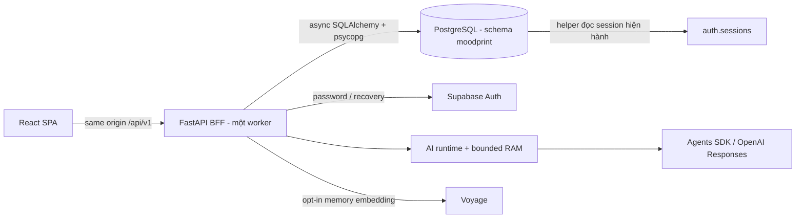
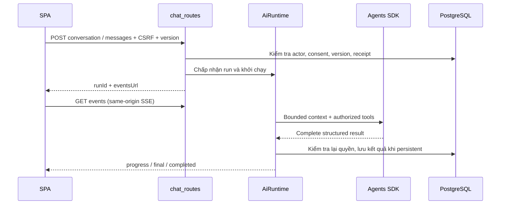

# Kiến trúc kỹ thuật MoodPrint

Cập nhật theo mã nguồn ngày **28/10/2026**. Tài liệu này mô tả hệ thống đã được triển khai trong repository; kết quả kiểm chứng nằm ở [docs/verification.md](docs/verification.md), hướng dẫn chi tiết ở [docs/](docs/README.md).

## 1. Phạm vi và mô hình triển khai

MoodPrint hỗ trợ trò chuyện với năm trợ lý, nhật ký cảm xúc, ghi nhớ do người dùng duyệt, hồ sơ tìm bạn, lời mời kết nối, nhắn tin, hoạt động chung và kiểm duyệt. Backend là **modular monolith** FastAPI. Frontend là SPA React 19/TypeScript/Vite, gọi BFF cùng origin qua `/api/v1`.

| Thành phần | Trách nhiệm | Nguồn |
| --- | --- | --- |
| SPA | Route, state hiển thị, xác nhận hành động, API/SSE | [main.tsx](frontend/src/main.tsx), [RealApp.tsx](frontend/src/features/real/RealApp.tsx) |
| FastAPI | Auth, authorization, DTO, transaction, nghiệp vụ, AI orchestration | [main.py](backend/app/main.py) |
| PostgreSQL/pgvector | Dữ liệu ứng dụng bền vững, version, receipts, embedding | [ORM](backend/app/infrastructure/database/models.py), [migrations](backend/alembic/versions/) |
| Supabase Auth | Kiểm tra mật khẩu, xác nhận email, khôi phục mật khẩu, provider session | [provider.py](backend/app/modules/auth/provider.py) |
| OpenAI Agents SDK | Model/tool loop có giới hạn; structured output | [provider.py](backend/app/ai/provider.py) |
| Voyage, tùy chọn | Embedding cho memory đã được duyệt và cho phép xử lý ngoài | [voyage.py](backend/app/ai/voyage.py) |
| Caddy/container | TLS, static SPA, reverse proxy, giới hạn topology | [compose staging](deploy/compose.staging.yml) |



Database và Supabase Auth phải thuộc cùng hệ thống session: trỏ Auth hosted vào database local độc lập không tạo được phiên hợp lệ. Không có Supabase JS client hay đường browser truy cập trực tiếp schema ứng dụng. Xem [Auth](docs/supabase/auth.md).

## 2. Cấu trúc repository

```text
frontend/src/
  api/                      HTTP, SSE, contracts, generated TypeScript
  components/               UI primitives, focus, motion policy
  companions/               Avatar và danh tính trình bày của trợ lý
  features/real/            Shell, AI chat, mood, memory, privacy, voice
    social/                 Discovery, public profile, human messaging
    activities/             Icebreaker, quiz, focus, activity dock
    admin/                  Moderation UI
  styles/                   Tokens, global CSS, shell styles
backend/app/
  core/                     Settings, security, limits, errors, streams
  infrastructure/database/ Connection, shared ORM, provider session helper
  ai/                       Runtime, provider, persistence, context, memory
  modules/                  Auth, users, consent, mood, profiles, social,
                            matching, activities, moderation, voice
  jobs/                     Bounded retention cleanup
backend/alembic/versions/    Chuỗi schema migration
backend/tests/              Unit, HTTP/API, PostgreSQL, synthetic server
backend/evals/              Offline/live AI eval và synthetic matching eval
frontend/tests/             Fixture E2E, fullstack, live/provider, visual
scripts/                    Kiểm tra config, contract, harness, migration review
deploy/                     Local/staging Compose, SQL review, AWS packaging
docs/                       Hướng dẫn theo subsystem
```

Các module dùng chung một database và transaction boundary. Thư mục không đồng nghĩa microservice. `app/ai/chat_routes.py` là router AI được `main.py` gắn hiện tại; không lấy mọi file có tên `routes.py` làm API đang chạy.

## 3. Hợp đồng và ranh giới request

Pydantic trong [contracts.py](backend/app/contracts.py) và các module schema định nghĩa DTO. API dùng tên trường camelCase; Python giữ snake_case. Chuỗi sinh hợp đồng:

```text
Pydantic + FastAPI routes
  -> scripts/export_openapi.py
  -> backend/openapi.json
  -> npm run contracts:generate
  -> frontend/src/api/generated/schema.d.ts
```

`ApiClient` thêm CSRF và `Idempotency-Key` cho authenticated writes, giữ lại key khi kết quả mạng/5xx chưa rõ. Server lưu receipt trong transaction khi operation hỗ trợ replay. Ghi có `expectedVersion` dùng optimistic concurrency để tránh ghi đè trạng thái cũ; phạm vi cụ thể do DTO/route quyết định.

Lỗi nghiệp vụ trả envelope `error.code/message/retryable/requestId`; không trả exception provider, SQL hoặc secret. Body thường tối đa 65.536 byte; đường voice tối đa 3.000.000 byte. Production tắt Swagger/OpenAPI public. Xem [API](docs/backend/api.md).

## 4. Danh tính, eligibility và consent

Đăng nhập qua backend gọi Supabase Auth. Browser nhận cookie opaque `moodprint_session` HttpOnly và CSRF cookie đọc được; không lưu provider JWT trong localStorage. Database giữ hash session/CSRF và liên kết provider session. `require_actor` kiểm tra session hiện hành; `lock_actor`/`verify_actor` kiểm tra lại tại boundary transaction. Helper SQL đọc sự tồn tại của session trong `auth.sessions`.

Tài khoản mới có age band `unknown`. Chính sách tự khai báo trong mã yêu cầu đủ 16 tuổi cho tính năng cá nhân; matching và tương tác người thật yêu cầu adult. Đây là self-declaration, không phải dịch vụ xác minh danh tính/tuổi.

| Purpose / preference | Tác dụng |
| --- | --- |
| `AI` | Cho phép dùng trợ lý AI |
| `MEM` | Ghi nhớ đã duyệt; phụ thuộc AI |
| `MATCH` | Public matching profile và social; yêu cầu adult |
| `VOICE` | Chuyển âm thanh thành chữ; phụ thuộc AI |
| `historyEnabled` | Tùy chọn lưu lịch sử AI, tách khỏi global capability |
| `semanticMemoryEnabled` | Tùy chọn embedding/retrieval bên ngoài, tách khỏi MEM |

Feature flag không tự bật consent. Rút quyền tăng version/invalidate context và chặn thao tác tiếp theo. UI ẩn nút chỉ là trải nghiệm; backend là authority. Chi tiết [security và Auth](docs/supabase/auth.md).

## 5. AI: run, transcript, context và memory

Năm bot (`may`, `guong`, `nhip`, `rure`, `caunoi`) dùng chung `AiRuntime`/`SdkProvider`, có instruction/tool policy khác nhau. Không phải năm process độc lập. Không có model-facing tool tự publish hồ sơ, tự gửi lời mời hoặc thực thi shell.



- **Transcript:** persistent chat lưu trong `ai_conversations/ai_messages` khi người dùng bật preference và capability cho phép. Temporary chat giữ nội dung trong RAM. Không được mô tả mọi transcript là RAM-only.
- **Model context:** là projection có version/policy, không phải toàn bộ transcript nhìn thấy. Giới hạn 24 message và 24.000 byte; cắt tại privacy boundary. Mood scope chỉ có hiệu lực trong lượt HTTP đã chọn.
- **Memory:** proposal cần người dùng confirm; memory active tách khỏi lịch sử. Semantic index chỉ xử lý memory đã được phép và có opt-in.
- **Events:** SDK delta/tool text được buffer nội bộ; browser chỉ nhận output validated. UI cần `final` hợp lệ và terminal `completed` trước khi coi thành công.

`store=False`, tracing disabled và no automatic provider retry là cấu hình client; không phải cam kết về retention hạ tầng của provider. Restart đánh dấu lượt đang chạy interrupted và không replay model call. Xem [runtime](docs/agents/runtime.md), [context-memory](docs/agents/context-memory.md).

## 6. Matching và social

Luồng public profile là draft → preview có hạn → publish có kiểm tra digest/version. Matching chỉ đọc payload của published profile hiện hành cùng eligibility/consent/counters. Không đọc private profile, mood, chat hoặc memory để chấm điểm.

`MATCHING_SCORER` hỗ trợ `v1`, `v2`, `shadow`; mặc định `Settings` là **v1**, ví dụ local MVP bật **v2**. V2 dùng taxonomy, trọng số xác định, threshold, giải thích bằng điểm chung thật và diversity re-ranking. API trả tối đa 5 candidate, nhãn định tính và opaque candidate ref, không trả phần trăm tương hợp hay user UUID để gửi trực tiếp.

Trước khi mint reference và trước thao tác pair, server kiểm tra lại quyền/consent/profile/block dưới lock. Canonical lock order: sorted users → pair → resource. Candidate ref hết hạn sau 15 phút; lời mời có hạn 7 ngày; cooldown cho skip/kết thúc/từ chối được áp dụng trong route/service. Profile publication và quyền tiếp tục dùng phòng đã mở có điều kiện khác nhau.

Kết nối mở mới cho phép gửi human message có client message ID và sequence. SSE social báo watermark/trạng thái để client tải projection mới; không coi event là nguồn thay thế authorization. Block, consent withdrawal, deletion và moderation có thể đóng quyền truy cập, kết thúc hoạt động chung. Xem [matching](docs/matching/README.md).

## 7. Hoạt động chung và moderation

`activities` có state machine thuần, handler riêng cho `icebreaker`, `coop_quiz`, `focus`. Route/service giữ lock, chạy transition, persist, tăng activity watermark. UI dùng server time cho focus timer; không quyết định thời điểm kết thúc bằng đồng hồ máy người dùng. Có active/invited/paused và terminal completed/ended/declined/cancelled/expired/aborted.

Identity field và reveal grant là dữ liệu riêng: người dùng chủ động cho phép từng trường. Moderation lưu report/evidence theo workflow; staff role được kiểm tra phía server, không lấy quyền từ public profile. `MODERATION_ADMIN_ENABLED=false` làm admin route không khả dụng. Xem [backend lifecycle](docs/backend/data-lifecycle.md).

## 8. Lưu trữ và vận hành

Schema private `moodprint` ngoài Supabase Data API. Authorization hiện tại dựa backend ownership/purpose/pair gates và runtime role tối thiểu; không tuyên bố đã có bộ RLS end-user cho schema này. Role migration tách runtime. ORM đặt `hide_parameters=True`, psycopg `prepare_threshold=None`.

Head hiện tại `0016_guest_foundation`; readiness chỉ chấp nhận giá trị trong `READY_REVISIONS` và yêu cầu provider-session helper. Không tự migration khi startup. Local Alembic runner từ chối remote host; hosted DDL đi qua SQL review/approval riêng. [Runbook migration](docs/supabase/migrations.md) giải thích database disposable và hosted workflow.

Topology được hỗ trợ là **một backend worker/một replica**: active runs, stream slots, limits và temporary context có state trong process. PostgreSQL locks không biến các state RAM đó thành shared state. Muốn scale cần shared ephemeral state, fencing, revocation và kiểm thử mới.

Lifespan khởi chạy sweeper và embedding worker. Cleanup có giới hạn batch; retention database đang hoạt động không chứng minh xóa khỏi backup/provider. Health live chỉ chứng minh process sống; ready kiểm tra database/revision/helper, không gọi live model. Log chỉ nên chứa request ID, error class và metric tổng hợp.

## 9. Kiểm chứng và giới hạn

CI tại [verify.yml](.github/workflows/verify.yml) chạy static analysis, PostgreSQL tests, migrations, contract drift, frontend unit/build/E2E, synthetic fullstack, SQL review integrity và packaging. [Development](docs/development.md) cung cấp lệnh chạy lại; [verification](docs/verification.md) ghi kết quả thực tế của lần cập nhật.

Live OpenAI/Voyage, hosted Auth/PostgreSQL, TLS/proxy trên staging, backup restore và đánh giá người thật cần cấu hình/đồng ý tương ứng. Không dùng fixture E2E hoặc fake SDK model để tuyên bố các tích hợp đó đã đạt.
