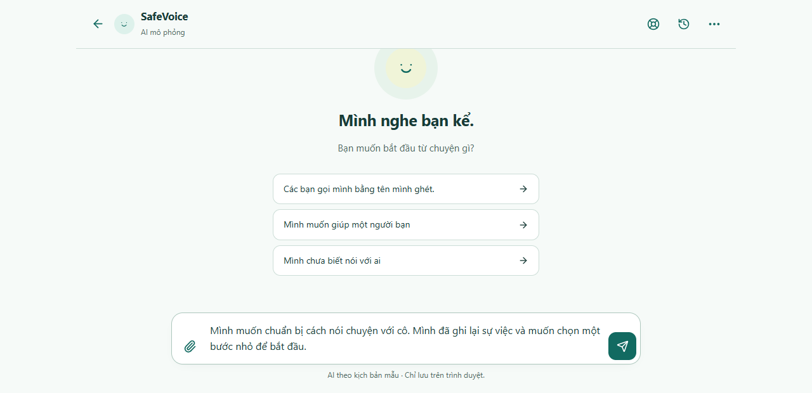
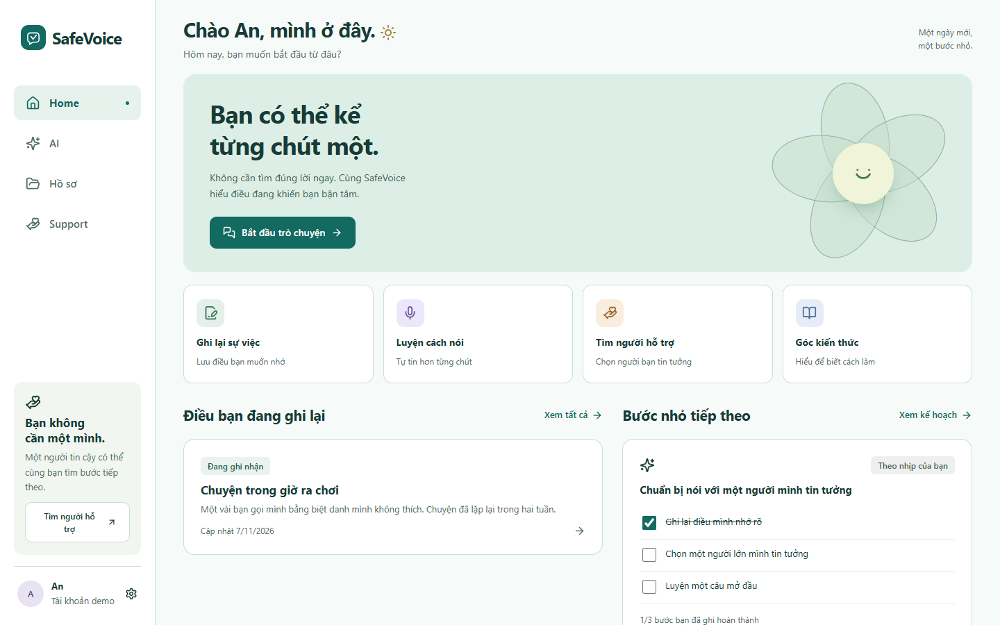
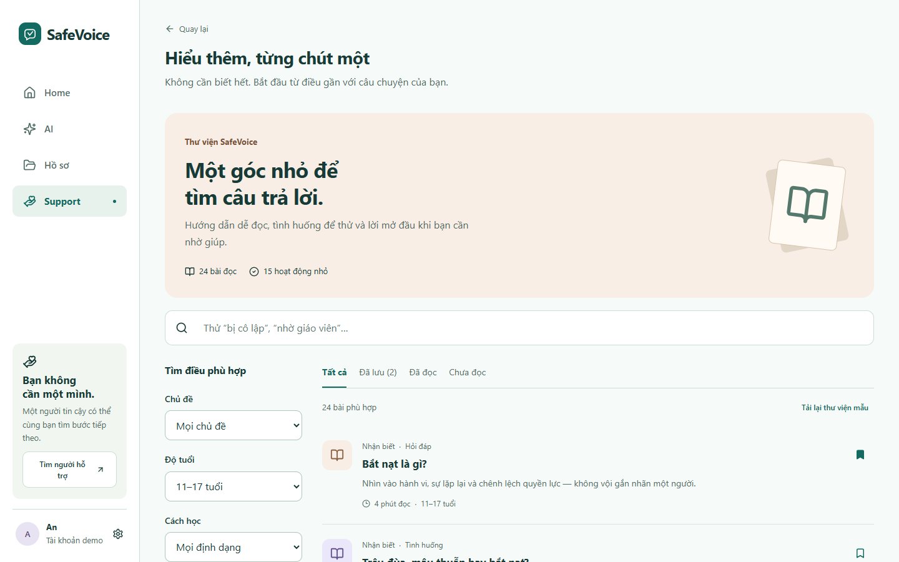
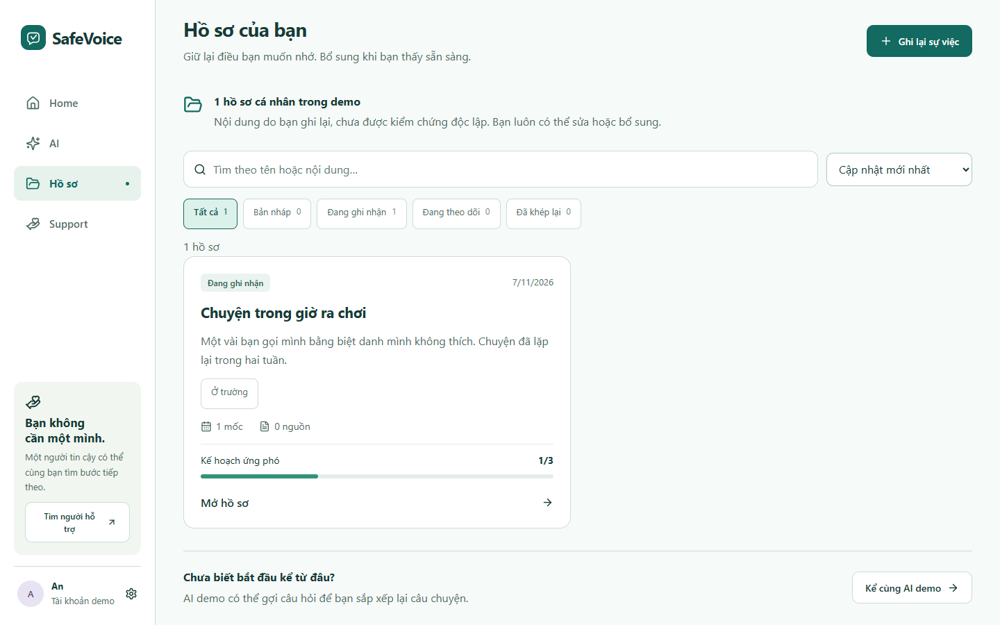
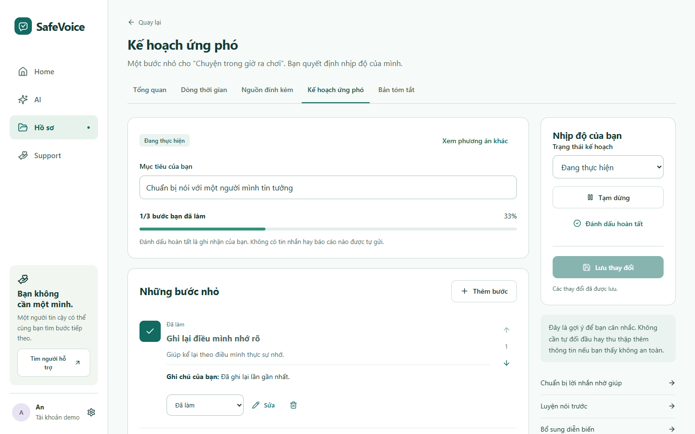
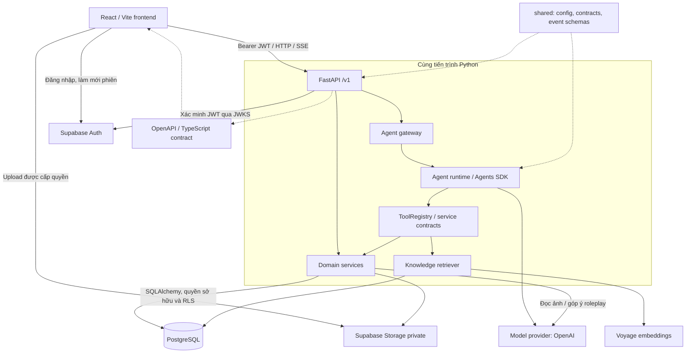

# SafeVoice

**Hiểu tình huống, ghi lại điều cần nhớ, chuẩn bị bước tìm hỗ trợ.**

Bắt nạt và bạo lực học đường có thể xảy ra trong lớp, ngoài sân trường hoặc trên mạng. Khi chưa biết gọi tên điều đang xảy ra hay mở lời với ai, học sinh cần một nơi để sắp xếp câu chuyện theo nhịp của mình.

SafeVoice là ứng dụng web tiếng Việt hướng tới học sinh 11–17 tuổi: trò chuyện để làm rõ tình huống, đọc kiến thức, ghi nhận sự việc, giữ bằng chứng và luyện cách nói với người lớn tin cậy. Khác với một chatbot độc lập, cuộc trò chuyện có thể nối với hồ sơ và kế hoạch cá nhân; các thao tác AI đề xuất cần người dùng duyệt trước khi lưu.

## Giao diện sản phẩm

<p align="center">
  
</p>

**AI Companion:** giao diện tập trung vào cuộc trò chuyện, với composer ở cuối màn hình. Ảnh demo thể hiện cuộc trò chuyện mới và **bản nháp chưa gửi**, chưa có phản hồi AI.

| Trang chủ | Knowledge Hub |
| --- | --- |
|  |  |
| Bắt đầu ghi nhận sự việc, tìm hỗ trợ hoặc tiếp tục kế hoạch. | Bài đọc đóng gói cùng ứng dụng; tra cứu nguồn qua API là phần riêng. |

| Hồ sơ sự việc | Kế hoạch ứng phó |
| --- | --- |
|  |  |
| Xem lại nội dung, trạng thái và các mốc đã ghi nhận. | Chia mục tiêu thành bước nhỏ, sửa và theo dõi tiến độ. |

Năm ảnh được chụp trực tiếp từ **frontend SafeVoice ở chế độ demo**, với nhân vật An và dữ liệu hư cấu lưu trong trình duyệt. Bộ ảnh không sử dụng FastAPI, Supabase hay provider trả phí và không chứng minh các luồng kết nối backend. School Admin không nằm trong bộ ảnh.

## Tính năng chính

| Tính năng | Cách dùng và phạm vi hiện có |
| --- | --- |
| **Tài khoản và Home** | Đăng ký, xác nhận email, đăng nhập, khôi phục mật khẩu; xem hồ sơ gần đây và tiến độ kế hoạch. Workspace kết nối tải dữ liệu qua API; demo độc lập lưu trong trình duyệt. |
| **AI Companion** | Kể chuyện bằng văn bản, mở lịch sử, nhận phản hồi streaming, xem nguồn tham khảo, dừng hoặc thử lại khi lỗi. Có công cụ lấy ngữ cảnh, đề xuất mốc/kế hoạch và bộ nhớ cần duyệt. Adapter kết nối là opt-in; model thật cần credential. |
| **Hồ sơ sự việc** | Tạo, sửa, lọc hồ sơ, thêm dòng thời gian và ghi chú; lưu bền qua FastAPI/PostgreSQL. Nội dung là lời ghi nhận của người dùng, không phải kết luận đã xác minh. |
| **Nguồn đính kèm** | Ghi chú, tệp riêng tư, upload có tạm dừng/tiếp tục và URL tải có thời hạn. Phân tích ảnh bằng AI cần đồng ý gửi ảnh; bản đọc và sửa được lưu riêng với bản gốc. Demo chỉ dùng tệp mẫu. |
| **Kế hoạch ứng phó** | Chọn phương án, sửa mục tiêu, thêm/sắp xếp bước, đánh dấu tiến độ và đặt ngày xem lại. Lưu kế hoạch không tự gửi báo cáo hay thông báo nhắc việc. |
| **Knowledge Hub** | 24 bài đọc đóng gói, bộ lọc, lưu bài và đánh dấu đã đọc. Tra cứu nguồn đã xuất bản qua API dùng kho tri thức riêng, cần corpus và cấu hình retrieval phù hợp. |
| **Luyện cách nói** | Roleplay bằng văn bản với vai giáo viên, phụ huynh hoặc người lớn tin cậy; lưu phiên và xem góp ý. Dùng ngữ cảnh hồ sơ khi người dùng cho phép. Model thật cần key; voice hiện mô phỏng, không thu microphone. |
| **Tìm hỗ trợ** | Quản lý người tin cậy, chuẩn bị lời nhắn, lưu nháp, sao chép hoặc tải `.txt` để tự chia sẻ. UI chưa hoàn tất hành trình gửi/rút bản chia sẻ tới trường; chưa có dịch vụ tự gửi email/SMS. |
| **School Admin** | `/demo/school` là không gian mô phỏng với dữ liệu riêng, chưa phải cổng quản trị kết nối vào hồ sơ học sinh. |

AI có thể sai và không thay thế người lớn tin cậy hoặc hỗ trợ chuyên môn. Trang `/support/urgent` mở được khi chưa đăng nhập và khi API không hoạt động; việc gọi số hỗ trợ luôn do người dùng chủ động.

## Công nghệ

| Thành phần | Công nghệ và vai trò |
| --- | --- |
| Frontend | **React 19, Vite 7, TypeScript**, React Router 7, Zustand; port/adapter tách UI khỏi HTTP và demo |
| Giao diện | CSS, Lucide React, GSAP; `thinking-orbs` cho trạng thái Agent, có giảm chuyển động |
| Backend | **Python 3.12, FastAPI**, Pydantic, SQLAlchemy async, asyncpg; JWT, domain services và SSE |
| Agent | **OpenAI Agents SDK 0.24**, tools, sessions, context, memory và approval; client OpenAI cho chức năng cần model |
| Dữ liệu | **Supabase Auth, PostgreSQL 17**, RLS, các schema `app`, `agent_store`, `knowledge`; Storage private và TUS upload |
| Retrieval | pgvector kết hợp tìm từ khóa; Voyage embeddings cho cấu hình thông thường; ingestion có phiên bản và kiểm tra citation |
| Kiểm thử | Vitest, Testing Library, Playwright, axe; pytest, pgTAP, Ruff, Pyright, import-linter |
| Workspace | uv, npm và lockfile; OpenAPI/JSON Schema cùng TypeScript contract được sinh |

## Kiến trúc hệ thống



**FastAPI import Agent như một package Python**, không gọi một dịch vụ Agent riêng. Backend sở hữu HTTP, JWT, transaction, upload và persistence; Agent sở hữu điều phối model, prompt, tools và các sự kiện public. Agent gọi nghiệp vụ qua contract được backend cung cấp, không import hạ tầng database của backend. Cách tách này cho phép kiểm thử runtime offline với cùng hợp đồng khi kết nối.

Frontend dùng Supabase Auth để quản lý phiên và capability do API cấp để upload Storage. Dữ liệu nghiệp vụ đi qua FastAPI. `shared/` giữ cấu hình và hợp đồng chung; OpenAPI cùng schema TypeScript giúp phát hiện sai lệch client/server.

## Cấu trúc repository

```text
SafeVoice/
├── frontend/
│   ├── src/features/          # Home, AI, hồ sơ, kế hoạch, kiến thức, hỗ trợ
│   ├── src/services/          # Ports, composition và HTTP adapters
│   ├── src/components/        # Layout và thành phần UI
│   ├── e2e/                   # Playwright: demo và local services
│   └── scripts/               # Boundary checks, capture và UI audit
├── backend/
│   ├── app/api/               # HTTP routes
│   ├── app/modules/           # Nghiệp vụ và Agent gateway
│   ├── app/infrastructure/    # Database, Auth, Storage
│   ├── app/jobs/              # Đối soát run, dọn evidence
│   └── tests/
├── agent/
│   ├── src/safevoice_agent/   # Runtime, tools, knowledge, memory, roleplay
│   ├── ingestion/            # Nội dung, manifest và corpus tổng hợp
│   ├── evals/                # Dataset, rubric và runner đánh giá
│   └── tests/
├── shared/                   # Config, contracts và schema dùng chung
├── supabase/                 # Local config, migrations, seed, pgTAP
├── scripts/                  # Khởi tạo local, quality gates, export, E2E
├── deploy/                   # Cấu hình đóng gói/triển khai tham khảo
├── .github/assets/readme/    # Chỉ chứa ảnh tĩnh của README
└── README.md                 # Giới thiệu và hướng dẫn chính
```

`scripts/ownership.json` và `scripts/dev/schema-manifest.json` là đầu vào máy đọc cho công cụ kiểm tra. README riêng của package giữ chi tiết chuyên biệt như ingestion và evals.

## Cài đặt và chạy local

Các lệnh ưu tiên **Windows PowerShell**. Trên macOS/Linux dùng `cd` thay `Set-Location`, `npm`/`npx` thay `npm.cmd`/`npx.cmd`. Wrapper `.cmd` tránh lỗi chặn `npm.ps1` trên Windows, không cần đổi execution policy.

### Cách 1 — Xem nhanh frontend demo

Cần Git và Node.js **22.12+**; CI dùng Node.js 24. Không cần Python, Docker, backend hay API key.

Thay `$RepositoryUrl` bằng URL clone hiện tại từ GitHub → **Code**; tên thư mục local luôn là `SafeVoice`, kể cả khi repository trên GitHub chưa đổi tên.

```powershell
$RepositoryUrl = "https://github.com/<owner>/<repository>.git"
git clone $RepositoryUrl SafeVoice
Set-Location SafeVoice/frontend
npm.cmd ci
npm.cmd run dev -- --config e2e/vite.demo.config.ts --port 5173 --strictPort
```

Mở **http://127.0.0.1:5173**, chọn **Bỏ qua** rồi **Vào thử với tài khoản demo**. School Admin ở `/demo/school`. Dừng bằng `Ctrl+C`.

Config demo không đọc `.env` root; dùng terminal chưa đặt các biến `VITE_PUBLIC_*` kết nối dịch vụ. Dữ liệu nằm trong `localStorage`; chat, phân tích ảnh và luyện nói dùng kịch bản dựng sẵn. Đổi host/cổng sẽ dùng vùng lưu khác. Chỉ nhập dữ liệu hư cấu khi trải nghiệm demo.

### Cách 2 — Ứng dụng đầy đủ với dịch vụ local

Cần **Python 3.12**, **uv**, Node.js/npm và Docker đang chạy. Supabase CLI **2.122.1** được script ghim và gọi qua `npx`; repo đã có cấu hình, không cần `supabase init`.

Từ root repository:

```powershell
uv sync --all-packages --all-extras --locked
Set-Location frontend
npm.cmd ci
npx.cmd playwright install chromium  # chỉ cần cho kiểm thử/chụp ảnh
Set-Location ..

uv run python scripts/dev/supabase_worktree.py start
uv run python scripts/dev/bootstrap_local_db.py
uv run python scripts/e2e_stack.py --project real --agent scripted
```

`start` khởi động Supabase và áp dụng migrations lúc tạo database. `bootstrap_local_db.py` cấp mật khẩu ngẫu nhiên cho role giới hạn `safevoice_api`, ghi credential vào **`.local/test.env`**, không đọc `.env` của người dùng. Seed mặc định không tạo tài khoản chung. Không dùng role `postgres` để chạy ứng dụng.

| Dịch vụ | Địa chỉ mặc định |
| --- | --- |
| Frontend | http://127.0.0.1:5178 |
| FastAPI / readiness / OpenAPI UI | http://127.0.0.1:8008/ready · http://127.0.0.1:8008/docs |
| Supabase Auth / Storage | http://127.0.0.1:54321 |
| PostgreSQL / Studio | `127.0.0.1:54322` · http://127.0.0.1:54323 |
| Hộp thư local | http://127.0.0.1:54324 |

Đường chạy này có Auth, API, PostgreSQL, Storage và Agent runtime thật; **model và embeddings là scripted/tổng hợp**, không mất phí provider. Harness chỉ nhận endpoint loopback, dùng environment riêng và không reset database. Hook seed có thể thay corpus knowledge đang published trong database local, nên dùng stack phát triển riêng.

Mở `/auth`, đăng ký bằng email hư cấu và xác nhận qua hộp thư local. Mở link xác nhận trong cùng browser/profile để giữ PKCE verifier, sau đó đăng nhập bằng email. Nút vào demo luôn chọn workspace demo, dù backend đang chạy.

Companion HTTP là opt-in. Với tài khoản kết nối, mở DevTools Console tại origin frontend, chạy rồi tải lại:

```javascript
localStorage.setItem("safevoice:ai-companion", "live");
location.reload();
```

`live` ở đây chọn adapter HTTP; model của harness vẫn scripted và chỉ trả lời các tình huống test xác định. Có thể bật adapter khi build bằng `VITE_PUBLIC_AI_COMPANION=live`.

**Kiểm tra:** tạo hồ sơ, tải lại trang và kiểm tra dữ liệu còn nguyên. `GET /health` trả `{"status":"ok"}`, `/ready` trả `{"status":"ready"}`. Readiness chỉ kiểm tra database/JWKS, chưa xác nhận provider, Storage hoặc chất lượng corpus.

**Dừng:** nhấn `Ctrl+C` để dừng harness/Vite/API, rồi:

```powershell
uv run python scripts/dev/supabase_worktree.py status
uv run python scripts/dev/supabase_worktree.py stop
```

Nếu cổng bận, dùng stack riêng với cùng tên/offset cho start, bootstrap, harness và stop:

```powershell
uv run python scripts/dev/supabase_worktree.py start --name dev --offset 500 --lite
uv run python scripts/dev/bootstrap_local_db.py --name dev --offset 500
uv run python scripts/e2e_stack.py --name dev --offset 500 --project real --agent scripted
# Dừng harness bằng Ctrl+C trước:
uv run python scripts/dev/supabase_worktree.py stop --name dev --offset 500
```

Ví dụ này dùng frontend/API 5678/8508, Supabase API/DB 54821/54822, mailbox 54824; `--lite` bỏ Studio. Credential ở `.local/stacks/dev/test.env`. `reset` của script Supabase xóa dữ liệu local và cần bootstrap lại; không cần reset khi chạy thường ngày.

### Factory thông thường và provider tùy chọn

Để chạy `app.main:create_app` ngoài harness, sao chép template nếu chưa có `.env`:

```powershell
if (-not (Test-Path .env)) { Copy-Item .env.example .env }
```

Template chứa placeholder hosted, **phải thay bằng giá trị local**. Lấy URL/key/runtime database URL từ `.local/test.env`, đặt `APP_ENV=development`, CORS đúng origin. Không sao chép credential vào README, issue hay ảnh.

| Nhóm biến | Cấu hình |
| --- | --- |
| Backend | `SUPABASE_URL`, `SUPABASE_PUBLISHABLE_KEY`, `SUPABASE_SECRET_KEY`, `DATABASE_URL` của role `safevoice_api`; `CORS_ALLOWED_ORIGINS` liệt kê origin được phép |
| Frontend công khai | `VITE_PUBLIC_SUPABASE_URL`, `VITE_PUBLIC_SUPABASE_PUBLISHABLE_KEY`, `VITE_PUBLIC_API_BASE_URL`; tùy chọn `VITE_PUBLIC_AI_COMPANION=live` |
| Provider bí mật | `VOYAGE_API_KEY` cho retrieval mặc định; `OPENAI_API_KEY` cho model thật |
| Quản trị/test | `SUPABASE_DB_URL` là kết nối đặc quyền cho migration; `TEST_*` do bootstrap cấp cho local tests; không đưa vào browser |

**Mọi biến `VITE_PUBLIC_*` được đưa vào bundle.** Chỉ URL và publishable key được dùng ở frontend; secret key, database password và provider key ở server. Khởi động lại Vite sau khi sửa env. Model, timeout, budget và retrieval tuning nằm trong [config.py](shared/src/safevoice_shared/config.py); `APIFY_API_TOKEN` chưa có tích hợp hoạt động trong luồng hiện tại.

Factory mặc định dùng pgvector và **cần Voyage key ngay khi khởi động**, không tự chuyển sang fixture. OpenAI key có thể để trống nếu không dùng chức năng model; đường AI tương ứng sẽ báo chưa sẵn sàng. Có key chưa đồng nghĩa đã có corpus: pipeline `plan → build → embed → store → validate → publish` nằm tại [knowledge ingestion](agent/ingestion/README.md). Bước Voyage có thể mất phí và cần ledger/ngân sách; onboarding ngân sách còn thao tác thủ công. Không trộn embeddings hashing của E2E với corpus Voyage.

### Cập nhật môi trường đã có khi đổi tên

Package Python hiện dùng `safevoice-agent`, `safevoice-shared`, `safevoice-backend`; chạy lại `uv sync --all-packages --all-extras --locked` sau khi cập nhật code. Các biến phục vụ stack và eval dùng tiền tố `SAFEVOICE_`.

Database tạo mới từ migrations dùng role `safevoice_api`. Với database đã triển khai, thay đổi mã nguồn không tự đổi role đang tồn tại: quản trị viên cần đổi tên role runtime hiện tại sang `safevoice_api`, cập nhật comment của `knowledge.source_confidential` thành `safevoice:private_ingestion`, rồi cập nhật username và credential tương ứng trong `DATABASE_URL`. Không reset database đang có dữ liệu chỉ để đổi tên. `.env` riêng và database hosted không được sửa tự động.

Khóa lưu trữ trình duyệt hiện dùng tiền tố `safevoice`. Dữ liệu demo và tùy chọn cũ không tự chuyển sang khóa mới; dữ liệu tài khoản kết nối vẫn nằm trong database. Việc đổi tên repository trên GitHub và thư mục checkout là thao tác riêng với thay đổi nội dung code.

Khi đã chủ động cấu hình provider và corpus, dùng hai terminal:

```powershell
# Terminal 1: root, FastAPI dùng .env
uv run uvicorn app.main:create_app --factory --host 127.0.0.1 --port 8000
```

```powershell
# Terminal 2: root
Set-Location frontend
npm.cmd run dev -- --port 5173 --strictPort
```

Đặt `CORS_ALLOWED_ORIGINS=http://127.0.0.1:5173`, `VITE_PUBLIC_API_BASE_URL=http://127.0.0.1:8000` và hai biến Supabase public tương ứng. Khi bật provider, chat, đọc ảnh, roleplay, trích xuất memory hoặc nén session có thể phát sinh phí. Các ảnh và kiểm tra trong tác vụ này không dùng provider trả phí.

## Cách hệ thống hoạt động

- **Xác thực và API:** Supabase Auth quản lý đăng ký, PKCE và phiên. Client gửi Bearer token tới FastAPI; backend xác minh JWT ES256/JWKS, thời hạn và danh tính. Khi hết phiên, UI yêu cầu đăng nhập lại; cache và dữ liệu demo được tách theo workspace.
- **Hội thoại:** API kiểm tra owner, mở run và chuyển yêu cầu tới Agent gateway. Runtime dùng Agents SDK để stream câu trả lời/công cụ qua SSE; backend lưu trạng thái để mở lại hoặc khôi phục lượt bị gián đoạn. Frontend chỉ hiển thị sự kiện public, không hiển thị suy luận riêng hay payload nội bộ.
- **Tools, session và bộ nhớ:** tools đọc ngữ cảnh hồ sơ, tra cứu kiến thức hoặc tạo đề xuất. Công cụ ghi dữ liệu phải qua phê duyệt; đóng hộp thoại không đồng nghĩa đồng ý. Lịch sử SDK và bộ nhớ lâu dài là hai phần riêng: người dùng xem/sửa/từ chối gợi ý, quản lý hoặc xóa điều đã lưu.
- **Knowledge:** corpus có phiên bản, chunk và metadata nguồn. Retriever tìm trong bản đã publish bằng vector/từ khóa; citation được đối chiếu trước khi gửi về UI. Bài đọc đóng gói ở Knowledge Hub và trạng thái đã đọc/lưu bài hoạt động độc lập với corpus này.
- **Hồ sơ và kế hoạch:** services quản lý lời ghi nhận, mốc sự việc và các bước ứng phó; AI chỉ đề xuất. Kiểm tra version và owner ngăn ghi đè hoặc gắn dữ liệu của tài khoản khác.
- **Bằng chứng:** API cấp quyền upload giới hạn; browser tải vào Storage private qua TUS rồi gọi finalize. Bản gốc giữ riêng với derivative/bản đọc AI; signed download URL hết hạn. Phân tích ảnh kiểm tra owner và consent trước khi gửi ảnh tới provider.
- **Ranh giới quyền:** role database giới hạn và transaction có danh tính người dùng kết hợp kiểm tra service với RLS. API chia sẻ chỉ cho xem nội dung đã chọn với membership phù hợp, không đọc toàn bộ hồ sơ cá nhân. Xóa tài khoản là quy trình nhiều bước giữa Auth, Storage và database; phải xử lý run AI đang hoạt động trước.

## Kiểm thử

Sau khi cài dependency, từ root:

```powershell
uv run python scripts/check.py
uv run python scripts/export_contract_schemas.py --check
uv run python scripts/export_openapi.py --check

# Chạy riêng theo package:
uv run python -m pytest shared/tests -q
uv run python -m pytest backend/tests -q
uv run python -m pytest agent/tests -q
uv run python -m pytest scripts/db/tests scripts/tests -q
```

`check.py` chạy Ruff lint/format, Pyright, import-linter rồi toàn bộ pytest offline. Pytest mặc định loại marker `integration` và `live_agent`; scripted/fake provider kiểm tra logic điều phối, không chứng minh chất lượng model thật.

Trong `frontend/`:

```powershell
npm.cmd run typecheck
npm.cmd run lint
npm.cmd run format:check
npm.cmd test -- --maxWorkers=2
npm.cmd run build
npm.cmd run check:boundaries
npm.cmd run test:e2e -- --project=demo --workers=2
```

Demo E2E tự khởi động Vite cô lập tại cổng 5178 và cần Chromium đã cài. Boundary check kiểm tra credential patterns trong nguồn/bundle và giới hạn SDK/HTTP. Chỉ chạy `npm.cmd run gen:api` khi chủ động sinh lại TypeScript từ OpenAPI; lệnh này ghi file generated.

Kiểm tra cần **Supabase local**, từ root sau start/bootstrap:

```powershell
uv run python scripts/dev/supabase_worktree.py test
uv run --env-file .local/test.env python -m pytest -m "integration and not live_agent" -q
uv run python scripts/e2e_stack.py --run --project real --agent scripted
# Chỉ các luồng AI:
uv run python scripts/e2e_stack.py --run --project real --agent scripted --grep E-AG
```

pgTAP kiểm tra schema/grants/RLS. Integration và E2E tạo/xóa dữ liệu hư cấu trên loopback. Project Playwright `real` dùng Auth/Storage/database thật, **model vẫn scripted**; chỉ truyền `--project=real` vào Playwright trực tiếp chưa đủ để khởi động stack. Có thể thêm `--name`/`--offset` cho stack riêng. Report/traces ở `.local/e2e/`; ảnh QA nằm trong output của test, không ghi vào thư mục ảnh README.

Các eval live, `pytest -m live_agent` và Voyage embeddings cần credential/quyền model/ngân sách và có thể mất phí. Nhánh `--agent live` của harness hiện chưa truyền credential provider xuống tiến trình con; để dùng provider thật, chạy factory thông thường như hướng dẫn trên. Đọc [Agent evals](agent/evals/README.md) và [knowledge benchmark](agent/evals/knowledge/README.md) trước khi chạy. Scripted tests không thay cho đánh giá đó.

**Xác minh:** 1.731 test Python offline (157 ca integration/live được loại theo cấu hình), 166 test frontend và 26 E2E AI đạt; đã chạy lại 4 ca responsive/accessibility và 2 ca chụp approval/memory. Đã kiểm tra desktop, mobile 360–430px, tablet, lịch sử dài, câu trả lời dài, composer nhiều dòng, thinking, hủy và bàn phím/focus. Ảnh QA có fixture được giữ riêng, không dùng trong showcase. Typecheck, ESLint, build, boundaries, Ruff, Pyright và import-linter đạt. Prettier toàn bộ frontend đạt; `.gitattributes` giữ LF cho các tệp văn bản frontend khi checkout trên các nền tảng. jsdom cảnh báo thiếu Canvas khi test orb.

### Xử lý lỗi thường gặp

| Hiện tượng | Kiểm tra |
| --- | --- |
| PowerShell chặn `npm.ps1` | Dùng `npm.cmd` / `npx.cmd`. |
| Docker chưa sẵn sàng / cổng bận | Khởi động Docker Desktop, xem `supabase_worktree.py status`, dùng stack name/offset khác nếu cần. |
| `Voyage API key is required` | Factory mặc định cần Voyage; dùng harness scripted để kiểm tra local không trả phí. |
| 401 / không vào được tài khoản | Xác nhận email local, kiểm tra URL/key cùng stack, đăng nhập lại; không dùng anonymous token. |
| CORS / link email sai địa chỉ | Khớp host, port, CORS và Auth redirect; `localhost` khác `127.0.0.1`. |
| Đăng nhập thật nhưng AI vẫn mô phỏng | Bật Companion HTTP; nút vào demo luôn dùng mô phỏng. |
| Runtime login lỗi sau reset | Bootstrap lại rồi khởi động API/harness với environment mới. |
| Knowledge không có kết quả | Kiểm tra version đã publish và embedder tương ứng; readiness không kiểm tra corpus. |
| Upload dừng / URL tệp hết hạn | Kiểm tra upload/finalize; tiếp tục hoặc xin URL mới qua API. Không dùng signed URL làm liên kết vĩnh viễn. |
| uv/cache không truy cập được | Có thể đặt `$env:UV_CACHE_DIR = "$PWD/.local/uv-cache"`; pytest hỗ trợ `-o cache_dir=.local/pytest-cache`. |
| Format check không đạt | Chạy Prettier với `--write` trên file báo lỗi, rồi chạy lại `npm.cmd run format:check`. Giữ quy tắc LF trong `.gitattributes`. |

## Trạng thái và giới hạn

Ứng dụng có các luồng local kết nối cho Auth, hồ sơ, kế hoạch, evidence, retrieval và Agent với approval/memory. Demo trình duyệt, School Admin và voice là các phần mô phỏng được ghi nhãn. Hỗ trợ qua UI hiện dừng ở chuẩn bị/lưu nháp/tự chia sẻ; chưa có thông báo tự động tới trường hay người nhận.

Chat kết nối hiển thị văn bản và nguồn tham khảo; hiện không có renderer Markdown riêng. Tệp và phân tích ảnh đi qua luồng evidence/consent, không phải nút tải tệp trực tiếp trong composer. Bộ ảnh không có model trả phí: ảnh cho thấy UI và dữ liệu kết nối, không khẳng định đã kiểm chứng phản hồi live.

Provider thật, pipeline Voyage đầy đủ và hosted deployment chưa được xác minh trong tác vụ này. Các công cụ `scripts/db/*` cho hosted có guard/project riêng, không phải onboarding chung; không dùng test/bootstrap/reset local với hosted. Trước khi dùng với dữ liệu học sinh thật cần đánh giá chất lượng AI, quy trình hỗ trợ, quyền vận hành và bảo vệ dữ liệu ở môi trường triển khai.
