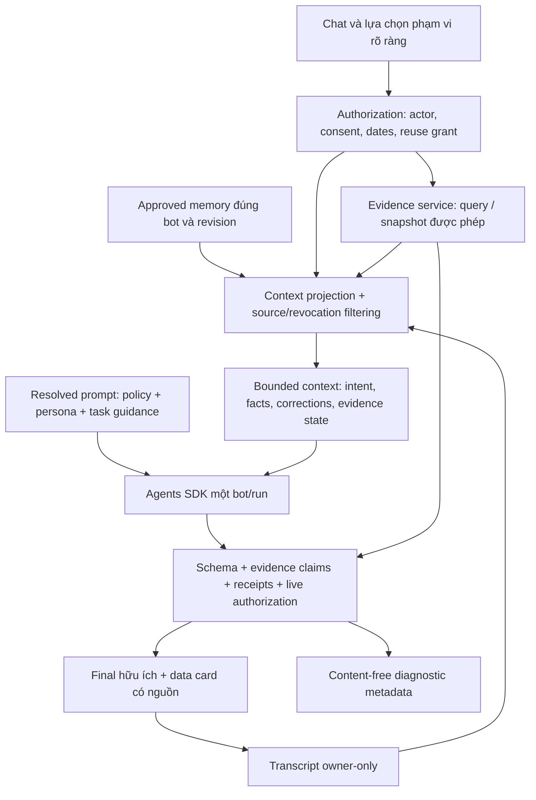

# Audit AI Agent Prompts, Data Grounding & Conversational Quality

Ngày audit: **26/10/2026, Asia/Bangkok**. Repository được kiểm tra: `E:\MoodPrint`, commit **`779db2a`**, nhánh gốc `dev`. Các worktree khác không phải đối tượng audit. Báo cáo này chỉ phân tích và đề xuất; **không có thay đổi application code, prompts, schema, cấu hình hoặc deployment**.

## 1. Executive Summary — Tóm tắt điều hành

**Đánh giá tổng thể: PARTIAL — nền tảng phân quyền tương đối chặt, nhưng tính liên tục của evidence giữa các lượt chưa đáp ứng hội thoại phân tích dữ liệu.** Audit đã hoàn thành ở mức mã nguồn và kiểm thử local tổng hợp. Chưa đủ bằng chứng để kết luận nguyên nhân chính xác của sự cố production, hoặc chứng nhận chất lượng model hiện đang triển khai.

Vấn đề không chỉ nằm ở system prompt. Frontend chủ động tiêu thụ quyền đọc mood sau một lần gửi. Backend dựng lại danh sách tools cho từng run, trong khi history chỉ giữ lời người dùng và lời bot, không giữ kết quả tool có provenance. Model ở lượt kế tiếp có thể thấy các con số mà chính nó từng nói, nhưng không có evidence tương ứng để kiểm tra hoặc biết rõ quyền tái sử dụng. Prompt lại yêu cầu hướng dẫn chọn ngày khi thiếu tool và nói dữ liệu ít khi `insightAvailable=false`. Các lớp này kết hợp tạo điều kiện cho lời phủ nhận gây mâu thuẫn.

Một vấn đề độc lập cần ưu tiên: **MEM đã tắt vẫn có thể được chuyển tiếp gián tiếp qua lời bot trong saved history**. Reproduction local xác nhận canary từ approved memory xuất hiện trong model input của lượt sau khi MEM bị rút, dù retrieval mới đã bị chặn. Đây là tái gửi dữ liệu của chính người dùng qua transcript, không phải bằng chứng truy cập chéo người dùng hoặc sự cố production đã xảy ra.

### Danh mục phát hiện

| ID | Mức độ | Trạng thái | Phát hiện | Độ tin cậy |
|---|---|---|---|---|
| F01 | High | CONFIRMED | Quyền mood theo lượt thay đổi nhưng thiếu contract rõ cho follow-up và việc dùng lại thống kê | Cao về cơ chế; vừa về liên hệ production |
| F02 | High | CONFIRMED | Mất provenance của tool qua lượt; output không kiểm chứng numerical claims | Cao |
| F03 | High | CONFIRMED | Nội dung từ MEM đã thu hồi vẫn đi vào model qua saved assistant history | Cao; reproduction local |
| F04 | Medium | CONFIRMED | `insightAvailable` gộp khả năng mô tả, quan sát và suy luận vào một cờ đếm bản ghi | Cao về contract; vừa về tác động ngôn ngữ |
| F05 | Medium | CONFIRMED | Lỗi domain/tool trong run mất phân loại hữu ích khi trả về UI | Cao |
| F06 | Medium | CONFIRMED | Context chỉ là suffix văn bản; mất source/version và có thể mất lời sửa còn cần thiết | Cao về cơ chế; vừa về tần suất tác động |
| F07 | Medium | LIKELY | Chính sách giọng hội thoại không đồng nhất; Mây đang dùng baseline ít hướng dẫn thích ứng hơn | Cao về selection; vừa về chất lượng hiện tại |
| F08 | Medium | CONFIRMED | Eval chất lượng chính không có tools/multi-turn; thiếu regression cho sự cố Nhịp | Cao |
| F09 | Medium | CONFIRMED | Guardrail thành công giả bỏ sót diễn đạt khác và chặn nhầm câu vô hại | Cao; reproduction local |
| F10 | Low | CONFIRMED | Default của prompt content và version không cùng quy tắc; metadata runtime chưa đủ để truy nguyên | Cao; không xác nhận runtime đang gắn sai version |

**Tổng: 10 findings — Critical: 0; High: 3; Medium: 6; Low: 1.** Có 9 CONFIRMED và 1 LIKELY. Các giả thuyết riêng của incident ở mục 3 không được cộng thêm vào số findings.

Năm cải tiến ưu tiên:

1. Chốt contract phân biệt **đọc lại dữ liệu**, **dùng snapshot đã được phép**, **nhắc tới phát ngôn trước**, và **thu hồi quyền**; giữ per-turn read mặc định.
2. Tạo evidence snapshot có nguồn, thời điểm, phạm vi và capabilities; kiểm chứng claims số liệu bằng backend.
3. Chặn dữ liệu nguồn đã thu hồi quay lại qua transcript; giữ quyền xem lịch sử tách biệt quyền gửi lịch sử cho model.
4. Thay `insightAvailable` bằng khả năng mô tả/so sánh/suy luận cụ thể, để dữ liệu thưa vẫn có câu trả lời hữu ích.
5. Thêm regression ba lượt Nhịp và eval qua runtime thật với consent chuyển trạng thái; sau đó mới điều chỉnh personas dựa trên review tiếng Việt của con người.

## 2. Current Architecture — Kiến trúc hiện tại

### Stack và ranh giới đã xác minh

`README.md`, `backend/pyproject.toml`, `frontend/package.json` và môi trường đã cài cho thấy React/Vite/TypeScript ở frontend; FastAPI/Pydantic v2, SQLAlchemy async + psycopg ở backend; Supabase PostgreSQL/Auth theo thiết kế; OpenAI Agents SDK Python cho cả năm bot. Interpreter test local là **Python 3.12.13**, `openai-agents=0.24.0`, `openai=3.37.0`. Không suy ra model production từ các version thư viện này. Build hiện tại báo Vite **7.3.7**; manifest cho phép dải version.

Chỉ có một bot hoạt động trong mỗi run. Không thấy handoff tự động hoặc một mạng agent phối hợp trong đường chat chính. `navigate_bot` chỉ là card điều hướng. SDK quản lý vòng model/tool trong run; ứng dụng tự quản conversation, consent, persistence, retrieval, budget và SSE. Không truyền SDK `session` hoặc `previous_response_id` trong `Runner.run_streamed`; không có cơ sở cho rằng SDK tự nhớ kết quả tool giữa hai HTTP turns.

### Đường thực thi frontend → phản hồi cuối

```mermaid
sequenceDiagram
    participant U as Người dùng / RealApp
    participant H as chat_routes.send
    participant R as AiRuntime.drive
    participant P as SdkProvider / Agents SDK
    participant D as PostgreSQL
    U->>H: POST messages(text, version, clientMessageId, moodScope?)
    H->>D: Kiểm session, tuổi, AI consent, idempotency, quota
    H->>D: Ghi AiRun/AiTurn; ghi user text nếu persistent
    H-->>U: 202 + eventsUrl
    H->>R: LiveRun(mood_scope của đúng request)
    R->>D: Lấy approved memories đúng owner/bot/quyền
    R->>P: instructions + bounded text history + tools của run
    opt Nhịp có mood_scope và model chọn tool
        P->>R: read_mood_summary({})
        R->>D: Kiểm lại quyền; đọc dates/scores/versions của owner
        R-->>P: count/mean/buckets/sourceVersions/insightAvailable
    end
    P-->>R: AiOutput đã qua schema + output guardrail
    R->>D: Kiểm lại live policy; ghi assistant text/cards nếu persistent
    R-->>U: SSE final rồi completed
    Note over U,R: Lượt sau dựng lại history và tools; không mang tool result cũ
```

| Thành phần | Trách nhiệm thực tế và vị trí |
|---|---|
| Chat UI | `Chat` trong [RealApp.tsx](../frontend/src/features/real/RealApp.tsx#L691): chọn thread, ngày, consent xử lý ban đầu, gửi request, reset `shareMood`, nhận SSE |
| API client/SSE | [stream.ts:48](../frontend/src/api/stream.ts#L48), `consumeAIEvents`: kiểm event ordering/schema, chỉ trả final sau completed, không render raw provider deltas |
| Router chính | [main.py:235](../backend/app/main.py#L235) đăng ký chat/memory/mood/consent và các domain dưới `/api/v1`; `ai/routes.py` hiện chỉ compatibility import |
| Admission | [chat_routes.py:316](../backend/app/ai/chat_routes.py#L316), `send`: owner/session, AI consent, version, `mood_scope`, idempotency gắn cả text và scope, chặn run trùng, quota, tạo `LiveRun` |
| Orchestrator | [runtime.py:411](../backend/app/ai/runtime.py#L411), `AiRuntime.drive`: retrieval → history → provider → validation → live-policy fence → persistence/emission |
| Model adapter | [provider.py:135](../backend/app/ai/provider.py#L135), `SdkProvider.run/_stream`: tạo `Agent`, compose instructions, register tools, `AiOutput`, guardrail; timeout 30 giây, không retry |
| Tools | [runtime.py:332](../backend/app/ai/runtime.py#L332), `AiRuntime.tools`: `propose_memory`, `propose_private_item`, `read_mood_summary`; allowlist theo bot và scope |
| Mood producer | [mood/service.py:19](../backend/app/modules/mood/service.py#L19), `selected_summary`: lọc owner/range, chỉ scores/dates/versions, không notes |
| Prompt selection | [prompts.py:23](../backend/app/ai/prompts.py#L23), `SELECTED_VARIANTS`, `instructions`, `prompt_version`; public bot registry riêng ở `registry.py` |
| Context | [context.py:12](../backend/app/ai/context.py#L12), `build_history`: tối đa 24 messages và 24.000 UTF-8 bytes; sau đó thêm tối đa 10 memory strings nếu còn chỗ |
| Conversation tạm | [store.py:34](../backend/app/ai/store.py#L34), `ConversationStore`: RAM, owner + session, idle TTL mặc định 86.400 giây; mất khi worker/restart làm mất RAM |
| Saved history | [persistence.py:58](../backend/app/ai/persistence.py#L58), `conversation_view/load_runtime_conversation`: PostgreSQL, trang mới nhất 40 messages cho runtime rồi bị context cap 24; UI có pagination riêng |
| Memory | [memory.py:53](../backend/app/ai/memory.py#L53), `create_proposal/confirm/edit_memory/delete_memory`; proposal preview 15 phút, approve riêng, receipt/idempotency và consent-version checks |
| Retrieval | [embeddings.py:439](../backend/app/ai/embeddings.py#L439), `retrieve_memories`: approved active same-owner/same-bot, source revision còn hợp lệ; lexical fallback hoặc Voyage theo opt-in, kiểm lại quyền sau outbound call |
| Live authorization | [security.py:91](../backend/app/core/security.py#L91), `lock_actor/verify_actor/assert_purpose`; `runtime.check` đối chiếu data version/run/worker, monitor mỗi 0,5 giây và kiểm trước final |
| Metadata/errors | `accounting.py`, `usage.py`, [availability.py:31](../backend/app/ai/availability.py#L31); usage ledger tùy cấu hình, public failure không đưa raw exception body ra UI |

### Giới hạn và điểm mạnh cần giữ

- SDK `max_turns=3`, hooks tối đa 3 model calls/2 tool calls; `parallel_tool_calls=False`, output cap 1.200 tokens. `AsyncOpenAI.max_retries=0` và `ModelRetrySettings(max_retries=0)` đều được đặt rõ ([provider.py:121](../backend/app/ai/provider.py#L121), [provider.py:182](../backend/app/ai/provider.py#L182)). Không có retry sửa nội dung hội thoại tự động sau guardrail.
- `store=False`, tracing disabled và buffering là lựa chọn có thật trong adapter. Chúng không tự chứng minh toàn bộ chính sách lưu dữ liệu của nhà cung cấp.
- Schema cấm extra fields; model không thể tự thêm receipt/action vào DTO. Các tools hiện tại không có thao tác gửi invitation, kết nối, publish hay ghi mood.
- Saved history opt-in, conversation mới tối đa 30 ngày theo ứng dụng; history và semantic memory có hai preference riêng. Không nhầm lịch sử UI với toàn bộ context model nhìn thấy.
- `read_mood_summary` có JSON schema rỗng và backend từ chối arguments khác `{}`. Model không tự chọn `owner`, ngày hoặc notes. Database có unique constraint `(user_id, local_date)`, nên cách tính mean theo số rows không có lỗi trùng ngày trong schema hiện tại ([models.py:124](../backend/app/infrastructure/database/models.py#L124)).

## 3. Production Incident Analysis — Phân tích sự cố Nhịp

### Tái dựng có giới hạn

Nguồn incident là mô tả do người dùng cung cấp: lượt 1 có 2/7 ngày (20/10 điểm 3; 26/10 điểm 2; trung bình 2,5), lượt 2 “Bạn cứ nhận xét đi” bị phủ nhận quyền truy cập, lượt 3 “Nhìn lại tuần” lặp số liệu. **Không có production transcript gốc, request bodies, tool trace, deployed commit, model snapshot hoặc consent-event sequence trong phạm vi bằng chứng nhận được.** Không coi lời mô tả là trace đã được kiểm chứng.

Reproduction local dùng ngày **20–26/10/2026**, hai Mood records synthetic và SDK `ScriptedModel`; cả conversation tạm và saved conversation đều được thử. Chọn scope lần lượt `[có, không, có]` cho ba HTTP turns. Kết quả:

| Lượt | Model tools/input được quan sát | Kết quả chứng minh được |
|---|---|---|
| 1 | Có `read_mood_summary`; vòng model thứ hai nhận tool result với `sourceVersions` | `count=2`, `mean=2.5`, 7 buckets, 5 nulls, `insightAvailable=false`; không có private note |
| 2 | Không có `read_mood_summary`; history vẫn chứa lời assistant với các con số | Không còn `function_call_output` hay `sourceVersions` trong input mới |
| 3 | Có lại tool sau khi request gửi lại scope | Có thể đọc lại cùng nguồn và nhận lại cùng thống kê |

**Đây là reproduction của đường dữ liệu, không phải reproduction lời phủ nhận bằng model thật.** Lời đáp synthetic được chủ động lập trình để quan sát SDK inputs; không dùng lời đáp đó làm bằng chứng naturalness hoặc xác suất hallucination.

### F01 — Quyền đọc theo lượt không có contract follow-up đầy đủ

**High · Context/authorization UX · CONFIRMED · Complexity: M.**

- **Quan sát và bằng chứng:** [RealApp.tsx:870](../frontend/src/features/real/RealApp.tsx#L870) chỉ gửi `moodScope` khi được chọn; [dòng 935](../frontend/src/features/real/RealApp.tsx#L935) reset ngay sau accepted request. UI nói “Bạn chọn lại quyền này cho mỗi lượt” ([dòng 1137](../frontend/src/features/real/RealApp.tsx#L1137)). `chat_routes.send` đưa scope của request vào `LiveRun` ([dòng 442](../backend/app/ai/chat_routes.py#L442)); `AiRuntime.tools` chỉ register mood tool khi scope khác `None` ([runtime.py:392](../backend/app/ai/runtime.py#L392)). Reproduction xác nhận cả hai chế độ history.
- **Nguyên nhân:** per-turn authorization là chủ đích hợp lý, nhưng chưa có state phân biệt “chưa được đọc lại lượt này”, “snapshot trước còn được dùng”, “nguồn bị thu hồi” và “thật sự chưa từng có dữ liệu”. Tool presence trở thành tín hiệu ngầm để model tự giải nghĩa.
- **Tác động:** follow-up ngắn dễ bị xử lý như yêu cầu hoàn toàn mới; model có thể phủ nhận quá khứ hoặc bắt người dùng chọn lại mà không giải thích mạch hội thoại. Liên hệ với lời phủ nhận production là **LIKELY**, không phải kết luận đã truy ra đúng run.
- **Giải pháp:** R1/R2 ở mục 9: giữ read mặc định từng lượt, truyền runtime evidence state rõ ràng; nếu muốn cho dùng lại snapshot thì phải có consent riêng, nhìn thấy được và có thể thu hồi. Không tự giữ checkbox bật hoặc coi câu “cứ nhận xét” là scope grant.
- **Kiểm chứng:** T01–T05 ở mục 11; kiểm cả API request, tools được expose và lời giải thích khi không được đọc lại.

### Đánh giá 10 giả thuyết ban đầu

| Giả thuyết | Kết luận theo repository | Phần chưa biết |
|---|---|---|
| H1: tool không nhất quán qua lượt | CONFIRMED: thay đổi có chủ đích theo `mood_scope`, không phải register ngẫu nhiên | Scope thật của incident |
| H2: consent hết sau một lượt | CONFIRMED với per-turn mood read; **AI/MEM consent tổng không tự hết sau mỗi tin** | Có thay đổi consent thật hay không |
| H3: context/tool results khác nhau | CONFIRMED qua reproduction | Input production chính xác |
| H4: tool result không được giữ | CONFIRMED: chỉ tồn tại trong SDK run, không được đưa sang turn tiếp | Có nhánh deployment khác không |
| H5: history có số liệu thiếu provenance | CONFIRMED qua reproduction | Số liệu lượt 1 có thực sự từ tool không |
| H6: model hiểu sai sufficiency | LIKELY do F04 và cách viết prompt | Cần real-model replay có kiểm soát |
| H7: không phân biệt thống kê với trend | CONFIRMED ở contract cờ đơn; tác động trả lời là LIKELY | Model có suy luận gì ở incident không quan sát được |
| H8: tool failure bị coi là thiếu records | **Không được ủng hộ trong đường lỗi đã thử:** lỗi abort run, không trả empty result cho model | Lỗi/adapter production khác vẫn là HYPOTHESIS |
| H9: instructions/schema làm phòng thủ | Persona khi thiếu tool yêu cầu chọn ngày; wording về “dữ liệu còn ít” có thể đóng góp. Schema chủ yếu kiểm cấu trúc | Không có bằng chứng schema trực tiếp ép lời phủ nhận |
| H10: variant/version/runtime lệch | Có bất đối xứng helper F10; đường accounting hiện tại dùng explicit variant đúng | Không xác nhận deployment dùng sai prompt/version |

Lượt 3 không tự chứng minh có tool: cùng số liệu cũng có thể được chép từ history. Cần quan sát tool execution, không suy ra từ câu chữ. Không có đủ evidence để khẳng định lượt 1 đã hallucinate hay lượt 2 mất session.

### Thu thập thêm bằng chứng an toàn

Trong môi trường synthetic, cố định commit/model/prompt hash, ghi content-free `run_id`, tool names, scope-present/range policy ID, result status, số lượng evidence và consent versions; so sánh ba turns. Không đưa mood records, notes, transcript hay credentials vào telemetry mặc định. Nếu cần xem trace incident thực, cần quy trình hỗ trợ có quyền riêng, redaction và retention; audit này không yêu cầu truy xuất dữ liệu riêng để hoàn tất báo cáo.

## 4. System Prompt & Persona Audit — Rà soát prompt và năm personas

### Instructions hiện đang chạy

`instructions(bot_id)` dùng `SELECTED_VARIANTS[bot_id]`, không phải `DEFAULT_VARIANT` chung. A là `SHARED + PERSONAS`; B thêm `STRATEGY`; baseline dùng hoàn toàn `LEGACY_BOTS + LEGACY_SHARED` ([prompts.py:115](../backend/app/ai/prompts.py#L115)).

| Bot | Variant/version chọn hiện tại | Điểm tốt | Rủi ro và cải tiến cần đo |
|---|---|---|---|
| Mây `may` | baseline / `legacy-v1` | Vai trò lắng nghe, ngắn, không ép kể thêm; ranh giới receipt/privacy vẫn có | Không nhận các nguyên tắc mới về không khen/đồng cảm máy móc, không kết thúc mọi lượt bằng hỏi, ưu tiên correction trong `STRATEGY`. Thử các intent cùng vui, chỉ nghe, bực bội, hỏi thực tế; đừng tự đổi sang A chỉ vì prompt dài hơn |
| Gương `guong` | A / `2026-10-24-a1` | Phân biệt giả thuyết với lời user, nhận correction, mô tả riêng cần duyệt | Prompt yêu cầu “một quan sát ... hoặc câu hỏi” có thể thành khuôn; A thiếu strategy correction của approved memory dù persona có nhận sửa. Nên hỏi có mục đích khi thật sự cần, cho phép trả lời thực tế trực tiếp |
| Nhịp `nhip` | B / `2026-10-24-b1` | Đọc đúng scope, không notes, không chẩn đoán, missing days không là mood thấp | Thiếu contract follow-up; `insightAvailable=false phải nói dữ liệu còn ít` chưa nói rõ vẫn được mô tả/so sánh. Cần guidance ba mức và limitation theo đúng câu hỏi |
| Rủ Rê `rure` | B / `2026-10-24-b1` | Một hoạt động bắt đầu ngay, đổi ý khi bị từ chối, không lộ đáp án sớm | Tools hiện là `[]`; không có activity catalog tool. General play suggestions là hợp lệ, nhưng không được gọi đó là nội dung catalog đã duyệt hoặc phiên thật. Nên giữ constraint đã biết qua turns và đổi mức năng lượng thay vì hỏi lại tất cả |
| Cầu Nối `caunoi` | A / `2026-10-24-a1` | Tách private/public, 18+, không bịa candidates/scores/invitations | Tools `[]`, không có matching result trong context; nên giải thích và mở UI, không nói đã kiểm tra kết quả. Hướng dẫn feature cụ thể cần đồng bộ với UI/domain thực |

Rủ Rê nằm trong allowlist retrieval `MEMORY_BOTS` của embedding module, nhưng runtime không expose proposal tool cho Rủ Rê. Vì vậy không tuyên bố cả Rủ Rê và Cầu Nối đều tuyệt đối không có memory: Cầu Nối bị retrieval loại rõ; Rủ Rê có thể nhận approved same-bot memory nếu tồn tại từ producer được phép. Đây là điểm cần làm rõ trong tài liệu capability.

### F04 — Cờ sufficiency quá thô

**Medium · Reasoning/data contract · CONFIRMED · Confidence: cao về code, vừa về model behavior · Complexity: S–M.**

- **Quan sát:** `selected_summary` trả `insightAvailable = len(rows) >= 3` ([service.py:38](../backend/app/modules/mood/service.py#L38)). API mood summary riêng cũng có cờ tương tự ([routes.py:80](../backend/app/modules/mood/routes.py#L80)). Không có trend estimator, độ phủ theo thời gian, phương pháp bất định hoặc validation thực nghiệm trong logic này.
- **Contributing instructions:** [prompts.py:70](../backend/app/ai/prompts.py#L70) yêu cầu nói dữ liệu còn ít khi false; [dòng 107](../backend/app/ai/prompts.py#L107) gom “tool không có/lỗi/không đủ dữ liệu” vào một nhánh hướng dẫn. Điều đó không bắt buộc từ chối mọi nhận xét, nhưng không phân định loại kết luận được phép.
- **Tác động:** 2 records bị hiểu thành không thể đưa bất cứ nhận xét nào; ngược lại 3 records có thể bị hiểu thành đã đủ kết luận xu hướng, dù khoảng trống/mục đích khác nhau.
- **Giải pháp:** R3; capabilities theo từng phép phân tích. Giữ useful description khi có quan sát; một cờ count không được chứng nhận inference. Không tự đặt ngưỡng mới “5/7 ngày là đủ”.
- **Verification:** T06–T08: 0/1/2/3 records, thời điểm sát nhau hoặc cách xa, missing days, user chỉ yêu cầu nhận xét so với hỏi xu hướng/nguyên nhân.

### F07 — Giọng hội thoại và chính sách thích ứng không đồng nhất

**Medium · Conversational UX/persona · LIKELY · Confidence: vừa · Complexity: S cho prompt, M cho evaluation.**

- **Bằng chứng:** baseline của Mây chỉ có một câu persona và `LEGACY_SHARED` ([prompts.py:4](../backend/app/ai/prompts.py#L4)); guidance tự nhiên mới ở [SHARED:27](../backend/app/ai/prompts.py#L27) không được dùng cho Mây. Evidence synthetic lịch sử [tool-calling-results.json](plans/validation-artifacts/live-ai/tool-calling-results.json) có Mây chúc mừng/khen nhiều trong câu khoe thắng cờ; [final-evaluation.md](plans/validation-artifacts/live-ai/final-evaluation.md) cũng ghi nhận khuynh hướng praise/questions. Đây là mẫu synthetic cũ, không đại diện tần suất hiện tại.
- **Nguyên nhân khả dĩ:** selection từng bot có cơ sở eval cũ nhưng các nguyên tắc sản phẩm mới gắn trong variant toàn khối; đổi persona kéo theo đổi cả policy/strategy. Chưa có abstraction đảm bảo nguyên tắc bắt buộc áp dụng cho mọi bot mà vẫn giữ voice riêng.
- **Tác động:** phong cách thiếu đồng nhất theo intent, có thể lặp validation/apology hoặc hỏi không cần thiết; không có bằng chứng năm bot đều đang nói như nhau.
- **Giải pháp:** R5; tách shared policy bắt buộc khỏi voice/task strategy, nhưng so sánh candidate Mây với baseline bằng bộ mới trước khi chọn. Preserve baseline như đối chứng.
- **Verification:** T13–T16 và review con người: cùng một intent qua năm bot, tình huống không muốn lời khuyên, từ chối activity, correction, lời vui, câu hỏi thực tế.

### F10 — Prompt versioning thiếu một điểm resolve duy nhất

**Low · Configuration/observability · CONFIRMED · Confidence: cao · Complexity: S.**

- **Quan sát:** `instructions('nhip')` resolve B, nhưng `prompt_version()` không có đối số resolve `DEFAULT_VARIANT='baseline'` ([prompts.py:124](../backend/app/ai/prompts.py#L124)). Reproduction xác nhận `legacy-v1` so với `2026-10-24-b1`.
- **Giới hạn kết luận:** `reserve_usage` hiện gọi `prompt_version(SELECTED_VARIANTS[bot_id])` đúng ([runtime.py:284](../backend/app/ai/runtime.py#L284)); `evals.live` cũng dùng variant explicit và prompt hash. Không thấy đường production hiện tại gọi helper không đối số rồi gắn sai version. Đây là contract dễ dùng sai, không phải bằng chứng gắn sai metadata đã xảy ra.
- **Điểm điều tra yếu:** `AiRun` chỉ có bot/status/version; prompt/model ở `AiUsage` tùy `ai_accounting_enabled` mặc định false. Runtime không lưu content hash/tool-policy/context-policy đầy đủ cho mỗi turn ([models.py:180](../backend/app/infrastructure/database/models.py#L180), [config.py:24](../backend/app/core/config.py#L24)).
- **Giải pháp:** R7; một `resolve_prompt(bot_id, override)` trả content, variant, version, hash; provider và metadata dùng cùng đối tượng. Không đổi `AiRun.version` thành prompt version: đó là optimistic state version.
- **Verification:** T17: mọi bot/default/override, hash đúng content đã gửi, metadata vẫn có khi accounting tắt; kiểm tra rollout mixed workers.

### Đánh giá cách viết shared instructions

SHARED mới đã có nhiều hướng tốt: trả lời đúng intent, humor theo tình huống, tránh đồng cảm/khen máy móc, không bắt buộc câu hỏi cuối. Không nên “sửa” bằng cách thêm hàng chục lệnh cấm vào mỗi persona. Các phủ định về privacy/receipts cần giữ, nhưng trạng thái dữ liệu và giới hạn analysis phải do runtime cung cấp, tránh để câu “không có tool” lấn át toàn bộ nhu cầu trò chuyện.

Các examples chỉ một ví dụ mỗi persona và đã ghi “không chép nguyên”; chưa có bằng chứng chúng gây sao chép hàng loạt. Cần đo lexical repetition và human review, không gán lỗi cho examples chỉ vì có ví dụ. Độ dài output tối đa là hàng rào kỹ thuật, không phải mục tiêu viết 1.200 tokens mỗi lượt.

## 5. Tool Calling & Data Grounding Audit

### Contract hiện tại của `read_mood_summary`

Frontend chọn date range theo timezone/session server time. `MoodReadScope` giới hạn 1–90 ngày liên tiếp ([schemas.py:93](../backend/app/ai/schemas.py#L93)); `validate_scope` kiểm trong 90 ngày gần đây theo timezone của user ([service.py:13](../backend/app/modules/mood/service.py#L13)). Backend không parse “tuần này” trong text thành quyền hoặc range; “Nhìn lại tuần” là starter text, không phải scope grant.

Tool chỉ cho Nhịp khi request có scope, owner lấy từ authenticated actor. Trước query kiểm AI consent/data version/session/run; sau query kiểm lại. Chỉ chọn `Mood.local_date`, `Mood.value`, `Mood.version`. Payload gồm `from/to/count/mean/insightAvailable/sourceVersions/buckets`. Không có `status`, `retrievedAt`, evidence ID, reuse policy hoặc capability theo analysis type.

Model có thể chọn gọi tool khi thấy phù hợp; adapter không cấu hình `tool_choice` để bắt buộc mood read. Không phải mọi câu có scope đều cần gọi tool: user có thể chỉ muốn bàn thói quen. Tuy nhiên nếu final đưa claim về stored mood thì hiện không có postcondition bắt buộc đã có tool/evidence. Không nên force tool cho mọi cuộc trò chuyện Nhịp; chỉ enforce khi câu trả lời cần claim về dữ liệu đã lưu.

### F02 — Evidence biến thành lời bot không kiểm chứng được

**High · Grounding/provenance · CONFIRMED · Confidence: cao · Complexity: M.**

- **Quan sát:** `drive` trả về và lưu chỉ `AiOutput.text/cards` ([runtime.py:448](../backend/app/ai/runtime.py#L448), [dòng 491](../backend/app/ai/runtime.py#L491)). `AIMessage`/`AiMessageRecord` không có tool-result/evidence refs ([schemas.py:59](../backend/app/ai/schemas.py#L59), [models.py:41](../backend/app/ai/models.py#L41)). `build_history` chuyển chúng thành role/content, không source/status. Reproduction thấy con số cũ còn, `sourceVersions` mất.
- **Validation gap:** `AiOutput` chỉ ràng buộc text length và card union ([schemas.py:26](../backend/app/ai/schemas.py#L26)); guardrail không đối chiếu số liệu. Test synthetic không seed mood, không scope, vẫn được completed với câu “7 ngày ... trung bình 4.9”. Đây là bằng chứng validator chấp nhận nội dung không nguồn, không phải bằng chứng model thật đã bịa câu đó.
- **Nguyên nhân:** transcript được dùng đồng thời làm continuity và evidence; chưa có cấu trúc claim/evidence tách biệt.
- **Tác động:** model có thể tự tin lặp claim trước, phủ nhận claim thật, hoặc đổi phạm vi/mean mà schema vẫn hợp lệ. `sourceVersions` hiện hữu chỉ hữu ích trong cùng run.
- **Giải pháp:** R2/R3. Snapshot backend giữ tối thiểu owner binding, scope, thời điểm, source revisions và capabilities; số liệu hiển thị từ deterministic formatter hoặc claims có evidence refs được validator kiểm. Không regex mọi chữ số trong prose vì số phút hoạt động, ngày và số điểm có ngữ nghĩa khác nhau.
- **Verification:** T01/T06/T08/T09; forged count/mean/date, fabricated source refs, same numbers sai scope, không tool nhưng claim stored mood, nguồn đã đổi.

### F05 — Lỗi thao tác mất ý nghĩa khi ra khỏi runtime

**Medium · Error contracts/recovery · CONFIRMED · Confidence: cao · Complexity: S–M.**

- **Bằng chứng:** `read_mood_summary` propagate exception, proposal decorators đặt `failure_error_function=None`; `drive` bắt lỗi và dùng `public_failure`. Hàm này phân loại provider/SQL/timeout, còn `DomainError` nói chung thành `AI_RUN_FAILED` ([availability.py:31](../backend/app/ai/availability.py#L31)). Frontend cũng chỉ map một số public codes ([stream.ts:5](../frontend/src/api/stream.ts#L5)).
- **Reproduction:** lỗi synthetic từ `selected_summary` sinh `failed`, `AI_RUN_FAILED`, không `final`, một model call. **Không** có tool output “0 records”, cũng không có lời bot giả “thiếu dữ liệu”. Phân biệt này bác bỏ việc quy mọi lỗi tool thành no-data ở implementation hiện tại.
- **Tác động:** người dùng không biết cần chọn lại scope, đăng nhập lại, cấp quyền hay đợi dịch vụ. Các lỗi được chặn an toàn nhưng recovery quá chung.
- **Giải pháp:** R4; public allowlist code theo trạng thái an toàn, giữ raw exception/SQL/provider bodies kín. Permission failures phải dừng và reauthorize; infrastructure failure có thể cho response giới hạn nếu không cần data, nhưng không fallback sang số liệu cũ khi quyền đã đổi.
- **Verification:** T10–T12; denied/expired/unavailable/failure phải có kết quả khác nhau; không final khi policy fence không qua.

### Phân biệt các trạng thái cần có

| Trạng thái đề xuất | Hiện tại | Cách trả lời/ứng xử mục tiêu |
|---|---|---|
| Permission denied | Không có scope thì thường không expose tool; AI off có `CONSENT_REQUIRED` | “Lượt này bạn chưa chọn khoảng ngày cho Nhịp đọc.” Không nói database không có records |
| Permission expired | Không có reuse token; `MOOD_SCOPE_EXPIRED` hiện nói **date window**, `SESSION_EXPIRED` là auth session | Tách tên scope/date/session/reuse-expiry; yêu cầu chọn lại phù hợp, không đánh đồng |
| Tool unavailable | Tool không thuộc allowlist hoặc AI/provider chưa sẵn sàng | Nói rõ capability hiện không có; không giả vờ đã kiểm tra |
| Tool execution failed | Run failed; một số lỗi thành generic | Nói chưa hoàn tất việc đọc, không có kết luận về số records |
| No records | `count=0`, `mean=null`, buckets toàn null, false | Nêu “không có bản ghi trong khoảng đã chọn”, không suy mood xấu |
| Partial records | Ví dụ 2/7, mean tính trên 2 ngày | Mô tả phần quan sát được, nêu coverage và giới hạn đúng một lần |
| Retrieved | `count>0`, data/version có trong cùng run | Dùng các facts đã xác minh; nhãn này không chứng nhận trend |
| Insufficient for a conclusion | Chỉ có cờ `insightAvailable` | Gắn với câu hỏi/phương pháp cụ thể; vẫn trả phần mô tả hợp lệ |

Chỉ tên các trạng thái trên là đề xuất thiết kế, chưa phải enum đang tồn tại. Tool nội bộ không cần lộ raw technical enum trong hội thoại với người dùng.

## 6. Context Engineering & Memory Audit

### Các nguồn hiện được đưa vào model

| Nguồn | Cách xử lý và giới hạn |
|---|---|
| Current input | Append user text trước `drive`; giới hạn 500 ký tự; message digest bao gồm scope cho idempotency |
| History cùng bot/thread | Newest suffix tối đa 24 messages/24.000 bytes; không summary, không cross-bot transfer |
| Tool results | SDK giữ trong cùng run; ứng dụng không lưu/forward sang run mới |
| Approved long-term memory | Kiểm owner/bot/status/source version/AI+MEM; retrieval thường tối đa 6 items/1.200 ký tự theo defaults, rồi context thêm nhãn “data, not instructions” |
| Semantic search | Chỉ opt-in và có capability; chỉ approved memories cùng bot; recheck sau query; có lexical fallback |
| Local `RunContextWrapper` | Actor/run/services để tools dùng; không có bước ứng dụng serialize toàn `LiveRun` thành model input. Scope vẫn chủ yếu được biểu đạt bằng tool availability/result |
| UI cards/status | UI/persistence giữ; `build_history` không chuyển cards, timestamps hoặc run status cho model |

### F03 — Thu hồi nguồn không lọc lời assistant đã dẫn xuất từ nguồn

**High · Privacy/consent/data lifecycle · CONFIRMED · Confidence: cao · Complexity: M; giảm thiểu ban đầu S–M.**

- **Bằng chứng:** [consent/routes.py:47](../backend/app/modules/consent/routes.py#L47) xóa derived index, tắt semantic opt-in, withdraw proposals; [dòng 80](../backend/app/modules/consent/routes.py#L80) invalidates RAM. `retrieve_memories` chặn khi thiếu AI/MEM. Nhưng `load_runtime_conversation` dựng lại mọi text ở trang mới nhất của saved history, không source filtering ([persistence.py:104](../backend/app/ai/persistence.py#L104)); `build_history` chuyển assistant text sang model nguyên văn.
- **Reproduction:** seed approved synthetic memory; turn 1 model nhận memory và assistant lặp canary; rút MEM qua API thật; turn 2 cùng saved conversation không còn block “Approved memory data”, nhưng input vẫn có assistant canary. Xác nhận **tái gửi tới model adapter**; không gọi provider thật và không quan sát model thật tiết lộ lại.
- **Nguyên nhân:** quyền lưu/xem transcript được dùng như quyền gửi lại mọi dữ liệu từng xuất hiện trong transcript. Không có lineage từ message tới memory version/evidence/consent scope. Xóa hoặc sửa memory cũng không sửa assistant text đã lưu, nên đây là đường cần kiểm tra cho cả deletion/correction, chưa coi mọi biến thể đã được reproduce.
- **Tác động:** câu “không dùng nguồn đã thu hồi” trong prompt không đủ vì model không nhận nhãn cho biết câu cũ đến từ nguồn nào. Rút quyền retrieval không đảm bảo chặn reuse gián tiếp như người dùng có thể kỳ vọng.
- **Giải pháp:** R1/R2. Mitigation MVP: bắt đầu model-context mới khi nguồn nhạy cảm bị thu hồi, giữ lịch sử UI để owner xem/export; lọc lịch sử trước mốc consent thu hồi ở mọi worker và khi resume. Nếu không biết lineage, chọn cutoff bảo thủ thay vì cố đoán/chỉnh prose. Đối với source deletion/edit cũng cần boundary hoặc metadata tương ứng. Không âm thầm xóa lịch sử người dùng đã chọn lưu.
- **Verification:** T04/T05/T18: canary không có trong outbound input sau revoke, delete/edit, logout/restart/regrant; test phải bắt input, không chỉ hỏi model xem nó có nhớ không.

**Phân định chính sách:** giữ transcript cho chủ sở hữu theo history consent có thể vẫn là hành vi sản phẩm được chọn. Finding này nói về **tự động tái sử dụng transcript làm model input**, không kết luận việc giữ transcript là trái phép về pháp lý. Chính sách “rút MEM chỉ tắt kho memory nhưng history tiếp tục được xử lý” nếu là lựa chọn chủ đích phải được giải thích và cho kiểm soát riêng; hiện prompt và disclosure chưa giải quyết rõ xung đột này.

### F06 — Context projection mất metadata và trí nhớ hội thoại có giới hạn ngầm

**Medium · Context/memory consistency · CONFIRMED · Confidence: cao về projection · Complexity: M.**

- **Bằng chứng:** [context.py:8](../backend/app/ai/context.py#L8) và `build_history` giữ suffix bằng số messages/bytes, chỉ role/text. Saved loader đọc 40 messages nhưng model cap 24. Approved memories được truyền là `list[str]` ([embeddings.py:439](../backend/app/ai/embeddings.py#L439)), không memory ID/version/time; memory không có chỗ thì bị bỏ. `conversation_view` biết status/run, nhưng projection không dùng.
- **Nguyên nhân:** bounded history đơn giản, an toàn hơn summary tự phong suy đoán thành fact, nhưng không có turn grouping/continuity state. Một correction cũ có thể ra khỏi window, trong khi approved memory cũ vẫn được retrieve; activity constraints hoặc tool outcome cũng có thể mất.
- **Tác động:** UI còn thấy tin cũ không có nghĩa bot còn thấy; model khó biết dữ kiện là mới, đã sửa hay đã hết quyền. Không khẳng định cứ quá 24 messages là sai; chỉ xác nhận không có bảo đảm giữ facts quan trọng sau ngưỡng đó.
- **Giải pháp:** R2/R5. Thêm bounded, typed conversation state cho intent/constraints/corrections có nguồn và tuổi thọ; không lưu mọi thứ vào long-term memory. Giữ ID/version ở backend, chỉ serialize phần cần thiết; tóm tắt tự do là tùy chọn sau khi có provenance/invalidation. Không tăng context vô hạn.
- **Verification:** T18/T19: correction trước/sau boundary, Vietnamese UTF-8 byte cap, oldest user half-turn bị cắt, memory cũ mâu thuẫn lời sửa, lỗi/cancelled turn và constraint bị bỏ khỏi context.

### Các follow-up cụ thể

| User nói | Hành vi mục tiêu |
|---|---|
| “Bạn cứ nhận xét đi.” | Nhận là yêu cầu tiếp tục ở mức quan sát; dùng snapshot còn quyền nếu có. Nếu không được dùng, giải thích ngắn đúng scope, không phủ nhận lượt trước đã có thống kê |
| “Nói rõ hơn.” | Giải thích nhận xét hiện tại, không tự query nguồn mới hoặc tạo hypothesis mạnh hơn |
| “Dựa vào số liệu vừa rồi.” | Resolve evidence reference ở backend, kiểm reuse grant/source revision. Assistant prose đơn thuần không trở thành verified evidence |
| “Sao lúc nãy bạn bảo có dữ liệu?” | Nhận đúng phần mâu thuẫn: “Ở lượt trước ...; lượt này ...”. Không xin lỗi dài rồi bịa nguyên nhân hệ thống |
| “Mình không muốn chia sẻ nữa.” | Không dùng thêm nguồn trong phản hồi; cho hành động thu hồi rõ trên UI. Nếu text chưa được backend chuyển thành receipt thì không nói “đã thu hồi quyền”. Runtime không hiện có tool làm việc này |

## 7. Conversational UX & Naturalness Review

Đây là review theo instructions, code paths và evidence synthetic lịch sử, **không phải một vòng chấm model thật mới**. Các câu dưới là tiêu chí thiết kế/human test, không phải transcript đã quan sát trong audit.

| Persona và kịch bản thực tế | Đáp ứng nên có | Anti-pattern cần chấm |
|---|---|---|
| Mây: “Mình vừa được điểm tốt, chỉ khoe thôi!” | Cùng vui ngắn, có thể tinh nghịch nhẹ | Chuyển ngay sang phân tích cảm xúc, praise dài hoặc hỏi “Bạn cảm thấy thế nào?” |
| Mây: “Bực quá, chỉ nghe thôi”; “Luộc trứng bao lâu?” | Tôn trọng chỉ nghe; câu hỏi đời thường thì trả lời đời thường | Luôn mở đầu bằng validation và biến mọi thứ thành counseling |
| Gương: “Mình thích vẽ nhưng không hướng nội” | Nhận correction, bỏ nhãn, bám đúng điều user đã nói | Bảo vệ nhãn cũ, tạo thêm suy đoán chắc chắn, tự lưu correction |
| Nhịp: “2 ngày thôi, bạn cứ nhận xét” | Mô tả hai quan sát và phép so sánh có giới hạn | Từ chối tất cả hoặc biến hai điểm thành xu hướng cả tuần |
| Rủ Rê: “Không muốn vẽ, ít năng lượng, 3 phút” | Đổi hoạt động cụ thể phù hợp; giữ constraints qua turn | Hỏi lại ngân sách/vật dụng mọi lượt, lặp ý đã bị từ chối, dump danh sách dài |
| Rủ Rê: đoán sai câu đố rồi xin gợi ý | Bám câu đố cũ, gợi nhỏ, chưa lộ đáp án | Đổi câu đố hoặc bật mí ngay |
| Cầu Nối: “Bạn tìm được ai hợp mình chưa?” | Nêu chưa có candidates trong chat; hướng dẫn mở discovery/card | Bịa tên, phần trăm matching, đã gửi lời mời |
| Cầu Nối: “Chưa muốn công khai” | Tôn trọng, có thể giúp draft riêng nếu user muốn | Thuyết phục chia sẻ thêm, dùng mood/memory để đánh giá peer |

Shared behavior nên ưu tiên trả lời trực tiếp, một bước chủ động có ích và độ dài theo intent. Giới hạn chỉ cần nêu phần ảnh hưởng đến câu trả lời, thường một câu; không cần lặp “mình là AI”, “không chẩn đoán”, “không đủ dữ liệu” khi không liên quan. Humor tùy nội dung, không đặt quota emoji hoặc một kiểu xưng hô cứng cho mọi người.

Không cần bot nào cũng hỏi cuối lượt. Không ép user kể thêm để bot có việc làm. Với uncertainty: cho biết **điều biết được**, rồi giới hạn **điều chưa kết luận được**, sau đó một gợi ý tùy chọn nếu hữu ích. Với correction: sửa cách hiểu trong phiên và phân biệt với việc sửa database cần receipt.

## 8. Security, Privacy & Consent Considerations

### Những kiểm soát có bằng chứng tốt

- Owner/date selection ở backend; mood tool không nhận owner hoặc notes. Integration tests kiểm foreign owner, forged args, missing dates và private-note canary.
- `lock_actor` kiểm tuổi/session đang còn hiệu lực, trong đó có provider-session helper; AI/MEM/VOICE/MATCH có boundaries riêng. Social yêu cầu adult, không do prompt tự cấp.
- Tool đề xuất chỉ tạo preview, không approve. `confirm` dùng owner lock, proposal version, consent versions, source version và receipt; approve item có thể ghi nhận MEM cùng giao dịch theo contract hiện tại ([memory.py:225](../backend/app/ai/memory.py#L225)). **MEM off không có nghĩa proposal preview bị cấm**: runtime hiện cho preview khi AI còn quyền, lưu lâu dài cần user approve.
- Retrieval rechecks authorization sau Voyage; pending/unapproved memories không được dùng như approved. Cầu Nối không nhận private approved memory từ retrieval.
- Revocation/data-version change chặn active run và final; raw provider deltas không đi ra UI. Tests local không chứng nhận SLA thu hồi thực tế trên production.

### Rủi ro cần ưu tiên

F03 là đường reuse xuyên qua saved history mà retrieval checks không bao phủ. Tương tự, chỉ bỏ `read_mood_summary` ở lượt kế tiếp không làm biến mất điểm mood trong assistant text. “Không có quyền query lại” và “không có quyền dùng mọi dẫn xuất” là hai quyết định khác nhau; cần thống nhất chính sách trước khi thêm snapshot cache.

Không đưa snapshots vào approved memory tự động. Không đưa mood evidence vào matching, telemetry, embedding corpus hoặc bot khác. Snapshot có user binding phía server; không chấp nhận evidence ID của peer chỉ vì model/user gửi lên. Reuse phải có expiry/revocation check, không chỉ prompt dặn “hãy quên”.

Input và approved memory là untrusted data, dù được owner duyệt; prompt đã nhắc điều này. Schema/allowlist/owner checks là hàng rào thực, trong khi prompt injection resistance về ngôn ngữ vẫn cần eval. Audit này không phải chứng nhận toàn bộ RLS/Auth/deletion/nhà cung cấp. Không đọc production secrets hay records; credential của container test local chỉ được xử lý trong bộ nhớ subprocess, không ghi vào report/artifact.

## 9. Proposed Target Architecture — Kiến trúc mục tiêu

Giữ FastAPI modular monolith, Agents SDK và một bot/run. Với khoảng 50 users, cần một vài typed DTO/services nhỏ và tests; chưa cần framework memory mới, additional agents, event bus hay kho vector khác.



### Evidence snapshot tối thiểu

Ví dụ **đề xuất**, không phải schema đã triển khai:

```json
{
  "evidenceId": "server-generated-opaque-id",
  "kind": "mood_summary",
  "status": "partial_records",
  "scope": {"from": "2026-10-20", "to": "2026-10-26", "timezone": "Asia/Bangkok"},
  "observed": {
    "recordedDays": 2,
    "selectedDays": 7,
    "meanOfRecordedDays": 2.5,
    "points": [{"date": "2026-10-20", "score": 3}, {"date": "2026-10-26", "score": 2}]
  },
  "capabilities": {
    "describeRecordedPoints": true,
    "compareObservedPoints": true,
    "inferWeeklyTrend": false,
    "inferCause": false
  },
  "limitations": ["missing_days_unobserved", "weekly_trend_not_established"],
  "reuse": {"allowed": false, "reason": "read_authorized_for_current_turn_only"}
}
```

Backend giữ owner, run, `retrievedAt`, expiry, consent versions/source revisions và invalidation metadata cần thiết. Model chỉ nhận phần tối thiểu phục vụ câu hỏi; không cần raw owner IDs, notes hoặc một receipt do model tự tạo. `compareObservedPoints=true` cho phép so hai quan sát có thật; **không** có nghĩa đủ chứng cứ cho quy luật lặp lại hoặc một threshold thống kê mới.

### Gói cải tiến và trách nhiệm

Các gói dưới trả lời riêng về thay đổi, module sở hữu, migration, API/UI, privacy, compatibility, tests và lợi ích. S = thay đổi hẹp; M = qua vài lớp kèm regression; L = thiết kế/persistence mới cần rollout. Đây là ước lượng tương đối, không phải cam kết ngày công.

| Gói | Thay đổi và lý do | Layer/files dự kiến | Migration và API/UI | Privacy/compatibility | Tests và lợi ích |
|---|---|---|---|---|---|
| **R1 · P0 · M** | Chốt read/reuse/revoke; runtime state rõ; cutoff model context khi nguồn bị rút. Giải quyết F01/F03 | `chat_routes.py`, `runtime.py`, `context.py`, `consent/routes.py`, `memory.py`, `RealApp.tsx`, privacy docs | Mitigation consent cutoff có thể dùng `ConsentEvent.created_at` hiện có, không migration cho MEM revoke; source edit/delete lâu dài có thể cần persisted context epoch. UI thêm trạng thái và hành động chọn lại; không tự regrant | History vẫn để owner xem/export. Legacy không có lineage: bỏ pre-boundary context bảo thủ, không gắn quyền giả. Kiểm across workers/regrant | T01–T05/T18; không phủ nhận quá khứ, không gửi lại dữ liệu bị thu hồi |
| **R2 · P0/P1 · M–L** | Typed evidence snapshot + context provenance; tránh assistant text thành nguồn chuẩn F02/F06 | `mood/service.py`, `schemas.py`, `runtime.py`, `context.py`, `persistence.py`, `models.py` nếu lưu lâu | RAM current-turn snapshot: không migration/API mới bắt buộc. Reuse qua restart: **chỉ** thêm snapshot/ref storage sau explicit policy, cần migration/RLS/retention. Version DTO trước khi thêm public fields | Không biến snapshot thành memory; owner/run/scope bound, expiry, revision checks. Old messages `unverified_history`, không backfill nguồn từ prose | T01/T04/T09/T18; continuity kiểm chứng được, privacy rõ |
| **R3 · P0 · M** | Capabilities ba mức; deterministic stats formatter hoặc typed claims validator F02/F04 | `mood/service.py`, `schemas.py`, `provider.py`, `runtime.py`, `prompts.py`; frontend data card tùy chọn | Không cần DB migration cho capability/validator. Output DTO nội bộ đổi; nếu đổi `AiOutput` public phải version và cập nhật generated TS/SSE parser cùng đợt | Không tiết lộ thêm trường nhạy cảm. Giữ prose/cards cũ cho clients cũ hoặc rollout đồng bộ; `insightAvailable` cũ deprecate có nghĩa rõ | T06–T09; mô tả dữ liệu thưa hữu ích và số liệu đúng |
| **R4 · P0/P1 · S–M** | Public error taxonomy và recovery theo nguyên nhân F05 | `availability.py`, `runtime.py`, `stream.ts`, UI messages | Không DB migration; thêm allowlisted public codes, giữ fallback cho code chưa biết | Không lộ exception body. Code cũ vẫn generic nhưng safe. Policy errors không fallback dùng nguồn bị cấm | T10–T12; người dùng biết bước khôi phục, lỗi không bị hiểu thành thiếu bản ghi |
| **R5 · P1 · M** | Prompt composition 5 lớp; bounded corrections/intent state; persona evaluation F06/F07 | `prompts.py`, `context.py`, `runtime.py`, `registry.py`, `evals/` | Prompt refactor không migration/API; state RAM có thể không migration. Durable state cần policy rồi mới schema | Giữ frozen baseline; thay từng bot sau đo. Không lưu tự động sở thích/corrections thành long-term memory | T13–T19; giảm hỏi lặp, giữ cá tính và ý định user |
| **R6 · P0/P1 · M** | Suite multi-turn qua API/runtime + human review; guardrail precision/recall F08/F09 | `tests/test_scoped_mood_tool.py`, `test_chat_persistence.py`, `test_sdk_adapter.py`, `evals/dataset.py`, `live.py`, `judge.py`, `scenarios_live.py`, frontend tests | Chỉ test/eval, không migration/API. Real-model batch riêng có cap/budget phê duyệt trước | Synthetic only; raw tool input không đưa vào logs. Historical heldout không dùng lại để tune | Toàn bộ T01–T19; không chọn prompt chỉ nhờ giỏi từ chối khi batch không có tools |
| **R7 · P1 · S** | Một prompt resolver; metadata model/hash/tool/context policy tách accounting F10 | `prompts.py`, `provider.py`, `runtime.py`, `usage.py`, `accounting.py` | Content-free logs không migration; nếu cần audit metadata bền mới cân nhắc cột/schema. Không cần API user-facing | Không log transcript, notes, raw tool args. Old metadata unknown giữ unknown, không đoán hash | T17; truy ra cấu hình đã chạy, so sánh tái lập được |

### Lựa chọn triển khai đơn giản

**Mặc định đề xuất:** giữ per-turn read, tạo current-turn evidence object, trả phần thống kê bằng formatter đã kiểm, giải thích follow-up theo đúng trạng thái. Nếu sản phẩm muốn continuity trên số liệu, thêm lựa chọn rõ “Cho phép dùng bản thống kê này để trao đổi tiếp trong cuộc trò chuyện”, mặc định tắt; reuse permission không cấp quyền query mới và có thể thu hồi.

Lưu raw tool traces bền vững là cách nhanh để giữ mọi thứ nhưng mở rộng dữ liệu nhạy cảm, retention và replay surface; không phù hợp làm mặc định MVP. Một snapshot nhỏ có source refs tốt hơn raw SDK event log. Chỉ lưu RAM thì đơn giản nhưng không sống qua restart; phải nói rõ và yêu cầu chọn lại, không tự tái dựng snapshot từ lời bot.

## 10. Recommended Prompt Design — Thiết kế prompt đề xuất

### Năm lớp tách biệt

| Lớp | Nội dung | Chủ sở hữu |
|---|---|---|
| 1. Shared product/safety | Intent-first, directness, uncertainty đúng mức, tuổi/consent/domain boundaries, không fake success | Prompt policy nhỏ dùng cho mọi bot; backend vẫn enforce |
| 2. Identity/personality | Giọng, nhịp, chủ động, humor, điều làm bot này khác bot khác | Persona riêng, không nhét auth/query logic vào voice |
| 3. Task reasoning | Mô tả/quan sát/suy luận; nhận correction; activity constraints; giải thích matching theo capability | Task guidance ngắn theo bot/use case |
| 4. Runtime evidence/context | Facts/scope/status/capabilities/reuse; current intent/correction có source | Backend typed data, được serialize như dữ liệu không tin cậy về chỉ dẫn |
| 5. Output contract/validation | DTO, evidence references, receipt assertions, final live-policy checks | Schema/validator; không giao toàn bộ cho system prompt |

Không cần hiển thị chain-of-thought. Chỉ cần lời đáp được grounded và lý do ngắn ở mức người dùng cần. Output examples đa dạng theo intent, không dùng một câu apology mẫu cho mọi giới hạn.

### Shared principles đề xuất

> Trả lời điều người dùng đang muốn làm ở lượt này. Có thể chỉ cùng vui, lắng nghe hoặc trả lời thực tế; không mặc định đó là yêu cầu tư vấn tâm lý. Đưa phần trả lời có căn cứ trước. Chỉ hỏi khi thiếu thông tin khiến câu trả lời thay đổi đáng kể; không bắt buộc câu hỏi cuối. Điều chỉnh độ dài, tránh lặp lời xin lỗi hoặc validation.
>
> Phân biệt dữ kiện được backend xác minh, điều người dùng tự kể và giả thuyết. Không có quyền đọc lại không có nghĩa chưa từng có dữ liệu. Chỉ dùng evidence có trạng thái và quyền hiện tại cho phép; lời assistant trước không tự chứng minh một số liệu. Nêu giới hạn đúng với kết luận đang được hỏi, đồng thời trả phần hữu ích còn làm được.
>
> Mọi thao tác bền vững do backend/UI quyết định. Proposal/card là bản nháp hoặc điều hướng; chỉ nói thao tác hoàn tất khi có receipt hợp lệ cho đúng thao tác. Không suy ra quyền mới từ lời chat hoặc dữ liệu được truy xuất.

Đây là nội dung khuyến nghị để thử nghiệm, **không được thay vào prompts.py trong audit này**. Giữ các safety/privacy principles hiện tại, nhất là không chẩn đoán, không gán nhãn chắc chắn và không lách tuổi/consent.

### Guidance riêng cho Nhịp đề xuất

> Bạn là Nhịp, điềm tĩnh, cụ thể, dễ trò chuyện. Khi có mood evidence được phép dùng, phân biệt ba mức:
>
> **Mô tả:** nhắc đúng các điểm đã ghi, ngày có dữ liệu, ngày chưa ghi và thống kê tính trên phần quan sát được.
>
> **Quan sát:** so sánh các điểm thực sự quan sát được khi user muốn nhận xét; diễn đạt giới hạn phạm vi. Chênh lệch giữa hai điểm không thành xu hướng cho những ngày không được ghi.
>
> **Suy luận:** chỉ nêu trend/quy luật khi evidence capabilities và phương pháp cho phép; không suy nguyên nhân từ tương quan hay chẩn đoán. Nếu chưa được phép kết luận ở mức này, vẫn trả phần mô tả/quan sát thích hợp.
>
> Khi user nói “cứ nhận xét” hoặc “nói rõ hơn”, tiếp tục đúng chủ đề và mức evidence, không tự tăng độ chắc chắn. Nếu snapshot còn quyền thì dùng snapshot; nếu chỉ còn history chưa xác minh thì giải thích cần chọn lại range để đọc/kiểm tra. Không phủ nhận việc lượt trước đã có một bản thống kê chỉ vì tool hiện vắng mặt.

### Áp dụng ba mức vào ví dụ 2/7 ngày

- **Mô tả hợp lệ:** 20/10 điểm 3; 26/10 điểm 2; có 2 ngày được ghi trong 7 ngày chọn; mean của **hai ngày đã ghi** là 2,5. Năm ngày khác chưa quan sát được.
- **Quan sát hợp lệ:** điểm tự ghi ngày 26 thấp hơn ngày 20 một điểm. Không nói mood đã giảm liên tục trong khoảng giữa hai ngày.
- **Suy luận chưa có cơ sở:** “cả tuần xấu dần”, “do thiếu ngủ”, “bạn đang trầm cảm”, “trung bình mọi ngày trong tuần là 2,5”. Thang mood tự ghi được dùng như chỉ số sản phẩm, không thành thước đo chẩn đoán hoặc bảo đảm khoảng cách tâm lý bằng nhau.

Không đưa một threshold số ngày mới vào prompt. Muốn có trend: xác định rõ estimand/time window/missingness, phương pháp, dữ liệu synthetic và dữ liệu đánh giá được consent, rồi kiểm với chuyên môn/human review. Đánh giá false positive/false negative và UX trước khi chọn ngưỡng; số records đơn lẻ không đủ quyết định.

### Trước/sau minh họa

“Trước” là diễn giải incident người dùng báo, không phải trace do audit thu được. “Sau” là response mục tiêu, chỉ áp dụng khi quyền tương ứng tồn tại.

| Tình huống | Câu trả lời mục tiêu |
|---|---|
| Lượt 1, có scope và evidence | “Bạn ghi 2 trong 7 ngày: 20/10 là 3 điểm, 26/10 là 2 điểm. Trung bình hai ngày đã ghi là 2,5; năm ngày còn lại chưa có bản ghi.” |
| “Bạn cứ nhận xét đi”, **snapshot reuse đã được cho phép** | “Điểm ngày 26 thấp hơn ngày 20 một điểm. Mình chỉ thấy hai lần ghi nên chưa biết những ngày giữa đó ra sao; chưa thể gọi đây là xu hướng giảm cả tuần.” |
| Cùng câu hỏi, **chỉ per-turn read, không có reuse grant** | “Ở lượt trước mình đã đưa bản thống kê; lượt này quyền đọc khoảng ngày chưa được chọn lại. Để nhận xét tiếp dựa trên dữ liệu đã xác minh, bạn chọn lại khoảng 20–26/10 nhé.” Không bịa rằng chưa từng có dữ liệu |
| “Sao lúc nãy bảo có dữ liệu?”, có metadata xác nhận previous read | “Lượt trước có một lần đọc được cấp quyền. Lượt này mình chưa được đọc lại; câu nói ‘không có dữ liệu’ đã diễn đạt sai giới hạn đó.” Nếu không có metadata thì không tự khẳng định tool đã chạy |
| Không có records trong range được phép | “Khoảng ngày này chưa có bản ghi tâm trạng. Mình chưa có điểm nào để mô tả; nếu muốn, bạn có thể tự ghi cảm xúc hôm nay.” |
| Tool lỗi | “Mình chưa đọc được thống kê ở lượt này. Bạn có thể thử lại sau; hiện mình chưa xác minh được kết quả.” Không nói records bằng 0 |
| “Không chia sẻ nữa”, chưa có revoke receipt | “Mình sẽ không dùng thêm thống kê đó trong câu trả lời này. Bạn có thể dừng quyền dùng lại ở phần chia sẻ dữ liệu.” Không nói đã đổi quyền backend |

Với per-turn-only policy nghiêm ngặt, câu hỏi tự do follow-up sẽ còn ma sát chọn lại. Đây là trade-off cần nói rõ, không thể vừa giữ scope chỉ một lượt vừa ngầm cho dùng lại mọi số liệu vô hạn chỉ bằng prompt.

## 11. Testing & Evaluation Strategy — Kiểm thử và đánh giá

### Bằng chứng thực thi trong audit

| Phạm vi | Commands thực chạy | Kết quả quan sát | Giới hạn |
|---|---|---|---|
| Baseline repo | `git status --short`, `git branch --show-current`, `git log -1 --format='%h %s'`, `git worktree list` | `dev@779db2a`; chỉ `.worktrees/` untracked có sẵn | Không thay/clean worktrees |
| Runtime versions | `.venv\Scripts\python.exe -c ...importlib.metadata...` trong backend | Python 3.12.13; agents 0.24.0; openai 3.37.0 | Không xác minh model deployed |
| Ruff | `.venv\Scripts\ruff.exe check app/ai tests/test_scoped_mood_tool.py tests/test_context_selection.py tests/test_sdk_adapter.py` | Exit 0; All checks passed | Phạm vi AI và các tests nêu trên |
| mypy | `.venv\Scripts\mypy.exe app/ai` | Exit 0; 20 source files không lỗi | Không thay type/schema |
| Initial targeted pytest chưa cấp DB | `.venv\Scripts\python.exe -m pytest -q ... -rs` với `TEST_DATABASE_URL=''` | 51 passed, 83 skipped | Có lặp selection `test_context_selection.py` trong lượt đầu; không dùng số này làm integration coverage |
| Local PostgreSQL | `docker ps --format ...`; `docker exec moodprint-ai-memory-pg createdb -U postgres moodprint_conversation_audit_20261026_test` | Tạo DB mới riêng trên loopback 16432, PostgreSQL 17 + pgvector | Không reset database có sẵn; fixture chỉ tạo/xóa tables trong DB disposable mới |
| Targeted integration/unit suite | Command đầy đủ ngay dưới, thông qua wrapper đặt URL test local trong process environment | **143 passed, 104.44 giây, exit 0** | Auth/provider synthetic; không chứng nhận hosted Supabase hoặc OpenAI thật |
| Reproduction riêng audit | `.venv\Scripts\python.exe -m pytest -c pyproject.toml -q -s -p tests.conftest <TEMP>/test_moodprint_conversation_audit_20261026.py --tb=short` | **6 passed, 10.33 giây, exit 0** | Một lượt trước thiếu `-c pyproject.toml`: 1 passed/5 setup errors vì async config không được load từ temp; đã chạy lại đúng cấu hình. Không phải lỗi ứng dụng |
| Cleanup database test | `docker exec moodprint-ai-memory-pg dropdb -U postgres moodprint_conversation_audit_20261026_test` | Exit 0 sau khi các tests hoàn tất | Chỉ xóa DB disposable do audit tạo; giữ nguyên container và các DB có sẵn |
| Frontend type | `npm.cmd run typecheck` | Exit 0 | Không có UI thay đổi |
| Frontend API/SSE unit | `npm.cmd test -- --run src/api/client.test.ts src/api/stream.test.ts` | **15 passed / 2 files**, exit 0 | Không phải toàn bộ frontend unit suite |
| Frontend build | `npm.cmd run build` | Exit 0; production build hoàn tất | Không phải backend packaging/deployment test |
| Browser fixture tests | `npx.cmd --no-install playwright test tests/e2e/real.spec.ts --grep 'Nhịp|terminal AI failure' --reporter=line --output <TEMP>/moodprint-conversation-audit-browser` | **3 tests passed**, sau đó **teardown timeout 180 giây**, một error ngoài tests; command kết thúc **exit 1** sau cleanup | **PARTIAL cho command**; HTTP routes mocked, không full-stack/model quality; Vite process do test tạo đã được dọn |
| Live/production | Không thực thi live eval hoặc truy vấn production | Không phát sinh paid model calls từ audit | Chưa reproduce lời phủ nhận bằng real model, chưa xác minh incident trace |

Command chính, chạy trong `backend` với `TEST_DATABASE_URL` trỏ **database disposable vừa tạo**; giá trị credential không được ghi trong báo cáo:

```powershell
.\.venv\Scripts\python.exe -m pytest -q `
  tests/test_ai.py tests/test_scoped_mood_tool.py tests/test_context_selection.py `
  tests/test_chat_persistence.py tests/test_memory.py tests/test_embeddings.py `
  tests/test_sdk_adapter.py tests/test_ai_recovery.py tests/test_ai_availability.py `
  tests/test_live_evals.py tests/test_eval_preparation.py tests/test_safety.py `
  tests/test_voice.py tests/test_privacy_lifecycle.py -rs
```

Docker initially bị sandbox từ chối đọc config/engine; đọc inventory và chạy DB tests thành công sau execution escalation. Không có auto-review rejection còn chặn công việc. Browser teardown là giới hạn riêng, không được đổi thành E2E PASS vì assertions đã qua.

### Existing coverage và điểm thiếu

- `test_scoped_mood_tool.py`: range/owner/notes/arguments, live data version, AI consent, provider session, tool cap, một scoped HTTP turn và idempotency gắn range. **Không có assertion về lời đáp nhiều lượt với evidence đã mất**.
- `test_context_selection.py`: 10-turn ordering/correction, UTF-8 cap, chỉ thêm memory khi caller cấp. Không chứng nhận correction vẫn còn sau khi bị truncation.
- `test_chat_persistence.py`: cả năm bot rebuild history sau runtime restart, owner denial, opt-in, management khi AI off. Không kiểm revoked-memory canary lẫn trong assistant transcript như F03.
- `test_sdk_adapter.py`: output contract, budgets, cancellation, no retry 503, tracing/store flags, một câu fake durable success bị chặn. Không bao phủ precision/recall nhiều cách nói của guardrail.
- Frontend `real.spec.ts:98–150` có explicit-range/reset/retry/error assertions. Chúng xác nhận UI policy, không kiểm quality của Nhịp.

### F08 — Eval hiện có không đo đường lỗi hội thoại chính

**Medium · Evaluation/coverage · CONFIRMED · Confidence: cao · Complexity: M.**

- **Bằng chứng:** dataset có 60 cases, 12/bot, splits 20/20/20; mỗi case là một prompt ([dataset.py:80](../backend/evals/dataset.py#L80)). `evals.live` gửi một user message, `tools=[]`, `context=None` ([live.py:84](../backend/evals/live.py#L84)). Judge rubric nói thiếu tools là bình thường, không phạt missing data ([judge.py:18](../backend/evals/judge.py#L18)). Đây là phạm vi được công khai, không phải gian lận eval, nhưng không thể đại diện scoped mood follow-up.
- **Evidence lịch sử:** [comparison-results.json](plans/validation-artifacts/live-ai/comparison-results.json) ghi 180 structured outputs và heldout 20 cases, 4/bot; weighted score 4,3525 → 4,6375. Same-model judge, không hai người độc lập; selection frozen trước heldout, order-repeat mean difference 0,1688. Những số này là artifact ngày 24/10, không phải kết quả chạy mới. `multi-turn-results.json` thử fact/correction về chất liệu vẽ; tool artifact có một lần đọc mood một ngày, không incident ba lượt.
- **Harness cần cập nhật:** `scenarios_live.send` không gửi `moodScope` ([scenarios_live.py:169](../backend/evals/scenarios_live.py#L169)); S2 còn mong không có proposal khi MEM off ([dòng 301](../backend/evals/scenarios_live.py#L301)), trong khi current runtime cho phép preview bằng AI consent và approve riêng mới ghi MEM. Không chạy harness paid này trong audit; không khẳng định một lần live cụ thể đã fail.
- **Tác động:** prompt có thể đạt điểm cao vì nói thiếu access đúng trong no-tool batch nhưng vẫn kém khi tools/quyền thay đổi. `status=PASS` của live runner chủ yếu nói run thành công, không phải tự động chứng nhận semantic correctness.
- **Giải pháp:** R6; thêm scenario-level dataset với turns, state transitions và oracle evidence; sửa expectations theo contract hiện tại; không tune lại trên heldout đã mở.
- **Verification:** T01–T19, deterministic gates trước subjective scoring; real-model subset và human review sau khi có budget riêng.

### F09 — Durable-claim guardrail có cả bỏ sót và chặn nhầm

**Medium · Output validation/conversation recovery · CONFIRMED · Confidence: cao · Complexity: S–M.**

- **Bằng chứng:** `_DURABLE_CLAIM` và `_no_unreceipted_claim` ở [provider.py:38](../backend/app/ai/provider.py#L38) chỉ bắt vài mẫu đầu câu. Reproduction: “Mình vừa gửi lời mời rồi.” không match; “Mình đã lưu ý điều bạn nói.” lại match dù “lưu ý” không phải ghi bền vững.
- **Nguyên nhân:** regex lexical được dùng như guardrail hẹp; comment code đã thừa nhận đây không phải semantic classifier. `AiOutput` không đủ ngữ nghĩa để chứng minh một câu tự do là action claim đúng receipt.
- **Tác động:** fake success vẫn có thể qua bằng paraphrase; câu vô hại có thể làm fail cả lượt và UI yêu cầu retry, tạo cảm giác bot máy móc/khó đoán. Chưa đo false-positive/negative rate trên model thật.
- **Giải pháp:** R3/R6; action status đến từ typed backend receipts và UI templates; model không tự sinh thành công cho tools không có write. Giữ kiểm tra ngôn ngữ như defense-in-depth được đo precision/recall; đừng coi thêm một regex là giải pháp đầy đủ, cũng đừng bỏ guardrail mà không thay thế.
- **Verification:** T12/T16: active/passive, phủ định, trích dẫn, “lưu ý”, “vừa gửi”, “đã gửi xong”, không có receipt/receipt sai thao tác; final không được leak trước validation.

### Regression suite đề xuất

| Test | Kịch bản và oracle | Loại kiểm |
|---|---|---|
| **T01 bắt buộc** | Incident Nhịp: 20/10=3, 26/10=2, 2/7, mean 2,5; “Bạn cứ nhận xét đi”; “Nhìn lại tuần”; `[scope, none, scope]`, cả tạm/saved | Deterministic input/tool assertions + real-model text review |
| T02 | Cả ba lượt có scope; chỉ đọc khi cần, không phủ nhận access, không đổi range | Tool/API integration + model eval |
| T03 | “Nói rõ hơn”, “Dựa vào số liệu vừa rồi”, “Sao lúc nãy ...”; snapshot reuse on/off | Scenario state machine + human usefulness |
| T04 | Rút reuse/AI/MEM giữa turns và khi đang chạy; regrant không hồi sinh grant cũ | Backend authorization/input capture |
| T05 | History saved/restart/new login/worker khác; peer evidence ID; source revision đổi | Integration owner/version/replay |
| T06 | 0/1/2/3 records, 7 buckets, 90-day bounds, missing days; mean trên phần quan sát | Unit/service deterministic |
| T07 | Hai điểm giảm rồi gaps; câu hỏi trend và cause so với chỉ mô tả | Capability checks + calibrated human/model eval |
| T08 | Model trả forged count/mean/date/capability hoặc số đúng nhưng sai range | Output validator; final bị chặn/corrected an toàn |
| T09 | Bỏ gọi tool nhưng claim stored records; tool result injection “ignore prior ...” | SDK integration + adversarial real model |
| T10 | Scope absent/expired, session expired, AI denied | API/status/oracle; không có outbound data bị cấm |
| T11 | DB timeout/provider 503/tool fault; empty result khác failed | Integration deterministic; không fake no-record |
| T12 | Guardrail false-positive và paraphrase fake receipts; không emit raw delta | Unit/SDK integration |
| T13 | Mây happiness/frustration/everyday/just listen; Gương corrections không nhãn | Human paired review + rubric |
| T14 | Rủ Rê reject suggestion, low energy, constraints, puzzle hint | Multi-turn usefulness/state checks |
| T15 | Cầu Nối no candidates/18-/MATCH off/private profile; không bịa invitation/score | Deterministic auth + persona eval |
| T16 | Prompt injection, memory poisoning, quote fake action, explicit no-memory | Deterministic side effects + manual review |
| T17 | Default/override prompt resolve, hash/model/policy metadata; accounting off | Unit/config integration |
| T18 | Memory correction/edit/delete/revoke/regrant; assistant canary và user copy; cũ nằm ngoài window | Input capture/invalidation + conversation eval |
| T19 | 24-message/byte boundaries, memory budget, failed/cancelled turns, UI history dài hơn model context | Unit + scenario continuity |

### Real-model và human evaluation

Chạy qua HTTP/runtime với synthetic owner/peer và disposable DB, không chỉ gọi provider với `tools=[]`. Dataset mới có fixed evidence, turns và consent transitions; tách development/calibration khỏi heldout mới. Đóng băng model identifier (snapshot nếu có), SDK/config, prompt hash, tool/context policy, dataset version và oracle data trước khi so A/B. Đảo thứ tự, lặp một phần cùng scenario để đo biến thiên; không suy khác biệt thực chỉ từ một câu trả lời.

Chấm factual grounding, cross-turn consistency, usefulness, naturalness, persona differentiation, tool correctness, authorization, safety và output validity. Cấm số liệu sai, truy cập vượt scope, fake durable success và forbidden-source canary bằng deterministic gates; không bù bằng điểm giọng văn cao. Human review tiếng Việt ít nhất hai người độc lập trên calibration, ghi bất đồng/adjudication; judge là hỗ trợ mù nhãn, có order repeats, không là nguồn phán quyết duy nhất.

Success criteria trước rollout: toàn bộ mandatory privacy/correctness cases pass; không có forbidden outbound source trong bộ kiểm; numerical claims khớp oracle và scope; incident trả được quan sát hữu ích khi có quyền và giải thích đúng khi không có. Với quality, đặt acceptance score sau calibration và so paired baseline cùng dữ liệu; chưa có cơ sở đặt một ngưỡng điểm tuyệt đối trong audit. Báo N, số lần lặp, phân bố lỗi, uncertainty, latency P50/P95 và measured token usage. Không tự chạy paid batch để hoàn tất tài liệu này.

### Reproduction tổng hợp có thể lặp lại

Mã dưới là **analysis test tạm**, không phải implementation change. Đã chạy với fixtures thật của repo, HTTP ASGI routes, PostgreSQL disposable và SDK fake model. Để lặp: lưu nguyên block vào `<TEMP>/test_moodprint_conversation_audit_20261026.py`; từ `backend` dùng lệnh có `-c pyproject.toml` ở bảng trên, chỉ sau khi trỏ `TEST_DATABASE_URL` tới **database local mới, dùng một lần, hậu tố `_test`**. Fixture reset tables trong target test database; không dùng DB đang chứa dữ liệu cần giữ. Date range tự theo ngày local, nên trên ngày khác sẽ là bảy ngày kết thúc hôm đó.

```python
import json
from datetime import datetime, timedelta
from uuid import uuid4
from zoneinfo import ZoneInfo

import pytest
from app.ai.prompts import instructions, prompt_version, SELECTED_VARIANTS
from app.ai.provider import _DURABLE_CLAIM
from app.core.errors import DomainError
from app.infrastructure.database.models import Memory, Mood
from tests.fakes import ScriptedModel, message_output, tool_output
from tests.test_chat_persistence import enable, key


def reply(text):
    return [message_output(json.dumps({'text': text, 'cards': []}, ensure_ascii=False))]


async def chat(client, bot, persistent):
    r = await client.post('/api/v1/ai/conversations', json={'botId': bot, 'persistent': persistent}, headers=key())
    assert r.status_code == 201
    return r.json()['conversationId']


async def send(client, cid, text, scope=None, success=True):
    endpoint = f'/api/v1/ai/conversations/{cid}'
    view = (await client.get(endpoint)).json()
    body = {'text': text, 'clientMessageId': str(uuid4()), 'expectedConversationVersion': view['version']}
    if scope is not None:
        body['moodScope'] = scope
    accepted = await client.post(endpoint+'/messages', json=body, headers=key())
    assert accepted.status_code == 202
    stream = await client.get(accepted.json()['eventsUrl'])
    assert ('event: completed' if success else 'event: failed') in stream.text
    return stream.text


@pytest.mark.parametrize('persistent', [False, True])
async def test_three_turn_evidence_boundary(clients, persistent):
    app, actors = clients
    client, uid = actors[0]
    await enable(client, history=persistent)
    today = datetime.now(ZoneInfo('Asia/Bangkok')).date()
    start = today-timedelta(days=6)
    first = f'{start}: 3; {today}: 2; 2/7 ngay, trung binh 2.5; chua ket luan xu huong.'
    model = ScriptedModel([[tool_output('read_mood_summary', 'one')], reply(first), reply('Co the trao doi tiep.'), [tool_output('read_mood_summary', 'three')], reply(first)])
    app.state.ai.model_override = model
    async with app.state.database.sessions.begin() as db:
        for day, value in [(start, 3), (today, 2)]:
            db.add(Mood(user_id=uid, local_date=day, value=value, note='AUDIT_PRIVATE_NOTE', timezone='Asia/Bangkok'))
    cid = await chat(client, 'nhip', persistent)
    scope = {'fromDate': str(start), 'toDate': str(today)}
    await send(client, cid, 'Nhin lai tuan', scope)
    evidence = next(json.loads(item['output']) for item in model.calls[1]['input'] if item.get('type') == 'function_call_output')
    assert evidence['count'] == 2 and evidence['mean'] == 2.5
    assert evidence['insightAvailable'] is False and len(evidence['buckets']) == 7
    await send(client, cid, 'Ban cu nhan xet di')
    followup = json.dumps(model.calls[2]['input'], ensure_ascii=False)
    assert first in followup and 'sourceVersions' not in followup
    assert 'AUDIT_PRIVATE_NOTE' not in followup
    assert not any(item.get('type') == 'function_call_output' for item in model.calls[2]['input'])
    assert 'read_mood_summary' not in [tool.name for tool in model.calls[2]['tools']]
    await send(client, cid, 'Nhin lai tuan', scope)
    assert 'read_mood_summary' in [tool.name for tool in model.calls[3]['tools']]
    print('AUDIT three_turn', json.dumps({'persistent': persistent, 'from': str(start), 'to': str(today), 'count': evidence['count'], 'mean': evidence['mean'], 'scope_sequence': [True, False, True], 'followup_has_old_claim': True, 'followup_has_tool_evidence': False}))


async def test_revoked_memory_still_in_saved_assistant_history(clients):
    app, actors = clients
    client, uid = actors[0]
    await enable(client, history=True)
    r = await client.put('/api/v1/consents/MEM', json={'enabled': True, 'expectedVersion': 1, 'policyVersion': 'v1'}, headers=key())
    assert r.status_code == 200
    canary = 'AUDIT_MEMORY_CANARY_WATERCOLOR'
    async with app.state.database.sessions.begin() as db:
        db.add(Memory(user_id=uid, bot_id='may', text=canary, proposal_id=uuid4()))
    model = ScriptedModel([reply('Theo ghi nho: '+canary), reply('Tiep tuc.')])
    app.state.ai.model_override = model
    cid = await chat(client, 'may', True)
    await send(client, cid, 'Nho so thich cua minh?')
    assert canary in json.dumps(model.calls[0]['input'])
    r = await client.put('/api/v1/consents/MEM', json={'enabled': False, 'expectedVersion': 2, 'policyVersion': 'v1'}, headers=key())
    assert r.status_code == 200
    await send(client, cid, 'Tiep tuc nhung khong dung memory')
    items = model.calls[1]['input']
    assert not any('Approved memory data' in str(item.get('content', '')) for item in items)
    assert any(item.get('role') == 'assistant' and canary in str(item.get('content', '')) for item in items)
    print('AUDIT revoked_memory', json.dumps({'fresh_retrieval_blocked': True, 'old_assistant_canary_sent_again': True, 'saved_history': True}))


async def test_tool_fault_aborts_instead_of_becoming_no_records(clients, monkeypatch):
    app, actors = clients
    client = actors[0][0]
    await enable(client, history=False)
    async def fail(*args, **kwargs):
        raise DomainError(503, 'AUDIT_TOOL_FAILURE', 'Synthetic failure')
    monkeypatch.setattr('app.modules.mood.service.selected_summary', fail)
    model = ScriptedModel([[tool_output('read_mood_summary', 'fault')]])
    app.state.ai.model_override = model
    cid = await chat(client, 'nhip', False)
    today = str(datetime.now(ZoneInfo('Asia/Bangkok')).date())
    stream = await send(client, cid, 'Doc mood', {'fromDate': today, 'toDate': today}, success=False)
    assert 'event: final' not in stream and len(model.calls) == 1
    assert 'AI_RUN_FAILED' in stream
    print('AUDIT tool_fault: failed, no final, no fake empty result')


async def test_unsupported_numbers_are_not_validated(clients):
    app, actors = clients
    client = actors[0][0]
    await enable(client, history=False)
    app.state.ai.model_override = ScriptedModel([reply('Co 7 ngay du lieu; diem trung binh 4.9.')])
    cid = await chat(client, 'nhip', False)
    stream = await send(client, cid, 'Nhin lai tuan')
    assert '4.9' in stream
    print('AUDIT numeric_validation: unsupported scripted numeric claim accepted without mood scope')


def test_prompt_metadata_and_guardrail_edges():
    assert SELECTED_VARIANTS['nhip'] == 'B'
    assert instructions('nhip') == instructions('nhip', 'B')
    assert prompt_version() == 'legacy-v1'
    assert prompt_version('B') == '2026-10-24-b1'
    assert _DURABLE_CLAIM.search('Mình vừa gửi lời mời rồi.') is None
    assert _DURABLE_CLAIM.search('Mình đã lưu ý điều bạn nói.') is not None
    print('AUDIT prompt_version_default: legacy-v1; selected_nhip: 2026-10-24-b1')
    print('AUDIT guardrail: missed paraphrase and benign false-positive confirmed')
```

## 12. Prioritized Implementation Roadmap — Lộ trình ưu tiên

### P0 — Correctness, consistency và privacy

1. **R6 phần regression trước:** đưa T01/F03 input-capture test vào suite chính; chốt expected behavior với per-turn/reuse/revoke bằng bảng trạng thái. Đây là baseline RED/GREEN cho công việc sau, không triển khai trong audit.
2. **R1 phần mitigation:** chặn old-source transcript replay sau MEM revoke/source deletion. Dùng cutoff bảo thủ với UI continuity notice trong khi chưa có lineage đầy đủ; test saved resume và mọi worker.
3. **R2/R3 phần tối thiểu:** current-turn evidence object + verified statistics, capabilities mô tả/quan sát; ràng buộc stored-mood claim phải có evidence đang được phép. Làm rõ 2/7 vẫn nhận xét được trong phạm vi quan sát.
4. **R1/F01 UX:** thể hiện chính xác quyền cho lượt này, và phản hồi đúng khi follow-up thiếu scope. Chưa thêm persistent reuse nếu sản phẩm chưa chốt consent text/expiry/revocation.
5. **R4 phần lỗi:** allowlist public failure reasons, không giả no-data; giữ receipt/output/live-policy checks hiện tại.

Điều kiện ra khỏi P0: incident suite và consent canary pass deterministic; owner/notes/age/security tests không regression; không tự báo sửa xong chỉ dựa prompt unit tests.

### P1 — Chất lượng hội thoại và kiến trúc dễ duy trì

1. R7: thống nhất resolver/metadata, tách khỏi cost accounting.
2. R5: tách năm lớp instructions; candidate per persona, đặc biệt Mây và Nhịp; giữ baseline đối chứng.
3. R6: scenario harness theo current proposal contract và scoped tools, human calibration tiếng Việt, heldout mới; sửa F09 bằng contract/guardrail đo được.
4. Nếu được chọn: R2 snapshot reuse rõ quyền, chỉ thêm durable snapshot/ref khi restart continuity thật sự cần. Migration phải review ACL/RLS/retention/deletion trước execution riêng.

Điều kiện P1: không kém privacy/correctness baseline, quality gains lặp lại trên scenario mới, không tăng apologies/questions máy móc, không phá SSE/frontend contract.

### P2 — Tùy chọn sau khi có nhu cầu đo được

- Bounded conversation summary có provenance/correction invalidation khi 24-message suffix thực sự không đủ; không thêm summary chỉ vì có thể.
- Phương pháp trend đã validation và giải thích độ phủ/missingness; không dựa mỗi count threshold.
- Matching/activity read tools chỉ khi có user-selected source contract và use case rõ; không thêm để làm bot có vẻ mạnh hơn.
- Dashboard content-free theo failure class/variant, không lưu raw sensitive traces mặc định.

Không đề xuất viết lại SDK runtime, thêm agent hoặc thay database/framework để xử lý các findings này.

## 13. Risk and Trade-off Analysis — Rủi ro và đánh đổi

| Quyết định | Lợi ích | Chi phí/rủi ro | Lựa chọn phù hợp MVP |
|---|---|---|---|
| Giữ per-turn read | Quyền rõ, dữ liệu gửi tối thiểu | Follow-up phải chọn lại nếu không có reuse | Giữ mặc định; nói đúng limitation, không tự bật lại |
| Conversation-scoped snapshot reuse | Hội thoại tự nhiên hơn, ít query | Thêm quyền, expiry, source updates, revoke semantics | Opt-in rõ; RAM trước, persistence sau khi thật cần |
| Deterministic stat card + prose | Count/mean/date có oracle chắc | Phải tích hợp UI, prose không được mâu thuẫn card | Formatter nội bộ trước; card nếu UX có ích, không build dashboard quá mức |
| Claims schema | Validator mạnh hơn đối với số liệu | Contract complexity và client versioning; model có thể khó hoàn tất hơn | Ít claim types cần thiết, không cấu trúc hóa toàn bộ câu chuyện |
| Cutoff old transcript sau revoke | Ngăn replay khi chưa có lineage | Mất context không nhạy cảm trước mốc, có thể user cần nhắc lại | Chấp nhận có thông báo; không âm thầm xóa lịch sử |
| Per-message lineage | Lọc chọn lọc, correction/deletion chính xác hơn | Migration/backfill; dependencies gián tiếp khó đầy đủ | Bổ sung từ message mới; legacy unknown xử lý bảo thủ |
| Prompt ngắn hơn | Dễ hiểu, giảm instruction conflict | Có thể mất safety policy nếu rút gọn tùy tiện | Tách layers, giữ backend gates và frozen baseline |
| Semantic action classifier | Bắt paraphrase tốt hơn regex | Latency/cost, bất định, false positives | Typed receipts/templates trước; classifier chỉ bổ trợ nếu đo có ích |
| Human review | Đo naturalness/voice sát tiếng Việt | Tốn thời gian và có bất đồng | Nhóm nhỏ nhưng độc lập, tập trung cases khó; không dựa judge một mình |

Không hứa snapshot hoặc typed schema loại bỏ mọi hallucination. Numerical validation chỉ kiểm loại claims đã model hóa; prose suy nguyên nhân/nhãn vẫn cần capability policy và evaluation. Không tăng data retention chỉ để dễ debug. Không dùng điểm quality để bù một vi phạm quyền.

## 14. Open Questions and Missing Evidence — Câu hỏi mở

1. Incident đang chạy commit/branch nào, model identifier nào, prompt content/hash nào? `779db2a` là mã local được audit, không được mặc định là deployed revision.
2. Ba request thực có `moodScope` không? Checkbox/range có được chọn lại ở lượt 3 hay model chỉ lặp history? Có consent/session/data-version event giữa turns không?
3. Product muốn per-turn scope giới hạn **query** hay cả mọi **reuse** của dữ liệu/derivatives? Consent history có được hiểu là gửi lại nội dung từ nguồn đã rút MEM không? Đây là quyết định sản phẩm còn cần làm rõ, không tự lựa chọn thay user.
4. Nếu cho snapshot reuse: hạn trong turn/thread/session là gì, có sống qua new login/restart không, source edit/delete làm stale thế nào? Không tự đặt TTL mới trong audit.
5. Quy tắc `insightAvailable >=3` bắt nguồn từ tiêu chuẩn/product decision nào? Chưa thấy validation cho trend inference; không coi nó là tiêu chuẩn thống kê/y tế.
6. Historical live artifacts là synthetic theo metadata và tài liệu, không phải raw production monitoring. Chưa có independent human calibration, model snapshot immutable hay đủ N để chứng minh persona quality rộng.
7. `scenarios_live.py` có còn là harness được dùng chính sau thay đổi contextual consent không? S2 hiện lệch contract preview; cần sửa trước vòng paid eval kế tiếp.
8. Cần duy trì retrieval của Rủ Rê qua producer nào? UI/docs nên phản ánh đúng capability thay vì nói không có memory tuyệt đối.
9. Frontground date bounds trong UI lấy từ `session.serverTime`; khi trang mở qua nửa đêm có thể stale cho đến refresh. Backend vẫn validate. Đây là edge case đã thấy ở code/tài liệu lịch sử, chưa browser-reproduce riêng và không cộng vào 10 findings chính.
10. Browser assertions đạt nhưng command teardown timeout; audit không mở rộng thành sửa tooling. Chưa chạy toàn bộ backend/frontend/browser suite, manual accessibility review, mobile viewport mới, hoặc real-model replay. Không có UI change trong task này.

Các câu hỏi trên là phần evidence còn thiếu và quyết định cho triển khai tương lai, không phải lý do trì hoãn deliverable audit. Không cần production secrets hoặc mood notes để bắt đầu các regression synthetic đã đề xuất.

## 15. Final Recommendations — Khuyến nghị cuối cùng

**Ngay sau audit:** ưu tiên regression incident và đường replay sau MEM revoke, rồi evidence contract/current-turn validation và cách diễn đạt sparse data. Đừng bắt đầu bằng việc thay toàn bộ prompts hoặc giữ checkbox chia sẻ luôn bật.

**Sau đó:** thống nhất resolver/metadata, refactor prompt thành các lớp nhỏ, đánh giá personas theo intent và state transitions thật. Nếu cần continuity bền vững, thêm snapshot reuse được consent và lineage/invalidation; không tự lưu tool results như long-term memory.

**Thứ tự thực hiện:** tests và contract quyền → chặn revoked-source replay → evidence/capability/claims → error UX → prompt/persona evaluation → optional reuse persistence/trend. Mỗi bước là một change set nhỏ, có regression và rollout/rollback riêng; không cần thêm agent hay viết lại hệ thống.

| Phạm vi | Thay đổi trong task này | Kiểm chứng | Rủi ro còn lại | Trạng thái |
|---|---|---|---|---|
| Audit/documentation | Chỉ báo cáo Markdown này; chưa implementation | Source refs, 143 existing tests + 6 synthetic reproductions, Ruff/mypy, 15 frontend tests, typecheck/build | Chưa có production trace hoặc real-model replay mới | **Hoàn tất audit; PARTIAL về runtime/production assurance** |
| Browser policy | Không sửa UI; kiểm existing tests | 3 assertions suites đạt, teardown có timeout | Chưa full-stack/browser command hoàn tất sạch | **PARTIAL** |
| Ứng dụng | Không có fix, migration, deploy hoặc prompt replacement | Không tuyên bố findings đã được sửa | 3 High/6 Medium/1 Low còn cần roadmap | **Chưa được khắc phục trong phạm vi audit** |
