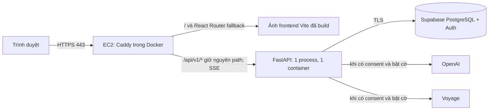
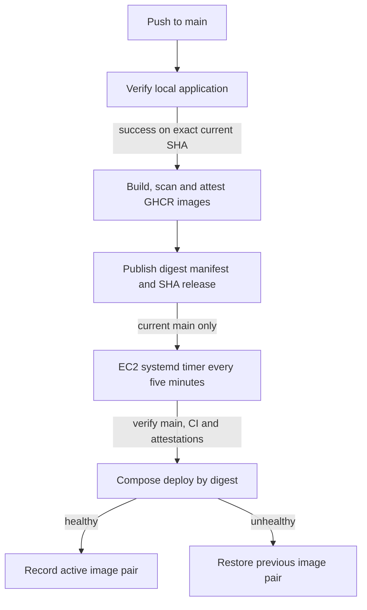

# Kiến trúc staging và kiểm kê hiện trạng

## Luồng chạy

`frontend/src/api/client.ts` dùng đường dẫn tương đối `/api/v1`; Caddy giữ nguyên path. `frontend/src/App.tsx` dùng HashRouter cho giao diện demo; callback Auth và các đường dẫn thực vẫn cần fallback về `index.html`. Production không chạy Vite. API trong `backend/app/__main__.py` nghe cổng 8001, một Uvicorn process; Compose không publish cổng này. Caddy dùng HTTPS tự động khi `APP_DOMAIN` là tên miền thật; `APP_DOMAIN=:80` chỉ dùng cho smoke test cục bộ. [Caddy automatic HTTPS](https://caddyserver.com/docs/automatic-https).

## Kết quả kiểm kê mã nguồn

| Thành phần | Hiện trạng / rủi ro |
| --- | --- |
| Frontend | npm lockfile, Node 22 tương thích; `typecheck`, Vitest, Vite build, Playwright. Không có script lint độc lập; CI dùng typecheck và tests. |
| Backend | Python 3.12, `uv.lock`, FastAPI, Ruff, mypy, pytest. Image cũ đã là một process và UID 10001. |
| Auth | Supabase Auth qua backend; cookie HttpOnly cho session, Secure ở production, SameSite Lax, CSRF và so Origin theo `FRONTEND_ORIGIN`. Redirect là `/auth/callback`; phải cấu hình allow-list bên Supabase. Không có CORS middleware mở origin khác. |
| Sức khỏe | `/api/v1/health/live` kiểm tra process; `/ready` kiểm tra DB, revision `0010_account_deletion` và helper phiên Auth. Không chạy migration lúc startup. |
| AI, bộ nhớ | OpenAI Agents SDK, timeout/concurrency giới hạn; Voyage chỉ dùng khi cờ hệ thống và tùy chọn từng người bật. Transcript, replay và proposal tạm nằm RAM, mất khi restart. Một worker/replica là bắt buộc trước khi thiết kế shared store. |
| STT | WAV mono PCM16 8–48 kHz, tối đa 30 giây/3.000.000 byte, audio đọc theo chunk, không lưu raw audio. Model cấu hình `gpt-transcribe` ở env mẫu cũ chưa được xác nhận trong tài liệu OpenAI hiện tại. |
| Logs | Backend log request ID và loại lỗi, không log body; Caddy tắt access log và lọc headers/URI trong runtime error log. Kiểm tra lại bằng request synthetic trước staging. |
| Database | Supabase PostgreSQL/Auth giữ nguyên; source Alembic 0001→0010. Probe read-only thấy remote ở 0010; vẫn cần review backup/privileges/SQL trước release. Automated image deployment không chạy migration. |

Các điểm cần chú ý: `deploy/README.md` trước task từng nói readiness ở `0005_export_scope`; đã cập nhật theo source. AI accounting không được bật chỉ nhờ metadata revision nếu grants/backup chưa review. Phần lớn pytest DB bị skip nếu thiếu `TEST_DATABASE_URL`; lần này đã chạy trên PostgreSQL disposable. Rate limit hiện có ở lớp ứng dụng nhưng cần đo theo IP/user thực trong staging. CORS same-origin và cookie phải được smoke test qua domain thật.

Hiện EC2 hạ tầng đã có; application containers chưa được triển khai. Cần một release đã qua CI và xác minh health/HTTPS trước khi công bố trạng thái live.

## Ranh giới mạng và an toàn

Security group EC2 chỉ inbound TCP 80, TCP 443, UDP 443 (nếu bật HTTP/3); không mở 8001, 5432 hoặc SSH công khai. SSM dùng outbound HTTPS. Nếu muốn không dùng UDP 443, bỏ mapping UDP trong Compose trước khi cấu hình SG. EC2 cần outbound tới GitHub API/GHCR và SSM, Supabase, OpenAI/Voyage khi bật. Chặn truy cập trực tiếp API từ Internet. Caddy có `Cache-Control` bất biến cho assets có hash, `no-store` cho phần khác và không áp CSP mới có thể làm hỏng ứng dụng. Header Auth/Cookie được reverse proxy mặc định chuyển tiếp; Caddy không tự ghi access log. [Caddy reverse_proxy](https://caddyserver.com/docs/caddyfile/directives/reverse_proxy).
