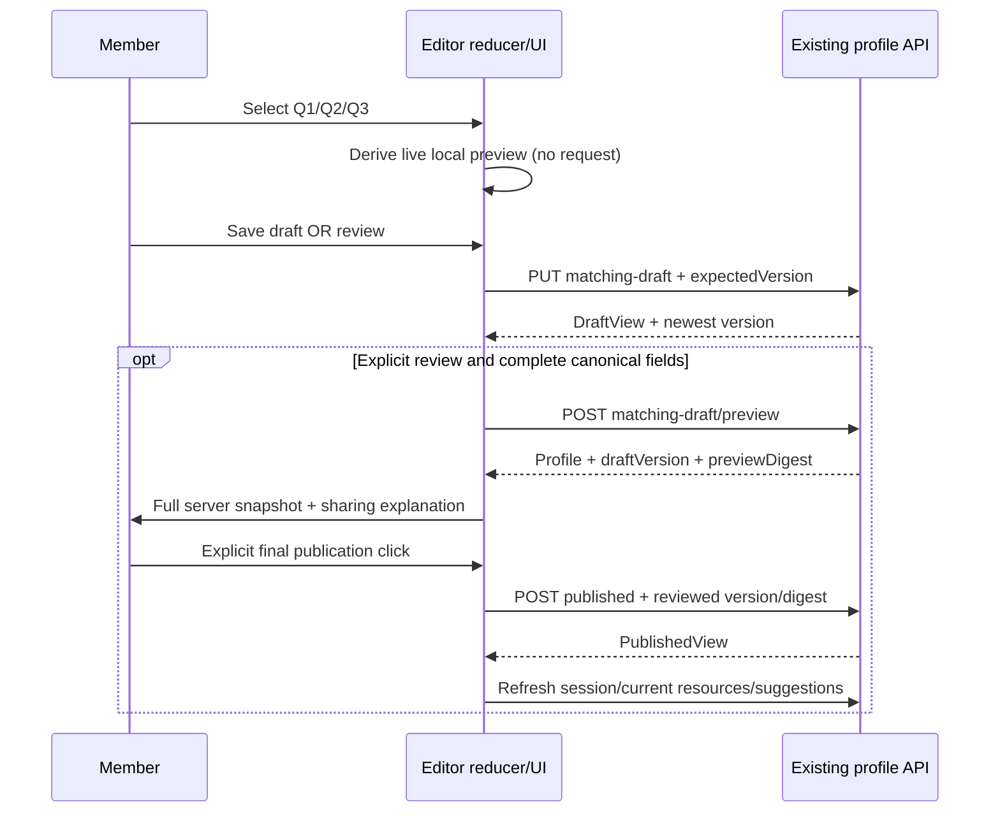

# Friendship Discovery — technical specification

Status: **proposed**, Markdown contracts only. Current paths/contracts are verified in [01](01-current-state-audit.md); planned modules below do not exist yet. Preserve all [02](02-product-requirements.md) requirements and [03](03-ux-ui-specification.md) copy/behavior.

## 1. Recommended architecture and alternatives

Recommended: retain Discovery orchestration and existing profile endpoints; replace ProfileEditor's presentation/state boundary; add optional typed discovery metadata to `PublicProfile`, stored in its existing JSONB payload. Keep canonical taxonomy v2 and existing matching scorers/retrieval unchanged. Share a pure public-card view model and renderer across owner live preview, authoritative server review, suggestions and request cards.

| Alternative | Trade-off / decision |
| --- | --- |
| UI-only relabel canonical goal/style and truncate interests to three | Rejected: meanings differ, data is lost, and saved drafts cannot restore approved answers faithfully. |
| Add SQL columns/new profile endpoints/new scorer | Rejected for MVP: existing JSONB/versioned publication already provides the lifecycle; no query needs new indexed fields. |
| Add optional DTO metadata within existing payload | Recommended: strict validation and persistent new choices, no SQL migration; requires backend-first rollout and a compatible backend rollback floor. |
| Remove values/language minimums to get literally three inputs | Not authorized as a default: changes v1 validity/scoring and eligibility assumptions. Preserve minimums and use a compact missing-data review. |

## 2. File responsibilities and component hierarchy

All new frontend modules are proposed under `frontend/src/features/real/social/`:

```text
Discovery.tsx [existing: resources, selected tab, editor ownership, action refresh]
  ProfileEditor.tsx [refactor: reducer, operation state, responsive stages, review protocol]
    FriendshipQuestions.tsx [new: three semantic question groups + compact choices]
    InterestPickerDialog.tsx [new: bounded browse/search + explicit full-set management]
    PublicProfileCard.tsx [new: pure public-profile display, owner/peer variants]
    ProfilePublishReview.tsx [new: required-data supplement + exact server review]
  CandidateCard.tsx [existing: recommendation actions + starter + new shared renderer]
  RequestCard.tsx [existing: retain request lifecycle; migrate shared display if necessary]

discoveryProfile.ts [new: option mappings, hydrate, reducer, reconciliation, validation, view model]
conversationStarters.ts [new: pure allowlisted template selection]
profileRules.ts [existing: reusable canonical facet limits; retire five-step-specific gating]
TagPicker.tsx [existing: canonical supplemental facets; do not change max behavior globally]
social.css [existing: scoped builder/card/picker presentation]
```

Do not turn this into an unrelated app-wide state framework or split RealApp wholesale. `Button`, `Dialog`, `StatePanel`, ErrorNotice, transport/session hooks, SeedAvatar and taxonomy lookup are reusable. Move SeedAvatar with its existing algorithm into PublicProfileCard or re-export it from CandidateCard to avoid a circular import; the alias/seed calculation remains server-owned.

`PublicProfileCard` accepts an explicitly normalized view model, mode `owner-local | owner-reviewed | peer`, heading level and action slot. All modes include access to full public data. PeerCard's old export can temporarily wrap the new renderer so RequestCard consumers do not break. Never import ProfileEditor into the card; no card performs profile fetches.

Responsive layout changes only how the same questions/preview are arranged. Do not mount separate desktop/mobile reducers. An owner mobile preview may mount a second **read-only** card; the desktop card is unmounted/hidden appropriately so only the relevant region is exposed to assistive technology.

## 3. Proposed DTO/type contract

The following is interface documentation, **not code to write in this planning task**. Existing generated types remain authoritative after future regeneration.

```ts
type FriendshipIntention = 'talk' | 'shared-interests' | 'study' | 'experiences';
type ConnectionApproach = 'gradual' | 'lively' | 'activity-first';

interface FriendshipDiscovery {
  version: 1;
  intention: FriendshipIntention | null;
  connectionApproach: ConnectionApproach | null;
  featuredInterests: string[]; // canonical taxonomy IDs, ordered, unique, 0..3
}

// Additive member of the current generated PublicProfile, not a second DTO family.
interface PublicProfileAddition {
  discovery?: FriendshipDiscovery | null;
}
```

Implement corresponding Pydantic `FriendshipDiscovery` model in existing `backend/app/modules/social/schemas.py`; Python `connection_approach`, `featured_interests`, with DTO camelCase wire aliases. `version` literal 1; unknown fields forbidden. PublicProfile defaults discovery to null. Validate known/unique featured IDs, max three and **subset of full interests** in a PublicProfile model validator. Keep all current canonical validators/limits. JSONB stores snake_case like today's `strict_goal`; wire JSON stays camelCase.

Partial metadata (null intention/approach or zero featured IDs) is valid in a draft. Canonical publication minimums remain enforced exactly as today. To preserve legacy clients, server publication need not add a new required-question gate: optional/partial discovery renders honest fallbacks. The new frontend additionally requires Q1, Q3 and ≥1 featured ID before adopting the new flow. This is a UX completeness rule, not a new cross-user authorization rule. Do not infer answers to satisfy either validation layer.

Old published payloads lacking discovery remain valid, untouched and discoverable. New-profile partial drafts can be saved, but final UI review still requires canonical minimums. The taxonomy version stays v2 because no interest/goal/style IDs or similarity matrices change.

Update existing `backend/openapi.json` using `scripts/export_openapi.py` and regenerate `frontend/src/api/generated/schema.d.ts` with the existing npm script **only during future implementation**. Do not hand-edit generated declarations or bypass validation with `any`/a hand-maintained duplicate Profile type.

### Save compatibility with older writers

Current PUT replaces the payload, so it needs one scoped compatibility rule:

1. Check `expectedVersion` under the existing transaction/lock/idempotency path.
2. If `discovery` is omitted (`model_fields_set`), preserve the current draft metadata; if no draft metadata exists, preserve current valid published metadata when creating the first draft. This prevents older clients from erasing newer fields merely by omitting them.
3. For this omission path only, reconcile preserved featured IDs by intersection with submitted full interests (keep order). Zero remaining featured IDs is valid; view falls back to first three full IDs without inventing intent. Do not add arbitrary full interests back against the writer's explicit removal.
4. Explicit `discovery: null` clears that optional extension; this is an explicit API replacement, not the omission path. New UI never uses null to discard a non-null extension accidentally.
5. If discovery was explicitly supplied, reject an invalid subset with 422; do not silently fix the new client's bug. Persist a newly built allowlisted JSONB value; do not mutate a nested JSONB object in place and rely on change detection.
6. Preserve the existing meaning of all canonical fields and idempotency receipts. Only discovery has omission preservation; do not turn full PUT into a broad undocumented PATCH.

No CandidateCardDTO endpoint expansion is necessary: its `profile` already carries the extended PublicProfile. Candidate explanations stay server-owned and unchanged. PreviewView/PublishedView/PeerCardDTO inherit the same additive profile member.

## 4. Mapping and preservation rules

### Intention and canonical goal

For a genuinely new editor with no saved draft or published snapshot, initialize `goalMode='follow-intention'`. Map `talk→friendship`, `shared-interests→shared-interests`, `study→study-buddy`, `experiences→friendship`. While that mode is active, Q1 updates intention plus canonical goal. Explicitly editing the canonical goal changes mode to `preserve`; successful first draft save also switches it to `preserve`.

Any hydrated saved/published profile starts in `preserve`, regardless of whether metadata exists. Q1 then only edits discovery intention. The existing goal, including `language-practice`, stays intact unless the user edits `Tùy chọn ghép bạn đã lưu`. This conservative rule avoids silently changing legacy matching on an attractive new Q1 label. Show the canonical goal summary and the helper from 03. `goalMode` is local control state, not another public field.

### Connection approach and canonical style

No semantic mapping. Q3 only updates `discovery.connectionApproach`. Existing style remains unchanged; brand-new canonical style is existing default `balanced`, displayed as a neutral system default in review (`Cách trò chuyện dùng để ghép bạn: Cân bằng (mặc định, có thể đổi)`). It must not produce a new “both gradual” explanation or a personality inference. Existing strictGoal/languages/values/activities/availability are copied and only change via their explicit controls.

### Full versus featured interests

Maintain a retained set in editor state, initially **all** stored full interests (stable order), plus featured IDs. New selected IDs are tentative additions until saved. Compute:

```text
effective full interests = orderedUnique(retainedInterests + featuredInterests)
```

- Feature an ID: require featured count <3; effective full count after add ≤10; append to featured in selection order.
- De-feature an ID: remove from featured only. If it was not retained, it disappears from effective full. If it was retained/saved, full interest remains.
- Explicit full-set delete: remove from retained **and** featured. It changes the draft's public matching set and must be labeled accordingly.
- Save success: retained becomes exactly returned full interests; saved snapshot/version update. Subsequent de-featuring keeps those saved IDs in full.
- Initial featured projection: saved metadata's subset, or first three full IDs if metadata absent/empty. This projection does not mark the editor dirty, write to API or republish. It is materialized only on explicit save of the new editor's profile.
- Load 4–10 interests: never slice full interests to three; only slice the local fallback featured projection. Preserve full-set order. Unknown IDs from an unexpectedly newer taxonomy must produce an incompatibility/read-only recovery state; do not silently filter/drop them before save.

When the full set is explicitly reduced below three, private saving is allowed but review/publish is blocked with the exact minimum message. MVP full-set management lists/removes retained IDs; new IDs enter through deliberate featured selections and become retained on save. There is no separate bulk-add control in MVP. Initial featured mode never silently accumulates every attempted click.

## 5. Frontend state and interfaces

One reducer in `discoveryProfile.ts`; React useReducer is sufficient. No React Query/Zustand/form library install is justified.

```ts
type EditorStage = 'builder' | 'review-preparation' | 'review-ready';
type Operation = 'idle' | 'saving' | 'previewing' | 'publishing';
interface EditorState {
  canonical: Omit<PublicProfile, 'interests' | 'discovery'>;
  intention: FriendshipIntention | null;
  connectionApproach: ConnectionApproach | null;
  retainedInterests: string[];
  featuredInterests: string[];
  goalMode: 'follow-intention' | 'preserve';
  draftVersion: number;
  publishedVersion: number;
  savedSnapshot: string; // stable serialization of effective public profile
  stage: EditorStage;
  mobileQuestion: 0 | 1 | 2;
  operation: Operation;
  serverPreview: PreviewView | null;
  editRevision: number;
}

hydrateEditor(draft: DraftView, published: PublishedView | null): EditorState
reduceEditor(state: EditorState, action: EditorAction): EditorState
toDraftProfile(state: EditorState): PublicProfile
validateReview(state: EditorState, taxonomy: TaxonomyDTO): ReviewIssue[]
buildPublicProfileView(profile: PublicProfile, taxonomy: TaxonomyDTO): PublicProfileView
```

Use generated names from schema, with imports/aliases for `PublicProfile`, `PreviewView`, `DraftView`, `PublishedView`, `TaxonomyDTO`; the above illustrates signatures, not an alternative source of schema truth. `canonical` stores only non-interest, non-discovery public fields. Intention/approach and the retained/featured sets each have one owner; never also store an editable assembled PublicProfile alongside them. `toDraftProfile` constructs `{...canonical, interests: orderedUnique(retainedInterests + featuredInterests), discovery: {version: 1, intention, connectionApproach, featuredInterests}}`. The assembled profile and preview are derived, not separately synchronized state. `EditorAction` is a discriminated union for HYDRATE (explicit only), SET_INTENTION, SET_APPROACH, FEATURE, DEFEATURE, DELETE_FULL_INTEREST, PATCH_CANONICAL, SET_QUESTION, SAVE_STARTED/SUCCEEDED/FAILED, PREVIEW_SUCCEEDED/INVALIDATED and PUBLISH_STARTED/FAILED. Reducer remains pure; network orchestration stays in ProfileEditor.

Hydration precedence: draft if version>0, else published if present, else the existing empty profile. Do not rehydrate automatically on polling/resource updates while editing. Use newest save response version for the next operation rather than a stale prop closure. `dirty` compares normalized effective payload against savedSnapshot; ignore question index, dialogs, notices and fallback projection itself. Initialize savedSnapshot from the normalized hydrated editor projection (including its local fallback featured view), so opening a legacy profile does not count as an edit; this is a local comparison baseline and does not claim the optional metadata was already persisted.

Derived live preview consumes `toDraftProfile(state)` in the same render. No effect that copies profile into another preview state. Every profile-changing action increments editRevision and clears serverPreview/review-ready state. Selection preserves input focus. No per-selection network, AI call or write effect.

Serialize a captured payload/revision per save. Freeze answer inputs during operations for MVP, preventing savedSnapshot from claiming unsent edits were saved. On completion also verify mounted/editor instance, API session epoch and operation ID before applying callbacks. Session/account change resets state, pending destinations and previews; use existing ApiClient lifecycle rather than ad hoc auth tokens.

## 6. Draft, review and publication sequence



Review-preparation first validates main question completeness and effective full interests; missing canonical values/languages are collected in that stage, without fabricating defaults. Draft saves still accept partial values. If preparation was complete on entry, run save then preview once. Otherwise `Xem bản được chia sẻ` initiates that sequence after valid supplements. Preview request validates all canonical minimums on the server.

Final publish body remains `{draftVersion, previewDigest, expectedPublishedVersion}`. It must use the **last authoritative** preview returned by API, not a local synthetic digest. Last publication version is taken from current PublishedView.profileVersion or DraftView.publishedVersion, not PublishedView.version blindly. Final click is the only publication trigger and keeps current MATCH consent behavior.

Any answer change, explicit save, new preview, preview failure or conflict clears publish readiness. Existing server expiry is 15 minutes; PreviewView has no expiry field, so handle 409 authoritatively rather than inventing a precise client countdown. A preview refresh requires a fresh review and another final click. No automatic retry of publication after 409.

Draft persistence is explicit **server save**. Unsaved local edits last only while editor stays mounted. No localStorage/sessionStorage/IndexedDB, background autosave, unload writes, or cross-account cache. Successful publication may leave a saved server draft, as today; closing/discarding reverts local edits only, never deletes a server draft or withdraws publication.

For uncertain network outcomes, use existing transport's stable idempotency key for the identical request body. A subsequent GET reconciles version/state; never invent a new expectedVersion or loop automatic overwrites. On STALE_VERSION fetch latest into a separate conflict view; retaining local edits and explicitly overwriting uses latest version only after the user confirms. A saved draft refresh must not overwrite dirty local state.

## 7. Navigation guard integration

Existing router is a declarative HashRouter in `frontend/src/features/real/RealApp.tsx:1982`; do not assume `useBlocker` works outside a data router or migrate the entire router to solve one form. `frontend/src/features/real/journal/useJournalGuard.tsx` already demonstrates anchor capture, popstate interception before Router, native unload warning and a pending callback. Reuse that established pattern in a profile-scoped hook; its journal-specific discard-only UI cannot satisfy save-and-leave, and its replaceState history behavior needs explicit Back/Forward validation.

Proposed `useProfileNavigationGuard.ts` in the social directory provides a scoped pending-destination callback and native unload handler. Document-level anchor capture follows the journal pattern; Discovery registers the editor's guard callback for button-driven tab changes, and Close calls it directly. Handle hash Back/Forward through the same guarded navigation adapter, preserving current hash/history state while confirmation is pending, then executing the recorded destination exactly once after resolution. Preserve React Router's history state object; do not copy the journal hook's `replaceState(null, ...)` blindly. Avoid repeated history pushes or loops, and test real browser Back/Forward (T14/T15). Do not substitute an unload-only guard and claim route coverage.

Exact adapter signature proposed: `requestEditorLeave(continueNavigation: () => void): void`, registered while dirty and unregistered on clean/unmount; safe default executes immediately. Its implementation must use the actual router's navigation primitive and existing history location, with one pending destination and suppression for its own approved replay. If history interception cannot be implemented reliably without a broad router change, retain this as a release-blocking task to resolve in Phase 0; do not expand router scope silently.

Session-driven redirects/logout bypass the guard and clear editor memory. During in-flight saves the guard must not dispatch a second save. Save-and-leave awaits response; failure keeps current location and edits. Anchor capture should avoid needing RealApp edits; if a programmatic shell navigation path does require an adapter, keep that touch scoped and preserve unrelated pre-existing changes. Do not refactor journal state or its appearance for this project.

## 8. Recommendation data and deterministic starters

Keep server `reasons` as the authority and render at most its existing maximum of three. Do not re-rank candidates, recompute compatibility percentages, or append claims based on the current unsaved draft. Do not fetch peer account/identity data. Render peer discovery intent when present; fallback goal label otherwise. Existing new approach is a self-description, not yet a scorer dimension.

No endpoint addition is necessary for starters. `conversationStarters.ts` matches **exact** allowlisted reason strings generated from taxonomy labels, also requiring the corresponding ID in candidate.profile.interests. Example: reason exactly `Cùng thích âm nhạc` permits music templates. No substring parsing, fuzzy/similarity expansion, or claim based only on peer interests. Server reason omission merely results in a conservative generic opener.

```ts
selectConversationStarter(
  card: CandidateCardDTO,
  taxonomy: TaxonomyDTO,
): { templateId: string; text: string }
```

Use priority `music, coffee, movies, reading, games, travel`, then generic. For a qualifying topic, select one of two variants by a deterministic small hash of `avatarSeed|profileVersion|peerVersion|starter-v1`; do not use expiring candidateRef, Math.random, a private identifier, or an API request. Stable content across rerenders; changes to profile versions can produce a new variant.

| Topic | Variant 0 | Variant 1 |
| --- | --- | --- |
| music | Có bài hát nào bạn có thể nghe đi nghe lại cả ngày không? | Dạo này bạn hay nghe bài hát nào? |
| coffee | Bạn thích cà phê ở quán quen hay tự pha hơn? | Nếu chọn một món cà phê hôm nay, bạn sẽ chọn gì? |
| movies | Có bộ phim nào gần đây khiến bạn muốn kể cho một người bạn không? | Bạn thường chọn phim theo thể loại hay theo tâm trạng? |
| reading | Có cuốn sách nào bạn muốn giới thiệu cho một người bạn không? | Bạn thích đọc một mạch hay mỗi ngày một chút? |
| games | Bạn thích chơi game một mình hay cùng bạn bè hơn? | Có trò chơi nào bạn muốn rủ một người bạn cùng thử không? |
| travel | Bạn thích một chuyến đi được lên kế hoạch hay tùy hứng hơn? | Nếu có một ngày rảnh để đi chơi, bạn muốn ghé đâu? |
| generic | Gần đây có điều gì nho nhỏ làm bạn thấy vui không? | Bạn muốn bắt đầu làm quen bằng câu chuyện gì? |

Template IDs are `starter-v1:<topic>:<variant>`. Topics/variants are explicit public, non-sensitive prompts; no therapeutic diagnosis, mood inference or chat/journal retrieval. Do not copy to clipboard or send a greeting automatically. Shared approach reasons may be added later through structured server evidence, with an independently reviewed explanation contract.

AI alternative: potentially more variety but adds latency, cost, moderation, provenance and hallucination concerns. It is unnecessary for these seven safe topic families; templates give deterministic testability and zero paid calls. Future AI experimentation must be opt-in to a separate scoped plan, based solely on published fields, with fallback templates.

## 9. Database, security and release compatibility

No SQL migration/backfill/index/RLS change is recommended. JSONB supports the optional extension; no matching query filters/order by these new keys. Existing active-owner uniqueness, versions, locks and authorization remain intact. Do not run `apply_migration`, mutate hosted profiles or alter reviewed SQL for this task.

No data migration means legacy payloads are interpreted with fallback display and lazy explicit-save adoption. New metadata is public when published and owner-only in drafts. Do not add private fields to the DTO. Retain service.public_payload allowlisting; full canonical fields are preserved intentionally, not by spreading arbitrary account/AI data.

All matching constraints listed in 01 section 6 remain. Scoring/retrieval/explain/ranking files need regression tests, not behavioral edits. Same canonical profile plus different discovery object must yield identical scores, ordering and eligibility in v1/v2/shadow. Explicit canonical changes/full-interest additions can appropriately affect matching. No automatic addition of activities for `activity-first` or experiences.

Backend-first rollout order for a future authorized release:

1. Ship compatible DTO reader/writer and omission preservation, with legacy/new payload tests and generated schema.
2. Ship frontend adopting metadata and new card; verify old cached frontend can save without erasing metadata.
3. Observe errors/consent and matching regression evidence; keep scorer unchanged.

Rollback: revert the frontend surface first while retaining the expanded DTO/backend. **Do not roll back to a backend that rejects stored discovery keys**: PublicProfile currently forbids extras and that would break reading new rows. Use a forward compatibility patch if backend logic needs reverting; retain reading/preserving the optional extension. Do not bulk delete metadata or rewrite published rows to facilitate rollback. If a later implementation discovers an actual SQL constraint requiring migration, stop that portion, document reviewed forward-only migration and rollback design, and obtain authorization before any database change.

## 10. Handoff verification

Implementation must link each interface/task to [05 roadmap](05-implementation-plan.md) and test IDs in [06](06-test-and-validation-plan.md). Validate API contracts with both full canonical legacy fixtures and partial discovery fixtures. Report schema generation, local disposable-DB tests, screen sizes, keyboard/screen-reader checks and untested deployment assumptions separately. No new tests or source files were executed/created as part of this technical planning document.
