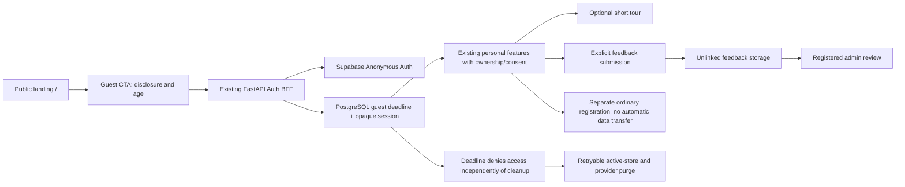

# MoodPrint guest experience — feasibility summary

Audit date: **2026-10-28, Asia/Bangkok**. Scope: read, audit, design and plan only. No feature is implemented by this document set.

## Baseline and evidence standard

The audited checkout is `main` at **`984753389aa8bd4b3112b19a8beceb1e538fd659`**. `git ls-remote origin refs/heads/main` returned the same SHA; the initial working tree was clean. Source references throughout these documents refer to that commit. The live deployment's build SHA was not exposed or independently established; live observations must not be treated as proof it runs this exact commit.

Labels: **VERIFIED_SOURCE** means inspected code; **VERIFIED_RUNTIME** means an executed local check or read-only live observation; **PROPOSED** means work to build; **UNVERIFIED** means an explicit implementation/release gate. Detailed evidence and exact source lines are in [01](01-current-architecture-audit.md); commands and their observed results are in [06](06-testing-and-release-plan.md).

## Verdicts

`READY` means no material prerequisite remains unknown for the scoped implementation. `CONDITIONALLY_READY` means technically supported by the architecture, with named prerequisites. `BLOCKED` means the stated guarantee cannot currently be delivered or a mandatory gate has no verified solution. These are feasibility verdicts, not production launch approvals.

| Feature | Verdict | Complexity | Main blockers / conditions | Recommendation |
|---|---|---|---|---|
| A. Two-hour guest accounts | **CONDITIONALLY_READY** | High | No anonymous provider method/account kind; sessions slide; no guest social gate; incomplete guest purge; hosted anonymous creation/CAPTCHA/IP forwarding untested; operational budget and deletion disclosure need approval | Extend existing Auth BFF, PostgreSQL ownership and lifecycle workers. Build security/lifecycle before exposing trial CTA |
| B. Public landing and optional spotlight tour | **CONDITIONALLY_READY** | Medium | Root session gate precedes all routes; HashRouter/callback compatibility; tour library has not passed keyboard/mobile/CSP evaluation; new guest contract required for the full journey | Keep public `/` separate from the existing `/#/...` application; preserve tokens and components; validate Driver.js before selecting it |
| C. Feedback and protected dashboard | **CONDITIONALLY_READY** | Medium | Only activity feedback exists; no app rating schema/API; retained guest feedback must be unlinked and disclosed; staff-role scope/retention approval | New feedback module; reuse server staff authorization, not activity or abuse-report tables |
| Literal deletion of every copy at exactly two hours, including backups and providers | **BLOCKED** | Outside app-only control | Delayed workers, backups, external processing and already delivered browser content cannot be synchronously erased by an app TTL | Promise exact access expiration, separately describe active-store cleanup target and external retention. If literal immediate universal erasure is required, do not launch the AI trial |

All three application features are feasible together **after** the listed gates. The current application is a suitable starting point for implementation on a feature branch; it is **not ready to enable guests safely through a small UI change**.

## Reuse versus new work

| Reuse, with regression checks | Must be built |
|---|---|
| Server-to-Supabase calls and verified provider identity; opaque HttpOnly session cookie; CSRF and idempotency patterns | Anonymous sign-in method, verified anonymous classification, creation compensation and strict absolute deadline |
| User ownership and age/consent gates; AI run policy revalidation; approved-memory workflow | Registered-only social gates across direct APIs, peer selection, badge polling and background work |
| Five assistants; journaling; opt-in history; memory vectors/jobs; bounded WAV transcription | Guest-specific expiry caps, quotas, cancellation and exhaustive hard purge |
| Lease-fenced deletion worker; private provider identity helper; startup recovery | Guest cleanup schedule/retries/alerts independent of an authenticated browser; orphan identity reconciliation |
| Brand, tokens, Dialog/Button/StatePanel, reduced-motion policy, existing React Router | Public entry composition, guest status/expiry UI, replayable contextual tour |
| Staff roles and recent-reauth checks; generated OpenAPI/TypeScript workflow; test harnesses | Application feedback table, unlinked retention, protected review UI and aggregates |

Evidence: `backend/app/modules/auth/routes.py:141–202`; `backend/app/core/security.py:29–155`; `backend/app/ai/runtime.py:481–554`; `backend/app/modules/users/lifecycle.py:58–186`; `frontend/src/features/real/RealApp.tsx:191–278,328–476`; `backend/app/modules/moderation/staff.py:38–51`.

## Most important findings

1. **The Dashboard setting is not application support.** `ProviderSession` has no anonymous flag and there is no anonymous-sign-in method (`auth/provider.py:15–20,69–131`). `SessionView` has no account kind/deadline (`contracts.py:63–78`). `session_view()` advertises matching unconditionally (`auth/routes.py:83–91`).
2. **Existing session renewal violates the requested trial semantics.** Login initializes idle expiry and `require_actor()` extends it (`auth/routes.py:154–156`; `core/security.py:66–76`). A guest-specific immutable deadline must also be enforced in the provider-session SQL helper, transaction revalidation and background policies.
3. **Default-deny social authorization is essential.** Current MATCH checks distinguish adults and consent, not guests (`core/security.py:139–155`; `social/service.py:71–86`; `consent/routes.py:26–32`). Hiding navigation does not close this gap.
4. **Account deletion is not an exhaustive guest purge.** The worker deletes private content and provider identity, but leaves a deleted user tombstone, revoked application session rows, consents/events and job metadata (`users/lifecycle.py:88–186`). Several foreign keys do not cascade (`database/models.py:63–110,155–177`).
5. **All three structured shared activities require a real connection.** Their create route and non-null model fields require a pair, room and two people (`activities/routes.py:65–142`; `activities/models.py:31–39`). Rủ Rê's individual AI conversation is available; standalone structured focus/quiz is separate optional work.
6. **Do not scale by changing worker count.** Supported runtime is one worker (`backend/app/__main__.py:9–18`); temporary chat and voice counters are in process, although AI admission uses PostgreSQL (`ai/store.py:36–76`; `voice/routes.py:14–17`; `ai/persistence.py:220–268`). Fifty visitors is a load-test target, not evidence of fifty simultaneous affordable model calls.

## Recommended combined architecture

Keep all personal data behind FastAPI. Use PostgreSQL for temporary persistent records and durable cleanup coordination; retain current bounded RAM for unsaved raw chat context. Do not expose private tables to Supabase Data API or introduce a second identity system. Start with one backend worker. Defer identity conversion and standalone shared-activity replacements.

## Implementation order and gates

1. **Contract and hosted compatibility proof:** synthetic provider tests, disposable schema, anonymous claim/deletion proof on an explicitly approved non-production Auth target, CAPTCHA and backend IP-rate behavior.
2. **Backend account kind, immutable expiry and social denial:** prove `T−1 ms` allowed / `T` denied, including direct APIs and long-lived responses; registered regressions pass.
3. **Purge, orphan recovery and cost controls:** complete data inventory, failed-worker/restart tests, durable quotas and aggregate spend reservation.
4. **Public landing and guest entry:** route/callback compatibility, eligibility and disclosure, guest timer/error/expired states, no auto-creation on page load.
5. **Feedback and admin:** unlinked retention, validation, idempotency, staff authorization and review metrics.
6. **Optional tour, full journey QA and release review:** mobile/keyboard/reduced motion, 50-user synthetic load and explicit release decision. Never apply production migrations or deploy as part of this audit.

The actionable task breakdown is [05](05-implementation-roadmap.md); unresolved owner decisions are [07](07-risks-and-open-decisions.md). A future implementer can start using [08](08-claude-code-handoff.md), but this audit does not execute that prompt.

## Document map

- [01 — Current architecture and evidence](01-current-architecture-audit.md)
- [02 — Guest authentication, deadline and deletion design](02-guest-auth-design.md)
- [03 — Landing and onboarding design](03-landing-onboarding-design.md)
- [04 — Feedback and admin design](04-feedback-system-design.md)
- [05 — Implementation roadmap](05-implementation-roadmap.md)
- [06 — Testing, observed baseline and release gates](06-testing-and-release-plan.md)
- [07 — Risks and open decisions](07-risks-and-open-decisions.md)
- [08 — Self-contained Claude Code handoff](08-claude-code-handoff.md)
