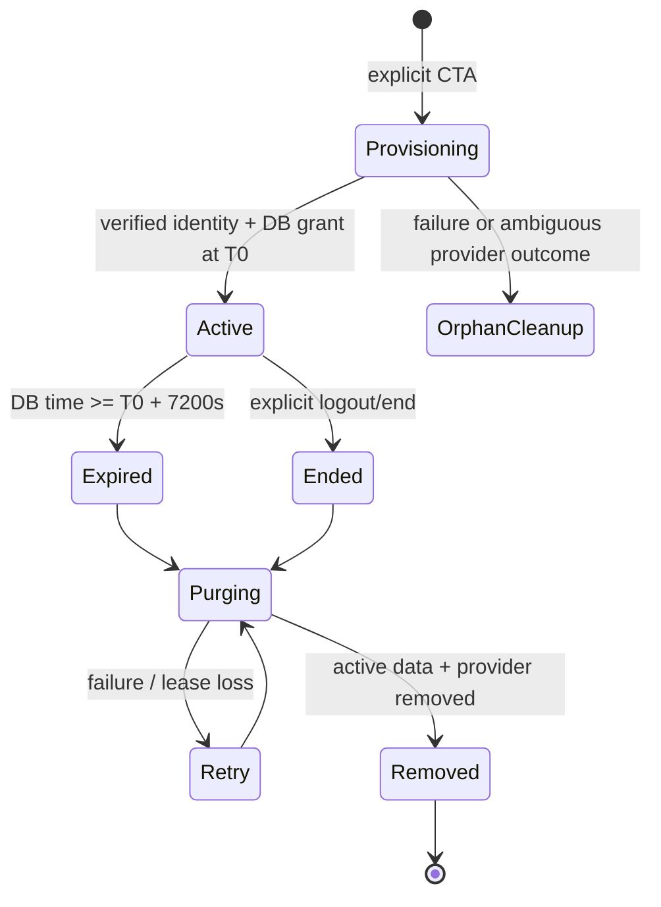

# Guest authentication, expiry and deletion design

**PROPOSED, not implemented.** Baseline and exact evidence: [01](01-current-architecture-audit.md). Verdict: **CONDITIONALLY_READY**. Exact two-hour authorization is a hard requirement; physical cleanup has a separately monitored completion target.

## 1. Architecture choice

| Option | Compatibility / effort | Security and deletion | Operations / cost at roughly 50 visitors | Verdict |
|---|---|---|---|---|
| A. Supabase Anonymous Auth + existing PostgreSQL + scheduled cleanup | Reuses internal user/session/ownership models, memory/history, transactions and deletion helpers; medium/high lifecycle work | One ownership model; durable deadlines; FK-aware purge. Backups still retain past rows | Existing DB and one backend worker; no new service. Need expiry index, bounded jobs, load evidence | **Recommend** |
| B. Supabase Anonymous Auth + Redis for all guest data | New parallel persistence implementations for chat/moods/memory/proposals/usage; existing SQL services and FKs still need work | Redis TTL does not revoke Supabase sessions, erase Postgres metadata or backups, or fence work already running | Extra service, client, availability/persistence configuration; eviction could unexpectedly lose live trials | Defer; Redis may later coordinate shared transient state, not solve deletion by itself |
| C. Supabase Auth + RAM-only personal trial | Smaller initial persistence change if demo limited to chat | Restart destroys content but still needs durable deadline/provider cleanup; does not provide requested journals/approved memory/history semantics consistently | Cheapest storage, poor compatibility and recovery | Does not satisfy full scope |

Keep the current FastAPI Auth BFF; no second authentication system or browser-to-private-table path. Current reusable components are `auth/provider.py:41–101`, `auth/routes.py:153–202`, `core/security.py:29–155` and `users/lifecycle.py:58–186`. Dedicated disposable PostgreSQL tests are already supported.

## 2. Identity and provisioning

### Provider verification

Add `SupabaseAuth.anonymous_session(captcha_token, *, correlation_id: str)` using the server-to-provider transport. The official Auth client implements anonymous creation as `POST /auth/v1/signup` without email/phone/password, forwarding `gotrue_meta_security.captcha_token` and optional `data`; verify that wire contract against the pinned provider integration before implementation. This application must send `data.moodprint_guest_attempt=correlation_id` from the server-created durable attempt, never from client-supplied metadata. [Official Auth client source](https://github.com/supabase/auth-js/blob/master/src/GoTrueClient.ts), method `signInAnonymously` (reviewed 2026-10-28).

Extend `ProviderSession` with verified `is_anonymous`. Continue `GET /user` before accepting claims; match subject/issuer/session and a future expiry, validate expected audience and boolean anonymous status consistently against the verified provider user. A guest path requires **true**, a permanent-login path requires a verified permanent identity; inconsistent/missing classification fails closed. Do not authorize from `user_metadata`, client JSON, a decoded-but-unverified token or the PostgreSQL `authenticated` role. Preserve tests for existing registered providers when extending fixture claims.

Anonymous identities use Supabase's `authenticated` role, and require explicit anonymous discrimination; automatic anonymous-user cleanup is not supplied. [Supabase anonymous authentication](https://supabase.com/docs/guides/auth/auth-anonymous). Existing MoodPrint does not distinguish these users (`auth/provider.py:15–20`; `contracts.py:63–78`).

Map the verified Supabase subject to a **new internal `users.id`**, as current login does. Never use one shared demo user. Store server-owned `account_kind='guest'`, initialized once; client cannot upgrade it. A repeat request with an existing live guest cookie returns the same deadline. A registered cookie must never be overwritten by the trial CTA.

### Creation sequence and compensation

1. The public page performs no Auth signup. On **Dùng thử ngay**, show the two-hour disclosure and the existing minimum-age attestation; collect only the existing year/confirmation fields. Under-16 visitors receive the existing ineligible outcome and no feature access. Do not grant AI/MEM/VOICE automatically.
2. Obtain a short-lived, same-origin **provisioning intent cookie** through `POST /auth/guest-intents` (Origin + JSON/custom-header preflight checks; no app identity yet). Cookie is random, Secure/HttpOnly/SameSite Strict; store only its hash. This is CSRF/idempotency coordination, not a separate identity system. Lifetime 10 minutes. Creation uses `Idempotency-Key` bound to that cookie, age payload digest and verified CAPTCHA. Never treat an arbitrary idempotency key alone as proof of ownership.
3. Persist an intent and a cryptographically random 256-bit `provider_correlation` before the external request. Reserve shared app/IP/global trial admission. Call anonymous signup once per leased attempt, passing the correlation in provider `data`. A transport timeout/process crash is an **ambiguous** outcome, not proof signup failed: prohibit another upstream signup for that attempt until reconciliation resolves it. Provider failure never leaves an authorized app session.
4. Verify returned provider identity. In one short DB transaction create the guest user, age declaration, disabled consents, app session and scheduled cleanup job. Assign **`T0` from fresh database `clock_timestamp()` when the app trial is granted**, then `T = T0 + interval '2 hours'` (7200 seconds). Provider signup may precede T0; there is no app access before grant. This definition is the session creation instant used everywhere.
5. Issue the existing opaque session and CSRF cookies. Drop provider access/refresh tokens after verification; do not persist them in browser storage, logs or database. No provider refresh is needed for this BFF: current authorization uses live `auth.sessions`, not access-token lifetime (`core/security.py:41–47`). Verify provider session settings permit the intended lifetime; earlier revocation is always allowed.
6. If app creation fails after provider success, schedule **targeted orphan cleanup**. The mandatory provider marker correlates the persisted attempt even if the returned subject was never saved; it is never an authorization claim. A reviewed private helper `find_guest_orphan_subjects(attempt_id)` joins the stored random marker to `auth.users.raw_user_meta_data.moodprint_guest_attempt`, requires `is_anonymous=true`, creation within that attempt's bounded window and no internal user mapping. Grant only this narrow helper to the cleanup/runtime role, not broad Auth-row/token read privileges; empty search_path, no PUBLIC/anon/authenticated execution. A paired `delete_orphan_guest_identity(attempt_id)` repeats those guards before deletion and reports a controlled result. Any multiple-match/unexpected-state outcome alerts and stays retry-required. Never delete all anonymous identities in a shared project.
7. If HTTP response is lost **after the app grant committed**, the intent cookie + same idempotency key allows recovery of the **same user and T**, issuing rotated app credentials without retaining plaintext tokens. If upstream succeeded but no app grant exists and its tokens were lost, purge the orphan rather than invent a provider session from metadata. Keep the old attempt terminal/ambiguous and never reuse it for another signup; user may explicitly begin a new intent after admission permits. Reconcile unresolved attempts for up to24h with alerts; never interpret one empty lookup as permission to retry upstream. Concurrent recovery serializes on intent/user; superseded credentials are revoked. Cross-tab UI uses Web Locks when available, then rechecks `/session`; backend gates remain authoritative without browser coordination.

Bounded retries, lease/fence and orphan reconciliation are mandatory release work, not optional polish. Existing `LOGIN_LIMIT`/`IP_LIMIT` are in process (`auth/routes.py:135–138`); they are insufficient for durable provisioning limits.

## 3. Proposed schema and contracts

Use the existing Alembic chain, not Supabase CLI-generated migrations. **Names below are reserved proposals**; rebase and choose the next free revision at implementation time (currently after `0015_context_privacy`). Do not generate or apply DDL in this audit.

| Object | Proposed change and invariant |
|---|---|
| `users` | Add `account_kind` checked `registered/guest`, default `registered` for old rows; nullable `guest_started_at`, `guest_expires_at` TIMESTAMPTZ. Constraint: registered has both null; guest has both non-null and expiry=start+7200s. Kind/start/deadline immutable through ordinary APIs; only service may create them |
| `auth_sessions` | Add `created_at` TIMESTAMPTZ. Guest `expires_at=T`, never slides. Use one guest lifecycle even if opaque credentials rotate; no session may exceed user deadline. Existing registered expiry behavior unchanged |
| `guest_cleanup_jobs` | One job/user, FK to user; due_at=T, pending/running/retry state, attempts, next_attempt_at, lease_token/lease_until and controlled error code. Index `(state,next_attempt_at)` and user guest-expiry partial index. Cleanup coordination survives restart; owner row deleted only after purge succeeds |
| `guest_provisioning_attempts` | Intent hash + idempotency digest, mandatory unique256-bit provider correlation, optional returned subject, lifecycle state/lease, created/expiry. No raw tokens or sensitive payload dump. Unknown outcomes never reissue signup; reconcile/alert for≤24h. Remove resolved correlation after recovery/cleanup window; unresolved target stays restricted retry-required rather than silently abandoned |
| `guest_usage` | User FK, trial AI admissions, voice calls/seconds and concurrency accounting. Atomic reserve/settle under DB lock; cleared with guest |
| Shared abuse/cost counters | Separate bounded, expiring security counters keyed by rotating HMAC of canonical IP, plus identifier-free daily model spend/reservations. No transcript, user UUID, browser fingerprint, raw IP or token in durable cost aggregate. Proposed IP-key retention ≤24h; disclose this security exception |
| Existing content | Saved conversations/proposals/exports must use `min(existing expiry,T)`; memory/journal/private items remain user-owned and are inaccessible at T even though they have no individual TTL column |
| Runtime SQL helper | Extend `is_provider_session_active(app_session_id,app_user_id)` with guest deadline/current provider anonymous consistency; use fresh database time. Preserve app-session mapping, empty search_path and revoked/version/status predicates |
| Cleanup helpers | Reuse guarded identity deletion mechanism after guest is nonactive, but verify anonymous provider subject before deleting a guest identity; return/check success. Add narrow attempt-correlated orphan lookup/delete helpers as above. Purge guest rows, unlike registered tombstone workflow |

Keep schema private. Observed hosted RLS policies are for runtime only, not end-user ownership ([01 §7](01-current-architecture-audit.md#7-deployment-and-baseline-observations)). New tables need explicit runtime grants/policies and anon/authenticated denial for **all** CRUD, not only SELECT. Revoke PUBLIC execution on helpers, grant only runtime/cleanup roles; do not weaken or replace existing helpers with `true`. If exposed schemas elsewhere exist, inspect ownership + restrictive guest policies separately. `auth.uid()` does not automatically represent the current opaque-cookie user in SQLAlchemy connections.

All API paths below have `/api/v1` prefix. Reuse existing camelCase DTOs, strict validation/error envelope, CSRF and receipt conventions (`contracts.py:15–31`; `api/client.ts:39–123`).

| Endpoint/contract | Proposed behavior |
|---|---|
| `POST /auth/guest-intents` | Public initiation only after CTA; exact Origin, JSON/custom-header requirement, IP/global throttling; returns 204 + 10-minute intent cookie. No Supabase user, no private data |
| `POST /auth/guest` | Public write bound to intent, idempotency and CAPTCHA; body `{eligibility:{birthYear,confirmedMinimumAge,confirmedAdultAge,policyVersion,expectedVersion:0},captchaToken,disclosureVersion:'guest-v1'}`. Returns 201 `SessionView`; same successful intent/live guest returns 200 same lifecycle. 409 for registered session; 422 age/validation, 429 quota, 503 provider unavailable. No automatic retry with a new key |
| `SessionView` | Add `accountKind`, `guestStartedAt`, `guestExpiresAt` (null for registered), `serverTime`, `guestQuota:{aiTurnsRemaining,voiceSecondsRemaining}` for guests, capability `feedback`. Set `features.matching=false`; clear staff for guests. Validate these in frontend |
| `GET /session` | Before T returns immutable deadline; at/after T returns 401 code `GUEST_EXPIRED`, clears app cookies where possible. Never renew deadline |
| `POST /auth/guest/end` | Active guest + CSRF/idempotency; permanently revoke lifecycle now, invalidate AI/exports, queue purge immediately, clear cookies; 204. No password required because it affects only the authenticated disposable identity. Registered request denied |
| Existing personal routes | Ownership/eligibility/purpose plus guest deadline, including GETs, mutation finalization, exports/download and memory decisions. Use 404 for another owner's resource, no private existence leaks |
| Existing social routes | 403 `REGISTERED_REQUIRED` for a live guest; expired identity gets 401 first. Social summary may return a deliberate zero projection without querying social records. Admin uses staff gate and permanent-user gate |
| `POST /auth/logout` | For registered keep current behavior. For guest end lifecycle and enqueue purge; never leave an inaccessible trial's identity/content indefinitely |

## 4. Strict two-hour authorization

Authoritative predicate: `active user AND valid app/provider session AND (registered OR database_time < guest_expires_at)`. At **`database_time == T` access is denied**, with no grace or rounding to minutes. Clock/display differences must never extend it. Use UTC instants; database is deadline authority; monitor clock skew and resynchronize application monotonic timers from DB/server time.

At T the **MoodPrint authorization grant** is invalid even if Supabase's session row or a previously issued provider JWT still exists until cleanup. Tokens are never returned to this guest browser; deleting/revoking provider sessions and identities is a separate confirmed cleanup step. Do not claim JWT cryptographic validity ends at T. Before launch inventory any other exposed schemas/Storage/Realtime consumer of this Auth project: a consumer relying only on `authenticated` would bypass the app deadline and must gain the same lifetime gate or remain unavailable to guests.

Enforcement points:

- `verify_session`, `verify_actor`/transaction, SQL helper and every personal-data finalization; retain registered sliding renewal only in an explicit registered branch (`core/security.py:29–129`). No timer-only authorization.
- Conditional writes and final checks use **fresh** database time, not transaction-start `now()` or cached ORM state. Bound SQL/provider deadlines to remaining trial time; a mutation started before T must not receive a new successful authorization or publish private output after T. Recheck immediately before its conditional content write and before dispatching the response, and abort on elapsed operation budget. A database commit physically finishing after a valid pre-T decision is not a fresh authorization; its data is inaccessible at T and serialized against purge. Do not promise impossible commit/TCP scheduling precision. Prove the straddling-transaction race in integration tests; a start-of-request check is insufficient.
- AI admission, tools, proposal approval, memory retrieval/indexing and final save/publication. Worker policies without a request actor need the same user-lifetime predicate (`ai/embeddings.py:40–72`).
- SSE: authorization **before each content event**, including buffered/replayed final events, not only at connection start/tick. Schedule a deadline cancellation for idle streams, emit content-free `revoked`/`GUEST_EXPIRED` and close. Never emit a queued `final` after T. Existing poll cadence alone cannot provide that (`ai/chat_routes.py:552–598`).
- AI/voice tasks: deadline `min(normal timeout,T−DB_time)`, cancellation when reached and fresh checks before every tool/external dispatch and output. Detach/deny late provider results even if cancellation is delayed. Cancellation cannot recall a remote request already accepted, undo provider billing, or erase a response already delivered before T.
- Background index publication: owner lock + current deadline + lease token + consent/data/preference versions immediately before upsert. Cancel/remove expired jobs; reconciliation must not recreate them.

**Precision/linearization boundary:** 7200 seconds is the logical authorization limit, not a claim that CPU scheduling, TCP delivery, physical erasure or provider execution stops at a mathematically exact instant. Each conditional mutation's final DB lifetime decision and each private response/SSE event's final lifetime check immediately before its dispatch is its authorization boundary; if that check occurs at/after T, reject/drop it. No awaited queue/provider/resource operation may occur between the final output check and dispatch; otherwise check again afterward. A decision before T can finish physical commit/delivery after T due to scheduling, but cannot grant subsequent access; purge uses the same owner lock so it either follows the committed write or causes the late writer to fail. Tests assert decision/dispatch order and eventual purge, not impossible disk/TCP completion precision. User-saved copies cannot be recalled. If exact physical erasure at T is required, the requirement is blocked; see [07](07-risks-and-open-decisions.md).

| Situation | Required behavior |
|---|---|
| Refresh / restart browser | Existing opaque cookie recovers same user/T; browser persistence may end access earlier, never extend it |
| Multiple tabs | Shared cookie/deadline; BroadcastChannel sends non-sensitive expired/logout signal. Every tab independently clears private state. Cannot turn an expired local UI into a fresh trial without explicit CTA |
| Open inactive page | Display countdown with server offset, recheck on focus/visibility/online. At T clear draft/cache/recording/streams; server denies regardless of whether JS ran |
| API/stream call begun before T | Revalidate at data finalization/content dispatch; close stream and discard late output; bound in-flight tasks by T |
| Network loss | Stop private actions at local deadline estimate; on reconnect require `/session`; no offline mutation queue or automatic fresh signup |
| Server restart | Deadline and jobs durable; prior running AI interrupted, never replay paid calls. Unsaved RAM context may be lost; opt-in saved data remains only while before T |
| Sweeper outage | Authorization still fails at T through database predicate; cleanup backlog alarm; no reactivation on retries/exhaustion |
| DB/Auth unavailable | Fail closed; retry message, no local identity fallback or deadline extension |
| Cleanup versus user/tool write | Same owner lock/order plus final lifetime predicate. Late work cannot resurrect deleted data; absent owner/job/lease fails closed |

## 5. Data deletion and recovery

Separate **logical denial at T** from **physical active-store deletion**. Proposed healthy-service SLO: cleanup begins within 60 seconds, completes within 5 minutes; alert on age >5 minutes. This is an operational target, not a guarantee during an outage, and needs owner approval before publishing copy. No expired guest ever becomes authorized while waiting.

Reuse lease/fence mechanics, split guest cleanup so a failed identity or deletion attempt cannot starve activities/normal retention (`main.py:77–96`). Persist job at provisioning, not first expired request. Recover leases after restart. Retry transient errors with backoff; after a bounded automatic burst move to alerted retry-required state and continue periodic reconciliation, never silently abandon or reactivate. Retain minimal retry target only until resolved.

Purge under canonical owner locks, inspecting the FK graph from metadata and migrations:

1. Revoke all guest app sessions, increment auth/data versions, cancel local runs/voice/index tasks; clear runtime events/proposals/context/mood evidence and owner exports. Stop further job creation. At cutoff this is best-effort acceleration; predicate already denies access.
2. Remove owner AI messages/conversations/preferences and **temporary `ai_turns` with no conversation**, `ai_usage`, `ai_runs`; ensure no late accounting writer recreates owner rows. Settle detached aggregate liability first if needed, retaining no identity.
3. Remove proposals, approved memories (vectors/jobs cascade), private items, moods, own identity fields, age declaration, consents/events, idempotency, legacy outbox and data/export jobs.
4. Verify forbidden social/staff rows were never created. If corrupted fixtures/legacy data exist, clean dependent references in FK order; preserve registered counterpart data and moderation evidence according to an explicit incident policy. Unexpected staff roles or peer evidence is an alert, not permission to delete the peer's rows. Do not use blind `DELETE user CASCADE` until the reviewed graph proves safety.
5. In the same hosted Postgres transaction, mark guest nonactive and invoke the reviewed, guest-guarded provider identity deletion helper; check that the intended anonymous identity and provider sessions/refresh rows disappear. Existing mechanism is `0010_account_deletion.py:14–51`; hosted constraints and privileges must be proven on a synthetic non-production identity.
6. Hard-delete guest app sessions, cleanup/user-scoped jobs and the user row after dependent rows are gone. Completed guest cleanup must leave no user UUID linkage in retained feedback/cost aggregates. Commit atomically where provider Auth shares this database. If using an external provider admin deletion API instead, record separate retryable provider status and do not report full deletion until confirmed.
7. Remove provisioning correlation, RAM caches and any issued-but-unredeemed export payloads. Repeat purge idempotently and scan for stragglers by all owner/FK variants (`user_id`, sender/recipient, low/high, owner/peer). New guest creation always gets fresh internal/provider IDs.

Storage boundaries and what can actually disappear:

| Location | Deletion commitment |
|---|---|
| Live PostgreSQL content/metadata + provider rows in same DB | Logical unreadability at T; transactionally purged by worker, with verified Auth child cascade |
| RAM tasks/context/export/audio buffers | Cancel and drop references at T/end and on cleanup; no forensic RAM-zeroization promise. Process restart drops process memory |
| Guest feedback | Voluntary, disclosed, unlinked app-feedback record may remain; detailed design in [04](04-feedback-system-design.md) |
| Security counters / spend totals | Minimal HMAC IP counters up to 24h and identifier-free spend totals; no personal activity. Owner must approve disclosed exception |
| OpenAI | `store=False` and disabled SDK tracing reduce app state, not a universal erasure guarantee. Responses abuse-monitoring retention can outlive trial; audio-transcription endpoint has a distinct retention policy. Verify actual project/model controls. [OpenAI data controls](https://developers.openai.com/api/docs/guides/your-data) |
| Voyage | No verified project retention agreement in this audit. Keep semantic opt-in default off; before allowing guest opt-in verify policy and add expiry fencing. Plain approved memory/lexical retrieval still works without Voyage |
| Logs / diagnostic dumps | No bodies, tokens, audio, SQL parameters or comments in logs. Verify real proxy/container/CloudWatch retention and redaction; physical historic logs follow published operational retention |
| Backups/PITR/replicas | Cannot selectively prove immediate physical erasure from existing backups. Restore into an isolated environment, apply expiry/guest purge before enabling service; retain immutable deadlines. No claim TTL deletes backups |
| Downloaded/browser-copied data | Cannot revoke user-controlled copies. Guest export UI must say this; cap server download by T |

## 6. Backend permissions

| Capability | Guest policy |
|---|---|
| Five AI assistants | Allowed after 16+ eligibility and explicit AI consent, within trial quota. Cầu Nối offers general draft/advice only, no real candidates |
| Journals, own private profile/settings | Allowed and owner-scoped until T. No future-day journal claims or shared profiles |
| Approved memory/proposals | Allowed temporarily with existing approval/AI/MEM rules. Semantic indexing remains separately opted in and availability-gated |
| Temporary/saved history | Existing user choice preserved; if opted in, saved expiry capped to T. Never silently enable saving or promise days/cross-device guest recovery |
| Voice | Existing 30-second WAV preview/edit flow, explicit permission, trial/global spend caps; no new realtime voice or speech-output promise |
| Solo activity | Rủ Rê conversational quiz/focus guidance allowed. Existing structured shared quiz/focus APIs forbidden; standalone structured mode deferred |
| Feedback | Allowed before T; no separate extension of expired app authorization |
| Matching/publication/discovery/requests/human messages/shared activities/reveals | Deny on backend and peer-selection gates, even with fabricated consent/profile/room rows |
| Data export/delete | Own data before T using guest-specific confirmation rather than password reauth. End-trial deletion available. Files already downloaded are user-controlled |
| Staff/admin | Always denied for guests, even if malformed staff row exists |

Place central `require_registered` logic in security/service policy, then apply to every social entry and underlying pair/candidate policy. Block enabling MATCH for guests in consent route. Backend capabilities reduce unnecessary frontend requests but never substitute for API guards. Explicit route inventory/test matrix is in [06](06-testing-and-release-plan.md).

## 7. Abuse and cost controls

Proposed starting values (configurable, **not measured price guarantees**):

| Control | Starting value / rationale |
|---|---|
| Trial creation | 3 successful trials/IP/hour, 10/day; bounded failed-attempt bucket; challenges and understandable retry for shared NAT. HMAC canonical client IP; trust only configured proxy hops |
| Guest AI | 25 accepted turns over the entire 2h lifecycle, 6/minute, 1 active run/guest. Enough to sample five assistants; no reset at midnight/restart |
| Global capacity | Initially 10 simultaneous guest runs within existing global cap 50; preserve registered capacity. Fifty guests can browse; queued users see retry, no silent unbounded job queue |
| Voice | 6 clips/trial, max 30 seconds each, max total 180 seconds; 2/minute; 1 active/guest and initially 3 global guest STT calls |
| Embeddings | Explicit semantic opt-in only; max 20 approved indexed memories/trial, bounded unique-version jobs, no automatic retry storm; default off pending provider retention gate |
| Data growth | Max 10 live conversations/guest, max 25 accepted AI turns total, 50 private items, 50 approved memories, 100 pending proposals (existing cap). Keep current text/body limits |
| Streams | Max 2 AI SSE connections/guest; no guest social SSE. Clamp max stream duration to T |
| Feedback | One submission/trial, 3 attempts/minute; shared IP abuse gate, independent of comment content |
| Spend | Nonzero owner-approved daily guest USD budget, usage accounting required, atomic worst-case reservation before AI/STT/embed dispatch, settle actual/uncertain spend. Treat unknown price as unavailable for paid guest operation |

Use PostgreSQL-backed shared reservations/counters for guest creation and paid usage; do not copy `AttemptLimiter` into another worker and claim distributed protection. Existing observed-spend check (`ai/persistence.py:256–268`) can overshoot with simultaneous admitted calls. Preserve in-flight reservations after uncertain failures so retry/account farming cannot create unbounded liability. Maintain identifier-free aggregate spend before guest deletion; otherwise purging `ai_usage` would reopen a daily budget. Do not reserve/unreserve twice on idempotent replay. HMAC IP keys remain pseudonymous network data: protect/rotate their secret, restrict access and expire them; hashing does not make them universally anonymous.

CAPTCHA/Turnstile should protect upstream anonymous signup as well as the app entry. Supabase's anonymous endpoint defaults to 30/hour/IP; server-side requests may aggregate at the backend's IP. Forwarding end-user IP requires a modern secret API key; publishable and legacy keys do not support that override. [Supabase Auth rate limits](https://supabase.com/docs/guides/auth/rate-limits). Current BFF only supplies a publishable key (`auth/provider.py:43–59`).

**Recommended MVP:** keep publishable-key BFF and request a separately approved upstream anonymous burst allowance sufficient for an initial 50-user cohort (proposed minimum 60), with provider CAPTCHA and stricter shared app counters. No Dashboard settings are changed by this audit. If this cannot be safely configured, evaluate modern server-only secret-key forwarding or a carefully verified direct anonymous-bootstrap exchange; document its privilege/token exposure before changing architecture. Do not spoof forwarding headers with a publishable key or turn off provider abuse protection.

## 8. Guest experience and conversion

- Entry: **Dùng thử ngay** → explanation **Dùng thử 2 giờ, không cần email** → minimum-age check → automatic anonymous session after explicit continuation. No password or mandatory signup.
- Disclosure: **Lượt dùng thử kết thúc sau 2 giờ kể từ khi bắt đầu. Khi hết giờ, bạn không thể mở lại dữ liệu của lượt này. MoodPrint sẽ xóa dữ liệu khỏi hệ thống đang hoạt động; xem thời gian xử lý và các giới hạn về bản sao lưu, dịch vụ AI.** Link to exact approved policy; avoid the false claim that every copy disappears at T.
- Navigation status: **Đang dùng thử · còn 1 giờ 24 phút**; no second-by-second screen-reader announcement. Quiet five-minute warning, not a modal during emotional chat.
- Locked social: **Tạo tài khoản để tìm bạn và nhắn tin. Tính năng này dành cho người từ 18 tuổi, khi bạn chủ động bật chia sẻ.** Preserve eligibility for registered users too.
- Expired: **Lượt dùng thử đã kết thúc**; **Bắt đầu lượt dùng thử mới**, **Tạo tài khoản**, link to public page. Explain the old data is unavailable; new trial never recovers it. Clear private drafts/recordings/tour/API caches and close streams. No infinite auto-signup loop.
- Early end: **Kết thúc và xóa lượt dùng thử** with clear confirmation; no email/password form.

Defer same-identity conversion and data migration. Registration uses current verified email flow; before switching, end the guest lifecycle and warn that trial data will not transfer. Do not silently reassign memories/consents or promote `account_kind` on the client. A future conversion requires verified new identity ownership, both-side reauthentication for existing accounts, explicit data-selection consent, conflict rules, rotated sessions, quota policy, frozen cleanup job coordination and a tested deadline race. These are separate security/product work, not an MVP shortcut.
