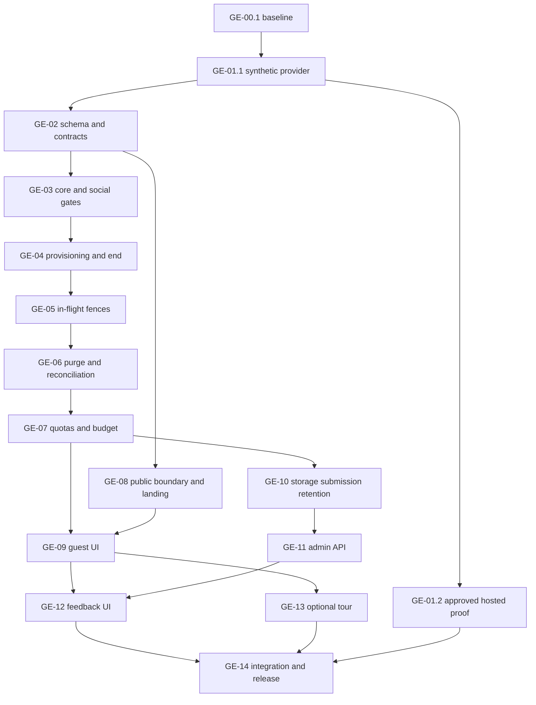

# Guest Experience Implementation Plan

> **For agentic workers:** REQUIRED SUB-SKILL: Use superpowers:subagent-driven-development (recommended when authorized and available) or superpowers:executing-plans to implement this plan task-by-task. Steps use checkbox (`- [ ]`) syntax for tracking. The owner selected a future Claude Sonnet implementation session; this Codex session only writes plans.

**Goal:** Deliver an isolated 7200-second guest trial, public Vietnamese landing, optional onboarding, and unlinked ratings with protected administration.

**Architecture:** Extend the existing FastAPI Auth BFF and private PostgreSQL schema. Immutable database deadlines govern authorization; independently scheduled cleanup removes temporary records. Preserve registered hash routes, personal eligibility/consent, and the one-worker topology.

**Tech Stack:** Python 3.12, FastAPI, SQLAlchemy/psycopg, Alembic, Supabase Auth/PostgreSQL/pgvector; React 19, TypeScript, Vite, React Router 7, CSS tokens, GSAP; pytest, Vitest and Playwright.

**Spec:** The original [summary](../00-feasibility-summary.md), [architecture audit](../01-current-architecture-audit.md), [guest design](../02-guest-auth-design.md), [landing design](../03-landing-onboarding-design.md), [feedback design](../04-feedback-system-design.md), [roadmap](../05-implementation-roadmap.md), [verification plan](../06-testing-and-release-plan.md), [decision register](../07-risks-and-open-decisions.md), and [original handoff](../08-claude-code-handoff.md) remain the approved baseline.

## Global Constraints

- Guest lifetime exactly **7200 seconds from database application grant**, never sliding; deny at `database_time >= guest_expires_at` independently of cleanup and entry flags.
- Keep 16+ personal eligibility, 18+ registered-only social eligibility, explicit AI/MEM/VOICE consent and approved memory. No implicit MATCH/history/semantic-memory consent.
- Existing FastAPI BFF, opaque HttpOnly cookie, CSRF, ownership and provider-session checks remain the security boundary. No browser Supabase SDK or direct private-table access.
- Default false: `GUEST_AUTH_ENABLED`, `GUEST_PAID_ENABLED`, `GUEST_SEMANTIC_ENABLED`, `FEEDBACK_ENABLED`, `FEEDBACK_ADMIN_ENABLED`, `PRODUCT_TOUR_ENABLED`. Never flag off expiry, cleanup or reconciliation.
- Initial limits: 25 AI turns/trial, 6/minute, 1 active/guest, 10 active guest AI globally; 6 voice clips/180 seconds per trial, 2/minute, 1 active/guest, 3 global. Keep existing registered/global capacity checks too.
- Numerical daily guest budget is **unset/unapproved**. Paid guest dispatch fails closed until configured and approved; synthetic providers are only allowed in explicit test fixtures.
- Guest conversion, standalone structured solo activities, Redis, router migration, new AWS resources and analytics platforms are out of scope.
- Preserve all user work and `.gitignore`. Only implementation plans are changed by this planning session. Future implementation uses an isolated feature branch and focused commits; no merge or deployment.
- No hosted mutation, destructive production test, production SQL, paid model call or new infrastructure without separate explicit target/action/budget approval.
- Public copy is natural Vietnamese. Never promise universal erasure at T, cross-device guest recovery, next-day guest quota, or transfer into a registered account.

## Review Focus

1. Lost signup/grant responses and concurrent tabs must recover one lifecycle or reconcile one orphan; owned by GE-04.1/04.2 and GE-06.2.
2. Awaited work crossing T must fail its final authorization/output check; owned by GE-05.1–05.4.
3. Forged peer/profile/staff rows must not expose guests or registered data; owned by GE-03.2 and GE-06.1.
4. Deleting usage and receipts must not reopen spend or retain identity in feedback; owned by GE-07.2 and GE-10.3.
5. Callback credentials, stale UI requests and missing tour targets must not leak or restore private state; owned by GE-08.1, GE-09.2 and GE-13.2.

## Inspected baseline and planning evidence

On 2026-10-28 (Asia/Bangkok), `git rev-parse HEAD` and `git ls-remote origin refs/heads/main` both returned `984753389aa8bd4b3112b19a8beceb1e538fd659`; branch `main`. `git status --short` initially showed only `?? docs/guest-experience/` (the nine supplied audit documents). No tracked source delta exists. No nested AGENTS.md applies beneath docs/backend/frontend; the nested Vercel skill instructions apply only to that skill package.

README, ARCHITECTURE.md, CLAUDE.md, both manifests, all nine audits, OpenAPI's 100 operations, ORM ownership/FKs, auth/security/provider/helper, AI/SSE/memory/voice, deletion worker, frontend entry/callback/navigation/client and validation scripts were inspected. Source locations below name symbols rather than inheriting stale audit line numbers. All new paths/interfaces/test names in these plans are **proposed**, not existing functionality.

Historical audit counts (642 backend, 73 frontend units, 44 selected browser fixtures, 28 synthetic fullstack) are not fresh passes. The initial planning check `python scripts/check_docs.py` passed: 41 Markdown files, 312 local links, 100 API operations, 48 settings, 38 ORM tables. Full application checks are deliberately deferred to GE-00.1 and GE-14; this session changes documentation only. Current hosted Auth/CAPTCHA/provider retention and live image SHA are unverified.

## Plan map and task ownership

There are **15 parent GE IDs and 35 executable subtasks**. A parent may span plans; each numbered subtask has exactly one owner.

| Plan                                                            | Owned task IDs                                             | Purpose                                                                    |
| --------------------------------------------------------------- | ---------------------------------------------------------- | -------------------------------------------------------------------------- |
| [01 Foundation/auth](01-foundation-and-guest-auth.md)           | GE-00.1; GE-01.1–01.2; GE-02.1–02.2; GE-03.1; GE-04.1–04.3 | Baseline, provider, schema/contracts, core authorization, provisioning/end |
| [02 Expiry/permissions](02-guest-expiry-and-permissions.md)     | GE-03.2; GE-05.1–05.4                                      | Social denial, transactions/output, AI/SSE/tools, memory, voice/export     |
| [03 Cleanup/cost](03-guest-cleanup-and-cost-controls.md)        | GE-06.1–06.2; GE-07.1–07.3                                 | Exhaustive purge, worker/orphans, durable quotas and detached budget       |
| [04 Landing/guest UI](04-public-landing-and-guest-ui.md)        | GE-08.1–08.2; GE-09.1–09.2                                 | Callback/public boundary, landing, guest entry and lifecycle UI            |
| [05 Feedback/admin](05-feedback-and-admin.md)                   | GE-10.1–10.3; GE-11.1–11.2; GE-12.1–12.2                   | Unlinked storage/API/retention, staff policy, form/dashboard               |
| [06 Onboarding](06-interactive-onboarding.md)                   | GE-13.1–13.2                                               | Compatibility gate and short optional route-aware tour                     |
| [07 Integration/release](07-integration-testing-and-release.md) | GE-14.1–14.3                                               | Mandatory negative tests, regression, load/recovery, release package       |
| [08 Interface matrix](08-interface-and-dependency-matrix.md)    | Reference only                                             | Full order, interfaces, file/migration ownership and requirement coverage  |
| [09 Sonnet prompt](09-sonnet-implementation-prompt.md)          | Handoff only                                               | Complete English prompt; do not execute in this planning session           |

Execute in the exact total order in plan 08. GE-01.2 is a deliberately deferred external checkpoint after GE-06/07, not a prerequisite that blocks safe local development. GE-08 can be developed with unavailable CTA before guest integration; frontend guest submission consumes backend contracts only after their producers pass. No parallel edits of RealApp/contracts/main/models/migrations.

## Decisions refined from the audit

- Keep audit architecture. New engineering refinements: one bound attempt per intent; 10-minute intent recovery window; explicit provider ambiguity classification; final ASGI private-output guard; immutable DB trigger; stable public-write retry key; detached reservation tokens; exhaustive operation classification; no library dependency before a tour proof.
- Reuse `record_age`, `session_view`, `require_actor`, `transaction`, `match_consent`, `room_gate`, runtime checks, lease-fenced worker patterns, Button/Dialog/StatePanel, avatars/tokens, generated contracts and synthetic fullstack infrastructure. Do not reuse registered tombstone deletion as guest purge.
- Driver.js 1.10.2 is the selected **conditional candidate**, retaining the audit's recommendation. A failing accessibility/CSP spike leaves spotlight off and supplies inline guidance; adopting another library requires a recorded evidence-based deviation, not a second simultaneous dependency.
- Source discrepancy to fix in implementation: current provider verification does not enforce audience/future expiry/anonymous agreement itself; publicWrite has no idempotency key; Auth imports ErrorNotice from RealApp; SSE checks once per batch; `require_staff` is tied to moderation flag. Tasks name each correction.

## Open owner decisions and release gates

| Decision (all unresolved)         | Safe implementation default                                                                                                                                  | Work that proceeds                                         | Exact hold                                                                                             |
| --------------------------------- | ------------------------------------------------------------------------------------------------------------------------------------------------------------ | ---------------------------------------------------------- | ------------------------------------------------------------------------------------------------------ |
| D01 deletion/retention disclosure | Exact cutoff; proposed healthy cleanup start ≤60s, completion ≤5min; security HMAC ≤24h; detached daily cost totals proposed 30d; disclose backups/providers | All local lifecycle/privacy tests with flags off           | Public guest entry/copy approval and G3                                                                |
| D02 operating budget              | `GUEST_DAILY_BUDGET_USD` unset; `GUEST_PAID_ENABLED=false`; no guessed dollar cap                                                                            | Synthetic quota/accounting/UI tests, personal journal work | Any paid guest AI/STT/embed dispatch and G4; real-model tests also need separate budget                |
| D03 feedback retention            | 180d proposed, `FEEDBACK_ENABLED=false`                                                                                                                      | Synthetic collection/admin/retention                       | Public feedback collection/disclosure and G3/G5                                                        |
| D04 hosted test target            | No approved non-production target assumed                                                                                                                    | Local provider/SQL/HTTP fixtures                           | GE-01.2 hosted proof and G1; production SQL/settings/deployment need a later separate release decision |

Existing external-provider/backup/log review and upstream ≥60 signup burst/CAPTCHA proof are technical gates under D01/D04, not invented approvals. If literal all-copy erasure at T is required, that requirement remains blocked. Unexpected peer safety evidence during cleanup is an incident requiring a retention decision; do not erase registered counterpart evidence to achieve a row-count pass.

## Skills and implementation method

Read/applied for planning: local `.agents/skills/using-superpowers/SKILL.md`, `.agents/skills/writing-plans/SKILL.md`, Supabase/Postgres planning guidance, and `.agents/skills/verification-before-completion/SKILL.md`. Existing approved design substitutes for new brainstorming per explicit owner instruction. No feature-execution skill was used to implement code.

For Sonnet, the local kit contains `executing-plans`, `subagent-driven-development`, `test-driven-development`, `systematic-debugging`, `verification-before-completion`, `requesting-code-review`; read their actual SKILL.md at execution. `finishing-a-development-branch` exists in this machine's installed Superpowers 7.0.1 plugin, but not the project-local `.agents/skills/` copy: discover it in the future runtime, report missing if unavailable, and keep the branch. The portable CLAUDE.md skills are fallbacks, not claims of an active plugin/hook. Prefer inline Sonnet execution with a durable ledger and independent phase/final review where available; never fabricate agent tools or repeat ordinary approval questions. Subagent-driven execution is appropriate only with applicable authorization/tool support. No merge/deploy choices are authorized by generic finishing-skill menus.

## Definition of Done

Every task records RED/GREEN commands, result counts, regression output, reviewed diff, focused commit, deviations and limitations in `docs/guest-experience/implementation/evidence/execution.md` on the implementation branch. Steps are small checkable actions; complex test matrices are parameterized rather than giant feature commits. New tests listed here must actually be created; references do not assert present tests.

Required application completion: static/type/unit/API/PostgreSQL/migrations/contracts/build/browser/fullstack checks, all 25 negative scenarios in plan 07, registered regression, mobile/desktop/keyboard/loading/error/empty states, one-worker recovery/cost/load proof and truthful manual/hosted gaps. Any failed critical authorization/privacy test is FAIL; essential unavailable external checks are PARTIAL. Planning status is **CONDITIONALLY_READY**: local implementation can start; public release is gated by D01–D04 and G0–G6.
