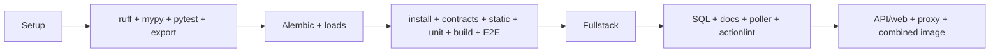

# Baseline CI, bottlenecks và độ tin cậy

Nguồn đo: 35 recent verify runs lấy ngày 2026-11-02; job/step timestamps của 8 successful runs, cộng run failed của đúng source HEAD. [Raw runs](evidence/github-runs.json), [summary sinh tự động](evidence/ci-baseline.json), [script tái tạo](benchmark_metadata.py). GitHub connector jobs không trả timestamps, nên timing được lấy read-only bằng `gh api`; logs excerpts lấy qua GitHub connector. Không dùng screenshot hoặc README làm timing.

## Successful sample

Thời gian bên dưới là **job execution**, không gồm toàn bộ queue; mỗi workflow chỉ có một job nên job-sum = critical-path job duration. Workflow wall-clock tính từ run `createdAt` đến job `completed_at`, được lưu riêng trong JSON. Đây không phải billed minutes sau rounding hay usage invoice.

| Run / date UTC | Branch / SHA | Job duration | Backend step | Frontend/contract/browser | Full-stack |
|---|---|---:|---:|---:|---:|
| [41407789936](https://github.com/mhiu05/MoodPrint/actions/runs/41407789936), 02-11 | test/11-2 / 732ec921 | 29:22 | 13:22 | 7:27 | 5:47 |
| [41407212151](https://github.com/mhiu05/MoodPrint/actions/runs/41407212151), 02-11 | fix/release-poller-oci-subject / d1e61323 | 18:50 | 6:55 | 5:38 | 3:53 |
| [41298504384](https://github.com/mhiu05/MoodPrint/actions/runs/41298504384), 01-11 | main / 732ec921 | 23:43 | 9:31 | 6:23 | 5:15 |
| [41230681781](https://github.com/mhiu05/MoodPrint/actions/runs/41230681781), 31-10 | main / 94ef40fc | 20:22 | 7:40 | 6:02 | 4:03 |
| [41228716652](https://github.com/mhiu05/MoodPrint/actions/runs/41228716652), 31-10 | PR / 6907d9e1 | 23:36 | 9:32 | 6:52 | 4:31 |
| [41228708635](https://github.com/mhiu05/MoodPrint/actions/runs/41228708635), 31-10 | push / 6907d9e1 | 23:53 | 9:34 | 6:59 | 4:29 |
| [41224080347](https://github.com/mhiu05/MoodPrint/actions/runs/41224080347), 31-10 | PR / 1d595aec | 21:05 | 7:59 | 6:09 | 4:05 |
| [41224076860](https://github.com/mhiu05/MoodPrint/actions/runs/41224076860), 31-10 | push / 1d595aec | 23:54 | 9:27 | 7:04 | 4:31 |

Median job **1.419,5 s = 23:39,5**, min 18:50, max 29:22. Suite đã phát triển giữa các SHA; không coi sample nhiều workload này là A/B experiment. Cùng SHA `732ec921` khác branch cho thời gian khác nhiều; runner/host/load/cache phải được ghi trong benchmark mới. Main tham chiếu workflow wall-clock **1.426 s = 23:46**, job **1.423 s**; startup/queue khoảng 3 s cho run đó.

## Xác minh số tham khảo và các steps chậm

Run main `41298504384` xác minh khá sát con số người dùng cung cấp: 9:31 backend + 6:23 frontend/browser + 5:15 full-stack + **2:34 các phần còn lại** = 23:43 job. Không cộng median của từng step rồi gọi đó là median tổng.

| Work | Main run seconds | Median của 8 jobs | Giải thích |
|---|---:|---:|---|
| PostgreSQL service initialize | 13 | 13 | Không phải dependency installation |
| Checkout / Node cache restore | 1 / 5 | 1 / 3 | npm download cache có hit ở main log |
| pipx uv install | 3 | 3 | Không uv cache persistence |
| Provision + uv sync | 6 | 5 | Python download/deps nằm cùng step; chưa phân tách timer |
| Ruff + mypy + pytest + OpenAPI export | 571 | 569 | Bottleneck lớn nhất; pytest main tự báo 524,90 s |
| Alembic upgrade/check + 2 synthetic loads | 45 | 50 | Một step tổng hợp; không biết từng load theo API timestamps |
| npm ci/audit/contracts/tsc/Vitest/build/browser install/E2E | 383 | 397,5 | Browser chiếm phần lớn |
| Full-stack harness + 50 browser journeys | 315 | 270 | Một worker, cùng DB/actors có state |
| SQL approvals/docs/unittest/actionlint | 0 / 0 / 0 / 2 | 0 / 0 / 0,5 / 2 | API timestamps độ phân giải giây; 0 không nghĩa không tốn CPU |
| API/web Docker + Compose/Caddy/proxy checks | 48 | 50 | Phải giữ runtime packaging boundary |
| Combined SPA/API Docker | 27 | 30,5 | Variant khác được supported; chưa có lý do bỏ |

[Main log excerpts](evidence/main-ci-log-excerpts.txt) cho thêm số đo bên trong steps:

- Ruff báo success sau khoảng 0,06 s kể từ step start; mypy success ở `10:41:02.961Z`, khoảng 13,7 s sau Ruff. Đây là intervals log, không phải profiler từng process.
- Pytest: **1.711 pass, 4 skip, 524,90 s**. Không có `--durations`/JUnit trong current CI, nên chưa xác định slowest backend test/setup chính xác.
- Vitest: **34 files, 217 cases, 2,06 s**; Node test runner khoảng 0,062 s. Không có lý do cắt unit coverage vì tốc độ.
- npm ci kết thúc audit mặc định lúc `10:51:09.544Z`, explicit audit báo tiếp `10:51:09.935Z`; hai lượt audit cùng trạng thái zero vulnerabilities. Có thể dùng `npm ci --no-audit` và giữ explicit blocking audit.
- Frontend build command bắt đầu `10:51:18.966Z`, Vite báo build xong `10:51:26.194Z`; browser command `10:51:39.906Z`. Khoảng **13,7 s giữa build completion và browser command** bao gồm install OS/browser; không gán toàn bộ thành download cache miss.
- Chromium và headless-shell được download mới; E2E **398 pass / 5,8 phút**; full-stack **50 pass / 5,2 phút**. Hai reports là suite duration, khác step tổng chứa startup/setup.
- Docker logs xác nhận hai frontend Docker contexts đều chạy npm ci/build, thêm vào host build. Đó là lặp công việc build, song vẫn bảo vệ boundary khác; chưa thể xóa một lần mà không thay thế guard.

Local Windows: pytest `-m 'not postgres and not live'` **692 pass, 155 skip, 868 deselected / 37,41 s**; slowest reported call là reviewed Alembic artifacts **9,18 s**, initialization approvals **2,32 s**. Số liệu này chỉ hướng profiling, không thể quy đổi thành savings trên Linux. Local Vitest 217 pass. Unittest Windows lỗi import `fcntl`; main Linux logs có 19 tests pass. Không chạy local full-stack, hosted writes hoặc Docker builds trong audit.

## HEAD thất bại: không gộp vào successful median

[Run 41410267512](https://github.com/mhiu05/MoodPrint/actions/runs/41410267512) tại `a3af3d4c` thất bại full-stack: 49 pass/1 fail, V3-D group picker tại `v3.spec.ts:150`. Pytest 1.711 pass/4 skip (625,18 s), Vitest217 và mocked UI398 pass trước đó. Các steps sau full-stack được skipped, không có packaging/SQL/docs/unittest evidence cho HEAD từ run này. [Excerpts](evidence/head-ci-failure-excerpts.txt).

Không kết luận flaky từ một failure. Trace và focus/caret instrumentation phải phân biệt test typing quá sớm với user-visible deferred caret update. Source `GroupChat.tsx` dùng rAF sau chọn mention là giả thuyết có căn cứ; chỉ reproduction mới chốt nguyên nhân. Hai docs links có sẵn cũng lỗi offline, dù run không tới docs step.

## Triggers, DAG, duplication và release

`verify.yml`: `on: [push, pull_request]` không branch/path filters, không concurrency. Một job `verify`, timeout40 phút, PostgreSQL service. Bash multi-line `run` có fail-fast nên failure sớm chặn mọi step phía sau. Không có upload timing artifacts khi success; chỉ giữ browser failure evidence 3 ngày. Chưa có backend JUnit/per-test artifacts.

True dependencies: contracts generation cần exported OpenAPI; full-stack cần installed Node/Python/browser và owned DB, **không cần** result backend pytest/mocked UI; packaging cần source/lockfiles, không cần pytest artifact. Các guards tự thân độc lập và có thể fail fast ở lane riêng. Migrations và load phải có DB riêng với pytest/full-stack khi parallel.

Mẫu35 runs có **8 push/PR source-head pairs**, 2 cặp cả hai success: `6907d9e1` và `1d595aec`. Không khẳng định cancellation là tự động: source verify không có cancel rule, history không đủ để biết người/automation nào hủy. Cùng SHA push ở main và feature branch cũng xuất hiện; không loại main run vì publisher bắt buộc successful push-main.

Publisher DAG là `validate → build → publish_gate → publish`. Nó trigger completed verify trên main hoặc manual dispatch. `validate` chỉ cho successful push/main/same repo, SHA40hex=current main, workflowID **394882427**, workflow path và successful run; manual còn owner + exact approval string. Publication hold được kiểm tra từ candidate checkout. Build chưa có registry write; artifact image IDs/labels được verify; recheck current main trước quyền publish và trước manifest; immutable digests, manifest và OCI attestations được tạo. Host poller revalidates source/main/CI/publish run/attestations rồi gọi deploy. Đổi tên verify workflow/file hoặc thay success thành skipped/full subset sẽ phá trust chain.

Classic branch protection API trả **404 “Branch not protected”**; effective branch rules API trả `[]` tại thời điểm audit. [Classic response](evidence/branch-protection.txt), [effective rules](evidence/main-effective-rules.json). Điều này cho thấy chưa quan sát được required checks đang enforced qua hai API; không suy rộng thành mọi organization policy đều absent. Thiết lập required aggregate check phải là task vận hành có xác nhận owner, không âm thầm thay settings trong audit.

Manual dispatch có một command issue riêng: nhánh `if [[ -z "$CI_RUN_ID" ]]` trong publisher dùng `gh api .../runs -f head_sha=...` cùng các fields khác, không có `--method GET`. Local `gh api --help` và [GitHub CLI manual](https://cli.github.com/manual/gh_api) xác nhận fields làm default method thành POST. Suy luận: lookup read-only có thể fail trước provenance validation khi manual dispatch cần tìm run. Chưa thử request POST/dispatch/publish trong audit. Fix đề xuất là explicit GET với nguyên bộ filters/validations, không bỏ gate.

## Critical path đề xuất và trade-offs

Giữ workload không đổi, tách parallel lanes đưa mô hình từ tổng `backend + browser + fullstack + migration + package + policy` thành `plan + max(lane durations) + verify`. Nếu backend vẫn khoảng9,5 phút, thêm setup/artifact overhead và runner variation, **ESTIMATE median11–15 phút**, p90 mục tiêu≤18 phút. Không lấy `23,7 / số jobs` để ước lượng. Bị giới hạn concurrency runner có thể làm critical path dài hơn; tổng runner-minutes có thể tăng do provisioning/npm/browser install lặp.

Ưu tiên đo pytest setup và chạy independent lanes. Caching browsers có main-run install overhead chỉ khoảng14 s trước command nên không chắc lợi hơn restore/save; cache UV là giảm repeated setup sau split; Docker BuildKit có ích cho repeated packaging/publish nhưng verify và publish vẫn phải trust đúng inputs và immutable identity. [Target CI](04-target-ci-architecture.md), [benchmark experiment](07-validation-and-benchmark-plan.md).
