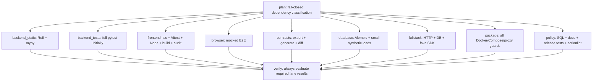

# Kiến trúc CI mục tiêu và invariants release

Giữ `.github/workflows/verify.yml`, workflow name **Verify local application**, workflow ID **394882427** và aggregate job/check name **verify**. Không tạo workflow thay thế rồi coi ID tương đương. Current publisher và `deploy/aws/poll_release.py` kiểm ID/path/name/event/source rất chặt; sửa DAG bên trong workflow trước, contract release giữ nguyên.

## DAG triển khai theo hai bước

Trước selection, mọi lane chạy full để so parity; chưa tách backend unit/integration theo marker cho đến P2-01 hoàn tất. Static checks không cần DB. Full-stack/migration có owned DB riêng. Không shard full-stack bằng nhiều workers với accounts/global controls hiện tại.

Đây là lane ownership; có thể gộp static+policy vào một runner nếu measured startup > net saving. Không tăng số jobs chỉ để đạt sơ đồ. `backend_tests` sau taxonomy có hai jobs `backend_unit`, `backend_integration`, collection manifests phải union bằng full baseline và intersection rỗng; security/migration tags là selection dependencies chứ không test chạy hai lần mặc định.

Contracts lane tự install Python+Node, export OpenAPI từ cùng checkout, generate TypeScript, diff cả hai tracked artifacts; không trust user-provided artifact từ PR hay cache. Frontend lane có thể typecheck/build từ committed contract vì drift lane blocking. Full-stack dùng own Node/Python/browser/DB setup và fake SDK; không cần `needs: backend_tests` hoặc `browser`. Package build các contexts độc lập; không cần backend test result để bắt đầu, nhưng publication vẫn chờ full verify workflow thành công.

## Aggregate check đúng khi skip/fail/cancel

`verify` dùng `if: ${{ always() }}`, needs toàn bộ lanes và planner. Planner produce versioned outputs `selection_version=1`, `mode=full|selected`, từng lane `true|false`, `reason_codes` không chứa secret. Gate kiểm:

1. Planner success, manifest schema hợp lệ, mọi known lane có boolean; không unknown/missing values.
2. Lane selected=true phải `result == success`; failure/cancelled/skipped đều FAIL.
3. Lane selected=false chỉ được `result == skipped`, và policy cho event/path matrix cho phép skip đó; không tự suy “skipped là pass”.
4. `push main` bắt buộc modefull, tất cả release-relevant lanes selected=true, **không cho docs-only shortcut trên main**. Workflow overall success chỉ khi gate và mọi mandatory jobs success.
5. PR checkout là merge ref thông thường; report source head SHA và actual `git rev-parse HEAD` riêng. Publication chỉ nhận push-main exact SHA, không PR green hoặc dispatch-only green.

Unit tests pure `scripts/ci/selection.py` và gate decision helper phải cover fail/cancel/skip/unknown/planner failure, malicious paths, truncated diffs, main docs-only, cross-stack input, merge_group nếu enabled. Actionlint kiểm expression; expression outcomes phải được exercised bằng dry-run/injected failure runs trên PR trước chuyển required check. Không chỉ unit-test một helper mà workflow không gọi.

## Events và concurrency

Đề xuất `push` chỉ main, `pull_request` giữ tất cả PR, thêm `workflow_dispatch` full verify cho branch chưa có PR. Chấp nhận trade-off: feature branch không có PR không có automatic full push CI; local/manual vẫn có. Không loại push-main, không phát hành từ successful PR. Nếu repository dùng merge queue sau này thêm `merge_group`, luôn full, không tự giả định hiện đang dùng.

Chỉ PR được cancel khi superseded. Ví dụ group `${{ github.workflow }}-${{ github.event_name == 'pull_request' && format('pr-{0}', github.event.pull_request.number) || format('run-{0}', github.run_id) }}`, `cancel-in-progress: ${{ github.event_name == 'pull_request' }}`. Main/manual mỗi run có group riêng; tránh pending main run bị thay thế dù `cancel-in-progress:false` trong group chung. Không dùng `github.ref` chung cho PR và main publication. Giữ publisher group `moodprint-staging-release` với cancel=false và các latest-main rechecks; không đổi sang cancel running releases.

Không đặt `paths-ignore` ở workflow trigger cho required checks: check có thể không được tạo. Planner chạy trong workflow mọi PR; docs-only lanes skipped có explanation và aggregate check thật. [GitHub workflow syntax](https://docs.github.com/en/actions/reference/workflows-and-actions/workflow-syntax) mô tả filter/needs/conditions/concurrency; plan cần kiểm lại semantics bằng fixture workflows lúc implementation.

## Dependency-based selection

Implementation dùng `scripts/ci/dependencies.json`, `selection.py`, `test_selection.py` (đều mới), không dựa extension. Input paths từ git diff merge base PR base/head, bao gồm old và new path cho rename; main full. Fetch đủ base, không đếm file bằng GitHub300-file UI limit. Missing base/history, diff error/truncation, unknown path, selector/toolchain/workflow change đều fallback **full**. Không execute PR path string qua shell interpolation.

| Changed paths | Minimum selected lanes, ngoài planner/aggregate |
|---|---|
| Chỉ `docs/**`, README không executable/schema inventory | policy; docs inventories liên quan contracts/config/schema phải kéo lane tương ứng; main vẫn full |
| Frontend UI/components/features | frontend + browser + fullstack; package nếu runtime assets/CSP/build boundary thay đổi |
| `frontend/src/api/**`, generated schema, backend OpenAPI | frontend + browser + contracts + backend tests + fullstack + package |
| Backend module feature | backend static/unit/integration + contracts + fullstack; browser/frontend nếu DTO/taxonomy/feature flag/public config ảnh hưởng; package |
| `backend/app/core/**`, auth, guests, consent, privacy, infrastructure | mọi security-dependent backend/frontend/browser/contract/DB/fullstack/package/policy lanes |
| `backend/alembic/**`, reviewed SQL, runtime roles/storage SQL | database + backend tests + contracts + browser/frontend/fullstack + package + policy |
| Docker/Compose/Caddy/AWS deploy/scripts | package + policy + runtime/backend config tests + DB/fullstack; same-origin/auth/CSP kéo browser |
| Shared taxonomy/contracts/SDK/runtime dependencies | toàn bộ consumer closure, mặc định full nếu chưa có audited graph edge |
| Lockfiles/pyproject/package.json/TS/Vite/PW config, workflow/selector/safety scripts | full |
| Backend/frontend tests/helpers/fixtures | owning lane + transitive consumer lanes; test-only không phải skip integration |
| Unknown hoặc mixed/cross-stack change | union closure; fallback full nếu không phân loại chắc chắn |

Planner phải emit `selected_lanes`, `changed_paths_hash`, `base_sha`, `head_sha`, reasons trong content-free artifact. Không upload changed file contents. Ban đầu chạy shadow: execute full nhưng lưu plannedselection; phát hiện mọi full-suite failure nằm ngoài subset dự kiến rồi sửa graph trước bật skip.

## Cache/reproducibility

| Cache | Key/trust rule | Measurement/decision |
|---|---|---|
| uv | Pinned uv0.11.14 + Python3.12.13, OS/arch, hash `backend/uv.lock`; `uv sync --locked` mọi lane; cache download/wheels, không `.env`/venv state | Đo restore/save và install; official setup-uv support theo [uv GitHub guide](https://docs.astral.sh/uv/guides/integration/github/); pin action SHA tại implementation |
| npm | Giữ setup-node npm cache theo package-lock, Node22/OS/arch; `npm ci --no-audit`, explicit audit vẫn blocking | Không cache node_modules mutable; log cache hit/lock key/Node exact patch |
| Playwright | OS/arch + package-lock/Playwright version; browsers only, vẫn install system dependencies | Restore/save có thể đắt hơn download~seconds; thử nghiệm, không mặc định bật |
| BuildKit | `gha` scope riêng api/web/combined, platformlinux/amd64, Dockerfile+locks+context; build final verification giữ nguyên | Không cache runtime env/secrets; untrusted PR không ghi release-trusted cache; measure cold/warm; pinned recipes và labels vẫn kiểm |

Reproducible install không đồng nghĩa identical image bytes: base tags, timestamps và network state có thể đổi. Current publisher rebuild sau verification, --pull, rồi attests actual digests. Giữ logic này ở refactor ban đầu; reuse verify images là project trust/provenance riêng, chỉ làm sau khi chứng minh same immutable inputs, source labels và safe artifacts. Không lấy cache hit thay cho verification.

## Release/main protection và rollout

Classic protection/effective rules chưa enforce check được quan sát; thiết lập `verify` required qua owner-managed settings chỉ sau check name ổn định xuất hiện. Không thay rule trước khi workflow phát ra check, không bypass admins/merge queue requirements bằng đổi tên.

Phases rollout: full lanes shadow → aggregate parity/injected failure → trigger cleanup → parallelfull main → selection shadow PR → selected PR canary → full main release drill. Các invariant từ `deploy-staging.yml`, publication hold, immutable manifest/digests và poller được snapshot tests bảo vệ. Workflow_run event/ID/path/currentmain validations được giữ, không chuyển sang tìm “latest successful run” của bất kỳ SHA. Metrics/rollback ở [07](07-validation-and-benchmark-plan.md).

## Chi phí và mục tiêu

**ESTIMATE**: full median11–15 phút/p90≤18 phút, PR selected3–7 phút, docs-only<2 phút. Budget runner-seconds mục tiêu≤120% matched full baseline sau split; tính cả repeat setup, cache I/O và failed runs. Nếu runner quota gây queue, ưu tiên 5–6 practical jobs thay vì tối đa lanes; không chạy 10 independent fresh environments nếu không có lợi đo được.
