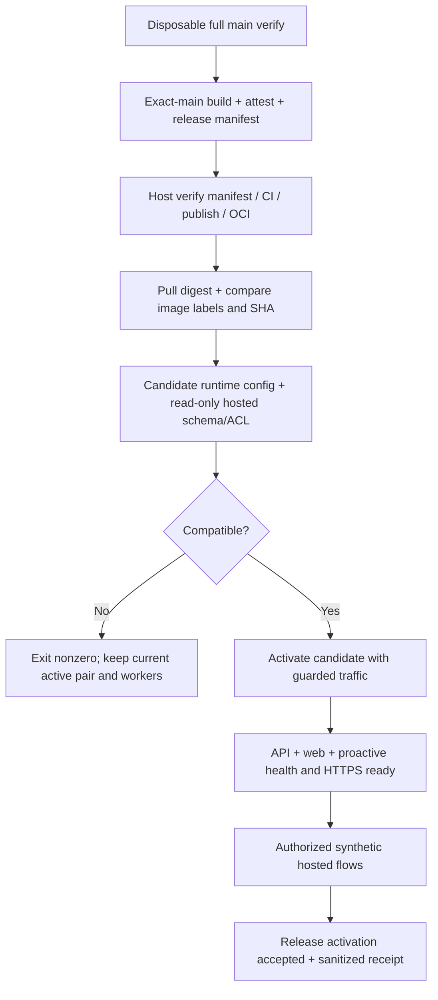

# Production compatibility và release safety

**P0 về rủi ro. Chỉ thiết kế; audit không deploy, migrate, sửa config hoặc chạy hosted smoke ghi dữ liệu.** Hosted metadata đọc ngày02-11-2026 xác nhận revision0020 và thiếu columns/tables mà source0024 dùng. [Evidence và query read-only](evidence/hosted-schema-readonly.json). Không được suy đang có incident trên EC2 khi chưa biết deployed digest/SHA.

## Hiện trạng và giới hạn từng gate

| Gate hiện có | Source / behavior | Khoảng trống |
|---|---|---|
| Exact main CI provenance | Publisher `validate`, rechecks; poller `validate_ci_run`, `validate_publish_run` | Chứng minh candidate đã qua disposable CI, không biết hosted schema/config |
| Immutable image/attestation | Manifest schema1, SHA40hex, digest refs, OCI revision labels, gh attestation verify | Chưa có observed running image/report sau deploy; env `RELEASE_SHA` một mình không đủ |
| API readiness | `main.py`: select1, version trong `READY_REVISIONS`, Auth helper presence | Chưa kiểm required columns/ACL; head stamp sai có thể lọt; public error cố ý không nói schema details |
| Compose health | Compose api ready endpoint override Dockerfile live health | Backend/root Dockerfile riêng chỉ health/live; gate không được dựa live200 |
| Deploy health/rollback | `deploy.sh` up rồi chờ api/web + HTTPS ready; image rollback khi failed | Chạy sau thay active; không chờ proactive; chưa preflight candidate với actual runtime role |
| Worker | `app.jobs.proactive --health` heartbeat; Compose health | Heartbeat có thể sống dù job query thiếu schema; cần shared schema readiness + operational idle-vs-enabled checks |
| Hosted helper tools | `inspect_database.py`, `check_config.py`, `verify_runtime_role.py` | Không tự gọi tất cả; một số scripts dùng migration-owner credentials; report phải phân biệt connector/admin role và app runtime role |

`scripts/test_staging_proxy.sh` mong ready503 vì không DB; đó là negative packaging test chính xác, không healthy-hosted acceptance. `test_supabase_fullstack.py` có fixture writes/reset option, không thay cho read-only preflight. Tham khảo [Supabase observability](https://supabase.com/docs/guides/observability) để chọn metadata/log/advisor checks có phạm vi; không thu raw user data. [Changelog](https://supabase.com/changelog) được kiểm trong audit; không có lý do đổi model/API hoặc schema workflow sang Supabase CLI: source đang dùng **Alembic**.

## Thiết kế contract chung

Tạo `backend/app/core/compatibility.py` (không startup application/background tasks khi chạy CLI), `scripts/export_compatibility.py` và generated `backend/compatibility.json`. Dữ liệu được versioned/cross-checked với `app/core/revisions.py` và `alembic heads` trong required CI. Proposed schema1:

```json
{
  "schema_version": 1,
  "accepted_revisions": ["0024_three_agent_groups"],
  "required_columns": {
    "moodprint.ai_runs": ["origin", "parent_run_id"],
    "moodprint.ai_conversations": ["kind", "active_agent", "active_agent_since"],
    "moodprint.ai_messages": ["mentions"]
  },
  "required_tables": ["moodprint.ai_proactive_jobs", "moodprint.ai_sharing_permissions", "moodprint.ai_collaborations", "moodprint.ai_orchestration_steps", "moodprint.ai_group_members"],
  "required_functions": ["moodprint.is_provider_session_active(uuid,uuid)"],
  "migration_policy": "operator-reviewed-no-automatic-migration"
}
```

Đây là minimum named regression contract, không exhaustive ORM schema checker. Implementation enumerate mọi current-head required object từ migration0021–0024/ORM và kiểm defaults/types/constraints/ACL cần thiết; không thêm bảng `ai_groups` vì group conversations dùng `ai_conversations` + `ai_group_members`. Lưu required privilege matrix SELECT/INSERT/UPDATE/DELETE/sequence/function theo runtime path; sử dụng **catalog `has_*_privilege`**, không trial INSERT/UPDATE để chứng minh privilege. Có privilege không chứng minh RLS semantic correctness; disposable role-matrix tests và authorized synthetic smoke bổ sung phần đó.

Interfaces chốt cho implementation:

- `async inspect_compatibility(connection, *, accepted_revisions: tuple[str, ...]) -> CompatibilityReport`; report typed gồm `compatible: bool`, `observed_revisions: list[str]`, `reason_codes: list[str]`, `checks: dict[str, bool]`. Không đưa DSN/user IDs/text/secrets vào report.
- `python -m app.core.compatibility --format json`: dùng Settings validation và runtime DSN, transaction **READ ONLY**, connect/query timeout bounded; exit0 compatible, exit2 incompatible/config invalid, exit3 inspection unavailable. CLI không migrate/stamp/write grants hoặc auto-fallback schema.
- `python scripts/export_compatibility.py --check`: chỉ đọc source/contract, exit1 khi drift. CLI export và backend Docker copy manifest; exact image attestation binds bytes và SHA.
- `/api/v1/health/ready` gọi shared inspector hoặc shared primitive checks, trả generic ready200 / NOT_READY503. Không expose revision/privileges/DSN publicly. `/health/live` vẫn chỉ process liveness.

Kiểm tất cả `alembic_version` rows, không scalar(first-row) để bỏ qua multi-head lạ. Current accepted tuple chỉ0024; chưa có evidence để chấp nhận0020/0023 hoặc future unknown revisions.

## Vị trí gates trong pipeline



Artifact publication có thể diễn ra khi hosted chưa migrate: registry publication không traffic activation. Không thêm production secrets vào PR workflow. **Hard blocking preflight ở host sau provenance, trước khi ghi active file/up** là final authority; optional environment-controlled readiness report trước publication chỉ bổ sung, không thay host check.

### G1 — Identity và baseline đang chạy

Read-only inspection trên host qua operator-owned bounded tool: record expected mainSHA/manifestCIrun/publishrun, `docker inspect` running API/web/proactive `.Image`, image RepoDigests/labels, config hash (không env values), active/previous digest refs. Environment `RELEASE_SHA` phải match nhưng không là sole proof. OCI manifest digest khác local config image ID; không so chúng như cùng loại hash. Nếu tag/digest/label/container mismatch, Hold với reasoncode; không tự sửa state.

Không in `docker inspect` toàn payload vì Config.Env có secrets; chỉ format allowlisted fields. Không upload SSM SecureString hoặc `.env`. API public endpoint không cần trả private deployment manifest; sanitized internal receipt đủ audit.

### G2 — Candidate preflight trước cutover

`deploy.sh` sau compose pull nhưng trước `install candidate active`/`up`: run candidate API image một lần với production env file root-owned0600, explicit `--entrypoint ...python -m app.core.compatibility`, no service app startup, network nội bộ phù hợp DB route. Dùng runtime credentials cùng role/pooler mode như API/worker. Timeout không quá30s, DB transaction read-only, statement timeout5s/lock2s/connect5s; compare observed revision/catalog/function/ACL/settings with candidate contract.

Settings validation giữ `APP_ENV=production`, HTTPS frontend origin, secure cookies/CSRF, auth/key presence khi enabled, AI/STT/embedding feature combinations, pool budgets của API+worker, source SHA syntax và exact worker enabled state. Báo booleans/reasoncodes, không raw errors/DSNs. Kiểm AI key **presence/config** không gọi AI để kiểm validity ở gate này.

Incompatible/unavailable/config invalid đều nonzero; giữ old active/previous state, không stop old containers/workers, xóa chỉ candidate temp env do run tạo. Poller ghi held state không phải deployedSHA và retry có bounded backoff/reasoncodes, không lặp deployment vô hạn mỗi poll. Không auto `alembic upgrade head`, không revision stamp, không tự cấp quyền.

### G3 — Controlled activation, readiness và worker

Tiếp tục check Compose health + HTTPS ready. Include `proactive` container trong deploy health khi service tồn tại; dù worker disabled vẫn phải đúng image/config/schema và heartbeat idle hợp lệ. Khi enabled, readiness/check schema phải precede materialization. Không chạy worker production mới nếu DB compatibility chưa qua.

Nếu API/web healthy nhưng worker unhealthy hoặc endpoint ready503, deploy failed. Một protected synthetic smoke có thể cần maintenance gate/token đã có `release_gate.py`; tool hiện **không fence background workers**, nên operator rollout phải kiểm separately. Automated blue/green traffic design chưa được chứng minh ở một-host Compose hiện tại; không gọi health-after-up là zero-downtime pre-traffic validation. Nếu cần blocking smoke trước public traffic, thêm explicit maintenance/blue-green design và test; không hứa gate đã làm được việc đó.

### G4 — Hosted synthetic smoke

Tạo runner mới `scripts/hosted_release_smoke.py`, không reuse reset helper vô điều kiện. Chỉ chạy khi exact allowlisted environment/domain/project và approved synthetic A/B accounts được cấu hình out-of-band. Refuse missing accounts, arbitrary IDs, production real user, unknown target; fixtures phải có ownership marker và cleanup plan. Redact cookies/passwords/CAPTCHA/signed URLs; trace/video/screenshot mặc định off như hosted browser configs đang làm.

Flow tối thiểu: login synthetic account → session/18+ ready → own journal read + isolated peer denial → AI history read; group/message rendering khi feature on; logout/revoked session denial. Persistence create/edit/upload/delete chỉ nếu target/account/data mutations được authorized cụ thể; không được chạy trong audit read-only này. AI response live không required để xác nhận DB/login compatibility; fake provider không được inject vào serving production để làm smoke xanh. Nếu smoke đòi paid AI thì chuyển riêng budget-approved live evaluation.

Report `{release_sha, api_digest, web_digest, observed_schema, checks:{...}, smoke_status, observed_at}` không content. Missing approved smoke config phải report **BLOCKED/NOT_RUN**, không pass; release activation policy quy định hard-block nếu smoke là mandatory cho target đó.

## Migration mismatch và rollback

| Tình huống | Hành vi bắt buộc |
|---|---|
| Hosted0020, candidate0024 | Hold trước cutover; cung cấp missing-object/revision reasoncodes. Operator review chain0021–0024, review SQL hashes/ACL/extensions và preservation rehearsal; audit không thực thi |
| Hosted claims0024 nhưng thiếu column/table/function/grant | Hold catalog/runtime-role mismatch; không stamp lại hoặc create missing objects tự động |
| DB unavailable hoặc query timeout | Fail closed preflight; giữ deployment hiện tại, bounded retry, không coi unknown là compatible |
| Main đổi sau publish/verify | Existing current-main/poller recheck skip candidate, không tìm SHA khác để deploy |
| Post-deploy ready/worker/smoke fail | Restore verified previous image refs nếu **previous image đã chứng minh compatible với current DB**; verify health và receipt, báo failure |
| Không có compatible previous pair | Giữ maintenance fence/stop failed first deployment theo existing policy; operator intervention, không downgrade DB tự động |

Expand-only migration không tự chứng minh rollback safe: previous image có `READY_REVISIONS` strict0023 sẽ từ chối schema0024 dù ORM-compatible. Phải rehearse exact previous/fallback image trên post-migration schema và chuẩn bị fallback accepted window đã review **trước migration**. Không nới tuple cho future head tùy tiện. DB downgrade/restore là operator-approved incident procedure, khác image rollback; cần backup/restore evidence, không chạy destructive migration trong CI hosted job.

## Regression cases để gate có giá trị

Tests bắt buộc:0020/0023 reject,0024 complete pass,unknown/future/multihead reject, false0024 missingorigin/proactive reject, missingAuthhelper/grant reject, runtime-role denied access vs owner pass, config unsafe/refused, CLI network timeout sanitized, candidate image label/digest mismatch, no active-state write on preflight failure, worker unhealthy fail, previous-image incompatible rollback Hold, smoke target/account refusal, token redaction. Run tests với disposable DB và fake Docker/SSM/GitHub để verify no writes/cutover ở failure paths; host rehearsal chỉ authorized isolated target.

Release manifest schema1 giữ nguyên trong initial gates: compatibility file đi bên trong attested API image. Validator hiện kiểm required fields và version, vẫn cho phép extra keys; không được xem khả năng đó là một versioned compatibility contract đã được thiết kế. Nếu cần manifest schema2, publisher/poller rollout và versioned tests là task riêng, không lẫn vào cache/parallelization.
