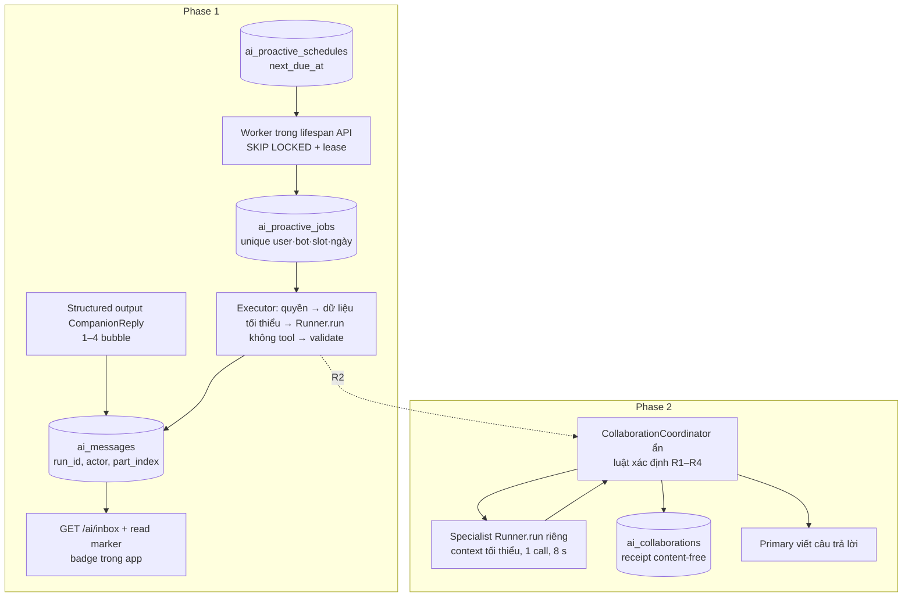

# 00 — Tóm tắt điều hành: Trợ lý chủ động và cộng tác đa trợ lý

Ngày: 31/10/2026 · Nhánh khảo sát: `test/local-2026-10-30` (HEAD `d6eaf71`) · Loại tài liệu: **kế hoạch, không phải triển khai**.

## 1. Mục tiêu

Đưa năm trợ lý MoodPrint (Mây, Gương, Nhịp, Rủ Rê, Cầu Nối) từ chatbot thụ động thành người đồng hành **chủ động có kiểm soát**: (Phase 1) trả lời bằng vài tin ngắn tự nhiên, gửi lời hỏi thăm sáng/tối theo lịch người dùng tự bật, báo tin mới ngay trong ứng dụng; (Phase 2) cho phép một trợ lý nhờ trợ lý khác một việc nhỏ với dữ liệu tối thiểu, có sự cho phép và có giải thích trung thực.

## 2. Hiện trạng (đã kiểm chứng)

- Một runtime chung (`AiRuntime` + `SdkProvider`) tạo một `Agent` mỗi lượt, `Runner.run_streamed(max_turns=3)`, ≤3 model call/≤2 tool call, tracing tắt, `store=False`; output `AiOutput{text, cards}`; **một** tin bot mỗi run do unique `ai_messages(run_id, actor)`. Chi tiết: [01](01-current-codebase-audit.md).
- SSE `ai-events-v1` với 5 loại event; client validate chặt; persistent replay cố định seq 1–3.
- Context projection có stamp theo run (`ai_turns`) và cắt tại privacy boundary; journal evidence chỉ sống trong run hiện tại.
- Worker nền chạy **trong** process API (sweeper, embedding, guest, journal); topology một worker/một replica; pool 5+2; role limit 20.
- Hosted Supabase ở `0019_journal` trong khi nhánh cần `0020`; `pg_cron`/`pgmq` có sẵn nhưng chưa cài.
- Baseline UI (agent-browser, dữ liệu tổng hợp): tin trợ lý không khung, mobile ẩn tab bar trong chat, nhãn ngày hard-code tiếng Anh "Today" ([92](92-visual-qa-and-agent-browser.md)).
- SDK: `openai-agents 0.24.0` = bản mới nhất trên PyPI. `Agent.as_tool()` chia sẻ context cha và bỏ hooks/budget mặc định; handoff chuyển toàn bộ lịch sử ([02](02-openai-agents-sdk-research.md)).

## 3. Kiến trúc khuyến nghị

- **Phase 1**: mỗi bubble là một row (ADR-01/02); SSE v2 theo `?protocol=2`, v1 giữ cho client cũ (ADR-03); run chủ động là principal hệ thống `origin='proactive'`, không session, không tin người dùng giả (ADR-04); scheduler là worker trong process API dùng bảng queue PostgreSQL (ADR-05/06); lời hỏi thăm vào hội thoại gần nhất đủ điều kiện (ADR-07); tin dẫn xuất nhật ký chỉ vào context sau khi revalidate provenance (ADR-08); unread đếm theo lượt giao (ADR-12). Mọi tính năng opt-in, tối đa 4 lời/ngày, có giờ yên lặng, không push/email/SMS.
- **Phase 2**: điều phối **bằng code**, coordinator là lớp định tuyến ẩn (không phải trợ lý thứ sáu); ba cạnh cố định (Nhịp→Rủ Rê mức năng lượng, Nhịp→Mây thói quen nhỏ, Rủ Rê→Gương hoạt động), Cầu Nối không có cạnh; chỉ trường enum/đã kiểm được chuyển; câu giải thích cộng tác do backend render từ receipt thật (ADR-09/10/11).

## 4. Chi phí và tải (ước tính có công thức, [91](91-performance-cost-and-capacity.md))

Baseline đo được: 1.659 input / 172 output token, 1,11 call mỗi run. Một lời hỏi thăm ≈ $0,000225; beta 100 người dùng ≈ $0,85/tháng; cộng tác thêm ~35–51 % chi phí lượt và ~1 model call. Worker không thêm kết nối DB; EC2 cần kiểm CPU/RAM (AWS chưa truy cập được).

## 5. Sẵn sàng

| Phase | Trạng thái | Lý do chính |
| --- | --- | --- |
| Phase 1 | **`CONDITIONALLY_READY`** | Thiết kế và 21 task đầy đủ; điều kiện: owner xác nhận mặc định OD-01…OD-06, áp dụng 0020 hosted trước khi deploy, kiểm EC2 trước khi bật worker, duyệt văn bản consent nhật ký |
| Phase 2 | **`BLOCKED`** | Phụ thuộc cổng: cần Phase 1 Gate G1 (SSE v2, origin, provenance, pipeline proactive) |

Chi tiết và prompt triển khai Phase 1: [95-implementation-handoff.md](95-implementation-handoff.md).

## 6. Owner cần quyết định/cung cấp

1. Xác nhận các mặc định OD-01…OD-12 ([94 §4](94-dependencies-risks-and-open-decisions.md)).
2. Sửa kết nối AWS MCP (BLK-01) để kiểm năng lực EC2/CloudWatch ở chế độ chỉ đọc.
3. Duyệt/áp dụng 0020 hosted (BLK-02).
4. (Tùy chọn) Tài khoản thử nghiệm **tổng hợp** để kiểm UI đã đăng nhập trên staging (BLK-03).

## 7. Bản đồ tài liệu

| Nhóm | Tài liệu |
| --- | --- |
| Nền tảng | [01 Audit](01-current-codebase-audit.md) · [02 SDK](02-openai-agents-sdk-research.md) · [03 ADR](03-architecture-decisions.md) |
| Phase 1 | [01 Yêu cầu](phase-1/01-product-requirements.md) · [02 Nhiều bubble](phase-1/02-multi-message-contract.md) · [03 Scheduler](phase-1/03-proactive-scheduler-and-workers.md) · [04 DB](phase-1/04-database-and-migrations.md) · [05 API/runtime](phase-1/05-backend-api-and-agent-runtime.md) · [06 UX](phase-1/06-frontend-ux-and-notifications.md) · [07 Persona](phase-1/07-persona-behaviors-and-prompts.md) · [08 Kế hoạch](phase-1/08-implementation-plan.md) · [09 Kiểm thử](phase-1/09-testing-and-acceptance.md) |
| Phase 2 | [01 Yêu cầu](phase-2/01-product-requirements.md) · [02 Điều phối](phase-2/02-orchestration-architecture.md) · [03 Giao tiếp/consent](phase-2/03-agent-communication-and-consent.md) · [04 UI](phase-2/04-collaboration-ui-ux.md) · [05 Backend/DB](phase-2/05-backend-and-database-contracts.md) · [06 Kế hoạch](phase-2/06-implementation-plan.md) · [07 Kiểm thử](phase-2/07-testing-and-acceptance.md) |
| Xuyên suốt | [90 Đe dọa](90-security-privacy-threat-model.md) · [91 Chi phí](91-performance-cost-and-capacity.md) · [92 Visual QA/E2E](92-visual-qa-and-agent-browser.md) · [93 Phát hành](93-release-rollback-and-observability.md) · [94 Rủi ro](94-dependencies-risks-and-open-decisions.md) · [95 Bàn giao](95-implementation-handoff.md) |
