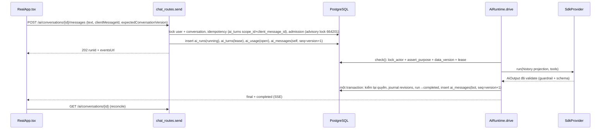

# 01 — Kiểm tra mã nguồn hiện tại

Ngày kiểm tra: **31/10/2026**. Nhánh: `test/local-2026-10-30` (HEAD `d6eaf71`). Tài liệu này chỉ ghi **dữ kiện đã kiểm chứng**; đề xuất nằm ở [03-architecture-decisions.md](03-architecture-decisions.md) và các thư mục phase.

> Quy ước: "Đã xác minh" = đọc trực tiếp mã nguồn hoặc metadata hosted trong phiên này. Số dòng lấy từ working tree tại thời điểm đọc; `RealApp.tsx` có thay đổi chưa commit của người dùng nên số dòng có thể lệch vài dòng.

## 1. Trạng thái repository khi bắt đầu

| Hạng mục | Quan sát |
| --- | --- |
| Branch | `test/local-2026-10-30`, PR target thường là `main` |
| Thay đổi chưa commit lúc bắt đầu | `frontend/src/features/real/RealApp.tsx`, `frontend/src/features/real/journal/journal.css`, thư mục `docs/friendship-profile-redesign/` (untracked) |
| Thay đổi xuất hiện **trong lúc** phiên chạy | `backend/app/modules/social/{routes,schemas,service}.py`, `backend/openapi.json`, `frontend/src/api/generated/schema.d.ts`, nhiều file `frontend/src/features/real/social/*` mới. Đây là công việc song song (friendship profile redesign) của người khác; phiên này **không** sửa chúng |
| Alembic head trong repo | `0020_private_profile_retirement` |
| Alembic hosted (Supabase MCP) | `0019_journal` — **chưa áp dụng 0020** |
| `READY_REVISIONS` của nhánh | chỉ `("0020_private_profile_retirement",)` ([revisions.py](../../../backend/app/core/revisions.py)) → image của nhánh này sẽ **không ready** trên hosted hiện tại |

## 2. Xác minh các "investigation leads"

| # | Lead | Kết quả | Bằng chứng |
| --- | --- | --- | --- |
| 1 | `SdkProvider` tạo một Agent cho bot được chọn | **Đúng.** Mỗi lượt tạo `Agent[Any](name=f"MoodPrint:{bot_id}", …)` mới; instructions, tools, `output_type` chọn theo bot/intent | [provider.py:207-221](../../../backend/app/ai/provider.py#L207) |
| 2 | `Runner.run_streamed(max_turns=3)` | **Đúng.** Stream được tiêu thụ hết trong server; client chỉ nhận output đã validate | [provider.py:222-234](../../../backend/app/ai/provider.py#L222) |
| 3 | Runtime giới hạn tool calls | **Đúng, kiểm hai lớp:** `_BudgetHooks.on_tool_start` (>2 → `TOOL_LIMIT`) và `check_tool()` trong runtime; model calls >3 → `MODEL_LIMIT`. DB còn có CHECK `requests_started <= 3 and tool_calls between 0 and 2` trên `ai_usage` | [provider.py:68-109](../../../backend/app/ai/provider.py#L68), [runtime.py:368-373](../../../backend/app/ai/runtime.py#L368), [models.py:233](../../../backend/app/infrastructure/database/models.py#L233) |
| 4 | Output thường là `AiOutput.text` | **Đúng.** `AiOutput{text 1–6000, cards ≤3}`. Hai biến thể riêng: `MoodAnalysisPlan` (render bởi backend) và `NhipOutput` (+`source_entry_ids`) cho chế độ journal | [schemas.py:26-28](../../../backend/app/ai/schemas.py#L26), [journal.py:55-59](../../../backend/app/ai/journal.py#L55) |
| 5 | `ai_messages` unique `(run_id, actor)` | **Đúng** cả ORM lẫn hosted (`uq_ai_messages_run_id`) | [ai/models.py:53](../../../backend/app/ai/models.py#L53), [0007_chat_history.py](../../../backend/alembic/versions/0007_chat_history.py) |
| 6 | SSE `progress/final/completed/failed/cancelled` | **Đúng.** Envelope `ai-events-v1`. Với persistent run, replay **cố định** seq 1–3 và từ chối `afterSeq > 3` (`CURSOR_GAP`) | [schemas.py:119-123](../../../backend/app/ai/schemas.py#L119), [chat_routes.py:574-631](../../../backend/app/ai/chat_routes.py#L574) |
| 7 | Một bot response = một message | **Đúng.** Một `AiMessageRecord(actor="bot", sequence=durable.version)` trong cùng transaction chuyển run sang `completed` | [runtime.py:682-714](../../../backend/app/ai/runtime.py#L682) |
| 8 | Nhịp có journal-search tool có scope | **Đúng.** `search_journal_entries` chỉ cấp cho Nhịp khi không có mood scope; owner do locked `User` quyết định; tối đa 5 entry, 90 ngày, chỉ `saved`, không media | [runtime.py:433-499](../../../backend/app/ai/runtime.py#L433), [journal/ai.py:32-88](../../../backend/app/modules/journal/ai.py#L32) |
| 9 | Đã có background maintenance workers | **Đúng, nhưng chạy trong chính process API.** Lifespan tạo 4 task: `sweep_context` (1 s), `embedding_worker` (1 s), `guest_worker` (1 s), `journal_worker` (60 s). Không có scheduler theo giờ người dùng | [main.py:204-240](../../../backend/app/main.py#L204) |

## 3. Luồng AI hiện tại (user-triggered)

Điểm quan trọng đã xác minh:

- **Admission** khóa advisory toàn cục `pg_advisory_xact_lock(664201, 1)`, đếm run đang chạy (global/user), rate/phút, quota ngày theo ngày Asia/Bangkok, ngân sách ngày từ `ai_usage` ([persistence.py:220-268](../../../backend/app/ai/persistence.py#L220)). Mọi `ai_runs` đều bị đếm — chưa có khái niệm run do server khởi tạo.
- **`check()` gắn với session**: gọi `self.store.get(conversation_id, user_id, session_id)` và `lock_actor()` → `verify_actor()` đòi `AuthSession` hợp lệ ([runtime.py:291-317](../../../backend/app/ai/runtime.py#L291), [security.py:130-168](../../../backend/app/core/security.py#L130)). Vì vậy **không thể tái sử dụng nguyên `AiRuntime.drive()` cho run không có người dùng đang đăng nhập.**
- **Fencing**: `ai_turns.worker_id/lease_until` và `ai_usage.worker_id/lease_until`; `recover_turns()` chuyển run hết lease sang `interrupted`; khởi động lại không replay model call ([persistence.py:131-154](../../../backend/app/ai/persistence.py#L131), [main.py:69-81](../../../backend/app/main.py#L69)).
- **Tracing tắt**: `set_tracing_disabled(True)`, `RunConfig(tracing_disabled=True, trace_include_sensitive_data=False)`, `store=False`, `max_retries=0`, `parallel_tool_calls=False`, `max_tokens=1200` ([provider.py:128-229](../../../backend/app/ai/provider.py#L128)).
- **Guardrail** `_no_unreceipted_claim` là regex hẹp bắt câu "đã lưu/đã gửi lời mời…" ([provider.py:47-65](../../../backend/app/ai/provider.py#L47)).

## 4. Mô hình lưu trữ hội thoại

| Bảng | Vai trò | Ràng buộc/đặc điểm đã xác minh (ORM + hosted) |
| --- | --- | --- |
| `ai_conversations` | Thread đã lưu | `version >= 1`, `bot_id` CHECK 5 bot, index `(user_id, updated_at, id)`, `expires_at` cố định lúc tạo (≤30 ngày, không gia hạn theo hoạt động) |
| `ai_messages` | Tin nhắn | unique `(conversation_id, sequence)`, unique `(run_id, actor)`, `text varchar(6000)`, `cards jsonb` |
| `ai_runs` | Metadata run, không nội dung | `conversation_id uuid NOT NULL` **không có FK**, partial unique `uq_ai_active_conversation` (một run `running` / conversation) |
| `ai_turns` | Idempotency + stamp + lease | `session_id`, `client_message_id`, `worker_id`, `lease_until` đều NOT NULL; unique `(scope_id, client_message_id)`; `context_policy` nullable (NULL = legacy, fail closed) |
| `ai_usage` | Accounting content-free | CHECK `requests_started <= 3`, `tool_calls between 0 and 2` |
| `ai_preferences` | Preference | `history_enabled` thực tế bị ép theo capability `CHAT_HISTORY_ENABLED` ([persistence.py:19-32](../../../backend/app/ai/persistence.py#L19)) |

**Bất biến version/sequence (đã xác minh, chưa được ghi thành tài liệu):** mỗi tin nhắn mới làm `conversation.version += 1` và nhận `sequence = version` mới ([chat_routes.py:438-453](../../../backend/app/ai/chat_routes.py#L438), [runtime.py:711-714](../../../backend/app/ai/runtime.py#L711)). Vì vậy `version == max(sequence)`; đổi tên không đổi version. `expectedConversationVersion` là precondition gửi tin; lệch → `409 STALE_VERSION`.

**RLS/grants (hosted, đã xác minh):** mọi bảng `moodprint.*` liên quan đều `relrowsecurity = true`, chỉ một policy `backend_access` cho `moodprint_runtime`; quyền của `anon/authenticated/service_role` bị revoke trong migration ([0007_chat_history.py](../../../backend/alembic/versions/0007_chat_history.py)). Authorization end-user nằm ở backend (owner predicate trong SQL), không phải RLS theo `auth.uid()`.

## 5. Context projection và privacy boundary

- `model_messages()` đi ngược từ tin mới nhất và **dừng ở tin đầu tiên** có stamp thiếu, sai `data_version`, policy lạ, hoặc là `mood-turn-v1`/`journal-turn-v1` của run khác ([context.py:46-71](../../../backend/app/ai/context.py#L46)). Hệ quả: một tin không có stamp sẽ **cắt toàn bộ lịch sử cũ hơn** khỏi context.
- Stamp được nạp từ `ai_turns` theo `run_id` ([persistence.py:105-128](../../../backend/app/ai/persistence.py#L105)). **Mọi run tạo tin nhắn phải có `ai_turns`** nếu muốn tin đó còn trong context.
- `build_history()` giới hạn 24 tin / 24.000 byte; approved memories chèn dưới dạng dữ liệu JSON ([context.py:74-94](../../../backend/app/ai/context.py#L74)).
- `users.data_version` tăng khi tạo/sửa/xóa journal ([journal/routes.py:121,161,195](../../../backend/app/modules/journal/routes.py#L121)), đổi preference AI ([chat_routes.py:150](../../../backend/app/ai/chat_routes.py#L150)), mood… Đây là **bộ đếm toàn cục**: bất kỳ chỉnh sửa nào cũng cắt context của mọi hội thoại.

## 6. Journal: quyền đọc, bằng chứng, lưu giữ

| Quy tắc | Nguồn |
| --- | --- |
| Chỉ chủ sở hữu, `status='saved'`, cửa sổ 90 ngày theo `user.timezone`, không ngày tương lai | [journal/ai.py:32-46](../../../backend/app/modules/journal/ai.py#L32), [journal/service.py:15-25](../../../backend/app/modules/journal/service.py#L15) |
| Trả về đúng các khóa `id, version, localDate, mood, emotions, factors, snippet, snippetTruncated`; snippet ≤1.000 ký tự, tổng ≤24.000 byte; không media | [journal/ai.py:60-77](../../../backend/app/modules/journal/ai.py#L60), [20-nhip-text-only-contract.md](../diary/20-nhip-text-only-contract.md) |
| Evidence chỉ sống trong run hiện tại (`JournalEvidence.assert_current`), revisions được kiểm lại dưới owner lock trước khi publish | [ai/journal.py:33-52,147-172](../../../backend/app/ai/journal.py#L147) |
| Backend tự tạo link `/self/entry/{id}`; model không được viết link; output phải trích dẫn khi có entry | [ai/journal.py:115-144](../../../backend/app/ai/journal.py#L115) |
| Từ chối đọc nhật ký bằng lời trong lượt hiện tại → tool bị gỡ | [ai/journal.py:62-66](../../../backend/app/ai/journal.py#L62), [provider.py:201-205](../../../backend/app/ai/provider.py#L201) |
| Retention xóa entry cũ hơn 89 ngày local, media đưa vào hàng đợi xóa Storage | [jobs/retention.py:78-91](../../../backend/app/jobs/retention.py#L78) |
| **Consent**: `AI`, `MEM`, `VOICE` luôn được coi là bật ("personal features are always permitted"); chỉ `MATCH` cần bật thật | [consent/policy.py](../../../backend/app/modules/consent/policy.py), [security.py:187-203](../../../backend/app/core/security.py#L187) |

Hệ quả cho proactive: hiện **không có** consent riêng cho việc dùng nhật ký trong tin nhắn chủ động. Phải thêm opt-in mới (xem [phase-1/04](phase-1/04-database-and-migrations.md)).

Hosted (aggregate): **0** saved journal entries — tính năng journal mới được áp dụng (0019), chưa có dữ liệu thật để đánh giá chất lượng.

## 7. Người dùng, tuổi, timezone, xóa tài khoản

- `users.age_band ∈ unknown/under16/teen/adult`; AI yêu cầu `teen` hoặc `adult` ([security.py:158-161](../../../backend/app/core/security.py#L158)); `MATCH` yêu cầu `adult` và không bị `social_restricted_until`.
- `users.timezone` mặc định `Asia/Bangkok` ([models.py:48](../../../backend/app/infrastructure/database/models.py#L48)); **không có API cho người dùng đổi timezone** (chỉ đọc trong `SessionView`). `MoodInput.timezone` "accepted for compatibility" nhưng bị bỏ qua ([contracts.py:141-152](../../../backend/app/contracts.py#L141)).
- `users.last_seen_at` cập nhật tối đa 15 phút/lần khi trượt session ([security.py:84-96](../../../backend/app/core/security.py#L84)) — dùng được làm tín hiệu "còn hoạt động".
- Xóa tài khoản **không xóa row `users`**: `process_deletions` xóa dữ liệu từng bảng, rồi đặt `status='deleted'` ([users/lifecycle.py:59-178](../../../backend/app/modules/users/lifecycle.py#L59)). FK `ON DELETE CASCADE` từ `users` **không kích hoạt** → mọi bảng mới phải được xóa tường minh.
- Guest purge có `INVENTORY` phân loại mọi bảng ORM và test `test_inventory_classifies_every_orm_table` bắt buộc bảng mới phải được phân loại ([guests/lifecycle.py:74](../../../backend/app/modules/guests/lifecycle.py#L74), [test_guest_cleanup.py:164](../../../backend/tests/test_guest_cleanup.py#L164)).

## 8. Hàng đợi và worker có sẵn để tái sử dụng

| Mẫu | Nơi | Có thể tái dùng cho proactive |
| --- | --- | --- |
| Lease job PostgreSQL + `SKIP LOCKED` + backoff `5·2^(n-1)` ≤3600 s + attempts tối đa + fenced publication | `process_embedding_jobs` [embeddings.py:389-525](../../../backend/app/ai/embeddings.py#L389) | **Có** — mẫu chuẩn cho `ai_proactive_jobs` |
| Due-sweeper: đọc id không khóa, mỗi id một transaction ngắn, `SKIP LOCKED` | `advance_due` [activities/jobs.py:57-100](../../../backend/app/modules/activities/jobs.py#L57) | **Có** — cho bước materialize lịch |
| Data job có lease 30 s | `process_deletions` | Tham khảo |
| Read marker riêng tư + đếm unread nhóm theo room | `ConnectionRead`, `unread_by_room` [social/summary.py:50-73](../../../backend/app/modules/social/summary.py#L50) | **Có** — mẫu cho `ai_conversation_reads` |
| Badge polling 15 s khi tab visible + focus | [useSocialSummary.ts:14-47](../../../frontend/src/features/real/social/useSocialSummary.ts#L14) | **Có** — mẫu cho unread AI |
| Bảng `outbox` | Đã retired (DR-10), không consumer | **Không** dùng lại |

`pg_cron` (1.6.4) và `pgmq` (1.5.1) **có sẵn nhưng chưa cài** trên hosted (Supabase MCP `list_extensions`).

## 9. Frontend chat

| Hạng mục | Quan sát | Nguồn |
| --- | --- | --- |
| Router | `HashRouter`; chat ở `/#/assistants/:botId?conversation=…` | [RealApp.tsx:1980-1986](../../../frontend/src/features/real/RealApp.tsx#L1980) |
| Mở hội thoại | Không có `conversation` param → lấy header mới nhất theo `updated_at` của bot và **tự mở** | [RealApp.tsx:1273-1291](../../../frontend/src/features/real/RealApp.tsx#L1273) |
| Stream | `consumeAIEvents` chỉ chấp nhận `ai-events-v1`, seq liên tục, `final.data` **chỉ** có `text`, `cards`; khóa lạ → lỗi | [stream.ts:48-154](../../../frontend/src/api/stream.ts#L48) |
| Sau final | Chèn tạm `${runId}-final`, rồi GET lại conversation và thay bằng bản server | [RealApp.tsx:1149-1179](../../../frontend/src/features/real/RealApp.tsx#L1149) |
| Gửi tin | Gửi `expectedConversationVersion = thread.version`; `STALE_VERSION` hiện lỗi chung, không tự tải lại | [RealApp.tsx:1392-1404](../../../frontend/src/features/real/RealApp.tsx#L1392) |
| Render | Mỗi message một `.message-row`; bot không có nền bubble; actions (giờ, sao chép) hiện khi hover/focus/chạm | [RealApp.tsx:1754-1821](../../../frontend/src/features/real/RealApp.tsx#L1754) |
| Live region | `.conversation-messages` là `aria-live="polite" aria-relevant="additions text"` → mỗi tin thêm vào đều được đọc | [RealApp.tsx:1753](../../../frontend/src/features/real/RealApp.tsx#L1753) |
| Trạng thái AI | `deriveAIActivity` chỉ phản ánh vòng đời thật; không có giai đoạn suy luận | [aiActivityView.ts:27-45](../../../frontend/src/features/real/aiActivityView.ts#L27) |
| Thông tin hội thoại | Panel modeless (≥1100 px) / dialog modal; các section `h3 + p + actions` | [ConversationInfo.tsx:197-249](../../../frontend/src/features/real/ConversationInfo.tsx#L197) |
| Nhãn ngày | **Lỗi:** hard-code tiếng Anh `"Today"`/`"Yesterday"` | [messageDates.ts:23](../../../frontend/src/features/real/messageDates.ts#L23) |
| Motion | GSAP qua `useGSAP` + `gsap.matchMedia("(prefers-reduced-motion: no-preference)")` | [AIActivityStatus.tsx:55-65](../../../frontend/src/features/real/AIActivityStatus.tsx#L55), [ConversationInfo.tsx:82-95](../../../frontend/src/features/real/ConversationInfo.tsx#L82) |

Baseline trực quan bằng agent-browser: [92-visual-qa-and-agent-browser.md](92-visual-qa-and-agent-browser.md).

## 10. Vận hành và triển khai

| Hạng mục | Dữ kiện | Nguồn |
| --- | --- | --- |
| Topology | **Một** uvicorn worker, một replica; RAM chứa run/stream/temporary chat | [`backend/app/__main__.py`](../../../backend/app/__main__.py), [deploy/README.md](../../../deploy/README.md) |
| Container | `api` mem 768 MB, 1,5 CPU, `stop_grace_period 150s`, read-only FS; `web` Caddy 256 MB | [compose.staging.yml](../../../deploy/compose.staging.yml) |
| Proxy | Caddy `flush_interval -1`, `response_header_timeout 120s` | [Caddyfile](../../../deploy/Caddyfile) |
| Release | EC2 poller systemd timer 5 phút, image GHCR digest-pinned + attestation; không chạy migration | [deploy/aws/README.md](../../../deploy/aws/README.md) |
| Logs/metrics | CloudWatch agent đọc docker json log; alarm 5xx, readiness, AI budget 80 %, disk | [cloudwatch-alarms.json](../../../deploy/aws/cloudwatch-alarms.json) |
| DB pool | 5 + 2 overflow / process; role limit đã duyệt 20; giả định 2 process chồng nhau khi deploy | [budget.py](../../../backend/app/infrastructure/database/budget.py) |
| Hosted DB | PostgreSQL 17.11, `max_connections=60`, `moodprint_backend` conn limit **20**, lúc kiểm có 15 kết nối qua Supavisor (12 idle, 3 *idle in transaction* ~8 phút); `idle_in_transaction_session_timeout=0`, `statement_timeout=120s` | Supabase MCP `execute_sql` (metadata) |
| CI | `verify.yml`: backend + PostgreSQL, migration chain + single-worker load, frontend + contract drift, fullstack (fake SDK model), SQL review, `check_docs.py`, AWS poller, Docker | [verify.yml](../../../.github/workflows/verify.yml) |
| Doc gate | `check_docs.py` kiểm link tương đối, **inventory API** (`api-reference.md`), **settings** (`configuration.md`), **tables** (`docs/supabase/schema.md`) | [check_docs.py](../../../scripts/check_docs.py) |
| AWS thực tế | **Không kiểm được**: AWS MCP không kết nối (`-32602`) | [94-dependencies-risks-and-open-decisions.md](94-dependencies-risks-and-open-decisions.md) |

## 11. Tái sử dụng / phải thay đổi / giữ nguyên

| Thành phần | Quyết định | Lý do |
| --- | --- | --- |
| `SdkProvider._stream` (agent per bot, budget hooks, guardrail, tracing off) | **Tái sử dụng**, mở rộng output type và thêm entry `run_proactive` | Đã có giới hạn chi phí và privacy đúng |
| `AiRuntime.drive()` / `check()` | **Giữ nguyên cho run của người dùng**; proactive dùng executor riêng | `check()` gắn session; trộn sẽ làm yếu boundary |
| `ai_messages (run_id, actor)` | **Phải thay** bằng `(run_id, actor, part_index)` | Chặn nhiều bubble |
| `ai_runs`, `ai_turns` | **Mở rộng** (`origin`, `trigger`, cột nullable có CHECK) | Run do server khởi tạo |
| `admission()`, `daily_turns()` | **Sửa** để tách run `proactive` khỏi quota/concurrency của người dùng | Không để lời hỏi thăm chặn người dùng chat |
| `model_messages()` | **Mở rộng** policy mới + revalidation có provenance | Giữ continuity sau tin chủ động |
| SSE `ai-events-v1` | **Giữ** cho client cũ; thêm `ai-events-v2` | Client cũ validate chặt `final` |
| `consumeAIEvents`, render message | **Sửa** cho nhóm bubble | — |
| Embedding job pattern, `ConnectionRead`, `useSocialSummary` | **Tái sử dụng mẫu** | Đã được kiểm chứng trong codebase |
| Journal tool `search_journal_entries` cho chat thường | **Giữ nguyên** | Proactive dùng truy vấn code-driven riêng, không qua tool |
| Guest flows, social/matching, moderation | **Không đụng** (trừ inventory/purge) | Ngoài phạm vi |
| `provider_session.sql`, reviewed SQL đã duyệt | **Không đụng** | Theo memory dự án và review gate |

## 12. Phát hiện cần lưu ý (không phải lỗi của tính năng mới)

1. **Hosted 0019 vs nhánh 0020**: triển khai bất kỳ image nào từ nhánh này đều cần áp dụng 0020 trước (hoặc bản compat).
2. *(Cập nhật 31/10/2026: không tái hiện; mã ứng dụng không giữ transaction quanh I/O mạng — [96 F-01, F-02](96-architecture-hardening-review.md#1-phát-hiện-kỹ-thuật-quan-trọng).)* **Ba kết nối *idle in transaction* ~8 phút** và `idle_in_transaction_session_timeout=0`: rủi ro giữ lock lâu; worker mới nên đặt `SET LOCAL lock_timeout`/`statement_timeout` và không giữ transaction quanh model call. Chưa xác định nguồn (có thể là môi trường dev local trỏ vào hosted — `backend/.env` trỏ hosted theo memory dự án).
3. **Nhãn ngày tiếng Anh** trong UI tiếng Việt (`Today`/`Yesterday`).
4. **Timezone không chỉnh được**: lịch theo giờ địa phương cần nguồn timezone riêng.
5. **`STALE_VERSION` không tự hồi phục** ở frontend: tin chủ động chèn vào hội thoại đang mở sẽ khiến lần gửi tiếp theo thất bại nếu không xử lý.
