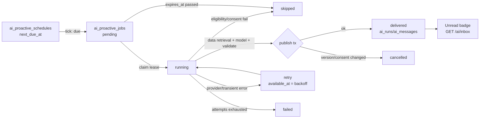

# Phase 1 — 03. Scheduler và worker cho tin chủ động (P1.2)

Quyết định: [ADR-04](../03-architecture-decisions.md#adr-04--danh-tính-run-chủ-động-server-originated), [ADR-05](../03-architecture-decisions.md#adr-05--chọn-công-nghệ-scheduler) (worker trong process API + bảng queue PostgreSQL), [ADR-06](../03-architecture-decisions.md#adr-06--hàng-đợi-job-và-claim), [ADR-07](../03-architecture-decisions.md#adr-07--vị-trí-tin-chủ-động). Schema: [04](04-database-and-migrations.md).

## 1. Vòng đời



Khác biệt so với run người dùng:

| | Run người dùng | Run chủ động |
| --- | --- | --- |
| Khởi phát | `POST …/messages` | Lịch đến hạn |
| Principal | `Actor` + session | `ProactivePrincipal` (ADR-04) |
| Tin `actor='self'` | Có | **Không** |
| Input model | Projection transcript + memory | Dữ liệu có cấu trúc theo persona, **không** transcript |
| Tools | Theo bot | **Không có tool**; dữ liệu do code truy xuất trước |
| `ai_runs.conversation_id` lúc chạy | Hội thoại đích | `NULL` cho tới khi publish |
| Admission | quota/rate/concurrency người dùng | Cap proactive riêng + ngân sách chung; không tính vào 60 lượt/ngày |
| SSE | Có | Không (tin xuất hiện qua GET + inbox) |
| Hủy | Nút Dừng | Đổi/tắt lịch, đổi consent, xóa tài khoản |

## 2. Thành phần

| Thành phần | File đề xuất | Trách nhiệm |
| --- | --- | --- |
| `schedule_math` | `backend/app/ai/proactive/schedule.py` | Tính `next_due_at`, `local_date`, kiểm giờ yên lặng/weekday/pause (hàm thuần) |
| `materialize_due` | `backend/app/jobs/proactive.py` | Tạo job từ lịch đến hạn |
| `claim_job` / `execute_job` / `publish_job` | `backend/app/jobs/proactive.py`, `backend/app/ai/proactive/executor.py` | Claim, quyền, dữ liệu, model, publish |
| `proactive_tick(app)` | `backend/app/jobs/proactive.py` | Một lượt bounded: materialize ≤100 lịch, xử lý ≤ `PROACTIVE_WORKER_CONCURRENCY` job |
| Vòng lặp lifespan | [main.py](../../../../backend/app/main.py) | `proactive_worker()` mỗi 60 s khi `PROACTIVE_WORKER_ENABLED` |

## 3. Materialize lịch → job

`next_due_at` được tính khi lưu lịch và sau mỗi lần materialize; giá trị luôn là **instant UTC** của lần kế tiếp hợp lệ.

```python
async def materialize_due(db, at):
    rows = await db.scalars(
        select(Schedule).where(Schedule.enabled, Schedule.next_due_at <= at)
        .order_by(Schedule.next_due_at).limit(100).with_for_update(skip_locked=True))
    for s in rows:
        settings = await db.get(ProactiveSettings, s.user_id)
        occurrence = s.next_due_at
        local_date = occurrence.astimezone(ZoneInfo(settings.timezone)).date()
        expires = occurrence + timedelta(minutes=cfg.proactive_grace_minutes)
        status, reason = ("pending", None) if expires > at else ("skipped", "missed_window")
        await db.execute(insert(Job).values(
            user_id=s.user_id, schedule_id=s.id, bot_id=s.bot_id, slot=s.slot,
            local_date=local_date, due_at=occurrence, expires_at=expires,
            status=status, skip_reason=reason, available_at=occurrence,
            schedule_version=s.version, settings_version=settings.version,
        ).on_conflict_do_nothing(index_elements=["user_id", "bot_id", "slot", "local_date"]))
        s.next_due_at = next_occurrence(s, settings, after=occurrence)
```

- Transaction ngắn, không gọi model, không khóa `users` (tránh đảo thứ tự lock với route).
- Sau sự cố dài (ví dụ máy chủ tắt 2 ngày), mỗi lịch chỉ tạo **một** job cho mỗi lần bị lỡ rồi đánh `skipped(missed_window)`; `next_occurrence` nhảy tới lần tương lai gần nhất (không tạo hàng loạt).

## 4. Tính giờ theo múi giờ và DST

```python
def next_occurrence(s, settings, *, after: datetime) -> datetime | None:
    zone = ZoneInfo(settings.timezone)
    local = after.astimezone(zone)
    for offset in range(0, 15):                      # tối đa 2 tuần để tìm ngày hợp lệ
        day = local.date() + timedelta(days=offset)
        if not weekday_allowed(s.weekdays, day) or (s.paused_until and day <= s.paused_until):
            continue
        candidate = resolve_local(day, s.local_time, zone)
        if candidate > after:
            return candidate.astimezone(UTC)
    return None   # không có ngày hợp lệ → lịch không đến hạn

def resolve_local(day, t, zone) -> datetime:
    naive = datetime.combine(day, t)
    first = naive.replace(tzinfo=zone, fold=0)
    # Giờ không tồn tại (spring-forward): round-trip qua UTC dời giờ theo độ dài khoảng trống (02:30 → 03:30)
    if first.astimezone(UTC).astimezone(zone).replace(tzinfo=None) != naive:
        return first.astimezone(UTC).astimezone(zone)
    return first                                      # giờ lặp (fall-back): fold=0, chỉ một lần/ngày nhờ unique local_date
```

| Tình huống | Hành vi |
| --- | --- |
| Asia/Ho_Chi_Minh, Asia/Bangkok (không DST) | Đơn giản, đúng giờ |
| Giờ không tồn tại do DST | Giao ở giờ đã dời theo khoảng trống (ví dụ 02:30 → 03:30); thực tế không xảy ra vì khung sáng bắt đầu từ 05:00 |
| Giờ lặp do DST | Giao một lần (fold=0); unique `(user, bot, slot, local_date)` chặn lần hai |
| Người dùng đổi timezone | `settings.version += 1`, tính lại `next_due_at` mọi lịch, hủy job `pending` cũ |
| Bản cập nhật `tzdata` thay đổi luật | `tzdata==2026.5` pin trong [pyproject.toml](../../../../backend/pyproject.toml); job đã tạo giữ `due_at` cũ |

## 5. Claim, lease, thứ tự khóa

Theo đúng mẫu đã chạy ổn định của `process_embedding_jobs` ([embeddings.py:398-430](../../../../backend/app/ai/embeddings.py#L398)):

```python
async with db.begin():   # T1: chỉ khóa job
    job = await db.scalar(select(Job).where(
        or_(and_(Job.status.in_(("pending", "retry")), Job.available_at <= now(), Job.expires_at > now()),
            and_(Job.status == "running", Job.lease_until <= now())),
        ~exists().where(Other.user_id == Job.user_id, Other.status == "running",      # 1 job running / user
                        Other.lease_until > now(), Other.id != Job.id))
        .order_by(Job.available_at, Job.id).limit(1).with_for_update(skip_locked=True))
    if job.expires_at <= now(): job.status, job.skip_reason = "skipped", "expired"; return
    if job.attempts >= cfg.proactive_max_attempts: job.status, job.last_error = "failed", "attempts_exhausted"; return
    job.status, job.lease_token, job.worker_id = "running", uuid4(), runtime.worker_id
    job.lease_until, job.attempts = now() + timedelta(seconds=90), job.attempts + 1
```

Thứ tự khóa trong mọi transaction về sau: **`users` → `ai_proactive_jobs` → `ai_conversations`** (giống owner → job của embeddings; route chat khóa `users` → `ai_conversations`). Không bao giờ khóa job rồi mới khóa user.

## 6. Thực thi (không giữ transaction quanh model call)

| Bước | Transaction | Nội dung |
| --- | --- | --- |
| E1 Authorize + snapshot | T2 (owner lock) | `authorize_proactive()` ([05 §3](05-backend-api-and-agent-runtime.md)); so `schedule_version`/`settings_version` của job; kiểm cap ngày (§9), ngân sách (§10), người dùng đang chat (ADR-07); ghi `ai_runs(origin='proactive', status='running', conversation_id=NULL)`, `ai_turns(origin='proactive', session_id=NULL, client_message_id=job.id, lease_until=job.lease_until)`, `ai_usage(open)`; snapshot `data_version` |
| E2 Retrieve | T3 (owner lock, đọc) | Dữ liệu theo persona ([07](07-persona-behaviors-and-prompts.md)); với Nhịp: entry hôm qua + ghi provenance tạm vào bộ nhớ job (chưa ghi DB) |
| E3 Generate | **không có transaction** | `SdkProvider.run_proactive(...)` với `asyncio.timeout(30)`, `max_turns=2`, không tool; usage ghi qua observer (transaction ngắn riêng như hiện nay) |
| E4 Validate | không | Pydantic + validator nghiệp vụ + guardrail; nội dung an toàn |
| E5 Publish | T4: owner → job (kiểm `lease_token`, `lease_until > now()`) → conversation | Kiểm lại toàn bộ E1, `assert_journal_revisions`, chọn/khóa hội thoại, insert messages + sources, run→`completed`, usage terminal, job→`delivered` |

Kiểm "đang chat" (ADR-07) chạy ở E1 để không tốn model call; E5 kiểm lại. Nếu E5 phải hoãn (người dùng vừa bắt đầu chat trong lúc sinh tin): rollback transaction publish, run → `cancelled` + usage settle trong transaction riêng, job → `retry` với `available_at = now + 5 phút` và **hoàn lại** `attempts` (hoãn không phải lỗi); nội dung đã sinh bị bỏ — không lưu nội dung tạm vào bảng job. Tình huống này hiếm (cửa sổ vài giây) nên chi phí sinh lại được chấp nhận.

Mọi kiểm tra ở E5 thất bại vì **người dùng đã thay đổi** (tắt lịch, đổi version, tắt consent, xóa tài khoản, data_version đổi đối với Nhịp journal) → job `cancelled` hoặc `retry` (chỉ khi data_version đổi và chưa hết attempts), run `cancelled`, usage settle; không hiển thị gì.

## 7. Retry, backoff, trạng thái kết thúc

| Lỗi | Phân loại | Hành động |
| --- | --- | --- |
| `AI_PROVIDER_UNAVAILABLE`, `AI_TIMEOUT`, `AI_PROVIDER_RATE_LIMIT`, `AI_STORAGE_UNAVAILABLE` | Tạm thời | `retry`, `available_at = now + min(15 phút, 60·2^(attempts-1) s)`, không quá `expires_at` |
| `ModelBehaviorError`, schema/validator fail | Có thể tạm thời | `retry` tối đa 1 lần nữa, rồi `failed(invalid_output)` |
| Guardrail tripwire | Nội dung | `skipped(guardrail)` — không retry |
| `AI_PROVIDER_CONFIGURATION` | Cấu hình | `failed(provider_configuration)`, metric cảnh báo |
| Không đủ điều kiện | Chính sách | `skipped(<reason>)` |
| Lease hết hạn (crash) | Hạ tầng | Job được claim lại; run cũ bị `recover_turns` chuyển `interrupted` |

`skip_reason` (enum đóng): `missed_window, expired, disabled, paused, ineligible_account, ineligible_social, inactive_user, daily_cap, budget, active_chat, auto_paused, ai_unavailable, guardrail, no_history_capability`.

"Dead letter": job `failed` giữ 30 ngày (content-free) để điều tra; không có hàng đợi riêng.

## 8. Đa worker, restart, deploy chồng

- Hai process chồng nhau khi deploy (`OVERLAP_PROCESSES = 2`, [budget.py](../../../../backend/app/infrastructure/database/budget.py)): cả hai chạy tick; `SKIP LOCKED` + lease + unique job ⇒ không trùng.
- `stop_grace_period: 150s` ([compose.staging.yml](../../../../deploy/compose.staging.yml)): khi lifespan kết thúc, `proactive_worker` bị cancel; job đang chạy để lease hết hạn (90 s) và được claim lại — **không** commit dang dở.
- EC2 reboot: `next_due_at` và job nằm trong DB; khi khởi động, lần tick đầu xử lý job còn hạn, phần lỡ → `missed_window`.
- Lifespan startup hiện chạy `recover_turns()` ([main.py:69-81](../../../../backend/app/main.py#L69)) → run proactive `running` của process chết được đóng `interrupted`.

## 9. Giới hạn số lượng

| Giới hạn | Giá trị | Nơi kiểm |
| --- | --- | --- |
| Khung bật tối đa / tài khoản | 4 (= `PROACTIVE_DAILY_CAP_PER_USER`) | API lưu lịch |
| Lượt giao tối đa / ngày local | 4 | E1 (đếm job `delivered` cùng `local_date`) |
| Mỗi bot × slot × ngày | 1 | Unique DB |
| Auto-pause | 3 lượt giao liên tiếp của cùng bot chưa đọc | E1 → `skipped(auto_paused)` + đặt `schedules.auto_paused_at` |
| Người dùng không hoạt động | `last_seen_at` > 14 ngày | E1 → `skipped(inactive_user)` |
| Concurrency worker | 1 (cấu hình 1–4) | Tick |
| Job running / user | 1 | Claim bỏ qua user đang có job `running` |

## 10. Quota, chi phí, độ trễ model

- Proactive **không** dùng `ai_daily_turns_per_user` (60) của người dùng: `daily_turns()` chỉ đếm `origin='user'` ([persistence.py:190-198](../../../../backend/app/ai/persistence.py#L190)).
- Proactive **có** tính vào ngân sách ngày chung (`spent_today_nano` đọc `ai_usage`) và dừng sớm hơn: khi `spent ≥ PROACTIVE_BUDGET_SHARE × ceiling` (mặc định 0,5) → `skipped(budget)`, để dành phần còn lại cho chat người dùng.
- Admission global (`ai_global_concurrency`) đếm cả run proactive; per-user concurrency và rate/phút chỉ đếm `origin='user'` ([persistence.py:226-246](../../../../backend/app/ai/persistence.py#L226)).
- Production bật worker **bắt buộc** `AI_ACCOUNTING_ENABLED=true` và `AI_DAILY_BUDGET_USD > 0` (validator `Settings`).
- Ước tính chi phí/độ trễ: [91](../91-performance-cost-and-capacity.md).

## 11. Hủy khi thay đổi cài đặt

| Thay đổi | Trong cùng transaction của route |
| --- | --- |
| Tắt/xóa/tạm dừng lịch | `schedule.version += 1`; job `pending/retry` của lịch → `cancelled`; `next_due_at` tính lại hoặc `NULL` |
| Đổi giờ/ngày lặp | Như trên + tính `next_due_at` mới |
| Đổi timezone/giờ yên lặng | `settings.version += 1`; mọi lịch của user tính lại; job chưa chạy → `cancelled` |
| Tắt "Dùng khoảnh khắc hôm qua" | `settings.journal_context_version += 1`, `users.data_version += 1` (cắt context journal cũ), job Nhịp → `cancelled` |
| Xóa tài khoản / deletion_pending | Worker E1/E5 thấy `deletion_pending` → `cancelled`; `process_deletions` xóa bảng proactive |

Job `running` không bị sửa trực tiếp (tránh tranh chấp lease); E5 phát hiện version lệch và hủy.

## 12. Tải lên pool Supabase

- Không tạo engine/pool mới; mỗi tick dùng tối đa `1 + PROACTIVE_WORKER_CONCURRENCY` checkout ngắn, không đồng thời với model call.
- Đặt `SET LOCAL lock_timeout = '2s'`, `SET LOCAL statement_timeout = '5s'` trong transaction worker (hosted `idle_in_transaction_session_timeout=0`, [01 §12](../01-current-codebase-audit.md)).
- Ước lượng: 100 người dùng × 4 khung = 400 job/ngày → ~6 transaction/job → ~2.400 transaction ngắn/ngày; không đáng kể.

## 13. Metric và log (content-free)

| Metric (log `metric=…`) | Ý nghĩa |
| --- | --- |
| `proactive_job_state state=<s> bot=<b> slot=<slot> reason=<r>` | Mỗi lần job chuyển trạng thái |
| `proactive_lag_seconds value=` | `delivered_at − due_at` |
| `proactive_queue_due value=` | Job `pending/retry` đã đến hạn (mỗi 60 s) |
| `proactive_tick_ms value=` | Thời lượng tick |
| `proactive_budget_skip` | Bị dừng vì ngân sách |

Không log `user_id`, nội dung, tiêu đề, `local_time`. `job_id` được phép (tương tự `run_id` của người dùng đã đăng ký). Alarm đề xuất: [93](../93-release-rollback-and-observability.md).
