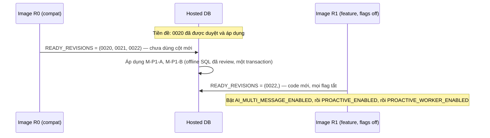

# Phase 1 — 04. Database và migration

> **Đây là đặc tả, không phải migration.** Không có file Alembic nào được tạo trong phiên lập kế hoạch. SQL dưới đây là phác thảo để reviewer đối chiếu; file thật phải sinh qua Alembic và đi qua quy trình review hosted ([docs/supabase/migrations.md](../../../supabase/migrations.md)).

## 1. Dữ kiện đã kiểm tra (hosted, Supabase MCP, chỉ metadata)

| Hạng mục | Giá trị |
| --- | --- |
| Project | `roznanxbiyqybjpvtilq` |
| PostgreSQL | 17.11, `TimeZone=UTC`, `max_connections=60` |
| Alembic | `0019_journal` (repo head `0020_private_profile_retirement` **chưa** áp dụng) |
| Extensions đã cài | `vector 0.8.2`, `pgcrypto`, `uuid-ossp`, `pg_stat_statements`, `supabase_vault` |
| Có sẵn, chưa cài | `pg_cron 1.6.4`, `pgmq 1.5.1`, `pg_net 0.20.4` |
| `ai_messages` | constraints `uq_ai_messages_run_id` (run_id, actor), `uq_ai_messages_conversation_id` (conversation_id, sequence), CHECK actor/sequence |
| `ai_runs` | `conversation_id NOT NULL`, partial unique `uq_ai_active_conversation`, index `user_id`, `conversation_id` |
| `ai_turns` | `session_id`, `client_message_id`, `worker_id`, `lease_until` NOT NULL; `context_policy varchar(32)` nullable |
| RLS | Bật trên mọi bảng đã kiểm; policy duy nhất `backend_access` → `moodprint_runtime` |
| Roles | `moodprint_backend` login, conn limit 20, không BYPASSRLS; `moodprint_app`, `moodprint_runtime` NOLOGIN |
| Security advisor | Chỉ cảnh báo Auth "leaked password protection" (không liên quan) |

## 2. Tổng quan thay đổi đề xuất

| Migration | Tên dự kiến | Nội dung | Phụ thuộc |
| --- | --- | --- | --- |
| **M-P1-A** | `0021_multi_message` | `ai_messages.part_*`, `ai_runs.origin/proactive_slot`, nullable có CHECK, `ai_turns.origin` | 0020 đã áp dụng hosted |
| **M-P1-B** | `0022_proactive_messages` | 5 bảng mới: settings, schedules, jobs, conversation reads, message sources | M-P1-A |

Cả hai là **expand-only**, có `server_default`, không backfill dữ liệu, chạy trong một transaction (quy trình offline SQL hiện có).

## 3. M-P1-A — nhiều bubble và nguồn run

```sql
-- ai_messages: nhiều bubble/run
ALTER TABLE moodprint.ai_messages
  ADD COLUMN part_index smallint NOT NULL DEFAULT 0,
  ADD COLUMN part_count smallint NOT NULL DEFAULT 1;
ALTER TABLE moodprint.ai_messages
  ADD CONSTRAINT ck_ai_messages_part
    CHECK (part_index >= 0 AND part_count BETWEEN 1 AND 4 AND part_index < part_count),
  ADD CONSTRAINT ck_ai_messages_self_single
    CHECK (actor = 'bot' OR (part_index = 0 AND part_count = 1));
ALTER TABLE moodprint.ai_messages
  ADD CONSTRAINT uq_ai_messages_run_part UNIQUE (run_id, actor, part_index);
ALTER TABLE moodprint.ai_messages DROP CONSTRAINT uq_ai_messages_run_id;

-- ai_runs: run do server khởi tạo
ALTER TABLE moodprint.ai_runs
  ADD COLUMN origin varchar(16) NOT NULL DEFAULT 'user',
  ADD COLUMN proactive_slot varchar(16),
  ALTER COLUMN conversation_id DROP NOT NULL;
ALTER TABLE moodprint.ai_runs
  ADD CONSTRAINT ck_ai_runs_origin CHECK (origin IN ('user', 'proactive')),
  ADD CONSTRAINT ck_ai_runs_slot
    CHECK ((origin = 'proactive') = (proactive_slot IS NOT NULL)
           AND (proactive_slot IS NULL OR proactive_slot IN ('morning', 'evening'))),
  ADD CONSTRAINT ck_ai_runs_conversation CHECK (origin <> 'user' OR conversation_id IS NOT NULL);
CREATE INDEX ix_ai_runs_user_origin_created ON moodprint.ai_runs (user_id, origin, created_at);

-- ai_turns: stamp cho run không có session
ALTER TABLE moodprint.ai_turns
  ADD COLUMN origin varchar(16) NOT NULL DEFAULT 'user',
  ALTER COLUMN session_id DROP NOT NULL;
ALTER TABLE moodprint.ai_turns
  ADD CONSTRAINT ck_ai_turns_origin CHECK (origin IN ('user', 'proactive')),
  ADD CONSTRAINT ck_ai_turns_session CHECK ((origin = 'user') = (session_id IS NOT NULL));
```

Ghi chú triển khai:

- **Tên constraint**: naming convention `uq_%(table_name)s_%(column_0_name)s` ([models.py:28-38](../../../../backend/app/infrastructure/database/models.py#L28)) sẽ đặt `(run_id, actor, part_index)` thành `uq_ai_messages_run_id` — **trùng tên cũ**. ORM phải đặt tên tường minh `UniqueConstraint("run_id", "actor", "part_index", name="uq_ai_messages_run_part")` (như `uq_memory_embedding_jobs_snapshot`).
- `ADD COLUMN … DEFAULT <hằng>` là thay đổi metadata trên PostgreSQL ≥ 11; `DROP NOT NULL` không quét bảng. `ADD CONSTRAINT UNIQUE` xây index — bảng hosted rất nhỏ (7 hội thoại còn hạn), chấp nhận trong transaction. Nếu sau này > 1 triệu row: tách `CREATE UNIQUE INDEX CONCURRENTLY` ra artifact riêng.
- `ck_ai_runs_conversation` cho phép `conversation_id NULL` chỉ với run proactive (trước publish). Image cũ không bao giờ ghi NULL.
- `ix_ai_runs_user_origin_created` phục vụ `daily_turns()`/admission lọc `origin='user'`.

## 4. M-P1-B — bảng tin chủ động

```sql
CREATE TABLE moodprint.ai_proactive_settings (
  user_id uuid PRIMARY KEY REFERENCES moodprint.users(id) ON DELETE CASCADE,
  timezone varchar(64) NOT NULL,
  quiet_start time NOT NULL DEFAULT '22:00',
  quiet_end time NOT NULL DEFAULT '07:00',
  badges_enabled boolean NOT NULL DEFAULT true,
  journal_context_enabled boolean NOT NULL DEFAULT false,
  journal_context_version integer NOT NULL DEFAULT 0,
  version integer NOT NULL DEFAULT 1,
  policy_version varchar(32) NOT NULL DEFAULT 'proactive-v1',
  created_at timestamptz NOT NULL DEFAULT clock_timestamp(),
  updated_at timestamptz NOT NULL DEFAULT clock_timestamp(),
  CONSTRAINT ck_ai_proactive_settings_version CHECK (version >= 1 AND journal_context_version >= 0),
  CONSTRAINT ck_ai_proactive_settings_policy CHECK (policy_version IN ('proactive-v1'))
);

CREATE TABLE moodprint.ai_proactive_schedules (
  id uuid PRIMARY KEY,
  user_id uuid NOT NULL REFERENCES moodprint.users(id) ON DELETE CASCADE,
  bot_id varchar(16) NOT NULL,
  slot varchar(16) NOT NULL,
  enabled boolean NOT NULL DEFAULT false,
  local_time time NOT NULL,
  weekdays smallint NOT NULL DEFAULT 127,          -- bit 0 = Thứ Hai … bit 6 = Chủ nhật
  paused_until date,
  auto_paused_at timestamptz,
  next_due_at timestamptz,
  version integer NOT NULL DEFAULT 1,
  created_at timestamptz NOT NULL DEFAULT clock_timestamp(),
  updated_at timestamptz NOT NULL DEFAULT clock_timestamp(),
  CONSTRAINT uq_ai_proactive_schedules_user_id UNIQUE (user_id, bot_id, slot),
  CONSTRAINT ck_ai_proactive_schedules_bot CHECK (bot_id IN ('may','guong','nhip','rure','caunoi')),
  CONSTRAINT ck_ai_proactive_schedules_slot CHECK (slot IN ('morning','evening')),
  CONSTRAINT ck_ai_proactive_schedules_window CHECK (
    (slot = 'morning' AND local_time BETWEEN '05:00' AND '11:30')
    OR (slot = 'evening' AND local_time BETWEEN '17:00' AND '22:30')),
  CONSTRAINT ck_ai_proactive_schedules_step CHECK (
    mod(extract(minute FROM local_time)::int, 15) = 0 AND extract(second FROM local_time) = 0),
  CONSTRAINT ck_ai_proactive_schedules_weekdays CHECK (weekdays BETWEEN 1 AND 127),
  CONSTRAINT ck_ai_proactive_schedules_version CHECK (version >= 1)
);
CREATE INDEX ix_ai_proactive_schedules_due ON moodprint.ai_proactive_schedules (next_due_at)
  WHERE enabled AND next_due_at IS NOT NULL;

CREATE TABLE moodprint.ai_proactive_jobs (
  id uuid PRIMARY KEY,
  user_id uuid NOT NULL REFERENCES moodprint.users(id) ON DELETE CASCADE,
  schedule_id uuid REFERENCES moodprint.ai_proactive_schedules(id) ON DELETE SET NULL,
  bot_id varchar(16) NOT NULL,
  slot varchar(16) NOT NULL,
  local_date date NOT NULL,
  due_at timestamptz NOT NULL,
  expires_at timestamptz NOT NULL,
  status varchar(16) NOT NULL DEFAULT 'pending',
  skip_reason varchar(32),
  attempts smallint NOT NULL DEFAULT 0,
  available_at timestamptz NOT NULL,
  lease_token uuid,
  lease_until timestamptz,
  worker_id uuid,
  schedule_version integer NOT NULL,
  settings_version integer NOT NULL,
  run_id uuid REFERENCES moodprint.ai_runs(id) ON DELETE SET NULL,
  conversation_id uuid REFERENCES moodprint.ai_conversations(id) ON DELETE SET NULL,
  challenge_kind varchar(24),                      -- Rủ Rê, enum đóng, content-free
  last_error varchar(48),
  created_at timestamptz NOT NULL DEFAULT clock_timestamp(),
  finished_at timestamptz,
  CONSTRAINT uq_ai_proactive_jobs_user_id UNIQUE (user_id, bot_id, slot, local_date),
  CONSTRAINT ck_ai_proactive_jobs_status CHECK (status IN
    ('pending','running','retry','delivered','skipped','cancelled','failed')),
  CONSTRAINT ck_ai_proactive_jobs_attempts CHECK (attempts BETWEEN 0 AND 5),
  CONSTRAINT ck_ai_proactive_jobs_window CHECK (expires_at > due_at),
  CONSTRAINT ck_ai_proactive_jobs_skip CHECK ((status = 'skipped') = (skip_reason IS NOT NULL)),
  CONSTRAINT ck_ai_proactive_jobs_delivery CHECK (status <> 'delivered' OR run_id IS NOT NULL),
  CONSTRAINT ck_ai_proactive_jobs_lease CHECK (status <> 'running' OR (lease_token IS NOT NULL AND lease_until IS NOT NULL))
);
CREATE INDEX ix_ai_proactive_jobs_due ON moodprint.ai_proactive_jobs (status, available_at)
  WHERE status IN ('pending','retry','running');
CREATE INDEX ix_ai_proactive_jobs_owner ON moodprint.ai_proactive_jobs (user_id, local_date);
CREATE INDEX ix_ai_proactive_jobs_run_id ON moodprint.ai_proactive_jobs (run_id);

CREATE TABLE moodprint.ai_conversation_reads (
  conversation_id uuid PRIMARY KEY REFERENCES moodprint.ai_conversations(id) ON DELETE CASCADE,
  user_id uuid NOT NULL REFERENCES moodprint.users(id) ON DELETE CASCADE,
  last_read_sequence integer NOT NULL DEFAULT 0,
  updated_at timestamptz NOT NULL DEFAULT clock_timestamp(),
  CONSTRAINT ck_ai_conversation_reads_sequence CHECK (last_read_sequence >= 0)
);
CREATE INDEX ix_ai_conversation_reads_user_id ON moodprint.ai_conversation_reads (user_id);

CREATE TABLE moodprint.ai_message_sources (          -- provenance content-free
  id uuid PRIMARY KEY,
  run_id uuid NOT NULL REFERENCES moodprint.ai_runs(id) ON DELETE CASCADE,
  user_id uuid NOT NULL REFERENCES moodprint.users(id) ON DELETE CASCADE,
  source_kind varchar(24) NOT NULL,
  source_id uuid NOT NULL,                           -- không FK: entry bị xóa phải làm revalidate thất bại, không xóa provenance
  source_revision integer NOT NULL,
  source_local_date date,
  policy varchar(32) NOT NULL,
  created_at timestamptz NOT NULL DEFAULT clock_timestamp(),
  CONSTRAINT uq_ai_message_sources_run_id UNIQUE (run_id, source_kind, source_id),
  CONSTRAINT ck_ai_message_sources_kind CHECK (source_kind IN ('journal_entry')),
  CONSTRAINT ck_ai_message_sources_revision CHECK (source_revision >= 1)
);
CREATE INDEX ix_ai_message_sources_user_id ON moodprint.ai_message_sources (user_id, source_id);
```

### 4.1 RLS và quyền (giống [0007_chat_history.py](../../../../backend/alembic/versions/0007_chat_history.py))

Cho từng bảng mới: `ENABLE ROW LEVEL SECURITY`; `REVOKE ALL … FROM PUBLIC`; revoke `anon/authenticated/service_role` nếu tồn tại; nếu có `moodprint_runtime` → `GRANT SELECT, INSERT, UPDATE, DELETE` + `CREATE POLICY backend_access … FOR ALL TO moodprint_runtime USING (true) WITH CHECK (true)`. Dùng `'…' || quote_ident(r)` (không `format()`), vì offline SQL giữ `%%` (pitfall đã ghi nhận của dự án). Authorization theo chủ sở hữu nằm ở backend: **mọi** truy vấn qua route có predicate `user_id = :locked_user`.

Bảng **không** được expose qua Data API; schema `moodprint` vẫn private.

## 5. Ràng buộc nghiệp vụ không thể diễn đạt bằng CHECK

| Quy tắc | Nơi thực thi |
| --- | --- |
| Tối đa 4 lịch `enabled` / user | Route lưu lịch (transaction khóa user) |
| Teen: buổi tối ≤ 21:00, giờ yên lặng mặc định 21:30–07:00 | Route |
| Lịch không nằm trong giờ yên lặng | Route |
| Cầu Nối chỉ bật khi `adult` + MATCH + không hạn chế | Route và worker |
| `version == max(sequence)` của hội thoại | Code + property test |
| `ai_conversation_reads.user_id` = chủ hội thoại | Route (khóa conversation theo owner) |

## 6. ORM, inventory và tài liệu bắt buộc

| Việc | File | Lý do |
| --- | --- | --- |
| Model mới | `backend/app/ai/proactive/models.py` | Đặt cạnh `ai/models.py` |
| Sửa `AiMessageRecord`, `AiTurn`, `AiRun` | [ai/models.py](../../../../backend/app/ai/models.py), [database/models.py](../../../../backend/app/infrastructure/database/models.py) | Cột mới |
| Guest `INVENTORY` | [guests/lifecycle.py:74](../../../../backend/app/modules/guests/lifecycle.py#L74) | `test_inventory_classifies_every_orm_table` sẽ fail nếu thiếu; phân loại `"purged"` |
| Xóa tài khoản | [users/lifecycle.py](../../../../backend/app/modules/users/lifecycle.py) | Row `users` bị tombstone ⇒ FK cascade không chạy; xóa tường minh settings, schedules, jobs, reads, sources **trước** `delete(AiRun)` |
| Retention | [jobs/retention.py](../../../../backend/app/jobs/retention.py) | Job kết thúc > 30 ngày → xóa |
| `docs/supabase/schema.md` | inventory bảng | `check_docs.py` fail nếu thiếu tên bảng |
| `READY_REVISIONS` | [revisions.py](../../../../backend/app/core/revisions.py) | Xem §8 |

## 7. Lưu giữ và xóa

| Dữ liệu | Loại | Lưu giữ | Xóa khi |
| --- | --- | --- | --- |
| `ai_proactive_settings`, `ai_proactive_schedules` | Cấu hình người dùng | Đến khi người dùng xóa/xóa tài khoản | `process_deletions` (scope `account`/`all_private`), guest purge |
| `ai_proactive_jobs` | Content-free | 30 ngày sau `finished_at` | Retention, xóa tài khoản |
| Tin chủ động (`ai_messages`) | Nội dung | Theo hội thoại (≤ 30 ngày) | Như hội thoại hiện có |
| `ai_message_sources` | ID + revision | Theo run (run bị purge 90 ngày sau khi không còn message) | Cascade run, xóa tài khoản |
| `ai_conversation_reads` | Con trỏ | Theo hội thoại | Cascade |

Xóa một journal entry **không** xóa tin chủ động đã giao (giống câu trả lời chat hiện tại có trích dẫn); link trích dẫn sẽ 404 có kiểm soát và tin đó không còn được đưa vào context (revalidate thất bại). Đây là hành vi nhất quán với hiện trạng và cần được nêu trong UI quyền riêng tư ([06 §9](06-frontend-ux-and-notifications.md)).

## 8. Trình tự áp dụng và tương thích image



- Rollback R1 → R0: an toàn (R0 chấp nhận 0022 và bỏ qua cột/bảng mới). Tin nhiều bubble hiển thị thành nhiều tin riêng trên R0.
- Rollback schema: **không** (forward-only, như 0015–0020). Không khôi phục `uq_ai_messages_run_id` vì sẽ fail khi đã có run nhiều bubble. Nếu buộc phải gỡ tính năng: tắt flag; một migration forward đã review có thể drop 5 bảng mới **sau khi** xác nhận không cần giữ dữ liệu.

## 9. Kiểm thử migration

| Test | Khẳng định |
| --- | --- |
| `test_multi_message_migration.py` | Upgrade từ 0020 trên DB có dữ liệu mẫu: row cũ `part_index=0/part_count=1`; insert 2 bubble cùng run thành công; insert trùng `part_index` fail; insert `actor='self'` với `part_count=2` fail |
| `test_proactive_migration.py` | Bảng/index/constraint tồn tại; RLS bật; `moodprint_runtime` có DML; `anon/authenticated` không có quyền |
| Drift check | `alembic check`/so sánh metadata không có khác biệt (CI hiện có) |
| `verify_runtime_role.py` | Role runtime có DML trên bảng mới (script hiện có) |
| Rehearsal | Áp dụng trên DB `*_test` khôi phục từ `pg_dump --schema=moodprint` của hosted, role mirror hosted (quy trình đã ghi trong memory dự án) |
