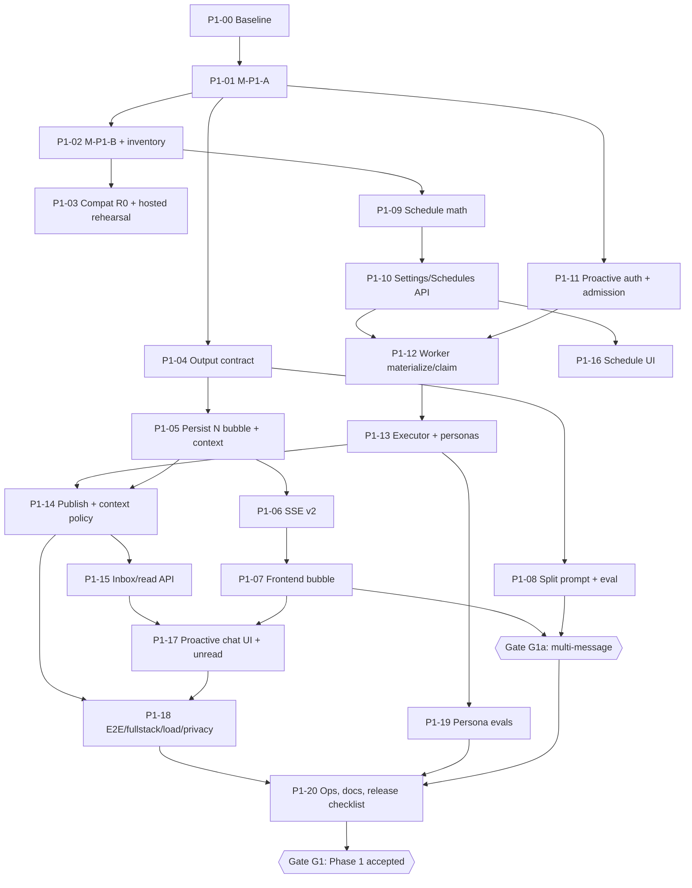

# Phase 1 — 08. Kế hoạch triển khai

Đọc trước: [03-architecture-decisions.md](../03-architecture-decisions.md), [02](02-multi-message-contract.md)–[07](07-persona-behaviors-and-prompts.md). Kiểm thử chi tiết: [09](09-testing-and-acceptance.md). Phát hành: [93](../93-release-rollback-and-observability.md).

## 0. Quy tắc chung cho mọi task

- Làm trên nhánh tính năng tách từ nhánh đích đã được duyệt (không làm trên `main`, không push/PR/deploy nếu chưa được yêu cầu). Không chạm thay đổi của người khác trong working tree.
- TDD: test đỏ trước, rồi code, rồi xanh. Chạy test trên PostgreSQL **disposable** (`*_test`, container local); **không** để `backend/.env` (trỏ hosted) điều khiển pytest/Alembic — luôn truyền `DATABASE_MIGRATION_URL` local.
- Mỗi task kết thúc bằng: test liên quan xanh, `ruff`/`mypy` (backend) hoặc `npm run typecheck && npm test` (frontend), `python scripts/check_docs.py` PASS nếu đụng API/config/bảng.
- Không đổi dependency/lockfile. Không bật flag trên staging/production trong task code.

## 1. Đồ thị phụ thuộc

## 2. Các task

### P1-00 — Baseline và tiền đề

| Trường | Nội dung |
| --- | --- |
| Phase / ưu tiên | 1 / P0 |
| Phụ thuộc | Không |
| File kiểm tra | `backend/app/core/revisions.py`, `backend/alembic/versions/`, `.github/workflows/verify.yml`, `scripts/check_docs.py` |
| File mới | `docs/implementation-plans/proactive-multi-agent-companion/evidence/execution.md` (sổ ghi tiến độ) |
| Contract | Không |
| Hành vi | Ghi lại kết quả baseline: backend pytest, frontend unit/E2E fixture, fullstack, `check_docs.py`; xác nhận head Alembic và trạng thái hosted (0019 hay 0020) |
| DB/API | Không |
| Bảo mật | Không dùng `.env` hosted cho test |
| Tests | Chạy bộ hiện có, không viết mới |
| Chấp nhận | Sổ ghi có số pass/fail thật và lệnh đã chạy |
| Rollback | Không áp dụng |
| DoD | Baseline được ghi, mọi lỗi có sẵn được liệt kê là "pre-existing" |

### P1-01 — Migration M-P1-A (bubble + origin)

| Trường | Nội dung |
| --- | --- |
| Phase / ưu tiên | 1 / P0 |
| Phụ thuộc | P1-00 |
| File kiểm tra/sửa | `backend/app/ai/models.py` (`AiMessageRecord`, `AiTurn`), `backend/app/infrastructure/database/models.py` (`AiRun`), `backend/tests/test_context_privacy_migration.py` (mẫu) |
| File mới | `backend/alembic/versions/0021_multi_message.py` (số có thể đổi), `backend/tests/test_multi_message_migration.py` |
| Contract | `UniqueConstraint("run_id","actor","part_index", name="uq_ai_messages_run_part")`; cột `part_index`, `part_count`, `origin`, `proactive_slot`; CHECK theo [04 §3](04-database-and-migrations.md) |
| Hành vi | Expand-only; `downgrade()` raise như 0015–0020 |
| DB/API | Chỉ DB |
| Bảo mật | Không đổi grant; giữ RLS |
| Tests | Upgrade từ 0020 với dữ liệu mẫu; insert 2 bubble; reject trùng `part_index`; reject `self` nhiều phần; reject `origin='user'` + `conversation_id NULL`; reject `origin='user'` + `session_id NULL`; drift check |
| Chấp nhận | Toàn bộ backend suite xanh với schema mới; code hiện tại (chưa dùng cột) không đổi hành vi |
| Rollback | Forward-only; code chưa phụ thuộc cột mới |
| DoD | Migration + ORM + test; offline SQL (`alembic upgrade --sql`) được tạo để review |

### P1-02 — Migration M-P1-B (bảng proactive) và inventory

| Trường | Nội dung |
| --- | --- |
| Phase / ưu tiên | 1 / P0 |
| Phụ thuộc | P1-01 |
| File kiểm tra/sửa | `backend/app/modules/guests/lifecycle.py` (`INVENTORY`), `backend/app/modules/users/lifecycle.py` (`process_deletions`), `backend/app/jobs/retention.py`, `docs/supabase/schema.md` |
| File mới | `backend/alembic/versions/0022_proactive_messages.py`, `backend/app/ai/proactive/{__init__,models}.py`, `backend/tests/test_proactive_migration.py`, `backend/tests/test_proactive_lifecycle.py` |
| Contract | 5 bảng [04 §4](04-database-and-migrations.md) |
| Hành vi | Xóa tài khoản xóa tường minh 5 bảng (trước `delete(AiRun)`); guest purge phân loại `"purged"`; retention xóa job kết thúc > 30 ngày |
| DB/API | DB |
| Bảo mật | RLS + `backend_access` cho `moodprint_runtime`; revoke anon/authenticated/service_role |
| Tests | Bảng/constraint/RLS/grant; `test_inventory_classifies_every_orm_table` xanh; deletion xóa đủ; retention giữ job 29 ngày, xóa job 31 ngày |
| Chấp nhận | `check_docs.py` PASS (schema inventory); test lifecycle xanh |
| Rollback | Forward-only; bảng trống không ảnh hưởng image cũ |
| DoD | Như trên + offline SQL |

### P1-03 — Bản tương thích R0 và diễn tập hosted

| Trường | Nội dung |
| --- | --- |
| Phase / ưu tiên | 1 / P0 |
| Phụ thuộc | P1-02; **0020 được owner duyệt áp dụng** |
| File kiểm tra/sửa | `backend/app/core/revisions.py`, `scripts/prepare_supabase_migration.py`, `scripts/apply_supabase_review.py`, `docs/supabase/migrations.md` |
| File mới | Artifact review SQL trong `deploy/supabase/reviewed-sql/` (theo quy trình hiện có, **không** tự áp dụng) |
| Contract | `READY_REVISIONS = ("0020_private_profile_retirement", "0021_multi_message", "0022_proactive_messages")` cho R0 |
| Hành vi | R0 không dùng cột/bảng mới; ready ở 0020, 0021 hoặc 0022 |
| DB/API | Không |
| Bảo mật | Áp dụng hosted chỉ khi owner cho phép, qua offline SQL đã review, một transaction, có backup |
| Tests | Readiness test với 3 revision; rehearsal trên `*_test` khôi phục từ dump schema hosted, role mirror |
| Chấp nhận | Báo cáo rehearsal PASS, sha256 artifact |
| Rollback | R0 là điểm rollback của R1 |
| DoD | R0 build xanh; artifact review chờ duyệt |

### P1-04 — Hợp đồng output nhiều bubble và provider

| Trường | Nội dung |
| --- | --- |
| Phase / ưu tiên | 1 / P0 |
| Phụ thuộc | P1-01 |
| File kiểm tra/sửa | `backend/app/ai/schemas.py`, `backend/app/ai/provider.py` (`_stream`, `_no_unreceipted_claim`), `backend/app/ai/journal.py` (`NhipOutput`, `render_journal_output`), `backend/app/ai/evidence.py` (`render_mood_analysis`), `backend/app/core/config.py` |
| File mới | `backend/tests/test_multi_message_contract.py` |
| Contract | `Bubble`, `CompanionReply`, `NhipReply` ([02 §1](02-multi-message-contract.md)); `AI_MULTI_MESSAGE_ENABLED` |
| Hành vi | Flag bật → `output_type=CompanionReply`/`NhipReply`; guardrail kiểm từng bubble; journal link thêm vào bubble cuối; mood analysis bọc 1 bubble. Flag tắt → y hệt hiện tại |
| DB/API | Không |
| Bảo mật | Validator chặn link/claim trên mọi bubble; tổng ≤ 5.900 ký tự |
| Tests | Fake `ScriptedModel` trả 1/2/4/5 bubble; bubble rỗng/trùng; 4 card; claim ở bubble 2; journal citation ở bubble 1; flag tắt giữ snapshot hiện tại |
| Chấp nhận | `test_sdk_adapter.py`, `test_journal_ai.py`, `test_mood_evidence_runtime.py` xanh không sửa kỳ vọng khi flag tắt |
| Rollback | Tắt flag |
| DoD | Test mới + cũ xanh |

### P1-05 — Persist N bubble, context, phân trang, export

| Trường | Nội dung |
| --- | --- |
| Phase / ưu tiên | 1 / P0 |
| Phụ thuộc | P1-04 |
| File kiểm tra/sửa | `backend/app/ai/runtime.py` (`drive`, `check_capacity`), `backend/app/ai/persistence.py` (`conversation_view`, `load_runtime_conversation`), `backend/app/ai/context.py` (`build_history`), `backend/app/ai/schemas.py` (`AIMessage`), `backend/app/ai/chat_routes.py` (`export_conversation`), `backend/app/ai/store.py` |
| File mới | `backend/tests/test_multi_message_persistence.py` |
| Contract | `AIMessage.partIndex/partCount/origin/proactiveSlot`; bất biến `version == max(sequence)` |
| Hành vi | [02 §5–8](02-multi-message-contract.md) |
| DB/API | `GET /ai/conversations/{id}` thêm trường; trang không cắt nhóm |
| Bảo mật | Không đổi quyền; projection gộp bubble trước khi đếm 24 tin |
| Tests | Persistent và temporary; hủy trước commit = 0 row; cursor rơi giữa nhóm; property test version/sequence; `build_history` gộp; export có trường mới |
| Chấp nhận | `test_chat_persistence.py`, `test_context_selection.py` xanh |
| Rollback | Tắt flag (chỉ còn 1 bubble) |
| DoD | Test xanh; OpenAPI regenerate (`scripts/export_openapi.py`) |

### P1-06 — SSE v2 và tương thích v1

| Trường | Nội dung |
| --- | --- |
| Phase / ưu tiên | 1 / P0 |
| Phụ thuộc | P1-05 |
| File kiểm tra/sửa | `backend/app/ai/chat_routes.py` (`events`, `durable_run`, `authorized_run`), `backend/app/ai/runtime.py` (`event`), `backend/app/ai/schemas.py` (`AIEvent`), `backend/app/main.py` (`openapi`), `scripts/check_sse_timing.py` |
| File mới | `backend/tests/test_ai_events_v2.py` |
| Contract | [02 §4](02-multi-message-contract.md) |
| Hành vi | `?protocol=2` → v2; mặc định v1 ghép; replay persistent seq 1–3 |
| DB/API | Query param mới |
| Bảo mật | Mỗi tick vẫn kiểm session/consent như hiện tại |
| Tests | v1 run 1 bubble byte-for-byte; v1 run 3 bubble ghép ≤ 6.000; v2 đúng thứ tự; `afterSeq` 0..3; `CURSOR_GAP` >3; reconnect bằng `Last-Event-ID` |
| Chấp nhận | Contract drift CI xanh sau `npm run contracts:generate` |
| Rollback | Client cũ dùng v1 |
| DoD | Test xanh, OpenAPI + `schema.d.ts` cập nhật |

### P1-07 — Frontend: stream v2, nhóm bubble, a11y, nhãn ngày, STALE_VERSION

| Trường | Nội dung |
| --- | --- |
| Phase / ưu tiên | 1 / P0 |
| Phụ thuộc | P1-06 |
| File kiểm tra/sửa | `frontend/src/api/stream.ts`, `frontend/src/api/stream.test.ts`, `frontend/src/features/real/RealApp.tsx` (`stream`, `send`, render log), `frontend/src/features/real/agent-chat.css`, `frontend/src/features/real/messageDates.ts` (+ test) |
| File mới | `frontend/src/features/real/messageGroups.ts` (+ `.test.ts`) |
| Contract | `ValidatedReply`; fallback parser v1 |
| Hành vi | [02 §9](02-multi-message-contract.md), [06 §7–8](06-frontend-ux-and-notifications.md) |
| DB/API | Không |
| Bảo mật | Validate chặt v2 (khóa lạ → lỗi) |
| Tests | Unit parser v1/v2/lỗi; unit group; E2E fixture 1/3 bubble, reload, copy, reduced motion, screen reader label; STALE_VERSION giữ draft |
| Chấp nhận | `npm run typecheck`, `npm test`, E2E fixture `chat-history.spec.ts` + spec mới xanh |
| Rollback | Revert frontend |
| DoD | Ảnh chụp trước/sau ở 390/768/1440 trong evidence (ngoài git nếu theo quy ước dự án) |

### P1-08 — Hướng dẫn tách bubble và eval

| Trường | Nội dung |
| --- | --- |
| Phase / ưu tiên | 1 / P1 |
| Phụ thuộc | P1-04 |
| File kiểm tra/sửa | `backend/app/ai/prompts.py` (`conversation_instructions`), `backend/evals/` |
| File mới | `backend/evals/multi_message/` (bộ case + rubric) |
| Contract | Văn bản prompt [02 §2](02-multi-message-contract.md) |
| Hành vi | Mặc định 1 bubble; tách khi tự nhiên |
| DB/API | Không |
| Bảo mật | Không dữ liệu thật trong eval |
| Tests | Offline: schema/validator; live (gate thủ công, có ngân sách): tỷ lệ 1 bubble cho câu ngắn ≥ 95 %, không tách danh sách ≥ 95 % |
| Chấp nhận | Báo cáo eval có số liệu thật hoặc ghi rõ "chưa chạy live" |
| Rollback | Bỏ đoạn prompt |
| DoD | Eval chạy được bằng một lệnh |

### P1-09 — Hàm tính lịch (thuần)

| Trường | Nội dung |
| --- | --- |
| Phase / ưu tiên | 1 / P0 |
| Phụ thuộc | P1-02 |
| File kiểm tra | `backend/app/modules/journal/service.py` (`active_dates`) |
| File mới | `backend/app/ai/proactive/schedule.py`, `backend/tests/test_proactive_schedule.py` |
| Contract | `next_occurrence`, `resolve_local`, `in_quiet_hours`, `weekday_allowed`, `window_for(slot, age_band)` |
| Hành vi | [03 §4](03-proactive-scheduler-and-workers.md) |
| DB/API | Không |
| Bảo mật | — |
| Tests | Asia/Ho_Chi_Minh; America/New_York DST gap/overlap; giờ yên lặng qua nửa đêm; weekday mask; pause; không có ngày hợp lệ → `None`; teen giới hạn |
| Chấp nhận | 100 % nhánh có test |
| Rollback | — |
| DoD | Test xanh |

### P1-10 — API cài đặt và lịch; cấu hình

| Trường | Nội dung |
| --- | --- |
| Phase / ưu tiên | 1 / P0 |
| Phụ thuộc | P1-09 |
| File kiểm tra/sửa | `backend/app/core/config.py`, `backend/app/main.py`, `backend/app/contracts.py` (`FeatureView`), `backend/app/modules/auth/routes.py` (session features), `docs/backend/api-reference.md`, `docs/backend/configuration.md`, `backend/.env.example` |
| File mới | `backend/app/ai/proactive/{schemas,routes}.py`, `backend/tests/test_proactive_api.py` |
| Contract | [05 §2.1–2.4, §8](05-backend-api-and-agent-runtime.md) |
| Hành vi | Upsert/xóa lịch; validate cửa sổ, giờ yên lặng, cap 4, Cầu Nối eligibility; hủy job chưa chạy; tắt journal consent tăng `data_version` |
| DB/API | 4 route mới; `features.proactive` |
| Bảo mật | `require_registered_actor`; owner predicate; idempotency + version; production validator cho worker |
| Tests | Guest 403; teen Cầu Nối 403; cap; quiet hours; stale version; idempotent replay; consent off hủy job + `data_version` tăng |
| Chấp nhận | `check_docs.py` PASS (API + config inventory) |
| Rollback | `PROACTIVE_ENABLED=false` |
| DoD | Test + docs |

### P1-11 — Ủy quyền proactive và tách quota

| Trường | Nội dung |
| --- | --- |
| Phase / ưu tiên | 1 / P0 |
| Phụ thuộc | P1-01 |
| File kiểm tra/sửa | `backend/app/ai/persistence.py` (`admission`, `daily_turns`), `backend/app/ai/chat_routes.py` (`durable_run`), `backend/app/core/security.py` (`assert_purpose`) |
| File mới | `backend/app/ai/proactive/policy.py`, `backend/tests/test_proactive_policy.py` |
| Contract | `authorize_proactive()` ([05 §3](05-backend-api-and-agent-runtime.md)) |
| Hành vi | Quota/rate/concurrency người dùng chỉ đếm `origin='user'`; global đếm tất cả |
| DB/API | `aiQuotaRemaining` không bị proactive trừ |
| Bảo mật | Ma trận tài khoản: guest, under16, unknown, deleted, deletion_pending, suspended, inactive, teen+Cầu Nối |
| Tests | Mỗi ô ma trận; admission không chặn người dùng khi có run proactive đang chạy |
| Chấp nhận | `test_ai*.py` hiện có xanh |
| Rollback | Revert (chưa có run proactive) |
| DoD | Test xanh |

### P1-12 — Worker: materialize, claim, lifespan

| Trường | Nội dung |
| --- | --- |
| Phase / ưu tiên | 1 / P0 |
| Phụ thuộc | P1-10, P1-11 |
| File kiểm tra/sửa | `backend/app/main.py` (lifespan), `backend/app/ai/embeddings.py` (mẫu claim), `backend/app/modules/activities/jobs.py` (mẫu due) |
| File mới | `backend/app/jobs/proactive.py`, `backend/tests/test_proactive_worker.py` |
| Contract | `proactive_tick(app)`, `materialize_due(db, at)`, `claim_job(db, worker_id)` |
| Hành vi | [03 §3, §5, §7–9](03-proactive-scheduler-and-workers.md) |
| DB/API | Không |
| Bảo mật | `SET LOCAL lock_timeout/statement_timeout`; thứ tự khóa users → jobs → conversations |
| Tests | Hai worker song song không trùng; lease hết hạn reclaim; missed window; sau downtime 2 ngày chỉ một job/lịch; job hết hạn → skipped; cap; auto-pause |
| Chấp nhận | Chạy tick với `PROACTIVE_WORKER_ENABLED=false` không làm gì |
| Rollback | Tắt flag |
| DoD | Test xanh, metric log content-free |

### P1-13 — Executor và persona

| Trường | Nội dung |
| --- | --- |
| Phase / ưu tiên | 1 / P0 |
| Phụ thuộc | P1-12 |
| File kiểm tra/sửa | `backend/app/ai/provider.py` (`run_proactive`), `backend/app/ai/prompts.py` (lớp proactive), `backend/app/ai/accounting.py` (`reserve_accounting` prompt version), `backend/app/modules/journal/ai.py`, `backend/app/modules/social/summary.py` |
| File mới | `backend/app/ai/proactive/{context,executor}.py`, `backend/app/ai/proactive/safety.py`, `backend/tests/test_proactive_executor.py`, `backend/tests/test_proactive_journal.py` |
| Contract | `ProactivePayload`, `ProactiveReply`, `NhipProactiveReply`, `challenge_kind` enum |
| Hành vi | E1–E4; persona [07](07-persona-behaviors-and-prompts.md); distress template |
| DB/API | `ai_runs/ai_turns/ai_usage` cho run proactive |
| Bảo mật | Không transcript, không tool, tracing tắt; entry của user khác/draft/media/ngoài 90 ngày không vào payload; canary text không xuất hiện trong log |
| Tests | Fake model ghi `calls[*]["input"]` để khẳng định payload; không có entry → validator chặn câu "hôm qua"; distress → không gọi model; Cầu Nối không có tên người |
| Chấp nhận | Không có `ai_messages(actor='self')` cho run proactive |
| Rollback | Tắt worker |
| DoD | Test xanh |

### P1-14 — Publish, chọn hội thoại, context policy

| Trường | Nội dung |
| --- | --- |
| Phase / ưu tiên | 1 / P0 |
| Phụ thuộc | P1-13, P1-05 |
| File kiểm tra/sửa | `backend/app/ai/context.py` (`model_messages`), `backend/app/ai/runtime.py` (`drive` revalidation), `backend/app/ai/journal.py` (`assert_journal_revisions`) |
| File mới | `backend/tests/test_proactive_publish.py`, `backend/tests/test_proactive_context.py` |
| Contract | ADR-07, ADR-08; `ai_message_sources` |
| Hành vi | [05 §4.2, §4.4](05-backend-api-and-agent-runtime.md) |
| DB/API | `GET conversation` hiện tin proactive với `origin`/`proactiveSlot` |
| Bảo mật | Kiểm lại toàn bộ quyền dưới owner lock; revalidate provenance; consent off → tin cũ bị loại khỏi context |
| Tests | Hội thoại busy → defer; tin `self` < 10 phút → defer; hết hạn → skipped; tạo mới khi không có hội thoại phù hợp; crash trước commit → không row; revalidate khi sửa/xóa entry, tắt consent, đổi data_version |
| Chấp nhận | Hiển thị đúng một lần dưới 3 lần thử song song |
| Rollback | Tắt worker; tin đã giao vẫn hợp lệ |
| DoD | Test xanh |

### P1-15 — API inbox và read marker

| Trường | Nội dung |
| --- | --- |
| Phase / ưu tiên | 1 / P0 |
| Phụ thuộc | P1-14 |
| File kiểm tra | `backend/app/modules/social/summary.py` (mẫu) |
| File mới | Route trong `backend/app/ai/proactive/routes.py`, `backend/tests/test_ai_inbox.py` |
| Contract | [05 §2.5–2.6](05-backend-api-and-agent-runtime.md) |
| Hành vi | Đếm theo run; read marker đơn điệu |
| DB/API | 3 route |
| Bảo mật | Không preview; chỉ hội thoại của chính user; guest trả rỗng |
| Tests | 3 bubble = 1 unread; read giảm số; marker không lùi; hội thoại hết hạn không đếm; người khác 404 |
| Chấp nhận | p95 < 50 ms với 500 hội thoại (fixture) |
| Rollback | Route tắt theo flag |
| DoD | Test + docs inventory |

### P1-16 — UI lịch hỏi thăm

| Trường | Nội dung |
| --- | --- |
| Phase / ưu tiên | 1 / P0 |
| Phụ thuộc | P1-10 |
| File kiểm tra/sửa | `frontend/src/features/real/RealApp.tsx` (routes, `AccountPage`), `frontend/src/features/real/ConversationInfo.tsx`, `frontend/src/components/UI.tsx` |
| File mới | `frontend/src/features/real/checkins/{CheckInsPage.tsx, ScheduleCard.tsx, checkins.css, schedule.test.ts}` |
| Contract | [06 §2–3, §9–12](06-frontend-ux-and-notifications.md) |
| Hành vi | Lưu từng điều khiển; trạng thái đầy đủ |
| DB/API | Dùng API P1-10 |
| Bảo mật | Opt-in nhật ký mặc định tắt; guest không thấy |
| Tests | Unit; E2E fixture desktop/mobile; axe; keyboard |
| Chấp nhận | Copy tiếng Việt đúng bảng; không thuật ngữ kỹ thuật |
| Rollback | Ẩn theo `features.proactive` |
| DoD | E2E + ảnh 390/768/1440 |

### P1-17 — UI lời hỏi thăm trong chat và chỉ báo chưa đọc

| Trường | Nội dung |
| --- | --- |
| Phase / ưu tiên | 1 / P0 |
| Phụ thuộc | P1-15, P1-07 |
| File kiểm tra/sửa | `frontend/src/features/real/RealApp.tsx` (`Navigation`, `Assistants`, `ConversationBody`), `frontend/src/features/real/AIData.tsx` (`ConversationHistory`) |
| File mới | `frontend/src/features/real/useAIInbox.ts` (+ test) |
| Contract | [06 §4–7](06-frontend-ux-and-notifications.md) |
| Hành vi | Badge, mục "Lời nhắn mới", đánh dấu đọc, BroadcastChannel, tự tải lại hội thoại idle |
| DB/API | Dùng API P1-15 |
| Bảo mật | Không preview; không lưu nội dung vào storage/BroadcastChannel |
| Tests | E2E: reload, 2 tab, back/forward, mobile, reduced motion, badges tắt |
| Chấp nhận | Không có unread trùng |
| Rollback | Ẩn theo flag |
| DoD | E2E xanh |

### P1-18 — Kiểm thử tích hợp, fullstack, tải, privacy

| Trường | Nội dung |
| --- | --- |
| Phase / ưu tiên | 1 / P0 |
| Phụ thuộc | P1-14, P1-17 |
| File kiểm tra/sửa | `backend/tests/e2e_server.py`, `frontend/tests/fullstack/`, `scripts/load_chat_memory.py` |
| File mới | `frontend/tests/e2e/proactive.spec.ts`, `frontend/tests/fullstack/proactive.spec.ts`, `backend/tests/test_proactive_privacy.py`, `scripts/load_proactive.py` |
| Contract | [09](09-testing-and-acceptance.md), [92 §4](../92-visual-qa-and-agent-browser.md) |
| Hành vi | Endpoint test-only "advance clock/run tick" chỉ tồn tại khi `APP_ENV=test` |
| DB/API | Không cho production |
| Bảo mật | Canary text trong nhật ký không xuất hiện ở log/metric/usage |
| Tests | Như [09](09-testing-and-acceptance.md) |
| Chấp nhận | Toàn bộ ma trận P0 xanh |
| Rollback | — |
| DoD | Báo cáo có số liệu thật |

### P1-19 — Eval persona

| Trường | Nội dung |
| --- | --- |
| Phase / ưu tiên | 1 / P1 |
| Phụ thuộc | P1-13 |
| File kiểm tra | `backend/evals/`, `docs/agents/evaluation.md` |
| File mới | `backend/evals/proactive/` (case tổng hợp, rubric: không bịa, không trách, một gợi ý, đúng persona) |
| Contract | [07](07-persona-behaviors-and-prompts.md) |
| Hành vi | Offline (fake model + validator) và live có gate ngân sách |
| DB/API | Không |
| Bảo mật | Chỉ dữ liệu tổng hợp |
| Tests | ≥ 60 case (5 persona × 2 slot × 6 tình huống) |
| Chấp nhận | Live: ≥ 95 % pass rubric bắt buộc, 0 vi phạm "bịa đọc nhật ký" |
| Rollback | — |
| DoD | Báo cáo eval |

### P1-20 — Vận hành, tài liệu, checklist phát hành

| Trường | Nội dung |
| --- | --- |
| Phase / ưu tiên | 1 / P0 |
| Phụ thuộc | P1-18, P1-19, Gate G1a |
| File kiểm tra/sửa | `deploy/aws/cloudwatch-alarms.json`, `docs/backend/operations.md`, `docs/agents/runtime.md`, `docs/agents/context-memory.md`, `ARCHITECTURE.md`, `docs/backend/data-lifecycle.md` |
| File mới | Runbook trong [93](../93-release-rollback-and-observability.md) được hiện thực vào `docs/backend/operations.md` |
| Contract | Metric/alarm [93](../93-release-rollback-and-observability.md) |
| Hành vi | Không đổi |
| DB/API | Không |
| Bảo mật | Log không nội dung |
| Tests | `check_docs.py` |
| Chấp nhận | Checklist release ký bởi owner |
| Rollback | — |
| DoD | Tài liệu đồng bộ code |

## 3. Cổng

| Cổng | Điều kiện |
| --- | --- |
| **G1a** (có thể bật `AI_MULTI_MESSAGE_ENABLED` trên staging) | P1-01…P1-08 xong; v1/v2 contract test xanh; E2E nhiều bubble xanh; eval tách bubble đạt hoặc owner chấp nhận rủi ro |
| **G1** (Phase 1 hoàn tất) | Mọi task P0 xong; [09 §6](09-testing-and-acceptance.md) đạt; runbook + alarm; hosted đã áp dụng M-P1-A/B qua review; owner duyệt OD-01…OD-04 |
| **G2-entry** (được bắt đầu Phase 2 bật cờ) | G1 + 14 ngày staging không có lỗi P0/P1 về giao trùng, rò rỉ hoặc vi phạm consent |
