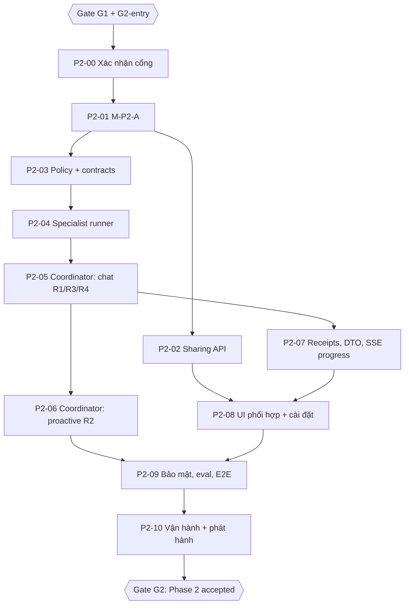

# Phase 2 — 06. Kế hoạch triển khai

**Cổng vào (bắt buộc):** Gate G1 và G2-entry của Phase 1 đạt ([phase-1/08 §3](../phase-1/08-implementation-plan.md)). Cụ thể các hợp đồng Phase 1 sau phải xanh trên CI trước khi bật bất kỳ cờ Phase 2 nào: SSE v2 contract, persist nhiều bubble atomically, `ai_runs.origin` + quota tách, `ai_message_sources` + revalidate (ADR-08), pipeline proactive E1–E5, read/inbox.

Quy tắc chung giống [phase-1/08 §0](../phase-1/08-implementation-plan.md).

## 1. Đồ thị phụ thuộc

## 2. Các task

### P2-00 — Xác nhận cổng Phase 1

| Trường | Nội dung |
| --- | --- |
| Phase / ưu tiên | 2 / P0 |
| Phụ thuộc | G1, G2-entry |
| File kiểm tra | Sổ `evidence/execution.md` Phase 1, run CI gần nhất |
| File mới | Mục "Phase 2 entry" trong sổ |
| Contract | Danh sách hợp đồng Phase 1 ở đầu tài liệu |
| Hành vi | Không code; xác nhận và ghi bằng chứng |
| DB/API | Không |
| Bảo mật | Xác nhận không có sự cố rò rỉ/giao trùng mở |
| Tests | Chạy lại bộ Phase 1 P0 |
| Chấp nhận | Tất cả xanh, có link run |
| Rollback | — |
| DoD | Owner xác nhận được bắt đầu |

### P2-01 — Migration M-P2-A

| Trường | Nội dung |
| --- | --- |
| Phase / ưu tiên | 2 / P0 |
| Phụ thuộc | P2-00 |
| File kiểm tra/sửa | `backend/app/infrastructure/database/models.py` (`AiRun`), `backend/app/modules/guests/lifecycle.py`, `backend/app/modules/users/lifecycle.py`, `backend/app/jobs/retention.py`, `backend/app/core/revisions.py`, `docs/supabase/schema.md` |
| File mới | `backend/alembic/versions/0023_collaboration.py`, `backend/app/ai/collaboration/models.py`, `backend/tests/test_collaboration_migration.py` |
| Contract | [05 §1](05-backend-and-database-contracts.md) |
| Hành vi | Expand-only; compat release chấp nhận 0022 và 0023 trước khi áp dụng hosted |
| DB/API | DB |
| Bảo mật | RLS + grant runtime; inventory; deletion |
| Tests | CHECK cạnh (mọi tổ hợp sai bị từ chối), `parent_run_id` iff `collaboration`, inventory, deletion, retention 90 ngày |
| Chấp nhận | Backend suite xanh |
| Rollback | Forward-only; cờ tắt |
| DoD | Migration + offline SQL + rehearsal |

### P2-02 — API quyền chia sẻ

| Trường | Nội dung |
| --- | --- |
| Phase / ưu tiên | 2 / P0 |
| Phụ thuộc | P2-01 |
| File kiểm tra/sửa | `backend/app/ai/chat_routes.py` (`update_preferences` làm mẫu hủy run), `backend/app/core/config.py`, `docs/backend/api-reference.md`, `docs/backend/configuration.md` |
| File mới | `backend/app/ai/collaboration/routes.py`, `backend/tests/test_sharing_api.py` |
| Contract | [05 §2](05-backend-and-database-contracts.md) |
| Hành vi | Bật/tắt từng cạnh; tắt → `data_version += 1`, hủy run đang chạy, invalidate |
| DB/API | 2 route |
| Bảo mật | Registered only; cạnh ngoài allowlist → 404; `nhip_energy_for_rure` chỉ bật khi journal context bật (`409 SHARING_REQUIRES_JOURNAL_CONTEXT`) |
| Tests | Guest; cạnh lạ; version; idempotency; tắt giữa run → run `cancelled` |
| Chấp nhận | `check_docs.py` PASS |
| Rollback | Cờ tắt |
| DoD | Test + docs |

### P2-03 — Policy, ma trận, hợp đồng

| Trường | Nội dung |
| --- | --- |
| Phase / ưu tiên | 2 / P0 |
| Phụ thuộc | P2-01 |
| File kiểm tra | `backend/app/ai/conversation.py` (`conversation_intent`, `current_text`), `backend/app/ai/proactive/safety.py` (distress screen Phase 1) |
| File mới | `backend/app/ai/collaboration/{policy,contracts}.py`, `backend/tests/test_collaboration_policy.py` |
| Contract | [03 §1–3](03-agent-communication-and-consent.md), luật R1–R4 [02 §3](02-orchestration-architecture.md), template [04 §3](04-collaboration-ui-ux.md) |
| Hành vi | Hàm thuần `evaluate(signals, permissions, counters) -> Decision`; builder `AllowedContext` theo cạnh |
| DB/API | Không |
| Bảo mật | `DENY_BY_DEFAULT`; builder không nhận transcript; Cầu Nối không có cạnh |
| Tests | Ma trận 5×5; mỗi luật dương/âm; distress chặn; depth; cap; budget; builder không chứa câu chữ người dùng (canary) |
| Chấp nhận | 100 % nhánh policy có test |
| Rollback | — |
| DoD | Test xanh |

### P2-04 — Specialist runner

| Trường | Nội dung |
| --- | --- |
| Phase / ưu tiên | 2 / P0 |
| Phụ thuộc | P2-03 |
| File kiểm tra/sửa | `backend/app/ai/provider.py` (`_BudgetHooks` thêm `model_limit/tool_limit`, client dùng chung), `backend/app/ai/accounting.py` |
| File mới | `backend/app/ai/collaboration/specialist.py`, `backend/tests/test_specialist_runner.py` |
| Contract | [05 §6](05-backend-and-database-contracts.md) |
| Hành vi | `Runner.run` riêng, `tools=[]`, `max_turns=1`, timeout, run con + usage riêng, luôn đóng run con |
| DB/API | `ai_runs(origin='collaboration')`, `ai_usage` |
| Bảo mật | Context riêng (`SpecialistContext`), tracing tắt, output validate + lọc link/claim |
| Tests | Fake model: hợp lệ, sai schema, timeout, vượt 1 call bị chặn, tracing tắt, context không có `LiveRun` |
| Chấp nhận | Không có thay đổi hành vi khi `AI_COLLABORATION_ENABLED=false` |
| Rollback | Cờ tắt |
| DoD | Test xanh |

### P2-05 — Coordinator trong chat (R1, R3, R4)

| Trường | Nội dung |
| --- | --- |
| Phase / ưu tiên | 2 / P0 |
| Phụ thuộc | P2-04 |
| File kiểm tra/sửa | `backend/app/ai/runtime.py` (`drive`, `event`), `backend/app/ai/provider.py` (`run(..., extra_instructions, extra_input)`) |
| File mới | `backend/app/ai/collaboration/coordinator.py`, `backend/tests/test_collaboration_chat.py` |
| Contract | [02 §4–6](02-orchestration-architecture.md), [05 §5](05-backend-and-database-contracts.md) |
| Hành vi | Đánh giá luật, receipt, ba lần kiểm quyền, đưa kết quả vào primary, fallback |
| DB/API | `ai_collaborations`, `ai_message_sources` |
| Bảo mật | Không văn bản nhật ký/câu chữ người dùng tới requester; revoke giữa lượt hủy run |
| Tests | Mỗi luật end-to-end với fake model; specialist lỗi → câu trả lời đơn; ngân sách thời gian < 15 s → bỏ qua; canary nhật ký không xuất hiện trong input của Rủ Rê |
| Chấp nhận | Lượt không khớp luật: số model call không đổi so với Phase 1 |
| Rollback | Cờ tắt |
| DoD | Test xanh |

### P2-06 — Coordinator trong lời hỏi thăm (R2)

| Trường | Nội dung |
| --- | --- |
| Phase / ưu tiên | 2 / P1 |
| Phụ thuộc | P2-05 |
| File kiểm tra/sửa | `backend/app/ai/proactive/executor.py`, `backend/app/ai/proactive/context.py` |
| File mới | `backend/tests/test_collaboration_proactive.py` |
| Contract | [02 §4.2](02-orchestration-architecture.md) |
| Hành vi | Specialist giữa E2 và E3; provenance gắn vào run Rủ Rê; stamp `proactive-journal-v1` |
| DB/API | Như P2-05 |
| Bảo mật | Revalidate ADR-08 áp dụng cho tin Rủ Rê |
| Tests | Có entry → receipt completed + dòng cộng tác; không entry → không gọi; tắt cạnh giữa E2/E5 → job cancelled |
| Chấp nhận | Đúng một lần giao như Phase 1 |
| Rollback | Cờ tắt |
| DoD | Test xanh |

### P2-07 — Receipt, DTO, SSE progress

| Trường | Nội dung |
| --- | --- |
| Phase / ưu tiên | 2 / P0 |
| Phụ thuộc | P2-05 |
| File kiểm tra/sửa | `backend/app/ai/persistence.py` (`conversation_view`), `backend/app/ai/chat_routes.py` (`events`), `backend/app/ai/schemas.py`, `frontend/src/api/stream.ts` |
| File mới | `backend/tests/test_collaboration_dto.py` |
| Contract | [05 §3–4](05-backend-and-database-contracts.md) |
| Hành vi | `collaboration` chỉ khi completed + used; template backend; progress thật — với persistent run, danh sách event v2 dựng xác định từ DB (`ai_collaborations` + `ai_runs`), tối đa 5 event ([05 §3](05-backend-and-database-contracts.md)) |
| DB/API | DTO + SSE v2 (`afterSeq ≤ 5` ở v2, ≤ 3 ở v1) |
| Bảo mật | Không digest/ID cạnh trong DTO ngoài `kind` |
| Tests | Receipt failed/timeout/discarded → không summary; v1 không thấy khóa mới; client v2 từ chối summary > 200 ký tự; persistent: reconnect ở mọi `afterSeq` 0–5 cho cả lượt có/không phối hợp, prefix không đổi khi trạng thái tiến |
| Chấp nhận | Contract drift xanh |
| Rollback | Cờ tắt |
| DoD | Test + OpenAPI |

### P2-08 — UI phối hợp và cài đặt

| Trường | Nội dung |
| --- | --- |
| Phase / ưu tiên | 2 / P0 |
| Phụ thuộc | P2-02, P2-07 |
| File kiểm tra/sửa | `frontend/src/features/real/RealApp.tsx`, `frontend/src/features/real/aiActivityView.ts`, `frontend/src/features/real/AIActivityStatus.tsx` |
| File mới | `frontend/src/features/real/collaboration/{CollaborationLine.tsx, WhySheet.tsx, SharingPage.tsx, collaboration.css}` (+ test) |
| Contract | [04](04-collaboration-ui-ux.md) |
| Hành vi | Trạng thái S0–S6; trang cài đặt |
| DB/API | Dùng API P2-02 |
| Bảo mật | Không hiển thị nội dung specialist |
| Tests | Unit `deriveAIActivity` thêm phase `consulting`; E2E fixture S1–S6; axe; reduced motion; mobile |
| Chấp nhận | Không có thuật ngữ kỹ thuật trên UI |
| Rollback | Ẩn theo `features.collaboration` |
| DoD | E2E xanh |

### P2-09 — Bảo mật, eval, E2E

| Trường | Nội dung |
| --- | --- |
| Phase / ưu tiên | 2 / P0 |
| Phụ thuộc | P2-06, P2-08 |
| File kiểm tra | `backend/evals/`, promptfoo/deepeval cấu hình hiện có trong repo |
| File mới | `backend/tests/test_collaboration_privacy.py`, `backend/evals/collaboration/`, `frontend/tests/e2e/collaboration.spec.ts`, `frontend/tests/fullstack/collaboration.spec.ts` |
| Contract | [07](07-testing-and-acceptance.md), [90](../90-security-privacy-threat-model.md) |
| Hành vi | Red-team injection qua nhật ký; leakage canary |
| DB/API | Không |
| Bảo mật | Toàn bộ ma trận đe dọa Phase 2 |
| Tests | Như [07](07-testing-and-acceptance.md) |
| Chấp nhận | 0 rò rỉ canary; 0 dòng cộng tác giả |
| Rollback | — |
| DoD | Báo cáo |

### P2-10 — Vận hành và phát hành

| Trường | Nội dung |
| --- | --- |
| Phase / ưu tiên | 2 / P0 |
| Phụ thuộc | P2-09 |
| File kiểm tra/sửa | `deploy/aws/cloudwatch-alarms.json`, `docs/backend/operations.md`, `docs/agents/runtime.md`, `ARCHITECTURE.md` |
| File mới | — |
| Contract | [93](../93-release-rollback-and-observability.md) |
| Hành vi | Metric `collaboration_state`, alarm tỷ lệ timeout |
| DB/API | Không |
| Bảo mật | Log content-free |
| Tests | `check_docs.py` |
| Chấp nhận | Owner ký checklist |
| Rollback | Cờ tắt |
| DoD | Tài liệu đồng bộ |

## 3. Cổng G2

1. Mọi task P0 xong; [07](07-testing-and-acceptance.md) §5 đạt.
2. Staging 7 ngày với tài khoản thử nghiệm: 0 dòng cộng tác không có receipt `completed`, 0 rò rỉ canary, tỷ lệ timeout specialist < 5 %.
3. Owner duyệt OD-08…OD-10.

## 4. Trạng thái triển khai (31/10/2026)

P2-00…P2-10 đã triển khai trên nhánh `feat/proactive-companion-phase2` (worktree `E:\MoodPrint-proactive-phase2`, tách từ Phase 1 `44f4201`), chỉ local, cờ tắt mặc định. Bằng chứng, lệch đặc tả D-01…D-11 và rủi ro còn lại: [evidence/execution-phase2.md](../evidence/execution-phase2.md). Điều kiện G2 chưa thể đạt trong phiên local: staging 7 ngày (mục 3.2), owner duyệt OD-08…OD-10 (mục 3.3), eval live (cần ngân sách owner duyệt).
