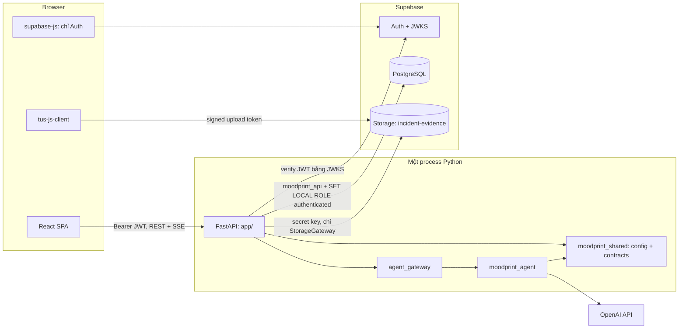

# 00 — Architecture Decisions

> **Trạng thái:** kế hoạch, chưa triển khai. **Ngày audit:** 2026-11-07. **Branch:** `mhiu05/feat-refactor`, HEAD `1a3c81fc`.
> Bộ tài liệu này là nguồn quyết định cho Phase 0/1. Khi mâu thuẫn với `docs/prototype/06-FUTURE-TECHNICAL-ARCHITECTURE.md` thì tài liệu này thắng, vì 06 viết trước khi có quyết định cuối và chưa kiểm tra project Supabase mới.

**Quy ước trạng thái dùng trong toàn bộ `docs/implementation/`:**

| Nhãn | Nghĩa |
|---|---|
| ✅ VERIFIED | Tồn tại và đã kiểm chứng trong phiên audit này |
| 🟡 UNVERIFIED | Tồn tại hoặc được báo cáo, nhưng phiên này chưa kiểm chứng |
| 📐 PLANNED | Chưa có, sẽ làm theo kế hoạch |
| ⛔ BLOCKED | Không thể tiến hành cho tới khi điều kiện được giải quyết |
| 👤 OWNER | Cần chủ dự án thao tác hoặc quyết định |

---

## 1. Kết quả audit

### 1.1 Repository

| Hạng mục | Trạng thái | Bằng chứng |
|---|---|---|
| Branch `mhiu05/feat-refactor`, đồng bộ `origin` | ✅ | `git status -sb` |
| Thay đổi chưa commit: `.claude/settings.local.json`, `.cursor/mcp.json`, `.mcp.json` | ✅ | Không thuộc phiên này, không được đụng tới |
| `backend/` chỉ có `README.md`; `backend/app`, `backend/alembic`, `backend/tests` là thư mục rỗng chưa track | ✅ | `find backend -type f` |
| `agent/` chỉ có `README.md` | ✅ | `find agent -type f` |
| Không có `pyproject.toml`, `uv.lock`, `supabase/`, `.github/workflows/` | ✅ | `ls`, `git ls-files` |
| `Dockerfile`, `ARCHITECTURE.md`, `.dockerignore`, `.gitattributes`, `deploy/*` đều 0 byte | ✅ | `wc -c` |
| `.gitignore` chặn `.env`, `.env.*`, cho phép `.env.example` | ✅ | `git check-ignore -v` |
| `.gitignore` **không** chặn `.venv/`, `__pycache__/`, `.pytest_cache/`, `.ruff_cache/` | ✅ thiếu | `git check-ignore` trả rỗng. F0-01.1 phải bổ sung |
| Python 3.11.0, uv 0.11.14, Docker 29.8.2 có trên máy; Supabase CLI và `psql` **không** có | ✅ | `which`, `--version` |

### 1.2 Frontend

| Hạng mục | Trạng thái | Bằng chứng |
|---|---|---|
| `tsc --noEmit` pass | ✅ | Chạy trong phiên |
| Vitest **54/54**, 13 file | ✅ | Chạy trong phiên. Báo cáo cũ ghi 50/50, 12 file, tức đã lỗi thời |
| 30 scenario, 12 chat, 6 roleplay, 24 article, 8 SVG fixture, 48 school report | ✅ | Đọc `mocks/scenarios`, `mocks/data`, `public/fixtures`, `school-data.ts` |
| Playwright E2E | 🟡 | **Cố ý không chạy**: `e2e/*.ts` có 4 lệnh `page.screenshot` ghi vào `docs/prototype/screenshots/`, chạy sẽ làm bẩn file đã track |
| Tất cả state nằm trong một Zustand store persist `moodprint-demo` (`src/app/store.ts`) | ✅ | Đọc code |
| Không có repository/adapter layer. `demoService` chỉ có `saveCase`, `savePlan`, `saveDraft`, `run` | ✅ | `mocks/services/demo.ts`. Tài liệu 06 mô tả `CaseRepository`, nhưng chúng **không tồn tại** |
| Có ghi trực tiếp vào store, bỏ qua `demoService` | ✅ | `incidents/index.tsx:383,757,870`, `wizard.tsx:199,208`, `home/index.tsx` (`putPlan`), `support/index.tsx:195-196`, `knowledge`, `profile`, `analysis-workflow.ts` |
| `scripts/check-boundaries.mjs` **cấm** `fetch(`, `EventSource(`, dependency khớp `supabase`, chuỗi kiểu JWT `eyJhbGci...` | ✅ | Sẽ fail ngay khi Phase 1 thêm supabase-js. F1-07.1 phải viết lại |
| `e2e/journey.spec.ts` assert không có request ra ngoài origin | ✅ | Cần allow-list khi chạy với backend thật |
| `thinking-orbs: "latest"` không pin version | ✅ | `package.json`. F1-07.1 pin lại |
| Không có upload file thật; `EvidencePicker` chỉ thêm fixture cứng | ✅ | `incidents/evidence.tsx` |
| Literal type `demo: true`, `kind: "pdf_placeholder"`, `origin: "mock_fixture"`, ID `uid("CASE")` dạng `CASE-<uuid>` | ✅ | `types/index.ts`, `store.ts`. Không tương thích trực tiếp với dữ liệu thật |

### 1.3 Supabase project `db-school-violence`

Kiểm tra bằng MCP `school-violence-supabase`, chỉ dùng thao tác đọc.

| Hạng mục | Trạng thái | Giá trị |
|---|---|---|
| Project URL | ✅ | `https://xhlshihobyxrgfqrdafh.supabase.co`, khớp MCP `get_project_url` |
| PostgreSQL | ✅ | 17.11 |
| `public` schema | ✅ | **Không có bảng nào** |
| Migrations, Edge Functions, dev branches | ✅ | Đều rỗng |
| `auth.users`, `storage.objects` | ✅ | 0 row |
| **Bucket `incident-evidence`** | ✅ | Owner tạo lúc 2026-11-07 09:03 UTC: `public=false`, `file_size_limit=NULL`, `allowed_mime_types=NULL`, type `STANDARD`, 0 object |
| Policy trên `public`, `storage` | ✅ | Không có |
| Extension đã cài | ✅ | `pgcrypto`, `uuid-ossp`, `pg_stat_statements`, `supabase_vault` |
| Extension có sẵn, chưa cài | ✅ | `vector` 0.8.2, `pg_trgm` 1.6, `unaccent` 1.1, `pg_cron`, `pgmq`, `pg_net` |
| JWT signing | ✅ | JWKS công khai trả 1 khóa **ES256 / P-256**. Có thể verify cục bộ, không cần JWT secret |
| Publishable key | ✅ | Có `sb_publishable_...`, không ghi giá trị vào tài liệu |
| Event trigger `ensure_rls` → `public.rls_auto_enable()` | ✅ | Tự bật RLS cho bảng mới, **chỉ trong schema `public`** |
| Default ACL schema `public` | ✅ | `anon`, `authenticated` được **toàn quyền** trên mọi bảng, sequence, function mới. RLS là lớp chặn duy nhất nếu đặt bảng ở `public` |
| Security advisor | ✅ | 2 WARN cùng một nguyên nhân: `anon`, `authenticated` có thể gọi `public.rls_auto_enable()` SECURITY DEFINER. Không có lỗi khác |
| Performance advisor | ✅ | 1 INFO: Auth dùng 10 connection tuyệt đối |
| `postgres` có `CREATEROLE` và `admin_option` trên `authenticated` | ✅ | Cho phép `GRANT authenticated TO moodprint_api` |
| `auth.uid()` đọc `request.jwt.claims` | ✅ | Pattern `SET LOCAL` của AD-04 hoạt động |
| `storage.protect_delete` chặn xóa trực tiếp `storage.objects` | ✅ | Phải xóa qua Storage API |
| `statement_timeout` của `authenticated` | ✅ | 8s. Bulk query phải nhỏ; không chạy lâu trong role này |
| Gói dịch vụ, global upload limit, region, cấu hình Auth | 📐 | MCP không đọc được. Coding agent đọc và chỉnh qua dashboard bằng Chrome (F0-11.1). **Free plan chặn file ở 50 MB bất kể bucket không giới hạn** |
| Quyền MCP | ✅ | Đọc và ghi, theo chủ ý của owner |
| `.env`, `.env.example` | ✅ | Owner tạo ở root. `.env.example` đã có placeholder; owner tự điền `.env` |

### 1.4 OpenAI Agents SDK

Đọc trực tiếp wheel `openai-agents==0.24.0` (không chạy code).

| API | Xác nhận |
|---|---|
| `SQLAlchemySession(session_id, engine=..., create_tables=False, sessions_table=..., messages_table=..., ensure_ascii=True)` | ✅ Bảng `agent_sessions(session_id, created_at, updated_at)`, `agent_messages(id, session_id, message_data, created_at)`. **Không có owner, không có tham số schema.** `ensure_ascii=True` mặc định sẽ escape tiếng Việt |
| Khóa ghi | ✅ `SELECT ... FOR UPDATE` trên dòng session, an toàn đa instance |
| `OpenAIResponsesCompactionSession(session_id, underlying_session, client=, model=, compaction_mode=, should_trigger_compaction=)` | ✅ Hỗ trợ thay suffix nguyên tử trên SQLAlchemy Postgres. Trigger mặc định là ≥10 candidate item |
| `Runner.run_streamed`, `RunResultStreaming.cancel("immediate"\|"after_turn")` | ✅ |
| Event: `raw_response_event`, `run_item_stream_event` (`tool_called`, `tool_output`, `message_output_created`...), `agent_updated_stream_event` | ✅ |
| `function_tool(..., needs_approval=, timeout_seconds=, timeout_behavior=, is_enabled=, failure_error_function=)` | ✅ |
| `RunState.approve/reject`, `to_string(context_serializer=, strict_context=)`, `from_string(agent, s, context_override=)` | ✅ Có API, resume sau restart cần spike S-03 |
| `RunConfig.tracing_disabled`, `trace_include_sensitive_data`, `call_model_input_filter`, `session_input_callback` | ✅ |
| `ModelSettings.store`, `metadata`, `prompt_cache_options` | ✅ |
| `agents.testing.ScriptedModel` | ✅ Dùng cho test tất định, không tốn chi phí |
| `agents.extensions.memory.EncryptedSession` | ✅ Có, xem AD-09 |

Dependency đã resolve khô bằng `uv pip compile` cho Python 3.12: `fastapi 0.162.0`, `starlette 1.10.0`, `pydantic 2.14.3`, `sqlalchemy 2.1.8`, `asyncpg 0.32.0`, `openai-agents 0.24.0`, `openai 3.46.0`, `pyjwt 2.15.1`, `voyageai 0.5.0`, `pytest 9.2.0`. Không có xung đột. Số phiên bản là ảnh chụp ngày audit, `uv.lock` mới là nguồn chính thức.

### 1.5 Quyết định của owner sau audit (2026-11-07)

1. **Bucket đã có**, cấu hình đúng AD-08. F0-06.1 không tạo mới nữa, chỉ kiểm tra cấu hình bằng migration idempotent.
2. **MCP được đọc và ghi là chủ ý.** Coding agent được dùng MCP, CLI và Chrome để tự làm mọi việc vận hành có thể tự làm, gồm áp dụng migration lên hosted. Quy tắc ở AD-19.
3. **ZDR tạm bỏ qua.** Kế hoạch không gate theo ZDR.
4. **Owner tự điền secret thật vào `.env`.** Agent không in, không ghi đè giá trị owner đã điền. Biến do agent tự sinh (password `moodprint_api`) thì agent tự ghi vào `.env`.

---

## 2. Kiến trúc đích



**Quy tắc phụ thuộc** (kiểm tra bằng `import-linter`, F0-01.3):

```text
moodprint_shared  ←  moodprint_agent  ←  app (backend)
```

- `moodprint_shared` không import package nội bộ nào.
- `moodprint_agent` không import `app`, không import `sqlalchemy.orm` model của backend, không đọc secret trực tiếp.
- Agent truy cập dữ liệu qua Protocol trong `moodprint_shared.contracts`; backend cung cấp implementation qua `agent_gateway`.

---

## 3. Quyết định kiến trúc

### AD-01 — Modular monolith, một runtime

**Quyết định:** FastAPI import trực tiếp `moodprint_agent`. Một process, `uvicorn --workers 1` ban đầu. Không Redis, Celery, Kafka, Kubernetes, HTTP nội bộ.
**Lý do:** đã chốt trong brief. Hồ sơ, memory và agent cần cùng ranh giới dữ liệu.
**Hệ quả:** mọi khóa nghiệp vụ (một run mỗi conversation, tiến trình reconcile) nằm trong DB, không nằm trong RAM, nên tăng worker sau này không cần đổi thiết kế.

### AD-02 — uv workspace ba member

**Quyết định:** `pyproject.toml` root là workspace ảo, member `shared/`, `agent/`, `backend/`. Python `3.12` qua `.python-version`, uv tự cài. Một `uv.lock` ở root. Package: `moodprint_shared` (`shared/src/`), `moodprint_agent` (`agent/src/`), `app` (`backend/app/`).

| Phương án | Kết luận |
|---|---|
| Một project root, nhiều package | Loại: không chặn được import ngược ở mức packaging, hai branch sửa chung một danh sách dependency |
| Hai member, contract nằm trong `agent` | Loại: backend phải đọc config từ package agent; thư mục agent lại do Phase 2 và 3 sửa, khó đóng băng |
| **Ba member** | Chọn: `shared/` là vùng đóng băng rõ ràng, kiểm tra bằng một lệnh `git diff` |

`shared/` là thư mục top-level thứ tư. Yêu cầu giữ `frontend/ backend/ agent/` vẫn đúng; `shared/` chỉ chứa code không thuộc riêng bên nào. Không cần `sys.path`, chạy `uv sync --all-packages`.

### AD-03 — Một đường dữ liệu qua FastAPI

**Quyết định:** dữ liệu nghiệp vụ chỉ đi qua FastAPI. Frontend dùng `supabase-js` **chỉ** cho Auth. Không gọi PostgREST, không truy cập Storage trực tiếp ngoài token do backend cấp.
**Lý do:** quy tắc nghiệp vụ (bất biến evidence, xác nhận chia sẻ, version conflict) nằm ở một chỗ. Agent tool dùng lại đúng service layer này.

### AD-04 — Thực thi RLS trong backend bằng role switching

**Quyết định:** backend kết nối bằng login role riêng `moodprint_api` (`NOBYPASSRLS`, `NOSUPERUSER`, `NOINHERIT`). Mỗi transaction của request:

```sql
BEGIN;
SET LOCAL ROLE authenticated;
SELECT set_config('request.jwt.claims', :verified_claims_json, true);
-- truy vấn nghiệp vụ
COMMIT;
```

| Phương án | Kết luận |
|---|---|
| `service_role` / `postgres`, chỉ lọc ở Python | Loại: một lỗi quên `WHERE owner_id` là lộ dữ liệu trẻ em. RLS phải là lớp thật |
| Gọi PostgREST bằng JWT người dùng | Loại: mâu thuẫn với SQLAlchemy và transaction nhiều bước |
| **`SET LOCAL ROLE` + claims** | Chọn: giữ SQLAlchemy, RLS có hiệu lực thật với `auth.uid()`, an toàn với pool vì scope theo transaction |

**Hệ quả:** tầng repository vẫn truyền `owner_id`, RLS là lớp phòng thủ thứ hai. Claims chỉ được set từ JWT đã verify. Không giữ transaction qua lời gọi LLM hoặc Storage.

### AD-05 — Bảng nghiệp vụ nằm trong schema không expose

**Quyết định:** schema `app` cho domain, `agent_store` cho bảng SDK, `knowledge` cho Phase 2. Không có bảng nghiệp vụ trong `public`. Không thêm các schema này vào Data API.
**Lý do:** ở `public`, default ACL cấp toàn quyền cho `anon`, `authenticated`, và người dùng có JWT có thể gọi PostgREST trực tiếp, bỏ qua validation của FastAPI. Schema riêng loại bỏ cả lớp rủi ro đó.
**Hệ quả:** `ensure_rls` không phủ các schema này, nên migration phải tự `ENABLE ROW LEVEL SECURITY` và test `test_every_table_has_rls` chặn việc quên. `generate_typescript_types` không dùng được; TypeScript type sinh từ OpenAPI.

### AD-06 — Một chiến lược migration: Supabase CLI SQL

**Quyết định:** toàn bộ schema nằm trong `supabase/migrations/*.sql`. **Không dùng Alembic.** SQLAlchemy model viết tay, drift test đối chiếu với DB thật.

| Phương án | Kết luận |
|---|---|
| Alembic | Loại: autogenerate không hiểu RLS, policy, Storage, role. Phần lớn sẽ là raw SQL, còn local stack lại không tự áp dụng |
| Hai hệ thống | Loại: hai lịch sử migration |
| **Supabase CLI** | Chọn: `supabase start` tự áp dụng migration, `list_migrations` đọc cùng lịch sử |

Xóa thư mục rỗng `backend/alembic`. CLI chạy qua `npx supabase@<pin>`, không cài global. Hosted do coding agent áp dụng bằng `scripts/db/push_hosted.py` (bọc `supabase db push --db-url $SUPABASE_DB_URL`), theo quy trình AD-19. **Không** dùng MCP `apply_migration` cho schema, vì version nó ghi khác version trong tên file và làm lệch lịch sử migration của CLI.

### AD-07 — Xác thực JWT cục bộ bằng JWKS

**Quyết định:** dùng `PyJWT` + `PyJWKClient` với JWKS `/auth/v1/.well-known/jwks.json`, allow-list `["ES256"]`, kiểm `aud == "authenticated"`, `iss == {SUPABASE_URL}/auth/v1`, `exp`, `sub`, `role == "authenticated"`. Từ chối `is_anonymous == true`. Cache JWKS 10 phút khớp cache edge của Supabase; gặp `kid` lạ thì refetch tối đa một lần mỗi 60 giây.
**Thao tác nhạy cảm** (`DELETE /me`, xác nhận chia sẻ) gọi thêm `GET /auth/v1/user` để phát hiện token của user đã xóa, vì xóa user không vô hiệu hóa access token đang còn hạn.
**Không bao giờ** dùng `user_metadata` để phân quyền. Vai trò trường học đọc từ bảng `app.school_memberships`.

### AD-08 — Storage riêng tư, không có policy cho người dùng

**Quyết định:** bucket `incident-evidence` private, `file_size_limit = NULL`, `allowed_mime_types = NULL`. **Không tạo policy nào** trên `storage.objects` cho `anon`/`authenticated`, nên mọi truy cập trực tiếp bị từ chối. Backend cấp signed upload token và signed download URL sau khi đã kiểm tra quyền. Secret key chỉ tồn tại trong `app/infrastructure/storage_gateway.py`.

Upload dùng TUS với `tus-js-client` tới `https://<ref>.storage.supabase.co/storage/v1/upload/resumable`, header `x-signature`, chunk 6 MB, không `x-upsert`.

**Fallback (S-01):** nếu token ký không dùng được cho TUS dài hạn, dùng JWT người dùng cộng duy nhất policy `INSERT` trên `users/<auth.uid()>/originals/*`.

### AD-09 — Session Memory: SDK lưu replay, app lưu sản phẩm

**Quyết định:** hai lớp tách biệt.

| Lớp | Bảng | Chủ | Mục đích |
|---|---|---|---|
| SDK replay | `agent_store.agent_sessions`, `agent_messages` | SDK | Input item, tool call, reasoning để gửi lại model. Có thể compaction, không hiển thị cho người dùng |
| Sản phẩm | `app.conversations`, `app.messages`, `app.agent_runs` | MoodPrint | Transcript hiển thị, ownership, trạng thái run, usage, idempotency |

`SQLAlchemySession` dùng `create_tables=False`, `ensure_ascii=False`, bảng tạo bằng migration. `session_id` = `conversations.id`. Vì SDK không có tham số schema, dùng `engine.execution_options(schema_translate_map={None: "agent_store"})` (spike S-02), fallback là `search_path` theo connection.

Chỉ `ConversationService.open_session()` được tạo session, sau khi kiểm tra owner. Tool không bao giờ thấy session object.

`OpenAIResponsesCompactionSession` được bọc sẵn trong factory nhưng tắt trigger ở Phase 0. Phase 3 đặt policy, dùng `compaction_mode="input"` vì chạy `store=False`. `EncryptedSession` hoãn lại (P2) vì khóa mã hóa và tương tác với compaction cần đánh giá riêng; dữ liệu đã được mã hóa at-rest ở tầng Supabase.

### AD-10 — Long-term Memory do MoodPrint sở hữu

**Quyết định:** bảng `app.memory_candidates`, `app.user_memories`. Vòng đời Candidate → duyệt → Persisted → Retrieved → Updated/Deleted. Chỉ người dùng mới duyệt được. Phase 0 retrieval dùng lexical (FTS `simple` + `pg_trgm` + `unaccent`). Embedding là bảng riêng do Phase 3 sở hữu.
**Lý do:** Voyage là bên thứ ba; gửi ký ức cá nhân của trẻ em cho nhà cung cấp mới là quyết định cần cân nhắc, không nên ngầm định. Lexical đủ cho smoke và dễ giải thích.

### AD-11 — Streaming bằng SSE trên `fetch`

**Quyết định:** `POST /v1/conversations/{id}/messages` trả `text/event-stream`, đọc bằng `fetch` + `ReadableStream`. Schema sự kiện riêng, version `v1`, không lộ event thô của SDK. Client mất mạng thì run vẫn chạy tới hết; client lấy lại kết quả qua `GET .../messages`.
**Loại:** WebSocket (thêm hạ tầng và logic reconnect không cần thiết), `EventSource` (không gửi được POST và header `Authorization`).

### AD-12 — Workspace kind thay cho feature flag

**Quyết định:** một composition root `frontend/src/services/composition.ts`. Phiên làm việc thuộc một trong hai loại:

| `workspace.kind` | Khi nào | Adapter |
|---|---|---|
| `real` | Đăng nhập Supabase | Auth, hồ sơ, evidence, plan, contacts: thật. AI chat, roleplay, voice: mock có nhãn cho tới khi có thật |
| `demo` | Người dùng bấm "Vào thử với tài khoản demo" | Toàn bộ mock, `moodprint-demo`, banner demo |

Component không đọc flag; chúng gọi service do composition root trả về. **Không fallback:** request thật lỗi thì hiện lỗi và retry, không bao giờ hiển thị dữ liệu mock thay thế. Hai workspace không bao giờ trộn dữ liệu.

### AD-13 — Môi trường kiểm thử: local Supabase stack

**Quyết định:** integration test chạy trên `supabase start` (Docker). Project hosted **không** dùng để test tự động. `APP_ENV=test` với DB host không phải loopback sẽ raise `UnsafeTestEnvironment` khi khởi động.
**Lý do:** có Auth và Storage thật, không tốn tài nguyên chung, hai worktree không đụng nhau.

### AD-14 — Một model duy nhất: `gpt-6-luna`

**Quyết định của owner:** mọi lời gọi model OpenAI trong sản phẩm, test, smoke và eval đều dùng `gpt-6-luna`. Không có model thứ hai, không có model riêng để làm judge.

| Vai trò | Model |
|---|---|
| Companion | `gpt-6-luna` |
| Evidence Analysis, vision (Phase 3) | `gpt-6-luna`. Model hỗ trợ input ảnh |
| Compaction | `gpt-6-luna` |
| Test `live_agent`, smoke, eval | `gpt-6-luna` |
| Judge của eval | **Không gọi model.** Coding agent đang chạy eval tự chấm (§AD-20) |

**Thực thi:** `config.py` có một hằng `OPENAI_MODEL = "gpt-6-luna"`. Mọi field model khác tham chiếu tới hằng này. Code truyền model tường minh cho `Agent`, `RunConfig` và `OpenAIResponsesCompactionSession`, vì mặc định của SDK là `gpt-4.1` cho compaction. Test `test_every_model_setting_is_gpt_6_luna` quét `AppConfig`. Test `test_no_other_model_literal_in_source` grep source tìm chuỗi `gpt-`/`o<số>` khác `gpt-6-luna`.

Thông số đã kiểm ngày audit: reasoning model; effort `none`…`max`, mặc định `medium`; context 1.05M token; hỗ trợ streaming, structured outputs, function calling, image input. Không gửi `temperature`/`top_p` khi có reasoning. Tool calling dùng Responses API, là mặc định của SDK.

Embedding của Phase 2 dùng Voyage (`voyage-4`). Đây là nhà cung cấp khác, không thuộc quy tắc này.

### AD-20 — Coding agent tự làm judge cho eval

**Quyết định:** eval chia hai tầng.

| Tầng | Ai chấm | Ví dụ |
|---|---|---|
| Assertion tất định | Code | Có citation với `source_id` tồn tại; không có URL lạ; không gọi tool write khi chưa approve; JSON đúng schema; có câu hỏi làm rõ; không chứa cụm từ cấm |
| Rubric chất lượng | **Coding agent đang chạy eval** | Tách fact/inference/unknown, giọng điệu phù hợp tuổi, an toàn, độ hữu ích |

Quy trình: `agent/evals/run.py` chạy case bằng `gpt-6-luna`, ghi output vào `agent/evals/results/<run-id>/outputs.jsonl`. Coding agent đọc từng output, chấm theo rubric 0–3 của `docs/prototype/06` §9, ghi `grades.jsonl` với điểm, lý do ngắn, và ID tiêu chí. Script `agent/evals/summarize.py` gộp lại, so với baseline gần nhất.

**Không dùng** metric LLM-as-judge của DeepEval hay `llm-rubric` của Promptfoo, vì các metric đó gọi model judge qua API. DeepEval/Promptfoo chỉ được dùng cho assertion tất định, nếu dùng.

**Hệ quả:** điểm rubric có tính chủ quan và phụ thuộc agent chấm. Báo cáo ghi tên agent chấm, `prompt_version`, `tools_version`, commit. So sánh giữa các lần chỉ có ý nghĩa khi cùng bộ case và cùng rubric. Ca nguy cơ cao (SC-04, SC-07, SC-09, SC-24) phải được chấm từng output, không lấy mẫu.

### AD-15 — Mặc định bảo mật cho lời gọi model

**Quyết định:** `ModelSettings(store=False)`, `RunConfig(tracing_disabled=True, trace_include_sensitive_data=False)` bật sẵn trong runtime. Trace nội bộ ghi vào `app.agent_runs`, không chứa nội dung.
**Lý do:** mặc định SDK gửi trace có nội dung lên OpenAI Platform, không chấp nhận được với lời kể của trẻ em.

### AD-16 — Tác vụ nền trong process

**Quyết định:** một `asyncio.Task` trong lifespan chạy reconcile định kỳ: run bị kẹt, upload dở dang, object chờ xóa. Dùng `FOR UPDATE SKIP LOCKED`. Không dùng queue. Có CLI `python -m app.jobs.reconcile` để chạy tay.

### AD-17 — Không có edge function, RPC công khai hay Realtime ở Phase 0/1

**Lý do:** không có consumer. Home đồng bộ qua refetch sau mutation.

### AD-18 — Kiểu dữ liệu TypeScript sinh từ OpenAPI

**Quyết định:** `openapi-typescript` sinh `frontend/src/services/http/schema.gen.ts` từ `backend/openapi.json`, CI so sánh diff. Adapter map sang type UI tại `frontend/src/services/http/mappers.ts`.

### AD-19 — Coding agent tự vận hành project hosted

**Quyết định:** coding agent tự làm mọi việc không cần quyết định kinh doanh, pháp lý hay thanh toán. Công cụ theo thứ tự ưu tiên: script trong repo → Supabase CLI → MCP `school-violence-supabase` → Chrome trên dashboard Supabase.

| Việc | Công cụ | Quy tắc |
|---|---|---|
| Đổi schema hosted | `scripts/db/push_hosted.py` | Chỉ sau khi gate local của task xanh. Chạy `--dry-run`, agent tự đọc danh sách migration sẽ áp dụng, rồi push. Sau đó `list_migrations`, `get_advisors` (security + performance) và ghi kết quả vào báo cáo phase |
| Đọc, kiểm tra hosted | MCP `list_tables`, `list_migrations`, `execute_sql` (SELECT), `get_advisors`, `query_logs` | Tự do |
| Ghi dữ liệu hosted | MCP `execute_sql` | Chỉ để dọn dữ liệu smoke test tổng hợp. Không DDL ngoài migration |
| Cấu hình Auth, Storage, xem gói dịch vụ | Chrome trên dashboard | Ghi lại giá trị đã đổi (không ghi secret) vào báo cáo |
| Password `moodprint_api` | `scripts/db/set_api_role_password.py` | Sinh ngẫu nhiên, đặt qua kết nối `SUPABASE_DB_URL`, ghi `DATABASE_URL` vào `.env`. Không in, không đưa qua MCP hay chat |
| Commit, push branch feature, mở PR, merge vào `mhiu05/feat-refactor` sau khi gate đạt | git, `gh` | Không force push. Không merge vào `main` |

**Vẫn cần owner:** điền secret vào `.env`, nâng gói dịch vụ có tính phí, pháp lý, đối tác trường, merge vào `main`.

**Lý do:** owner chọn tốc độ. Rủi ro được giới hạn bằng ba điều: project hosted chỉ chứa dữ liệu tổng hợp, mọi đổi schema đi qua file migration đã test trên DB trống, và advisor chạy sau mỗi lần push.

---

## 4. Cấu trúc repo đích

```text
pyproject.toml              # workspace root
uv.lock
.python-version
.env.example
shared/
  pyproject.toml
  src/moodprint_shared/
    env.py                  # EnvSettings: chỉ biến môi trường, gồm secrets
    config.py               # AppConfig: hằng số không bí mật
    logging.py
    contracts/              # 🔒 đóng băng trước khi rẽ nhánh
    testing/                # fixture adapter + contract test dùng chung
agent/
  pyproject.toml
  src/moodprint_agent/
    companion.py  runtime.py  context.py  events.py  errors.py  budget.py
    prompts/companion_v1.md
    tools/  memory/  knowledge/  evidence/  roleplay/
  ingestion/                # Phase 2
  tests/  evals/
backend/
  pyproject.toml
  openapi.json              # sinh ra, được commit
  app/
    main.py
    api/v1/                 # router
    core/                   # auth, db, uow, errors, request_id, logging
    modules/<domain>/       # models.py repository.py service.py schemas.py
    infrastructure/         # storage_gateway.py, auth_admin.py
    agent_gateway/
    jobs/
  tests/
supabase/
  config.toml
  migrations/
  seed.sql                  # chỉ dữ liệu tổng hợp cho local
  tests/                    # pgTAP
frontend/
  src/services/             # ports, http/, mock/, composition.ts
```

---

## 5. Foundation so với Phase 3

| Năng lực | Phase 0 | Phase 3 |
|---|---|---|
| Companion Agent | Một agent, prompt tối thiểu | Prompt đầy đủ, ngôn ngữ theo tuổi |
| Tools | `get_server_time` | Knowledge, Incident, Action Plan, Evidence Analysis, Roleplay, Support |
| Tool permission | `ToolPolicy`, registry, budget, approval contract | Policy cho từng tool |
| Structured output | `CompanionTurn` | Analysis, plan option, roleplay feedback |
| SDK session | Persist, ownership, restart test | Compaction policy |
| Memory | CRUD, duyệt candidate, lexical retrieval | Extraction, ranking, embedding, eval |
| Context Builder | Pipeline 8 bước, budget, provenance | Bộ chọn intent, tinh chỉnh |
| Streaming | Schema `v1`, endpoint chạy được | Tích hợp UI chat |
| Safety | Đường `/support/urgent` độc lập backend | Guardrail, phát hiện nguy cấp, eval |
| Eval | Khung, smoke bằng `ScriptedModel` | Bộ eval đầy đủ |

---

## 6. Điều kiện bắt buộc trước khi dùng dữ liệu thật của trẻ em

Phase 0/1 chỉ dùng **dữ liệu tổng hợp và tài khoản test**. Các điều kiện dưới đây là ⛔ cho mọi dữ liệu thật, không phải việc của Phase 0/1. Chúng không kéo theo viết lại sản phẩm: kiến trúc đã có sẵn điểm gắn.

ZDR không nằm trong danh sách này theo quyết định của owner (§1.5).

| ID | Điều kiện | Lý do |
|---|---|---|
| G-02 | Tư vấn pháp lý về Luật Bảo vệ dữ liệu cá nhân 91/2025/QH15 và Nghị định 356/2025/NĐ-CP, đặc biệt quy tắc đồng ý với dữ liệu trẻ em | Luật có hiệu lực từ 01/01/2026. **Các bản tóm tắt thứ cấp mâu thuẫn nhau** về tuổi và chủ thể đồng ý, nên không được thiết kế theo một bản tóm tắt |
| G-03 | Luồng đồng ý và thông báo phù hợp độ tuổi, đồng ý của người giám hộ nếu pháp lý yêu cầu | Hiện `profiles` chỉ lưu `age_band` |
| G-04 | Thỏa thuận xử lý dữ liệu với Supabase, OpenAI, Voyage; quyết định vùng lưu trữ | Sub-processor |
| G-05 | Thỏa thuận thật với trường, xác minh người nhận, quy trình tiếp nhận | PRD D13 |
| G-06 | Quy trình leo thang nguy cấp có người thật, hotline đã xác minh | OpenAI yêu cầu "escalation paths for high-risk interactions" |
| G-07 | Chính sách lưu trữ và xóa, quy trình xử lý nội dung CSAM | SC-09 mô tả ảnh riêng tư bị phát tán. Evidence không giới hạn MIME làm rủi ro này có thật |
| G-08 | Age-appropriate disclosure về AI, content filter, monitoring | OpenAI Under-18 guidance |
| G-09 | Quét malware và kiểm soát lạm dụng cho file upload | AD-08 không giới hạn MIME |
| G-10 | Red-team và eval safety đạt ngưỡng do owner phê duyệt, chấm theo AD-20 | Scenario SC-04, SC-07, SC-09, SC-24 |

**Biện pháp giữ lại trong kiến trúc từ đầu:** ownership, RLS, evidence private, chia sẻ tường minh, không có gửi ra ngoài tự động, tool permission và xác nhận, tracing tắt, và `/support/urgent` hoạt động không cần đăng nhập, không cần backend.

---

## 7. Nguồn đã tham khảo

- [OpenAI Agents SDK](https://openai.github.io/openai-agents-python/), [GitHub](https://github.com/openai/openai-agents-python), và mã nguồn wheel `openai-agents==0.24.0`
- [OpenAI — Using GPT-6](https://developers.openai.com/api/docs/guides/latest-model), [GPT-6 Luna](https://developers.openai.com/api/docs/models/gpt-6-luna), [Under-18 guidance](https://developers.openai.com/api/docs/guides/safety-checks/under-18-api-guidance)
- [Supabase — JWT](https://supabase.com/docs/guides/auth/jwts), [Signing keys](https://supabase.com/docs/guides/auth/signing-keys), [Resumable uploads](https://supabase.com/docs/guides/storage/uploads/resumable-uploads), [File limits](https://supabase.com/docs/guides/storage/uploads/file-limits), [Connecting](https://supabase.com/docs/guides/database/connecting-to-postgres)
- [Voyage — Text embeddings](https://docs.voyageai.com/docs/embeddings)
- [Law on Personal Data Protection No. 91/2025/QH15](https://english.luatvietnam.vn/dan-su/law-on-personal-data-protection-law-no-91-2025-qh15-405135-d1.html), [EY legal alert](https://www.ey.com/en_vn/technical/tax/tax-and-law-updates/legal-alert-july-2025-personal-data-protection-law), [Clym](https://www.clym.io/regulations/personal-data-protection-law-pdpl-vietnam), [Kaamel](https://www.kaamel.com/blog/en-privacy-alert-vietnam-s-personal-data-protection-law-pdpl-officially-enacted/). Các nguồn thứ cấp này chỉ để định hướng, không phải tư vấn pháp lý
