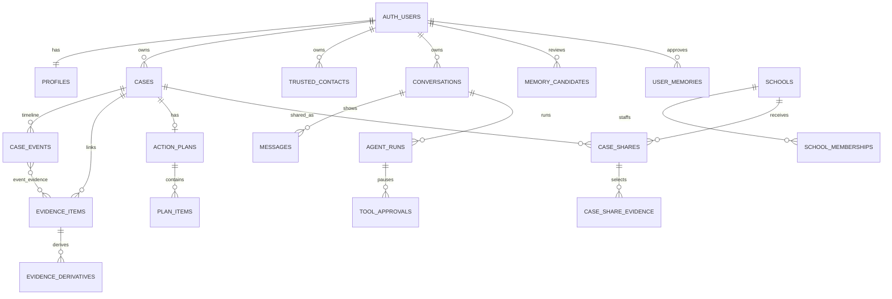
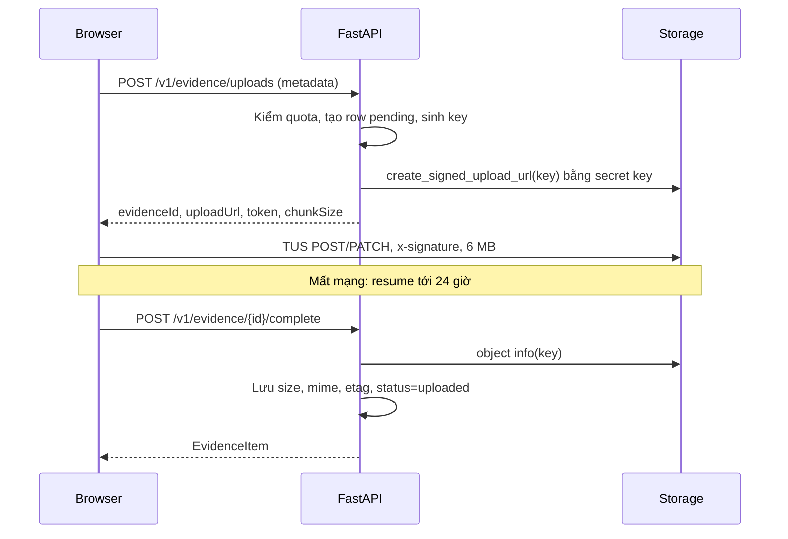

# 03 — Database Schema, RLS, Storage

> Tất cả đối tượng dưới đây là 📐 PLANNED trừ khi ghi rõ. Trạng thái thật của project xem `00-ARCHITECTURE-DECISIONS.md` §1.3. SQL trong tài liệu này chỉ lên hosted dưới dạng file migration, qua quy trình AD-19.

## 1. Trạng thái xác nhận và thay đổi đề xuất

| Đối tượng | Hiện tại ✅ | Đề xuất 📐 |
|---|---|---|
| Schema | `auth, extensions, graphql, graphql_public, public, realtime, storage, vault` | Thêm `app`, `app_private`, `agent_store`. Phase 2 thêm `knowledge` |
| Bảng `public` | Không có | Giữ nguyên rỗng |
| Bucket | `incident-evidence`: private, không giới hạn size/MIME, 0 object, 0 policy (owner tạo 2026-11-07) | Giữ nguyên. Migration idempotent chỉ để local stack có bucket và để assert cấu hình |
| Extension | `pgcrypto`, `uuid-ossp`, `pg_stat_statements`, `supabase_vault` | Thêm `vector`, `pg_trgm`, `unaccent` vào schema `extensions` |
| Function `public.rls_auto_enable` | Gọi được bởi `anon`, `authenticated` | `REVOKE EXECUTE`, có guard `IF EXISTS` vì local stack có thể không có function này |
| Role | `anon, authenticated, service_role, postgres, ...` | Thêm `moodprint_api` |

`vector` được bật ở baseline để Phase 2 và Phase 3 không phải tranh nhau thao tác cấp project.

## 2. Role và quyền

```sql
-- Migration: tạo role KHÔNG có password, KHÔNG LOGIN.
create role moodprint_api nologin noinherit nobypassrls nosuperuser nocreatedb nocreaterole;
grant authenticated to moodprint_api with inherit false, set true;
```

Password không bao giờ nằm trong git. Agent bật login bằng `scripts/db/set_api_role_password.py`: sinh ngẫu nhiên, chạy `alter role moodprint_api login password ...` qua `SUPABASE_DB_URL`, ghi `DATABASE_URL` vào `.env`, không in ra. Chạy lại script là cách rotate.

Local stack: `scripts/dev/bootstrap_local_db.py` đặt password test sau `supabase start`.

| Role | Quyền trên `app` | Ghi chú |
|---|---|---|
| `anon` | Không | Không có `USAGE` schema |
| `authenticated` | `USAGE`, DML theo từng bảng, bị RLS giới hạn | Chỉ vào được qua `SET LOCAL ROLE` vì schema không expose |
| `moodprint_api` | `USAGE` trên `app_private`, DML `agent_store`, không DML trực tiếp trên `app` | Kết nối login |
| `service_role` | Không cấp trên `app` | Supabase vẫn giữ quyền Storage/Auth của nó, còn backend chỉ dùng secret key qua HTTP |

## 3. Quy ước

- Khóa chính `uuid`. Bảng do client tạo ID (`cases`, `case_events`, `evidence_items`, `action_plans`, `plan_items`, `support_drafts`, `trusted_contacts`) nhận UUID từ client để tạo idempotent; `default gen_random_uuid()` vẫn có.
- Mọi bảng có `created_at timestamptz not null default now()`; bảng mutable có `updated_at` với trigger `app_private.touch_updated_at()`.
- `owner_id uuid not null references auth.users(id) on delete cascade`.
- Bảng con có `owner_id` denormalized và **FK ghép** `(parent_id, owner_id) → parent(id, owner_id)`, nên DB chặn liên kết chéo chủ sở hữu kể cả khi service lỗi.
- Bảng có chỉnh sửa đồng thời có `version int not null default 1`, trigger tăng version.
- Enum dùng `text` + `CHECK`, thêm giá trị không cần `ALTER TYPE`, dễ tương thích khi hai nhánh song song.
- Không dùng `SECURITY DEFINER` trừ trong `app_private`, luôn `SET search_path = ''`, và hàm phải tự kiểm `auth.uid()`.

## 4. Bảng theo phase



### Phase 0 (`f0_*`)

**`app.profiles`**

| Cột | Kiểu | Ràng buộc |
|---|---|---|
| `user_id` | uuid | PK, FK `auth.users` cascade |
| `nickname` | text | `char_length between 2 and 32` |
| `age_band` | text null | `in ('11-13','14-17')`. Null tới khi người dùng khai |
| `locale` | text | default `'vi'` |
| `start_interest` | text null | Từ form đăng ký |
| `reduced_motion` | bool | default false |
| `created_at, updated_at` | timestamptz | |

Không lưu email (nằm ở `auth.users`), không lưu password, không lưu ngày sinh. Frontend dùng `11–13` có en dash, mapper đổi sang `11-13`.

**`app.conversations`**

| Cột | Kiểu | Ràng buộc |
|---|---|---|
| `id` | uuid | PK. Đồng thời là `agent_store.agent_sessions.session_id` |
| `owner_id` | uuid | FK, unique `(id, owner_id)` |
| `title` | text | default `''` |
| `linked_case_id` | uuid null | Thêm FK ghép ở `f1_*` khi có `cases` |
| `source_article_id` | text null | Từ Knowledge→Chat |
| `summary` | text null | Tóm tắt do Phase 3 ghi |
| `status` | text | `active\|archived` |
| `last_message_at` | timestamptz null | |
| `created_at, updated_at` | | |

Index: `(owner_id, last_message_at desc)`.

**`app.messages`**: transcript hiển thị.

| Cột | Kiểu | Ràng buộc |
|---|---|---|
| `id` | uuid | PK |
| `conversation_id, owner_id` | uuid | FK ghép, cascade |
| `role` | text | `user\|assistant\|system` |
| `content` | text | |
| `client_message_id` | uuid null | Unique `(conversation_id, client_message_id)` để retry idempotent |
| `run_id` | uuid null | FK `agent_runs` set null |
| `citations` | jsonb | default `[]` |
| `created_at` | timestamptz | |

Index: `(conversation_id, created_at)`.

**`app.agent_runs`**

| Cột | Kiểu | Ràng buộc |
|---|---|---|
| `id` | uuid | PK |
| `conversation_id, owner_id` | uuid | FK ghép |
| `status` | text | `running\|awaiting_approval\|completed\|failed\|cancelled\|interrupted` |
| `model, prompt_version, tools_version` | text | |
| `input_tokens, output_tokens, total_tokens, request_count, tool_call_count` | int | default 0 |
| `latency_ms` | int null | |
| `error_code` | text null | Không chứa nội dung |
| `heartbeat_at` | timestamptz | default now |
| `started_at, finished_at` | timestamptz | |

**Ràng buộc đồng thời:** `create unique index agent_runs_one_active on app.agent_runs(conversation_id) where status in ('running','awaiting_approval');`

**`app.tool_approvals`**

| Cột | Kiểu | Ràng buộc |
|---|---|---|
| `id` | uuid | PK |
| `run_id, owner_id` | uuid | FK ghép |
| `tool_name, tool_call_id` | text | Unique `(run_id, tool_call_id)` |
| `arguments_preview` | jsonb | Phần hiển thị để người dùng duyệt |
| `run_state` | text | `RunState.to_string()`, không có AuthContext |
| `status` | text | `pending\|approved\|rejected\|expired` |
| `decided_at, expires_at` | timestamptz | |

**`app.memory_candidates`**

| Cột | Kiểu | Ràng buộc |
|---|---|---|
| `id` | uuid | PK |
| `owner_id` | uuid | FK |
| `category` | text | `preference\|communication\|support_person\|goal\|context` |
| `content` | text | `char_length <= 500` |
| `source_kind` | text | `user_explicit\|agent_proposed` |
| `source_conversation_id` | uuid null | FK set null |
| `source_message_id` | uuid null | FK set null |
| `supersedes_memory_id` | uuid null | |
| `status` | text | `pending\|approved\|rejected\|expired` |
| `expires_at` | timestamptz | default `now() + 30 days` |
| `decided_at` | timestamptz null | |

**`app.user_memories`**

| Cột | Kiểu | Ràng buộc |
|---|---|---|
| `id` | uuid | PK, unique `(id, owner_id)` |
| `owner_id` | uuid | FK |
| `category` | text | Như trên |
| `content` | text | `char_length <= 500` |
| `content_hash` | text | SHA-256 của nội dung đã chuẩn hóa |
| `status` | text | `active\|superseded` |
| `supersedes_id` | uuid null | Self FK set null |
| `source_kind` | text | `user_created\|approved_candidate` |
| `source_candidate_id, source_conversation_id` | uuid null | Provenance |
| `last_retrieved_at` | timestamptz null | |
| `expires_at` | timestamptz null | |
| `version` | int | |
| `search` | tsvector | Generated từ `app_private.f_unaccent(content)` cấu hình `simple` |

Index: unique `(owner_id, content_hash) where status='active'`; GIN `search`; GIN trigram trên `app_private.f_unaccent(content)`; `(owner_id, status, updated_at desc)`.

Xóa là **hard delete cả chuỗi supersede**, chỉ giữ audit không chứa nội dung. Không có cột liên kết tới `cases`, ràng buộc này cố ý: memory không phải kho hồ sơ.

**`app.audit_events`**: append-only.

| Cột | Kiểu |
|---|---|
| `id` | uuid PK |
| `actor_id` | uuid null, FK set null |
| `action` | text, ví dụ `evidence.download_url_issued` |
| `entity_type, entity_id` | text, uuid |
| `school_id` | uuid null |
| `metadata` | jsonb. **Không chứa nội dung người dùng** |
| `created_at` | timestamptz |

**`agent_store.agent_sessions`, `agent_store.agent_messages`**: phải khớp chính xác `SQLAlchemySession` 0.24.0.

```sql
create table agent_store.agent_sessions (
  session_id varchar primary key,
  created_at timestamp not null default current_timestamp,
  updated_at timestamp not null default current_timestamp
);
create table agent_store.agent_messages (
  id serial primary key,
  session_id varchar not null references agent_store.agent_sessions(session_id) on delete cascade,
  message_data text not null,
  created_at timestamp not null default current_timestamp
);
create index idx_agent_messages_session_time on agent_store.agent_messages(session_id, created_at);
```

Test `test_sdk_tables_match_sdk_metadata` so sánh với `session._sessions`, `session._messages`, sẽ fail khi nâng SDK làm đổi schema.

### Phase 1 (`f1_*`)

**`app.cases`**

| Cột | Kiểu | Ràng buộc |
|---|---|---|
| `id` | uuid | PK, unique `(id, owner_id)` |
| `owner_id` | uuid | |
| `title` | text | `<= 120`, được rỗng khi `status='draft'` |
| `template` | text | 8 giá trị `TPL-*` |
| `perspective` | text | `self\|witness` |
| `summary` | text | `<> ''` trừ khi `draft` |
| `category_tags, impact_tags` | text[] | default `{}` |
| `status` | text | `draft\|active\|monitoring\|closed` |
| `people, place, tried, trusted_person` | text | default `''` |
| `occurred_label` | text | Giá trị người dùng nhập |
| `search_text` | text | Generated: `lower(app_private.f_unaccent(title \|\| ' ' \|\| summary))` stored |
| `version` | int | |
| `created_at, updated_at` | | |

Index: `(owner_id, updated_at desc)`, `(owner_id, status)`, GIN trigram `search_text`.

**`app.case_events`**

| Cột | Kiểu | Ràng buộc |
|---|---|---|
| `id` | uuid | PK |
| `case_id, owner_id` | uuid | FK ghép cascade |
| `occurred_at` | timestamptz null | |
| `occurred_on` | date null | |
| `time_precision` | text | `exact\|day\|week\|unknown` |
| `place, description` | text | `description <> ''` |
| `provenance` | text | `user_entered\|ai_extracted\|user_confirmed`. Không có `mock_extracted` |
| `needs_review` | bool | |

`CHECK`: `exact` ⇒ `occurred_at` not null; `day|week` ⇒ `occurred_on` not null; `unknown` ⇒ cả hai null. **Không bao giờ tự suy ra ngày.**

Index: `(case_id, occurred_on, occurred_at)`.

**`app.evidence_items`**: bản ghi gốc.

| Cột | Kiểu | Bất biến? |
|---|---|---|
| `id` | uuid PK, unique `(id, owner_id)` | ✔ |
| `owner_id` | uuid | ✔ |
| `case_id` | uuid null, FK ghép set null | Không |
| `kind` | `image\|audio\|video\|document\|text_note\|other` | ✔ |
| `origin` | `user_upload\|user_entered` | ✔ |
| `storage_bucket, storage_key` | text null | ✔ khi đã đặt |
| `original_filename` | text null | ✔ |
| `declared_mime_type, stored_mime_type` | text null | `stored_` đặt một lần |
| `byte_size` | bigint null | Đặt một lần |
| `client_sha256` | text null | ✔ khi đã đặt |
| `storage_etag` | text null | Đặt một lần |
| `original_text` | text null | ✔ |
| `shown_timestamp` | text | ✔. Thời gian **thấy trong nội dung**, không suy diễn |
| `captured_at_label` | text | Người dùng khai |
| `user_edited_text` | text null | Không |
| `review_status` | `unreviewed\|corrected\|confirmed\|rejected` | Không |
| `limitations` | text[] | Không |
| `upload_status` | `pending\|uploaded\|failed\|deleting` | Theo state machine |

Trigger `app_private.guard_evidence_immutable` raise khi đổi cột ✔ hoặc đặt lại cột "một lần". `CHECK`: `text_note` ⇒ `original_text` not null, `storage_key` null; ngược lại `storage_key` not null. Unique `storage_key`.

Index: `(owner_id, case_id)`, partial `(owner_id) where case_id is null`, partial `(created_at) where upload_status in ('pending','deleting')`.

**`app.case_event_evidence`**: `(event_id, evidence_id, owner_id)` PK kép, FK ghép cả hai phía, cascade.

**`app.evidence_derivatives`**: kết quả sinh ra, tách khỏi bản gốc.

| Cột | Kiểu |
|---|---|
| `id` | uuid PK |
| `evidence_id, owner_id` | FK ghép cascade |
| `kind` | `thumbnail\|ocr_text\|transcript\|ai_analysis` |
| `storage_key` | text null |
| `content` | jsonb null |
| `generator, generator_version` | text |
| `source_sha256` | text null |

**`app.action_plans`**

| Cột | Kiểu | Ràng buộc |
|---|---|---|
| `id` | uuid | PK, unique `(id, owner_id)` |
| `case_id, owner_id` | uuid | FK ghép cascade. **Unique `case_id`**: một plan mỗi hồ sơ, đúng hành vi UI |
| `goal` | text | Khác rỗng khi không phải `draft` |
| `chosen_option_id` | text | |
| `status` | text | `draft\|active\|paused\|completed` |
| `next_review_date` | date null | |
| `outcome_notes` | text | |
| `version` | int | |

**`app.plan_items`**: `id`, `plan_id, owner_id` (FK ghép cascade), `label` (khác rỗng), `status` (`not_started|doing|done`), `notes`, `priority` (`high|normal`), `reason`, `position int`. `unique (plan_id, position) deferrable initially deferred` để đổi thứ tự trong một transaction.

Completed check ở service (`validatePlan` đã có), không dùng trigger.

**`app.trusted_contacts`**: `id`, `owner_id`, `label` (2–80), `role` (2–40). **Không có số điện thoại, email**: chưa có gửi ngoài, thu thập là không cần thiết.

**`app.support_drafts`** (P1): `id`, `owner_id`, `case_id` null FK ghép set null, `recipient_type`, `identity_mode` (`alias|disclose`), `content`, `compose` jsonb, `status` (`draft|prepared`), `version`.

**`app.knowledge_article_states`** (P1): PK `(owner_id, article_id)`, `bookmarked`, `read_at`. `article_id` là text, không FK, vì catalog vẫn nằm ở frontend tới Phase 2.

**`app.schools`**: `id`, `name`, `verification_status` (`synthetic|verified`), `created_at`. Người dùng đọc được bản ghi `verified`; test seed bản `synthetic`.

**`app.school_memberships`**: PK `(school_id, user_id)`, `role` (`staff|lead`), `status`. Chỉ provisioning ngoài API.

**`app.case_shares`**

| Cột | Kiểu | Ràng buộc |
|---|---|---|
| `id` | uuid | PK, unique `(id, owner_id)` |
| `owner_id` | uuid | |
| `case_id` | uuid null | FK ghép set null |
| `school_id` | uuid | FK restrict |
| `status` | text | `draft\|submitted\|in_review\|closed\|withdrawn` |
| `identity_mode` | text | `alias\|disclose` |
| `shared_fields` | text[] | Chỉ các giá trị trong allow-list |
| `snapshot` | jsonb null | Bản sao bất biến **đúng các trường được chọn**, đặt khi submit, xóa về null khi withdrawn |
| `confirmation_version` | text null | Phiên bản câu xác nhận đã hiển thị |
| `confirmed_at, submitted_at, withdrawn_at` | timestamptz null | |
| `version` | int | |

`CHECK`: `status <> 'draft'` ⇒ `confirmed_at`, `snapshot`, `confirmation_version` đều not null, trừ `withdrawn` có `snapshot` null. Partial unique `(case_id, school_id) where status in ('draft','submitted','in_review')`.

**`app.case_share_evidence`**: PK `(share_id, evidence_id)`, `owner_id`, FK ghép cả hai, cascade.

## 5. RLS

Mọi bảng trong `app`, `agent_store`, `knowledge` đều `ENABLE ROW LEVEL SECURITY`. Bảng chủ sở hữu dùng mẫu:

```sql
create policy owner_all on app.<table> for all to authenticated
  using (owner_id = (select auth.uid()))
  with check (owner_id = (select auth.uid()));
```

`(select auth.uid())` để planner cache theo statement.

| Bảng | Policy |
|---|---|
| `profiles` | `owner_all` với `user_id` |
| `conversations, messages, cases, case_events, case_event_evidence, evidence_items, evidence_derivatives, action_plans, plan_items, trusted_contacts, support_drafts, knowledge_article_states, memory_candidates, user_memories` | `owner_all` |
| `agent_runs` | owner `SELECT`; `INSERT/UPDATE` owner |
| `tool_approvals` | owner `SELECT, UPDATE`, `INSERT` owner |
| `audit_events` | Chỉ `INSERT` với `actor_id = auth.uid()`. Không có `SELECT`, `UPDATE`, `DELETE` |
| `schools` | `SELECT` khi `verification_status='verified'` hoặc người dùng là member; không ghi |
| `school_memberships` | `SELECT` dòng của chính mình; không ghi |
| `case_shares` | Owner: `SELECT`, `INSERT` draft, `UPDATE`. Staff: `SELECT` khi `app_private.is_school_member(school_id)` **và** `status in ('submitted','in_review','closed')`. Staff cập nhật qua hàm `app_private.staff_set_share_status` ở phase sau |
| `case_share_evidence` | Owner `all`; staff `SELECT` khi share đọc được |
| `agent_store.*` | Một policy `using (true) with check (true) to moodprint_api`. Không cấp cho `authenticated`, `anon` |

**Staff không có policy nào trên `cases`, `case_events`, `evidence_items`, `action_plans`, `conversations`, `user_memories`.** Staff chỉ đọc `snapshot`. Tải file qua backend, backend kiểm `case_share_evidence`, cấp signed URL ngắn hạn và ghi audit.

`auth.uid()` trong role `authenticated` lấy từ `request.jwt.claims`.

### Hàm hỗ trợ trong `app_private`

| Hàm | Security | Mục đích |
|---|---|---|
| `f_unaccent(text)` | INVOKER, `IMMUTABLE`, schema-qualified | Wrapper cho generated column và index |
| `touch_updated_at()`, `bump_version()` | INVOKER | Trigger |
| `guard_evidence_immutable()` | INVOKER | Trigger |
| `is_school_member(uuid)` | **DEFINER**, `search_path=''` | Tránh đệ quy RLS, kiểm `auth.uid()` trong thân hàm |

| `reconcile_stale_runs(interval)` | **DEFINER**, `search_path=''` | Chuyển run mất heartbeat sang `interrupted`. Không đọc nội dung |
| `claim_evidence_for_purge(int)` | **DEFINER**, `search_path=''` | Trả `(id, storage_key)` của evidence `deleting` hoặc upload quá hạn, dùng `FOR UPDATE SKIP LOCKED` |
| `finish_evidence_purge(uuid)` | **DEFINER**, `search_path=''` | Xóa row sau khi object đã xóa |

`app_private` không expose, `REVOKE ALL FROM PUBLIC`. Cấp `EXECUTE` `is_school_member` và các helper trigger cho `authenticated`. Ba hàm reconcile chỉ cấp cho `moodprint_api`.

**Tác vụ không có user context:** reconciler chạy bằng chính `moodprint_api`, không `SET ROLE`, nên không đọc được `app.*` trực tiếp. Mọi thao tác xuyên user đi qua ba hàm hẹp trên, chỉ nhận và trả ID, không có quyền đọc nội dung. Đây là ngoại lệ DEFINER duy nhất cho tác vụ nền.

## 6. Hành vi xóa

| Thao tác | Kết quả |
|---|---|
| Xóa hồ sơ | Transaction: mọi share còn hiệu lực → `withdrawn`, `snapshot=null`; evidence của hồ sơ → `upload_status='deleting'`; xóa `cases` (cascade events, plan); `conversations.linked_case_id`, `support_drafts.case_id` → null. Sau commit, gọi Storage xóa object, reconciler thử lại nếu lỗi |
| Bỏ evidence khỏi hồ sơ | `case_id=null`, gỡ khỏi event, giữ file. Xuất hiện ở danh sách "chưa gắn hồ sơ" |
| Xóa vĩnh viễn evidence | `deleting` → xóa object và derivative → xóa row |
| Rút share | `withdrawn`, `snapshot=null`, xóa `case_share_evidence`. Staff mất quyền ngay |
| Xóa tài khoản | Rút share → xóa mọi object Storage theo `users/<id>/` → `auth.admin.deleteUser` → FK cascade → xóa `agent_store` theo các conversation đã liệt kê trước đó |
| Xóa conversation | `session.clear_session()`, xóa row `agent_sessions`, rồi xóa `conversations` |
| Upload dở quá 48 giờ | Reconciler chuyển `failed`, xóa object nếu có |
| Evidence chưa gắn hồ sơ | **Không tự xóa.** Không được âm thầm xóa bằng chứng gốc |

`agent_store` không có FK tới `app` vì SDK cần bảng độc lập. Reconciler báo cáo orphan qua log đếm số, test bảo đảm luồng xóa dọn hết.

Chính sách retention thật là G-07.

## 7. Storage

### Bucket

```sql
insert into storage.buckets (id, name, public, file_size_limit, allowed_mime_types)
values ('incident-evidence', 'incident-evidence', false, null, null)
on conflict (id) do nothing;
```

Trên hosted, bucket đã có nên `insert` không làm gì. Migration sau đó assert `public = false`, `file_size_limit is null`, `allowed_mime_types is null`, raise nếu sai.

### Object key

```text
users/{owner_id}/originals/{evidence_id}/{random16}{.ext}
users/{owner_id}/derived/{evidence_id}/{kind}/{derivative_id}{.ext}
```

- Không dùng tên file gốc trong key: tên có thể chứa thông tin cá nhân và ký tự không hợp lệ. Tên gốc nằm ở `original_filename`.
- `.ext` lấy từ allow-list theo `declared_mime_type`, không có thì bỏ.
- Prefix theo user giúp xóa theo tài khoản.

### Policy

Không tạo policy cho `anon`, `authenticated` trên `storage.objects` (AD-08). Test `test_direct_storage_access_denied` xác nhận JWT người dùng không đọc, không liệt kê, không ghi được.

### Luồng upload



Nếu token hết hạn (2 giờ) giữa chừng: `POST /v1/evidence/{id}/upload-token` cấp lại khi vẫn `pending`.

### Bất biến bản gốc

- Không `upsert`, không policy `UPDATE`: object đã có không ghi đè được, Storage trả lỗi "Asset Already Exists".
- `storage_key`, `byte_size`, `storage_etag` khóa bằng trigger sau `uploaded`.
- Không có endpoint thay file. Muốn thay thì tạo evidence mới.
- Thao tác sinh dữ liệu chỉ ghi vào `derived/`.

### Tải xuống

`GET /v1/evidence/{id}/download-url`: kiểm owner qua RLS, trả signed URL TTL `evidence_download_url_ttl_s = 120`, ghi `audit_events`. Không lưu URL. Header `Content-Disposition: attachment` cho loại ngoài ảnh để tránh render nội dung tùy ý trên domain Storage.

### Giới hạn ở tầng ứng dụng

Bucket không giới hạn nhưng ứng dụng vẫn cần kiểm soát tài nguyên. Giá trị trong `config.py`:

| Thiết lập | Mặc định | Mục đích |
|---|---|---|
| `evidence_max_object_bytes` | 2 GiB | Từ chối sớm, thân thiện. Có thể tăng không cần migration |
| `evidence_user_quota_bytes` | 5 GiB | Tổng theo user |
| `evidence_pending_uploads_per_user` | 10 | Chống spam upload dở |
| `evidence_upload_rate_per_hour` | 60 | Giới hạn theo user |

Global limit của project vẫn áp dụng: **Free 50 MB, Pro tới 500 GB**. Agent đặt mức tối đa gói cho phép ở F0-11.1. Nếu project ở gói Free, `evidence_max_object_bytes` phải hạ xuống 50 MB cho tới khi owner nâng gói (O-04).

## 8. Migration

**Công cụ:** Supabase CLI, file trong `supabase/migrations/`.

**Tên file:** `<YYYYMMDDHHMMSS>_<scope>_<mô-tả>.sql`, tạo bằng `npx supabase migration new`.

| Scope | Chủ | Được phép |
|---|---|---|
| `f0` | Phase 0 | Tạo foundation |
| `f1` | Phase 1 | Domain Phase 1 |
| `kb` | Phase 2 | Chỉ đối tượng trong schema `knowledge` |
| `ag` | Phase 3 | Chỉ **bảng mới** trong `app`, `agent_store`, không `ALTER` bảng `f0`/`f1` |
| `compat` | Integrator | Thay đổi bảng dùng chung, theo quy trình `06` §5 |

**Thứ tự Phase 0:**

| File | Nội dung |
|---|---|
| `f0_extensions_roles` | Extension, schema, role, revoke `rls_auto_enable` |
| `f0_private_helpers` | Hàm `app_private` |
| `f0_profiles` | `profiles`, `audit_events` |
| `f0_conversations` | `conversations`, `messages`, `agent_runs`, `tool_approvals` |
| `f0_agent_store` | Bảng SDK |
| `f0_memory` | `memory_candidates`, `user_memories` |
| `f0_storage_bucket` | Bucket |

**Quy tắc:**

1. Chỉ tiến về phía trước. Không sửa migration đã merge. Sửa sai bằng migration mới.
2. Migration phải **chạy được từ DB trống** trên local stack: `npx supabase db reset`.
3. Mỗi migration có đủ RLS, grant, index trong cùng file với bảng.
4. Không có `DROP`, `TRUNCATE`, xóa cột trên bảng dùng chung nếu không có bước expand/contract.
5. Trước khi đề nghị áp dụng remote: chạy pgTAP, `pytest -m integration`, và advisor.
6. Hosted: agent chạy `scripts/db/push_hosted.py --dry-run`, tự kiểm danh sách file, rồi `--apply`, sau đó `list_migrations` và `get_advisors`. Không dùng MCP `apply_migration` cho schema. Chỉ một agent push tại một thời điểm; khi làm song song chỉ integrator agent được push (`06` §6).
7. Project hosted chỉ chứa dữ liệu tổng hợp ở giai đoạn này.

Phối hợp song song xem `06-PHASE-2-3-PARALLEL-WORKTREE-PLAN.md` §5.

## 9. Kiểm thử SQL

`supabase/tests/*.sql` dùng pgTAP (`npx supabase test db`):

| File | Nội dung |
|---|---|
| `00_rls_coverage.sql` | Mọi bảng có RLS và ít nhất một policy |
| `01_owner_isolation.sql` | User A không đọc, sửa, xóa của B trên mọi bảng owner |
| `02_composite_fk.sql` | Không thể link event, evidence, plan của A vào hồ sơ của B |
| `03_evidence_immutable.sql` | Cập nhật cột bất biến bị từ chối |
| `04_school_scope.sql` | Staff trường X không thấy share trường Y, không thấy `cases`, không thấy draft, mất quyền khi `withdrawn` |
| `05_grants.sql` | `anon` không có quyền nào trên `app`; `authenticated` không chạm `agent_store`, `app_private` |
| `06_audit_append_only.sql` | Không `SELECT`, `UPDATE`, `DELETE` |
| `07_memory_rules.sql` | Dedupe active, xóa chuỗi supersede |
