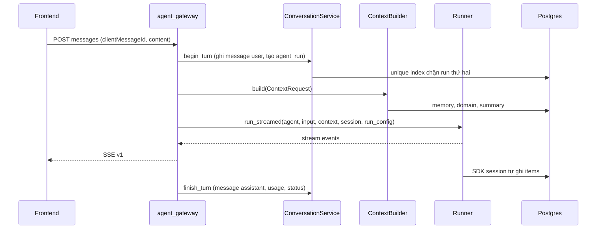
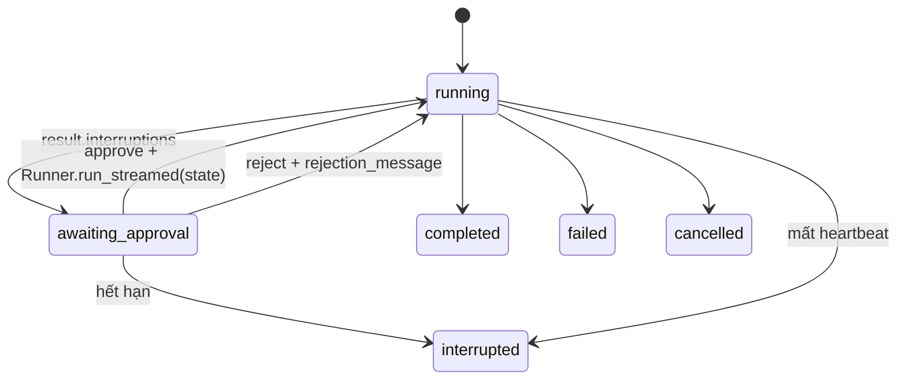
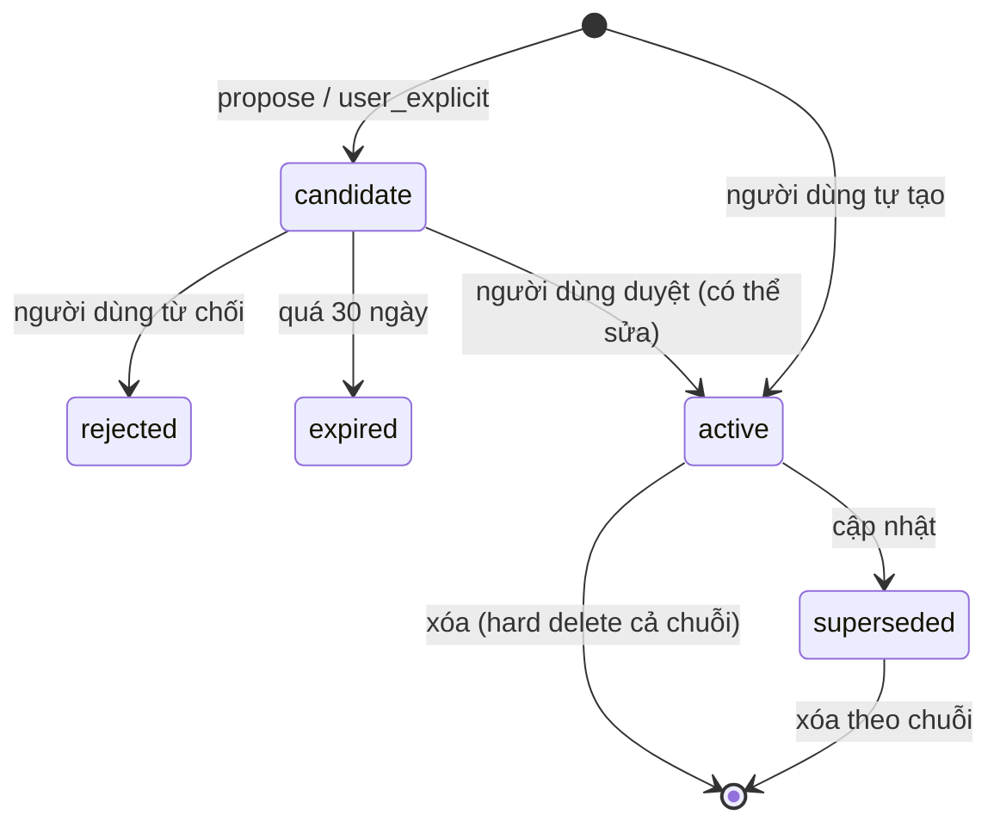

# 05 — Agent and Memory Architecture

> 📐 PLANNED. API SDK dẫn ở đây đã đối chiếu mã nguồn `openai-agents==0.24.0`. Khi nâng version, chạy lại `test_sdk_tables_match_sdk_metadata` và spike S-02, S-03.

## 1. Một AI Companion

Người dùng chỉ thấy một Companion. Bên trong là **một `Agent`** với tools, không có handoff, không có persona riêng. `docs/prototype/06` §5 từng cho phép nhiều agent; quyết định cuối là một agent, và chỉ tách khi eval chứng minh lợi ích.

```python
# agent/src/moodprint_agent/companion.py
def build_companion(cfg: AppConfig, registry: ToolRegistry) -> Agent[AgentToolContext]:
    return Agent[AgentToolContext](
        name="MoodPrint Companion",
        instructions=render_instructions,          # hàm động, xem §5
        tools=registry.sdk_tools(),
        model=cfg.agent.companion_model,
        model_settings=ModelSettings(store=False, parallel_tool_calls=False),
        output_type=None,                          # streaming text; structured qua tool hoặc output theo phase
    )
```

`parallel_tool_calls=False` để budget và approval dễ suy luận. Prompt nằm trong `agent/src/moodprint_agent/prompts/companion_v1.md`, có `PROMPT_VERSION`, ghi vào `agent_runs.prompt_version`.

### Luồng một lượt



**Không giữ transaction DB trong lúc stream.** Mỗi lần gọi service mở UoW ngắn bằng `AuthContext`.

## 2. Runtime

`agent/src/moodprint_agent/runtime.py`:

```python
class CompanionRuntime:
    async def stream_turn(self, *, ctx: AgentToolContext, user_input: str, session: Session
                         ) -> AsyncIterator[StreamEvent]: ...
    async def resume_after_approval(self, *, ctx: AgentToolContext, serialized_state: str,
                                    approved: bool, session: Session) -> AsyncIterator[StreamEvent]: ...
```

`RunConfig` mặc định:

```python
RunConfig(
    model=cfg.openai_model,                    # luôn "gpt-6-luna", không dựa vào mặc định SDK
    model_settings=..., tracing_disabled=True, trace_include_sensitive_data=False,
    workflow_name="moodprint-companion", call_model_input_filter=None,
)
```

`stream_turn` bọc `Runner.run_streamed` trong `asyncio.timeout(cfg.agent.run_timeout_s)`.

| Giới hạn | `config.py` | Mặc định | Khi vượt |
|---|---|---|---|
| Lượt model | `agent.max_turns` | 8 | `MaxTurnsExceeded` → `run.failed: max_turns` |
| Tool call mỗi run | `agent.max_tool_calls_per_run` | 6 | `ToolBudgetExceeded` |
| Timeout tool | `ToolPolicy.timeout_s` | 15s | `timeout_behavior="error_as_result"`, model được báo lỗi |
| Timeout run | `agent.run_timeout_s` | 90s | `result.cancel("immediate")`, `run.failed: run_timeout` |
| Độ dài input | `agent.max_user_input_chars` | 4000 | 422 |

**Tool budget:** `RunHooks.on_tool_start` tăng `ctx.context.budget`; `ToolPolicy.max_calls_per_run` kiểm trong wrapper của registry, trả lỗi có cấu trúc cho model; quá `max_tool_calls_per_run` thì hủy run.

**Hủy:** `POST /v1/runs/{id}/cancel` đặt cờ trong map run đang chạy của process, runtime gọi `cancel("after_turn")` để session ghi nhất quán. Client ngắt SSE **không** hủy run.

**Lỗi map sang event:** `MaxTurnsExceeded`, `ModelTimeoutError`, `ModelRefusalError`, `ToolTimeoutError`, `InputGuardrailTripwireTriggered`, lỗi `openai`. Không để exception text gốc ra client vì có thể chứa nội dung.

**Usage:** lấy `result.context_wrapper.usage` sau khi stream kết thúc, ghi `agent_runs` và phát `run.usage`. Latency đo bằng `perf_counter`. Có `time_to_first_token_ms` trong log.

### Dịch event

`agent/src/moodprint_agent/events.py` chuyển event SDK sang schema `v1`:

| SDK | `v1` |
|---|---|
| `raw_response_event`, `response.output_text.delta` | `message.delta` |
| `run_item_stream_event`, `tool_called` | `tool.started` |
| `run_item_stream_event`, `tool_output` | `tool.completed` |
| `result.interruptions` sau khi stream hết | `approval.required` |
| Kết thúc | `run.usage`, `run.completed` |

Không forward reasoning item, tham số tool thô hay tool output.

## 3. Tools

`agent/src/moodprint_agent/tools/registry.py`:

```python
class ToolRegistry:
    def register(self, fn, policy: ToolPolicy) -> None: ...   # từ chối write không có approval
    def sdk_tools(self) -> list[FunctionTool]: ...
    def version(self) -> str: ...                             # hash tên + version, ghi agent_runs.tools_version
```

Phase 0 đăng ký đúng một tool:

```python
async def get_server_time(ctx: RunContextWrapper[AgentToolContext]) -> ServerTime: ...
```

| Năng lực | Tool dự kiến (Phase 3) | Access | Approval | Service |
|---|---|---|---|---|
| Knowledge | `knowledge_search` | read | Không | `KnowledgeRetriever` |
| Incident | `get_case_context`, `propose_case_event`, `save_confirmed_event` | read, prepare, write | Có khi ghi | `IncidentService` |
| Action Plan | `propose_action_plan`, `save_plan` | prepare, write | Có khi ghi | `ActionPlanService` |
| Evidence Analysis | `analyze_evidence` | prepare | Có: gửi nội dung tới model vision | `EvidenceService` |
| Roleplay | Service riêng, không phải tool chung | read | Không | `agent/.../roleplay/` |
| Support | `support_directory`, `draft_support_message` | read, prepare | Không | Tĩnh, đã xác minh |

**Bất biến:**

- Không có tool gửi bất cứ thứ gì ra bên ngoài. `external_report_send` không tồn tại.
- `/v1/shares/{id}/submit` chỉ gọi được từ hành động người dùng, không có tool tương ứng.
- Output tool được bọc là dữ liệu, không phải chỉ dẫn. Nội dung trong evidence hoặc knowledge có thể chứa prompt injection; instruction phải nêu rõ không làm theo, và Phase 3 có eval cho việc này.
- Tool trả ID và trường cần thiết, không trả toàn bộ bản ghi.

### Approval



1. Sau khi stream kết thúc mà `result.interruptions` không rỗng: `state = result.to_state()`, `state.to_string(context_serializer=lambda _: {})`.
2. Ghi `tool_approvals.run_state`, `arguments_preview`. **Context không được serialize**, vì có `AuthContext`.
3. Phát `approval.required`, trạng thái `awaiting_approval`.
4. Người dùng quyết định. Backend load theo owner, `await RunState.from_string(agent, s, context_override=<context mới>)`.
5. `state.approve(item)` hoặc `state.reject(item, rejection_message=...)`, rồi `Runner.run_streamed(agent, state, session=session, run_config=...)`.

Việc resume sau khi **process restart** chính là spike S-03, vì mã nguồn SDK có ghi chú token approval gắn với agent còn sống. Fallback nếu không dùng được: tool write không dùng `needs_approval` của SDK; thay vào đó tool `prepare` tạo bản đề xuất, người dùng bấm xác nhận trên UI, backend ghi qua service. Contract `approval.required` không đổi.

Tool `prepare` luôn là lựa chọn ưu tiên khi UI đã có bước xác nhận, ví dụ wizard hồ sơ.

## 4. Ba lớp bộ nhớ

| Lớp | Lưu ở đâu | Nội dung | Vòng đời |
|---|---|---|---|
| A. Session | `agent_store.*`, `app.conversations`, `app.messages` | Lịch sử một conversation | Theo conversation |
| B. Long-term | `app.user_memories`, `app.memory_candidates` | Sự thật bền vững được người dùng duyệt | Người dùng kiểm soát |
| C. Domain | `cases`, `case_events`, `evidence_items`, `action_plans`, `knowledge.*` | Dữ liệu nghiệp vụ | Theo nghiệp vụ |

**Lịch sử hội thoại không phải long-term memory.** Dữ liệu hồ sơ không tự chép sang memory.

### Layer A — Session

```python
# agent/src/moodprint_agent/memory/session.py
def make_session(conversation_id: UUID, engine: AsyncEngine, cfg: AppConfig) -> Session:
    store_engine = engine.execution_options(schema_translate_map={None: "agent_store"})
    inner = SQLAlchemySession(str(conversation_id), engine=store_engine, create_tables=False,
                              ensure_ascii=False)
    return inner
```

Hàm này chỉ được gọi từ `ConversationService.open_session`, là nơi kiểm tra owner.

| Vấn đề | Cách xử lý |
|---|---|
| Quan hệ với transcript | `app.messages` là nguồn hiển thị. SDK items là nguồn replay. Không suy ra cái này từ cái kia |
| Reload | UI đọc `app.messages` |
| Restart | Cả hai ở Postgres. Test `test_session_survives_engine_restart` |
| Gửi đồng thời | Unique index `agent_runs_one_active` → 409 |
| Retry | `client_message_id` unique |
| Lượt bị ngắt | Reconciler đánh dấu `interrupted` qua `heartbeat_at`. Trước run kế tiếp, `repair_session()` loại item cuối không hoàn chỉnh (function call thiếu output) bằng `pop_item()`. Message user vẫn còn trong transcript, UI cho phép gửi lại |
| Dài | Phase 0: `SessionSettings(limit=cfg.agent.session_item_limit)` giới hạn số item nạp vào model. Phase 3: compaction |
| Xóa | `session.clear_session()` rồi xóa row `agent_sessions` |

**Compaction (Phase 3):**

```python
OpenAIResponsesCompactionSession(
    session_id=str(conversation_id), underlying_session=inner, client=openai_client,
    model=cfg.agent.compaction_model, compaction_mode="input",
    should_trigger_compaction=policy,
)
```

`cfg.agent.compaction_model` luôn là `gpt-6-luna`, phải truyền tường minh vì mặc định của SDK là `gpt-4.1`. Phải dùng `compaction_mode="input"` vì `store=False`. `policy` theo số token ước tính, không theo mặc định 10 item.

### Layer B — Long-term



**Quy tắc:**

1. Không có đường nào từ model thẳng tới `user_memories`. `propose` chỉ tạo candidate.
2. `decide(approve)` tính `content_hash`. Trùng bản active: không tạo mới, candidate thành `approved`, trả bản hiện có.
3. Xung đột do người dùng hoặc candidate chỉ định qua `supersedes_memory_id`: bản cũ `superseded`, bản mới link `supersedes_id`. Phase 3 thêm phát hiện xung đột ngữ nghĩa, nhưng vẫn để người dùng quyết định.
4. Provenance: `source_kind`, `source_candidate_id`, `source_conversation_id`.
5. `category` không có giá trị cho nội dung sự việc. Phase 3 extraction có bộ lọc từ chối candidate chứa tên người, chi tiết sự việc, nội dung evidence.
6. Scoped theo `owner_id`, RLS.

**Retrieval Phase 0:**

```python
class MemoryQuery(BaseModel):
    text: str
    categories: list[MemoryCategory] = []
    limit: int = Field(default=5, le=20)
```

Xếp hạng lexical `0.6 * ts_rank + 0.3 * similarity + 0.1 * recency_decay`, loại `expired`, chỉ `active`. Query rỗng hoặc không khớp trả danh sách rỗng, **không** fallback sang "tất cả". Trọng số trong `config.py`.

Phase 3 thêm `memory_embeddings` và lớp xếp hạng theo intent, sau khi quyết định có gửi ký ức cá nhân cho Voyage hay không.

### Layer C — Domain

Context Builder chỉ nạp **một đoạn tóm tắt ngắn** của hồ sơ đang liên kết (`conversations.linked_case_id`): `title`, `status`, số mốc, ngày cập nhật, gắn nhãn `user_reported`. Chi tiết lấy qua tool khi cần, để mọi truy cập đều qua cùng lớp phân quyền và có dấu vết. `AI inference` không bao giờ trình bày như sự thật đã xác minh.

## 5. Context Builder

`agent/src/moodprint_agent/memory/context_builder.py`.

```python
class ContextRequest(BaseModel):
    auth: AuthContext
    conversation_id: UUID
    user_input: str
    linked_case_id: UUID | None
    token_budget: int

class ContextSection(BaseModel):
    kind: Literal["identity", "conversation_summary", "memory", "domain", "knowledge"]
    text: str
    provenance: list[Provenance]      # source_kind, source_id, retrieved_at, stale
    tokens: int
    priority: int

class ContextBundle(BaseModel):
    sections: list[ContextSection]
    dropped: list[DroppedSection]     # kind, reason, source_ids
    total_tokens: int
```

**Pipeline:**

| Bước | Việc | Nguồn | Phase 0 |
|---|---|---|---|
| 1 | Danh tính: `age_band`, `locale`, bí danh. Không email | `AuthContext`, profile | ✔ |
| 2 | Conversation, tin nhắn gần đây | SDK Session tự nạp | ✔ (không nằm trong bundle) |
| 3 | Tóm tắt conversation dài | `conversations.summary` | Interface, rỗng |
| 4 | Memory đã duyệt, liên quan | `MemoryService.search` | ✔ lexical |
| 5 | Domain | `IncidentService` | ✔ khi có Phase 1 service; Phase 0 stub rỗng |
| 6 | Knowledge khi cần | Tool, không auto-inject ở mặc định | Phase 3 |
| 7 | Instructions, tools | `render_instructions` | ✔ |
| 8 | Budget | Cắt theo `priority` | ✔ |

**Kết nối SDK:** bundle nằm trong `AgentToolContext.context`, `render_instructions(ctx, agent)` đọc và render. Vì instructions không vào session, ký ức không bị lưu lại trong `agent_messages`, và xóa memory có hiệu lực ngay ở lượt sau.

**Xử lý:**

- **Thứ tự:** cố định theo bảng, để tận dụng prompt cache; phần thay đổi đặt cuối.
- **Provenance:** mỗi mục render kèm nhãn nguồn và ngày: `[đã duyệt 2026-10-02]`.
- **Trùng lặp:** theo `content_hash`, rồi `source_id`.
- **Cũ:** memory quá `memory_stale_days` nhãn `stale=true`, ưu tiên thấp, được render kèm cảnh báo cần xác nhận lại.
- **Mâu thuẫn:** không tự chọn. Giữ cả hai có nhãn để model hỏi lại, đúng `docs/prototype/06` §5.2.
- **Budget:** ước tính bằng `len(text) / 3` (bảo thủ với tiếng Việt), sau khi hạn chế theo priority thì ghi `dropped`. Phase 3 có thể thay bằng tokenizer chính xác.
- **Chỉ dẫn an toàn:** nội dung memory và domain nằm trong khối dữ liệu có phân định, nêu rõ không phải chỉ dẫn.

## 6. Structured output

`CompanionTurn` trong `contracts/agent.py`, dựa trên `docs/prototype/06` §5.1. Phase 0 chỉ định nghĩa và test serialize. Phase 3 chọn áp dụng bằng `output_type` hay tool riêng, vì `output_type` ảnh hưởng streaming text.

```python
class CompanionTurn(BaseModel):
    reply: str
    observed_facts: list[Finding] = []
    user_reported_facts: list[Finding] = []
    possible_patterns: list[Finding] = []
    uncertainties: list[str] = []
    clarifying_question: str | None = None
    safe_options: list[SafeOption] = []
    urgency: Literal["none", "elevated", "immediate"] = "none"
    citations: list[SourceCitation] = []
```

## 7. Evals

`agent/evals/`, tách khỏi pytest mặc định.

| Tầng | Công cụ | Chạy khi | Tốn tiền |
|---|---|---|---|
| Deterministic | `ScriptedModel` + pytest | Mọi lần | Không |
| Contract | `KnowledgeRetrieverContract`, event schema | Mọi lần | Không |
| Live smoke | `pytest -m live_agent`, `gpt-6-luna`, giới hạn chi phí | Thủ công, cần `OPENAI_API_KEY` | Rất ít |
| Scenario eval | `agent/evals/run.py` với `gpt-6-luna` trên 30 scenario, 12 chat, 8 screenshot; assertion tất định bằng code, rubric do coding agent tự chấm (AD-20) | Phase 3 | Có, chỉ phần chạy `gpt-6-luna` |

**Chỉ một model:** mọi lời gọi ở đây là `gpt-6-luna` (AD-14). Không có model judge. Không dùng metric LLM-as-judge của DeepEval hay `llm-rubric` của Promptfoo.

**Cấu trúc:**

```text
agent/evals/
  cases/*.jsonl          # input, expected, expected_non_actions, rubric_ids
  rubric.md              # tiêu chí 0–3, theo docs/prototype/06 §9
  run.py                 # chạy gpt-6-luna, ghi outputs.jsonl, chạy assertion code
  summarize.py           # gộp grades.jsonl, so baseline
  results/<run-id>/      # outputs.jsonl, assertions.jsonl, grades.jsonl, summary.md
```

`grades.jsonl` do coding agent viết sau khi đọc từng output: `{case_id, rubric_id, score, reason, grader}`. `grader` ghi tên agent và phiên. Không có grade thì `summarize.py` báo case chưa chấm, không tự coi là đạt.

Mọi kết quả eval ghi `prompt_version`, `tools_version`, `model`, SDK version, commit, để tái lập được. Test data chỉ dùng fixture tổng hợp.

Phase 0 chỉ tạo khung, `rubric.md` và `agent/evals/README.md`.

## 8. Foundation so với Phase 3

| Foundation (Phase 0) | Phase 3 |
|---|---|
| `companion.py`, `runtime.py`, `events.py`, `errors.py`, `budget.py` chạy với `get_server_time` | Prompt đầy đủ, các tool |
| `tools/registry.py`, `ToolPolicy` | Các file trong `tools/` |
| `memory/session.py`, `memory/context_builder.py`, `memory/retrieval.py` | `memory/extraction.py`, `memory/compaction.py`, ranking |
| Bảng `f0_*` | Bảng `ag_*` |
| Fixture retriever | Tích hợp Knowledge Tool |
| Endpoint SSE | UI chat thật, `ChatPort` real |

## 9. Cân nhắc chi phí và an toàn

- **Rate limit:** `agent.messages_per_user_per_hour` đếm từ `agent_runs`. Không cần Redis.
- **Trần chi phí:** Phase 3 thêm trần token mỗi user mỗi ngày, cũng đếm từ `agent_runs`.
- **Log:** không log nội dung tin nhắn, tool arguments, memory. Chỉ log ID, độ dài, mã lỗi.
- **Dữ liệu tới OpenAI:** mọi lượt chat thật đều gửi nội dung cho OpenAI. Phase 0..3 chỉ dùng nội dung tổng hợp. Người dùng thật chờ các điều kiện ở `00` §6.
- **`/support/urgent`** không phụ thuộc agent, backend, đăng nhập.
