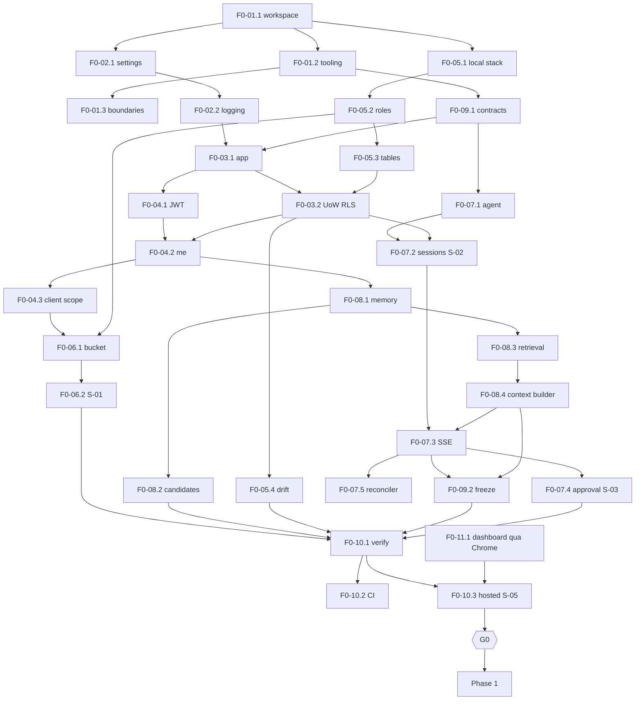
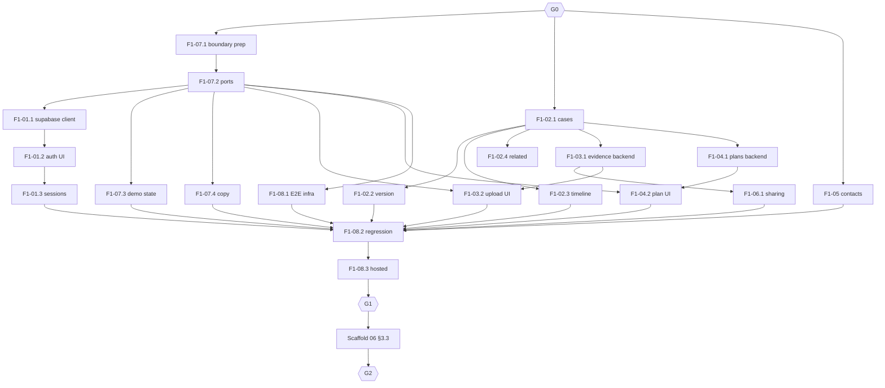

# 08 — Execution Order and Handoff

> Tài liệu này dành cho coding agent tiếp theo. Đọc theo thứ tự: `08` → `00` → `01` → `03` → `04` → `05` → `07`. Phase 1 thêm `02`. Phase 2/3 thêm `06`.

## 1. Trước khi bắt đầu

1. Đọc `00` §1 về trạng thái thật. Không giả định thứ gì tồn tại chỉ vì có trong `docs/prototype/`.
2. Kiểm tra `.env` (O-01) có những biến nào đã điền, không in giá trị. Local stack không cần `.env`. Việc chạm hosted (F0-10.3) cần O-01 xong.
3. Phase 0 làm trên `feat/phase-0-foundation`, rẽ từ `mhiu05/feat-refactor`. Phase 1 trên `feat/phase-1-backend`, rẽ sau khi Phase 0 merge. Agent commit, push branch feature, mở PR, và merge vào `mhiu05/feat-refactor` khi gate đạt (AD-19). Không merge vào `main`.
4. Agent tự làm việc vận hành theo AD-19: MCP Supabase được đọc và ghi, Chrome để cấu hình dashboard (F0-11.1), `push_hosted.py` để áp dụng migration. Bắt đầu F0-11.1 song song ngay từ đầu.

## 2. Đồ thị task

## 3. Critical path

**Phase 0:** F0-01.1 → F0-05.1 → F0-05.2 → F0-05.3 → F0-03.2 → F0-04.2 → F0-08.1 → F0-08.3 → F0-08.4 → F0-07.3 → F0-09.2 → F0-10.1 → F0-10.3.

Rủi ro lớn nhất trên đường này: F0-05.1 (khóa ES256 trên local stack) và F0-03.2 (role switching). Làm hai việc này sớm.

**Phase 1:** F1-07.1 → F1-07.2 → F1-03.2 (cần F1-03.1) → F1-08.2 → F1-08.3. Upload là phần có nhiều điều chưa biết nhất ở frontend.

## 4. Việc chạy song song được

Trong một phase, cùng một worktree, khác người hoặc subagent, không chung file:

| Phase 0 lane | Task |
|---|---|
| Hạ tầng | F0-05.1 → F0-05.3, F0-06.1 |
| Backend core | F0-02.*, F0-03.1, F0-04.1 |
| Agent thuần | F0-07.1, F0-08.4 (fake service) |

| Phase 1 lane | Task |
|---|---|
| Backend domain | F1-02.*, F1-03.1, F1-04.1, F1-05, F1-06.1 |
| Frontend nền | F1-07.1, F1-07.2, F1-08.1 |
| Frontend tính năng | F1-01.*, F1-03.2, F1-04.2, F1-07.3, F1-07.4, sau khi có ports |

Migration trong cùng phase: **một người** tạo file migration tại một thời điểm, để timestamp không chồng.

## 5. Ai làm việc gì

### 5.1 Việc của owner

| ID | Việc | Cần trước | Trạng thái |
|---|---|---|---|
| O-01 | Điền `.env` theo `.env.example`: `SUPABASE_URL`, `SUPABASE_PUBLISHABLE_KEY`, `SUPABASE_SECRET_KEY`, `SUPABASE_DB_URL` (password database), các biến `VITE_PUBLIC_*`, `OPENAI_API_KEY` khi chạy live, `VOYAGE_API_KEY` cho Phase 2. **Không cần** điền `DATABASE_URL`, agent tự sinh | F0-10.3. Local không cần | 👤 `.env` đã tạo, đang rỗng. `.env.example` đã có |
| O-04 | Nâng gói nếu cần file lớn hơn 50 MB | Upload file lớn | 👤 Chỉ khi F0-11.1 thấy gói Free |
| O-09 | Trần chi phí OpenAI, Voyage cho dev và eval | A-06, Phase 2/3 | 👤 |
| O-10 | Tư vấn pháp lý, các điều kiện `00` §6 | Người dùng thật | 👤 ⛔ |
| O-11 | Trường đối tác thật, hoặc xác nhận chỉ dùng synthetic | F1-06.3 | 👤 |
| O-12 | Merge vào `main` | Khi owner muốn | 👤 |

### 5.2 Việc agent tự làm

Các mục trước đây xếp là owner action, nay do agent làm theo AD-19.

| Việc | Công cụ | Task |
|---|---|---|
| Đọc gói, region, compute, pooler host | Chrome | F0-11.1 |
| Đặt global upload limit tối đa theo gói | Chrome | F0-11.1 |
| Cấu hình Auth: Site URL, redirect URL, email confirmation, tắt anonymous, chính sách mật khẩu, JWT expiry | Chrome | F0-11.1 |
| Kiểm cấu hình bucket | MCP + Chrome | F0-06.1, F0-11.1 |
| Đặt password `moodprint_api`, ghi `DATABASE_URL` | `set_api_role_password.py` | F0-10.3 |
| Áp dụng migration hosted, chạy advisor | `push_hosted.py` + MCP | F0-10.3, F1-08.3 |
| Smoke test hosted, dọn dữ liệu test | Script + MCP | F0-10.3, F1-08.3 |
| Commit, push, PR, merge vào `mhiu05/feat-refactor`, tag baseline | git, `gh` | Cuối mỗi phase, G2 |
| (Tùy chọn) Auth connection theo phần trăm theo advisor | Chrome | Khi scale |

**Hoãn lại, không chặn Phase 0/1:**
- SMTP riêng (`moodprintapp.com`): Phase 0/1 tạo user test qua admin API.
- Origin production và domain `moodprint.duckdns.org`: thuộc việc deploy.

**Agent không được làm khi chưa hỏi owner:** xóa project, reset password database, rotate hoặc thu hồi API key, nâng hay hạ gói tính phí, đổi cài đặt organization, xóa bucket.

## 6. Checkpoint

| Checkpoint | Khi | Bằng chứng |
|---|---|---|
| CP-0a | Sau F0-03.2 | `test_concurrent_users_never_share_claims` xanh. Nếu không đạt, **dừng**, xem lại AD-04 |
| CP-0b | Sau F0-06.2 | `spikes/S-01.md` |
| CP-0c | Sau F0-07.3 | Demo SSE với `ScriptedModel` |
| G0 | Cuối Phase 0 | `phase-0-report.md` |
| CP-1a | Sau F1-07.2 | 54 Vitest cũ xanh ở `demo` |
| CP-1b | Sau F1-03.2 | Upload resume E2E |
| G1 | Cuối Phase 1 | `phase-1-report.md` |
| G2 | Trước khi rẽ nhánh | `06` §8 |

Báo cáo phase gồm: commit SHA, lệnh đã chạy và kết quả, test fail nếu có kèm output, spike và fallback, khác biệt so với kế hoạch, owner action còn mở. Không tuyên bố đạt nếu chưa chạy.

## 7. Rủi ro và rollback

| Rủi ro | Xác suất | Ảnh hưởng | Giảm thiểu | Rollback |
|---|---|---|---|---|
| `SET LOCAL ROLE` không chạy qua pooler hosted | Trung bình | Cao | S-05, test local trước | Direct connection hoặc pooler transaction |
| Local stack không ký ES256 | Trung bình | Trung bình | S-04, verifier nhận allow-list theo env | HS256 chỉ trong `APP_ENV=test` |
| TUS với signed token không resume được | Trung bình | Trung bình | S-01 | Fallback AD-08 |
| SDK đổi schema session khi nâng version | Thấp | Cao | Pin `0.24.*`, test schema | Giữ version cũ, migration riêng |
| Resume approval sau restart không chạy | Trung bình | Trung bình | S-03 | Mẫu `prepare` + xác nhận |
| Free plan chặn file > 50 MB | Cao nếu Free | Trung bình | F0-11.1 phát hiện sớm, lỗi 413 rõ ràng, O-04 | Hạ `evidence_max_object_bytes` |
| Refactor store làm hỏng test cũ | Trung bình | Trung bình | Làm F1-07.2 sớm, giữ alias `useDemoStore` | Revert commit F1-07.2 |
| Migration hosted lỗi giữa chừng | Thấp | Cao | Dry run, test từ trống, một agent áp dụng | Migration sửa tiến về phía trước; Supabase backup point-in-time nếu có |
| Agent ghi DDL qua MCP thay vì migration, làm lệch schema | Trung bình | Cao | AD-19 cấm; `test_schema_drift` và `push_hosted.py` so lịch sử migration hosted với repo | Viết migration khớp với trạng thái thật, hoặc migration hoàn tác |
| Agent bấm nhầm thao tác nguy hiểm trên dashboard | Thấp | Cao | Danh sách cấm ở §5.2, chỉ thao tác trong bảng F0-11.1 | Phụ thuộc thao tác; báo owner ngay |
| Lộ secret qua ảnh chụp Chrome hoặc log | Trung bình | Cao | Không mở trang API key khi chụp; không in `.env`; filter log | Owner rotate key |
| Hai phase cùng sửa file chung | Trung bình | Trung bình | Scaffold, `check_ownership.py` | Compat change |
| Hiểu nhầm là đã sẵn sàng cho trẻ thật | Trung bình | Rất cao | `00` §6, nhãn mô phỏng | Không cho người dùng thật vào cho tới khi xong `00` §6 |

**Rollback chung:** mỗi task là một commit hoặc nhóm commit nhỏ, revert được độc lập. Migration không revert bằng cách xóa file; viết migration mới. Frontend luôn có thể quay về workspace `demo` vì code mock không bị xóa.

## 8. Definition of Done cuối cùng

Phase 0 và Phase 1 xong khi **tất cả** đúng:

- [ ] G0 và G1 đạt, có báo cáo với bằng chứng chạy lệnh thật.
- [ ] Người dùng thử nghiệm tổng hợp đăng ký thật, đăng nhập, tạo hồ sơ với timeline, tải file lên và xem lại, lập và cập nhật kế hoạch, thêm người tin cậy, soạn bản nháp hỗ trợ; tất cả còn sau khi reload và trên trình duyệt khác.
- [ ] User B không truy cập được bất kỳ dữ liệu nào của user A, kiểm bằng RLS và API.
- [ ] Staff trường chỉ thấy đúng share đã submit cho trường đó.
- [ ] Workspace `demo` vẫn chạy đúng như prototype, E2E cũ xanh.
- [ ] Chat, Analysis, Roleplay, Voice có nhãn mô phỏng rõ ràng trong workspace thật.
- [ ] `/support/urgent` chạy khi không đăng nhập và khi backend tắt.
- [ ] Session, memory, Context Builder, agent runtime chạy và được test, contract đóng băng.
- [ ] G2 đạt, hoặc báo cáo nêu rõ mục nào chưa đạt và vì sao.
- [ ] Không có secret trong git, không có dữ liệu thật trong bất kỳ môi trường nào.
- [ ] Báo cáo ghi rõ sản phẩm **chưa** sẵn sàng cho học sinh thật cho tới khi xong `00` §6.
