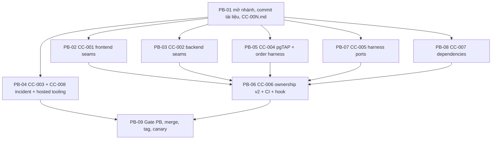

# 01 — Pre-Branch Readiness Plan

> **Người thực hiện:** Integration Agent (một agent, một worktree: thư mục hiện tại `C:\Users\minhh\orca\workspaces\MoodPrint\mhiu05-feat-refactor`).
> **Nhánh làm việc:** `integration/pre-branch-readiness`, rẽ từ `mhiu05/feat-refactor` (hiện `1aec4078f2852720479e183d10c7cc086b6d6a3f`), merge lại bằng PR. **Không** đụng `main`. **Không** sửa tag `baseline/phase-1-verified`.
> **Đầu ra:** tag annotated mới `baseline/phase-2-3-start`. Owner chỉ tạo hai worktree **sau** khi `Gate PB` ở §6 xanh.
> Tham chiếu: `00` (B-01…B-11), `11` (ma trận sở hữu), `docs/implementation/06` §3, §5.

## 1. Vì sao cần bước này

G2 của Phase 1 đã tạo scaffold, nhưng audit (`00` §5) cho thấy hai agent vẫn buộc phải sửa file đóng băng hoặc sẽ đạp lên nhau. Mọi thay đổi bên dưới là **cộng thêm, tương thích ngược**, được làm một lần trước khi đóng băng, và mỗi thay đổi có test. Sau tag mới, quy trình compat chuẩn (`06` §5) áp dụng.

| Mã compat | Nội dung | Task | Chặn lỗi |
|---|---|---|---|
| CC-001 | Frontend: slot `knowledgeSearch`/`companion`, composition factory nhận `StreamClient`, `ApiClient.stream` | PB-02 | B-05 |
| CC-002 | Backend: `app.state.knowledge`, `build_runtime`, router rỗng, module rỗng | PB-03 | B-06, B-14 |
| CC-003 | `IncidentService.add_confirmed_event` | PB-04 | B-07 |
| CC-004 | pgTAP theo schema, kiểm `knowledge`, harness thứ tự migration | PB-05 | B-08 |
| CC-005 | Harness E2E theo offset, capability flag, `--lite`, hook seed, app scripted | PB-07 | B-09 |
| CC-006 | Ownership policy v2, `ci_ownership.py`, CI, hook | PB-06 | B-01…B-04 |
| CC-007 | Extras được khóa trước, backend phụ thuộc extras, CI `--all-extras` | PB-08 | B-10 |
| CC-008 | Công cụ migration hosted: chống trùng version, `--include-all`, receipt `phase23` | PB-04 | B-11 |

Mỗi CC có một file `docs/implementation/compat/CC-00N.md` (lý do, thay đổi, tương thích ngược, ảnh hưởng hai phase, test) do integrator viết trong PB-01.

## 2. Đồ thị phụ thuộc



- **Song song được:** PB-02, PB-03, PB-04, PB-05, PB-07, PB-08 (khác file). Mỗi task một commit nhóm, không sửa chung file.
- **Tuần tự bắt buộc:** PB-01 trước tất cả; PB-06 sau PB-02/03/05/07/08 (allow-list phải phản ánh file mới); PB-09 cuối.
- Migration: **không** thêm migration `f*` hay `kb_`/`ag_` ở bước này.

## 3. Danh sách scaffold tạo ở bước này

| Đường dẫn | Nội dung ban đầu | Chủ sau tag |
|---|---|---|
| `backend/app/api/v1/analyses.py` | `router = APIRouter(prefix="/v1/analyses", tags=["analyses"])`, đã `include_router` | Phase 3 |
| `backend/app/api/v1/roleplay.py` | `router` prefix `/v1/roleplay`, đã include | Phase 3 |
| `backend/app/modules/knowledge/{__init__,factory}.py` | `build_knowledge_retriever(engine, settings, cfg) -> KnowledgeRetriever` trả fixture | Phase 2 |
| `backend/app/modules/{analysis,roleplay}/__init__.py` | rỗng | Phase 3 |
| `backend/tests/{knowledge,agent}/.gitkeep`, `backend/tests/integration/{knowledge,agent}/.gitkeep` | thư mục test riêng từng phase | Phase 2 / Phase 3 |
| `agent/src/moodprint_agent/testing/__init__.py` | rỗng, chỗ đặt kịch bản `ScriptedModel` cho E2E | Phase 3 |
| `frontend/src/services/composition/knowledge-types.ts` | `export type KnowledgeSearchService = { readonly live: true }` | Phase 2 |
| `frontend/src/services/composition/companion-types.ts` | `export type CompanionService = { readonly live: true }` | Phase 3 |
| `frontend/e2e/helpers/{capabilities,phase2,phase3}.ts` | `phase2.ts`: `export const knowledgeLive = false`; `phase3.ts`: `export const companionLive = false`; `capabilities.ts` re-export (integrator) | Phase 2 / 3 / integrator |
| `scripts/ci_ownership.py`, `scripts/tests/test_ci_ownership.py` | xem PB-06 | Integrator |
| `scripts/e2e_app.py` | app factory test-only cho E2E scripted/seed | Integrator |
| `scripts/e2e_hooks.json` | danh sách lệnh seed tùy chọn | Integrator |
| `docs/implementation/compat/CC-00{1..8}.md`, `README.md` | hồ sơ compat | Integrator |

## 4. Các task

**Quy ước trường.** Tiêu đề = Task ID. Các trường đánh số: 1 Mục đích · 2 Ưu tiên · 3 Branch · 4 Phụ thuộc · 5 File · 6 Chi tiết · 7 DB · 8 API/contract · 9 Test · 10 Acceptance · 11 Lệnh kiểm · 12 Điều kiện thất bại · 13 Deliverables · 14 Rủi ro/fallback. (Một số task gộp 3–4 trên cùng dòng; không trường nào bị bỏ.)

### PB-01 — Mở nhánh, commit tài liệu, hồ sơ compat

1. **Mục đích:** có một nhánh sạch, tài liệu kế hoạch được lưu vết, mỗi CC có hồ sơ.
2. **Ưu tiên:** P0. 3. **Branch:** `integration/pre-branch-readiness`.
4. **Phụ thuộc:** không.
5. **File:** `docs/implementation/phase2-3/*.md`, `docs/implementation/compat/CC-001.md … CC-008.md`, `docs/implementation/compat/README.md`.
6. **Chi tiết:** `git switch -c integration/pre-branch-readiness origin/mhiu05/feat-refactor`; kiểm `git rev-parse HEAD` bằng `1aec4078…` (nếu khác, ghi SHA mới và đọc lại `git log` xem có thay đổi nào ngoài tài liệu). Không stage `.claude/settings.local.json`, `.cursor/mcp.json`, `.mcp.json`. Commit chỉ đường dẫn cụ thể.
7. **DB:** không. 8. **API/contract:** không.
9. **Test:** `uv run pytest scripts/tests/test_ownership.py -q` vẫn 98 pass.
10. **Acceptance:** nhánh push được; mỗi CC có đủ 5 mục (lý do, thay đổi, tương thích ngược, ảnh hưởng phase 2/3, cách kiểm).
11. **Lệnh:** `git status --short`; `git log --oneline -3`; `git push -u origin integration/pre-branch-readiness`.
12. **Failure:** tip của target đã khác dự kiến mà có thay đổi code ngoài tài liệu → dừng, đọc diff, cập nhật kế hoạch trước khi tiếp tục.
13. **Deliverables:** nhánh + 9 file compat.
14. **Rủi ro/fallback:** nếu push bị từ chối, giữ nhánh cục bộ, báo owner (không force-push).

### PB-02 — CC-001: Frontend seams (ports, composition, stream)

1. **Mục đích:** để Phase 2/3 cắm adapter thật **mà không sửa** `ports.ts`, `composition.ts`, `client.ts`.
2. **Ưu tiên:** P0. 3. **Branch:** `integration/pre-branch-readiness`. 4. **Phụ thuộc:** PB-01.
5. **File:**
   - Sửa: `frontend/src/services/ports.ts`, `frontend/src/services/composition.ts`, `frontend/src/services/http/client.ts`, `frontend/src/services/mock/index.ts`, `frontend/src/services/composition/{knowledge,chat,analysis,roleplay}.ts`.
   - Tạo: `frontend/src/services/composition/{knowledge-types,companion-types}.ts`, `frontend/src/services/http/client.stream.test.ts`.
   - Sửa thêm `frontend/package.json`: script `"gen:api": "openapi-typescript ../backend/openapi.json -o src/services/http/schema.gen.ts"`. (Hiện chỉ có lệnh `npx` trong `frontend/README.md` và **CI không kiểm drift** của `schema.gen.ts`; PB-06 thêm bước `npm run gen:api && git diff --exit-code src/services/http/schema.gen.ts`.)
6. **Chi tiết:**
   - `ports.ts` **cộng thêm** (không đổi kiểu cũ): `import type { KnowledgeSearchService } from "./composition/knowledge-types"` và `CompanionService` từ `companion-types`; `Services` có thêm `knowledgeSearch: KnowledgeSearchService | null` và `companion: CompanionService | null`. Mọi `Services` cũ giữ nguyên field, `chat/analysis/roleplay` vẫn là `SimulatedPort` (wizard và analysis-workflow tiếp tục gọi `chat.save`).
   - `client.ts`: `createApiClient` trả `StreamClient = ApiClient & { stream(path: string, init?: RequestInit): Promise<Response> }`. `stream` **dùng lại** cùng lõi: kiểm `/v1/` path, `Authorization`, `checkIdentity()` (ném `session_changed`), một lần refresh khi 401, ánh xạ lỗi sang `ApiError` **trước khi** trả `Response` (status không ok → đọc envelope JSON), không tự đọc body khi ok, tôn trọng `AbortSignal`. `Content-Type: application/json` chỉ khi có body.
   - `composition/knowledge.ts` xuất `createKnowledgeSearchPort(client: StreamClient): KnowledgeSearchService | null` trả `null`; giữ `createKnowledgeCatalogPort` như cũ. `composition/chat.ts` xuất thêm `createCompanionService(client: StreamClient): CompanionService | null` trả `null` (và giữ `createChatPort`, `createAnalysisPort`, `createRoleplayPort`). `composition.ts` gọi hai factory và gán vào `knowledgeSearch`/`companion`; `mock/index.ts` đặt cả hai `null`.
   - **Hợp đồng URL liên phase (ghi vào CC-001):** liên kết "xem trong Thư viện" từ citation của chat là `/knowledge?document=<documentId>`; Phase 2 triển khai tham số `document`, Phase 3 chỉ tạo liên kết. Citation luôn hiển thị `title`, `publisher`, `lastReviewed`, và `url` (mở tab mới, `rel="noopener noreferrer"`).
7. **DB:** không. 8. **API/contract:** thay đổi chỉ ở TypeScript; `stream-events.ts` không đổi.
9. **Test:** (a) `client.stream.test.ts`: 401 → refresh một lần → thành công; token mới vẫn 401 → `onUnauthenticated`; đổi `workspace.userId` giữa chừng → `ApiError.code === "session_changed"` và **không** gọi fetch lần hai; lỗi 409 trả `ApiError` có `code` từ envelope; `AbortSignal` hủy giữa chừng; đường dẫn không bắt đầu `/v1/` bị từ chối. (b) `composition.test.ts`: workspace `demo` có `knowledgeSearch === null && companion === null`; workspace `real` cũng `null` (chưa có phase nào giao hàng). (c) 94 Vitest cũ vẫn pass.
10. **Acceptance:** `npm run typecheck && npm run lint && npm run format:check && npm test -- --maxWorkers=2 && npm run build && npm run check:boundaries` xanh; diff của `ports.ts` chỉ **thêm** dòng.
11. **Lệnh:** `cd frontend && npm test -- --maxWorkers=2`; `git diff --stat -- frontend/src/services/ports.ts`.
12. **Failure:** có bất kỳ thay đổi nào làm sai kiểu hiện có của `Services`; test cũ đỏ; `check:boundaries` báo `fetch(` ngoài `services/http/`.
13. **Deliverables:** commit CC-001 + `CC-001.md`.
14. **Rủi ro/fallback:** nếu `tsc` không chấp nhận intersection cho `StreamClient` ở test double cũ, thêm helper `asStreamClient(fake)` trong test (không đổi code sản xuất).

### PB-03 — CC-002: Backend seams

1. **Mục đích:** có chỗ nạp retriever thật và runtime đầy đủ mà không sửa `main.py` sau này.
2. **Ưu tiên:** P0. 3. **Branch:** `integration/pre-branch-readiness`. 4. **Phụ thuộc:** PB-01.
5. **File:** sửa `backend/app/main.py`, `backend/app/agent_gateway/wiring.py`, `backend/app/api/v1/__init__.py`; tạo các scaffold ở §3 (backend). Cập nhật `backend/openapi.json` và `frontend/src/services/http/schema.gen.ts` bằng script.
6. **Chi tiết:**
   - `main.py` lifespan: `app.state.knowledge = build_knowledge_retriever(engine, settings, cfg)` đặt **trước** `app.state.runtime`; `app.state.runtime = build_runtime(cfg, model_client)` với `build_runtime` định nghĩa trong `agent_gateway/wiring.py` (hiện trả đúng `CompanionRuntime(cfg, openai_client=model_client)`; Phase 3 sở hữu thân hàm). Include `analyses_router`, `roleplay_router`.
   - `build_knowledge_retriever`: chỉ chấp nhận `cfg.knowledge.retriever == "fixture"` → `FixtureKnowledgeRetriever()`; giá trị khác → `ValueError("retriever not available before Phase 2")`. Phase 2 thêm nhánh `pgvector`.
   - `wiring.build_context`: đọc retriever từ tham số mới `knowledge: KnowledgeRetriever | None = None`, mặc định fixture (hành vi cũ). `conversations.py`/`sse.py` (Phase 3) sẽ truyền `request.app.state.knowledge`.
7. **DB:** không. 8. **API/contract:** router rỗng không thêm path; OpenAPI không đổi ngoài `tags`.
9. **Test:** `backend/tests/test_app.py` thêm: `create_app()` có `app.state.knowledge`, startup/shutdown đóng tài nguyên (test hiện có `test_startup_shutdown_closes_engine` vẫn pass); `test_foundation_factory...` vẫn pass; `scripts/export_openapi.py --check` exit 0; import-linter xanh (`app.modules.knowledge` import `moodprint_agent` hợp lệ).
10. **Acceptance:** `uv run python scripts/check.py` xanh; `pytest -m integration -q` xanh trên stack local.
11. **Lệnh:** `uv run python scripts/check.py`; `uv run python scripts/export_openapi.py --check`.
12. **Failure:** hành vi runtime đổi (chat vẫn chỉ có `get_server_time`); startup thêm phụ thuộc mạng.
13. **Deliverables:** commit CC-002 + `CC-002.md`.
14. **Rủi ro/fallback:** nếu `include_router` làm đổi thứ tự OpenAPI gây diff, đăng ký sau cùng trong danh sách hiện có.

### PB-04 — CC-003 và CC-008: sự kiện đã xác nhận + công cụ migration hosted

1. **Mục đích:** (CC-003) cho phép Agent lưu sự kiện **đã được người dùng xác nhận** với provenance trung thực; (CC-008) làm cho `push_hosted.py` an toàn với migration `kb_`/`ag_`.
2. **Ưu tiên:** P0. 3. **Branch:** `integration/pre-branch-readiness`. 4. **Phụ thuộc:** PB-01.
5. **File:** sửa `backend/app/modules/incidents/service.py`, `scripts/db/safety.py`, `scripts/db/push_hosted.py`, `scripts/db/tests/test_hosted_safety.py`; thêm `backend/tests/integration/test_incident_confirmed_events.py`, `scripts/db/tests/test_migration_versions.py`.
6. **Chi tiết (CC-003):**
   - Thêm `async def add_confirmed_event(self, auth: AuthContext, case_id: UUID, data: EventCreate, *, proposal_id: UUID) -> TimelineEvent`. Bắt buộc `data.provenance == "user_confirmed"` (ngược lại `ValueError`). Dùng chung `_save_event(..., editing=False)` với tham số nội bộ `allow_provenance={"user_confirmed"}`; **không** nới `add_event` và **không** nới đường REST. Ghi `app.audit_events(action='case.event_confirmed_from_proposal', metadata={'proposalId': ...})`. Idempotent theo `data.id`. `ai_extracted` vẫn **không bao giờ** được lưu.
   - Protocol `IncidentService` trong contracts **không đổi**. Phase 3 định nghĩa Protocol hẹp `ConfirmedEventWriter` ở phía agent và bọc dịch vụ cụ thể trong `wiring.py`.
7. **Chi tiết (CC-008):**
   - `safety.check_history`: phát hiện **hai file cùng version** → `ValueError("Duplicate migration version")`; dùng `Counter`, không `dict`.
   - `push_hosted.py`: tham số `--include-all` (chuyển cho `supabase db push`), chỉ hợp lệ khi `--apply` và khi danh sách pending đã in ra; phát hiện phase: có tên chứa `_kb_` hoặc `_ag_` → yêu cầu `require_local_gate(root, head, phase=23)`; receipt mong đợi `{"scope": "local_phase23", "passed": true, "commit": HEAD, "checks": ≥ 12}` và phải chứa lệnh `scripts/verify_phase1.py`, `scripts/e2e_stack.py --run`, và `scripts/dev/migration_order_check.py`. Script sinh receipt (`verify_phase23.py`) được viết ở INT-04; PB chỉ định nghĩa và test chấp nhận/từ chối bằng receipt giả.
8. **DB:** không thêm migration. 9. **API/contract:** thêm phương thức nội bộ, không đổi HTTP.
10. **Test:** `test_incident_confirmed_events.py` (integration): owner A lưu sự kiện `user_confirmed` thành công, `provenance` đọc lại đúng; owner B nhận `NotFound`; gọi `add_event` với `user_confirmed` vẫn `403 fixture_not_allowed`; `ai_extracted` qua `add_confirmed_event` → `ValueError`; gọi hai lần cùng `data.id` trả cùng sự kiện; có đúng một dòng audit. `test_migration_versions.py`: hai file cùng timestamp → lỗi; tên sai mẫu `YYYYMMDDHHMMSS_<scope>_<name>.sql` → lỗi; `kb_` và `ag_` xen kẽ không lỗi. `test_hosted_safety.py`: receipt phase23 thiếu lệnh → từ chối.
11. **Acceptance:** toàn bộ test trên xanh; REST contract Phase 1 (`test_phase1_http.py`) không đổi.
12. **Lệnh:** `uv run pytest scripts/db/tests -q`; `uv run pytest -m integration backend/tests/integration/test_incident_confirmed_events.py -q`.
13. **Failure:** `add_event` chấp nhận provenance ngoài `user_entered`; audit thiếu; `--include-all` chạy được với `--dry-run`.
14. **Deliverables:** commit CC-003, CC-008 + hồ sơ.
15. **Rủi ro/fallback:** nếu sửa service gây regression ở frozen test, tách thành hàm riêng không dùng chung `_save_event` (nhân bản kiểm tra tối thiểu).

### PB-05 — CC-004: pgTAP theo schema và harness thứ tự migration

1. **Mục đích:** migration của hai phase không làm đỏ test người khác; `knowledge` được kiểm RLS/grant.
2. **Ưu tiên:** P0. 3. **Branch:** `integration/pre-branch-readiness`. 4. **Phụ thuộc:** PB-01.
5. **File:** sửa `supabase/tests/00_rls_coverage.sql`, `supabase/tests/05_grants.sql`; thêm `supabase/tests/14_schema_policy_manifest.sql`, `scripts/dev/migration_order_check.py`, `scripts/dev/migration_scope_check.py` (kiểm phạm vi SQL, `11` §7), `scripts/tests/test_migration_order_check.py`, `scripts/tests/test_migration_scope_check.py`, `docs/implementation/schema-manifest.json`.
6. **Chi tiết:**
   - `schema-manifest.json` liệt kê `baseline_tables` của `app` (22) và `agent_store` (2) theo **tên**; các bảng khác được phép nếu có RLS + ít nhất một policy.
   - `00_rls_coverage.sql`: bỏ phép đếm cứng; thay bằng (a) mọi bảng thuộc `baseline_tables` tồn tại, (b) mọi bảng (`relkind='r'`) trong `app`, `agent_store`, **và `knowledge` nếu tồn tại** có `relrowsecurity` và ≥ 1 policy, (c) `public` không có bảng nghiệp vụ. Tên schema lấy từ `select nspname from pg_namespace where nspname in ('app','agent_store','knowledge')`.
   - `05_grants.sql`: `anon` không có `USAGE` trên **mọi** schema trong tập `{app, app_private, agent_store, knowledge}` **tồn tại**; `authenticated` không `SELECT agent_messages`; bảng `knowledge.*` (nếu có) cho `authenticated` chỉ `SELECT`, `anon` không có quyền nào.
   - `migration_order_check.py`: dùng **stack hiện hành** (tên/offset lấy từ `MOODPRINT_STACK_NAME`/`MOODPRINT_PORT_OFFSET`, không mở stack thứ ba). Với mỗi thứ tự A (kb trước ag) và B (ag trước kb): ghi đè **tạm thời** thư mục `migrations/` trong workdir của stack (`.local/stacks/<name>/supabase/migrations`, không đụng `supabase/migrations` của repo) bằng bản sao baseline + `kb_*` + `ag_*` đã đánh lại timestamp theo thứ tự đó (nội dung SQL giữ nguyên), `supabase db reset`, `supabase test db`; cuối cùng khôi phục đúng thứ tự thật và reset lại. In `VERIFIED order=kb-first` / `order=ag-first`. Vô hại khi chưa có migration `kb_`/`ag_` (chạy hai lần trên baseline).
7. **DB:** không thêm bảng. 8. **API/contract:** không.
9. **Test:** `test_migration_order_check.py` (unit, mô phỏng thư mục, không Docker): tạo hoán vị đúng, từ chối trùng version, bảo toàn nội dung file. pgTAP: thêm một bảng giả `app.zz_probe` **không** RLS trong DB tạm → `00` đỏ (kiểm âm); có RLS + policy → xanh; một schema `knowledge` giả với bảng không RLS → đỏ.
10. **Acceptance:** `supabase test db` xanh với số assertion ≥ 194; kiểm âm được ghi vào `CC-004.md` kèm kết quả đỏ/xanh.
11. **Lệnh:** `uv run python scripts/dev/supabase_worktree.py test`; `uv run python scripts/dev/migration_order_check.py --self-test`.
12. **Failure:** test mới vẫn xanh khi bảng không RLS; bỏ sót schema `knowledge`.
13. **Deliverables:** commit CC-004 + manifest.
14. **Rủi ro/fallback:** nếu `db reset` lặp lại quá chậm, thêm tùy chọn `--only-order A|B` để chia lần chạy; vẫn cần cả hai thứ tự xanh ở INT-02 trên stack `int`.

### PB-06 — CC-006: Ownership policy v2, CI, hook

1. **Mục đích:** ownership **thật sự** chạy trên `feat/knowledge-base` và `feat/agent-companion`, kiểm bằng test và canary.
2. **Ưu tiên:** P0. 3. **Branch:** `integration/pre-branch-readiness`. 4. **Phụ thuộc:** PB-02, PB-03, PB-05, PB-07, PB-08 (cần danh sách file cuối cùng).
5. **File:** sửa `docs/implementation/ownership.yaml`, `scripts/check_ownership.py`, `scripts/tests/test_ownership.py`, `.github/workflows/ci.yml`, `.githooks/pre-commit`; tạo `scripts/ci_ownership.py`, `scripts/tests/test_ci_ownership.py`.
6. **Chi tiết:**
   - **Policy v2** (nội dung đầy đủ ở `11` §6): thêm khóa `branches` (`{"feat/knowledge-base": "2", "feat/agent-companion": "3"}`), `retired_branches` (`["feat/knowledge-ingestion-rag"]`), `local_overrides` (3 file cấu hình cục bộ), mở rộng `allow` (test backend/agent riêng từng phase, e2e riêng, router/module mới, `agent/src/moodprint_agent/testing/**`, `docs/implementation/compat/CC-P2-*.md`/`CC-P3-*.md`), mở rộng `frozen` (xem `11` §3).
   - `check_ownership.py`: hỗ trợ `local_overrides` — một đường dẫn trong danh sách **được bỏ qua chỉ khi** không có trong `git diff <base> HEAD` (tức thay đổi chưa commit bị bỏ qua; thay đổi đã commit vẫn vi phạm). Thêm hàm `resolve_base(repo, head)` = `git describe --tags --match 'baseline/phase-2-3-start*' --abbrev=0 <head>`; không có tag → `CheckError`.
   - `ci_ownership.py --branch NAME [--head REF] [--repo PATH]`: (1) nhánh trong `retired_branches` → exit 2 "retired branch name; rename to feat/knowledge-base"; (2) nhánh trong `branches` → phân giải base rồi gọi `violations`; thiếu tag → exit 2; (3) nhánh khác (`integration/*`, `compat/*`, `canary/*`, `main`, feature khác) → in `no ownership profile for <name>` exit 0. Đọc policy từ **base**, không từ working tree.
   - `ci.yml`: `on: {push, pull_request, workflow_dispatch(inputs.simulate_branch)}`; `permissions: contents: read`; checkout `ref: ${{ github.event.pull_request.head.sha || github.sha }}`, `fetch-depth: 0`, `fetch-tags: true`; bước ownership `uv run python scripts/ci_ownership.py --branch "${{ inputs.simulate_branch || github.head_ref || github.ref_name }}"`. Bỏ `case` trong shell. Thêm bước `uv run python scripts/dev/migration_scope_check.py --branch <cùng giá trị>` và (trong `offline`, sau `npm ci`) `npm run gen:api && git diff --exit-code src/services/http/schema.gen.ts`. `uv sync` dùng `--all-extras` (PB-08).
   - `.githooks/pre-commit`: `exec uv run python scripts/ci_ownership.py --branch "$branch" --local` (không còn bảng nhánh trong shell). Nếu `uv` không có, hook **thất bại ồn ào** (exit 2), không thoát 0.
7. **DB:** không. 8. **API/contract:** không.
9. **Test:** `test_ci_ownership.py`: `feat/knowledge-base` → phase 2; `feat/agent-companion` → phase 3; `feat/knowledge-ingestion-rag` → exit 2; `integration/phase-2-3` → exit 0 "no profile"; thiếu tag → exit 2; PR-merge-ref giả lập (HEAD có thêm commit của target) → dùng `head.sha` đúng; `local_overrides`: sửa chưa commit `.mcp.json` → pass, đã commit → fail; sửa `shared/src/moodprint_shared/contracts/knowledge.py` → fail với cả hai phase; Phase 2 sửa `agent/src/moodprint_agent/tools/x.py` → fail; Phase 3 sửa `agent/tests/knowledge/x.py` → fail; Phase 3 thêm `backend/tests/agent/test_x.py` → pass; Phase 2 thêm `backend/tests/knowledge/test_x.py` → pass; sửa `.github/workflows/ci.yml` bởi cả hai → fail. Thêm `test_policy_v2_matrix`: tham số hóa theo bảng ownership ở `11` §2/§6.1 (≥ 59 đường dẫn × 2 phase; phiên planning đã chạy bảng này với checker hiện có: 118/118 đúng kỳ vọng). Giữ nguyên 98 test cũ (cập nhật `BASE`/policy fixture).
10. **Acceptance:** tất cả test pass; **canary GitHub** ở PB-09 (đỏ khi sửa trái phép, xanh khi hợp lệ, cho cả hai nhánh).
11. **Lệnh:** `uv run pytest scripts/tests -q`; `uv run python scripts/ci_ownership.py --branch feat/knowledge-base --head HEAD` (trên nhánh PB phải báo thiếu tag hoặc no-profile, xem PB-09).
12. **Failure:** bất kỳ đường nào cho phép phase tự nới policy (policy phải đọc từ base); hook thoát 0 khi không chạy được.
13. **Deliverables:** commit CC-006, `CC-006.md`.
14. **Rủi ro/fallback:** nếu `git describe` không tìm thấy tag trong CI shallow clone → `fetch-tags: true` + `fetch-depth: 0`; kiểm bằng bước `git tag --list 'baseline/*'` in ra để chẩn đoán.

### PB-07 — CC-005: Harness theo offset, capability flag, stack nhẹ

1. **Mục đích:** hai agent chạy stack và E2E `real` đồng thời không va cổng; Phase 3 bật chat thật không làm đỏ test chung.
2. **Ưu tiên:** P0. 3. **Branch:** `integration/pre-branch-readiness`. 4. **Phụ thuộc:** PB-01.
5. **File:** sửa `scripts/dev/supabase_worktree.py`, `scripts/dev/bootstrap_local_db.py`, `scripts/e2e_stack.py`, `scripts/verify_phase0.py`, `scripts/verify_phase1.py`, `frontend/playwright.config.ts`, `frontend/e2e/responsive-real.spec.ts`; tạo `scripts/e2e_app.py`, `scripts/e2e_hooks.json`, `frontend/e2e/helpers/{capabilities,phase2,phase3}.ts`, `agent/src/moodprint_agent/testing/__init__.py`; test `scripts/tests/test_e2e_stack.py`.
6. **Chi tiết:**
   - **Một cơ chế duy nhất:** biến môi trường `MOODPRINT_STACK_NAME` (mặc định `foundation`) và `MOODPRINT_PORT_OFFSET` (mặc định `0`) là mặc định của mọi script trên; cờ CLI `--name/--offset` ghi đè. Cổng ứng dụng suy ra: Vite `5178 + offset`, API `8008 + offset`, mail `54324 + offset`. `E2E_MAIL_URL`, `VITE_PUBLIC_API_BASE_URL`, `CORS_ALLOWED_ORIGINS` dùng cổng đã suy ra. `supabase/config.toml` có `additional_redirect_urls`/`site_url` cố định → script ghi lại bản `.local/stacks/<name>/supabase/config.toml` với cổng Vite tương ứng.
   - Cờ `--lite` của `supabase_worktree.py prepare/start`: ghi `[studio] enabled = false` (Edge Runtime và Analytics đã tắt).
   - `playwright.config.ts`: `baseURL` đã đọc `E2E_BASE_URL`; `webServer` demo dùng `process.env.E2E_PORT ?? 5178 + offset`.
   - **Capability flags:** `capabilities.ts` xuất `knowledgeLive` (từ `phase2.ts`) và `companionLive` (từ `phase3.ts`). `responsive-real.spec.ts` dòng khẳng định `AI mô phỏng` đổi thành: `companionLive ? getByTestId("chat-live") : getByText(/AI mô phỏng/)`. Hợp đồng test-id: root của chat thật là `data-testid="chat-live"`; root của Knowledge Hub có tìm kiếm thật là `data-testid="knowledge-live"`.
   - `scripts/e2e_app.py`: factory test-only. Chế độ `scripted` (mặc định cho CI): `create_app()` rồi `app.state.runtime = CompanionRuntime(cfg, model=build_e2e_model())` nếu import được `moodprint_agent.testing.scripted_scenarios.build_e2e_model`, ngược lại giữ nguyên. Chế độ `live`: `app.main:create_app` thường. `e2e_stack.py --agent scripted|live` chọn. Ở chế độ `scripted`, nếu import được `moodprint_agent.knowledge.retriever` và `...embedder.HashingEmbedder` (Phase 2 giao hàng) thì `create_app()` gán `app.state.knowledge = PgVectorKnowledgeRetriever(engine, HashingEmbedder(), cfg)` để E2E không cần khóa Voyage; ngược lại giữ fixture.
   - `scripts/e2e_hooks.json`: `{ "after_db_ready": [ { "name": "knowledge-seed", "cmd": ["python","-m","moodprint_agent.knowledge.ingest","seed-synthetic","--target","test-env"], "optional": true } ] }`. `optional=true` nghĩa là mã thoát 2 (lệnh chưa tồn tại) bị bỏ qua, mọi mã khác lỗi nặng.
7. **DB:** không. 8. **API/contract:** không.
9. **Test:** `test_e2e_stack.py`: tính cổng cho offset 0/100/200/300 (không trùng nhau, trùng mặc định khi offset 0); `--lite` ghi cấu hình có `studio.enabled=false`; hook `optional` bỏ qua exit 2 nhưng lỗi khi exit 1; `e2e_app.py` import không có `scripted_scenarios` vẫn tạo app. Thủ công: chạy `e2e_stack.py --run --project demo --offset 100` **đồng thời** với `--offset 200` (không cần Supabase) và xác nhận cả hai xanh, không `EADDRINUSE`.
10. **Acceptance:** `verify_phase0.py --regression` và `verify_phase1.py` vẫn exit 0 khi offset=0 (không đổi hành vi mặc định); hai demo-E2E chạy song song thành công.
11. **Lệnh:** `MOODPRINT_PORT_OFFSET=100 MOODPRINT_STACK_NAME=kb uv run python scripts/e2e_stack.py --run --project demo`.
12. **Failure:** mặc định (offset 0) đổi cổng; còn chỗ nào hard-code `5178`, `8008`, `54324`; spec chung vẫn khẳng định chuỗi mô phỏng vô điều kiện.
13. **Deliverables:** commit CC-005 + hồ sơ; bảng cổng ở §5.
14. **Rủi ro/fallback:** nếu Windows không cho `--lite` giảm RAM đáng kể, ghi giới hạn "tối đa hai stack đồng thời" vào `09`.

### PB-08 — CC-007: Extras được khóa trước, CI `--all-extras`

1. **Mục đích:** `uv.lock` ổn định, CI luôn cài thư viện của hai extras, bản production gồm cả hai.
2. **Ưu tiên:** P0. 3. **Branch:** `integration/pre-branch-readiness`. 4. **Phụ thuộc:** PB-01.
5. **File:** sửa `agent/pyproject.toml`, `backend/pyproject.toml`, `uv.lock`, `.github/workflows/ci.yml` (chỉ dòng `uv sync`; PB-06 hợp nhất), `scripts/verify_phase*.py` nếu gọi `uv sync`.
6. **Chi tiết:** điền sẵn (đúng khối extras, giữ marker `# --- knowledge: ... ---`):
   - `knowledge = ["httpx>=0.28", "asyncpg>=0.30", "pypdf>=5", "beautifulsoup4>=4.12", "lxml>=5"]`
   - `companion = ["pillow>=11"]`
   - `backend/pyproject.toml`: `"moodprint-agent[knowledge,companion]"`.
   - CI/dev: `uv sync --all-packages --all-extras --locked`. Không dùng `pymupdf` (AGPL) và không dùng SDK `voyageai`.
   - Quy trình thêm thư viện sau tag: sửa extra của mình, chạy `uv lock`, commit **cả** `uv.lock`; khi merge xung đột `uv.lock` → lấy bản bên nào cũng được rồi `uv lock` lại (policy: GENERATED).
7. **DB:** không. 8. **API/contract:** không.
9. **Test:** `uv sync --all-packages --all-extras --locked` thành công trên máy sạch (CI); `uv run python -c "import PIL, pypdf, bs4, lxml, httpx, asyncpg"` thành công; `scripts/tests/test_ownership.py` mở rộng: sửa `[project] dependencies` của agent bị từ chối, sửa extra `knowledge` bởi Phase 2 được chấp nhận, bởi Phase 3 bị từ chối.
10. **Acceptance:** CI `offline` xanh; `uv.lock` có đủ gói; không thêm gói AGPL (`uv pip list` đối chiếu).
11. **Lệnh:** `uv lock && uv sync --all-packages --all-extras --locked`.
12. **Failure:** `--locked` thất bại vì lock lệch; extras trống.
13. **Deliverables:** commit CC-007.
14. **Rủi ro/fallback:** nếu `lxml` không có wheel trên Windows/Python 3.12 → thay `lxml` bằng `html.parser` của `beautifulsoup4` và bỏ `lxml` khỏi extra.

### PB-09 — Gate PB: hồi quy toàn bộ, merge, tag, canary, bàn giao

1. **Mục đích:** chứng minh baseline mới sạch và ownership thật sự thực thi; tạo tag.
2. **Ưu tiên:** P0. 3. **Branch:** `integration/pre-branch-readiness` → PR vào `mhiu05/feat-refactor`.
4. **Phụ thuộc:** PB-04, PB-06.
5. **File:** `docs/implementation/reports/pre-branch-report.md`, `docs/implementation/phase2-3/BASELINE.md` (ghi SHA, tag, lệnh tạo worktree).
6. **Chi tiết:** thực hiện theo §6 (Gate PB) theo thứ tự: hồi quy local → CI xanh → merge PR (`--merge`) → tạo `baseline/phase-2-3-start-rc1` → canary → tạo tag cuối.
7. **DB:** không áp hosted. 8. **API/contract:** không.
9. **Test:** toàn bộ §6.
10. **Acceptance:** mọi dòng của §6 `VERIFIED`; hai nhánh canary được xóa; báo cáo ghi SHA.
11. **Lệnh:** §6.
12. **Failure:** bất kỳ mục §6 đỏ → sửa tiến (commit mới), lặp; **không** gắn tag cuối.
13. **Deliverables:** tag `baseline/phase-2-3-start`, `pre-branch-report.md`, `BASELINE.md`.
14. **Rủi ro/fallback:** nếu canary phát hiện chính sách sai sau khi tag rc đã đẩy lên → tạo `…-rc2` trên commit sửa; tag cuối chỉ gắn lên commit đã qua canary. Không xóa hay di chuyển tag đã công bố cho owner.

## 5. Hạ tầng song song (đã xác minh bằng S-04, bổ sung tính toán)

S-04 đã **chạy** offset `+100`. Offset `+200`, `+300` suy ra bằng cùng công thức (`scripts/dev/supabase_worktree.py` tăng mọi khóa `*port`), và PB-09 phải chạy thử.

| Stack | Tên (`MOODPRINT_STACK_NAME`) | Offset | API | DB | Studio | Mail UI (SMTP) | Vite E2E | API E2E |
|---|---|---|---|---|---|---|---|---|
| Foundation (owner/CI) | `foundation` | 0 | 54321 | 54322 | 54323 | 54324 (54325) | 5178 | 8008 |
| Phase 2 | `kb` | 100 | 54421 | 54422 | 54423 (tắt `--lite`) | 54424 (54425) | 5278 | 8108 |
| Phase 3 | `ag` | 200 | 54521 | 54522 | 54523 (tắt) | 54524 (54525) | 5378 | 8208 |
| Integrator | `int` | 300 | 54621 | 54622 | 54623 (tắt) | 54624 (54625) | 5478 | 8308 |

- Docker engine hiện có 8.17 GB RAM: **tối đa hai stack Supabase chạy đồng thời** (`kb` + `ag` trong lúc phát triển; `int` chỉ khi hai stack kia đã dừng). Khuyến nghị owner tăng RAM Docker (O-08).
- Mỗi worktree: `.env` riêng (copy tay, **không** chứa `DATABASE_URL`/`SUPABASE_DB_URL` hosted), `.local/test.env` riêng do `bootstrap_local_db.py` sinh, `.env.live` riêng chứa **đúng** khóa nhà cung cấp cần (Phase 2: `VOYAGE_API_KEY`; Phase 3: `OPENAI_API_KEY`). `UnsafeTestEnvironment` chặn `APP_ENV=test` với DB không loopback.
- Dev server (không E2E): Phase 2 `5273`/`8100`, Phase 3 `5373`/`8200`.

## 6. Gate PB — bằng chứng bắt buộc

| # | Kiểm tra | Cách kiểm | Kết quả cần |
|---|---|---|---|
| PB-G1 | Tag cũ nguyên vẹn | `git rev-parse baseline/phase-1-verified^{commit}` | `763dcdd66ba8dbbfd691ad8541db21062ac06772` |
| PB-G2 | Hồi quy local đầy đủ | `uv run python scripts/verify_phase0.py --regression` rồi `uv run python scripts/verify_phase1.py` (offset 0) | exit 0, receipt đúng HEAD |
| PB-G3 | Số test không giảm | so với G1/G2: 265 pass/67 deselect, pgTAP ≥ 194, integration 67, Vitest 94, demo 13, real 11 + urgent 1; cộng test mới | không có test cũ bị xóa hoặc nới |
| PB-G4 | CI xanh trên đúng SHA | `gh run list --branch integration/pre-branch-readiness`, `gh pr checks` | `offline` + `integration` SUCCESS |
| PB-G5 | Merge vào target | `gh pr merge <n> --merge --match-head-commit <sha>` | merge commit; `git merge-base --is-ancestor <sha> origin/mhiu05/feat-refactor` đúng |
| PB-G6 | Hai stack cùng lúc | `supabase_worktree.py start --name kb --offset 100 --lite` và `--name ag --offset 200 --lite`, `supabase test db` trên cả hai, `docker ps` không trùng cổng | cả hai xanh, JWKS `kid` khác nhau |
| PB-G7 | Hai E2E demo song song | hai tiến trình `e2e_stack.py --run --project demo` offset 100 và 200 | cả hai xanh |
| PB-G8 | Migration thứ tự | `uv run python scripts/dev/migration_order_check.py` | `VERIFIED order=kb-first` và `order=ag-first` |
| PB-G9 | Ownership thực thi (đơn vị) | `uv run pytest scripts/tests -q` | pass, gồm ca âm tính |
| PB-G10 | **Canary GitHub dương/âm** | xem lệnh dưới | 2 lần đỏ đúng chỗ + 2 lần xanh |
| PB-G11 | `main` không đổi | `git rev-parse origin/main` | `8b329980af4038f4c2a565a6472fd01472fbdfef` |
| PB-G12 | Hợp đồng đóng băng | `uv run pytest shared/tests -q`, `export_contract_schemas.py --check`, `export_openapi.py --check` | exit 0, `shared/contract-schemas/` sạch |

Canary (PB-G10), thực hiện sau khi PB merge và `baseline/phase-2-3-start-rc1` đã đẩy lên:

```powershell
git switch -c canary/p2-forbidden baseline/phase-2-3-start-rc1
# sửa trái phép một file đóng băng, commit, push
Add-Content shared/src/moodprint_shared/contracts/knowledge.py "`n# canary"
git commit -am "canary: forbidden edit" ; git push origin canary/p2-forbidden
gh workflow run ci.yml --ref canary/p2-forbidden -f simulate_branch=feat/knowledge-base   # phải ĐỎ ở bước "Parallel phase ownership"
git switch -c canary/p2-allowed baseline/phase-2-3-start-rc1
# thêm file hợp lệ của Phase 2 rồi push
New-Item agent/tests/knowledge/test_canary_ok.py -Value "def test_ok(): pass`n" ; git add agent/tests/knowledge/test_canary_ok.py ; git commit -m "canary: allowed edit" ; git push origin canary/p2-allowed
gh workflow run ci.yml --ref canary/p2-allowed -f simulate_branch=feat/knowledge-base     # phải XANH
# lặp lại với feat/agent-companion: sửa agent/src/moodprint_agent/knowledge/x.py (đỏ) và agent/tests/test_canary_ok.py (xanh)
```

Sau đó `git push origin --delete canary/p2-forbidden canary/p2-allowed canary/p3-forbidden canary/p3-allowed` và `gh run list` ghi URL bốn lần chạy vào `pre-branch-report.md`. Đỏ **đúng bước** là điều kiện pass.

## 7. Bàn giao cho owner

Sau Gate PB, integrator ghi `docs/implementation/phase2-3/BASELINE.md` (SHA, tag) và gửi owner hai lệnh dưới. Owner **chỉ** cần chạy chúng và đặt khóa/ngân sách (`09` §4).

```powershell
git fetch origin --tags
git worktree add C:\Users\minhh\orca\workspaces\MoodPrint\feat-knowledge-base -b feat/knowledge-base baseline/phase-2-3-start
git worktree add C:\Users\minhh\orca\workspaces\MoodPrint\feat-agent-companion -b feat/agent-companion baseline/phase-2-3-start
git rev-parse feat/knowledge-base feat/agent-companion baseline/phase-2-3-start^{commit}   # ba SHA phải GIỐNG HỆT NHAU
```

(Tùy chọn, O-02) bật hook chung: `git config core.hooksPath .githooks`. Hook chỉ có tác dụng trên hai nhánh feature và thoát 0 ở nhánh khác; **CI mới là cơ chế bắt buộc**.

## 8. Sau tag: cập nhật baseline cho hai branch

Nếu về sau cần compat thay đổi (`CC-009…`): integrator làm theo `06` §5 trên `compat/CC-009`, tạo tag `baseline/phase-2-3-start+cc009`, **cả hai** feature branch `git merge --no-ff <tag>`. `ci_ownership.py` tự chọn tag gần nhất là tổ tiên của HEAD nên không cần sửa CI. Không cho phép thay đổi phá vỡ khi hai branch còn mở.
