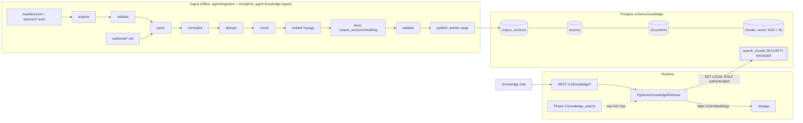
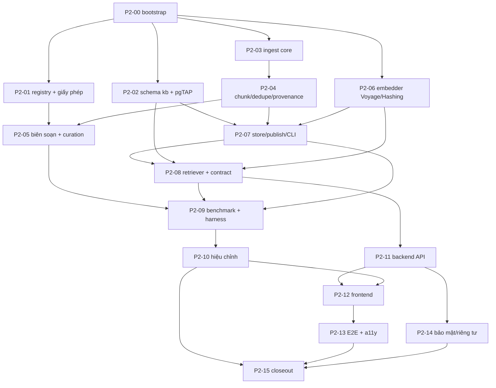

# 02 — Phase 2: Knowledge Base Implementation Plan

> **Coding agent:** Grok 4.7. **Branch:** `feat/knowledge-base`, rẽ từ `baseline/phase-2-3-start` (xem `01`). **Worktree:** `C:\Users\minhh\orca\workspaces\MoodPrint\MoodPrint-Knowledge`. **Stack local:** `kb`, offset `+100`.
> Đọc trước: `08-EXECUTION-ORDER…` bộ cũ §1, `00` (phase2-3), `11` (ownership), rồi `03` (corpus + ingestion) và `04` (retrieval + evaluation) của thư mục này.
> **Dữ liệu:** chỉ dữ liệu tổng hợp cho học sinh; **corpus tri thức là nội dung công khai/biên soạn**, không chứa dữ liệu người dùng. Câu truy vấn của học sinh là nhạy cảm (xem `04` §6).
> **Điều kiện vào còn chờ:** Gate PB chưa được xác nhận VERIFIED trong tài liệu này; không tự tạo branch/worktree hoặc dùng tag Phase 1 thay tag mới. Owner chỉ tạo worktree sau báo cáo PB và tag `baseline/phase-2-3-start` đúng SHA đã kiểm. Bàn giao đầy đủ: [12-PHASE-2-GROK-EXECUTION-HANDOFF.md](12-PHASE-2-GROK-EXECUTION-HANDOFF.md).
> **Chất lượng: UNMEASURED.** 180 truy vấn, Recall@5 ≥ 0.80, no-result accuracy ≥ 0.90 và citation integrity 100% là mục tiêu chưa đo; không phải kết quả baseline.

## 1. Mục tiêu

Một Knowledge Base thật, tiếng Việt, có nguồn kiểm chứng được, đi qua hợp đồng đóng băng `KnowledgeRetriever`, dùng được từ (a) Knowledge Hub của frontend và (b) tool `knowledge_search` của Phase 3 (sau tích hợp).

**Trong phạm vi:** registry nguồn + kiểm chứng giấy phép; pipeline ingest ngoại tuyến có phiên bản; schema `knowledge` + RLS; retriever lai (pgvector + FTS không dấu) qua Voyage; API tìm kiếm cho Hub; UI Hub thật (giữ nguyên thiết kế); benchmark tiếng Việt và báo cáo.

**Ngoài phạm vi (DEFER):** crawl liên tục, upload tài liệu bởi người dùng, nhúng ký ức người dùng, reranker bật mặc định, đa ngôn ngữ giao diện, embedding cục bộ, pgroonga.

**Không được làm:** sửa `shared/contracts/**`, sửa `create_retriever` (chữ ký), áp migration lên hosted, giữ `DATABASE_URL`/`SUPABASE_DB_URL` hosted trong worktree, thêm npm dependency, fallback sang dữ liệu mock khi retriever lỗi, nhúng nguyên văn nội dung `reference_only`/`unverified`.

Giữ nguyên `.gitignore` theo yêu cầu owner; bảo toàn `.claude/settings.local.json`, `.cursor/mcp.json`, `.mcp.json`, giá trị `.env` đã điền. Chỉ commit/push `feat/knowledge-base` của mình; không merge target/main, tạo tag, force push hoặc sửa file đóng băng. Việc hosted của kế hoạch Phase 0/1 không cấp quyền hosted cho Phase 2.

## 2. Kiến trúc

- Retriever là `PgVectorKnowledgeRetriever` trong `agent/src/moodprint_agent/knowledge/retriever.py`. Backend dựng nó trong `backend/app/modules/knowledge/factory.py::build_knowledge_retriever(engine, settings, cfg)` (đã scaffold ở CC-002; thêm nhánh `pgvector`) và đặt vào `app.state.knowledge`. Agent **không đọc secret**: khóa Voyage được factory truyền vào constructor.
- Truy cập DB của retriever: một transaction ngắn `SET LOCAL ROLE authenticated` **không** có claims người dùng (corpus công khai, RLS theo `published`), đặt `hnsw.iterative_scan`/`ef_search` bằng `SET LOCAL`. Không giữ transaction qua lời gọi Voyage: embed trước, rồi mở transaction chạy một câu SQL.
- Ingest dùng kết nối quản trị **cục bộ** (`TEST_ADMIN_DATABASE_URL` của stack `kb`, kiểm loopback). Phase 2 **không** có đường ghi hosted; integrator ghi corpus lên hosted ở INT-08 qua `scripts/db/publish_corpus.py` (bọc thư viện, kiểm project ref).
- Tên đối tượng đặt chỗ (xem `03` §4): schema `knowledge`; bảng `corpus_versions`, `sources`, `documents`, `chunks`, `ingestion_runs`; hàm `knowledge.f_unaccent`, `knowledge.published_version`, `knowledge.search_chunks`.

## 3. Hợp đồng và giao diện

| Giao diện | Nguồn | Phase 2 làm gì |
|---|---|---|
| `KnowledgeRetriever.search(query, *, scope, timeout_s)` 🔒 | `contracts/knowledge.py` | Triển khai, pass `KnowledgeRetrieverContract` với corpus tổng hợp |
| `KnowledgeTimeout`, `KnowledgeUnavailable` | `contracts/errors.py` | Ném đúng theo bảng ở `04` §5 |
| `create_retriever(cfg)` 🔒 | `knowledge/__init__.py` | **Không đổi chữ ký**; vẫn trả fixture; `retriever != "fixture"` → `ValueError` hướng dẫn dùng factory backend |
| `build_knowledge_retriever(engine, settings, cfg)` 🔒 | `backend/app/modules/knowledge/factory.py` | Thêm nhánh `cfg.knowledge.retriever == "pgvector"` |
| `/knowledge?document=<documentId>` | Hợp đồng liên phase (CC-001) | Hub mở tài liệu theo tham số này |
| `services.knowledgeSearch: KnowledgeSearchService \| null` | `ports.ts` (CC-001) | Định nghĩa kiểu trong `composition/knowledge-types.ts`, cung cấp trong `composition/knowledge.ts` |
| Mã lỗi REST | Envelope 🔒 | Dùng `rate_limited` (429), `upstream_error` (502, `details.reason` = `timeout`\|`unavailable`), `validation_failed` (422), `unauthenticated` (401); không thêm mã mới |

## 4. Đồ thị task và song song

- **Làm song song ngay sau P2-00:** P2-01 (nghiên cứu/giấy phép), P2-02 (schema), P2-03 (ingest core), P2-06 (embedder). Bốn nhánh việc không chung file.
- **Tuần tự bắt buộc:** P2-03 → P2-04 → P2-07; P2-08 cần schema + embedder + store; P2-10 cần benchmark; P2-12 cần API; P2-15 cuối.
- **Migration:** chỉ **một** người tạo file migration tại một thời điểm (P2-02 sở hữu `kb_schema`, `kb_search_fn`); thay đổi sau đó là migration mới (`kb_fix_*`), không sửa file cũ.
- Mỗi task kết thúc bằng một commit (hoặc nhóm nhỏ) và chạy `scripts/ci_ownership.py --branch feat/knowledge-base --local`.

## 5. Các task

**Quy ước trường.** Tiêu đề = Task ID. 1 Mục đích · 2 Ưu tiên · 3 Dependencies · 4 File · 5 Chi tiết · 6 DB · 7 API/contract · 8 Test · 9 Acceptance · 10 Lệnh kiểm · 11 Thất bại nếu · 12 Deliverables · 13 Rủi ro/fallback. **Branch** của mọi task: `feat/knowledge-base`.

### P2-00 — Khởi tạo worktree, stack, baseline

1. Mục đích: môi trường cô lập, xác nhận baseline đúng, hook/CI ownership hoạt động. 2. P0. 3. Gate PB xanh; owner đã tạo worktree.
4. File: `.env` (copy tay, **không** có DB hosted), `.env.live` (chỉ `VOYAGE_API_KEY`), `.local/stacks/kb/test.env` (sinh); không commit.
5. Chi tiết: (a) `git rev-parse HEAD` phải bằng `baseline/phase-2-3-start^{commit}` và nhánh hiện tại là `feat/knowledge-base`. (b) Đặt process env `MOODPRINT_STACK_NAME=kb`, `MOODPRINT_PORT_OFFSET=100`; `uv sync --all-packages --all-extras --locked`. (c) `uv run python scripts/dev/supabase_worktree.py start --name kb --offset 100 --lite`; `uv run python scripts/dev/bootstrap_local_db.py --name kb --offset 100` sinh `.local/stacks/kb/test.env`; bootstrap lại sau mỗi reset. (d) chạy baseline: `uv run python scripts/check.py`, `uv run python scripts/dev/supabase_worktree.py test --name kb --offset 100`, integration với env stack kb được nạp vào process (không đọc `.env` owner), `npm.cmd ci` và `npm.cmd test -- --maxWorkers=2` trong `frontend/`. `verify_phase0.py --regression`/`verify_phase1.py` tự nạp đúng env theo name/offset; lệnh pytest trực tiếp phải dùng loader trong handoff12 §5. (e) ngân sách live chỉ từ owner, không tự duyệt; không gọi Voyage/OpenAI trong PB hoặc baseline offline. (f) ghi báo cáo SHA, CLI và cổng: DB 54422, Supabase API 54421, mail 54424, E2E Vite/API 5278/8108, dev Vite/API 5273/8100.
6. DB: không. 7. API: không.
8. Test: toàn bộ baseline giữ nguyên. Số lịch sử Phase 1 là 265 offline/67 integration, pgTAP 194, Vitest 94; PB-02 đã kiểm 122 Vitest. Chốt số mới từ báo cáo PB/SHA tag, không dùng 94 để cho phép mất 28 test seam mới.
9. Acceptance: số test baseline ghi vào báo cáo; ownership check exit 0 trên cây sạch.
10. Lệnh: `uv run python scripts/ci_ownership.py --branch feat/knowledge-base --local`.
11. Thất bại: HEAD ≠ tag; stack dùng cổng 54321–54329; `.env` chứa host hosted.
12. Deliverables: mục "Môi trường" trong báo cáo.
13. Rủi ro: Docker thiếu RAM → dừng stack `ag` hoặc tăng RAM (O-08).

### P2-01 — Registry nguồn và kiểm chứng giấy phép

1. Mục đích: chọn nguồn có thẩm quyền, xác minh giấy phép/ngày/hiệu lực, **không** nhúng thứ không được phép. 2. P0. 3. P2-00.
4. File: `agent/ingestion/corpus/sources/*.toml`, `agent/ingestion/corpus/SOURCE-REGISTER.md`, `agent/ingestion/README.md`.
5. Chi tiết: theo `03` §1–§3. Với **mỗi** nguồn ứng viên chấm 0–3 sáu tiêu chí (thẩm quyền, liên quan, giấy phép, ngôn ngữ, áp dụng VN, độ mới/khả năng trích xuất) và ghi `verified_on` + bằng chứng (URL đã mở, trích nguyên văn câu giấy phép ≤ 125 ký tự, ngày). Bắt buộc xác minh lại bằng trình duyệt thật các nguồn mà phiên planning bị 403: `stopbullying.gov` (3 trang + trang reuse của HHS), `thuvienphapluat.vn`/`vbpl.vn`/Công báo cho Nghị định 80/2017/NĐ-CP, Thông tư 06/2019/TT-BGDĐT, Thông tư 38/2019/TT-BLĐTBXH, Luật Trẻ em 2016 (tình trạng hiệu lực tại 2026-11, văn bản thay thế nếu có); đọc **nguyên văn** điều khoản tái sử dụng của UNICEF (mục Terms of use) và WHO (trang copyright + phạm vi fact sheet). Phân hạng `licence_class` ∈ {`open_reuse`, `authored`, `reference_only`, `unverified`}. Nguồn nào chưa xác minh được → `unverified` (không vào corpus).
6. DB: không. 7. API: không.
8. Test: `agent/tests/knowledge/test_source_registry.py` (U-KB-01): mọi `*.toml` hợp lệ schema; `licence_class` ∈ tập; `open_reuse` phải có `licence_quote` và `verified_on`; `reference_only`/`unverified` không có khối `acquire`.
9. Acceptance: ≥ 12 nguồn được chấm; ≥ 6 nguồn `open_reuse` hoặc `authored`-được-hậu-thuẫn; coverage ma trận chủ đề (`03` §3) có ≥ 2 nguồn khác nhau cho mỗi chủ đề lõi; báo cáo nêu rõ nguồn bị loại và lý do.
10. Lệnh: `uv run pytest agent/tests/knowledge/test_source_registry.py -q`; `uv run python -m moodprint_agent.knowledge.ingest plan --manifest agent/ingestion/corpus/manifest.toml`.
11. Thất bại: nhúng nội dung UNICEF/WHO/`unverified`; ghi `verified_on` mà không có bằng chứng; bỏ qua nguồn Việt Nam.
12. Deliverables: `SOURCE-REGISTER.md` (bảng nguồn, điểm, bằng chứng, quyết định).
13. Rủi ro/fallback: chặn bot (403) → dùng Claude in Chrome đọc trang rồi lưu **tóm tắt tự biên soạn + trích dẫn ngắn hợp lệ**, không lưu HTML gốc nếu không được phép.

### P2-02 — Schema `knowledge` + RLS + pgTAP

1. Mục đích: lược đồ DB công khai-chỉ-đọc, phiên bản hóa, an toàn. 2. P0. 3. P2-00.
4. File: `supabase/migrations/<ts>_kb_schema.sql`, `<ts>_kb_search_fn.sql`; `supabase/tests/kb_00_schema.sql`, `kb_01_rls_grants.sql`, `kb_02_unaccent.sql`, `kb_03_search_fn.sql`.
5. Chi tiết: DDL và chỉ mục theo `03` §4–§5. `CREATE SCHEMA knowledge` (không expose ra Data API). `knowledge.f_unaccent(text)` IMMUTABLE bọc `extensions.unaccent` (hoặc `translate()` nếu spike S-08 chứng minh unaccent thiếu chữ Việt). Mọi bảng `ENABLE ROW LEVEL SECURITY`; chính sách `read_published` cho `authenticated` (`corpus_version = knowledge.published_version()`); **không** policy cho `anon`; `REVOKE ALL ... FROM PUBLIC`; `GRANT USAGE ON SCHEMA knowledge TO authenticated, moodprint_api`; `GRANT SELECT` chỉ trên bảng đọc được; `GRANT EXECUTE` trên `search_chunks`. Chỉ mục: GIN trên `fts`, GIN `gin_trgm_ops` trên `heading_norm` (chỉ giữ nếu S-08 giữ nhánh trigram), btree theo khóa chính `(corpus_version, …)`. `unique index corpus_one_published ... where status='published'`. **HNSW không tạo mặc định** (corpus vài nghìn chunk: quét chính xác nhanh hơn, recall 100%, không phải xử lý lọc/iterative scan); P2-10 quyết định, nếu cần thì thêm migration `kb_hnsw_index` (`vector_cosine_ops`, m=16, ef_construction=64).
6. DB: như trên; **chỉ** đối tượng `knowledge.*`. Cấm đụng `app`, `agent_store`, `public`, extension, role.
7. API: không.
8. Test (pgTAP): `P-KB-01` mọi bảng `knowledge` có RLS + policy; `P-KB-02` `anon` không có quyền gì; `authenticated` chỉ SELECT và chỉ thấy phiên bản `published` (tạo 2 phiên bản, một `building`); không INSERT/UPDATE/DELETE; `P-KB-03` `f_unaccent('Đường đi bắt nạt ở trường')='duong di bat nat o truong'` cho toàn bảng chữ cái Việt (đủ 134 tổ hợp nguyên âm-thanh); `P-KB-04` `search_chunks` trả đúng hàng theo bộ lọc và không trả hàng của phiên bản khác; `P-KB-05` hàm là `SECURITY INVOKER`; `P-KB-06` chỉ một phiên bản `published`. Thêm `scripts/dev/migration_scope_check.py` xanh.
9. Acceptance: `supabase test db` xanh gồm 00/05/14 mới (CC-004) nhận schema `knowledge`; `db reset` từ trống xanh; `test_schema_drift` (nếu có SQLAlchemy model) không cần vì bảng `knowledge` truy cập bằng SQL, nhưng thêm `P-KB-07` so cột với `03` §4.
10. Lệnh: `uv run python scripts/dev/supabase_worktree.py reset; uv run python scripts/dev/supabase_worktree.py test`.
11. Thất bại: bảng thiếu RLS; policy cho `anon`; migration đụng đối tượng ngoài `knowledge`; tên file sai mẫu.
12. Deliverables: 2 migration + 4 file pgTAP + danh sách migration trong báo cáo.
13. Rủi ro: HNSW trên corpus nhỏ chưa cần; mặc định không tạo. Nếu P2-10 chứng minh cần, thêm migration mới rồi so recall HNSW với quét chính xác (nếu khác > 1% tuyệt đối thì dùng quét chính xác).

### P2-03 — Lõi ingest: manifest, acquire, validate, parse, normalize

1. Mục đích: chuyển nguồn thành văn bản sạch, tái lập được, an toàn. 2. P0. 3. P2-00.
4. File: `agent/src/moodprint_agent/knowledge/ingest/{__init__,__main__,cli,models,manifest,acquire,validate,normalize}.py`, `ingest/parse/{__init__,html,pdf,markdown,text}.py`, `agent/tests/knowledge/test_ingest_*.py`.
5. Chi tiết: theo `03` §5–§7. Pydantic `frozen`; pyright strict. `acquire`: `httpx.AsyncClient`, allow-list host lấy từ `sources/*.toml`, tối đa 1 yêu cầu/giây/host, tôn trọng `robots.txt` (bỏ qua nguồn bị cấm), `If-None-Match`/`If-Modified-Since`, giới hạn 15 MB, redirect chỉ trong cùng allow-list, snapshot vào `.local/corpus-cache/<source_id>/<sha256>` (**không commit** nếu `licence_class != open_reuse`). `validate`: cổng giấy phép (chỉ `open_reuse`/`authored` đi tiếp), MIME/magic bytes, kích thước, `sha256` ghim nếu có. `parse`: HTML bằng `beautifulsoup4` (+`lxml` nếu có) loại nav/footer/script; PDF bằng `pypdf` (ghi trang); Markdown thẻ biên soạn (front matter TOML-hoặc-YAML-tối-giản tự phân tích, không thêm pyyaml). `normalize`: Unicode **NFC**, bỏ ký tự điều khiển/zero-width, gộp khoảng trắng, nối từ bị ngắt dòng bởi PDF, chuẩn hóa dấu câu, giữ nguyên dấu thanh.
6. DB: không. 7. API: không.
8. Test: `U-KB-02…08`: fixture HTML/PDF/MD tổng hợp nhỏ trong `agent/tests/knowledge/data/`; NFC/NFD cho cùng chuỗi cho cùng kết quả; từ chối host ngoài allow-list và redirect ra ngoài; từ chối `reference_only`; bỏ qua robots; giới hạn kích thước; parse deterministic (chạy hai lần, cùng `sha256`).
9. Acceptance: pyright strict sạch; coverage dòng của `ingest/` ≥ 85%; không có truy cập mạng trong test (dùng `httpx.MockTransport`).
10. Lệnh: `uv run pytest agent/tests/knowledge -q`; `uv run pyright`.
11. Thất bại: truy cập mạng thật trong test; kết quả parse thay đổi giữa hai lần chạy; log in nội dung văn bản.
12. Deliverables: module + test.
13. Rủi ro: `pypdf` trích sai tiếng Việt có dấu → thêm kiểm "tỉ lệ ký tự thay thế ≤ 0.5%" và fallback sang nhập tay thẻ biên soạn.

### P2-04 — Chunk, dedupe, provenance

1. Mục đích: đơn vị truy hồi tốt cho tiếng Việt, truy vết được. 2. P0. 3. P2-03.
4. File: `ingest/{chunk,dedupe,stats}.py`, test `test_chunk_*.py`, `test_dedupe.py`.
5. Chi tiết: `03` §6. Chunk theo **heading + đoạn**, mục tiêu 600–1100 ký tự (≈ 150–350 token tiếng Việt), tối đa 1400, chồng lấn 1 câu; không cắt giữa câu, giữa mục danh sách, hoặc giữa điều khoản luật (luật chia theo `Điều`/`Khoản`). Mỗi chunk giữ `heading`, `section_path`, `char_start/end`, `content_sha256`, và mã `chunk_id = <document_id>#<ordinal:03d>-<sha8>`. Dedupe: trùng chính xác theo `sha256` chuẩn hóa; gần trùng bằng Jaccard 5-shingle ≥ 0.90 → giữ bản có `authority_tier` cao hơn và ghi `duplicate_of`.
6. DB: không. 7. API: không.
8. Test: ranh giới câu tiếng Việt (viết tắt "TP.", "Q.", số thứ tự "1."); luật theo `Điều`; chunk không rỗng; tổng ký tự các chunk (trừ chồng lấn) bằng văn bản gốc; `chunk_id` ổn định khi chạy lại và khi chỉ một chunk thay đổi thì chỉ id đó đổi; property test (Hypothesis không có → dùng vòng lặp ngẫu nhiên hạt cố định).
9. Acceptance: 100% chunk ∈ [200, 1400] ký tự trừ mục ngắn có chủ đích; không chunk trùng.
10. Lệnh: `uv run pytest agent/tests/knowledge/test_chunk_*.py agent/tests/knowledge/test_dedupe.py -q`.
11. Thất bại: chunk cắt giữa từ/ký tự tổ hợp; id đổi khi nội dung không đổi.
12. Deliverables: chunker + báo cáo thống kê (`stats.json`).
13. Rủi ro: câu quá dài trong văn bản luật → cho phép vượt 1400 tối đa 1800 với `oversize=true` và ghi vào báo cáo.

### P2-05 — Biên soạn và curation corpus

1. Mục đích: nội dung tiếng Việt chất lượng, đúng nguồn, phủ chủ đề. 2. P0. 3. P2-01, P2-04.
4. File: `agent/ingestion/authored/*.md`, `agent/ingestion/authored/_review/*.md`, `agent/ingestion/corpus/manifest.toml`, `agent/ingestion/synthetic/contract_corpus.json`.
5. Chi tiết: (a) Chuyển 24 bài tĩnh ở `frontend/src/mocks/data/knowledge.ts` (định dạng guide/faq/checklist/template) thành thẻ biên soạn, giữ `legacy_article_id`; scenario/quiz là tương tác nên **không** ingest (ghi lý do trong manifest). (b) Viết thêm thẻ để phủ ma trận chủ đề `03` §3 (mục tiêu ≥ 40 tài liệu, ≥ 350 chunk). Mỗi thẻ: front matter đầy đủ (`derived_from` với `locator`), văn phong theo độ tuổi (11–13 và 14–17), không chẩn đoán, không hứa hẹn, không tên riêng thật, có `last_reviewed`, `applicability`. (c) `_review/<id>.md` ghi đối chiếu từng khẳng định với nguồn. (d) Bộ `synthetic/contract_corpus.json` (tổng hợp) thỏa yêu cầu của `KnowledgeRetrieverContract` (tiếng `vi`, VN, tuổi 11–13, topic `support`, không có `zz`) **và** chứa 1 tài liệu "bẫy chỉ thị" (nội dung mô phỏng prompt-injection) để Phase 3/INT-05 kiểm.
6. DB: không. 7. API: không.
8. Test: `U-KB-20…26`: mọi thẻ có `derived_from` trỏ tới nguồn `open_reuse|authored-backed` có `verified_on`; không có tên người/số điện thoại cá nhân (regex + danh sách); độ dài đoạn; không URL ngoài allow-list; mỗi bài tĩnh `format ∈ {guide,faq,checklist,template}` có thẻ tương ứng hoặc ngoại lệ ghi rõ; chạy `build` hai lần cho cùng `manifest_sha256`.
9. Acceptance: ma trận chủ đề: mỗi chủ đề lõi ≥ 3 tài liệu, ≥ 2 tài liệu dẫn nguồn khác nhau; tiếng Việt có dấu chuẩn NFC; reviewer (Phase 2 agent lần hai, ghi trong `_review`) không còn khẳng định thiếu nguồn.
10. Lệnh: `uv run python -m moodprint_agent.knowledge.ingest build --manifest agent/ingestion/corpus/manifest.toml --out .local/corpus/build-1`; `uv run pytest agent/tests/knowledge -q -k authored`.
11. Thất bại: thẻ chép nguyên văn nguồn `reference_only`; khẳng định pháp lý không có `locator`; nội dung nằm ngoài Việt Nam mà gắn `country_scope: [VN]`.
12. Deliverables: corpus biên soạn + manifest + bản đồ phủ chủ đề (bảng trong báo cáo).
13. Rủi ro: thiếu nguồn mở cho một chủ đề → ghi "khoảng trống đã biết" và để benchmark có truy vấn `no-result` tương ứng thay vì bịa.

### P2-06 — Embedder: Voyage REST + Hashing + cache

1. Mục đích: nhúng tài liệu/truy vấn ổn định, rẻ, có kiểm thử ngoại tuyến. 2. P0. 3. P2-00.
4. File: `agent/src/moodprint_agent/knowledge/embedder.py`, `ingest/embed.py`, `agent/tests/knowledge/test_embedder_*.py`.
5. Chi tiết: `QueryEmbedder` Protocol (`async embed_query(text) -> list[float]`) và `DocumentEmbedder` (`async embed_documents(texts) -> list[list[float]]`). `VoyageEmbedder` gọi `POST https://api.voyageai.com/v1/embeddings` bằng `httpx`: `model` từ `KnowledgeConfig.embedding_model` (mặc định `voyage-4`), `input_type` `document`/`query`, `output_dimension=1024`, `truncation=false` (lỗi nếu quá dài thay vì cắt im lặng), `output_dtype="float"`. Lô ≤ 128 văn bản **và** ≤ 100 000 token ước tính/yêu cầu (giới hạn tài liệu: 1 000 văn bản; 320K token cho `voyage-4`). Retry 5 lần, backoff mũ có jitter, tôn trọng `Retry-After`, 429/5xx/timeouts; 4xx khác không retry. Timeout mỗi yêu cầu cấu hình; truy vấn dùng ngân sách con `embed_timeout_fraction × timeout_s`. Ghi `usage.total_tokens` vào bộ đếm chi phí. `HashingEmbedder`: vector 1024 chiều tất định từ băm n-gram ký tự đã bỏ dấu (dùng cho CI và E2E; không bao giờ cho kết quả chất lượng sản xuất). Cache nhúng theo `(model, dims, input_type, sha256(text))` trong `.local/corpus-cache/embeddings.sqlite` (stdlib `sqlite3`). **Không** log văn bản; chỉ log độ dài, số token, mã lỗi. Cờ so sánh bất đối xứng: `query_embedding_model` có thể khác `embedding_model` (các model dòng voyage-4 tương thích nhau theo FAQ của Voyage — **phải xác nhận bằng benchmark**, không giả định).
6. DB: không. 7. API: không.
8. Test: `httpx.MockTransport` kiểm thân yêu cầu (model, input_type, output_dimension, truncation), retry 429 rồi thành công, 500 liên tục → `KnowledgeUnavailable`, timeout → `KnowledgeTimeout`, chia lô đúng ngưỡng, cache hit không gọi mạng, `HashingEmbedder` tất định và gần nhau với văn bản gần nhau (cosine) và không phụ thuộc dấu thanh; không log văn bản (caplog). Test `live_kb` (đánh dấu `@pytest.mark.live_kb`, mặc định không chạy): một lô 3 câu tiếng Việt, kiểm 1024 chiều và chuẩn hóa độ dài 1 (sai số 1e-3). Test live **bị chặn** nếu thiếu file ngân sách.
9. Acceptance: pyright strict; live test (nếu owner đã duyệt) ≤ 1 000 token.
10. Lệnh: `uv run pytest agent/tests/knowledge -q`; `uv run pytest -m live_kb -q` (khi được phép).
11. Thất bại: gọi Voyage trong test mặc định; vector không 1024 chiều; log chứa nội dung.
12. Deliverables: embedder + bộ đếm token/chi phí.
13. Rủi ro: Voyage 401/quota → lỗi rõ ràng, retriever suy giảm sang lexical (xem `04` §5), ingest dừng.

### P2-07 — Store, publish, validate, CLI

1. Mục đích: nạp corpus vào DB theo phiên bản, idempotent, có rollback. 2. P0. 3. P2-02, P2-04, P2-06.
4. File: `ingest/{store,publish,verify}.py`, `agent/tests/knowledge/test_store_*.py`, `agent/tests/integration/knowledge/test_publish_pg.py` (đánh dấu `integration`).
5. Chi tiết: lệnh `plan|acquire|build|embed|store|validate|publish|rollback|status|verify-citations|seed-synthetic` (`03` §7). `store`: tạo `corpus_versions(status='building')`, chèn `sources` (upsert), `documents`, `chunks` theo lô trong transaction, idempotent theo `(version, manifest_sha256)`. `validate`: bất biến (số tài liệu/chunk khớp build; 0 embedding NULL; đủ 1024 chiều; `fts` không rỗng; FK; mọi `source_id` có `licence_class ∈ {open_reuse, authored}`; mọi tài liệu có `last_reviewed`; coverage ma trận chủ đề) → `validated`. `publish`: một transaction `SELECT ... FOR UPDATE` trên `corpus_versions`, chuyển bản cũ `published → retired`, bản mới `validated → published`; `rollback --to`: ngược lại, chỉ cho bản `retired` chưa bị xóa. Mục tiêu kết nối: `test-env` (đọc `.local/test.env`, **bắt buộc loopback**) hoặc `--db-url` loopback; **không có** mục tiêu hosted trong CLI. `verify-citations`: mỗi chunk của bản đang xét → `source_id`, `document_id` tồn tại; URL trong allow-list manifest; `last_reviewed` hợp lệ; không có URL chạy qua redirect khác host (kiểm tĩnh); tùy chọn `--link-check` (HEAD, chỉ báo cáo).
6. DB: dùng schema từ P2-02. 7. API: không.
8. Test: `I-KB-01…06`: publish hai phiên bản liên tiếp → chỉ bản mới thấy được bởi `authenticated`; rollback phục hồi; chạy `store` hai lần không nhân bản; gián đoạn giữa chừng (raise sau lô 2) rồi chạy lại → hoàn tất đúng; `validate` bắt embedding NULL/sai chiều; hai tiến trình publish đồng thời → một thành công, một chờ khóa; từ chối URL DB không loopback.
9. Acceptance: round-trip `build → embed(Hashing) → store → validate → publish → search` xanh trên stack `kb`.
10. Lệnh: `uv run pytest -m integration agent/tests/integration/knowledge -q`.
11. Thất bại: có thời điểm hai phiên bản `published`; có đường ghi hosted; log in văn bản chunk.
12. Deliverables: CLI hoàn chỉnh + hướng dẫn `agent/ingestion/README.md`.
13. Rủi ro: transaction dài với lô lớn → lô ≤ 200 chunk/transaction, phiên bản chỉ hiển thị khi `published`.

### P2-08 — Retriever pgvector lai + contract test

1. Mục đích: triển khai `KnowledgeRetriever` thật theo `04`. 2. P0. 3. P2-02, P2-06, P2-07.
4. File: `agent/src/moodprint_agent/knowledge/{retriever,query,scoring}.py`, `backend/app/modules/knowledge/{factory,testing}.py`, `agent/tests/knowledge/test_retriever_*.py`, `agent/tests/integration/knowledge/test_retriever_contract_pg.py`.
5. Chi tiết: `PgVectorKnowledgeRetriever(engine, embedder, cfg: KnowledgeConfig, *, clock)` thực thi đúng thuật toán `04` §3–§5: chuẩn hóa/che truy vấn → embed (ngân sách con) → một câu `knowledge.search_chunks` (hai nhánh + hợp nhất) → ngưỡng → dựng `KnowledgeResult` (`score` ∈ [0,1], sắp xếp `score` giảm, tie-break `chunk_id`). `asyncio.timeout(timeout_s)`; `timeout_s <= 0` → `KnowledgeTimeout` ngay; `CancelledError` truyền ra; lỗi DB/mạng → `KnowledgeUnavailable`; embed lỗi → hạ cấp lexical-only (`match_kind="lexical"`, ghi log mức WARNING chỉ mã lỗi). `scope.corpus_version` ghim (truy vấn dùng kết nối `authenticated` chỉ thấy `published`; ghim bản khác chỉ hợp lệ với kết nối quản trị của harness eval). Factory: nhánh `pgvector` dựng retriever từ `app.state.engine` và `settings.voyage_api_key`; thiếu khóa → factory ném `ValueError` (không bao giờ âm thầm dùng embedder giả ở sản xuất). `HashingEmbedder` chỉ do test và `scripts/e2e_app.py` (chế độ scripted) truyền tường minh bằng cách tự dựng `PgVectorKnowledgeRetriever(engine, HashingEmbedder(), cfg)` rồi gán `app.state.knowledge`.
6. DB: gọi `knowledge.search_chunks`; không thêm đối tượng.
7. API/contract: Protocol 🔒 giữ nguyên.
8. Test: `KnowledgeRetrieverContract` chạy với retriever thật + corpus tổng hợp + `HashingEmbedder` (CI ngoại tuyến): `test_ok_shape`, `no_results`, `top_k`, `sorted_by_score`, `filters`, `timeout_raises`, `cancellation_propagates`, `deterministic`; thêm `I-KB-10…18`: truy vấn không dấu = có dấu cho cùng tập top-3; nhiễu `'; DROP TABLE` và `& | ! :` không làm hỏng tsquery; embed lỗi → `match_kind=lexical`; DB tắt → `KnowledgeUnavailable` (không treo quá `timeout_s + 0.5s`); 20 truy vấn đồng thời không rò rỉ kết nối (`pool.checkedout()==0`); che email/điện thoại/URL trước khi gửi embedder (mock bắt thân yêu cầu); độ dài > `query_max_chars` bị cắt tại ranh giới từ.
9. Acceptance: mọi test contract và `I-KB-10…18` xanh; không test nào phụ thuộc Voyage.
   - **Seam E2E chính thức:** Phase 2 cung cấp `app.modules.knowledge.testing.build_e2e_retriever(engine, cfg) -> KnowledgeRetriever`, đồng bộ, tự dựng adapter với `HashingEmbedder` và `cfg.knowledge`. `scripts/e2e_app.py` chỉ import optional module và gọi factory này **sau khi** lifespan đã tạo engine; không suy đoán constructor `PgVectorKnowledgeRetriever`, không sửa script đóng băng. Câu mô tả constructor ở mục 5 là thiết kế nội bộ, không phải chữ ký mà harness gọi. Module có mặt nhưng thiếu dependency/factory hoặc lỗi khởi tạo phải làm E2E fail, không fallback fixture.
10. Lệnh: `uv run pytest agent/tests/knowledge -q`; `uv run pytest -m integration agent/tests/integration/knowledge -q`.
11. Thất bại: `no_results` sai khi nhiễu; `score` ngoài [0,1]; kết quả không tất định; truy vấn nguyên văn xuất hiện trong log.
12. Deliverables: retriever + factory + báo cáo contract.
13. Rủi ro: ngưỡng chưa hiệu chỉnh → giá trị tạm bảo thủ, hiệu chỉnh ở P2-10 (ghi rõ trong báo cáo phần "ngưỡng tạm thời").

### P2-09 — Benchmark tiếng Việt, chỉ số, harness

1. Mục đích: đo chất lượng truy hồi khách quan, tái lập được. 2. P0. 3. P2-05, P2-07, P2-08.
4. File: `agent/evals/knowledge/cases/{benchmark.jsonl,labels.jsonl,README.md}`, `agent/evals/knowledge/{run.py,metrics.py,report.py}`, `agent/tests/knowledge/test_metrics.py`.
5. Chi tiết: theo `04` §7. 180 truy vấn (150 có đáp án, 30 không), chia **dev 40% / test 60%**; **khóa split và nhãn test trước khi hiệu chỉnh** (commit riêng, `split_sha256` ghi vào báo cáo). Gán nhãn thủ công bởi coding agent: pooled từ hợp kết quả mọi cấu hình + tìm tay; 20% truy vấn gán lại lần hai để đo nhất quán. Harness chạy các cấu hình A/B/C/D (`04` §7.4), ghi `results/<run-id>/{outputs,metrics,latency,cost}.json` + `config.json` (model, dims, phiên bản corpus, commit). Không gọi model LLM nào (AD-20).
6. DB: dùng bản corpus `validated` trong stack `kb`. 7. API: không.
8. Test: `U-KB-30…36` chỉ số đúng trên ví dụ tay (Recall@k, MRR, nDCG với đánh giá có bậc, no-result accuracy, p50/p95); hồi quy: kết quả giống nhau khi chạy lại với `HashingEmbedder`.
9. Acceptance: bộ dữ liệu phủ đúng phân bố `04` §7.2; kiểm tra tự động: mỗi nhãn tham chiếu `document_id` tồn tại; không truy vấn nào xuất hiện ở cả dev và test; không trùng lặp gần (Jaccard ≥ 0.8) giữa các truy vấn.
10. Lệnh: `uv run python agent/evals/knowledge/run.py --split dev --config hybrid --embedder hashing` (ngoại tuyến) và `--embedder voyage` khi được phép.
11. Thất bại: nhãn test bị sửa sau khi hiệu chỉnh; tính điểm thiếu truy vấn không đáp án.
12. Deliverables: dataset + harness + báo cáo baseline (chưa hiệu chỉnh).
13. Rủi ro: ít tài liệu cho một chủ đề → truy vấn thuộc chủ đề đó chuyển sang nhóm `no-result` có chủ đích và ghi nhận khoảng trống.

### P2-10 — Hiệu chỉnh và quyết định cấu hình

1. Mục đích: chốt ngưỡng, `k`, mô hình, rerank bằng bằng chứng. 2. P0. 3. P2-09.
4. File: `agent/evals/knowledge/results/<run-id>/**`, `agent/evals/knowledge/spikes/S-08.md`, `agent/src/moodprint_agent/knowledge/scoring.py` (hằng), `shared/.../config.py::KnowledgeConfig` (giá trị mặc định — vùng được phép).
5. Chi tiết: chỉ dùng **dev split**: (a) S-08: `unaccent` vs `translate`, tokenizer lexical (stoplist, OR vs AND, phrase boost), nhánh trigram có ích không; (b) so cấu hình A lexical-only, B vector-only, C hybrid RRF, D hybrid + `rerank-3` (và bất đối xứng `voyage-4-large` tài liệu / `voyage-4-lite` truy vấn); (c) chọn `rrf_k ∈ {20, 50, 60}`, `vector_candidates`, `lexical_candidates ∈ {20, 30, 50}`; (d) hiệu chỉnh `min_vector_score`, `min_lexical_score` để đạt no-result accuracy mục tiêu với mất mát Recall@5 ≤ 0.03; (e) tạo HNSW chỉ nếu p95 quét chính xác > 25 ms ở kích thước corpus đã publish; nếu tạo thì recall HNSW so với quét chính xác chênh ≤ 1% tuyệt đối trên mọi truy vấn có lọc; (f) **sau khi khóa cấu hình**, chạy **một lần** trên test split và ghi số liệu — không điều chỉnh lại. Quy tắc quyết định: chọn cấu hình có nDCG@10 dev cao nhất; hòa trong 0.01 → chọn đơn giản/rẻ hơn; chỉ bật hybrid nếu hơn nhánh đơn tốt nhất ≥ +0.03 Recall@5 trên **test**, chỉ bật rerank nếu +0.03 nDCG@10 **và** p95 ≤ ngân sách.
6. DB: có thể thêm migration `kb_fix_*` (chỉ mục/hàm). 7. API: không.
8. Test: `U-KB-40`: hằng cấu hình nằm trong `KnowledgeConfig` và khớp `config.json` của run được chọn; hồi quy chỉ số ở CI chạy với `HashingEmbedder` kiểm sàn tối thiểu (không phải ngưỡng chất lượng).
9. Acceptance: bảng so sánh A–D trên test split; mỗi mục tiêu `04` §7.5 được đánh dấu PASS/FAIL **trung thực**; mục FAIL có phân tích nguyên nhân và kế hoạch, không hạ ngưỡng im lặng.
   - Chọn hybrid/rerank và khóa cấu hình bằng **dev**; mức cải thiện +0.03 trên test chỉ là tiêu chí xác nhận của kế hoạch đã đăng ký, không là vòng lựa chọn mới. Nếu test fail, báo FAIL/needs revision và review công khai; không quay lại chọn cấu hình khác trên holdout đã lộ. Nhóm no-result của test có 18 mẫu, mục tiêu ≥ 0.90 tương ứng ≥ 17/18 (30 là số toàn bộ dataset).
10. Lệnh: `uv run python agent/evals/knowledge/run.py --split test --config <chosen> --embedder voyage`.
11. Thất bại: tinh chỉnh trên test split; báo cáo chỉ nêu số tốt.
12. Deliverables: `phase-2-report.md` mục "Kết quả benchmark", `S-08.md`, cấu hình khóa.
13. Rủi ro: không đạt Recall@5 ≥ 0.80 → mở rộng corpus/viết lại thẻ (P2-05) rồi chạy lại trên **bộ truy vấn mới tương đương** (không tái dùng nhãn test đã lộ).

### P2-11 — Backend: API tìm kiếm và factory

1. Mục đích: phơi bày retriever cho Hub, có xác thực, giới hạn tốc độ, lỗi chuẩn. 2. P0. 3. P2-08.
4. File: `backend/app/api/v1/knowledge.py`, `backend/app/modules/knowledge/{service,schemas,ratelimit}.py`, `backend/tests/knowledge/test_knowledge_api.py`, `backend/tests/integration/knowledge/test_knowledge_http.py`, `backend/openapi.json` + `frontend/src/services/http/schema.gen.ts` (sinh lại).
5. Chi tiết: `GET /v1/knowledge/search?q&topic&age&language&limit`, `GET /v1/knowledge/documents/{documentId}`, `GET /v1/knowledge/sources`, `GET /v1/knowledge/corpus` (`02` §3 và `04` §8). Đều yêu cầu `get_auth`. Ánh xạ `age` (`11–13` hoặc `11-13`) → `AgeBand`; bộ lọc topic từ danh sách cho phép. Giới hạn tốc độ `search_rate_per_user_per_min` bằng cửa sổ trượt trong tiến trình (ghi chú: mềm, đơn worker; chi phí/bên thứ ba, không phải ranh giới bảo mật) → 429 + `Retry-After`. Lỗi: `KnowledgeTimeout`/`Unavailable` → 502 `upstream_error` với `details.reason`. Phản hồi có `degraded: bool` và `mode`. **Không** log `q`; log `request_id`, độ dài, `status`, `latency_ms`, `corpus_version`.
6. DB: đọc qua retriever/SQL `knowledge.*`. 7. API: như trên (camelCase).
8. Test: `I-KB-20…30`: 401 khi thiếu token; 422 khi `q` rỗng hoặc > `query_max_chars`; kết quả đúng schema; `no_results` trả 200 với danh sách rỗng (không phải 404); 429 sau ngưỡng; embedder lỗi → 200 với `degraded=true`; DB tắt → 502 `upstream_error`; OpenAPI có `security` Bearer và mô tả lỗi; mapping tuổi dấu gạch nối dài; `GET documents/{id}` 404 cho id không tồn tại; **không** rò thông tin nội bộ (`licence_note`, đường dẫn cache).
9. Acceptance: `export_openapi.py --check` sạch sau khi sinh lại; `test_api_contracts` xanh; ma trận cô lập Phase 1 (`test_phase1_http.py`) không đổi.
10. Lệnh: `uv run pytest backend/tests/knowledge -q; uv run pytest -m integration backend/tests/integration/knowledge -q`; `uv run python scripts/export_openapi.py && cd frontend && npm run gen:api`.
11. Thất bại: route công khai không cần đăng nhập; log chứa truy vấn; thêm mã lỗi mới.
12. Deliverables: API + OpenAPI + test.
13. Rủi ro: tải cao làm cạn pool → giới hạn đồng thời 8 truy vấn/tiến trình bằng semaphore; vượt → 429.

### P2-12 — Frontend: Knowledge Hub thật

1. Mục đích: tích hợp tìm kiếm thật, giữ nguyên thiết kế/animation, phân biệt rõ ba loại nội dung. 2. P0. 3. P2-11 (API), P2-10 (nhãn UI, `degraded`).
4. File: `frontend/src/features/knowledge/**` (mới: `search.tsx`, `retrieved.tsx`, `document-drawer.tsx`, `sources-drawer.tsx`, `use-knowledge-search.ts`, `*.test.tsx`), `frontend/src/services/http/knowledge.ts`, `frontend/src/services/composition/{knowledge,knowledge-types}.ts`.
5. Chi tiết: `KnowledgeSearchService` = `{ search(q, filters, signal): Promise<KnowledgeSearchResult>; document(id): Promise<KnowledgeDocument>; sources(): Promise<KnowledgeSourceInfo[]>; corpus(): Promise<CorpusInfo> }`; `createKnowledgeSearchPort(client: StreamClient)` dùng `client` JSON (không cần stream). Hub: ô tìm kiếm có chế độ **"Tra cứu từ nguồn"** (khi `services.knowledgeSearch !== null`) và giữ lọc cục bộ cho bài tĩnh. Ba nhãn: **"Bài biên soạn"** (24 bài tĩnh, cục bộ), **"Tình huống tương tác"** (scenario/quiz, cục bộ), **"Kết quả tra cứu"** (từ API, hiện nguồn, ngày rà soát, phạm vi quốc gia, "Tóm tắt biên soạn" nếu `authored`). Trạng thái: nhàn rỗi, đang tìm (Thinking Orbs hiện có hoặc skeleton, tôn trọng `reducedMotion`), có kết quả, không kết quả ("Chưa tìm thấy nguồn phù hợp" + gợi ý bỏ bộ lọc, **không** đề xuất bài tĩnh như thể là kết quả), lỗi + nút Thử lại, suy giảm (`degraded`: "Đang tìm theo từ khóa"). **Không** thay thế bằng dữ liệu mock khi API lỗi. Tham số `?document=<id>` mở `DocumentDrawer`. Drawer nguồn liệt kê nguồn, nhà xuất bản, ngày rà soát, phạm vi áp dụng. Test ID: `knowledge-live`, `retrieved-result`, `citation-chip`. Mapper tuổi `11–13`↔`11-13`. Workspace `demo`: `knowledgeSearch === null` → hành vi cũ (nhãn "Thư viện mẫu").
6. DB: không. 7. API: dùng `/v1/knowledge/*` qua `schema.gen.ts`.
8. Test (Vitest): trạng thái ở trên; **không fallback** (API reject → thông báo lỗi, vùng "Kết quả tra cứu" không chứa bài tĩnh); đổi workspace giữa chừng hủy yêu cầu (`AbortController`); mapper tuổi; deep link `?document=`; truy cập bàn phím và `aria-live`; không ghi `localStorage` nội dung truy vấn. 94 Vitest cũ vẫn xanh, và `knowledge.test.tsx` hiện có không bị nới.
9. Acceptance: `npm run typecheck && lint && format:check && test && build && check:boundaries` xanh; 8 viewport (320…1440) không tràn ngang (E2E ở P2-13).
10. Lệnh: `cd frontend && npm test -- --maxWorkers=2`.
11. Thất bại: bất kỳ đường nào hiển thị mock như kết quả thật; sửa file ngoài vùng; thêm npm dependency.
12. Deliverables: UI + test.
13. Rủi ro: danh sách chủ đề cục bộ không khớp topic trong corpus → bảng ánh xạ topic cố định trong `services/http/knowledge.ts` và test.

### P2-13 — E2E real, demo regression, a11y/responsive

1. Mục đích: chứng minh hành trình thật + không phá demo. 2. P0. 3. P2-12.
4. File: `frontend/e2e/knowledge-real.spec.ts`, `frontend/e2e/helpers/phase2.ts` (đặt `knowledgeLive = true`).
5. Chi tiết: `E-KB-01` đăng nhập thật, tìm "bị nhắn tin dọa trong nhóm lớp" → có kết quả + chip nguồn + mở tài liệu; `E-KB-02` truy vấn không dấu cho kết quả tương đương; `E-KB-03` truy vấn ngoài phạm vi → trạng thái không kết quả, không bài tĩnh trong vùng kết quả; `E-KB-04` chặn `**/v1/knowledge/search` bằng `page.route` trả 502 → hiện lỗi + Thử lại, không mock; `E-KB-05` deep link `?document=`; `E-KB-06` user B xem cùng URL tài liệu (corpus công khai → thấy; xác nhận **không** có dữ liệu người dùng nào trong phản hồi); `E-KB-07` axe WCAG 2A/AA trên `/knowledge`; `E-KB-08` 320/360/375/390/430/768/1024/1440 không tràn ngang. Corpus seed qua hook `knowledge-seed` (`seed-synthetic`, HashingEmbedder). Demo: `journey.spec.ts`, `responsive.spec.ts`, `ui-refinement.spec.ts` vẫn xanh (không sửa).
   - Hook baseline thực thi `python scripts/e2e_seed.py`, dispatcher tới `python -m moodprint_agent.knowledge.ingest seed-synthetic --target test-env`; process đã nhận env loopback stack kb. Chỉ **module tính năng chưa tồn tại** được bỏ qua với exit 2; module hiện hữu mà lỗi phải khác 0/2 và fail. Phase 2 triển khai CLI + `testing.build_e2e_retriever`, không sửa `scripts/e2e_{app,seed,stack}.py`/`e2e_hooks.json`. Demo không gọi hook seed.
6. DB: seed tổng hợp. 7. API: không.
8. Test: như trên. 9. Acceptance: `e2e_stack.py --run --project real` và `--project demo` (offset 100) xanh; không `console.error`; không request ra ngoài allow-list (N-05).
10. Lệnh: sau khi đặt hai biến process như P2-00, `uv run python scripts/e2e_stack.py --run --project real --name kb --offset 100`; chạy riêng `--project demo --name kb --offset 100` (PowerShell không dùng cú pháp gán env kiểu POSIX).
11. Thất bại: chỉnh `responsive-real.spec.ts` (🔒) thay vì dùng capability; test bị `.skip`.
12. Deliverables: spec + ảnh báo cáo (không commit ảnh baseline đã track).
13. Rủi ro: Vite HMR giữa lúc chạy (`fullstack-vite-hmr-pitfall`) → không sửa `frontend/` khi E2E đang chạy.

### P2-14 — Bảo mật, riêng tư, giấy phép

1. Mục đích: không rò dữ liệu, không nhúng nội dung cấm, không log truy vấn. 2. P0. 3. P2-11.
4. File: `agent/tests/knowledge/test_security_*.py`, `backend/tests/knowledge/test_privacy_logs.py`, `supabase/tests/kb_04_privileges.sql`.
5. Chi tiết: (a) RLS/grant: `anon` không đọc, `authenticated` không ghi, không thấy bản `building`. (b) SQL/tsquery injection fuzz 500 chuỗi (hạt cố định) không lỗi 500. (c) Quét log trong toàn bộ test: truy vấn canary `ZZ-CANARY-<uuid>` không xuất hiện trong bất kỳ log nào (backend, retriever, embedder). (d) Cổng giấy phép: test CI duyệt manifest + DB: không tài liệu `published` nào có `licence_class ∈ {reference_only, unverified}`; mọi `open_reuse` có `licence_quote`. (e) Prompt-injection: tài liệu bẫy trong corpus tổng hợp được trả nguyên văn, không chứa markup đặc biệt, `text` nằm trong trường dữ liệu. (f) Secret scan: không `pa-` (Voyage), `sk-`, `sb_secret_` trong repo/bundle (`check:boundaries` + grep). (g) Giới hạn: `q` > `query_max_chars`, `limit` > 20, ký tự điều khiển.
6. DB: pgTAP thêm. 7. API: không.
8. Test: như trên. 9. Acceptance: tất cả xanh; danh sách rủi ro còn lại trong báo cáo.
10. Lệnh: `uv run pytest agent/tests/knowledge backend/tests/knowledge -q`; `supabase test db`.
11. Thất bại: canary xuất hiện trong log; tài liệu `reference_only` đã publish.
12. Deliverables: báo cáo bảo mật Phase 2.
13. Rủi ro: lộ khóa Voyage trong log lỗi httpx → redactor chuẩn hóa `Authorization` ở logger `httpx`.

### P2-15 — Closeout

1. Mục đích: báo cáo + bằng chứng + CI + SHA cuối. 2. P0. 3. P2-10, P2-13, P2-14.
4. File: `docs/implementation/reports/phase-2-report.md`.
5. Chi tiết: theo mẫu §7. Chạy toàn bộ gate §6. Đẩy branch; chờ CI `offline` + `integration` xanh trên **đúng SHA cuối**; ghi URL run. Không merge vào target.
6. DB: liệt kê migration. 7. API: liệt kê route.
8. Test: toàn bộ. 9. Acceptance: §6.
10. Lệnh: `uv run python scripts/check.py; supabase_worktree.py test; pytest -m integration; npm gates; e2e real+demo; ci_ownership`.
11. Thất bại: SHA cuối khác SHA đã kiểm CI; báo cáo thiếu mục "Giới hạn đã biết".
12. Deliverables: báo cáo, `git rev-parse HEAD`, run URL.
13. Rủi ro: CI đỏ do môi trường → sửa nguyên nhân, không `--no-verify`.

## 6. Definition of Done — Phase 2 (`PHASE_2 = VERIFIED` khi tất cả đúng)

Trạng thái hiện tại: **NOT_STARTED / benchmark UNMEASURED; PB baseline pending**. Các tiêu chí bên dưới là điều kiện tương lai. D2-07 cho phép báo cáo FAIL có giải trình, nhưng mọi FAIL phải được nêu để integrator/owner review; không tự gắn VERIFIED khi một cổng cứng như citation integrity chưa đạt.

| # | Tiêu chí | Bằng chứng |
|---|---|---|
| D2-01 | Ingest chạy end-to-end: `build → embed → store → validate → publish` với dữ liệu thật (Voyage) trên stack `kb` | log lệnh + `report.json`, `ingestion_runs` |
| D2-02 | Migration `kb_*` qua `db reset` từ trống, pgTAP xanh | `supabase test db` |
| D2-03 | Embedding đúng: 1024 chiều, chuẩn hóa, 0 NULL, mô hình ghi trong `corpus_versions` | `validate` |
| D2-04 | Truy hồi qua hợp đồng đóng băng: `KnowledgeRetrieverContract` xanh với retriever thật | `pytest agent/tests/knowledge` |
| D2-05 | Citation ánh xạ tài liệu nguồn thật: 100% chunk có `source_id`/`document_id`/URL trong allow-list, giấy phép hợp lệ | `verify-citations`, benchmark citation integrity |
| D2-06 | Knowledge Hub dùng adapter thật, phân biệt ba loại nội dung, không fallback mock | Vitest + `E-KB-04` |
| D2-07 | Chất lượng đạt hoặc có giải trình trung thực từng mục `04` §7.5 trên **test split** | `phase-2-report.md` |
| D2-08 | Unit + integration + pgTAP + E2E real + demo regression xanh; số test baseline không giảm | gate §5 P2-15 |
| D2-09 | Bảo mật/RLS/riêng tư (P2-14) xanh | test |
| D2-10 | `ci_ownership.py --branch feat/knowledge-base` exit 0 và CI xanh trên SHA cuối | run URL |
| D2-11 | Báo cáo đã commit, đủ mục §7 | file |

**Không** coi Phase 2 xong chỉ vì truy vấn vector trả kết quả.

## 7. Mẫu báo cáo `phase-2-report.md`

1. Tóm tắt và trạng thái từng D2-xx. 2. SHA nền, SHA cuối, lệnh tạo worktree. 3. Môi trường (stack, phiên bản CLI, Docker). 4. Nguồn: bảng `SOURCE-REGISTER` rút gọn, nguồn bị loại, khoảng trống đã biết. 5. Corpus: số tài liệu/chunk theo hạng giấy phép, theo chủ đề, `manifest_sha256`, `corpus_version`. 6. Migration (tên file, đối tượng). 7. Hợp đồng: bằng chứng `create_retriever` chữ ký không đổi, `contracts/**` không đổi (`git diff --stat baseline…`). 8. Benchmark: bảng A–D (dev), cấu hình khóa, kết quả test **một lần**, PASS/FAIL từng mục tiêu, độ trễ, chi phí token/USD thực tế. 9. API (route, OpenAPI diff). 10. Frontend (ảnh chụp không bắt buộc, danh sách test). 11. Bảo mật. 12. Test: lệnh, kết quả, số lượng. 13. Giới hạn đã biết và việc cho integrator (INT-03, INT-08: corpus hosted, đổi `retriever` mặc định). 14. CI run URL. 15. Quyết định/đề xuất compat nếu có.

## 8. Rủi ro chính

| Rủi ro | Mức | Giảm thiểu |
|---|---|---|
| Thiếu nguồn mở tiếng Việt chất lượng | Cao | Thẻ biên soạn có đối chiếu (`_review`), minh bạch "tóm tắt biên soạn"; owner quyết định xin phép UNICEF (O-05) |
| Nhãn benchmark thiên lệch (một agent gán) | Trung bình | Pooling, gán lại 20%, khóa test split, báo cáo nhất quán |
| Voyage lỗi/quota giữa chừng | Trung bình | Cache nhúng, retry, hạ cấp lexical, dừng ingest rõ ràng |
| Hiệu năng HNSW + lọc | Thấp (corpus nhỏ) | `iterative_scan`, so với quét chính xác |
| Chi phí | Thấp | ~2M token toàn bộ ingest + benchmark ≪ 200M token miễn phí; harness vẫn đếm và chặn |
