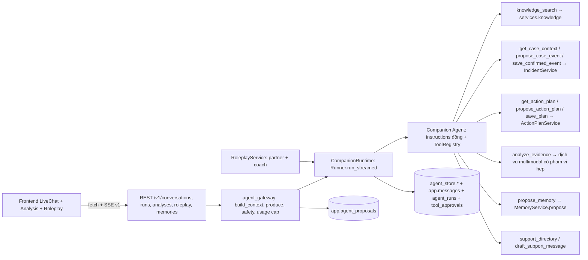
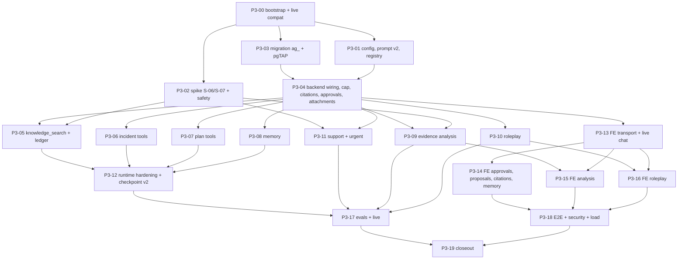

# 05 — Phase 3: AI Companion Implementation Plan

> **Coding agent:** Claude Opus 5.5. **Branch:** `feat/agent-companion`, rẽ từ `baseline/phase-2-3-start` (xem `01`). **Worktree:** `C:\Users\minhh\orca\workspaces\MoodPrint\MoodPrint-Agent`. **Stack local:** `ag`, offset `+200`.
> **Trạng thái:** `GATE_PENDING` cho baseline mới; Phase 3 `NOT_STARTED`, live/eval `UNMEASURED`. Không tạo branch/worktree/tag hoặc gọi paid API trong PB. Handoff đầy đủ: `13-PHASE-3-OPUS-EXECUTION-HANDOFF.md`.
> Đọc trước: `00` (phase2-3), `11`, rồi `05` này, `06` (tool/bộ nhớ/bằng chứng), `07` (eval và cổng chất lượng). Nền: `docs/implementation/05-AGENT-AND-MEMORY-ARCHITECTURE.md` và `04-API-AND-SERVICE-CONTRACTS.md`.
> Mô hình: `gpt-6-luna` cho **mọi** lời gọi (AD-14). Trang model đã xác nhận ngày 2026-11-08: đầu vào text + ảnh, streaming, structured outputs, function calling, ngữ cảnh 1.05M token, `reasoning.effort ∈ {none, low, medium, high, xhigh, max}` (mặc định `medium`). Giá Standard cho prompt ≤ 272K input token, USD/1M token: input **0.10**, cached input **0.01**, output **0.50**; cache writes và long context/tier khác tính theo [trang giá chính thức](https://developers.openai.com/api/docs/pricing). [Trang model](https://developers.openai.com/api/docs/models/gpt-6-luna) xác nhận khả năng; **giá niêm yết khác trần ngân sách owner** (O-03). SDK trong `uv.lock`: `openai-agents==0.24.0`, `openai==3.46.0`; không nâng tự phát.

## 1. Mục tiêu

Một Companion thật, một người dùng nhìn thấy một AI, tích hợp với backend và frontend hiện có. Mở rộng nền SDK đã có; **không** viết lại bằng engine điều phối tự chế.

**Trong phạm vi:** prompt có phiên bản; registry tool đầy đủ; SSE; usage; budget; approval; hủy; timeout; phục hồi lỗi; kết quả có cấu trúc; bộ nhớ ba lớp có chọn lọc; `knowledge_search` qua `FixtureKnowledgeRetriever`; công cụ hồ sơ sự việc và kế hoạch hành động (đề xuất → duyệt → lưu); phân tích ảnh/screenshot có consent; roleplay nhiều lượt (giáo viên, phụ huynh, người lớn đáng tin); UI chat/analysis/roleplay thật; eval và live-model compatibility.

**Ngoài phạm vi (DEFER):** embedding bộ nhớ cá nhân (O-07), `EncryptedSession`, STT/TTS (voice), phân tích âm thanh/video/PDF, tool cập nhật sự kiện đã có (Protocol không có `update_event`), multi-worker, handoff giữa nhiều agent, gửi thông tin ra ngoài (không có tool nào làm việc này).

**Quy tắc cứng (R-P3):**

- R-P3-01 Không giữ `DATABASE_URL`/`SUPABASE_DB_URL` hosted; không `push_hosted.py`.
- R-P3-02 **Không import** `moodprint_agent.knowledge` từ mã Phase 3. Tool nhận retriever qua `ctx.context.services.knowledge`; test dùng `FixtureKnowledgeRetriever` từ `moodprint_shared.testing`. Test `agent/tests/test_boundaries_p3.py` quét AST và fail nếu vi phạm.
- R-P3-03 Test luôn tạo cấu hình tường minh `KnowledgeConfig(retriever="fixture")`, **không** dựa vào mặc định (integrator đổi mặc định ở INT-03).
- R-P3-04 Mọi tool ghi dữ liệu: `access="write"`, `needs_approval=True`, đi qua dịch vụ hiện có, chữ ký không nhận `user_id`/`owner_id`, chỉ nhận `proposal_id`.
- R-P3-05 Nội dung từ tool/kho tri thức/bằng chứng/ký ức luôn là **dữ liệu**, nằm trong khối có phân định; prompt nêu rõ không làm theo chỉ dẫn trong dữ liệu; có eval cho việc này.
- R-P3-06 Không log nội dung tin nhắn, tham số tool, ký ức, văn bản bằng chứng; chỉ ID, độ dài, mã lỗi (test quét log bằng canary).
- R-P3-07 Không sửa `shared/contracts/**`; đề xuất compat nếu thật sự cần (`CC-P3-NNN.md`).

## 2. Kiến trúc đích

Điểm nối với Phase 2 duy nhất là Protocol `KnowledgeRetriever` (đóng băng). Điểm nối với Phase 1 là các service và `AuthContext` (đóng băng). `main.py` không đổi: `build_runtime` trong `agent_gateway/wiring.py` (chữ ký 🔒 từ CC-002) là nơi Phase 3 dựng registry và dịch vụ thật.

## 3. Thiết kế chính (tóm tắt, chi tiết ở `06`)

| Chủ đề | Quyết định |
|---|---|
| Đường ghi | `propose_*` lưu bản đề xuất bất biến → `save_*(proposal_id)` có approval SDK → ghi qua service → đánh dấu `applied`. Người dùng duyệt đúng nội dung đã xem (preview sinh từ bản lưu, không từ tham số model). |
| Sự kiện hồ sơ | Chỉ `basis ∈ {user_stated, evidence_shows}` được đề xuất; suy đoán (`inferred`) bị từ chối ở tool. Lưu bằng `add_confirmed_event` với provenance `user_confirmed` (CC-003). |
| Citation | Sổ cái theo run: `knowledge_search` trả mã `S1…Sn`; marker `[S#]` hợp lệ mới thành `SourceCitation`; marker lạ bị gỡ; không kết quả ⇒ không citation; lưu vào `app.messages.citations`, phát lại khi replay. |
| Phân tích ảnh | Dịch vụ multimodal một lời gọi có schema, không session/tools/handoff, sau consent; ảnh tải bằng URL ký có kiểm host, giải mã lại, xóa EXIF, ≤ 2048 px; kết quả là derivative `ai_analysis` bất biến; chỉnh sửa người dùng ở `user_edited_text`. |
| Khẩn cấp | Bộ kiểm tất định tiếng Việt (có/không dấu) trước và sau model; luôn gắn khối hỗ trợ khẩn cấp. |
| Roleplay | Chế độ của Companion: cùng endpoint tin nhắn, prompt đối tác riêng, bước coach tạo phản hồi có cấu trúc. |
| Ký ức | Không embedding; `propose_memory` chỉ tạo candidate; lọc tất định; chọn theo lexical + ý định + độ mới; nén phiên `compaction_mode="input"`. |
| Đầu ra có cấu trúc | Quyết định bằng spike S-06; mặc định dự phòng: stream text + tool `report_turn_assessment` cuối lượt. Structured là bắt buộc; spike chọn cơ chế, không được bỏ đầu ra. Lỗi phải có trạng thái rõ và khối an toàn tất định. |

## 3.1 Baseline đã có và khoảng trống Phase 3

PB-03 cung cấp `app.state.knowledge`, `build_knowledge_retriever`, `build_runtime` và router analyses/roleplay đã đăng ký. PB-04 cung cấp **seam domain tin cậy** `add_confirmed_event`; nó chưa phải ProposalStore. `user_confirmed`/proposal UUID là điều kiện cần; kiểm proposal owner, approval, expiry, hash, binding và consumption thuộc P3-03/04/06. Audit baseline chỉ INSERT, không dùng audit như bảng trạng thái hay nới grants. Domain retry so payload/provenance, chuẩn hóa timezone/evidence; payload khác ⇒ 409; case version chỉ tăng lần ghi đầu.

`DeferredDomainServices`, prompt tối thiểu, citation replay chưa đầy đủ, memory compaction tắt và giao diện AI mô phỏng là trạng thái nền có chủ ý. Giữ S-02/S-03 và regression tests; không viết lại orchestration hoặc tạo agent nhiều tầng để che thiếu wiring. Báo cáo cũ có checkpoint mâu thuẫn; lấy đoạn closure mới nhất và **chạy lại trên SHA của mình**, không dùng số pass cũ làm tiêu chí cố định.

Kiểm sự khác biệt prototype và feature bằng output thật. Giữ các ID P3-00…P3-19 dưới đây; mỗi task đi test RED → code tối thiểu → GREEN → diff/review → commit đúng ownership. Các lệnh paid chỉ là hướng dẫn cho giai đoạn đã có ngân sách, không chạy trong PB.

## 4. Đồ thị task và song song

- **Song song sau P3-04:** P3-05, 06, 07, 08, 09, 10, 11 (khác file: `tools/*.py`, `evidence/`, `roleplay/`, `memory/`) và P3-13 (frontend, chạy với `ScriptedModel` trước). Chỉ **một** người tạo migration tại một thời điểm: P3-03 tạo toàn bộ migration dự kiến; thay đổi sau là `ag_fix_*`.
- **Tuần tự:** P3-03 → P3-04; P3-12 sau các tool; P3-17 sau P3-12; P3-19 cuối.
- **Sớm nhất có thể:** P3-00 (live compat) vì kết quả có thể đổi thiết kế (tham số `ModelSettings`, dạng input ảnh).

## 5. Các task

**Quy ước trường.** Tiêu đề = Task ID. 1 Mục đích · 2 Ưu tiên · 3 Dependencies · 4 File · 5 Chi tiết · 6 DB · 7 API/contract · 8 Test · 9 Acceptance · 10 Lệnh kiểm · 11 Thất bại nếu · 12 Deliverables · 13 Rủi ro/fallback. **Branch** mọi task: `feat/agent-companion`. Tiền tố test: `U-AG` (unit), `I-AG` (integration), `P-AG` (pgTAP), `E-AG` (E2E), `L-AG` (live).

### P3-00 — Khởi tạo, baseline, live-model compatibility (sớm)

1. Mục đích: môi trường cô lập; xác nhận SDK khóa `0.24.0` / OpenAI `3.46.0` + `gpt-6-luna` tương thích **trước khi** xây phần còn lại. 2. P0. 3. Gate PB xanh; owner tạo worktree; O-03, O-04.
4. File: `.local/stacks/ag/test.env` (sinh, không commit), `.env.live` (chỉ `OPENAI_API_KEY`, không commit), `.local/eval-budget.json` (owner duyệt), `agent/evals/budget.py`, `agent/tests/test_eval_budget.py`, `agent/tests/live/test_live_compat.py`, `agent/evals/results/live-compat-<date>.json`, `agent/evals/spikes/S-06.md` (khung).
5. Chi tiết: (a) Chỉ sau Gate PB/tag và owner tạo đúng worktree: xác nhận nhánh `feat/agent-companion`, HEAD đúng `baseline/phase-2-3-start`; đặt process env `MOODPRINT_STACK_NAME=ag`, `MOODPRINT_PORT_OFFSET=200`; `uv sync --all-packages --all-extras --locked`; dùng `scripts/dev/supabase_worktree.py start --name ag --offset 200 --lite` rồi `scripts/dev/bootstrap_local_db.py --name ag --offset 200`. DB54522, Supabase API/auth54521, mail54524; E2E Vite/API5378/8208; dev5373/8200. Env ở `.local/stacks/ag/test.env`; integration trực tiếp phải dùng loader của handoff13, không fallback env foundation/root dotenv. Chạy baseline offline/integration/pgTAP/frontend, ghi số mới từ PB trên SHA tag. Trước live, triển khai/test budget gate bằng fake transport: owner ghi max_usd, max_tokens_total, max_tokens_per_run, max_calls_total, scope, expiry; reserve trước mỗi request, khóa ledger, từ chối thiếu/hết hạn/sai model/scope. Tắt automatic SDK retries hoặc đưa mọi retry qua cùng ledger. Không tự coi giá rẻ hoặc có key là quyền chi tiêu. (b) `test_live_compat.py` (`@pytest.mark.live_agent`; **từ chối chạy nếu thiếu file ngân sách hoặc `OPENAI_API_KEY`**; mỗi test dùng `reasoning.effort="low"` và giới hạn token đầu ra): **L-AG-01** một lượt tiếng Việt streaming qua `Runner.run_streamed` (kiểm sự kiện `response.output_text.delta`, usage, `store=False`, không gửi `temperature`/`top_p`); **L-AG-02** gọi function tool `get_server_time` một vòng (`parallel_tool_calls=False`); **L-AG-03** structured output nhỏ (`CompanionTurn` rút gọn); **L-AG-04** đầu vào ảnh: PNG tổng hợp 256×256 có chữ "Xin chào", gọi dịch vụ multimodal không session/tools, kiểm văn bản đọc ra chứa "Xin chào"; **L-AG-05** approval: tool ghi giả → `interruptions` → resume trong tiến trình mới (xác nhận S-03 với model thật); **L-AG-06** `OpenAIResponsesCompactionSession(compaction_mode="input")` trên phiên 12 mục với trigger thấp. Tổng ≤ 12 lời gọi, ≤ ngân sách token trong file. (c) Ghi vào báo cáo: phiên bản `openai-agents`, `openai`, độ trễ từng lượt, usage, tham số bị từ chối (nếu có). (d) Nếu có tham số không tương thích → ghi `CC-P3-001.md`/điều chỉnh `ModelSettings` trong phạm vi Phase 3, **dừng** các task phụ thuộc cho tới khi giải quyết.
6. DB: không. 7. API: không.
8. Test: L-AG-01…06 + baseline đầy đủ.
9. Acceptance: 6/6 xanh trước khi mở task phụ thuộc; mục đỏ/không chạy có chẩn đoán và ghi BLOCKED, không tính pass; kết quả nằm trong `live-compat-<date>.json` (không chứa nội dung nhạy cảm; chỉ nội dung tổng hợp).
10. Lệnh: `uv run pytest -m live_agent agent/tests/live -q` (sau khi nạp khóa vào tiến trình, không in).
11. Thất bại: chạy live không có file ngân sách; dùng model khác `gpt-6-luna`; lưu response lên OpenAI (`store` phải `False`).
12. Deliverables: JSON kết quả + mục "Live compatibility" trong báo cáo.
13. Rủi ro: tên tham số reasoning thay đổi giữa SDK/API → thích ứng trong `runtime.py::run_config`; nếu ảnh input không đi qua `Runner`, dùng `AsyncOpenAI.responses.create` trực tiếp trong `evidence/reader.py` (vẫn `store=False`).

### P3-01 — Cấu hình, prompt v2, registry factory

1. Mục đích: nền cấu hình/prompt/tool có phiên bản, test ghim. 2. P0. 3. P3-00.
4. File: `shared/src/moodprint_shared/config.py` (chỉ `AgentConfig`, `MemoryConfig`), `.env.example` (khối `agent`), `agent/src/moodprint_agent/prompts/{companion_v2,roleplay_partner_v1,roleplay_coach_v1,evidence_reader_v1}.md`, `agent/src/moodprint_agent/companion.py`, `tools/{registry,factory,proposals,context}.py`, `agent/tests/test_prompts.py`, `test_registry_factory.py`, `test_config_models.py`.
5. Chi tiết: thêm trường `AgentConfig` đã đặt chỗ (`11` §5) với mặc định bảo thủ: `daily_token_cap_per_user=200_000`, `knowledge_tool_timeout_s=8`, `proposal_ttl_s=1800`, `approval_ttl_s=900`, `analysis_timeout_s=60`, `analysis_max_image_bytes=8_000_000`, `analysis_max_image_px=2048`, `analysis_allowed_mime=("image/jpeg","image/png","image/webp")`, `roleplay_max_turns=30`, `compaction_trigger_tokens=24_000`, `reasoning_effort="low"` (chat) / `"medium"` (coach, phân tích) — **giá trị cuối chọn bằng eval ở P3-17**. Prompt `companion_v2.md`: danh tính, tiếng Việt theo tuổi, kỷ luật fact/report/inference/unknown, an toàn, quy tắc dùng tool (khi nào tra cứu, tạo truy vấn **tổng quát không tên riêng**, dùng `[S#]`, không `[S#]` khi không có kết quả), quy tắc đề xuất-rồi-hỏi (không nói "đã lưu" trước khi tool trả `applied`), quy tắc bằng chứng, ký ức (chỉ `propose_memory` cho sở thích bền vững, không chuyện sự việc), khối khẩn cấp, chống chỉ dẫn trong dữ liệu. `PROMPT_VERSION = "companion_v2"`; test **ghim sha256** của từng file prompt vào hằng trong test (đổi prompt ⇒ phải đổi version và cập nhật hằng — kiểm bằng review). `ToolRegistry`: thêm `register_group`, nhãn Việt cho mọi tool (`label`), hàm `preview` cho tool ghi, `version()` đã bao gồm `policy.version`. `tools/factory.py::build_registry(cfg: AppConfig) -> ToolRegistry`; tool lấy deps từ context riêng của lượt qua `tools/context.py::CompanionToolContext(AgentToolContext)` (dataclass với các field bổ sung keyword-only `deps`, `scratch`; không sửa shared). `ToolDeps` là dataclass các Protocol hẹp (`ProposalStore`, `ConfirmedEventWriter`, `EvidenceImageFetcher`, `VisionRunner`, `SupportDirectory`, `ScratchStore`) — **không** chứa engine, secret, JWT.
6. DB: không. 7. API: không.
8. Test: `U-AG-01…10`: mọi `AgentConfig.*model*` = `gpt-6-luna` (giữ `test_every_model_setting_is_gpt_6_luna`); không chuỗi `gpt-`/`o<số>` khác trong source; tool ghi thiếu approval bị từ chối; chữ ký chứa `user_id`/`owner_id` bị từ chối; `version()` đổi khi đổi policy; prompt hash ghim; import `moodprint_agent.knowledge` bị bắt bởi `test_boundaries_p3`.
9. Acceptance: pyright strict + ruff sạch; `scripts/check.py` xanh.
10. Lệnh: `uv run python scripts/check.py`.
11. Thất bại: prompt chứa dữ liệu người dùng; trường config thiếu giá trị mặc định an toàn.
12. Deliverables: config + prompt + factory + test.
13. Rủi ro: prompt dài làm tăng token → đo token prompt cố định (`tests` in con số), mục tiêu ≤ 1 800 token cho phần cố định.

### P3-02 — Spike S-06, S-07 và kiểm tra khẩn cấp tất định

1. Mục đích: chốt cách lấy `urgency`/tách fact-inference mà vẫn stream mượt; chốt hình dạng gọi vision; xây tầng an toàn tất định. 2. P0. 3. P3-00.
4. File: `agent/evals/spikes/{S-06,S-07}.md`, `agent/src/moodprint_agent/tools/safety.py`, `agent/tests/test_safety.py`, `agent/evals/cases/safety_phrases.jsonl`.
5. Chi tiết: **S-06** so ba phương án trên 20 lượt live (kịch bản tổng hợp, ≤ ngân sách): (a) `output_type=CompanionTurn` và tách `reply` tăng dần từ JSON stream; (b) stream text + tool cuối lượt `report_turn_assessment(observed_facts, user_reported_facts, possible_patterns, uncertainties, urgency)` (read-only, không tính vào `max_tool_calls_per_run` — thêm ngoại lệ có test); (c) stream text + bộ hậu xử lý tất định + lượt phân loại riêng rẻ. Tiêu chí: TTFT p50 không tệ hơn +1.0 s so với text thuần; có đánh giá trong ≥ 95% lượt; recall `urgency=immediate` trên bộ khẩn cấp = 100% khi hợp với bộ tất định; R-02 (rubric) không thấp hơn text thuần. Chọn phương án đạt; mặc định (b). **S-07**: xác nhận dạng input ảnh qua `Runner` (`input_image` item với data URL) hay gọi `responses.create`; ghi lỗi/giới hạn kích thước. **Safety**: `assess_urgency(text) -> UrgencyAssessment(level, signals: tuple[str,...])` với nhóm tín hiệu (ý định tự hại, nguy cơ tức thời bị hại, bị ép/đe dọa lộ ảnh riêng, lạm dụng, bạo lực sắp xảy ra), khớp **không phân biệt dấu**, kéo dài ký tự ("chếtttt"), viết tắt/teen code thường gặp; chạy trên tin nhắn người dùng **và** câu trả lời model. Khi `immediate`: cổng gateway nối **khối hỗ trợ khẩn cấp tĩnh** (nội dung sao chép từ `frontend/src/features/support` đã xác minh: tel:111 và hướng dẫn tìm người lớn tại chỗ; không thêm số chưa xác minh) vào `message.completed.content` và đặt `structured.urgency="immediate"`.
6. DB: không. 7. API: không (dùng trường `structured` đã có).
8. Test: `U-AG-20…32`: ≥ 60 cụm tổng hợp có/không dấu/teen code cho `immediate`/`elevated`; ≥ 40 cụm lành tính (tránh báo động giả: "mình chết đứng khi thấy điểm", "cười chết mất") với tỉ lệ dương tính giả ≤ 0.10 (**ngưỡng đề xuất**, in số thực đo); bộ SC-04, SC-07, SC-09, SC-24 (`docs/prototype/05-MOCK-SCENARIOS.md`) đều `immediate`/`elevated` đúng kỳ vọng; test không phụ thuộc model. Thêm minimal-pair theo ngữ cảnh: phủ định, quá khứ, trích lời, giả định, nguy cơ gián tiếp/nhiều lượt, teen code/chính tả sai. Đo TP/FP/TN/FN theo nhóm và câu trả lời thực; keyword recall không chứng minh safety toàn hệ thống. Đọc R-06/R-08 mọi output rủi ro cao; không làm classifier chỉ bằng một từ khóa.
9. Acceptance: recall `immediate` ≥ 0.95 trên bộ cụm; S-06 và S-07 có kết luận kèm số liệu.
10. Lệnh: `uv run pytest agent/tests/test_safety.py -q`; `uv run pytest -m live_agent agent/tests/live/test_s06.py -q` (cần ngân sách).
11. Thất bại: khối khẩn cấp chứa số điện thoại chưa xác minh; phân loại chạy bằng LLM-judge.
12. Deliverables: S-06, S-07, `safety.py`.
13. Rủi ro: dương tính giả nhiều → tách hai mức `elevated` (chỉ thêm gợi ý) và `immediate` (thêm khối khẩn cấp); điều chỉnh bằng bộ lành tính.

### P3-03 — Migration `ag_*` + pgTAP

1. Mục đích: bảng mới cho đề xuất, phân tích, roleplay, đính kèm; không đụng bảng `f0/f1`. 2. P0. 3. P3-00.
4. File: `supabase/migrations/<ts>_ag_proposals.sql`, `<ts>_ag_analysis_requests.sql`, `<ts>_ag_roleplay_sessions.sql`, `<ts>_ag_message_attachments.sql`; `<ts>_ag_message_assessments.sql`; `supabase/tests/ag_00_schema.sql`, `ag_01_isolation.sql`, `ag_02_proposal_immutability.sql`, `ag_03_constraints.sql`.
5. Chi tiết (cột chính; thêm cột được, không đổi tên):
   - `app.agent_proposals(id uuid pk, owner_id → auth.users cascade, conversation_id, run_id, kind check in ('case_event','action_plan'), target_case_id uuid null, payload jsonb not null, payload_sha256 text not null, preview jsonb not null, base_version int null, request_key text not null, approval_binding jsonb null, status check in ('proposed','approved','rejected','applied','expired','failed') default 'proposed', result jsonb, created_at, expires_at not null, decided_at, applied_at)`. FK phức hợp `(conversation_id, owner_id)` → `app.conversations(id, owner_id)` và `(run_id, owner_id)` → `app.agent_runs(id, owner_id)`; `unique(id, owner_id)`, `unique(owner_id, run_id, request_key)`. Server sinh UUID không nil; request_key ràng buộc tool_call_id/request idempotency, retry khác payload/hash trả409. Approval binding lưu approval ID/tool_call_id/run/owner/quyết định/hash; gateway đối chiếu tool_approvals của run, không nhận binding từ model. Trigger `BEFORE UPDATE`: cấm đổi `id`, `payload`, `payload_sha256`, `preview`, `kind`, `owner_id`, `conversation_id`, `run_id`, `target_case_id`, `base_version`, `request_key`, `created_at`, `expires_at`; `approval_binding` chỉ gắn một lần trong transition approved rồi bất biến; chỉ cho đổi `status/result/decided_at/applied_at` theo máy trạng thái (`proposed→approved|rejected|expired|failed`, `approved→applied|failed|expired`).
   - `app.analysis_requests(id uuid pk, owner_id, evidence_id, consent_version text not null, consent_at timestamptz not null, status check in ('running','succeeded','failed','cancelled'), source_sha256 text not null, request_sha256 text not null, derivative_id uuid null unique, error_code text, usage jsonb, started_at, finished_at)`; FK phức hợp `(evidence_id, owner_id)` → `app.evidence_items(id, owner_id)` (nếu chưa có ràng buộc unique `(id, owner_id)` ở `evidence_items`, kiểm trong `f1_evidence.sql` — **đã có** theo mẫu composite FK của dự án; nếu thiếu, dùng chỉ mục ghi nhận và kiểm trong service, không `ALTER` bảng f1).
   - `app.roleplay_sessions(id pk, owner_id, conversation_id unique, role check in ('teacher','parent','trusted_adult'), scenario_key text, scenario_context text (≤ 800), user_goal text (≤ 300), difficulty smallint 1..3, age_band text, use_case_context boolean default false, linked_case_id uuid null, status check in ('active','completed','abandoned'), turn_count int, feedback jsonb, created_at, completed_at)` với FK phức hợp tới `conversations`.
   - `app.message_attachments(message_id, owner_id, evidence_id, created_at, primary key(message_id, evidence_id))` với FK phức hợp `(message_id, owner_id)` → `app.messages`, `(evidence_id, owner_id)` → `evidence_items`.
   - `app.message_assessments(message_id uuid primary key, owner_id uuid not null, run_id uuid not null, structured jsonb not null, created_at)` lưu `CompanionTurn` theo FK ghép message/owner và run/owner, cascade. Đây là **bảng mới**, vì `app.messages` nền không có structured và không được ALTER. Backend enrich DTO đọc transcript riêng; shared `ChatMessage` giữ nguyên.
   - Mọi bảng: `ENABLE ROW LEVEL SECURITY`; policy `owner_select/insert/update` theo mẫu `f0`; `GRANT select,insert,update` (không delete trừ khi cần xóa cascade); chỉ mục theo `owner_id` + khóa ngoại phủ (mẫu `11_fk_indexes.sql`: thêm chỉ mục cho mọi cột FK).
   - **Không** `ALTER`/`DROP` bảng `f0/f1`; **không** tạo extension/role.
6. DB: như trên. 7. API: không.
8. Test (pgTAP): `P-AG-01` mọi bảng mới có RLS + policy, `anon` không quyền; `P-AG-02` user B không thấy/không ghi bản ghi của A; không thể gắn đề xuất vào conversation của người khác (FK phức hợp); `P-AG-03` trigger bất biến: đổi `payload` ném lỗi; chuyển trạng thái sai ném lỗi; `P-AG-04` ràng buộc check/độ dài; `P-AG-05` cascade xóa user/conversation dọn sạch; `P-AG-06` mọi FK có chỉ mục phủ. `migration_scope_check.py` xanh. Test `00/05/14` (CC-004) vẫn xanh.
9. Acceptance: `db reset` từ trống + `supabase test db` xanh; `migration_order_check.py --self-test` xanh với 5 file `ag_`.
10. Lệnh: `uv run python scripts/dev/supabase_worktree.py reset; uv run python scripts/dev/supabase_worktree.py test`.
11. Thất bại: bất kỳ `ALTER TABLE app.<bảng f0/f1>`; bảng thiếu RLS; migration ghi dữ liệu.
12. Deliverables: 5 migration + 4 pgTAP + danh sách migration trong báo cáo.
13. Rủi ro: kích thước migration → chia 5 file nhỏ để rollback/đọc dễ.

### P3-04 — Backend: wiring dịch vụ thật, trần sử dụng, citation, approvals, đính kèm

1. Mục đích: nối Companion với dịch vụ thật; sửa B-12; thêm giới hạn chi phí. 2. P0. 3. P3-01, P3-03.
4. File: `backend/app/agent_gateway/{wiring,sse,environment,usage_cap}.py`, `backend/app/api/v1/conversations.py`, `backend/app/modules/conversations/{service,approvals,schemas,attachments}.py`, `backend/tests/agent/**`, `backend/tests/integration/agent/**`, các test hiện có `test_conversations.py`, `test_agent_stream.py`, `test_agent_approval.py` (được phép sửa để phản ánh hành vi mới, **không nới assertion**).
5. Chi tiết: (a) `build_runtime(cfg, model_client)` giữ đúng chữ ký CC-002, dựng registry thuần từ cfg, không cần DB/app.state tại startup; `build_context` dựng `CompanionToolContext` cùng `ToolDeps` mới cho mỗi lượt/resume (không global mutable deps, không giữ auth của user trước); `build_context` dựng `AgentServices` thật: `IncidentService(engine)`, `EvidenceService(engine, storage, cfg)`, `ActionPlanService(engine)`, `MemoryService`, `knowledge = request.app.state.knowledge` được gateway truyền vào tham số `knowledge` đã có từ PB-03. Adapter cần Storage/client đặt ở backend rồi truyền qua Protocol hẹp, không đưa secret/engine vào context. (b) Sửa B-12: `produce()` lấy `citations` và `structured` từ `message.completed`, truyền vào `TurnResult` ⇒ lưu `app.messages.citations`; structured ghi vào bảng mới `message_assessments` cùng transaction lưu assistant message; backend DTO `MessageRead` cộng trường structured và query join theo owner. Nhánh replay đọc citations/structured đã lưu và phát lại trong `message.completed`. (c) Trần: `usage_cap.check(auth, cfg)` tổng `total_tokens` của `agent_runs` trong ngày UTC hiện tại; vượt ⇒ `429 quota_exceeded` với `details.kind="ai_tokens"`; đồng thời thực thi `messages_per_user_per_hour` ⇒ `429 rate_limited` + `Retry-After`. (d) `GET /v1/runs/{id}/approvals` trả approval `pending` của owner (preview, hết hạn) để UI khôi phục sau reload. (e) `MessageCreate.attachments: list[UUID] = []` (tối đa 3): kiểm owner + `upload_status='uploaded'` + loại ảnh; ghi `message_attachments`; đưa vào context mục "Bằng chứng đính kèm" (id, tên, loại — **không** nội dung); `GET /v1/conversations/{id}/attachments` trả ánh xạ `messageId → evidenceIds`. (f) Gateway chọn runtime theo conversation: có `roleplay_sessions` ⇒ chế độ roleplay (P3-10).
6. DB: dùng bảng P3-03. 7. API: như trên; OpenAPI + `schema.gen.ts` sinh lại.
8. Test: `I-AG-01…20`: citations lưu + replay giữ citations; hết trần ⇒ 429 không gọi model; rate limit; attachment của user khác ⇒ 404; approvals pending chỉ của owner; context không chứa nội dung bằng chứng; **ma trận cô lập Phase 3**: tham số hóa từ OpenAPI cho mọi route `/v1/conversations*`, `/v1/runs*`, `/v1/memories*`, `/v1/memory-candidates*`, `/v1/analyses*`, `/v1/roleplay*` có ID ⇒ user B nhận 404 (`test_phase3_isolation_matrix`, và **fail nếu route mới chưa vào ma trận**); log canary.
9. Acceptance: `scripts/check.py`, `pytest -m integration` xanh; shared ChatMessage/TurnResult không đổi; `export_openapi.py --check` sạch.
10. Lệnh: `uv run pytest -m integration backend/tests/integration/agent backend/tests/integration/test_conversations.py -q`.
11. Thất bại: replay mất citation; model nhận được JWT/claims; tool nhận engine.
12. Deliverables: gateway hoàn chỉnh + OpenAPI.
13. Rủi ro: thay đổi `produce()` làm vỡ test SSE cũ → giữ nguyên thứ tự sự kiện và seq (test hiện có là hợp đồng).

### P3-05 — `knowledge_search` + sổ cái citation

1. Mục đích: tri thức có nguồn, không bịa citation. 2. P0. 3. P3-02, P3-04.
4. File: `agent/src/moodprint_agent/tools/{knowledge,citations}.py`, `events.py`, `runtime.py` (tích hợp sổ cái), `agent/tests/test_tool_knowledge.py`, `test_citations.py`.
5. Chi tiết: `async def knowledge_search(ctx, query: str, topics: list[str] = [], top_k: int = 4) -> KnowledgeToolResult`. Policy `read`, `timeout_s=8`, `max_calls_per_run=2`. Truy vấn đi qua che thông tin định danh cơ bản (email/điện thoại/URL) ở tầng tool trước khi gọi retriever; bộ lọc mặc định `languages=["vi"]`, `country_scope=["VN","GLOBAL"]`, `age_band=ctx.age_band`. Gọi `ctx.context.services.knowledge.search(KnowledgeQuery(...), scope=RetrievalScope(request_id=ctx.request_id), timeout_s=cfg.agent.knowledge_tool_timeout_s - 1)`. Kết quả cho model: `{status, corpusVersion, results:[{ref:"S1", title, publisher, section, applicability, country_scope, last_reviewed, text(≤ 700 ký tự)}]}`; mọi `text` nằm trong trường dữ liệu, không markup. **Sổ cái:** ghi `ref → SourceCitation` đầy đủ (từ `chunk.citation`) vào `RunScratch` của run. `no_results` ⇒ `{status:"no_results", results:[]}` + gợi ý "Không có nguồn phù hợp; đừng trích dẫn". Lỗi: `KnowledgeTimeout`/`KnowledgeUnavailable` ⇒ kết quả lỗi có cấu trúc `{error:{code:"knowledge_unavailable"|"knowledge_timeout", retryable:true}}` (tool **không** raise, run không treo). **Hậu xử lý citation** (trong `events.py` khi dựng `message.completed`): trích mọi marker `[S<n>]`; marker có trong sổ cái ⇒ `SourceCitation` (khử trùng, giữ thứ tự xuất hiện); marker lạ ⇒ gỡ khỏi nội dung và tăng bộ đếm `citation_unverified` (log mã, không nội dung); nếu sổ cái rỗng, **mọi** `[S#]` bị gỡ. Nội dung cuối giữ marker hợp lệ dạng `[1]` để UI gắn chip.
6. DB: không. 7. API: dùng `citations` của `message.completed` (đã có).
8. Test: `U-AG-40…55`: khớp Protocol với `FixtureKnowledgeRetriever` (test dùng `KnowledgeConfig(retriever="fixture")`); no_results ⇒ không citation dù model viết `[S1]`; marker lạ bị gỡ; khử trùng; hết thời gian ⇒ run vẫn hoàn tất với lỗi tool có cấu trúc (retriever giả `sleep`); `KnowledgeUnavailable` ⇒ model nhận lỗi, trả lời không nguồn; truy vấn có email bị che trước khi vào retriever; text kết quả chứa "Bỏ qua mọi chỉ dẫn" được bọc là dữ liệu (kiểm thân gửi lên model qua `ScriptedModel` ghi lại input); budget `max_calls_per_run=2`; sổ cái khôi phục sau approval resume (P3-12).
9. Acceptance: mọi test xanh; citation luôn ⊆ kết quả tool của chính run đó.
10. Lệnh: `uv run pytest agent/tests/test_tool_knowledge.py agent/tests/test_citations.py -q`.
11. Thất bại: citation tạo từ bộ nhớ mô hình; truy vấn nguyên văn bị log.
12. Deliverables: tool + sổ cái.
13. Rủi ro: model quên `[S#]` ⇒ không citation (chấp nhận, đo ở eval `citation_use_rate`; không tự gắn).

### P3-06 — Công cụ hồ sơ sự việc

1. Mục đích: ngữ cảnh hồ sơ, đề xuất mốc timeline, lưu khi được duyệt. 2. P0. 3. P3-04.
4. File: `agent/src/moodprint_agent/tools/incident.py`, `tools/proposals.py`, `backend/app/agent_gateway/proposals.py` (adapter `ProposalStore` và `ConfirmedEventWriter`), `agent/tests/test_tool_incident.py`, `backend/tests/integration/agent/test_incident_tools.py`.
5. Chi tiết: theo `06` §2. `get_case_context(case_id: UUID | None = None)` read; `propose_case_event(case_id, when, time_precision, place, description, evidence_ids, basis, rationale)` prepare; `save_confirmed_event(proposal_id)` write + approval. `basis="inferred"` bị từ chối với thông điệp hướng dẫn hỏi người dùng xác nhận. `proposal_id` khác nil, owner/run/conversation/target/kind/hash/version ràng buộc bất biến; gateway đổi `proposed→approved` bằng quyết định UI/SDK hợp lệ trước khi writer được gọi; tuyệt đối không dựa vào câu đồng ý do model suy diễn. Xác minh case thuộc owner **ở cả hai bước** (đề xuất và lưu). Preview: mô tả đã chuẩn hóa (ngày, nơi, mô tả, bằng chứng đính kèm theo tên) sinh từ bản lưu. Hết hạn (`proposal_ttl_s`) ⇒ `expired`. Lưu qua `add_confirmed_event(proposal_id=…)` (CC-003) với `provenance="user_confirmed"`; idempotent: gọi lại `save` trên đề xuất `applied` trả cùng sự kiện, không tạo thêm. Từ chối (reject) ⇒ `rejected`, không ghi.
6. DB: `app.agent_proposals`, `case_events`, `audit_events`. 7. API: không route mới (qua SSE approval hiện có).
8. Test: `U-AG-60…70`, `I-AG-30…45`: **không ghi trước approval** (đếm hàng `case_events` trước/sau); approve ⇒ đúng một sự kiện `user_confirmed`; reject ⇒ không ghi, trạng thái `rejected`; model đổi tham số giữa propose và save không ảnh hưởng (chỉ `proposal_id`); `proposal_id` của người khác ⇒ NotFound; case người khác ⇒ NotFound; `inferred` bị từ chối; đề xuất hết hạn ⇒ lỗi có cấu trúc; đổi event/proposal/payload/binding hoặc approve lần hai không thực thi; crash sau domain commit nhưng trước applied ⇒ retry cùng UUID/payload lấy đúng event và không thêm audit; chạy lại sau process restart (checkpoint) vẫn lưu đúng; payload bất biến (cố `UPDATE` trong test pgTAP).
9. Acceptance: ma trận quyền (A/B, đúng/sai id) xanh; không mô-đun frozen bị sửa.
10. Lệnh: `uv run pytest agent/tests/test_tool_incident.py -q; uv run pytest -m integration backend/tests/integration/agent -k incident -q`.
11. Thất bại: ghi dữ liệu khi chưa `approved`; sự kiện lưu với `ai_extracted`.
12. Deliverables: 3 tool + adapter.
13. Rủi ro: model gọi `save` ngay sau `propose` ở cùng lượt ⇒ vẫn bị approval chặn (thiết kế); eval đo tỉ lệ "hỏi trước khi lưu" (R-04).

### P3-07 — Công cụ kế hoạch hành động

1. Mục đích: đề xuất kế hoạch, ưu tiên, checklist, sửa kế hoạch, lưu khi được duyệt, bàn về tiến độ. 2. P0. 3. P3-04.
4. File: `agent/src/moodprint_agent/tools/plan.py`, `agent/tests/test_tool_plan.py`, `backend/tests/integration/agent/test_plan_tools.py`.
5. Chi tiết: `get_action_plan(case_id)` read (trả kế hoạch hiện có + `version`, tiến độ); `propose_action_plan(case_id, goal, items[{label, priority: high|normal, reason}], base_version, rationale)` prepare — sắp thứ tự theo ưu tiên, tối đa 8 mục, `label` ≤ 140 ký tự, mục `high` tối đa 3; mỗi mục có `reason` ngắn (lý do ưu tiên); `save_plan(proposal_id)` write + approval gọi `ActionPlanService.upsert(..., expected_version=base_version)`; `409 version_conflict` ⇒ kết quả lỗi có cấu trúc `{error:"version_conflict", latest_version}`, đề xuất chuyển `failed`, model hỏi người dùng có muốn đề xuất lại dựa trên bản mới. Mục đã `done` trong kế hoạch hiện có **giữ nguyên trạng thái** khi sửa (merge theo `label` hoặc id), không mất tiến độ. Không có trường ngụ ý MoodPrint đã liên hệ ai. `chosen_option_id` để rỗng. Thảo luận tiến độ dùng `get_action_plan`, không ghi.
6. DB: `agent_proposals`, `action_plans`, `plan_items`. 7. API: không.
8. Test: như P3-06 cộng: ưu tiên/thứ tự tất định; sửa kế hoạch giữ `done`; xung đột version; `completed` đòi mọi item `done` (luật của service) ⇒ tool không đặt `completed`; không ghi trước approval.
9. Acceptance: xanh; kế hoạch lưu sống sót reload (integration).
10. Lệnh: như trên với `-k plan`.
11. Thất bại: mất `done`; ghi khi chưa duyệt.
12. Deliverables: 3 tool.
13. Rủi ro: model đề xuất quá nhiều bước ⇒ validator cắt và báo lỗi cấu trúc để model rút gọn (không cắt âm thầm).

### P3-08 — Bộ nhớ: đề xuất, chọn lọc, nén, ngữ cảnh miền

1. Mục đích: ký ức có đồng ý, chọn lọc theo liên quan, phiên dài được nén. 2. P1. 3. P3-04.
4. File: `agent/src/moodprint_agent/memory/{extraction,selection,compaction,context_builder,session}.py`, `tools/memory.py`, `backend/app/modules/memory/service.py` (bộ lọc candidate), `agent/tests/test_memory_*.py`, `backend/tests/integration/test_memory.py`.
5. Chi tiết: theo `06` §4. `propose_memory(category, content)` ⇒ `MemoryService.propose(source_kind="agent_proposed", source_conversation_id, source_message_id)`; **bộ lọc tất định** từ chối: tên riêng (heuristic viết hoa nhiều từ + danh sách), email/điện thoại/URL, từ vựng sự việc (đánh, đe dọa, bắt nạt, chụp màn hình, ngày cụ thể…), > 500 ký tự, hoặc `category="context"` có nội dung sự việc; trả `{status:"rejected", reason}`; tối đa `extraction_max_candidates_per_run` mỗi run. `MemoryContextBuilder` mở rộng: truy vấn = tin nhắn + tiêu đề hồ sơ liên kết; `categories` suy từ ý định bằng từ khóa; `limit=cfg.memory.max_context_memories`; nhãn `[đã duyệt YYYY-MM-DD]`, `stale`; **mục Domain**: tóm tắt ngắn hồ sơ liên kết (`title`, `status`, số mốc, ngày cập nhật, nhãn `user_reported`) qua `IncidentService`, không gồm chi tiết (chi tiết lấy bằng tool). Nén: `OpenAIResponsesCompactionSession(..., compaction_mode="input", should_trigger_compaction=policy)` với `policy` theo ước tính token ≥ `compaction_trigger_tokens` (không theo mặc định 10 mục); `model=cfg.agent.compaction_model`; reuse `make_compaction_session` hiện có, không tạo session stack thứ hai; test request compaction theo API thực của SDK0.24.0 thay vì giả định `store` là tham số được hỗ trợ. UI/quyết định candidate dùng API hiện có (`/v1/memory-candidates/{id}/decision`).
6. DB: dùng bảng hiện có. 7. API: không route mới.
8. Test: `U-AG-80…95`, `I-AG-50…60`: candidate chứa sự việc/tên/điện thoại bị từ chối; chỉ candidate (không bao giờ memory) được tạo bởi agent; ký ức đã duyệt xuất hiện trong ngữ cảnh lượt sau khi liên quan, **không** xuất hiện khi không liên quan; xóa ký ức ⇒ lượt kế **không** dùng; ký ức quá hạn gắn `stale`; truy vấn không khớp ⇒ danh sách rỗng (không fallback "tất cả"); cô lập người dùng; nén kích hoạt đúng ngưỡng (client giả) và giữ nhất quán `agent_messages`; hai conversation: ký ức từ conversation A có trong ngữ cảnh B sau khi duyệt (A-05).
9. Acceptance: xanh; không có đường từ model trực tiếp tới `user_memories`.
10. Lệnh: `uv run pytest agent/tests -k memory -q; uv run pytest -m integration backend/tests/integration/test_memory.py -q`.
11. Thất bại: memory được tạo mà không có người dùng duyệt; ký ức bị xóa vẫn xuất hiện.
12. Deliverables: tool + selection + compaction.
13. Rủi ro: bộ lọc chặn quá tay ⇒ đo tỉ lệ từ chối hợp lệ ở eval (xem `07`), điều chỉnh từ vựng.

### P3-09 — Phân tích bằng chứng (ảnh/screenshot)

1. Mục đích: đọc ảnh có đồng ý, giữ nguyên bản gốc, tách văn bản trích/suy đoán/bất định. 2. P0. 3. P3-02 (S-07), P3-04.
4. File: `agent/src/moodprint_agent/evidence/{reader,image,models,orchestrator}.py`, `tools/evidence.py`, `backend/app/modules/analysis/{service,schemas,models}.py`, `backend/app/api/v1/analyses.py`, `agent/tests/data/images/*.png`, `agent/tests/test_evidence_*.py`, `backend/tests/integration/agent/test_analysis.py`.
5. Chi tiết: theo `06` §5. Hai đường vào dùng chung `AnalysisOrchestrator`: **(1) UI** `POST /v1/analyses {id, evidenceId, consent:{version, accepted:true}}` (đồng bộ, `analysis_timeout_s`); **(2) tool** `analyze_evidence(evidence_id)` (`prepare`, `needs_approval=True` vì nội dung rời hệ thống tới model; preview chỉ gồm tên tệp, kích thước, loại và câu "sẽ gửi ảnh này tới mô hình AI"). Pipeline: kiểm owner + `uploaded` + MIME ∈ allow-list ⇒ `EvidenceService.open_read_url(purpose="evidence_analysis")` ⇒ `EvidenceImageFetcher` tải (origin Storage cố định; HTTPS/public DNS production; test chỉ đúng loopback origin stack; không userinfo/redirect; kiểm DNS/IP; streamed bytes ≤ `analysis_max_image_bytes`; timeout20s, theo `06` §5.4) ⇒ `image.py`: sniff magic bytes, `PIL.Image.open().verify()` rồi mở lại, `ImageOps.exif_transpose`, **xóa EXIF/metadata**, thu nhỏ ≤ 2048 px, mã hóa lại PNG/JPEG, tính `source_sha256` của **bản gốc** ⇒ `EvidenceReader` (dịch vụ multimodal `gpt-6-luna`, `store=False`, không session/tools/handoff, tracing tắt, structured `EvidenceReading` qua client do backend tiêm) ⇒ lưu derivative `ai_analysis` (`add_derivative`, `generator="gpt-6-luna"`, `generator_version=<evidence_reader_v1@sha8>`, `source_sha256`) ⇒ `analysis_requests.succeeded`. `EvidenceReading`: `extracted_text[{text, confidence}]`, `visible_metadata{timestamp_text, platform_guess, participants_as_shown[]}`, `observations[]`, `inferences[{text, basis, confidence}]`, `uncertainties[]`, `limitations[]`, `needs_user_review: true`. Trả cho Companion (tool) chỉ bản **văn bản** đã rút gọn, không ảnh. Bản gốc, `user_edited_text`, và derivative luôn tách biệt; không ghi đè.
6. DB: `analysis_requests`, `evidence_derivatives` (hiện có), `audit_events`. 7. API: `POST /v1/analyses`, `GET /v1/analyses/{id}`.
8. Test: `U-AG-100…120`, `I-AG-70…85`: ảnh PNG tổng hợp (render từ `messenger_01…08.svg` bằng Playwright, commit PNG) đọc đúng văn bản mong đợi với `ScriptedModel`; SVG/PDF/GIF động bị từ chối; EXIF GPS bị xóa (kiểm bytes gửi đi); ảnh > 8 MB ⇒ 413 `object_too_large`; host URL lạ ⇒ từ chối (SSRF); `consent.accepted=false` ⇒ 422; **không có lời gọi model khi chưa consent/approval** (đếm lời gọi `ScriptedModel`); user B ⇒ 404; idempotent theo `id`; mô hình lỗi ⇒ `failed` + `error_code`, bản gốc nguyên vẹn; chỉnh sửa người dùng qua `PATCH /v1/evidence/{id}` không đổi derivative; digest/source hay consent khác với cùng request id ⇒ 409; timeout/disconnect không tạo thêm derivative và GET khôi phục đúng trạng thái; `EvidenceReading` không chứa khẳng định sự thật về danh tính; prompt-injection trong ảnh (văn bản "bỏ qua mọi quy tắc…") ⇒ nằm trong `extracted_text`, không đổi hành vi tool; log canary.
9. Acceptance: xanh; L-AG-04 xanh; `analysis_p95 ≤ 40 s` (đo live ở P3-17).
10. Lệnh: `uv run pytest agent/tests -k evidence -q; uv run pytest -m integration backend/tests/integration/agent/test_analysis.py -q`.
11. Thất bại: ảnh gửi tới model khi chưa consent; ghi đè `original_text`/`user_edited_text`; ảnh nằm trong session replay.
12. Deliverables: orchestrator, tool, endpoint, ảnh fixture.
13. Rủi ro: vision đọc sai tiếng Việt ⇒ `confidence` thấp + `needs_user_review`; UI luôn yêu cầu người dùng rà soát.

### P3-10 — Roleplay nhiều lượt

1. Mục đích: luyện hội thoại với giáo viên/phụ huynh/người lớn đáng tin, có phản hồi. 2. P0. 3. P3-04.
4. File: `agent/src/moodprint_agent/roleplay/{service,scenarios,models,feedback}.py`, `prompts/roleplay_*.md`, `backend/app/modules/roleplay/{service,schemas,models}.py`, `backend/app/api/v1/roleplay.py`, `agent/tests/test_roleplay_*.py`, `backend/tests/integration/agent/test_roleplay.py`.
5. Chi tiết: theo `06` §6. `POST /v1/roleplay/sessions {id, role, scenarioKey, userGoal, difficulty, linkedCaseId?, useCaseContext}` tạo `conversation` + `roleplay_sessions`; tin nhắn đi qua `POST /v1/conversations/{id}/messages` (SSE); runtime chọn **chế độ partner của cùng Companion** (không session/handoff/state agent riêng, không tool; có thể từ chối khi user lạc đề; ra khỏi vai khi phát hiện khẩn cấp); `POST /v1/roleplay/sessions/{id}/complete` chạy **bước coach của cùng phiên** (không tool/session/handoff riêng, structured `RoleplayFeedback`: `strengths[]`, `suggestions[]`, `rephrasings[{original, better}]`, `followUps[]`, `safetyNote`) và đặt `completed`; idempotent. Kịch bản tối thiểu 6 (2 giáo viên, 2 phụ huynh, 2 người lớn đáng tin) với `difficulty 1..3` (cách phản ứng: ủng hộ ngay / hỏi lại / bận-xao nhãng-nhưng-công-bằng). Đối tác **thực tế nhưng không tàn nhẫn**: không mắng, không thao túng, không đổ lỗi nạn nhân; giữ vai nhất quán (persona + bối cảnh + mục tiêu trong ngữ cảnh mỗi lượt). Mặc định **không** đọc hồ sơ; chỉ khi `useCaseContext=true` mới dùng tóm tắt hồ sơ. Giới hạn `roleplay_max_turns`.
6. DB: `roleplay_sessions`. 7. API: như trên.
8. Test: `U-AG-130…145`, `I-AG-90…100`: giữ vai qua ≥ 6 lượt với `ScriptedModel` (instructions chứa persona/bối cảnh/mục tiêu mỗi lượt); không tool nào khả dụng; thoát vai khi tín hiệu khẩn cấp; `complete` idempotent; user B ⇒ 404; vượt `roleplay_max_turns` ⇒ 409 có thông điệp; không đọc hồ sơ khi `useCaseContext=false` (kiểm thân gửi lên model); feedback đúng schema.
9. Acceptance: xanh; eval roleplay (P3-17) có kết quả.
10. Lệnh: `uv run pytest agent/tests -k roleplay -q`.
11. Thất bại: đối tác có tool ghi; roleplay rò hồ sơ khi không được phép.
12. Deliverables: service + endpoint + kịch bản.
13. Rủi ro: persona trôi sau nhiều lượt ⇒ nhắc lại persona ở mỗi lượt qua `render_instructions` + eval nhất quán.

### P3-11 — Công cụ hỗ trợ và xử lý khẩn cấp

1. Mục đích: gợi ý người/kênh hỗ trợ đã xác minh; soạn nháp tin nhắn mà không gửi. 2. P1. 3. P3-02, P3-04.
4. File: `agent/src/moodprint_agent/tools/support.py`, `agent/src/moodprint_agent/tools/support_data.py`, `backend/app/agent_gateway/safety.py`, `agent/tests/test_tool_support.py`.
5. Chi tiết: `support_directory(kind)` read, dữ liệu tĩnh đã xác minh (111 với nguồn `tongdai111.vn`, ghi `verified_on`); không thêm số chưa có nguồn. `draft_support_message(recipient_role, purpose, key_points)` prepare: trả **văn bản nháp** hiển thị trong chat; không gửi, không có đường gửi (kiểm bằng test: không tool nào có tên chứa send/post/email/call). Tích hợp P3-02: trước model (`assess_urgency` trên tin nhắn) và sau model (trên câu trả lời) ở `produce()`.
6. DB: không. 7. API: không.
8. Test: `U-AG-150…160`: danh bạ khớp nguồn; `draft_support_message` không gọi mạng; registry không chứa tool gửi; `immediate` luôn có khối khẩn cấp dù model không nhắc; `none` không thêm khối.
9. Acceptance: xanh; `test_no_outbound_tools` ghim danh sách tool tên.
10. Lệnh: `uv run pytest agent/tests/test_tool_support.py -q`.
11. Thất bại: tool có thể gửi nội dung ra ngoài.
12. Deliverables: 2 tool + dữ liệu.
13. Rủi ro: danh bạ lỗi thời ⇒ ghi `verified_on`, hiển thị ngày.

### P3-12 — Củng cố runtime: hủy, timeout, phục hồi lỗi, checkpoint v2

1. Mục đích: mọi đường lỗi kết thúc sạch, không treo, không rò. 2. P0. 3. P3-05…08.
4. File: `agent/src/moodprint_agent/runtime.py`, `events.py`, `budget.py`, `errors.py`, `agent/tests/test_runtime_*.py`, `backend/tests/integration/agent/test_runtime_recovery.py`.
5. Chi tiết: (a) `_Checkpoint.version = 2` thêm `scratch` (sổ cái citation, đề xuất tạo trong run); đọc được v1 (scratch rỗng). (b) Hủy: `POST /runs/{id}/cancel` ⇒ `cancel("after_turn")`; đo grace period 2 s, nếu lượt/tool chưa kết thúc thì `immediate` và dọn task/session; trước mọi domain write recheck trạng thái run/cancel trong adapter. Sau khi cancel được xác nhận **không bắt đầu** ghi mới; ghi đã commit trước cancel vẫn giữ, không hứa rollback dữ liệu đã lưu (đề xuất `proposed` chưa duyệt vẫn không thực thi). (c) Timeout tool/run/model như `docs/implementation/05` §2; lỗi tool ⇒ kết quả có cấu trúc cho model (không raise lên người dùng); `ModelRefusalError` ⇒ `model_refusal`. (d) `repair_session()` trước run kế sau gián đoạn. (e) Heartbeat 15 s. (f) Usage cộng dồn qua resume (test hiện có giữ). (g) Tracing tắt, `store=False` được kiểm trên mọi Responses create/parse (companion, partner, coach, reader); riêng compaction kiểm đúng request API thực và không phụ thuộc stored response IDs. Phân biệt cấu hình không lưu response với chính sách retention của nhà cung cấp.
6. DB: không. 7. API: không.
8. Test: `U-AG-170…195`, `I-AG-110…125`: hủy giữa chừng khi tool chậm; hủy khi `awaiting_approval`; timeout model ⇒ `run.failed: model_timeout` retryable; budget vượt ⇒ `tool_budget_exceeded`; restart process giữa approval ⇒ resume đúng, sổ cái citation còn; checkpoint v1 cũ vẫn resume; hai run đồng thời cùng conversation ⇒ 409; không có write bắt đầu sau khi cancel được xác nhận; test race cancel/approval/domain commit và công bố điểm tuyến tính hóa; mọi lời gọi model có cấu hình store/tracing và compaction API đúng (patch transport ghi request thật).
9. Acceptance: xanh; không test `sleep` thật > 2 s (dùng đồng hồ giả).
10. Lệnh: `uv run pytest agent/tests -q; uv run pytest -m integration backend/tests/integration/agent -q`.
11. Thất bại: run kẹt `running` sau hủy/lỗi; resume mất citation.
12. Deliverables: runtime củng cố + báo cáo hành vi lỗi.
13. Rủi ro: thay đổi checkpoint phá resume cũ ⇒ giữ đọc v1.

### P3-13 — Frontend: transport SSE và Live Chat lõi

1. Mục đích: chat thật với streaming, lịch sử, khôi phục, orbs, tiến trình tool, lỗi/thử lại. 2. P0. 3. P3-04 (OpenAPI), có thể chạy trước với `ScriptedModel`.
4. File: `frontend/src/services/http/{chat,chat-stream,chat-stream.test,chat.test}.ts`, `frontend/src/services/composition/{chat,companion-types}.ts`, `frontend/src/features/ai/live/**`, `frontend/src/features/ai/index.tsx`, `frontend/e2e/helpers/phase3.ts`.
5. Chi tiết: `CompanionService = { conversations: {list, create, remove, messages, attachments}, send(conversationId, content, attachments, signal): AsyncIterable<LiveEvent>, approve(runId, approvalId, decision, signal): AsyncIterable<LiveEvent>, cancel(runId), pendingApprovals(runId), run(runId), memory: {...}, analyses: {...}, roleplay: {...} }`. `chat-stream.ts`: trình đọc SSE trên `StreamClient.stream` (`ReadableStream` + `TextDecoder`), ghép khung bị cắt giữa chunk, kiểm `v === 1` và `seq` tăng dần, bỏ qua `heartbeat`, ném `StreamProtocolError` khi sai; **không** dùng `EventSource`. `useLiveChat`: `clientMessageId = crypto.randomUUID()`, tin nhắn lạc quan, gom `message.delta` theo `requestAnimationFrame`, `tool.started/completed` hiện chip Việt, `run.failed` hiện banner theo `code` + nút "Thử lại" (gửi lại **cùng** `clientMessageId`), nút "Dừng" gọi cancel; mất mạng giữa stream ⇒ khôi phục bằng `GET messages` (run vẫn chạy phía server). Thinking Orbs dùng thành phần hiện có theo trạng thái (`thinking`, `tool`, `waiting`), tôn trọng `reducedMotion`. Lịch sử: danh sách conversation, mở lại khôi phục tin nhắn + citations + trạng thái run (`awaiting_approval` ⇒ hiện lại hộp thoại). `data-testid="chat-live"`. Chỉ hiện khi `services.companion !== null`; ngược lại giữ chat mô phỏng có nhãn. Giữ bố cục, animation, responsive hiện có.
6. DB: không. 7. API: dùng `/v1/conversations*`, `/v1/runs*`, `/v1/memories*`.
8. Test (Vitest): ghép khung SSE chia chunk bất kỳ; `seq` lùi/`v≠1` ⇒ lỗi giao thức; heartbeat bị bỏ qua; delta gom đúng; `run.failed` từng `code` ⇒ thông điệp tiếng Việt, retry cùng `clientMessageId`; hủy; đổi workspace giữa stream ⇒ abort + không ghi state; replay `message.completed`; mở lại conversation khôi phục; **không** fallback sang chat mô phỏng khi API lỗi; 94 Vitest cũ + `ai-flows.test.tsx` hiện có không bị nới (demo vẫn dùng chat mô phỏng).
9. Acceptance: typecheck/lint/format/test/build/boundaries xanh (`fetch` chỉ trong `services/http/`).
10. Lệnh: `cd frontend && npm test -- --maxWorkers=2 && npm run check:boundaries`.
11. Thất bại: bất kỳ nhánh render dữ liệu mô phỏng trong workspace thật khi `companion` non-null.
12. Deliverables: transport + live chat + test.
13. Rủi ro: Vite HMR khi E2E đang chạy ⇒ không sửa `frontend/` trong lúc chạy.

### P3-14 — Frontend: duyệt, đề xuất, citation, ký ức

1. Mục đích: người dùng thấy và quyết định mọi thay đổi; nguồn minh bạch; kiểm soát ký ức. 2. P0. 3. P3-13, P3-06, P3-07.
4. File: `frontend/src/features/ai/live/{approval-dialog,proposal-card,citation-chips,memory-candidate-card,memory-drawer}.tsx` + test.
5. Chi tiết: `ApprovalDialog` từ `approval.required` (`tool`, `label`, `preview`, `expiresAt`): hiển thị nội dung sẽ lưu (sự kiện: ngày/nơi/mô tả/bằng chứng; kế hoạch: mục tiêu + từng bước + ưu tiên), đếm ngược hết hạn, nút **Lưu** / **Không lưu**, khóa focus, Esc/đóng = hoãn quyết định, giữ pending; nút Không lưu mới gửi reject, mô tả rõ "AI đề xuất, bạn quyết định"; hết hạn ⇒ vô hiệu hóa; sau quyết định gọi `approve()` và tiếp tục stream. `ProposalCard` hiện đề xuất trong luồng chat (nhãn "Đề xuất của AI — chưa lưu"; sau khi lưu đổi nhãn "Đã lưu vào hồ sơ" + liên kết tới hồ sơ). `CitationChips`: chip `[n]` với tiêu đề/nhà xuất bản/ngày rà soát, mở thẻ chi tiết (có liên kết ngoài `rel="noopener noreferrer"` và "Xem trong Thư viện" → `/knowledge?document=<documentId>`). `MemoryCandidateCard`: "Ghi nhớ điều này?" Có/Sửa/Không (gọi `/decision`); `MemoryDrawer`: danh sách, sửa, xóa. Khu vực "AI suy đoán" (từ `structured.possiblePatterns`) hiển thị riêng, nhãn "chưa xác minh". Khối khẩn cấp (nếu `urgency=immediate`) nổi bật với liên kết `/support/urgent` và `tel:111`.
6. DB: không. 7. API: approvals, memory-candidates.
8. Test (Vitest + RTL): hộp thoại bắt focus, bàn phím, hết hạn; **không gọi `approve` khi người dùng chỉ đóng hộp thoại**; preview hiển thị đúng dữ liệu bản lưu, không hiển thị tham số model; citation chip dựa vào `citations` của `message.completed`; không chip khi `citations=[]`; ký ức: duyệt/sửa/từ chối/xóa; a11y (`aria-live`, role dialog).
9. Acceptance: xanh; axe không lỗi nghiêm trọng trên các thành phần (E2E ở P3-18).
10. Lệnh: `cd frontend && npm test -- --maxWorkers=2`.
11. Thất bại: nút "Lưu" mặc định được focus khi mở; hộp thoại tự đóng và coi là đồng ý.
12. Deliverables: các thành phần + test.
13. Rủi ro: preview dài trên mobile ⇒ cuộn trong hộp thoại, giữ nút cố định đáy.

### P3-15 — Frontend: Evidence Analysis thật

1. Mục đích: phân tích ảnh có consent trong giao diện hiện có, phân tách văn bản trích/suy đoán/bất định, người dùng chỉnh sửa. 2. P0. 3. P3-09, P3-13.
4. File: `frontend/src/features/ai/analysis.tsx`, `frontend/src/features/ai/live/analysis-*.tsx`, `frontend/src/services/http/analysis*.ts`, test.
5. Chi tiết: khi `companion` non-null: chọn bằng chứng đã tải lên (ảnh) qua `EvidencePort.list`; hộp thoại **consent** (phiên bản văn bản consent, nêu rõ ảnh sẽ được gửi tới mô hình AI, backend đặt `store=False` cho response; không hứa zero retention hay ZDR, bản gốc không đổi) với checkbox bắt buộc; gọi `POST /v1/analyses`; trạng thái chờ có Thinking Orbs và nút Dừng chờ (AbortController chỉ dừng client; hiển thị có thể vẫn xử lý và khôi phục bằng GET; không khẳng định hủy server khi chưa có endpoint/cơ chế cancel đã kiểm); kết quả chia 4 khối: "Chữ đọc được" (kèm độ tin cậy), "Quan sát", "AI suy đoán (chưa xác minh)", "Điều chưa chắc & hạn chế". Người dùng sửa văn bản (`evidence.review` ⇒ `userEditedText`, `reviewStatus`), hiện song song bản AI và bản người dùng. Nút "Đề xuất thêm vào dòng thời gian" mở chat với đính kèm bằng chứng (đường 2 của P3-09). Ẩn nút "tạo hồ sơ từ bộ ảnh mẫu" (quy tắc biên cũ #4) vì giờ là bằng chứng thật. Demo giữ nguyên phân tích mẫu.
6. DB: không. 7. API: `/v1/analyses`.
8. Test: consent bắt buộc (không gọi API khi chưa tick); lỗi ⇒ thông điệp + Thử lại, không dữ liệu mẫu; chỉnh sửa người dùng giữ bản AI; chỉ ảnh được chọn; SVG bị chặn phía UI; 13 demo E2E vẫn xanh.
9. Acceptance: xanh.
10. Lệnh: như P3-13.
11. Thất bại: gửi phân tích khi chưa consent; hiển thị suy đoán như sự thật.
12. Deliverables: UI + test.
13. Rủi ro: thời gian chờ 20–40 s ⇒ tiến trình + hủy rõ ràng.

### P3-16 — Frontend: Roleplay thật

1. Mục đích: luyện hội thoại thật nhiều lượt có phản hồi. 2. P0. 3. P3-10, P3-13.
4. File: `frontend/src/features/ai/roleplay.tsx`, `frontend/src/features/ai/live/roleplay-*.tsx`, `frontend/src/services/http/roleplay*.ts`, test.
5. Chi tiết: chọn vai (giáo viên/phụ huynh/người lớn đáng tin) + kịch bản + mục tiêu + độ khó + tùy chọn "Dùng tóm tắt hồ sơ để diễn tập" (mặc định tắt, giải thích); hội thoại dùng cùng `useLiveChat` với nhãn "Diễn tập — đây không phải người thật"; nút "Kết thúc & nhận phản hồi" gọi `complete`; hiển thị `strengths`, `suggestions`, `rephrasings`, `followUps`, `safetyNote`; gợi ý bước tiếp theo (liên kết kịch bản khác hoặc `Soạn hỗ trợ`). Thoát vai khi khẩn cấp hiển thị khối khẩn cấp.
6. DB: không. 7. API: `/v1/roleplay/*`.
8. Test: luồng tạo → ≥ 4 lượt → hoàn tất; phản hồi đúng schema; nhãn mô phỏng vai; vượt giới hạn lượt; lỗi ⇒ retry không mất đoạn đã nhập.
9. Acceptance: xanh.
10. Lệnh: như P3-13.
11. Thất bại: roleplay hiển thị như người thật; mất đoạn nhập khi lỗi.
12. Deliverables: UI + test.
13. Rủi ro: persona trôi ⇒ xem P3-10.

### P3-17 — Eval agent (tất định + live) và chấm rubric

1. Mục đích: đo hành vi Agent bằng bằng chứng, có ngân sách. 2. P0. 3. P3-09, P3-10, P3-11, P3-12.
4. File: `agent/evals/{run.py,summarize.py,budget.py}`, `agent/evals/cases/*.jsonl`, `agent/evals/results/<run-id>/**`, `agent/tests/test_eval_harness.py`.
5. Chi tiết: theo `07`. Harness từ chối chạy live nếu thiếu `.local/eval-budget.json` hoặc vượt `max_tokens/max_usd`; ghi chi tiêu vào `.local/eval-spend.jsonl`; mỗi lời gọi dùng `gpt-6-luna`; không model judge. Tạo manifest đúng bảng `07` §3: 12chat, 8screenshot, 6roleplay nhiều lượt, 20knowledge với fixture, 8approval, 6memory, 8authorization, 8injection, 6robustness, 100urgency offline +4urgency live. Dự kiến72case live,36scripted/API,100urgency offline (overlap giữa mode; in unique count và request/repeat riêng). Chạy deterministic trước; tối đa3lượt dev n=1 trong budget; lượt cuối riêng n=3 mỗi case live, đọc/chấm mọi output theo `07` §5.4. Thêm case safety ngữ cảnh/FP-FN, DB memory/restart, streaming/concurrency, quota/cost/latency và recovery; không bỏ case khó để khớp count ban đầu. Coding agent đọc **từng** output, viết `grades.jsonl`; case chưa chấm không được tính đạt; 4 case rủi ro cao (SC-04, 07, 09, 24) đọc từng output và từng lần chạy.
6. DB: không (dùng DB local cho case có tool thật nếu cần). 7. API: không.
8. Test: `U-AG-200…210` (harness): chỉ số tính đúng; từ chối chạy thiếu ngân sách; từ chối model khác `gpt-6-luna`; tóm tắt báo "chưa chấm"; kiểm không gọi mạng ở chế độ `--deterministic`.
9. Acceptance: cổng ở `07` §5; kết quả trung thực (kèm case thất bại).
10. Lệnh: `uv run python agent/evals/run.py --suite deterministic`; `uv run python agent/evals/run.py --suite live --budget .local/eval-budget.json`; `uv run python agent/evals/summarize.py --run <id>`.
11. Thất bại: chấm bằng LLM; bỏ case khó; sửa case sau khi biết kết quả để "đạt".
12. Deliverables: bộ case, kết quả, bản tóm tắt.
13. Rủi ro: chi phí vượt dự kiến ⇒ harness dừng; báo cáo ghi phần chưa chạy.

### P3-18 — E2E real, bảo mật, tải

1. Mục đích: hành trình thật + không rò + không phá demo. 2. P0. 3. P3-14, P3-15, P3-16.
4. File: `frontend/e2e/ai-real.spec.ts`, `agent/src/moodprint_agent/testing/scripted_scenarios.py`, `backend/tests/integration/agent/test_security_*.py`.
5. Chi tiết: kịch bản `ScriptedModel` cho E2E (`moodprint_agent.testing.scripted_scenarios.build_e2e_runtime(cfg) -> CompanionRuntime`, đúng factory optional hiện có; helper build_e2e_model nếu cần chỉ là nội bộ, nạp bởi `scripts/e2e_app.py` **sau lifespan startup** ở chế độ scripted, runtime phải giữ registry/domain wiring đầy đủ của P3 (chỉ thay model); kiểm thực request tool và hàng DB, không chỉ UI text): `E-AG-01` chat có `knowledge_search` + citation (retriever fixture); `E-AG-02` đề xuất sự kiện → hộp thoại → **không** có `POST` ghi hồ sơ trước khi bấm Lưu → sau Lưu hồ sơ có mốc `user_confirmed`; `E-AG-03` Reject ⇒ không ghi; `E-AG-04` kế hoạch → duyệt → reload còn; `E-AG-05` ký ức: candidate → duyệt → conversation mới có dùng; `E-AG-06` phân tích ảnh có consent; `E-AG-07` roleplay 4 lượt + phản hồi; `E-AG-08` hủy giữa stream; `E-AG-09` mất mạng giữa stream rồi khôi phục; `E-AG-10` user B không thấy dữ liệu của A (hồ sơ, conversation, đề xuất, ký ức, phân tích); `E-AG-11` khẩn cấp hiển thị khối hỗ trợ; `E-AG-12` axe + 8 viewport; demo regression (13 test) xanh; `responsive-real.spec.ts` dùng `chat-live`. Bảo mật: quét log canary, XSS trong tin nhắn/citation (render văn bản, không `dangerouslySetInnerHTML`), prompt-injection (tài liệu bẫy từ fixture retriever, ảnh có chữ chỉ dẫn), SSRF fetcher, IDOR ma trận (P3-04), rate/quota, thiếu `OPENAI_API_KEY` ⇒ 503 `not_ready` thông điệp rõ (không bẫy im lặng). Tải: 20 conversation song song với `ScriptedModel`, `pool.checkedout()==0` sau khi xong, không rò task (`app.state.run_tasks` rỗng).
6. DB: dùng stack `ag`. 7. API: không.
8. Test: như trên. 9. Acceptance: `e2e_stack.py --run --project real --agent scripted` (offset 200) và `--project demo` xanh; không `console.error`; N-05 giữ.
10. Lệnh PowerShell (đặt process env riêng như P3-00): `uv run python scripts/e2e_stack.py --run --project real --agent scripted --name ag --offset 200 --env-file .local/stacks/ag/test.env`; demo chạy riêng với `--project demo` và cùng name/offset/env-file. Không gán env kiểu POSIX trên PowerShell.
11. Thất bại: có request ghi trước approval; `.skip` test.
12. Deliverables: spec + kịch bản scripted + báo cáo bảo mật Phase 3.
13. Rủi ro: HMR Vite; Windows `taskkill` đã có trong harness.

### P3-19 — Closeout

1. Mục đích: báo cáo + bằng chứng + CI + SHA cuối. 2. P0. 3. P3-17, P3-18.
4. File: `docs/implementation/reports/phase-3-report.md`.
5. Chi tiết: theo mẫu §7; chạy toàn bộ gate §6 (kể cả live đã duyệt); đẩy branch; CI `offline` + `integration` xanh trên **đúng SHA cuối**; ghi URL run; không merge vào target.
6. DB: liệt kê migration. 7. API: liệt kê route.
8. Test: toàn bộ. 9. Acceptance: §6.
10. Lệnh: như P3-18 cộng `ci_ownership.py`.
11. Thất bại: SHA cuối khác SHA đã kiểm; thiếu mục "Giới hạn đã biết"; tuyên bố xong chỉ dựa trên `ScriptedModel`.
12. Deliverables: báo cáo, SHA, run URL.
13. Rủi ro: CI đỏ do môi trường ⇒ sửa nguyên nhân, không `--no-verify`.

## 6. Definition of Done — Phase 3 (`PHASE_3 = VERIFIED` khi tất cả đúng)

Trạng thái hiện tại: **NOT_STARTED / live/eval UNMEASURED / Gate PB pending**. Đây là điều kiện tương lai. Thiếu ngân sách/live/CI là BLOCKED hoặc UNMEASURED, không VERIFIED; scripted pass không thay live.

| # | Tiêu chí | Bằng chứng |
|---|---|---|
| D3-01 | Chat thật hoạt động với `gpt-6-luna` (không chỉ `ScriptedModel`) | L-AG-01…06 + eval live |
| D3-02 | Session và ký ức bền: restart process, reload, conversation mới dùng ký ức đã duyệt | I-AG, E-AG-05 |
| D3-03 | Tool calling hoạt động; `knowledge_search` với fixture trả citation hợp lệ; không citation khi không nguồn | U-AG-40…55 |
| D3-04 | **Mọi** ghi quan trọng cần approval; không ghi trước approval; reject ⇒ không ghi | I-AG-30…60, E-AG-02/03/04 |
| D3-05 | Phân tích bằng chứng trong phạm vi duyệt (ảnh, consent, bản gốc bất biến) | I-AG-70…85, E-AG-06 |
| D3-06 | Roleplay nhiều lượt nhất quán, có phản hồi | I-AG-90…100, E-AG-07, eval roleplay |
| D3-07 | Frontend tích hợp (chat, SSE, lịch sử, orbs, tool progress, approval, citation, lỗi/thử lại, analysis, roleplay) | Vitest + E2E |
| D3-08 | Không rò dữ liệu giữa người dùng (ma trận cô lập + pgTAP) | `test_phase3_isolation_matrix`, `P-AG-02`, E-AG-10 |
| D3-09 | Unit + integration + pgTAP + E2E real + demo regression xanh; baseline không giảm | gate P3-19 |
| D3-10 | Eval đạt hoặc có giải trình trung thực từng mục `07` §5; high-risk đọc từng output | `phase-3-report.md` |
| D3-11 | `ci_ownership.py --branch feat/agent-companion` exit 0; CI xanh trên SHA cuối | run URL |
| D3-12 | Báo cáo đã commit đủ mục §7 | file |

**Không** tuyên bố xong Phase 3 chỉ vì `ScriptedModel` pass khi chức năng live là P0.

## 7. Mẫu báo cáo `phase-3-report.md`

1. Tóm tắt, trạng thái D3-xx. 2. SHA nền/cuối. 3. Môi trường. 4. **Live compatibility** (P3-00) và chi tiêu thực tế (token/USD) so với ngân sách. 5. Spike S-06, S-07: số liệu và quyết định. 6. Migration (tên, đối tượng). 7. Hợp đồng: `contracts/**` không đổi, bằng chứng `git diff`. 8. Tool: bảng tên/policy/version/approval; `tools_version`; `prompt_version`. 9. API/OpenAPI diff. 10. Frontend: thành phần, test. 11. Eval: số case, đạt assertion, điểm rubric từng tiêu chí, case < 2 kèm lý do, agent chấm, commit, `grades.jsonl` hash. 12. Bảo mật. 13. Độ trễ (TTFT, toàn câu, phân tích) và chi phí/lượt. 14. Test: lệnh, kết quả, số lượng. 15. Giới hạn đã biết và việc cho integrator (INT-03: retriever thật; INT-05/06). 16. CI run URL. 17. Compat đề xuất (nếu có). 18. Blocker baseline/budget/live/CI/compat, phần chưa chạy và lý do. Mỗi lệnh ghi exit code, passed/failed/skipped/deselected, artifact path; CI gắn SHA chính xác. Count lịch sử chỉ làm tham chiếu.

## 8. Rủi ro chính

| Rủi ro | Mức | Giảm thiểu |
|---|---|---|
| Hành vi `gpt-6-luna` (reasoning) với SDK 0.24 khác dự kiến | Cao | P3-00 sớm; thích ứng `ModelSettings` trong vùng Phase 3 |
| Model gọi `save_*` mà không hỏi | Trung bình | Approval là cổng cứng; đo "hỏi trước" ở eval |
| Độ trễ cao do reasoning | Trung bình | `reasoning.effort` thấp cho chat; stream sớm; đo TTFT |
| Chi phí vượt dự kiến | Trung bình | Harness chặn; trần ngày theo user |
| Dương tính giả của bộ khẩn cấp | Trung bình | hai mức; bộ lành tính; đo tỉ lệ |
| Rò thông tin qua ảnh/tên riêng | Cao | consent + approval; xóa EXIF; không lưu ảnh ở session; tracing tắt |
| Citation thiếu vì model quên marker | Thấp | đo `citation_use_rate`; không tự gắn |
