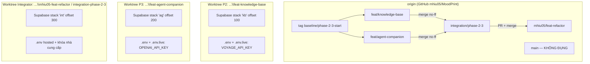
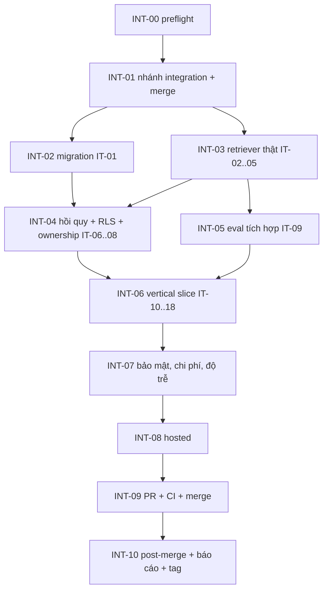

# 08 — Parallel Worktree Isolation and Integration Plan

> Hợp nhất `docs/implementation/06` với kết quả audit. Phần A: cách hai agent làm việc độc lập. Phần B: kế hoạch và Definition of Done của Integration Agent. Lệnh chi tiết nằm ở `10`.

## Phần A — Cô lập song song

### A.1 Topology



| Hạng mục | Phase 2 (Grok 4.7) | Phase 3 (Claude Opus 5.5) | Integrator |
|---|---|---|---|
| Nhánh | `feat/knowledge-base` | `feat/agent-companion` | `integration/phase-2-3`, `integration/*`, `compat/*` |
| Thư mục | `…\MoodPrint\feat-knowledge-base` | `…\MoodPrint\feat-agent-companion` | worktree hiện tại `…\mhiu05-feat-refactor` |
| Terminal | riêng, `MOODPRINT_STACK_NAME=kb`, `MOODPRINT_PORT_OFFSET=100` | riêng, `ag`, `200` | riêng, `int`, `300` |
| Supabase local | project_id `moodprint-kb`, workdir `.local/stacks/kb` | `moodprint-ag`, `.local/stacks/ag` | `moodprint-int`, `.local/stacks/int` |
| Cổng DB / API | 54422 / 54421 | 54522 / 54521 | 54622 / 54621 |
| Cổng E2E Vite / API | 5278 / 8108 | 5378 / 8208 | 5478 / 8308 |
| `.env` | local, **không** chứa DB hosted; `VOYAGE_API_KEY` ở `.env.live` | local, không DB hosted; `OPENAI_API_KEY` ở `.env.live` | có hosted (`SUPABASE_DB_URL`, `DATABASE_URL`) + hai khóa nhà cung cấp |
| Hosted Supabase | **cấm** | **cấm** | duy nhất, chỉ INT-08 |
| Migration | `*_kb_*` (schema `knowledge`) | `*_ag_*` (bảng mới trong `app`) | không tạo `kb_`/`ag_`; có thể thêm `int_fix_*` nếu cần sửa lệch (xem `10` §5) |
| Test DB | `kb` stack | `ag` stack | `int` stack |
| Đẩy lên origin | được, nhánh của mình | được, nhánh của mình | được, nhánh integration; merge PR vào target |
| Merge vào target | **cấm** | **cấm** | duy nhất, sau gate |

Docker (8.17 GB RAM) cho phép **tối đa hai stack đầy đủ cùng lúc** (`--lite`). Khi cả hai agent làm việc: chạy `kb` + `ag`. Integrator chỉ khởi động `int` sau khi dừng hai stack kia (`supabase_worktree.py stop --name kb --offset 100`).

### A.2 Quy tắc cô lập (kiểm được)

1. **Không trạng thái ghi chung.** Không symlink `.env`/`.local`; không thư mục cache chung (cache embedding ở `.local/corpus-cache` của từng worktree). Dữ liệu duy nhất chung là Git.
2. **Không chia sẻ DB.** Mỗi agent `db reset` thoải mái trên stack của mình. Test từ chối `DATABASE_URL` không loopback khi `APP_ENV=test` (`UnsafeTestEnvironment`); `ci_ownership` và `check:boundaries` bắt secret.
3. **Không chia sẻ migration:** tiền tố `kb`/`ag`; `migration_scope_check.py` (CI) kiểm phạm vi SQL; test chặn trùng version.
4. **Contract đóng băng:** `contracts/**`, `testing/**`, `contract-schemas/**`; thay đổi qua compat (`11` §8). Đề xuất của hai phase dùng tên khác nhau (`CC-P2-NNN`, `CC-P3-NNN`) để không trùng.
5. **Không rebase / force-push** nhánh đã đẩy. Cập nhật từ baseline chỉ bằng `git merge --no-ff <tag compat>`.
6. **Không merge chéo:** Phase 2 không merge `feat/agent-companion` và ngược lại; mọi kết hợp ở nhánh integration.
7. **Một điểm chạm duy nhất ở runtime:** Protocol `KnowledgeRetriever`. Phase 3 không import `moodprint_agent.knowledge` (test AST); Phase 2 không import mô-đun Phase 3 (`moodprint_agent.{tools,runtime,memory,roleplay,evidence,companion}`) (test AST `agent/tests/knowledge/test_boundaries_p2.py`).
8. **Tên đã đặt chỗ** (bảng, route, trường config) ở `11` §5, `02` §2, `05` §5, để tránh trùng nghĩa.

### A.3 Nội dung mỗi agent phải nộp (cổng "feature VERIFIED")

| Mục | Phase 2 | Phase 3 |
|---|---|---|
| Báo cáo triển khai | `reports/phase-2-report.md` | `reports/phase-3-report.md` |
| Bằng chứng test | lệnh + kết quả: `check.py`, pgTAP, integration, Vitest, E2E demo+real, benchmark | tương tự + eval deterministic + live |
| Danh sách migration | tên file `*_kb_*`, đối tượng tạo | tên file `*_ag_*`, đối tượng tạo |
| Bằng chứng hợp đồng | `git diff --stat baseline/phase-2-3-start -- shared/ ` rỗng; chữ ký `create_retriever` không đổi; contract test xanh | tương tự; `AgentToolContext` không đổi |
| Kết quả đánh giá | benchmark A–D, cấu hình khóa, test split một lần | eval Q3-xx, chi tiêu, độ trễ |
| Giới hạn đã biết | có | có |
| SHA cuối | `git rev-parse HEAD` đã push, CI xanh trên đúng SHA | tương tự |
| Việc cho integrator | corpus hosted, đổi mặc định retriever | retriever thật, eval lại |

### A.4 Thay đổi vùng đóng băng khi hai branch đang mở

Xem `11` §8. Tóm tắt: dừng phần phụ thuộc → `CC-Pn-NNN.md` → integrator `compat/CC-Pn-NNN` → tag `baseline/phase-2-3-start+ccNNN` → **cả hai** branch merge tag. Thời gian chờ tối đa một phiên; trong lúc đó làm task không phụ thuộc.

## Phần B — Kế hoạch tích hợp (Integration Agent)

### B.1 Tổng quan



Chỉ INT-02 và INT-03 có thể song song; còn lại tuần tự. Không bước nào được bỏ qua; thất bại ⇒ sửa trong nhánh integration (kèm test hồi quy) hoặc trả về nhánh feature, rồi **lặp lại từ bước bị ảnh hưởng**.

### B.2 Bản đồ IT → task

| IT | Nội dung | Task | Ghi chú |
|---|---|---|---|
| IT-01 | Migration `kb`+`ag` hai thứ tự, DB trống | INT-02 | cộng kiểm trùng version, phạm vi SQL |
| IT-02 | Retriever thật pass `KnowledgeRetrieverContract` | INT-03 | trên DB tích hợp, `HashingEmbedder` + corpus tổng hợp; thêm chạy với Voyage thật |
| IT-03 | `knowledge_search` + retriever thật ⇒ chunk liên quan, `source_id` tồn tại trong `knowledge.sources` | INT-03 | |
| IT-04 | Không kết quả ⇒ không bịa citation | INT-03 | live + scripted |
| IT-05 | Timeout/embedding lỗi/DB lỗi ⇒ không treo | INT-03 | |
| IT-06 | Hồi quy đầy đủ: backend, shared, agent, frontend, demo, real E2E | INT-04 | `verify_phase23.py` |
| IT-07 | RLS `knowledge.*` và bảng `ag_*`, cô lập user | INT-04 | pgTAP + API |
| IT-08 | Ownership của từng branch | INT-04 | `ci_ownership.py --head <SHA>` |
| IT-09 | Eval Knowledge + Companion với retriever thật, `gpt-6-luna` | INT-05 | trong ngân sách |
| IT-10 | **Vertical slice** 19 bước (`10` §7) | INT-06 | real E2E scripted + live |
| IT-11 | Hội thoại AI có xác thực, câu trả lời có nguồn thật | INT-06 | live |
| IT-12 | Ký ức giữa các conversation | INT-06 | live |
| IT-13 | Phân tích bằng chứng + rà soát | INT-06 | live, ảnh tổng hợp |
| IT-14 | Duyệt sự kiện / kế hoạch; không ghi trái phép | INT-06 | scripted + live |
| IT-15 | Roleplay | INT-06 | live |
| IT-16 | Gợi ý hỗ trợ | INT-06 | scripted |
| IT-17 | SSE, hủy, phục hồi trên stack tích hợp | INT-06 | scripted |
| IT-18 | Workspace demo vẫn hoạt động | INT-04/06 | Playwright demo |
| IT-19 | Hosted smoke API + UI | INT-08 | |
| IT-20 | Dọn dữ liệu tổng hợp | INT-08, INT-10 | đếm 0 |

### B.3 Các task tích hợp

**Quy ước trường.** Tiêu đề = Task ID. 1 Mục đích · 2 Ưu tiên · 3 Branch · 4 Dependencies · 5 File · 6 Chi tiết · 7 DB · 8 API/contract · 9 Test · 10 Acceptance · 11 Lệnh kiểm · 12 Thất bại nếu · 13 Deliverables · 14 Rủi ro/fallback. Lệnh đầy đủ ở `10`.

#### INT-00 — Preflight

1. Xác minh điều kiện tiên quyết. 2. P0. 3. `integration/phase-2-3` (chưa tạo). 4. Hai báo cáo feature đã commit.
5. File: `scripts/integration/preflight.py`, `docs/implementation/reports/integration-report.md` (mục 1).
6. Chi tiết: `git fetch --all --tags`; ancestry `git merge-base --is-ancestor baseline/phase-2-3-start <SHA>` cho cả hai; SHA đã push; CI `offline`+`integration` SUCCESS trên **đúng SHA** (`gh run list --commit`); `ci_ownership.py --head <SHA>` exit 0; báo cáo có đủ mục; `PHASE_2`/`PHASE_3` gate (`02` §6, `05` §6, `07` §9); xác nhận tip `mhiu05/feat-refactor` và `main` không đổi ngoài dự kiến; ghi SHA vào báo cáo. Kiểm `core.hooksPath`, repo sạch, `.env` hosted có mặt (không in), file ngân sách hợp lệ.
7. DB: không. 8. API: không.
9. Test: `preflight.py` có bài test với repo giả (thiếu tag, SHA không phải hậu duệ, CI đỏ ⇒ exit ≠ 0).
10. Acceptance: mọi điều kiện ở `10` §2 đạt; nếu một điều kiện P0 bị chặn ⇒ **không** gọi là VERIFIED, dừng.
11. Lệnh: `uv run python scripts/integration/preflight.py --p2 <sha> --p3 <sha>`.
12. Thất bại: bất kỳ gate feature chưa `VERIFIED`; CI đỏ; bằng chứng live thiếu khi nó là P0.
13. Deliverables: mục preflight trong báo cáo.
14. Rủi ro: CI chạy trên SHA khác (commit báo cáo sau CI) ⇒ yêu cầu feature agent chạy lại CI trên SHA cuối.

#### INT-01 — Nhánh integration và merge

1. Hợp nhất hai nhánh không phá lịch sử. 2. P0. 3. `integration/phase-2-3`. 4. INT-00.
5. File: toàn repo (giải xung đột).
6. Chi tiết: `10` §3: tạo từ commit của `baseline/phase-2-3-start`; `merge --no-ff feat/knowledge-base`; `merge --no-ff feat/agent-companion`; nếu `origin/mhiu05/feat-refactor` đã tiến: `merge --no-ff origin/mhiu05/feat-refactor` (đối chiếu từng commit mới). Xung đột: file sinh ⇒ sinh lại; `config.py`/`.env.example`/`agent/pyproject.toml` ⇒ giữ cả hai phần theo section; còn lại giải quyết thủ công có test; **không** `-X ours/theirs` mù. Ghi mọi SHA vào báo cáo.
7. DB: sắp xếp migration (INT-02). 8. API: sinh lại OpenAPI/TS.
9. Test: `scripts/check.py` + `export_*` check sau merge.
10. Acceptance: cây sạch, không còn marker xung đột, `uv sync --locked --all-extras` thành công, `check.py` xanh.
11. Lệnh: `10` §3. 12. Thất bại: xung đột được giải bằng cách xóa thay đổi của một phase; lock lệch.
13. Deliverables: nhánh `integration/phase-2-3` đã push (không force).
14. Rủi ro: xung đột ngữ nghĩa im lặng (cùng sửa 1 hàm) ⇒ chạy toàn bộ test trước khi tiếp tục.

#### INT-02 — Migration (IT-01)

1. Chứng minh `kb_*` và `ag_*` cùng DB trống, cả hai thứ tự. 2. P0. 3. integration. 4. INT-01.
5. File: `scripts/dev/migration_order_check.py` (đã có), báo cáo.
6. Chi tiết: kiểm trùng version (nếu trùng: đổi tên file **chưa áp hosted** của một bên, commit `int:` có giải thích); `migration_scope_check.py` cho từng file; `db reset` trên stack `int` (thứ tự thực); `migration_order_check.py` cả hai thứ tự; `supabase test db`; kiểm `knowledge` không nằm trong Data API (`supabase/config.toml`); không bảng `public`. Đối chiếu danh sách migration với hai báo cáo.
7. DB: như trên. 8. API: không.
9. Test: pgTAP toàn bộ gồm `00/05/14` và `kb_*`, `ag_*`.
10. Acceptance: `VERIFIED order=kb-first`, `order=ag-first`; số assertion ≥ 194 + P2 + P3; 0 vi phạm phạm vi.
11. Lệnh: `10` §5. 12. Thất bại: đối tượng trùng tên; policy xung đột; thứ tự ảnh hưởng kết quả.
13. Deliverables: bảng migration hợp nhất.
14. Rủi ro: cần migration sửa lệch ⇒ chỉ `int_fix_*` tiến-về-phía-trước, được phép khi chưa áp hosted; ghi lý do.

#### INT-03 — Nối retriever thật (IT-02…05)

1. Companion dùng KnowledgeBase thật. 2. P0. 3. integration. 4. INT-01, INT-02.
5. File: `shared/src/moodprint_shared/config.py` (`KnowledgeConfig.retriever` mặc định → `"pgvector"`), `backend/app/modules/knowledge/factory.py` (chỉ nếu cần), test tích hợp mới `backend/tests/integration/test_p23_knowledge_tool.py`.
6. Chi tiết: đổi mặc định retriever (vùng được integrator sửa); cập nhật test Phase 3 đã truyền fixture tường minh (R-P3-03) — kiểm không có test nào ngầm dựa mặc định; nạp corpus: `seed-synthetic` (Hashing) cho test tất định và corpus thật (Voyage) cho live; kiểm: (IT-02) contract class với retriever thật trên DB `int`; (IT-03) chạy `knowledge_search` qua runtime với `ScriptedModel` gọi tool ⇒ chunk có `source_id` ∈ `knowledge.sources` (truy vấn DB); (IT-04) truy vấn ngoài phạm vi ⇒ `no_results`, câu trả lời không có citation/URL (scripted + live); (IT-05) bọc retriever bằng lớp gây lỗi (`sleep`, ném `KnowledgeUnavailable`, tắt DB, embedder 500) ⇒ run kết thúc ≤ `timeout + 0.5 s` với lỗi tool có cấu trúc và câu trả lời không nguồn.
7. DB: dùng `knowledge.*`. 8. API: không.
9. Test: như trên; log canary.
10. Acceptance: IT-02…05 xanh; không citation bịa.
11. Lệnh: `10` §6. 12. Thất bại: Agent treo; citation không tồn tại.
13. Deliverables: test + thay đổi cấu hình.
14. Rủi ro: thiếu khóa Voyage ⇒ INT-03 chạy phần tất định; phần live chuyển `BLOCKED` (không tuyên bố VERIFIED).

#### INT-04 — Hồi quy, RLS, ownership (IT-06…08, IT-18)

1. Không phá Phase 0/1 và không mất test. 2. P0. 3. integration. 4. INT-02, INT-03.
5. File: `scripts/verify_phase23.py`, `scripts/db/safety.py` (đã mở rộng ở CC-008), báo cáo.
6. Chi tiết: `verify_phase23.py` chạy tuần tự và ghi `.local/phase23-gate.json` (`scope:"local_phase23"`, `commit`, `checks` ≥ 12): (1) `verify_phase0.py --regression`; (2) `verify_phase1.py`; (3) `check.py`; (4) `supabase test db`; (5) `pytest -m integration`; (6) Vitest + build + boundaries; (7) E2E demo; (8) E2E real `--agent scripted`; (9) `migration_order_check.py`; (10) `ci_ownership.py` cho từng SHA feature (IT-08); (11) `export_contract_schemas --check`, `export_openapi --check`, `gen:api` không drift; (12) `eval --suite deterministic`. Ghi số test **không thấp hơn** cộng dồn của hai feature + baseline. IT-07: pgTAP `kb_*`, `ag_*` + ma trận cô lập API cho mọi route mới.
7. DB: không. 8. API: không.
9. Test: toàn bộ.
10. Acceptance: exit 0 và receipt đúng HEAD; test baseline 265/67, pgTAP ≥ 194, Vitest 94, demo 13, real 11+1 không giảm.
11. Lệnh: `uv run python scripts/verify_phase23.py`. 12. Thất bại: test bị skip/xóa/nới.
13. Deliverables: receipt + bảng số liệu.
14. Rủi ro: ~30–40 phút chạy; chạy nền, đọc log.

#### INT-05 — Eval tích hợp (IT-09)

1. Chất lượng Knowledge + Companion với corpus thật. 2. P0. 3. integration. 4. INT-03.
5. File: `agent/evals/results/<run-id>/**` (nhánh integration), báo cáo.
6. Chi tiết: (a) benchmark Knowledge lại trên DB `int` với Voyage thật, **cấu hình khóa** của Phase 2, so với số của Phase 2 (sai khác ≤ 0.03 Recall@5; nếu lớn hơn ⇒ điều tra); (b) eval Companion (`knowledge`, `chat`, `injection`, `approval`, `memory` + 4 case rủi ro cao) với retriever thật, `--repeat 3`, ngân sách `integration-eval`; (c) coding agent chấm lại rubric R-01 (grounding thật), R-02, R-06, R-08 cho các case có nguồn; (d) so sánh với kết quả Phase 3 (retriever fixture).
7. DB: corpus đã nạp vào `int`. 8. API: không.
9. Test: Q3-xx áp dụng lại. 10. Acceptance: Q3-01…Q3-05 đạt; Q3-10…Q3-21 đạt hoặc giải trình; chi tiêu ≤ trần.
11. Lệnh: `10` §6. 12. Thất bại: citation không thuộc corpus; hồi quy chất lượng so với Phase 3 không giải thích được.
13. Deliverables: kết quả + tóm tắt. 14. Rủi ro: ngân sách cạn ⇒ ghi phần chưa chạy, `BLOCKED` nếu là P0.

#### INT-06 — Vertical slice (IT-10…IT-18)

1. Chứng minh hành trình đầy đủ trên dịch vụ thật. 2. P0. 3. integration. 4. INT-04, INT-05.
5. File: `frontend/e2e/integration-vertical-real.spec.ts`, `scripts/e2e_app.py` (chế độ live), báo cáo.
6. Chi tiết: 19 bước ở `10` §7, chạy hai chế độ: **scripted** (xác định, bắt buộc xanh, trong CI) và **live** (`gpt-6-luna` + retriever thật + Voyage, ngân sách `integration-eval`, n = 3, chính sách `07` §5.4). Không thay mock khi dịch vụ thật lỗi.
7. DB: stack `int`. 8. API: không.
9. Test: IT-10…IT-18.
10. Acceptance: scripted 100%; live: invariants an toàn 3/3, hành vi ≥ 2/3, ghi cả ba lần.
11. Lệnh: `10` §7. 12. Thất bại: có ghi trước approval; rò dữ liệu user B; mock xuất hiện thay dịch vụ thật.
13. Deliverables: spec + video/trace không bắt buộc, log tóm tắt.
14. Rủi ro: model ngẫu nhiên ⇒ chính sách n = 3 đã công bố.

#### INT-07 — Rà soát bảo mật, chi phí, độ trễ

1. `CRITICAL_SECURITY_FINDINGS = 0`. 2. P0. 3. integration. 4. INT-06.
5. File: báo cáo (mục bảo mật/chi phí).
6. Chi tiết: checklist `10` §8 (secret scan, log canary, SSRF, IDOR, XSS, injection, rate/quota, RLS/grant, advisors sau hosted); đối chiếu bảng độ nghiêm trọng; đo TTFT, độ trễ analysis, token/lượt, chi phí thực tế; Voyage chi phí; so với trần.
7. DB: không. 8. API: không.
9. Test: các test bảo mật hợp nhất. 10. Acceptance: 0 phát hiện Critical, 0 High chưa xử lý (High cần sửa hoặc owner chấp nhận bằng văn bản).
11. Lệnh: `10` §8. 12. Thất bại: bất kỳ cross-user exposure, ghi không duyệt, secret lộ.
13. Deliverables: bảng phát hiện + chỉ số. 14. Rủi ro: phát hiện muộn ⇒ sửa ở nhánh integration kèm test, chạy lại INT-04…06 bị ảnh hưởng.

#### INT-08 — Hosted Supabase

1. Áp migration và corpus lên `db-school-violence`, xác minh. 2. P0. 3. integration. 4. INT-07.
5. File: `scripts/db/publish_corpus.py`, `scripts/smoke_hosted.py` (thêm `--phase 23`), báo cáo.
6. Chi tiết: `10` §9: xác nhận định danh project (ref `xhlshihobyxrgfqrdafh`), lịch sử migration (17 `f0/f1`), dry-run, kiểm timestamp/thứ tự, receipt `phase23`, `push_hosted.py --apply`, `list_migrations`, publish corpus, advisors (security + performance), smoke API tổng hợp, smoke UI hosted (Claude in Chrome) khi có thể, dọn dữ liệu. **Không** reset hosted; **không** động DB MoodPrint cũ; **không** `apply_migration` MCP cho DDL.
7. DB: hosted forward-only. 8. API: smoke.
9. Test: IT-19, IT-20. 10. Acceptance: dry-run sau apply rỗng; advisor 0 lint security; smoke xanh; dọn dữ liệu đếm 0.
11. Lệnh: `10` §9. 12. Thất bại: lịch sử migration lệch; thiếu kết nối/quyền (⇒ báo `BLOCKED`, không tuyên bố hosted VERIFIED).
13. Deliverables: bằng chứng hosted. 14. Rủi ro: sau apply hosted, không thêm commit mã ngoài tài liệu (nếu có ⇒ chạy lại INT-04…INT-08 liên quan).

#### INT-09 — PR, CI, merge

1. Merge `integration/phase-2-3` → `mhiu05/feat-refactor`. 2. P0. 3. integration. 4. INT-08.
5. File: PR. 6. Chi tiết: `10` §10. 7. DB: không. 8. API: không.
9. Test: CI của PR. 10. Acceptance: toàn bộ điều kiện merge tự động (§B.4) đúng.
11. Lệnh: `10` §10. 12. Thất bại: CI đỏ, xung đột, SHA khác, target tiến thêm.
13. Deliverables: SHA merge. 14. Rủi ro: target tiến lên giữa chừng ⇒ quay lại INT-01 (merge target), chạy lại gate bị ảnh hưởng.

#### INT-10 — Post-merge, báo cáo, tag

1. Xác minh target độc lập với các nhánh feature. 2. P0. 3. `mhiu05/feat-refactor`. 4. INT-09.
5. File: `docs/implementation/reports/integration-report.md`, tag `baseline/phase-2-3-verified`.
6. Chi tiết: `10` §11–§12: checkout sạch của `origin/mhiu05/feat-refactor` ở worktree mới; chạy `verify_phase23.py`; xác nhận nội dung; viết báo cáo; tạo tag annotated; ghi hoàn tất hai phase.
7. DB: không. 8. API: không.
9. Test: `verify_phase23.py` trên merge commit. 10. Acceptance: exit 0; tag trỏ đúng SHA đã xác minh.
11. Lệnh: `10` §11–§12. 12. Thất bại: regression ⇒ fix-forward bằng PR có review, không viết lại lịch sử.
13. Deliverables: báo cáo, tag. 14. Rủi ro: CI trên merge commit đỏ vì môi trường ⇒ chẩn đoán, không tuyên bố hoàn tất.

### B.4 Điều kiện merge tự động (tóm tắt, chi tiết ở `10` §10)

```text
PHASE_2 = VERIFIED  AND  PHASE_3 = VERIFIED  AND  G-INTEGRATION = VERIFIED
AND REQUIRED_CI = SUCCESS (hai job `offline` và `integration` của workflow "Foundation" trên đúng SHA của PR; bước ownership/migration-scope chạy trong `offline`)
AND CRITICAL_SECURITY_FINDINGS = 0
AND không xung đột, SHA PR == SHA đã kiểm, target chưa tiến thêm kể từ lần hòa giải cuối
AND không có phê duyệt nào còn treo (branch protection hiện KHÔNG có; kiểm lại lúc chạy)
```

### B.5 Definition of Done — Integration

| # | Tiêu chí | Bằng chứng |
|---|---|---|
| DI-01 | Cả hai feature `VERIFIED` với bằng chứng ở INT-00 | preflight |
| DI-02 | `integration/phase-2-3` chứa cả hai lịch sử (merge `--no-ff`), không force-push | `git log --graph`, `merge-base --is-ancestor` |
| DI-03 | IT-01…IT-18 xanh (scripted) và IT-11…IT-15 live đạt chính sách `07` §5.4 | báo cáo |
| DI-04 | `verify_phase23.py` exit 0 trên HEAD integration; số test không giảm | receipt |
| DI-05 | Hosted: migration áp, advisor sạch, corpus publish, smoke xanh, dọn dữ liệu 0 | báo cáo hosted |
| DI-06 | `CRITICAL_SECURITY_FINDINGS = 0`; High đã xử lý hoặc có chấp nhận bằng văn bản | báo cáo bảo mật |
| DI-07 | CI xanh trên PR; PR merge bằng `--merge`; SHA merge xác minh trong target | `gh pr view`, `git branch --contains` |
| DI-08 | `verify_phase23.py` exit 0 trên checkout sạch của target sau merge | báo cáo |
| DI-09 | Báo cáo tích hợp đã commit; tag `baseline/phase-2-3-verified` trỏ đúng SHA | báo cáo, `git rev-parse` |
| DI-10 | `main` không bị đụng | `git rev-parse origin/main` = giá trị ban đầu |
