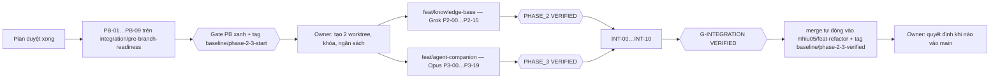

# 09 — Execution Order and Coding-Agent Handoff

> Điểm vào cho cả ba agent (Integrator trước branch, Grok 4.7, Claude Opus 5.5) và cho owner. Trạng thái thực thi PB xem15/16; Phase2/3 chưa bắt đầu. Prompt standalone chính thức là12/13/14.

## 1. Thứ tự đọc

| Agent | Đọc theo thứ tự |
|---|---|
| **Integrator (Pre-Branch)** | `00` → `01` → `11` → `docs/implementation/06` §3–§5 → `07`(cũ) §3–§5 |
| **Grok 4.7 (Phase 2)** | `docs/implementation/08` (cũ) → `00` (phase2-3) → `11` → `02` → `03` → `04` → `docs/implementation/{03,04}` (schema, contract) |
| **Claude Opus 5.5 (Phase 3)** | `docs/implementation/08` (cũ) → `00` (phase2-3) → `11` → `05` → `06` → `07` → `docs/implementation/{03,04,05}` |
| **Integrator (Integration)** | `00` → `08` → `10` → `11` → báo cáo hai phase → `docs/implementation/reports/g1-g2-closure-report.md` |

Quy tắc đọc: kiểm chứng điều đã đọc với mã nguồn (`git`, `rg`) trước khi dựa vào; báo cáo cũ có thể lỗi thời (`00` §2 phương pháp).

## 2. Toàn cảnh

### 2.1 Độ lớn tương đối (ước lượng, không phải cam kết thời gian)

S = một phiên làm việc; M = vài phiên; L = nhiều ngày làm việc.

| Phase 2 | | Phase 3 | | Integration | |
|---|---|---|---|---|---|
| P2-00 | S | P3-00 | S | INT-00 | S |
| P2-01 | M | P3-01 | S | INT-01 | S–M |
| P2-02 | M | P3-02 | M | INT-02 | S |
| P2-03 | M | P3-03 | M | INT-03 | M |
| P2-04 | S–M | P3-04 | L | INT-04 | M (chạy ~40 phút) |
| P2-05 | **L** (nội dung) | P3-05 | M | INT-05 | M |
| P2-06 | S–M | P3-06 | M | INT-06 | M |
| P2-07 | M | P3-07 | M | INT-07 | S–M |
| P2-08 | M–L | P3-08 | M–L | INT-08 | M |
| P2-09 | **L** (nhãn) | P3-09 | L | INT-09 | S |
| P2-10 | M | P3-10 | M–L | INT-10 | S–M |
| P2-11 | M | P3-11 | S–M | | |
| P2-12 | M–L | P3-12 | M | | |
| P2-13 | M | P3-13 | L | | |
| P2-14 | S–M | P3-14 | M | | |
| P2-15 | S | P3-15 | M | | |
| | | P3-16 | M | | |
| | | P3-17 | **L** (đọc từng output) | | |
| | | P3-18 | M | | |
| | | P3-19 | S | | |

**Đường găng Phase 2:** P2-01 → P2-05 (nội dung + đối chiếu) → P2-09 (nhãn) → P2-10. Bắt đầu viết thẻ và nhãn **sớm**, song song với phần kỹ thuật.
**Đường găng Phase 3:** P3-00 → P3-03 → P3-04 → P3-12 → P3-17. Frontend P3-13 chạy song song với `ScriptedModel`.

## 3. Quy tắc làm việc chung (mọi agent)

1. **Tự chủ cho việc thường lệ.** Commit, push nhánh của mình, chạy test, đọc tài liệu, nghiên cứu, tạo file trong vùng sở hữu: không cần hỏi. Dừng và báo khi: thiếu khóa/ngân sách, cần sửa vùng đóng băng (làm `CC-Pn-NNN.md`), blocker bên ngoài, hoặc phát hiện rủi ro dữ liệu thật.
2. **Mỗi commit:** chỉ stage đường dẫn cụ thể (không `git add -A`; không stage `.claude/settings.local.json`, `.cursor/mcp.json`, `.mcp.json`); chạy `ci_ownership.py --local`; thông điệp rõ (`feat(kb): …`, `fix(ag): …`, `test(...)`); không `--no-verify`.
3. **TDD:** viết test đỏ trước, thấy đỏ đúng lý do, rồi cài đặt. Không nới assertion để qua. Không `skip`/`xfail` không có ticket.
4. **Dữ liệu tổng hợp.** Không dữ liệu thật; email `@example.test`; ảnh tổng hợp; tên hư cấu.
5. **Một model cho OpenAI:** `gpt-6-luna`. Không thay nhà cung cấp, không thêm model judge. Voyage là nhà cung cấp embedding đã được duyệt (không phải model OpenAI).
6. **Ngân sách trước live.** Không có `.local/eval-budget.json` ⇒ không chạy lệnh trả phí.
7. **Trung thực báo cáo.** Ghi lệnh, mã thoát, SHA, số lượng; ghi cả thất bại. Không tuyên bố đạt khi chưa chạy. Trạng thái dùng nhãn VERIFIED / BLOCKED / DEFER.
8. **Không sửa `frontend/` khi E2E đang chạy** (Vite HMR làm hỏng lượt chạy).
9. **Không để secret trong git/log/ảnh chụp.** Khóa nằm ở `.env.live` (gitignored), nạp vào biến môi trường của tiến trình, không in.
10. **Ghi nhật ký** vào báo cáo theo phiên: việc đã làm, quyết định, kết quả kiểm, việc còn lại.

## 4. Việc của owner (chỉ những gì thật sự cần owner)

| ID | Việc | Khi nào | Vì sao chỉ owner | Mặc định nếu không làm |
|---|---|---|---|---|
| **O-01** | Chạy hai lệnh `git worktree add` (xem `01` §7) sau khi Gate PB xanh; xác nhận ba SHA giống nhau | Sau PB-09 | Quản lý thư mục máy cá nhân; ranh giới "owner tạo worktree" | Không bắt đầu Phase 2/3 |
| O-02 | (Tùy chọn) `git config core.hooksPath .githooks` | Sau PB-09 | Sửa cấu hình git dùng chung | Chỉ dựa vào CI |
| **O-03** | Đặt **ngân sách** vào `.local/eval-budget.json` từng worktree: `max_usd`, `max_tokens_total`, `max_calls`, đơn giá `price_usd_per_mtok` có nguồn/ngày/tier từ official pricing; giá không phải ngân sách được duyệt, phạm vi và hạn | Trước P2-06 (Voyage live) và P3-00 (OpenAI live) | Chi tiền thật | Chạy ngoại tuyến; live bị khóa; **Phase 3 không thể VERIFIED** |
| **O-04** | Cấp khóa: `OPENAI_API_KEY` (Phase 3 + integrator), `VOYAGE_API_KEY` (Phase 2 + integrator) vào `.env.live` của từng worktree | Cùng O-03 | Bí mật tài khoản | như trên |
| **O-05** | Quyết định giấy phép: (a) xin phép UNICEF (qua biểu mẫu của họ) nếu muốn nhúng nội dung; (b) dự án có **phi thương mại** không — để cân nhắc dùng ấn phẩm WHO CC BY-NC-SA 3.0 IGO; (c) chấp nhận ShareAlike của UNESCO CC BY-SA 3.0 IGO | Trước hoặc trong P2-01 | Quyết định pháp lý/kinh doanh | UNICEF, WHO = `reference_only`; UNESCO chỉ khi owner chấp nhận SA |
| **O-06** | Bật **opt-out huấn luyện/lưu dữ liệu** trong dashboard Voyage (cần thẻ + quyền Admin; không đảo ngược) | Trước khi dùng truy vấn không tổng hợp; khuyến nghị trước P2-08 live | Cấu hình tài khoản bên thứ ba | Chỉ dùng truy vấn tổng hợp; không dùng với học sinh thật |
| **O-07** | Xác nhận quyết định **không** tạo embedding cho ký ức cá nhân (gửi tới bên thứ ba) | Trước P3-08 | Rủi ro riêng tư của trẻ em | Mặc định "không" (đã là thiết kế) |
| O-08 | (Khuyến nghị) tăng RAM Docker Desktop lên ≥ 12 GB | Trước khi hai agent chạy stack | Cấu hình máy | Giới hạn tối đa 2 stack, `--lite` |
| **O-09** | Quyết định khi nào merge `mhiu05/feat-refactor` vào `main` | Sau `baseline/phase-2-3-verified` | Quy tắc bất biến: không agent nào đụng `main` | `main` giữ nguyên |
| O-10 | Review rõ ràng bất kỳ thay đổi nào của ngưỡng acceptance đã khóa | Chỉ khi phát sinh | Quyết định sản phẩm | Ngưỡng giữ nguyên, gate FAIL |
| O-11 | (Điều kiện nền, chưa thuộc Phase 2/3) `00` §6: pháp lý, đồng ý, thỏa thuận xử lý dữ liệu, trường đối tác — cần trước khi cho học sinh thật vào | Trước dữ liệu thật | Pháp lý | Sản phẩm giữ trạng thái "chỉ dữ liệu tổng hợp" |

**Không cần owner** cho: tạo branch/PR/merge integration vào `mhiu05/feat-refactor` khi gate đạt (hiện không có branch protection), áp hosted migration (theo AD-19, `push_hosted.py`), cấu hình dashboard Supabase qua Chrome, dọn dữ liệu smoke, commit/push nhánh feature, tạo tag baseline mới.

## 5. Prompt bàn giao

### 5.1 Integrator — Pre-Branch Readiness

> Bạn là Integration Agent của MoodPrint. Làm việc trong `C:\Users\minhh\orca\workspaces\MoodPrint\mhiu05-feat-refactor`. Nhiệm vụ: thực hiện `docs/implementation/phase2-3/01-PRE-BRANCH-READINESS-PLAN.md` (PB-01…PB-09) trên nhánh `integration/pre-branch-readiness` rẽ từ `origin/mhiu05/feat-refactor`, rồi PR vào `mhiu05/feat-refactor`, tạo tag annotated `baseline/phase-2-3-start` (qua `-rc1` + canary). Tuân thủ `00`, `11`. KHÔNG sửa tag `baseline/phase-1-verified`, KHÔNG đụng `main`, KHÔNG tạo worktree hay nhánh `feat/*`, KHÔNG áp hosted. Mỗi CC có test; không nới test cũ; chạy `verify_phase0.py --regression` và `verify_phase1.py` ở PB-09. Báo cáo `docs/implementation/reports/pre-branch-report.md` gồm SHA, lệnh, kết quả, URL canary. Kết thúc bằng việc in hai lệnh `git worktree add` cho owner. Dừng nếu Gate PB (§6) có mục đỏ.

### 5.2 Grok 4.7 — Phase 2

> Bạn là Grok 4.7, coding agent của Phase 2 (Knowledge Base). Worktree `C:\Users\minhh\orca\workspaces\MoodPrint\MoodPrint-Knowledge`. Đọc và thực hiện `12-PHASE-2-GROK-EXECUTION-HANDOFF.md`, nhánh `feat/knowledge-base`, rẽ từ `baseline/phase-2-3-start` (stack `kb`, offset 100). Thực hiện `02-PHASE-2-KNOWLEDGE-BASE-PLAN.md` theo `03` và `04`, từ P2-00 đến P2-15. Chỉ sửa đường dẫn `PHASE_2_OWNED` (`11` §2, `ownership.yaml`). Cấm: sửa `shared/**`, chữ ký `create_retriever` và `build_knowledge_retriever`, hosted DB/URL trong worktree, fallback sang mock, nhúng nội dung `reference_only`/`unverified`, import mô-đun Phase 3, thêm npm dependency. Mỗi commit chạy `scripts/ci_ownership.py --branch feat/knowledge-base --local`. Test split của benchmark phải được khóa trước khi hiệu chỉnh và chỉ chạy một lần cho cấu hình đã khóa. Mọi con số mục tiêu là đề xuất; báo cáo trung thực PASS/FAIL. Khi cần đổi vùng đóng băng: dừng phần phụ thuộc, viết `docs/implementation/compat/CC-P2-NNN.md`. Kết quả cuối: `docs/implementation/reports/phase-2-report.md` (mẫu `02` §7), SHA cuối đã push, CI xanh trên đúng SHA. KHÔNG merge vào `mhiu05/feat-refactor`.

### 5.3 Claude Opus 5.5 — Phase 3

> Bạn là Claude Opus 5.5, coding agent của Phase 3 (AI Companion). Worktree `C:\Users\minhh\orca\workspaces\MoodPrint\MoodPrint-Agent`. Đọc và thực hiện `13-PHASE-3-OPUS-EXECUTION-HANDOFF.md`, nhánh `feat/agent-companion`, rẽ từ `baseline/phase-2-3-start` (stack `ag`, offset 200). Thực hiện `05-PHASE-3-AI-COMPANION-PLAN.md` theo `06` và `07`, từ P3-00 đến P3-19. Chạy **P3-00 (live compatibility) sớm nhất**. Chỉ sửa đường dẫn `PHASE_3_OWNED`. Dùng `FixtureKnowledgeRetriever` qua Protocol; KHÔNG import `moodprint_agent.knowledge`; test luôn truyền `KnowledgeConfig(retriever="fixture")`. Mọi tool ghi: `needs_approval=True`, nhận `proposal_id`, ghi qua dịch vụ hiện có; không tool gửi ra ngoài. Mọi lời gọi OpenAI dùng `gpt-6-luna`, `store=False`, tracing tắt; không model judge; chỉ chạy live khi có `.local/eval-budget.json`. Rubric tự chấm từng output, bốn case rủi ro cao (SC-04, 07, 09, 24) mọi lần chạy. Mỗi commit chạy `scripts/ci_ownership.py --branch feat/agent-companion --local`. Không tuyên bố xong chỉ dựa trên `ScriptedModel`. Kết quả cuối: `docs/implementation/reports/phase-3-report.md` (mẫu `05` §7), SHA cuối đã push, CI xanh. KHÔNG merge vào `mhiu05/feat-refactor`.

### 5.4 Integrator — Integration và merge tự động

> Bạn là Integration Agent. Đọc và thực hiện `14-INTEGRATION-AGENT-EXECUTION-HANDOFF.md`. Khi `PHASE_2` và `PHASE_3` đã `VERIFIED` (báo cáo + CI trên đúng SHA), thực hiện `08` Phần B và `10` từ INT-00 đến INT-10, tự chủ, trong worktree `C:\Users\minhh\orca\workspaces\MoodPrint\mhiu05-feat-refactor`. Tạo `integration/phase-2-3` từ commit của tag baseline, merge `--no-ff` Phase 2 rồi Phase 3 rồi hòa giải tip hiện tại của target; chạy IT-01…IT-20; áp hosted một lần có dry-run và advisor; chỉ khi `PHASE_2 = VERIFIED`, `PHASE_3 = VERIFIED`, `G-INTEGRATION = VERIFIED`, CI SUCCESS và 0 Critical thì mở PR vào `mhiu05/feat-refactor` và merge bằng `gh pr merge --merge --match-head-commit`. KHÔNG merge vào `main`, KHÔNG force-push, KHÔNG bypass protection, KHÔNG reset hosted. Sau merge: xác minh trên bản sao sạch, báo cáo, tag `baseline/phase-2-3-verified`. Nếu P0 bị chặn: dừng, ghi blocker chính xác, không tuyên bố VERIFIED.

## 6. Giao thức phối hợp giữa các agent

| Tình huống | Cách làm |
|---|---|
| Cần thông tin của phase kia | Đọc Git (nhánh `origin/feat/...`, **chỉ đọc**) hoặc báo cáo; không hỏi trực tiếp; không merge chéo |
| Cần đổi hợp đồng | `CC-Pn-NNN.md` → integrator (PR draft vào target chỉ chứa file CC) |
| Hai phase cần cùng một thứ mới (ví dụ route chung) | Dừng; đề xuất compat; integrator tạo scaffold cho cả hai |
| Phát hiện lỗi ở vùng đóng băng | Mô tả lỗi + test tái hiện trong `CC-Pn-NNN.md`; không sửa |
| Phát hiện lỗi thuộc phase kia | Ghi vào báo cáo của mình ("phát hiện cho phase kia") + thông báo owner/integrator; không sửa |
| Xung đột tên bảng/route/trường config | Dùng bảng đặt chỗ (`11` §5, `05` §3); nếu thiếu → compat |

## 7. Điểm kiểm tra (checkpoint) bắt buộc

| CP | Khi nào | Bằng chứng | Ai |
|---|---|---|---|
| CP-PB | Gate PB | §6 của `01` | Integrator |
| CP-2a | Sau P2-02 | pgTAP `kb_*` xanh, `migration_scope_check` xanh | Grok |
| CP-2b | Sau P2-08 | `KnowledgeRetrieverContract` xanh với retriever thật | Grok |
| CP-2c | Sau P2-09 | dataset + split khóa + baseline A–D (dev) | Grok |
| CP-2d | Sau P2-10 | cấu hình khóa + số test split một lần | Grok |
| CP-3a | Sau P3-00 | live compatibility 6/6 hoặc chẩn đoán | Opus |
| CP-3b | Sau P3-04 | OpenAPI + replay giữ citation + ma trận cô lập | Opus |
| CP-3c | Sau P3-06 | "không ghi trước approval" xanh | Opus |
| CP-3d | Sau P3-12 | restart giữa approval + hủy + lỗi | Opus |
| CP-3e | Sau P3-17 | eval lượt cuối với chấm tay | Opus |
| G-FEAT | Cuối mỗi phase | `PHASE_n = VERIFIED` | Mỗi agent tự đề xuất, integrator xác nhận ở INT-00 |
| G-INT | INT-09 trước | `G-INTEGRATION = VERIFIED` | Integrator |

## 8. Checklist "sẵn sàng làm việc" cho mỗi worktree

- [ ] `git rev-parse HEAD == baseline/phase-2-3-start^{commit}`
- [ ] `.env` không chứa `DATABASE_URL`/`SUPABASE_DB_URL` hosted (kiểm bằng `Select-String`, không in)
- [ ] `$env:MOODPRINT_STACK_NAME`, `$env:MOODPRINT_PORT_OFFSET` đã đặt đúng
- [ ] Stack khởi động `--lite`, JWKS `kid` khác stack kia
- [ ] Baseline test xanh (`02` P2-00 / `05` P3-00)
- [ ] `ci_ownership.py --local` exit 0
- [ ] `.local/eval-budget.json` chỉ khi được duyệt
