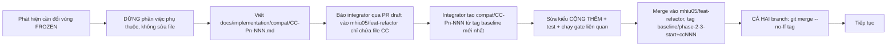

# 11 — File Ownership and Contract Matrix

> Áp dụng **sau** tag `baseline/phase-2-3-start` (xem `01`). Policy máy đọc là `docs/implementation/ownership.yaml` (JSON, `version: 2`, validation fail-closed), do `scripts/check_ownership.py` thực thi. Nếu bảng này và policy khác nhau thì **policy thắng**; PB-06 phải làm hai bên khớp và có test.
> Từ ngữ: phase 2 = `feat/knowledge-base` (Grok 4.7); phase 3 = `feat/agent-companion` (Claude Opus 5.5); integrator = `integration/*`, `compat/*` (Integration Agent).

## 1. Sáu hạng sở hữu

| Hạng | Nghĩa | Ai được sửa | Cơ chế kiểm |
|---|---|---|---|
| `PHASE_2_OWNED` | Đường dẫn trong `phases.2.allow` | Chỉ Phase 2 | `check_ownership.py --phase 2` |
| `PHASE_3_OWNED` | Đường dẫn trong `phases.3.allow` | Chỉ Phase 3 | `--phase 3` |
| `INTEGRATOR_OWNED` | Mọi đường dẫn không nằm ở hạng nào khác | Chỉ integrator (nhánh `integration/*`, `compat/*`) | "outside this phase's ownership" |
| `FROZEN` | Trong `frozen` (hợp đồng, auth, migration `f0/f1`, hạ tầng test, workflow) | Chỉ qua compat change | "frozen; use an integrator compat change" |
| `GENERATED` | Trong `generated` | Không sửa tay; tái sinh bằng lệnh | cho phép thay đổi nhưng **phải** do generator; CI `--check` |
| `SHARED_SECTION` | Một file, nhiều chủ, tách theo class / khối / extra | Mỗi phase chỉ sửa phần của mình | mask AST/khối/TOML, phần còn lại phải giống baseline |

`FROZEN` ưu tiên hơn `PHASE_*` (checker xét `frozen` trước). `INTEGRATOR_OWNED` ở mức đường dẫn; `FROZEN` là tập con **được gắn nhãn rõ** để thông báo lỗi dẫn tới đúng quy trình.

## 2. Ma trận theo khu vực

Ký hiệu: **P2**, **P3**, **I** = integrator, 🔒 = frozen, ⚙ = generated, § = shared section.

### 2.1 Agent (`agent/`)

| Đường dẫn | Hạng | Ghi chú |
|---|---|---|
| `agent/ingestion/**` | P2 | Dữ liệu corpus (manifest, nguồn, thẻ biên soạn) + shim CLI |
| `agent/src/moodprint_agent/knowledge/**` | P2 | Retriever thật, `ingest/`. **Chữ ký `create_retriever` 🔒** (`frozen_signatures`) |
| `agent/tests/knowledge/**`, `agent/evals/knowledge/**` | P2 | |
| `agent/src/moodprint_agent/{companion,runtime,events,budget,errors}.py` | P3 | |
| `agent/src/moodprint_agent/{prompts,tools,memory,roleplay,evidence,testing}/**` | P3 | `testing/` chứa kịch bản `ScriptedModel` cho E2E |
| `agent/tests/**` (trừ `knowledge/`), `agent/evals/**` (trừ `knowledge/`) | P3 | |
| `agent/src/moodprint_agent/context.py`, `__init__.py`, `py.typed` | I | Chỉ re-export; không đổi |
| `agent/pyproject.toml` | § | Phase 2: extra `knowledge`; Phase 3: extra `companion`; phần còn lại I |
| `agent/README.md` | I | |

### 2.2 Shared (`shared/`)

| Đường dẫn | Hạng | Ghi chú |
|---|---|---|
| `shared/src/moodprint_shared/contracts/**` | 🔒 | Mọi DTO/Protocol |
| `shared/src/moodprint_shared/testing/**` | 🔒 | `FixtureKnowledgeRetriever`, `KnowledgeRetrieverContract`, dữ liệu fixture |
| `shared/contract-schemas/**` | 🔒 ⚙ | `export_contract_schemas.py --check` |
| `shared/src/moodprint_shared/{env,logging}.py` | 🔒 | |
| `shared/src/moodprint_shared/config.py` | § | Phase 2: class `KnowledgeConfig`; Phase 3: `AgentConfig`, `MemoryConfig`; `ApiConfig`, `EvidenceConfig`, `LoggingConfig`, `AppConfig` là I |
| `shared/tests/**`, `shared/pyproject.toml` | I | |

### 2.3 Backend (`backend/`)

| Đường dẫn | Hạng | Ghi chú |
|---|---|---|
| `backend/app/core/**` | 🔒 | Auth, UoW, errors |
| `backend/app/modules/{profiles,incidents,evidence,plans,contacts,sharing,support,knowledge_state}/**` | 🔒 | `incidents/service.py` có `add_confirmed_event` do CC-003 trước tag |
| `backend/app/modules/knowledge/**`, `backend/app/api/v1/knowledge.py` | P2 | `factory.py`: chữ ký `build_knowledge_retriever` 🔒 |
| `backend/app/modules/{conversations,memory,analysis,roleplay}/**` | P3 | |
| `backend/app/api/v1/{conversations,memories,analyses,roleplay}.py` | P3 | |
| `backend/app/agent_gateway/**` | P3 | `wiring.py`: chữ ký `build_runtime` 🔒 |
| `backend/app/jobs/**` | P3 | Vòng reconcile mở rộng bên trong, không đổi `main.py` |
| `backend/app/main.py`, `backend/app/api/v1/__init__.py`, `backend/app/infrastructure/**` | 🔒 / I | `main.py` chỉ gọi các seam đã tạo ở CC-002 |
| `backend/tests/knowledge/**`, `backend/tests/integration/knowledge/**` | P2 | Có `conftest.py` riêng nếu cần |
| `backend/tests/agent/**`, `backend/tests/integration/agent/**` | P3 | |
| `backend/tests/integration/test_{agent_stream,agent_approval,conversations,memory}.py` | P3 | Test hiện có thuộc vùng Phase 3 |
| `backend/tests/**` còn lại, `backend/tests/conftest.py`, `integration/conftest.py` | 🔒 / I | `test_phase1_http.py` giữ nguyên ma trận cô lập Phase 1 |
| `backend/openapi.json` | ⚙ | `export_openapi.py` |
| `backend/pyproject.toml` | I | Đã phụ thuộc `moodprint-agent[knowledge,companion]` (CC-007) |

### 2.4 Database (`supabase/`)

| Đường dẫn | Hạng | Ghi chú |
|---|---|---|
| `supabase/migrations/*_f0_*`, `*_f1_*` | 🔒 | Không ALTER/DROP bảng `f0/f1` ở bất kỳ phase nào |
| `supabase/migrations/*_kb_*.sql` | P2 | Chỉ đối tượng trong schema `knowledge` |
| `supabase/migrations/*_ag_*.sql` | P3 | Chỉ **bảng/index/hàm mới** trong `app`, `agent_store`; không đụng `knowledge`; không `ALTER/DROP` bảng `f0/f1` |
| `supabase/tests/kb_*.sql` / `ag_*.sql` | P2 / P3 | pgTAP riêng |
| `supabase/tests/[0-9]*.sql` | 🔒 | 00…14, gồm kiểm theo schema (CC-004) |
| `supabase/config.toml`, `supabase/seed.sql` | 🔒 | |
| `docs/implementation/schema-manifest.json` | 🔒 | Danh sách bảng baseline |

### 2.5 Frontend (`frontend/`)

| Đường dẫn | Hạng | Ghi chú |
|---|---|---|
| `frontend/src/services/{ports,composition,workspace,supabase,session-reset}.ts`, `services/http/{client,stream-events}.ts`, `services/mock/**` | 🔒 | Sau CC-001 đã có slot và `StreamClient` |
| `frontend/src/features/knowledge/**` | P2 | |
| `frontend/src/services/composition/{knowledge,knowledge-types}.ts`, `services/http/knowledge*.ts` | P2 | `knowledge*.ts` gồm test colocated |
| `frontend/src/features/ai/**` | P3 | Gồm chat, analysis, roleplay, thư mục `live/`, ký ức |
| `frontend/src/services/composition/{chat,analysis,roleplay,companion-types}.ts`, `services/http/{chat,analysis,roleplay}*.ts` | P3 | |
| `frontend/e2e/knowledge-real.spec.ts`, `frontend/e2e/helpers/phase2.ts` | P2 | |
| `frontend/e2e/ai-real.spec.ts`, `frontend/e2e/helpers/phase3.ts` | P3 | |
| `frontend/e2e/helpers/capabilities.ts`, các spec còn lại | I / 🔒 | `responsive-real.spec.ts` đã đọc capability (CC-005) |
| `frontend/src/types/**`, `src/app/**`, `src/components/**`, `src/mocks/**`, `features/{home,incidents,profile,support,onboarding,auth,action-plans,school-admin}/**` | I | Không phase nào sửa. Nếu cần field mới → compat |
| `frontend/package.json`, `frontend/package-lock.json` | I / ⚙ | Phase 2/3 **không** thêm npm dependency; cần thì compat (CC) |
| `frontend/src/services/http/schema.gen.ts` | ⚙ | `openapi-typescript` từ `backend/openapi.json` |

### 2.6 Hạ tầng, tài liệu

| Đường dẫn | Hạng | Ghi chú |
|---|---|---|
| `scripts/**`, `.github/**`, `.githooks/**`, `Dockerfile`, `deploy/**` | 🔒 | |
| `docs/implementation/ownership.yaml`, `docs/implementation/phase2-3/**`, `docs/implementation/{00…08}-*.md` | 🔒 | |
| `docs/implementation/reports/phase-2-report.md` | P2 | |
| `docs/implementation/reports/phase-3-report.md` | P3 | |
| `docs/implementation/compat/CC-P2-*.md` / `CC-P3-*.md` | P2 / P3 | Đề xuất compat của từng phase |
| `docs/implementation/compat/CC-00*.md`, `reports/pre-branch-report.md`, `reports/integration-report.md` | I | |
| `uv.lock` | ⚙ | `uv lock` |
| `.env.example` | § | Khối `knowledge` (P2), khối `agent` (P3); các khối khác I |
| `.gitignore`, `pyproject.toml` (root), `.importlinter`, `.python-version` | I | |
| `.claude/settings.local.json`, `.cursor/mcp.json`, `.mcp.json` | `local_overrides` | Unstaged local override bị bỏ qua; staged hoặc committed vi phạm |

## 3. Danh sách `frozen` v2 (thêm vào danh sách hiện có)

Giữ nguyên 20 mục của policy v1, **thêm**: `backend/app/main.py`, `backend/app/api/v1/__init__.py`, `backend/app/infrastructure/**`, `backend/tests/conftest.py`, `backend/tests/integration/conftest.py`, `frontend/src/services/composition.ts`, `frontend/src/services/mock/**`, `frontend/src/services/session-reset.ts`, `frontend/src/services/supabase.ts`, `frontend/e2e/helpers/capabilities.ts`, `supabase/config.toml`, `supabase/seed.sql`, `supabase/tests/[0-9]*.sql`, `scripts/**`, `.github/**`, `.githooks/**`, `docs/implementation/ownership.yaml`, `docs/implementation/schema-manifest.json`, `docs/implementation/phase2-3/**`.

## 4. File sinh (GENERATED)

| File | Lệnh sinh | Kiểm | Xử lý xung đột khi merge |
|---|---|---|---|
| `uv.lock` | `uv lock` | CI `uv sync --locked` | lấy một bên, `uv lock`, commit |
| `frontend/package-lock.json` | `npm install --package-lock-only` | `npm ci` | Phase 2/3 không đổi `package.json` nên không xung đột; nếu có → compat |
| `backend/openapi.json` | `uv run python scripts/export_openapi.py` | `--check` | lấy một bên rồi sinh lại sau khi hợp nhất router |
| `frontend/src/services/http/schema.gen.ts` | `cd frontend && npm run gen:api` (script thêm ở PB-02; trước đó là `npx openapi-typescript ../backend/openapi.json -o src/services/http/schema.gen.ts`) | CI: `npm run gen:api && git diff --exit-code` (thêm ở PB-06; hiện **chưa** có kiểm drift) | sinh lại từ `openapi.json` đã hợp nhất |
| `shared/contract-schemas/**` | `export_contract_schemas.py` | `--check` | Không đổi bởi phase nào (🔒) |

Tuyệt đối không sửa tay file sinh; trong báo cáo ghi lệnh đã chạy và SHA input.

## 5. Phần chia sẻ (SHARED_SECTION) và tên đã đặt chỗ

| File | Phase 2 được sửa | Phase 3 được sửa |
|---|---|---|
| `shared/src/moodprint_shared/config.py` | class `KnowledgeConfig` | classes `AgentConfig`, `MemoryConfig` |
| `.env.example` | khối `# --- knowledge ----…` | khối `# --- agent ----…` |
| `agent/pyproject.toml` | `[project.optional-dependencies] knowledge` | `... companion` |

Tên trường **đặt chỗ** để tránh trùng ý nghĩa (mọi giá trị là hằng không bí mật, theo quy tắc `.env.example`):

- `KnowledgeConfig` (P2): `retriever` (`"fixture"` mặc định, thêm `"pgvector"`), `top_k`, `timeout_s`, `embedding_model="voyage-4"`, `query_embedding_model` (mặc định bằng `embedding_model`), `embedding_dims=1024`, `embed_timeout_fraction=0.6`, `vector_candidates=30`, `lexical_candidates=30`, `rrf_k=50`, `min_vector_score`, `min_lexical_score` (hiệu chỉnh ở P2-10), `rerank_enabled=False`, `rerank_model="rerank-3"`, `query_max_chars=300`, `search_rate_per_user_per_min=20`, `ingest_batch_size`.
- `AgentConfig` (P3, thêm vào trường hiện có): `daily_token_cap_per_user`, `knowledge_tool_timeout_s`, `proposal_ttl_s`, `approval_ttl_s`, `analysis_timeout_s`, `analysis_max_image_bytes`, `analysis_max_image_px`, `analysis_allowed_mime`, `roleplay_max_turns`, `roleplay_feedback_timeout_s`, `compaction_trigger_tokens`, `memory_extraction_enabled`, `live_eval_max_tokens_per_run`.
- `MemoryConfig` (P3): thêm `intent_boost`, `max_context_memories`, `extraction_max_candidates_per_run`.
- `AppConfig.knowledge.retriever`: **Phase 2 không đổi mặc định `"fixture"`**; integrator đổi ở INT-03. Mọi test Phase 3 phải truyền `KnowledgeConfig(retriever="fixture")` tường minh.

## 6. Policy v2 (nội dung đề xuất cho `ownership.yaml`)

Integrator dán vào PB-06 (JSON hợp lệ; checker mới từ chối khóa không biết/sai kiểu và **bắt buộc** đọc `branches`, `retired_branches`, `local_overrides`).

```json
{
  "version": 2,
  "source": "docs/implementation/phase2-3/11-FILE-OWNERSHIP-AND-CONTRACT-MATRIX.md",
  "baseline": "baseline/phase-2-3-start",
  "branches": { "feat/knowledge-base": "2", "feat/agent-companion": "3" },
  "retired_branches": ["feat/knowledge-ingestion-rag"],
  "local_overrides": [".claude/settings.local.json", ".cursor/mcp.json", ".mcp.json"],
  "frozen": [
    "shared/src/moodprint_shared/contracts/**",
    "shared/src/moodprint_shared/testing/**",
    "shared/contract-schemas/**",
    "shared/src/moodprint_shared/env.py",
    "shared/src/moodprint_shared/logging.py",
    "supabase/migrations/*_f0_*",
    "supabase/migrations/*_f1_*",
    "supabase/tests/[0-9]*.sql",
    "supabase/config.toml",
    "supabase/seed.sql",
    "backend/app/core/**",
    "backend/app/infrastructure/**",
    "backend/app/main.py",
    "backend/app/api/v1/__init__.py",
    "backend/app/modules/profiles/**",
    "backend/app/modules/incidents/**",
    "backend/app/modules/evidence/**",
    "backend/app/modules/plans/**",
    "backend/app/modules/contacts/**",
    "backend/app/modules/sharing/**",
    "backend/app/modules/support/**",
    "backend/app/modules/knowledge_state/**",
    "backend/tests/conftest.py",
    "backend/tests/integration/conftest.py",
    "frontend/src/services/ports.ts",
    "frontend/src/services/composition.ts",
    "frontend/src/services/workspace.ts",
    "frontend/src/services/supabase.ts",
    "frontend/src/services/session-reset.ts",
    "frontend/src/services/mock/**",
    "frontend/src/services/http/client.ts",
    "frontend/src/services/http/stream-events.ts",
    "frontend/e2e/helpers/capabilities.ts",
    "scripts/**",
    ".github/**",
    ".githooks/**",
    "docs/implementation/ownership.yaml",
    "docs/implementation/schema-manifest.json",
    "docs/implementation/phase2-3/**"
  ],
  "generated": ["uv.lock", "frontend/package-lock.json", "backend/openapi.json", "frontend/src/services/http/schema.gen.ts"],
  "untracked_artifacts": ["**/__pycache__/*.pyc", ".local/**", ".venv/**", ".pytest_cache/**", ".ruff_cache/**", "agent/.pytest_cache/**", "backend/.pytest_cache/**", "shared/.pytest_cache/**", ".playwright-mcp/**", "frontend/node_modules/**", "frontend/dist/**", "frontend/.vite/**", "frontend/coverage/**", "frontend/test-results/**", "frontend/playwright-report/**", "supabase/.branches/**", "supabase/.temp/**", "debug.log"],
  "shared_sections": {
    "shared/src/moodprint_shared/config.py": { "kind": "python_classes", "2": ["KnowledgeConfig"], "3": ["AgentConfig", "MemoryConfig"] },
    ".env.example": { "kind": "env_blocks", "2": ["knowledge"], "3": ["agent"] },
    "agent/pyproject.toml": { "kind": "toml_extras", "2": ["knowledge"], "3": ["companion"] }
  },
  "frozen_signatures": {
    "agent/src/moodprint_agent/knowledge/__init__.py": ["create_retriever"],
    "backend/app/modules/knowledge/factory.py": ["build_knowledge_retriever"],
    "backend/app/agent_gateway/wiring.py": ["build_runtime"]
  },
  "phases": {
    "2": {
      "allow": [
        "agent/ingestion/**",
        "agent/src/moodprint_agent/knowledge/**",
        "agent/tests/knowledge/**",
        "agent/evals/knowledge/**",
        "backend/app/modules/knowledge/**",
        "backend/app/api/v1/knowledge.py",
        "backend/tests/knowledge/**",
        "backend/tests/integration/knowledge/**",
        "supabase/migrations/*_kb_*.sql",
        "supabase/tests/kb_*.sql",
        "frontend/src/features/knowledge/**",
        "frontend/src/services/composition/knowledge.ts",
        "frontend/src/services/composition/knowledge-types.ts",
        "frontend/src/services/http/knowledge*.ts",
        "frontend/e2e/knowledge-real.spec.ts",
        "frontend/e2e/helpers/phase2.ts",
        "docs/implementation/reports/phase-2-report.md",
        "docs/implementation/compat/CC-P2-*.md"
      ],
      "exclude": []
    },
    "3": {
      "allow": [
        "agent/src/moodprint_agent/companion.py",
        "agent/src/moodprint_agent/runtime.py",
        "agent/src/moodprint_agent/events.py",
        "agent/src/moodprint_agent/budget.py",
        "agent/src/moodprint_agent/errors.py",
        "agent/src/moodprint_agent/prompts/**",
        "agent/src/moodprint_agent/tools/**",
        "agent/src/moodprint_agent/memory/**",
        "agent/src/moodprint_agent/roleplay/**",
        "agent/src/moodprint_agent/evidence/**",
        "agent/src/moodprint_agent/testing/**",
        "agent/tests/**",
        "agent/evals/**",
        "backend/app/agent_gateway/**",
        "backend/app/modules/conversations/**",
        "backend/app/modules/memory/**",
        "backend/app/modules/analysis/**",
        "backend/app/modules/roleplay/**",
        "backend/app/api/v1/conversations.py",
        "backend/app/api/v1/memories.py",
        "backend/app/api/v1/analyses.py",
        "backend/app/api/v1/roleplay.py",
        "backend/app/jobs/**",
        "backend/tests/agent/**",
        "backend/tests/integration/agent/**",
        "backend/tests/integration/test_agent_stream.py",
        "backend/tests/integration/test_agent_approval.py",
        "backend/tests/integration/test_conversations.py",
        "backend/tests/integration/test_memory.py",
        "supabase/migrations/*_ag_*.sql",
        "supabase/tests/ag_*.sql",
        "frontend/src/features/ai/**",
        "frontend/src/services/composition/chat.ts",
        "frontend/src/services/composition/analysis.ts",
        "frontend/src/services/composition/roleplay.ts",
        "frontend/src/services/composition/companion-types.ts",
        "frontend/src/services/http/chat*.ts",
        "frontend/src/services/http/analysis*.ts",
        "frontend/src/services/http/roleplay*.ts",
        "frontend/e2e/ai-real.spec.ts",
        "frontend/e2e/helpers/phase3.ts",
        "docs/implementation/reports/phase-3-report.md",
        "docs/implementation/compat/CC-P3-*.md"
      ],
      "exclude": ["agent/tests/knowledge/**", "agent/evals/knowledge/**"]
    }
  }
}
```

### 6.1 Đã kiểm chứng trong phiên planning

Policy v2 ở trên được chạy qua **checker hiện có** (`scripts/check_ownership.py`) trong một repo Git dùng một lần (thư mục tạm, không ảnh hưởng repo thật): 59 đường dẫn × 2 phase = **118 probe, 0 sai lệch** so với kỳ vọng ở §2. Một số probe tiêu biểu (✔ = được phép, ✖ = vi phạm):

| Đường dẫn | P2 | P3 | | Đường dẫn | P2 | P3 |
|---|---|---|---|---|---|---|
| `agent/src/moodprint_agent/knowledge/retriever.py` | ✔ | ✖ | | `agent/src/moodprint_agent/tools/x.py` | ✖ | ✔ |
| `agent/tests/knowledge/test_x.py` | ✔ | ✖ | | `agent/tests/test_x.py` | ✖ | ✔ |
| `backend/tests/knowledge/test_x.py` | ✔ | ✖ | | `backend/tests/integration/test_conversations.py` | ✖ | ✔ |
| `backend/app/api/v1/knowledge.py` | ✔ | ✖ | | `backend/app/api/v1/analyses.py` | ✖ | ✔ |
| `backend/app/main.py` | ✖ | ✖ | | `backend/tests/integration/test_phase1_http.py` | ✖ | ✖ |
| `supabase/migrations/…_kb_schema.sql` | ✔ | ✖ | | `supabase/migrations/…_ag_proposals.sql` | ✖ | ✔ |
| `supabase/migrations/…_f0_extensions_roles.sql` | ✖ | ✖ | | `supabase/tests/00_rls_coverage.sql` | ✖ | ✖ |
| `frontend/src/services/http/knowledge.test.ts` | ✔ | ✖ | | `frontend/src/services/http/chat-stream.ts` | ✖ | ✔ |
| `frontend/src/services/ports.ts` | ✖ | ✖ | | `frontend/e2e/responsive-real.spec.ts` | ✖ | ✖ |
| `frontend/e2e/helpers/phase2.ts` | ✔ | ✖ | | `frontend/e2e/helpers/capabilities.ts` | ✖ | ✖ |
| `docs/implementation/compat/CC-P2-001.md` | ✔ | ✖ | | `docs/implementation/compat/CC-P3-001.md` | ✖ | ✔ |
| `uv.lock`, `backend/openapi.json`, `schema.gen.ts` | ✔ | ✔ | | `scripts/x.py`, `.github/workflows/ci.yml` | ✖ | ✖ |

Chưa kiểm được vì checker hiện chưa có: `local_overrides` và `resolve_base` (PB-06 viết, kèm test dựa trên cùng bảng này). `frozen_signatures` cho hai hàm mới chỉ kiểm được sau PB-03 (file `factory.py`, `wiring.py` phải tồn tại ở baseline).

Hai chữ ký đóng băng mới (`build_knowledge_retriever`, `build_runtime`) bảo đảm `main.py` (đóng băng) luôn gọi được hai hàm mà mỗi phase đổi thân hàm.

## 7. Phạm vi SQL của migration (checker chưa kiểm — bổ sung)

`check_ownership.py` chỉ kiểm **tên file**, không kiểm nội dung SQL. PB-05 thêm `scripts/dev/migration_scope_check.py` (integrator, 🔒), chạy trong CI cho nhánh có profile và ở INT-02:

| File | Cho phép | Cấm (lỗi) |
|---|---|---|
| `*_kb_*.sql` | `CREATE/ALTER/DROP/GRANT/REVOKE/COMMENT/POLICY/FUNCTION/INDEX` có đối tượng mang tiền tố `knowledge.` hoặc `CREATE SCHEMA knowledge`; `CREATE EXTENSION IF NOT EXISTS` đã có sẵn thì chỉ no-op | bất kỳ đối tượng ngoài `knowledge`; `ALTER ROLE`/`CREATE ROLE`; `DROP` không `knowledge.`; `app.`, `agent_store.`, `public.`, `storage.`, `auth.` |
| `*_ag_*.sql` | `CREATE TABLE/INDEX/POLICY/FUNCTION/TRIGGER` đối tượng **mới** trong `app`, `agent_store`; `CREATE INDEX` trên bảng `f0/f1` (chỉ `CONCURRENTLY`-an toàn, không đổi dữ liệu) | `ALTER TABLE`/`DROP` bảng baseline (đọc từ `schema-manifest.json`); `knowledge.`; `ALTER ROLE`/`CREATE ROLE`; đụng `storage.`/`auth.` |
| mọi `kb_`/`ag_` | tên file `^\d{14}_(kb|ag)_[a-z0-9_]+\.sql$`; version duy nhất | `DROP SCHEMA`, `TRUNCATE`, `DELETE`/`UPDATE` không có `WHERE` |

Bộ phân tích dùng tokenizer SQL đơn giản (loại chú thích và literal) và có test với ví dụ vi phạm. Đây là rào chắn tĩnh; pgTAP (`kb_*`, `ag_*`, và `00/05/14`) mới là kiểm chứng hành vi.

## 8. Quy trình thay đổi vùng đóng băng



Nội dung bắt buộc của `CC-Pn-NNN.md`: (1) nhu cầu và file bị chặn; (2) thay đổi tối thiểu đề xuất, dạng cộng thêm; (3) vì sao tương thích ngược (consumer hiện có, snapshot schema); (4) ảnh hưởng tới phase kia; (5) test chứng minh; (6) hạn chót (task nào đang bị chặn). **Cho phép:** field optional có mặc định, phương thức mới, giá trị enum mới, kiểu TS mới, `KnowledgeFilters.formats: list[str] = []`. **Không cho phép:** đổi tên/đổi kiểu field, bỏ phương thức, đổi nghĩa `score`, đổi chữ ký ba hàm đóng băng, thay đổi hợp đồng SSE `v1`. Nếu bắt buộc phá vỡ: đóng băng một branch, merge branch kia trước (`06` §5).

Quy tắc cấp thời gian: agent chờ compat tối đa 1 phiên làm việc; trong lúc đó chuyển sang task không phụ thuộc (đồ thị `02`/`05`). Integrator xử lý compat trước mọi việc tích hợp khác.

## 9. Thực thi theo branch (CI, hook, canary)

| Lớp | Nơi | Hành vi |
|---|---|---|
| Hook cục bộ | `.githooks/pre-commit` → `scripts/ci_ownership.py --branch $BRANCH --local` | Chặn commit vi phạm; thất bại ồn ào nếu không chạy được; cần `core.hooksPath` (O-02) |
| CI mỗi push/PR | bước "Parallel phase ownership" | `feat/knowledge-base` → phase 2; `feat/agent-companion` → phase 3; tên cũ → lỗi; nhánh khác → "no ownership profile" |
| CI scope SQL | bước "Migration scope" | `migration_scope_check.py` cho nhánh có profile |
| Canary | push/PR thật trên `canary/ownership/{knowledge-base,agent-companion}/<case>`; dispatch chỉ bổ sung | Chứng minh event branch selection + đỏ/xanh đúng (PB-G10) |
| Tích hợp | INT-04 | Chạy lại `ci_ownership.py` với `--head <SHA feature>` cho cả hai branch (IT-08) |

CI luôn checkout `github.event.pull_request.head.sha` để diff chỉ là thay đổi của feature branch, không lẫn commit của target.

## 10. Quy tắc làm việc trong từng worktree (tóm tắt)

1. Trước mỗi commit: `uv run python scripts/ci_ownership.py --branch <tên nhánh> --local` phải exit 0.
2. Không tạo file ngoài các đường dẫn ở §2. Cần file mới ngoài vùng → compat, không "ngoại lệ miệng".
3. Không đổi tên hoặc xóa test cũ; không nới assertion. Test mới đặt tên theo `U-`/`I-`/`P-`/`E-` (`07` của bộ cũ) và thêm hậu tố `KB-` hoặc `AG-` (ví dụ `I-KB-04`, `E-AG-02`).
4. Mỗi branch tự xanh CI trên chính SHA cuối; báo cáo ghi SHA, lệnh, kết quả.
5. Không `git rebase`, không force-push branch đã đẩy; cập nhật chỉ bằng merge tag compat.
6. Không để secret hoặc hosted URL trong worktree feature; không chạy `push_hosted.py` (script từ chối khi thiếu receipt, và `.env` hosted không có trong worktree).
