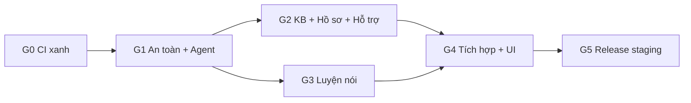

# MoodPrint School Safety — Tóm tắt

Bộ kế hoạch để chuyển MoodPrint thành ứng dụng giúp học sinh đối mặt với bạo lực học đường và tìm tới được một người lớn tin cậy. Đây là **MVP demo cho P-Innovation 2027**, chạy bằng persona hư cấu nhưng dùng **model thật** trên môi trường staging. Không phải giấy phép phát hành cho trẻ vị thành niên thật.

Review tại nhánh `mhiu05/feat-refactor`, HEAD `2d00c8d25cfc07eb8cb6939e84ab19386bd72034`, ngày 06/11/2026.

Grok bắt đầu tại [GROK-PROMPT](grok-handoff/GROK-PROMPT.md).

## Kết luận chính

1. **Nền tảng tốt, thiếu lớp an toàn.** Runtime, accounting, SSE, idempotency, Storage dùng lại được. Không cần viết lại backend.
2. **Chat hiện không có luồng khẩn cấp.** Regex hiện tại bỏ sót "nó bảo mai mang dao đến" và mọi câu về xâm hại, tống tiền, thương tích trong bộ thử. Đây là việc ưu tiên số 1.
3. **`main` đang đỏ.** Hai commit gần nhất lỗi cùng một test accessibility, nên không có release mới. Sửa vài thuộc tính ở `GroupChat.tsx`. Đây là task đầu tiên.
4. **Bot id mới `troly` tự tách khỏi code cũ.** Skills, web search, Maps, orchestration, collaboration đều không chạy với id này.
5. **TTS qua OpenAI cần cẩn thận.** Model TTS cũ tắt ngày 06/01/2027. Đường chính là `gpt-realtime-2.1-mini`, backend so transcript trước khi phát để đảm bảo đọc đúng văn bản đã duyệt.
6. **Nội dung cần người duyệt** là điểm phụ thuộc lớn nhất. Không chặn phát triển nhưng chặn release.

## Đã chốt với owner

| Mục | Kết quả |
| --- | --- |
| Môi trường | Giữ tên staging, bản chất là demo, chạy model thật |
| Agent | `gpt-6.1-terra` để đảm bảo độ thông minh; lượt phụ `gpt-6-luna` |
| STT, TTS | Key OpenAI hiện có |
| Eval live | Tổng dưới 3 USD |
| Hosted | Supabase MCP, AWS MCP |
| Thiết kế | Quy trình impeccable, chuyển động GSAP, thinking bằng thinking-orbs |
| Xây agent | openai-agents-python 0.24.0 |

## Kiến trúc

- Một Trợ lý duy nhất, một agent loop, tool là hàm backend.
- Safety engine nhiều tầng nằm ngoài model; nhánh đỏ chạy trước mọi cổng AI.
- Workflow là state machine phía backend; model chỉ đề xuất.
- Tool chỉ tạo proposal; người dùng bấm mới lưu.
- Profile `school_safety_demo` tách biệt; production 18+ không đổi.
- Chỉ thêm bảng mới, nên release và rollback đơn giản.

Chi tiết: [03-target-architecture](03-target-architecture.md), [06-ai-orchestration-and-safety](06-ai-orchestration-and-safety.md).

## Chi phí ước tính

Khoảng **48 USD/tháng cho 100 người dùng**, **480 USD/tháng cho 1.000 người dùng** với `gpt-6.1-terra`, theo giả định ở [07 §10](07-knowledge-base-design.md#10-chi-phí). Quy mô demo thấp hơn nhiều. Trần vận hành 20 USD/ngày.

## Lộ trình

Chi tiết: [11-master-implementation-roadmap](11-master-implementation-roadmap.md).

## Việc cần owner

Duyệt nội dung (OD-02), nghe thử giọng đọc, xem ảnh giao diện, thu thập hướng dẫn nền tảng trên app thật, đăng nhập AWS nếu phiên hết hạn. Toàn bộ ở [12-open-decisions](12-open-decisions.md).

## Mục lục

| File | Nội dung |
| --- | --- |
| [01](01-codebase-audit.md) | Audit, O1–O18 |
| [02](02-current-architecture.md) | Kiến trúc hiện tại, trace |
| [03](03-target-architecture.md) | Kiến trúc đích |
| [04](04-feature-gap-analysis.md) | Khoảng trống, cổng trước thí điểm |
| [05](05-data-model-and-migrations.md) | Schema, migration |
| [06](06-ai-orchestration-and-safety.md) | Agent, workflow, safety, cách dùng SDK |
| [07](07-knowledge-base-design.md) | KB, pipeline, chi phí |
| [08](08-speaking-practice-design.md) | Luyện nói, TTS |
| [09](09-ux-and-user-flows.md) | UX, impeccable, thinking, chuyển động, copy |
| [10](10-evaluation-and-quality-gates.md) | Eval, ngân sách, gate, kết quả G0 |
| [11](11-master-implementation-roadmap.md) | Roadmap |
| [12](12-open-decisions.md) | Quyết định |
| [demo/personas](demo/personas.md), [demo/scenarios](demo/scenarios-KB-A-B-C.md), [demo/showcase-cases](demo/showcase-cases.md) | Persona, kịch bản, ca trình diễn |
| [plans/](plans/WS-01-codebase-migration.md) | WS-01…WS-10 |
| [grok-handoff/](grok-handoff/README.md) | Bàn giao, runbook, prompt |
