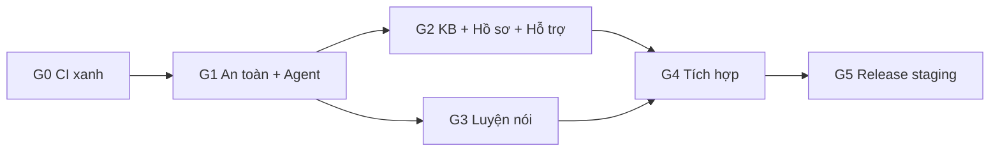

# MoodPrint School Safety — Tóm tắt

Bộ kế hoạch để chuyển MoodPrint thành ứng dụng giúp học sinh đối mặt với bạo lực học đường và tìm tới được một người lớn tin cậy. Đây là **MVP demo cho P-Innovation 2027**, chạy bằng persona hư cấu. Không phải giấy phép phát hành cho trẻ vị thành niên thật.

Review tại nhánh `mhiu05/feat-refactor`, HEAD `2d00c8d25cfc07eb8cb6939e84ab19386bd72034`, ngày 06/11/2026.

## Kết luận chính

1. **Nền tảng tốt, thiếu lớp an toàn.** Runtime, accounting, SSE, idempotency, Storage dùng lại được. Không cần viết lại backend.
2. **Chat hiện không có luồng khẩn cấp.** Regex hiện tại bỏ sót "nó bảo mai mang dao đến" và mọi câu về xâm hại, tống tiền, thương tích trong bộ thử. Đây là việc ưu tiên số 1 của sản phẩm mới.
3. **`main` đang đỏ.** Hai commit gần nhất lỗi cùng một test accessibility, nên không có release nào được phát hành. Sửa một dòng ở `GroupChat.tsx`. Đây là task đầu tiên.
4. **Bot id mới `troly` tự tách khỏi code cũ.** Skills, web search, Maps, orchestration, collaboration đều không chạy với id này.
5. **TTS của OpenAI tắt ngày 06/01/2027**, và Realtime không đảm bảo đọc nguyên văn. Luyện nói cần nhà cung cấp TTS riêng.
6. **Thiếu người duyệt là rủi ro lớn nhất về tiến độ.** Grok không được tự duyệt thẻ KB và template khẩn cấp.

## Kiến trúc

- Một Trợ lý duy nhất, một agent loop, tool là hàm backend.
- Safety engine nhiều tầng nằm ngoài model; nhánh đỏ chạy trước mọi cổng AI.
- Workflow là state machine phía backend; model chỉ đề xuất.
- Tool chỉ tạo proposal; người dùng bấm mới lưu.
- Profile `school_safety_demo` tách biệt; production 18+ không đổi.
- Chỉ thêm bảng mới, nên release và rollback đơn giản.

Chi tiết: [03-target-architecture](03-target-architecture.md), [06-ai-orchestration-and-safety](06-ai-orchestration-and-safety.md).

## Chi phí ước tính

Khoảng **9 USD/tháng cho 100 người dùng**, **89 USD/tháng cho 1.000 người dùng**, với giả định ở [07 §10](07-knowledge-base-design.md#10-chi-phí).

## Lộ trình

Chi tiết: [11-master-implementation-roadmap](11-master-implementation-roadmap.md). Bắt đầu tại [grok-handoff/README](grok-handoff/README.md).

## Quyết định cần owner

Chặn tiến độ: người duyệt (OD-02), ngưỡng eval (OD-08), trần chi phí (OD-11), nhà cung cấp TTS (OD-04), chuyển staging (OD-01), credential (OD-12). Toàn bộ ở [12-open-decisions](12-open-decisions.md).

## Mục lục

| File | Nội dung |
| --- | --- |
| [01](01-codebase-audit.md) | Audit, O1–O18 |
| [02](02-current-architecture.md) | Kiến trúc hiện tại, trace |
| [03](03-target-architecture.md) | Kiến trúc đích |
| [04](04-feature-gap-analysis.md) | Khoảng trống, cổng trước thí điểm |
| [05](05-data-model-and-migrations.md) | Schema, migration |
| [06](06-ai-orchestration-and-safety.md) | Agent, workflow, safety |
| [07](07-knowledge-base-design.md) | KB, pipeline, chi phí |
| [08](08-speaking-practice-design.md) | Luyện nói, nhà cung cấp |
| [09](09-ux-and-user-flows.md) | UX, copy |
| [10](10-evaluation-and-quality-gates.md) | Eval, gate, kết quả G0 |
| [11](11-master-implementation-roadmap.md) | Roadmap |
| [12](12-open-decisions.md) | Quyết định |
| [demo/personas](demo/personas.md), [demo/scenarios](demo/scenarios-KB-A-B-C.md) | Persona, kịch bản |
| [plans/](plans/WS-01-codebase-migration.md) | WS-01…WS-10 |
| [grok-handoff/](grok-handoff/README.md) | Bàn giao, runbook |
