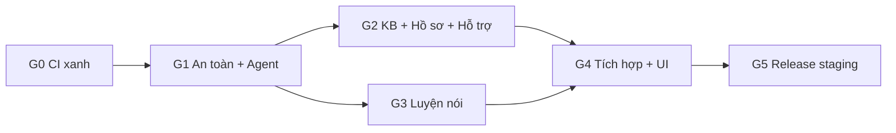

# MoodPrint School Safety — Tóm tắt

Bộ kế hoạch để chuyển MoodPrint thành ứng dụng giúp học sinh đối mặt với bạo lực học đường và tìm tới được một người lớn tin cậy. Đây là **bản release trên staging để trình bày ở P-Innovation 2027**, chạy **model thật**, với nội dung hư cấu. Khách bấm một lần là dùng được đủ tính năng.

Review tại nhánh `mhiu05/feat-refactor`, HEAD `2d00c8d25cfc07eb8cb6939e84ab19386bd72034`, ngày 06/11/2026.

Grok bắt đầu tại [GROK-PROMPT](grok-handoff/GROK-PROMPT.md).

## Kết luận chính

1. **Nền tảng tốt, thiếu lớp an toàn.** Runtime, accounting, SSE, idempotency, Storage dùng lại được. Không cần viết lại backend.
2. **Chat hiện không có luồng khẩn cấp.** Regex hiện tại bỏ sót "nó bảo mai mang dao đến" và mọi câu về xâm hại, tống tiền, thương tích trong bộ thử. Đây là việc ưu tiên số 1.
3. **`main` đang đỏ.** Hai commit gần nhất lỗi cùng một test accessibility, nên không có release mới. Sửa vài thuộc tính ở `GroupChat.tsx`. Đây là task đầu tiên.
4. **Bot id mới `troly` tự tách khỏi code cũ.** Skills, web search, Maps, orchestration, collaboration đều không chạy với id này.
5. **TTS qua OpenAI cần cẩn thận.** Model TTS cũ tắt ngày 06/01/2027. Đường chính là `gpt-realtime-2.1-mini`, backend so transcript trước khi phát để đảm bảo đọc đúng văn bản đã duyệt.
6. **Nội dung cần người duyệt** là điểm phụ thuộc lớn nhất. Không chặn phát triển nhưng chặn release.
7. **Khách đang bị code giới hạn.** Dưới cấu hình có trần, guest không dùng được giọng nói và chỉ khoảng 3 lượt chạy đồng thời. Plan đã có task sửa.
8. **Đợt này không cần ZDR hay tư vấn pháp lý**, vì không có dữ liệu thật của học sinh. Có học sinh thật thì làm theo [cổng G6](10-evaluation-and-quality-gates.md#cổng-g6-khi-có-học-sinh-thật).
9. **Điều kiện duy nhất**: không phát đường dẫn cho học sinh thật hoặc trường học.

## Đã chốt với owner

| Mục | Kết quả |
| --- | --- |
| Mục tiêu đợt này | Trình bày sản phẩm mượt bằng nội dung hư cấu |
| Môi trường | Staging là bản release thật, không có chế độ demo, chạy model thật |
| Khách | Một chạm, đủ tính năng, dữ liệu tự xóa sau 2 giờ |
| Tài khoản | Đăng ký đóng; một tài khoản trình bày cho phần Hồ sơ |
| Tình huống mẫu | Chỉ là kịch bản Markdown, không có trong sản phẩm |
| Model | Chỉ `gpt-6-luna` cho agent, classifier, verifier |
| STT, TTS | `gpt-transcribe`, `gpt-realtime-2.1-mini`, key OpenAI hiện có |
| Hệ thống cũ | Đóng băng, ẩn trên staging, không vá |
| Upload | Nhận mọi ảnh, video, không phân loại nội dung |
| Nội dung KB | Nền tảng Facebook, YouTube, TikTok; `reviewed_by: mhiu05` |
| Eval live | Tổng dưới 3 USD |
| Hosted | Supabase MCP, AWS MCP |
| Thiết kế | Quy trình impeccable, chuyển động GSAP, thinking bằng thinking-orbs |
| Xây agent | openai-agents-python 0.24.0 |

## Kiến trúc

- Một Trợ lý duy nhất, một agent loop, tool là hàm backend.
- Safety engine nhiều tầng nằm ngoài model; nhánh đỏ chạy trước mọi cổng AI.
- Workflow là state machine phía backend; model chỉ đề xuất.
- Tool chỉ tạo proposal; người dùng bấm mới lưu.
- Profile `school_safety` cô lập hệ thống cũ đã đóng băng; test cũ vẫn xanh.
- Chỉ thêm bảng mới, nên release và rollback đơn giản.

Chi tiết: [03-target-architecture](03-target-architecture.md), [06-ai-orchestration-and-safety](06-ai-orchestration-and-safety.md).

## Chi phí ước tính

Khoảng **13 USD/tháng cho 100 người dùng**, **133 USD/tháng cho 1.000 người dùng** với `gpt-6-luna`, theo giả định ở [07 §10](07-knowledge-base-design.md#10-chi-phí). Trần vận hành 20 USD/ngày, riêng khách 5 USD/ngày.

## Lộ trình

Chi tiết: [11-master-implementation-roadmap](11-master-implementation-roadmap.md).

## Việc cần owner

Duyệt nội dung (OD-02), xem ảnh giao diện, đăng nhập AWS nếu phiên hết hạn. Thay ảnh mẫu bằng ảnh thật khi có. Toàn bộ ở [11 §5](11-master-implementation-roadmap.md#5-việc-chỉ-con-người-làm-được).

## Mục lục

| File | Nội dung |
| --- | --- |
| [01](01-codebase-audit.md) | Audit, O1–O18 |
| [02](02-current-architecture.md) | Kiến trúc hiện tại, trace |
| [03](03-target-architecture.md) | Kiến trúc đích |
| [04](04-feature-gap-analysis.md) | Khoảng trống, ngoài phạm vi |
| [05](05-data-model-and-migrations.md) | Schema, migration |
| [06](06-ai-orchestration-and-safety.md) | Agent, workflow, safety, cách dùng SDK |
| [07](07-knowledge-base-design.md) | KB, pipeline, chi phí |
| [08](08-speaking-practice-design.md) | Luyện nói, TTS |
| [09](09-ux-and-user-flows.md) | UX, impeccable, thinking, chuyển động, copy |
| [10](10-evaluation-and-quality-gates.md) | Eval, ngân sách, gate, kết quả G0 |
| [11](11-master-implementation-roadmap.md) | Roadmap |
| [12](12-open-decisions.md) | Quyết định |
| [kb-source-links](kb-source-links.md) | Link nguồn cho thẻ KB |
| [demo/personas](demo/personas.md), [demo/scenarios](demo/scenarios-KB-A-B-C.md), [demo/showcase-cases](demo/showcase-cases.md) | Nhân vật, kịch bản mẫu |
| [plans/](plans/WS-01-codebase-migration.md) | WS-01…WS-10 |
| [grok-handoff/](grok-handoff/README.md) | Bàn giao, runbook, prompt |
