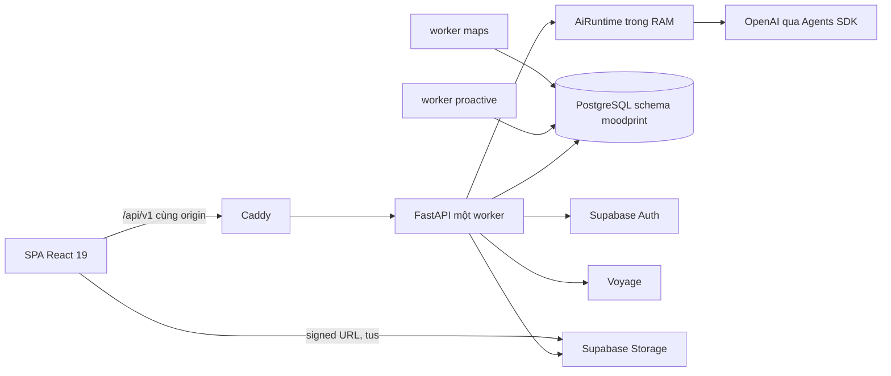
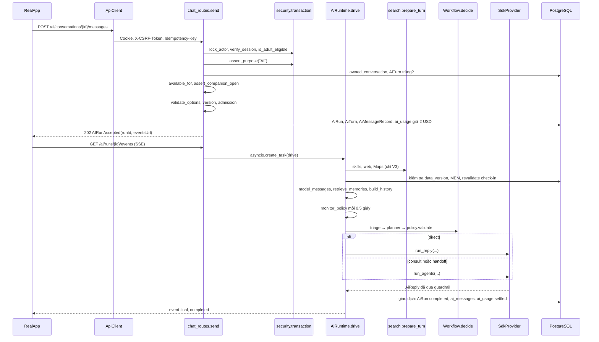
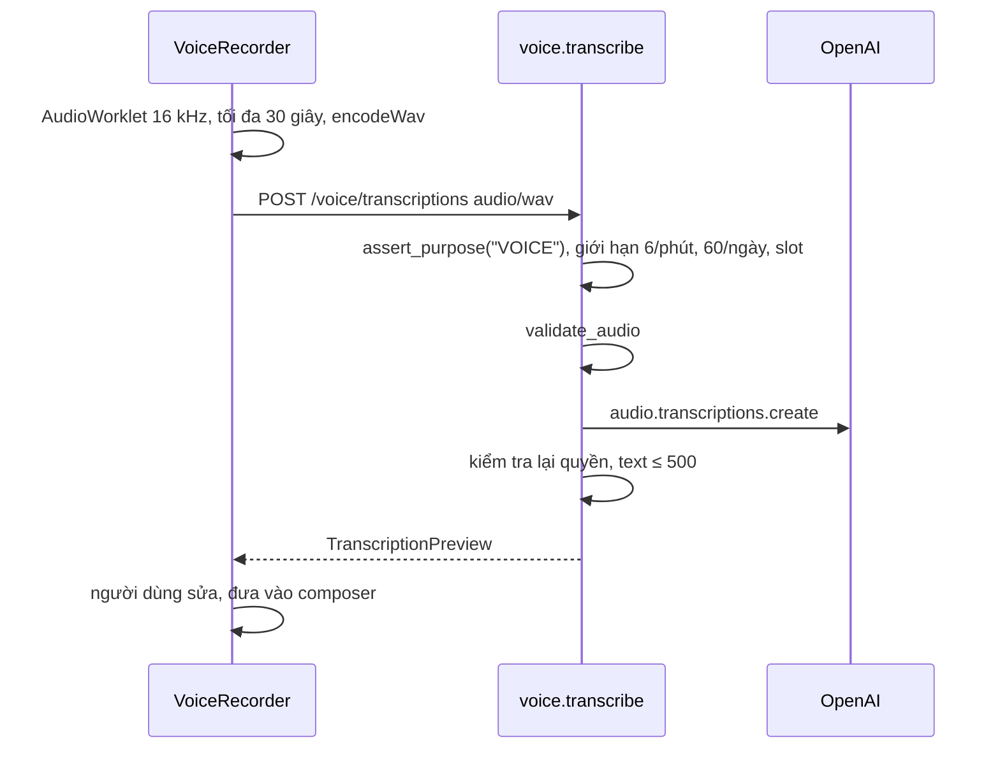
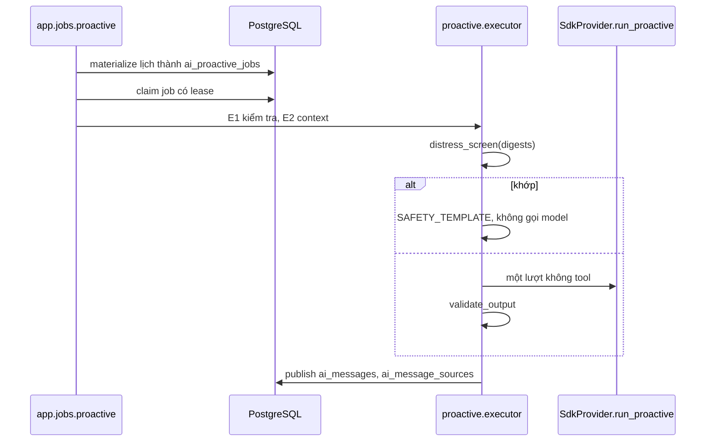
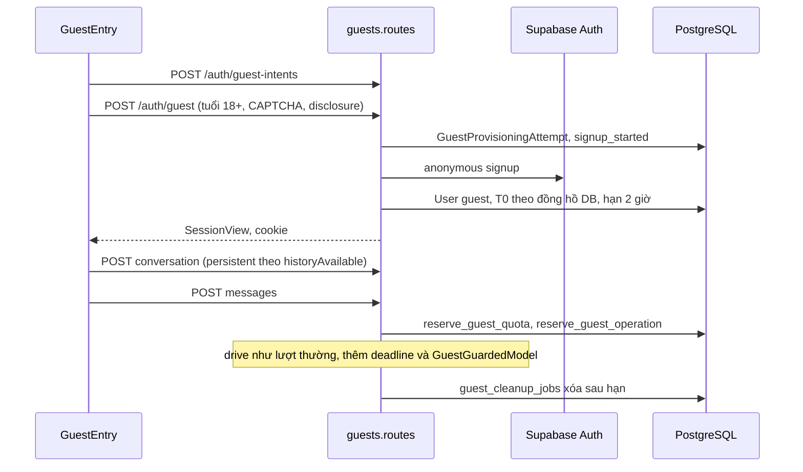
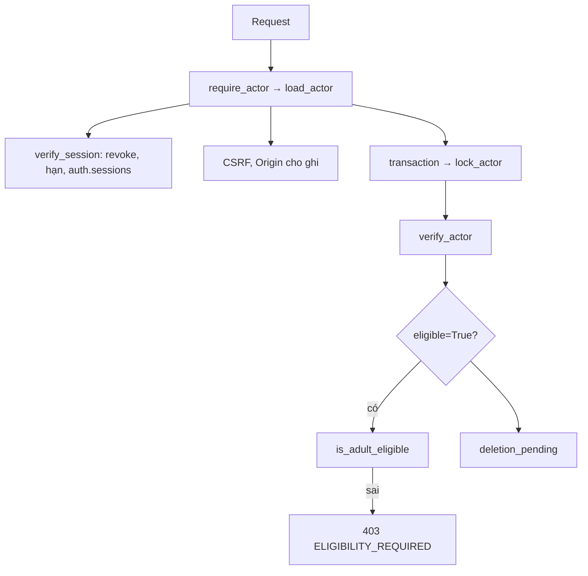
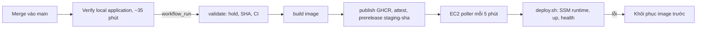

# 02 — Kiến trúc hiện tại

Tài liệu này mô tả code tại HEAD đã review, tập trung vào đường đi Grok sẽ chạm tới. Tổng quan chung nằm ở [ARCHITECTURE.md](../../ARCHITECTURE.md). Mọi mục dưới đây là VERIFIED trừ khi ghi khác.

## 1. Thành phần



## 2. Vòng đời một request AI



Điểm quan trọng cho thiết kế mới:

| Điểm | File, symbol | Ý nghĩa |
| --- | --- | --- |
| Cổng đầu | `chat_routes.send` | `AI_UNAVAILABLE`, `admission`, ngân sách đều chặn trước khi có run. Safety đỏ phải chạy **trước** các cổng này. |
| Không có streaming token | `SdkProvider._stream` | Browser chỉ nhận kết quả đã validate. Hậu kiểm an toàn cắm vào được mà không cần cắt stream. |
| Publish một giao dịch | `drive` | Message, run, usage commit cùng nhau. Template đỏ dùng cùng cách. |
| Sự kiện SSE của run lưu | `persistent_events` | Hàm thuần từ DB, forward-only. Template đỏ không cần `drive`. |
| Giới hạn | `_BudgetHooks(3, 2)`, `MAX_MODEL_CALLS = 7` | 3 model call, 2 tool call mỗi lượt. |
| Thời gian | `ai_timeout_seconds = 30`, `RUN_TIMEOUT_SECONDS = 30` | Thêm classifier và verifier cần nới trong profile demo. |

## 3. Upload attachment

```mermaid
sequenceDiagram
    participant UI as JournalAttachments
    participant API as media_routes
    participant DB as PostgreSQL
    participant S as Supabase Storage
    UI->>API: POST /journal/entries/{id}/media (type, mime, size)
    API->>DB: JournalMedia pending, receipt
    API->>S: POST object/upload/sign (không x-upsert)
    API-->>UI: uploadUrl, token, resumableUrl
    alt file ≤ 6 MiB
        UI->>S: PUT uploadUrl, x-upsert: false
    else file > 6 MiB
        UI->>S: tus, x-signature, chunk 6 MiB
    end
    UI->>API: POST .../media/{id}/complete
    API->>S: object/info
    API->>DB: so size và content-type; đúng thì ready, sai thì xóa
    UI->>API: GET .../media/{id}/access
    API->>S: object/sign, TTL 60 giây
    API-->>UI: signed URL
```

Server không bao giờ thấy byte file và không có hash. Evidence cần thêm bước tải về để băm.

## 4. Voice transcription



Không lưu audio. Không có `language`, `prompt`. Không vào ledger chi phí của tài khoản đăng ký.

## 5. Proactive job



Bị tắt hoàn toàn trong profile demo. Worker vẫn chạy heartbeat để `deploy.sh` báo healthy.

## 6. Guest turn



## 7. Danh tính và eligibility



`transaction(..., eligible=False)` dành cho session, export, xóa dữ liệu. `_session_view` tự tính `eligible = adult_eligible(user, declaration)`.

## 8. Dữ liệu liên quan

| Nhóm | Bảng | Migration | Ghi chú |
| --- | --- | --- | --- |
| Danh tính | `users`, `auth_sessions`, `age_declarations`, `consents`, `consent_events` | 0001, 0004 | `age_band` có CHECK |
| Hội thoại | `ai_conversations`, `ai_messages`, `ai_turns`, `ai_runs`, `ai_usage` | 0006, 0007, 0021, 0024, 0025 | `citations`, `source_backed` trên message |
| Memory | `memories`, `memory_proposals`, `memory_embedding_jobs`, `memory_embeddings` | 0007–0009, 0029 | |
| Journal | `journal_entries`, `journal_media`, `journal_storage_deletions`, `journal_ai_settings`, `journal_entry_embeddings`, `journal_ai_jobs` | 0019, 0029 | |
| Chi phí ngoài | `ai_search_usage`, `ai_maps_searches` | 0026, 0027 | Mẫu ledger ngoài |
| Consent | `consents` | 0001 | `consent_enabled` luôn true với `AI`, `MEM`, `VOICE` nếu có hàng |

**Quyền**: schema `moodprint` riêng, nằm ngoài Data API. Migration mới gọi `protect(table)`: bật RLS, thu hồi khỏi `anon`, `authenticated`, `service_role`, cấp DML cho `moodprint_runtime`, tạo policy `backend_access`. Đây là phòng thủ sâu; quyền theo user do backend kiểm tra.

**Storage**: bucket `journal-media` private, giới hạn 50 MiB, signed read 60 giây, upload token 2 giờ, không upsert. `SupabaseJournalStorage._private_bucket` kiểm tra bucket vẫn private trước mỗi lần ký.

**Frontend**: `AppEntry` chọn cây public hoặc `RealApp`. `classifyEntry` chỉ nhận `/`, `/login`, hash route. App dùng `HashRouter`. Trạng thái dùng `useResource`, `resourceCache` và context, không có thư viện state. Token ở `tokens.css`, chat có thế giới riêng ở `agent-chat.css`. Chuyển động qua `useMotionPolicy`.

## 9. Release hiện tại

Chi tiết ở [release-runbook](grok-handoff/release-runbook.md).


