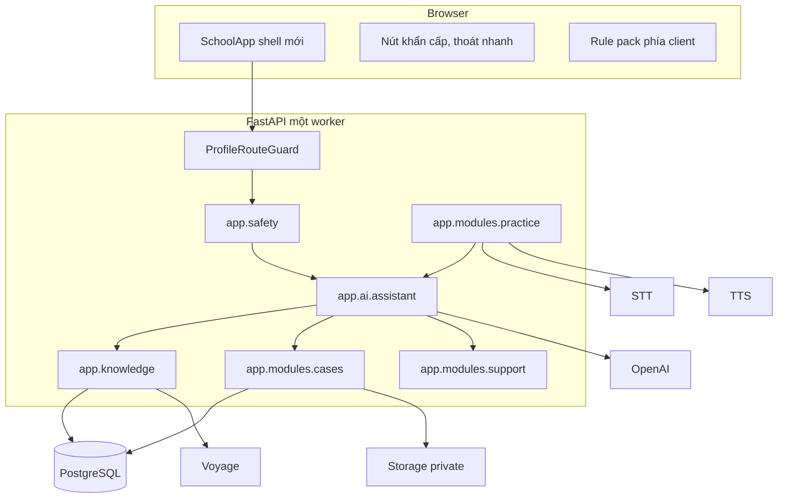
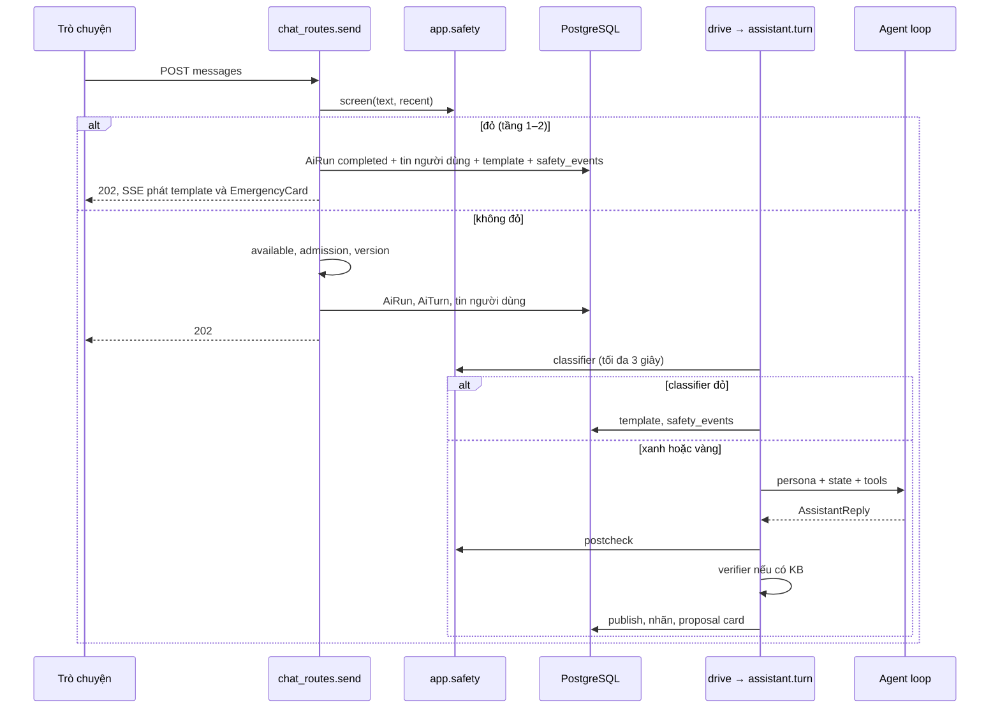

# 03 — Kiến trúc đích

Kiến trúc bám theo nguyên tắc: **an toàn cứng nằm ngoài model; model đề xuất, backend quyết định; hành động bền vững cần người dùng bấm xác nhận.**

## 1. Tổng quan

## 2. Module mới

| Đường dẫn | Trách nhiệm | Được import từ |
| --- | --- | --- |
| `backend/app/core/profile.py` | `is_demo`, denylist route, cờ bị ép tắt | Mọi nơi |
| `backend/app/safety/` | Chuẩn hóa, rule, context, classifier, decision, postcheck, template | `chat_routes`, `assistant`, `practice`. Tầng 1–2 không import `agents`. |
| `backend/app/ai/assistant/` | Persona, tool, workflow state machine, pipeline lượt | `runtime.py` |
| `backend/app/knowledge/` | Nạp thẻ, index, retrieval, verifier | `assistant` |
| `backend/app/modules/school/` | Hồ sơ demo, điều khoản, eligibility, seed | `security.py`, `auth` |
| `backend/app/modules/cases/` | Case, sự việc, bằng chứng, tóm tắt, PDF, PIN | `assistant` qua proposal |
| `backend/app/modules/support/` | Người lớn tin cậy, kế hoạch, soạn tin, thẻ 111 | `assistant` |
| `backend/app/modules/practice/` | Phiên luyện nói, STT/TTS, ledger giọng nói | Router riêng |
| `frontend/src/features/school/` | Shell, 4 tab, khẩn cấp, Hồ sơ, Luyện nói | `AppEntry` |
| `scripts/kb/` | Pipeline thu thập offline | Không nằm trong image |
| `kb/` | Nguồn, bản chuẩn hóa, eval | Không nằm trong image |

## 3. Profile

`APP_PROFILE` gồm `default` (mặc định) và `school_safety_demo`. `APP_ENV` vẫn phải là `production` trên staging vì `deploy.sh` từ chối giá trị khác.

Profile demo:

- **Ép tắt** (ghi cảnh báo, không làm boot lỗi): `ai_three_agent_experience_enabled`, `ai_smart_orchestration_enabled`, `ai_group_chat_enabled`, `ai_collaboration_enabled`, `ai_collaboration_defaults_enabled`, `proactive_enabled`, `proactive_worker_enabled`, `ai_web_search_enabled`, `ai_maps_search_enabled`, `maps_search_worker_enabled`, `ai_agent_skills_enabled`, `activities_enabled`, `semantic_memory_enabled`, `journal_semantic_enabled`, `journal_auto_memory_enabled`, `product_tour_enabled`.
- **Chặn route**: trả 404 cho nhóm social, matching, profiles, activities, groups, collaboration, proactive, inbox, maps, skills, journal, mood, memories (danh sách chính xác trong [WS-02](plans/WS-02-product-shell-access.md)).
- **Eligibility**: cần hàng `school_profiles` có `terms_accepted_at`, thay cho 18+.
- **Đăng ký công khai**: `POST /auth/signup` trả 403 `SIGNUP_CLOSED`.

Profile `default` giữ nguyên hành vi. Route mới vẫn có trong OpenAPI nhưng trả 404 khi không ở profile demo. Nhờ vậy contract sinh ra không phụ thuộc profile.

## 4. Luồng một lượt chat

**Tách bạch**

| Xác định, do backend | Xác suất, do model |
| --- | --- |
| Tầng 1–2, quyết định mức an toàn, kích hoạt WF-06 | Cách diễn đạt |
| Chuyển trạng thái workflow | Đề xuất bước tiếp theo |
| Lưu, sửa, chia sẻ, xuất PDF | Bản nháp tóm tắt, tin nhắn, kế hoạch |
| Hash, thời điểm, phiên bản bằng chứng | Gợi ý loại hành vi |
| Nhãn tham khảo, trích dẫn hợp lệ | Lựa chọn thẻ để dẫn |
| Allowlist số điện thoại | |

## 5. Nguyên tắc dữ liệu

- **Bảng mới, không thêm cột vào bảng cũ**, trừ việc nới CHECK bot. Nhờ đó ORM của image cũ vẫn tương thích schema mới và rollback đơn giản.
- Mọi bảng mới dùng `protect(table)` và thêm vào export, purge.
- `safety_events` không chứa nội dung.
- Không lưu audio. Không sao chép cả hội thoại vào hồ sơ.
- Hội thoại `troly` của tài khoản demo lưu theo `chat_retention_days`; guest ép tạm thời.

## 6. Topology

Vẫn một worker, một replica. Hệ quả ghi rõ:

| Trạng thái | Ở đâu | Khi restart |
| --- | --- | --- |
| Run đang chạy | RAM | Đánh dấu interrupted, không replay |
| Mở khóa PIN | RAM theo session | Nhập lại PIN |
| Phiên luyện nói đang mở | Bảng `practice_sessions` + hội thoại tạm trong RAM | Phiên kết thúc, người dùng bắt đầu lại |
| Rate limit | RAM | Reset |
| Workflow state | PostgreSQL với hội thoại lưu; RAM với guest | Giữ, hoặc mất với guest |

Giới hạn phiên luyện nói đồng thời: `practice_global_concurrency = 5` mặc định, vì mỗi lượt giữ một slot AI và gọi STT/TTS đồng bộ.

## 7. Bảo mật

| Lớp | Biện pháp |
| --- | --- |
| Truy cập | Cookie opaque, CSRF, `verify_session`, owner check mọi truy vấn case |
| Hồ sơ | PIN (scrypt), token mở khóa RAM 15 phút, dependency `require_case_unlock` |
| Storage | Private, BFF cấp quyền, TTL đọc 60 giây, không upsert, chỉ ảnh |
| Nội dung tình dục trẻ em | Không gửi nội dung tới model; chặn upload; luồng chuyển hướng |
| Prompt injection | Dữ liệu người dùng và KB bọc thành "dữ liệu, không phải chỉ dẫn"; tool không nhận owner id |
| Log | Chỉ request ID, nhãn, mức, phiên bản rule |
| Model | `store=False`, tracing tắt, `safety_identifier` băm |

## 8. Chọn công nghệ

| Hạng mục | Chọn | Tài liệu |
| --- | --- | --- |
| Agent | `openai-agents==0.24.0`, `gpt-6.1-terra`; lượt phụ `gpt-6-luna` | [06 §11](06-ai-orchestration-and-safety.md#11-dùng-openai-agents-python-thế-nào) |
| STT, TTS | `OPENAI_API_KEY` hiện có: `gpt-transcribe`, `gpt-realtime-2.1-mini` | [08](08-speaking-practice-design.md) |
| Thiết kế | Quy trình impeccable, kỹ năng trong `.agents/skills/impeccable` | [09 §1](09-ux-and-user-flows.md#1-hướng-hình-ảnh-và-quy-trình-impeccable) |
| Chuyển động | `gsap` 3.15, `@gsap/react`, `useMotionPolicy` | [09 §14](09-ux-and-user-flows.md#14-chuyển-động) |
| Thinking | `thinking-orbs` 0.3.2 | [09 §13](09-ux-and-user-flows.md#13-giao-diện-thinking) |

Staging giữ tên, bản chất là môi trường demo, luôn chạy model thật.

## 9. Những gì cố ý không làm

- Không multi-agent, handoff, specialist, group chat.
- Không web search mở trong luồng học sinh.
- Không reranker trong MVP.
- Không hội thoại giọng nói thời gian thực; Realtime API chỉ dùng làm bộ đọc.
- Không đăng công khai, không chia sẻ tự động, không báo cho bên thứ ba.
- Không console tổ tư vấn; `case_shares` chỉ chừa chỗ.
- Không service worker cho toàn app; chỉ đảm bảo trang hỗ trợ dùng được khi bundle đã tải.
