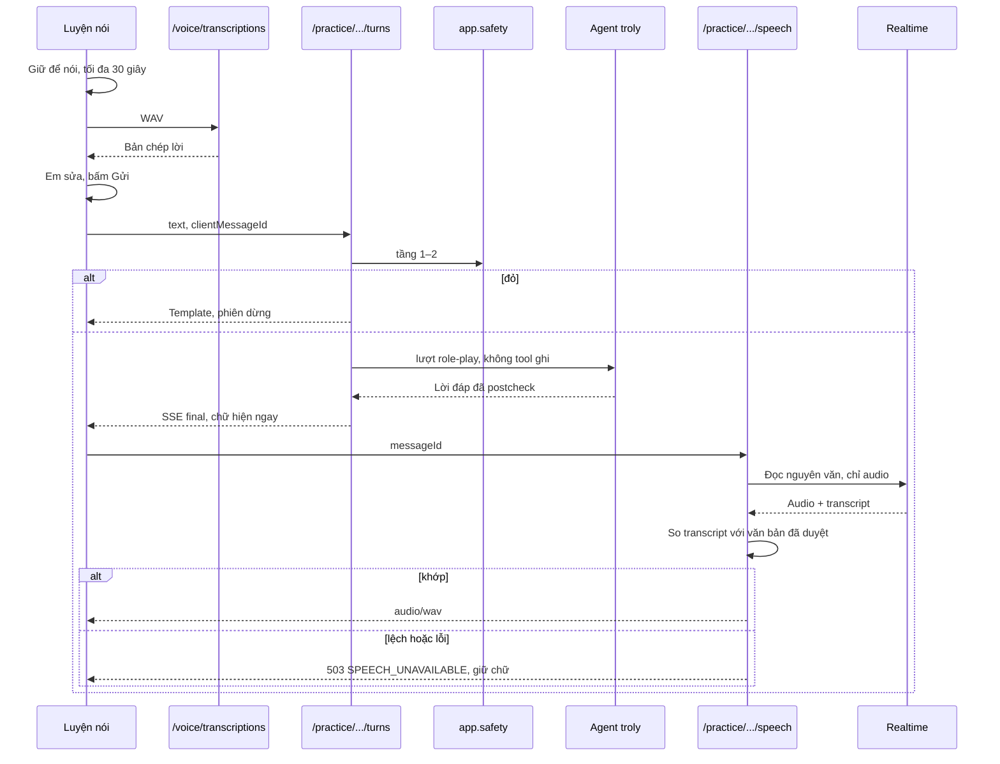
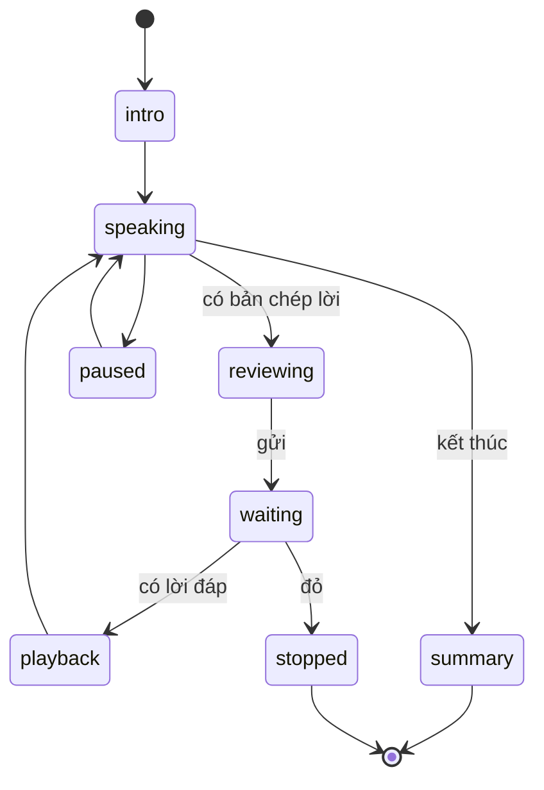

# 08 — Luyện nói

Ngày tra cứu: **06/11/2026**. Task ở [WS-08](plans/WS-08-voice-speaking-practice.md). Owner chốt: **STT và TTS đều dùng `OPENAI_API_KEY` hiện có** ([OD-04](12-open-decisions.md#od-04--tts-và-stt)).

## 1. Ràng buộc từ OpenAI

- `tts-1`, `tts-1-hd`, `gpt-4o-mini-tts` shutdown **06/01/2027**, thay bằng `gpt-realtime-2.1-mini` qua Realtime API. Model này không dùng với `/v1/audio/speech`. Nguồn: [deprecations](https://developers.openai.com/api/docs/deprecations), [TTS guide](https://developers.openai.com/api/docs/guides/text-to-speech).
- Realtime là **mô hình sinh giọng**, không phải bộ đọc. Nó có thể nói khác văn bản đã duyệt.
- Voice được tối ưu cho tiếng Anh; chất lượng tiếng Việt sẽ biết ở bước smoke.
- OpenAI khuyến nghị đường **chained** khi cần "chạy policy check trước khi agent phản hồi, rồi chỉ sinh giọng sau khi workflow có câu trả lời đã duyệt" ([Voice agents](https://developers.openai.com/api/docs/guides/voice-agents#build-a-chained-voice-workflow)). Đúng với yêu cầu của sản phẩm.

**Không dùng GPT-Live, Realtime speech-to-speech**: transcript phải sửa được và qua safety trước agent.

**Không dùng `agents.voice.VoicePipeline`**: cần extra `voice` kéo theo `numpy` (hiện không có trong runtime), và không cho chèn bước sửa transcript.

## 2. Tái dùng

| Thành phần | Quyết định |
| --- | --- |
| `pcm-worklet.js`, `encodeWav`, AudioContext 16 kHz | Tái dùng |
| `validate_audio`, WAV mono ≤ 30 giây | Tái dùng |
| `POST /voice/transcriptions` | Tái dùng; thêm `language`, `prompt` |
| `OpenAITranscriber` | Bọc sau `SpeechTranscriber` |
| Giới hạn 6/phút, 60/ngày, 1 slot | Giữ; profile `school_safety` nâng ngày lên 120 |
| `TranscriptionPreview.text` ≤ 500 | Giữ, khớp `MessageText` |
| Giới hạn body 3.000.000 byte, Caddy 3 MB | Giữ; không đổi host |
| `websockets` | Đã có trong runtime qua `openai-agents`, không thêm dependency |
| `VoiceRecorder` | Không tái dùng UI; viết `HoldToTalk` |

## 3. Pipeline



Chữ luôn hiện trước, tiếng đến sau. Không có token streaming. Audio không lưu.

## 4. Ba chế độ

| Chế độ | Mục tiêu | Vai của AI | Cấm |
| --- | --- | --- | --- |
| `retell` Kể lại | Luyện kể theo trình tự, đủ ý | Người nghe hỗ trợ, hỏi nhẹ | Ép kể chi tiết đau |
| `trusted_adult` Nói với người lớn | Mở lời, nói rõ điều cần | "Vai luyện tập do AI đóng", một người lớn giả định | Giả làm cô, bố mẹ, người thật cụ thể |
| `call_111` Chuẩn bị gọi 111 | Biết sẽ được hỏi gì, đọc thẻ tóm tắt | Huấn luyện viên, nêu câu có thể được hỏi | Xưng là tổng đài viên |

Mọi phiên mở đầu bằng câu xác định: AI, không phải người thật, luyện tập không thay cho cuộc nói thật.

**Độ khó**: `gentle` mặc định. `challenging` là tùy chọn, em tự bật, tối đa một phản ứng khó mỗi phiên, lấy từ danh sách duyệt sẵn (ví dụ "Chắc con cũng có lỗi gì đó"), kèm gợi ý cách đáp lại. Không dùng khi có nhãn tình dục, tự hại, hoặc `adult_perpetrator`.

## 5. Trạng thái phiên



Giới hạn: 20 lượt, 20 phút, hết hạn sau 2 giờ. `retry` thu lại, `pause` dừng phát, `stop` kết thúc, `exit` thoát không lưu.

**Tóm tắt cuối phiên**: một lượt agent trả `PracticeSummary(strengths[], next_tries[], draft_message?)`. Lưu vào case là proposal `practice_summary_save`, cần bấm xác nhận.

## 6. Nhà cung cấp

### STT

`gpt-transcribe`, 0,0045 USD/phút, `language="vi"`, `prompt` chứa từ vựng ("bị anti", "bóc phốt", "cô chủ nhiệm", "Tổng đài 111"). API reference xác nhận model và tham số `prompt`.

### TTS

`gpt-realtime-2.1-mini`: 20 USD/1M audio token ra, 0,60 USD/1M text vào; audio ra 1 token mỗi 50 ms, tức khoảng 0,024 USD/phút. Owner chốt đây là đường chính, không cần nghe thử ([OD-04](12-open-decisions.md#od-04--tts-và-stt)). Không đảm bảo đọc đúng chữ, nên cần so transcript.

`TTS_PROVIDER`: `openai_realtime` hoặc `none`.

### Cách làm Realtime thành bộ đọc

`OpenAIRealtimeSynthesizer` mở WebSocket từ server qua `AsyncOpenAI.realtime.connect`, một kết nối mỗi lượt đọc:

1. `session.update`: `type="realtime"`, `output_modalities=["audio"]`, `audio.output.voice`, instructions cố định: "Bạn là công cụ đọc. Đọc đúng từng chữ văn bản trong tin tiếp theo bằng tiếng Việt, giọng bình tĩnh. Không thêm, không bớt, không trả lời." Không tool.
2. `conversation.item.create` chứa văn bản, bọc là dữ liệu cần đọc.
3. `response.create`.
4. Gom `response.output_audio.delta` vào bộ đệm, đọc `response.output_audio_transcript.done`, lấy `usage` từ `response.done`.
5. Giới hạn 10 giây tổng, 45 giây âm thanh, 2 MB.

**Kiểm tra bắt buộc** `verbatim_ok(expected, transcript) -> bool`: chuẩn hóa bằng `normalize_text`, so `difflib.SequenceMatcher` ≥ 0,92; mọi chữ số trong văn bản gốc phải xuất hiện; transcript qua `postcheck`. Không đạt: bỏ audio, trả 503, UI giữ chữ. Không phát audio chưa kiểm tra, nên không stream tới browser.

Audio trả về `audio/wav` từ PCM 24 kHz. TO_VERIFY định dạng mặc định và tốc độ sinh ở T06; nếu độ trễ quá 5 giây cho câu 250 ký tự, báo owner kèm số đo.

Transcript do chính model sinh, nên đây là kiểm tra mạnh chứ không tuyệt đối. Ghi rõ trong tài liệu dự thi.

### Kiểm tra tự động

20 câu cố định theo ba chế độ. Grok đo tỷ lệ `verbatim_ok`, độ trễ, chi phí, kết quả lưu `.tmp/tts-trial/`, không commit audio. Không thu giọng trẻ em thật.

Chưa kiểm chứng được chất lượng trên giọng trẻ em và theo vùng miền. Ghi vào giới hạn đã biết.

## 7. Abstraction

`backend/app/modules/practice/providers.py`:

```python
class SpeechTranscriber(Protocol):
    async def transcribe(self, audio: bytes, *, language: str, prompt: str | None) -> str: ...

class SpeechSynthesizer(Protocol):
    async def synthesize(self, text: str, *, voice: str) -> SynthesizedAudio: ...

@dataclass(frozen=True)
class SynthesizedAudio:
    audio: bytes
    mime_type: Literal["audio/wav", "audio/mpeg"]
    characters: int
    input_tokens: int
    output_audio_tokens: int
```

Adapter: `OpenAISpeechTranscriber`, `OpenAIRealtimeSynthesizer`, `FakeSynthesizer`.

## 8. API

| Route | Mô tả |
| --- | --- |
| `POST /api/v1/practice/sessions` | Tạo phiên: `mode`, `scenarioId`, `difficulty`. Tạo hội thoại tạm `troly` |
| `GET /api/v1/practice/sessions/{id}` | Trạng thái |
| `POST /api/v1/practice/sessions/{id}/turns` | Gửi lời đã sửa; trả `AIRunAccepted`; SSE như chat |
| `POST /api/v1/practice/sessions/{id}/speech` | `{ messageId }` → audio. Server tự đọc text của message; client không gửi text tùy ý |
| `POST /api/v1/practice/sessions/{id}/end` | Kết thúc, tạo tóm tắt nháp |

Mọi route có owner check, CSRF, `Idempotency-Key` khi ghi, `assert_purpose("VOICE")` với STT/TTS.

## 9. An toàn

- Transcript đi qua **cùng** pipeline safety với chat.
- Đỏ: dừng phiên, hiện template, không gọi TTS.
- Role-play không có tool ghi. Postcheck thêm: không nhận là người thật; không phản ứng làm em thấy có lỗi ngoài danh sách duyệt.
- Nhãn "Giọng đọc do AI tạo" luôn hiện cạnh nút phát, theo chính sách OpenAI và yêu cầu sản phẩm.
- Chỉ gửi lời của AI sang TTS, không gửi lời học sinh.
- Không lưu audio ở server.

## 10. Đồng thời và chi phí

Khách dùng được Luyện nói: `pricing.kind_available` phải mở `voice` dưới cấu hình có trần, `GUEST_PRICING_JSON` thêm giá STT và TTS (WS-02-T12).

Một worker. `practice_global_concurrency = 5`; quá giới hạn trả 429 `PRACTICE_BUSY` kèm gợi ý nhập chữ. WebSocket chỉ mở trong lúc đọc. `speech_usage` ghi mỗi call; `speech_liability` cộng vào `budget_liability`. Khi hết ngân sách: tắt TTS trước, rồi STT, chữ vẫn chạy.

## 11. Ngoài phạm vi

GPT-Live, Realtime speech-to-speech, barge-in, chọn giọng theo vùng, lưu audio, phân tích cảm xúc giọng nói.
