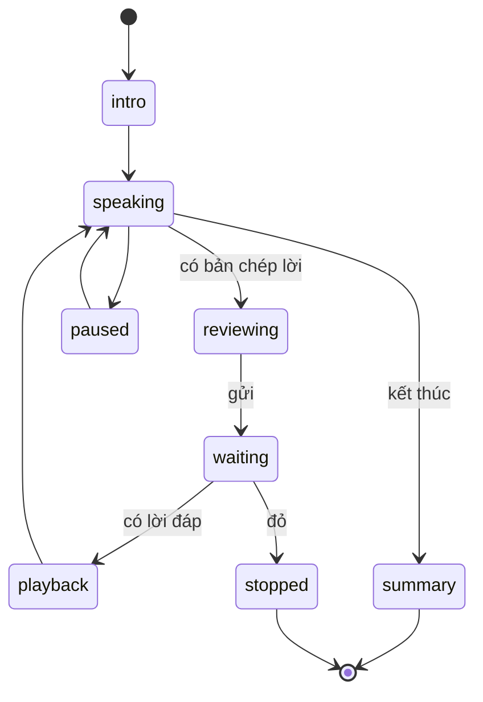

# 08 — Luyện nói

Ngày tra cứu: **06/11/2026**. Task ở [WS-08](plans/WS-08-voice-speaking-practice.md).

## 1. Phát hiện quyết định thiết kế

**OpenAI đã deprecate `tts-1`, `tts-1-hd`, `gpt-4o-mini-tts`. Shutdown 06/01/2027.** Hướng thay thế là `gpt-realtime-2.1-mini` qua Realtime API; model này không dùng được với `/v1/audio/speech`. Nguồn: [deprecations](https://developers.openai.com/api/docs/deprecations), [TTS guide](https://developers.openai.com/api/docs/guides/text-to-speech).

Hệ quả cho sản phẩm an toàn: Realtime là **mô hình sinh giọng**, không phải bộ đọc nguyên văn. Văn bản đã qua postcheck có thể được nói khác đi. Tài liệu cũng ghi voice được tối ưu cho tiếng Anh. Vì vậy **không dùng Realtime làm TTS**. Chọn engine TTS đọc đúng từng chữ.

## 2. Tái dùng

| Thành phần | Quyết định |
| --- | --- |
| `pcm-worklet.js`, `encodeWav`, AudioContext 16 kHz | Tái dùng |
| `validate_audio`, WAV mono ≤ 30 giây | Tái dùng; 30 giây đủ cho một lượt nói |
| `POST /voice/transcriptions` | Tái dùng; thêm `language`, `prompt` |
| `OpenAITranscriber` | Bọc sau `SpeechTranscriber` |
| Giới hạn 6/phút, 60/ngày, 1 slot | Giữ; profile demo nâng ngày lên 120 |
| `TranscriptionPreview.text` ≤ 500 | Giữ, khớp `MessageText` |
| Giới hạn body 3.000.000 byte, Caddy 3 MB | Giữ; không cần đổi Caddy |
| `VoiceRecorder` | Không tái dùng UI; viết `HoldToTalk` |

## 3. Pipeline

```mermaid
sequenceDiagram
    participant UI as Luyện nói
    participant STT as /voice/transcriptions
    participant T as /practice/.../turns
    participant S as app.safety
    participant A as Agent troly
    participant TTS as /practice/.../speech
    UI->>UI: Giữ để nói, tối đa 30 giây
    UI->>STT: WAV
    STT-->>UI: Bản chép lời
    UI->>UI: Em sửa, bấm Gửi
    UI->>T: text, clientMessageId
    T->>S: tầng 1–2
    alt đỏ
        T-->>UI: Template, phiên dừng
    else
        T->>A: lượt role-play, không tool ghi
        A-->>T: Lời đáp đã postcheck
        T-->>UI: SSE final
        UI->>TTS: messageId
        TTS-->>UI: Audio hoặc 503
        UI->>UI: Phát; lỗi thì chỉ hiện chữ
    end
```

Không có token streaming. Luôn có ô nhập chữ. Audio không lưu.

## 4. Ba chế độ

| Chế độ | Mục tiêu | Vai của AI | Cấm |
| --- | --- | --- | --- |
| `retell` Kể lại | Luyện kể theo trình tự, đủ ý | Người nghe hỗ trợ, hỏi nhẹ | Ép kể chi tiết đau |
| `trusted_adult` Nói với người lớn | Mở lời, nói rõ điều cần | "Vai luyện tập do AI đóng", một người lớn giả định | Giả làm cô, bố mẹ, người thật cụ thể |
| `call_111` Chuẩn bị gọi 111 | Biết sẽ được hỏi gì, đọc thẻ tóm tắt | Huấn luyện viên, nêu câu có thể được hỏi | Xưng là tổng đài viên |

Mọi phiên mở đầu bằng câu xác định: AI, không phải người thật, luyện tập không thay cho cuộc nói thật.

**Độ khó**: `gentle` mặc định. `challenging` là tùy chọn, em tự bật, tối đa một phản ứng khó mỗi phiên, lấy từ danh sách duyệt sẵn (ví dụ "Chắc con cũng có lỗi gì đó"), kèm gợi ý cách đáp lại. Không dùng cho nhãn tình dục, tự hại, hoặc khi `adult_perpetrator`. Phải có eval an toàn riêng.

## 5. Trạng thái phiên



Giới hạn: 20 lượt, 20 phút, hết hạn sau 2 giờ. `retry` thu lại, `pause` dừng phát, `stop` kết thúc, `exit` thoát không lưu.

**Tóm tắt cuối phiên**: một lượt agent trả `PracticeSummary(strengths[], next_tries[], draft_message?)`. Hiện cho em xem. Lưu vào case là proposal `practice_summary_save`, cần bấm xác nhận.

## 6. Nhà cung cấp

**Không có benchmark công khai** so sánh các dịch vụ này trên tiếng Việt theo vùng miền, và không có dữ liệu giọng trẻ em. Nghiên cứu năm 2026 về tiếng Việt hội thoại cho thấy WER thường tăng đáng kể khi mô hình huấn luyện trên giọng đọc gặp hội thoại thật ([VietSuperSpeech](https://arxiv.org/pdf/2603.01894)). Chất lượng phải đo bằng bake-off.

### STT

| Nhà cung cấp | Giá | Vòng đời | Ghi chú | Nhãn |
| --- | --- | --- | --- | --- |
| OpenAI `gpt-transcribe` | 0,0045 USD/phút | Hiện hành | Có `language`, `prompt`; đã tích hợp | VERIFIED |
| OpenAI `gpt-4o-mini-transcribe` | 0,003 USD/phút | Hiện hành | Rẻ hơn | VERIFIED |
| FPT.AI | 540–700 VND/phút theo gói; 60 phút/năm miễn phí | Hiện hành | Trang giá không ghi ngôn ngữ | VERIFIED giá |
| Google STT V2 | Khoảng 0,016 USD/phút | Hiện hành | Nguồn thứ cấp | TO_VERIFY |
| Azure Speech | Chưa có giá thời gian thực đáng tin | Hiện hành | | TO_VERIFY |
| Viettel AI, Zalo AI | Không có giá công khai | | Cần liên hệ | UNKNOWN |

**Chọn**: `gpt-transcribe`, `language="vi"`, `prompt` chứa từ vựng ("bị anti", "bóc phốt", "cô chủ nhiệm", "Tổng đài 111"). Lý do: đã tích hợp, không cần credential mới, rẻ nhất trong nhóm có API rõ.

### TTS

| Nhà cung cấp | Giá | Đọc nguyên văn | Tiếng Việt | Nhãn |
| --- | --- | --- | --- | --- |
| FPT.AI | 500.000 VND / 1,5M ký tự; 100.000 ký tự/tháng miễn phí | Có | Nhà cung cấp Việt Nam; giọng theo vùng TO_VERIFY | VERIFIED giá |
| Azure neural | Khoảng 15 USD/1M ký tự | Có | Giọng vi-VN TO_VERIFY | TO_VERIFY |
| Google Chirp 3 HD | 30 USD/1M ký tự; 1M miễn phí/tháng | Có | vi-VN chưa xác nhận | TO_VERIFY |
| OpenAI `gpt-4o-mini-tts` | 12 USD/1M audio token | Có | Tắt 06/01/2027 | **Loại** |
| OpenAI `gpt-realtime-2.1-mini` | 20 USD/1M audio token | **Không đảm bảo** | Voice tối ưu cho tiếng Anh | **Loại** cho TTS |
| Viettel AI, Zalo AI | Không có giá công khai | | Thư viện Zalo tìm được là không chính thức | UNKNOWN |

**Đề xuất**: FPT.AI nếu bake-off đạt. Lý do: giá công khai, có phần miễn phí đủ cho demo, nhà cung cấp trong nước. Cần owner cấp API key ([OD-04](12-open-decisions.md#od-04--nhà-cung-cấp-tts)).

**TO_VERIFY FPT**: API có trả link bất đồng bộ không; nếu có, adapter poll tối đa 8 giây rồi fallback chữ. Điều khoản dữ liệu chưa đọc. Chỉ gửi lời của AI sang TTS, không gửi lời học sinh.

**Bake-off** (owner hoặc nhóm thực hiện vì cần tai nghe):

- 30 câu cố định theo ba chế độ, nghe trên điện thoại.
- 40 đoạn STT do thành viên trưởng thành thu, chia Bắc/Trung/Nam; **không thu giọng trẻ em thật**.
- Tiêu chí: dễ nghe, tự nhiên, đọc đúng số và tên riêng, độ trễ đầu tiên ≤ 3 giây, WER.

Giới hạn còn lại: không kiểm chứng được giọng trẻ em.

## 7. Abstraction

`backend/app/modules/practice/providers.py`:

```python
class SpeechTranscriber(Protocol):
    async def transcribe(self, audio: bytes, *, language: str, prompt: str | None) -> str: ...

class SpeechSynthesizer(Protocol):
    async def synthesize(self, text: str, *, voice: str) -> SynthesizedAudio: ...

@dataclass(frozen=True)
class SynthesizedAudio:
    audio: bytes
    mime_type: Literal["audio/mpeg", "audio/wav"]
    characters: int
```

Adapter: `OpenAISpeechTranscriber`, `FptSpeechSynthesizer`, `FakeSynthesizer` cho test. Chọn qua `TTS_PROVIDER` (`none`, `fpt`, `azure`, `google`). `none`: UI chỉ hiện chữ.

## 8. API

| Route | Mô tả |
| --- | --- |
| `POST /api/v1/practice/sessions` | Tạo phiên: `mode`, `scenarioId`, `difficulty`. Tạo hội thoại tạm `troly` |
| `GET /api/v1/practice/sessions/{id}` | Trạng thái |
| `POST /api/v1/practice/sessions/{id}/turns` | Gửi lời đã sửa; trả `AIRunAccepted`; SSE như chat |
| `POST /api/v1/practice/sessions/{id}/speech` | `{ messageId }` → audio. Server tự đọc text của message; client không gửi text tùy ý |
| `POST /api/v1/practice/sessions/{id}/end` | Kết thúc, tạo tóm tắt nháp |

Mọi route có owner check, CSRF, `Idempotency-Key` khi ghi, `assert_purpose("VOICE")` với STT/TTS.

## 9. An toàn

- Transcript đi qua **cùng** pipeline safety với chat.
- Đỏ: dừng phiên, hiện template.
- Role-play không có tool ghi. Postcheck thêm: không nhận là người thật; không phản ứng làm em thấy có lỗi ngoài danh sách duyệt.
- Công bố: nhãn "Giọng đọc do AI tạo" luôn hiện cạnh nút phát, theo yêu cầu của chính sách OpenAI và của sản phẩm.
- Không lưu audio ở server; `audio.clear()` như `transcribe`.

## 10. Đồng thời và chi phí

Một worker. `practice_global_concurrency = 5`; quá giới hạn trả 429 `PRACTICE_BUSY` kèm gợi ý nhập chữ. `speech_usage` ghi mỗi call; `speech_liability` cộng vào `budget_liability`. STT reservation theo `duration_seconds`, TTS theo ký tự. Khi hết ngân sách: tắt TTS trước, rồi STT, chữ vẫn chạy.

## 11. Ngoài phạm vi

Realtime speech, GPT-Live, barge-in, chọn giọng theo vùng do người dùng, lưu audio, phân tích cảm xúc giọng nói.
