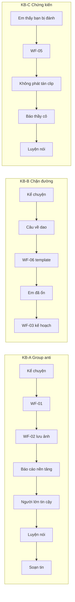

# 09 — UX và luồng người dùng

Đủ để dựng UI mà không phải tự thiết kế. Task ở [WS-09](plans/WS-09-frontend-integration.md).

## 1. Hướng hình ảnh

Bỏ trải nghiệm nhiều bot là đã chốt. Phong cách là quyết định của owner ([OD-06](12-open-decisions.md#od-06--hướng-hình-ảnh)).

| | A. Góc yên (đề xuất) | B. Bảng rõ ràng |
| --- | --- | --- |
| Cảm giác | Sổ tay yên tĩnh, ấm, ít viền | Trắng, thẻ rõ, thông tin dày hơn |
| Nền | `--color-bg` #f8f9f6 | #ffffff |
| Nhấn | `--color-primary` #285c4b | Trung tính + một màu xanh |
| Khẩn cấp | `--color-danger` #9c352c, duy nhất trên màn hình | Như A |
| Lý do | Dùng lại nguyên token, không gây áp lực, khẩn cấp nổi bật vì là điểm màu mạnh duy nhất | Dễ đọc số liệu nhưng giống công cụ hành chính |

Quy tắc chung: một màu mạnh duy nhất dành cho khẩn cấp. Không minh họa nhân vật. Không dùng màu đỏ cho lỗi thường (dùng `--color-warning`). Icon `lucide-react`, biểu tượng Trợ lý là một hình tròn trung tính, không có mặt.

CSS phạm vi `.school-app` trong `frontend/src/features/school/school.css`. Dùng `tokens.css`, `Button`, `Dialog`, `StatePanel`, `ErrorNotice`, `useMotionPolicy`. Không dùng `real.css`, `agent-chat.css`.

## 2. Sitemap

```text
Public (không cần đăng nhập, đường dẫn thật)
  /                 Trang giới thiệu demo
  /login            Đăng nhập tài khoản demo + chế độ khách
  /ho-tro           Tìm hỗ trợ
  /trung-tinh       Trang trung tính cho thoát nhanh

App (HashRouter, cần phiên)
  #/dieu-khoan      Điều khoản lần đầu
  #/tro-chuyen      Trò chuyện
  #/ho-so           Danh sách hồ sơ (cần PIN nếu đã đặt)
  #/ho-so/:caseId   Dòng thời gian
  #/ho-so/:caseId/su-viec/:eventId   Chi tiết, lịch sử phiên bản
  #/ho-so/:caseId/xuat               Xem trước và xuất PDF
  #/luyen-noi       Chọn chế độ
  #/luyen-noi/:sessionId             Phòng luyện nói
  #/ho-tro          Tìm hỗ trợ
  #/ho-tro/nen-tang/:platform        Hướng dẫn báo cáo
  #/nguoi-lon       Bảng người lớn tin cậy
  #/ke-hoach        Kế hoạch an toàn
  #/cai-dat         Cài đặt, giới hạn của AI, xóa dữ liệu
```

`classifyEntry` cần nhận thêm `/ho-tro`, `/trung-tinh`. Shell chọn theo `appProfile` từ `GET /public/experience`.

## 3. Khung ứng dụng

Mobile 360×800:

```text
┌────────────────────────────────┐
│ MoodPrint       [Thoát] [Khẩn] │  ← luôn hiện, ≥ 44px
├────────────────────────────────┤
│                                │
│        Nội dung màn hình       │
│                                │
├────────────────────────────────┤
│ Trò chuyện  Hồ sơ  Luyện  Hỗ trợ│  ← 4 tab, có nhãn chữ
└────────────────────────────────┘
```

Từ 768px trở lên: rail bên trái, khẩn cấp và thoát nhanh ở đầu rail. Kiểm tra ở 360, 390, 768, 1280.

**Nút Khẩn cấp** mở `EmergencySheet`, hoạt động không cần mạng, không cần đăng nhập:

```text
┌────────────────────────────────┐
│ Bây giờ em có an toàn không?   │
│ ┌────────────────────────────┐ │
│ │ 111  Bảo vệ trẻ em         │ │  tel:111
│ ├────────────────────────────┤ │
│ │ 113  Công an               │ │  tel:113
│ ├────────────────────────────┤ │
│ │ 115  Cấp cứu               │ │  tel:115
│ └────────────────────────────┘ │
│ Trên máy tính: hãy dùng điện   │
│ thoại gọi số này.              │
│ [Về thẻ tóm tắt của em]  [Đóng]│
└────────────────────────────────┘
```

**Nút Thoát nhanh**: một chạm, không hỏi lại. Xóa `resourceCache`, draft trong RAM, `sessionStorage`, rồi `location.replace("/trung-tinh")`. Phím Esc ba lần liên tiếp cũng kích hoạt trên desktop. Trang trung tính hiển thị nội dung ôn tập chung, có tiêu đề tab trung tính. Lần vào lại cần PIN nếu đã đặt.

**Tên trung tính**: cài đặt đổi `document.title` thành "Sổ tay" và icon tab trung tính. Không có thông báo đẩy trong MVP; nếu thêm sau, nội dung phải trung tính.

## 4. Lần dùng đầu

```text
┌────────────────────────────────┐
│ Trước khi bắt đầu              │
│ Em thuộc nhóm nào?             │
│ ( ) 11–14 tuổi  ( ) 15–17 tuổi │
│                                │
│ • Đây là AI, không phải người. │
│ • Dữ liệu lưu trên máy chủ của │
│   ứng dụng. Chỉ em xem được.   │
│ • Ứng dụng không tự báo cho ai.│
│ • Thông tin AI chỉ để tham khảo│
│ • Nếu nguy hiểm, gọi 111/113/  │
│   115.                         │
│ [ ] Em đã đọc và đồng ý        │
│          [Bắt đầu]             │
└────────────────────────────────┘
```

Lưu `terms_version`, thời điểm. Tài khoản demo seed sẵn nhóm tuổi nhưng vẫn phải bấm xác nhận.

## 5. Trò chuyện

```text
┌────────────────────────────────┐
│ ○ Trợ lý · AI, không phải người│
├────────────────────────────────┤
│ Chào em, có chuyện gì em muốn  │
│ kể không?                      │
│ [Kể chuyện đang xảy ra]        │
│ [Em thấy bạn bị bắt nạt]       │
│ [Chuẩn bị nói với người lớn]   │
│                                │
│        Tụi nó lập nhóm nói xấu │
│                                │
│ Mình hiểu rồi... [1]           │
│ ⓘ Thông tin do AI tổng hợp...  │
│ ┌ Lưu vào hồ sơ? ────────────┐ │
│ │ "Lập nhóm chat nói xấu..." │ │
│ │ [Xem và sửa] [Lưu] [Bỏ]    │ │
│ └────────────────────────────┘ │
├────────────────────────────────┤
│ Nhập tin nhắn...      [🎤] [↑] │
└────────────────────────────────┘
```

| Thành phần | Hành vi |
| --- | --- |
| Citation `[1]` | Dùng lại `CitationText`; mở sheet thẻ nguồn gồm tiêu đề, nơi phát hành, ngày kiểm tra, link |
| Nhãn tham khảo | Hiện khi `sourceMarked`; câu cố định; không ẩn được |
| Tool đang chạy | Trạng thái thân thiện: "Đang tìm thông tin đã kiểm duyệt", "Đang chuẩn bị bản nháp". Không lộ tên tool |
| Proposal card | Hiện đúng nội dung sẽ lưu; Sửa, Lưu, Bỏ; lưu xong hiện biên nhận từ server |
| `EmergencyCard` | Toàn chiều rộng, viền `--color-danger`, nút 111/113/115, nút "Em đã ổn" và "Em đã gọi" |
| Nhắc nghỉ | Câu xác định sau 20 lượt hoặc 30 phút |
| Giới hạn | Bộ đếm khi còn 50 ký tự trong 500 |
| Dừng | Giữ hành vi: yêu cầu dừng, chờ kết quả cuối |

## 6. Hồ sơ

**Danh sách**: thẻ case gồm tiêu đề, số sự việc, cập nhật gần nhất. Nút "Thêm hồ sơ".

**Dòng thời gian**

```text
┌────────────────────────────────┐
│ ← Sự việc của em       [Xuất]  │
│ Lời nói · Trên mạng · Lặp lại  │
│ [+ Thêm sự việc]               │
│ ──●── Khoảng đầu tuần trước    │
│   │  Nhóm chat lớp bị đổi tên..│
│   │  🖼 2 ảnh · Em kể          │
│ ──●── 12/10 (không rõ giờ)     │
│   │  ...                       │
└────────────────────────────────┘
```

**Thêm bằng chứng**: chọn ảnh → màn tự kiểm tra bắt buộc → tải lên có tiến trình → hiện kết quả.

```text
┌────────────────────────────────┐
│ Kiểm tra trước khi tải lên     │
│ Ảnh có cảnh khỏa thân hoặc     │
│ nội dung tình dục của ai không?│
│ [Không có]  [Có hoặc không chắc]│
└────────────────────────────────┘
```

Chọn "Có hoặc không chắc": không tải lên, hiện luồng chuyển hướng: không lưu, không gửi đi, liên hệ 111 hoặc công an, kèm lý do ngắn.

**Thông tin file**

```text
Đã lưu lúc 14:32, 06/11/2026 (giờ máy chủ)
Mã kiểm tra SHA-256: 9f2c…a1e0  [Xem đầy đủ]
Mã này cho thấy file không đổi kể từ lúc tải lên.
Nó không chứng minh chuyện đã xảy ra.
```

**Lịch sử phiên bản**: danh sách bản ghi, bản gốc đánh dấu "Bản đầu tiên". Sửa tạo bản mới.

**Xem trước PDF**: ba phần có nhãn rõ: "Em kể", "File em tải lên", "AI diễn giải (bản nháp đã được em xem)". Chọn phần muốn xuất. Tải về là hành động của em.

**PIN**: đặt ở lần đầu mở Hồ sơ, tùy chọn trong demo. 4–6 chữ số. 5 lần sai khóa 5 phút. Quên PIN: nhập lại mật khẩu.

## 7. Luyện nói

```text
┌────────────────────────────────┐
│ ← Nói với người lớn   Lượt 3/20│
│ Vai luyện tập do AI đóng       │
├────────────────────────────────┤
│ AI: Con muốn nói với cô chuyện │
│ gì?              [▶ Phát]      │
│ Giọng đọc do AI tạo            │
│                                │
│ Em: [bản chép lời sửa được]    │
│                                │
│        ▁▃▅▇▅▃▁                 │
│     ┌──────────────┐           │
│     │ Giữ để nói   │           │
│     └──────────────┘           │
│ [Nhập chữ]  [Dừng]  [Kết thúc] │
└────────────────────────────────┘
```

Giữ để nói bằng pointer và phím Space. Thả là dừng. Bộ đếm 30 giây. Với người dùng không giữ được: chế độ "chạm để bắt đầu, chạm để dừng" trong cài đặt. Sóng âm tắt khi `prefers-reduced-motion`.

## 8. Tìm hỗ trợ

Đọc được không cần đăng nhập, không cần API. Nội dung nằm trong bundle.

```text
┌────────────────────────────────┐
│ Tìm hỗ trợ                     │
│ [📞 111 Bảo vệ trẻ em · 24/24] │
│ [📞 113 Công an]               │
│ [📞 115 Cấp cứu]               │
│ Tổ tư vấn của trường           │
│  Hỏi thầy cô chủ nhiệm...      │
│ Báo cáo trên mạng              │
│  TikTok · Zalo · Facebook ·    │
│  Messenger · Instagram ·       │
│  YouTube · Discord             │
└────────────────────────────────┘
```

Hướng dẫn nền tảng cần đăng nhập mới đọc qua API; bản public dùng `cards.json` rút gọn do `scripts/kb/build.py` sinh ra.

## 9. Luồng ba kịch bản



Kịch bản chi tiết ở [demo/scenarios-KB-A-B-C.md](demo/scenarios-KB-A-B-C.md).

## 10. Copy mẫu

Xưng hô: 11–14 "mình – em"; 15–17 "mình – bạn". Câu ngắn. Không dùng từ chuyên môn. **Mọi template khẩn cấp là bản nháp, cần người có chuyên môn duyệt.**

| Tình huống | 11–14 | 15–17 |
| --- | --- | --- |
| Chào | Chào em. Mình là Trợ lý, một AI. Em muốn kể gì cũng được, không kể cũng không sao. | Chào bạn. Mình là Trợ lý, một AI. Bạn muốn bắt đầu từ đâu cũng được. |
| Giới hạn | Mình là AI nên có thể sai. Những chuyện quan trọng, em nên nói với một người lớn em tin. | Mình là AI nên có thể sai. Việc quan trọng nên có một người lớn bạn tin đồng hành. |
| Xác nhận lưu | Em xem lại nhé. Bấm Lưu thì nội dung này mới vào hồ sơ. | Xem lại giúp mình. Chỉ khi bạn bấm Lưu thì nội dung mới vào hồ sơ. |
| Đã lưu | Đã lưu vào hồ sơ của em. | Đã lưu vào hồ sơ của bạn. |
| Lỗi mạng | Mất kết nối rồi. Tin của em vẫn còn ở đây, em thử lại nhé. | Mất kết nối. Tin của bạn vẫn còn, thử gửi lại nhé. |
| AI bận | Mình đang chưa trả lời được. Nếu đang nguy hiểm, em bấm nút Khẩn cấp. | Mình đang chưa trả lời được. Nếu đang nguy hiểm, bấm nút Khẩn cấp. |
| Hết lượt | Hôm nay em đã dùng hết lượt trò chuyện. Nút Tìm hỗ trợ vẫn dùng được. | Hôm nay đã hết lượt trò chuyện. Tìm hỗ trợ vẫn dùng được. |
| Nhãn tham khảo | Thông tin do AI tổng hợp để tham khảo. Hãy xác minh lại với văn bản luật, thầy cô hoặc Tổng đài 111. | Giống bên trái, không đổi một chữ. |
| Chưa chắc | Mình chưa chắc, em có thể hỏi thầy cô, tổ tư vấn hoặc 111. | Mình chưa chắc, bạn có thể hỏi thầy cô, tổ tư vấn hoặc 111. |
| Nhắc nghỉ | Mình nói chuyện cũng lâu rồi. Em nghỉ một chút nhé, hoặc kể với một người em tin. | Mình nói chuyện khá lâu rồi. Nghỉ một chút, hoặc kể với một người bạn tin nhé. |

**Template khẩn cấp (nháp)**

| Nhóm | 11–14 | 15–17 |
| --- | --- | --- |
| `violence` | Điều em kể nghe nguy hiểm. Nếu em đang không an toàn, hãy đến chỗ có đông người và gọi ngay người lớn gần em. Em có thể gọi 113 (công an), 115 (cấp cứu), hoặc 111 (bảo vệ trẻ em, 24/24, miễn phí). | Điều bạn kể nghe nguy hiểm. Nếu lúc này chưa an toàn, hãy tới nơi đông người, báo người lớn ở gần. Bạn có thể gọi 113, 115 hoặc 111 (bảo vệ trẻ em, 24/24, miễn phí). |
| `sexual` | Chuyện em kể không phải lỗi của em. Em nên nói với một người lớn em tin, hoặc gọi 111. Đừng gửi hay lưu ảnh đó, vì điều này có thể gây thêm hại. Nếu đang nguy hiểm, gọi 113. | Chuyện này không phải lỗi của bạn. Hãy nói với một người lớn bạn tin hoặc gọi 111. Đừng gửi đi hay tự lưu ảnh. Nếu đang nguy hiểm, gọi 113. |
| `self_harm` | Mình rất lo cho em. Em hãy đến cạnh một người lớn ngay bây giờ và nói với họ. Em có thể gọi 111, hoặc 115 nếu em đã bị đau. Em không phải chịu một mình. | Mình lo cho bạn. Hãy ở cạnh một người lớn ngay lúc này và nói với họ. Bạn có thể gọi 111, hoặc 115 nếu đã bị thương. Bạn không phải chịu một mình. |
| `extortion` | Bị đòi tiền hay bị ép là không ổn. Em không cần tự giải quyết một mình. Hãy nói với người lớn em tin. Nếu họ dọa đánh, gọi 113. | Bị đòi tiền hay ép buộc là không ổn. Đừng tự xử lý một mình. Nói với người lớn bạn tin; nếu bị đe dọa, gọi 113. |

## 11. Trạng thái màn hình

Mọi màn hình chính phải có đủ:

| Trạng thái | Cách hiện |
| --- | --- |
| Loading | Skeleton hoặc `StatePanel`; `aria-busy` |
| Streaming | Chờ `final`; `AIActivityStatus`-style polite status |
| Empty | Một câu giải thích + một hành động |
| Error | `ErrorNotice`, nút thử lại, giữ dữ liệu đã nhập |
| Offline | `OfflineBanner`; khẩn cấp vẫn dùng được |
| Timeout | Nói rõ, cho thử lại |
| Permission denied | Micro: hướng dẫn cấp quyền, chuyển nhập chữ |
| Hết quota | Câu "Hết lượt", Tìm hỗ trợ vẫn mở |
| PIN khóa | Màn nhập PIN, không lộ tiêu đề case |

## 12. Accessibility

Mục tiêu WCAG 2.2 AA.

- Tương phản ≥ 4,5:1, thành phần UI ≥ 3:1.
- Mục tiêu chạm ≥ 44px (`--target-min`).
- Focus nhìn thấy, không bị che (2.4.11), thứ tự hợp lý, dùng `useRouteFocus`.
- Vùng cuộn có thể dùng bàn phím: `tabIndex={0}` và `aria-label` cho log hội thoại. Đây chính là lỗi đang làm CI đỏ ở `GroupChat`.
- Log hội thoại: live region lịch sự, không đọc hai lần.
- `EmergencyCard` được thông báo `role="alert"`.
- Thay thế kéo-thả và giữ-để-nói bằng thao tác đơn (2.5.1, 2.5.7).
- Cỡ chữ tới 200% không tràn ngang.
- Reduced motion qua `useMotionPolicy`.

Axe chạy trên mọi route trong Playwright. Checklist thủ công ở [10](10-evaluation-and-quality-gates.md).
