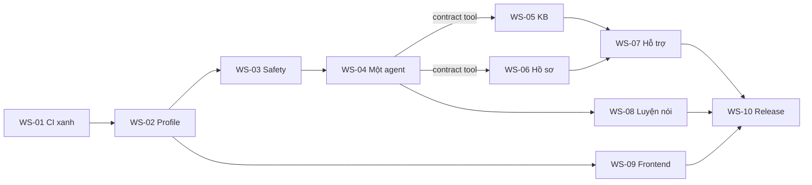

# 11 — Roadmap tổng

Grok cập nhật cột **Trạng thái** sau mỗi PR merge. Thứ tự chạy ở [execution-order](grok-handoff/execution-order.md). Nhánh nền: `mhiu05/feat-refactor`.

## 1. Workstream

| WS | Tên | Ưu tiên | Độ phức tạp | Lý do độ phức tạp | Phụ thuộc | Gate | Trạng thái |
| --- | --- | --- | --- | --- | --- | --- | --- |
| [WS-01](plans/WS-01-codebase-migration.md) | Audit và nền migration | P0 | S | Một lỗi CI và ledger | Không | G0 | Chưa bắt đầu |
| [WS-02](plans/WS-02-product-shell-access.md) | Product shell và truy cập | P0 | M | Chạm cổng eligibility toàn cục | WS-01 | Một phần G1 | Chưa bắt đầu |
| [WS-03](plans/WS-03-safety-engine.md) | Safety engine | P0 | L | Rule pack, 8 nhãn, eval 300 mẫu | WS-02 | G1 | Chưa bắt đầu |
| [WS-04](plans/WS-04-single-agent-orchestration.md) | Một agent và state machine | P0 | L | Cắm vào `drive`, 6 workflow | WS-03 | G1 | Chưa bắt đầu |
| [WS-05](plans/WS-05-knowledge-base.md) | Knowledge base | P1 | XL | Pipeline, 50 thẻ, phụ thuộc người duyệt | WS-04 contract | G2 | Chưa bắt đầu |
| [WS-06](plans/WS-06-incident-workspace.md) | Hồ sơ sự việc | P1 | L | Bất biến, hash, PDF tiếng Việt | WS-04 contract | G2 | Chưa bắt đầu |
| [WS-07](plans/WS-07-support-action-planning.md) | Hỗ trợ và hành động | P1 | M | Dùng lại khung tool | WS-04, WS-05, WS-06 | G2 | Chưa bắt đầu |
| [WS-08](plans/WS-08-voice-speaking-practice.md) | Luyện nói | P1 | L | Realtime làm bộ đọc, audio trên mobile | WS-04 | G3 | Chưa bắt đầu |
| [WS-09](plans/WS-09-frontend-integration.md) | Frontend | P0 | XL | Toàn bộ UI theo quy trình impeccable, thinking, chuyển động | WS-02, API từng WS | G4 | Chưa bắt đầu |
| [WS-10](plans/WS-10-evaluation-release.md) | Đánh giá và release | P0 | L | Hosted, SSM, phụ thuộc credential | Tất cả | G5 | Chưa bắt đầu |

## 2. Phụ thuộc

## 3. Giai đoạn

| Giai đoạn | Việc | Gate kết thúc | Có thể song song |
| --- | --- | --- | --- |
| 0. Sửa nền | WS-01 | G0 | Không |
| 1. Khung | WS-02, khung shell của WS-09 | Profile chạy | WS-09-T01 |
| 2. An toàn | WS-03, sau đó WS-04 | G1 | Nút khẩn cấp, thoát nhanh của WS-09 |
| 3. Năng lực | WS-05, WS-06, sau đó WS-07 | G2 | WS-05 và WS-06 độc lập; UI theo sau |
| 4. Giọng nói | WS-08 | G3 | Có thể song song giai đoạn 3 |
| 5. Tích hợp | Hoàn thiện WS-09 | G4 | Không |
| 6. Release | WS-10 | G5 | Không |

WS-03 đi trước vì an toàn phải có trước mọi tính năng trả lời. WS-04 và WS-07 dùng chung interface tool, nên WS-04 ra **PR contract** trước.

## 4. File dễ xung đột

| File | WS chạm | Cách giảm xung đột |
| --- | --- | --- |
| `backend/app/ai/runtime.py` | WS-04, WS-08 | Chỉ một nhánh `if bot == "troly"` gọi `assistant.turn` |
| `backend/app/ai/chat_routes.py` | WS-02, WS-03, WS-04 | Tách hàm vào `assistant/admission.py` |
| `backend/app/core/config.py` | Mọi WS | Thêm vào cuối theo khối, merge thường xuyên |
| `backend/app/main.py` | WS-02, WS-05, WS-06, WS-07, WS-08 | Thêm một dòng router mỗi WS |
| `backend/app/ai/schemas.py` | WS-03, WS-04 | Card mới vào PR contract |
| `backend/openapi.json`, `schema.d.ts` | Mọi WS | Sinh lại sau merge, không sửa tay |
| `docs/backend/api-reference.md`, `configuration.md`, `docs/supabase/schema.md` | Mọi WS | Cập nhật cùng PR |
| `backend/alembic/versions/` | Mọi WS | Số revision theo [05](05-data-model-and-migrations.md); merge theo đúng thứ tự |
| Test ghim head | Mọi WS có migration | `rg` chuỗi revision cũ |
| `frontend/playwright.config.ts` | WS-09, WS-10 | Thêm từng dòng spec |

Merge `main` vào `mhiu05/feat-refactor` sau mỗi WS. `main` có thể đổi (hiện còn nhánh khác đang làm).

## 5. Việc chỉ con người làm được

| Việc | Ai | Cần trước |
| --- | --- | --- |
| Duyệt template khẩn cấp, thẻ KB | mhiu05 | G5 |
| Thay ảnh mẫu bằng ảnh thật ở [assets/kb-screenshots](assets/kb-screenshots/README.md) | mhiu05 | Không chặn release |
| Xác nhận CAPTCHA protection của Supabase đang bật | mhiu05 hoặc Grok | G5 |
| Đăng ký ZDR với OpenAI | mhiu05 | G6 |
| Thuê tư vấn pháp lý, cử người phụ trách sự cố, nhờ chuyên gia rà nội dung | mhiu05 | G6 |
| Xem lại OD-16 | mhiu05 | G5 |
| Xem ảnh giao diện, review copy | Owner | G4 |
| Đăng nhập AWS nếu phiên hết hạn | Owner | G5 |
| Diễn tập trình bày | Nhóm | Sau G5 |

## 6. Rollback theo giai đoạn

Mọi thay đổi nằm trên `mhiu05/feat-refactor` đến WS-10. Trước khi vào `main`, rollback là revert PR con. Sau khi vào `main`, xem [release-runbook](grok-handoff/release-runbook.md).
