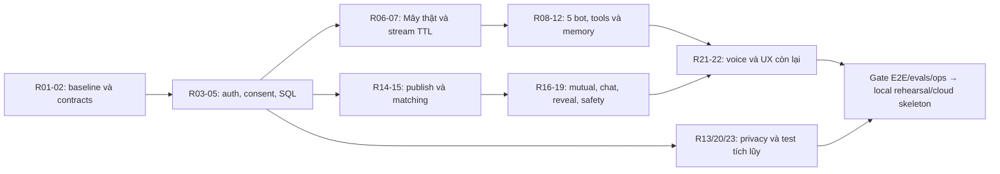

# 02 — Gap analysis và traceability

> **Kiến trúc đã chốt ngày 23/10/2026:** Python 3.12/FastAPI/Pydantic v2, SQLAlchemy 2 async + psycopg 3, Alembic/uv, Supabase PostgreSQL/Auth và OpenAI Agents SDK Python. Giữ React/Vite/TypeScript; Pydantic → OpenAPI → `frontend/src/api/generated/`. Chỉ scaffold cloud, không deploy. Evidence audit ban đầu là lịch sử, không phải trạng thái implementation mới.

Nguồn hiện trạng: [01](01-codebase-audit.md). Nguồn yêu cầu tạm dùng: [technical PoC §2.2, §9–13](../technical-poc-architecture.md#L31) và [prompt nội bộ](../prompt.md). **Không có Charter/spec gốc để xác nhận trạng thái phê duyệt.** Rxx là mã truy vết của bộ plans này, không giả làm requirement ID từ tài liệu bị thiếu.

Độ phức tạp S/M/L là phạm vi kỹ thuật tương đối, không phải estimate lịch. P0 = nền/quyền/critical path; P1 = hoàn thiện luồng MVP; P2 = chất lượng; Future = chưa thuộc baseline. Một dòng có thể có nền P0 và trải nghiệm P1, được tách bằng task.

## Ma trận từ yêu cầu đến công việc

| ID / feature                            | Hiện trạng và evidence                                                                                                                                                      | Hành vi cần có / phần thiếu                                                                                                 | Dependency                    | Độ khó / rủi ro                                            | Ưu tiên → task / hành động                                  |
| --------------------------------------- | --------------------------------------------------------------------------------------------------------------------------------------------------------------------------- | --------------------------------------------------------------------------------------------------------------------------- | ----------------------------- | ---------------------------------------------------------- | ----------------------------------------------------------- |
| R01 — Baseline/source of truth          | Backend/agents trống, Charter/spec vắng; links technical cũ; package-lock hiện hữu                                                                                          | Ghi baseline, scripts/workspace/versions, nguồn thật và ADR; không refactor đại trà                                         | Không                         | S / đọc nhầm spec hoặc mất untracked files                 | P0 → P00.01, P00.02; Q01                                    |
| R02 — Contracts và data boundaries      | `Action` string/optional, domain import `mocks`/registry UI ([types](https://github.com/mhiu05/MoodPrint/blob/dad0cb46bf69417a7b87e60e4e745c0a8c77df71/frontend/src/domain/types.ts#L175))                                                              | Pydantic/OpenAPI generated TypeScript, taxonomy trung lập, error/version/event contract, oracle thuần                       | R01                           | M / vô tình xuất private fields                            | P0 → P00.03, P00.04                                         |
| R03 — Auth/session/eligibility          | `demoState` tự adult và quyền; ScreenGate client ([demo](https://github.com/mhiu05/MoodPrint/blob/dad0cb46bf69417a7b87e60e4e745c0a8c77df71/frontend/src/mocks/demo.ts#L7))                                                                              | Server session từ Supabase Auth được xác minh, fail-closed, logout/revoke; kiểm tuổi/kênh ở mọi ingress                     | R02; Q03/Q04                  | L / giả mạo actor, mở teen                                 | P0 → P01.01, P01.02                                         |
| R04 — Consent độc lập                   | `effectiveAI/Memory/Voice/canMatch`, versions trong RAM ([policies](https://github.com/mhiu05/MoodPrint/blob/dad0cb46bf69417a7b87e60e4e745c0a8c77df71/frontend/src/domain/policies.ts#L3))                                                              | Ledger/version theo purpose, audit minimal, recheck commit/stream/job; không hồi sinh kết quả cũ                            | R03                           | L / race quyền cũ                                          | P0 → P01.03, P02.03, P06.03                                 |
| R05 — Database/ownership                | Không SQL/DB; mọi state trong Provider                                                                                                                                      | Supabase PostgreSQL, SQLAlchemy async/psycopg 3, Alembic, pool/transaction/least privilege, private CRUD và outbox metadata | R02                           | L / tenant leak, rollback dữ liệu                          | P0 → P01.01, P01.04; [05](05-backend-data-realtime-plan.md) |
| R06 — Một bot/model thật                | `scriptedReply`, timer 650ms ([reducer](https://github.com/mhiu05/MoodPrint/blob/dad0cb46bf69417a7b87e60e4e745c0a8c77df71/frontend/src/state/reducer.ts#L267))                                                                                          | SDK Agent/Runner, provider config, limits, cancellation, errors, bounded usage                                              | R03–R05; Q02 cho dữ liệu thật | M / tự viết agent loop, chi phí không chặn                 | P0 → P02.01, P02.02                                         |
| R07 — Streaming/reload                  | Pending/stop/retry UI, chưa network                                                                                                                                         | Typed SSE, sequence/cursor/dedup, ephemeral replay, run state; reload còn phiên; restart báo context mất                    | R06                           | L / trộn bot, partial output sai, replay dữ liệu hết quyền | P0 → P02.03, P02.04                                         |
| R08 — Năm companions                    | registry có 5 BotIds/cards; không SDK ([registry](../../frontend/src/companions/registry.ts#L1))                                                                            | Config version, tool/context allowlist riêng, output schema, eval từng bot                                                  | R06/R07                       | M / persona giống nhau hoặc context leakage                | P1 → P03.01, P03.02                                         |
| R09 — Chuyển bot                        | Mây→Nhịp chỉ Link, không transcript ([Cards](https://github.com/mhiu05/MoodPrint/blob/dad0cb46bf69417a7b87e60e4e745c0a8c77df71/frontend/src/companions/Cards.tsx#L245))                                                                                 | Giữ navigate-only; nếu sau này chuyển nội dung cần preview payload/version/expiry                                           | R08                           | S / nhầm SDK handoff với UI transition                     | P1 → P03.03; handoff context Future                         |
| R10 — Mood tự ghi/insights              | Công thức thật, RAM, ngày `/10`, demoDate UTC+7 ([Self](https://github.com/mhiu05/MoodPrint/blob/dad0cb46bf69417a7b87e60e4e745c0a8c77df71/frontend/src/pages/Self.tsx#L35))                                                                             | CRUD/version/date/timezone thật; null ngày thiếu; <3 ngày không insight; API read tool phạm vi rõ                           | R04/R05, R08 cho tool         | M / LLM tự suy mood, lệch ngày                             | P1 → P01.04, P04.01, P04.02                                 |
| R11 — Private items và proposal         | Gương profile card xác nhận; PI01 hardcode; save không memory ([Profile](https://github.com/mhiu05/MoodPrint/blob/dad0cb46bf69417a7b87e60e4e745c0a8c77df71/frontend/src/pages/Profile.tsx#L68))                                                         | Tách proposal/private record/approved memory; nguồn đúng owner; status response sau commit                                  | R04/R05/R08                   | M / suy đoán thành sự thật                                 | P1 → P04.02, P04.03                                         |
| R12 — Approved memory                   | `memoryApproved` và `memoryContext`, nhưng scriptedReply không dùng ([policies](https://github.com/mhiu05/MoodPrint/blob/dad0cb46bf69417a7b87e60e4e745c0a8c77df71/frontend/src/domain/policies.ts#L116))                                                | C-AI+MEM, duyệt đúng payload, bot scope, edit/delete/revoke, invalidation, limits                                           | R11                           | L / tự ghi, dùng lại bản đã xóa                            | P0 policy + P1 feature → P04.03, P04.04                     |
| R13 — Context/retention/provider        | RAM hiện mất sau reload; không TTL server; không processor                                                                                                                  | Context tạm theo user/bot/session, tối đa 24h idle; không transcript vào WAL/backups/logs; verify processor                 | R04/R06; Q02/Q05              | L / tưởng `store:false` là zero retention                  | P0 → P02.01, P02.03, P08.03, P09.02                         |
| R14 — Hồ sơ nháp/published              | Sharing preview, publish version, PI01→reading ([Profile](https://github.com/mhiu05/MoodPrint/blob/dad0cb46bf69417a7b87e60e4e745c0a8c77df71/frontend/src/pages/Profile.tsx#L304))                                                                       | Server validate allowlist, snapshot/version, explicit publish/withdraw, mapping nguồn có lựa chọn                           | R02–R05                       | L / private text lộ hoặc republish không invalidation      | P1 → P05.01                                                 |
| R15 — Matching/scoring                  | Thuật toán thật, candidates hư cấu; free-text viết cứng C01–04 ([matching](https://github.com/mhiu05/MoodPrint/blob/dad0cb46bf69417a7b87e60e4e745c0a8c77df71/frontend/src/domain/matching.ts#L8), [Connect](https://github.com/mhiu05/MoodPrint/blob/dad0cb46bf69417a7b87e60e4e745c0a8c77df71/frontend/src/pages/Connect.tsx#L103)) | Hard filters hai chiều, query DB, baseline 45/35/20, ≤3 reasons từ template, ≤5 cards, opaque pair ref                      | R14; không phụ thuộc AI       | M / ranking sai filter, product scope bio, cold start      | P1 → P05.02, P05.03; Q06                                    |
| R16 — Lời mời/mutual                    | Reducer tuần tự, mô phỏng peer trên cùng máy ([reducer](https://github.com/mhiu05/MoodPrint/blob/dad0cb46bf69417a7b87e60e4e745c0a8c77df71/frontend/src/state/reducer.ts#L649))                                                                          | Canonical pair, intent của actor thật, stale revalidation, quotas, expiry/cooldown, một open room                           | R15/R04/R05                   | L / duplicate room, accept sau revoke                      | P0 transaction + P1 UI → P06.01                             |
| R17 — Human chat/realtime               | Human replies timer; canChat guard client ([Chat](https://github.com/mhiu05/MoodPrint/blob/dad0cb46bf69417a7b87e60e4e745c0a8c77df71/frontend/src/pages/Chat.tsx#L26))                                                                                   | Commit/ACK, sequence, idempotency, SSE ID-only notify + API fetch/replay; 20 tin/phút account                               | R16                           | L / mất/trùng tin, event lộ sau block                      | P1 → P06.02, P06.03                                         |
| R18 — Reveal/block/revoke               | Field/direction/version demo, peer simulation ([reducer](https://github.com/mhiu05/MoodPrint/blob/dad0cb46bf69417a7b87e60e4e745c0a8c77df71/frontend/src/state/reducer.ts#L790))                                                                         | Chủ dữ liệu mới grant, request TTL/cooldown; live grant endpoint, revoke/block chặn ngay                                    | R16/R17                       | L / trả identity trong DTO/room cũ                         | P0 quyền + P1 flow → P06.03, P06.04                         |
| R19 — Report/moderation                 | Phiếu RAM, sample evidence, chưa nhân viên thật ([Settings](https://github.com/mhiu05/MoodPrint/blob/dad0cb46bf69417a7b87e60e4e745c0a8c77df71/frontend/src/pages/Settings.tsx#L201))                                                                    | Receipt thật, evidence tối thiểu tự chọn, moderator access/audit, block độc lập; staffing gate                              | R03/R05/R17                   | L / báo nhận sai hoặc evidence quá rộng                    | P1 → P06.05, P07.03; Q07                                    |
| R20 — Delete/export/lifecycle           | DELETE_TYPE và safeExport mẫu ([reducer](https://github.com/mhiu05/MoodPrint/blob/dad0cb46bf69417a7b87e60e4e745c0a8c77df71/frontend/src/state/reducer.ts#L1119))                                                                                        | Immediate deny + deletion jobs, processor tracking, backup tombstones; export đúng chủ/phạm vi                              | R05/R12/R18                   | L / phục hồi dữ liệu đã xóa                                | P0 → P01.03, P08.03; P1 UI → P07.03                         |
| R21 — Voice                             | Permission và VOICE_* mock, không recorder ([StartHome](https://github.com/mhiu05/MoodPrint/blob/dad0cb46bf69417a7b87e60e4e745c0a8c77df71/frontend/src/pages/StartHome.tsx#L27))                                                                        | User bắt đầu ≤30s, STT→duyệt text→send; AI+VOICE; audio cleanup ≤15 phút                                                    | R04/R06; Q01/Q02              | M / thu mic ngầm, audio retention                          | P1 nghĩa vụ MVP thuật lại → P07.01, P07.02                  |
| R22 — Tích hợp UI/resilience            | Nhiều form xóa nháp/đóng dialog ngay dispatch; CSS/motion tốt                                                                                                               | API adapters/hooks, async success/409/429/offline/reconnect, keyboard/a11y/mobile regression                                | R02, từng domain slice        | M / regress trải nghiệm, báo trạng thái sai                | P1 → P02.04, P04.04, P05.03, P06.02, P07.03                 |
| R23 — Evals/testing/ops                 | 77 unit tests, Playwright prototype; không backend/model eval hoặc CI                                                                                                       | Deterministic provider stub, SQL race/API/E2E/evals, redacted metrics, restore/deploy rollback                              | Mỗi slice                     | L / UI pass nhưng toàn tuyến sai                           | P0 kiểm quyền; P1 hoàn thiện → P08.01–P08.04, P09.01–P09.03 |
| R24 — Shared Activities/specialists/RAG | ACT01 demo có state machine; technical §2.2 gọi Future                                                                                                                      | Giữ fixtures trong test; chỉ đưa production sau quyết định phạm vi/evidence; SQL đủ cho memory nhỏ                          | Không chặn baseline           | L nếu mở rộng / scope creep                                | Future; không tạo task production trá hình                  |

## Critical path và các điểm cần làm trước

**Không bắt đầu bằng “thay mock bằng fetch” trong toàn UI.** Trước tiên phải có actor server, version quyền, DTO và một domain transaction có test. Nếu không, chỉ chuyển lỗi/quyền giả lập ra mạng mà chưa có invariant thật.

## Các mâu thuẫn phải giải quyết có kiểm soát

| Xung đột                                                              | Tác động                                            | Hướng đề xuất / decision                                                                    |
| --------------------------------------------------------------------- | --------------------------------------------------- | ------------------------------------------------------------------------------------------- |
| Technical links nói `prototype/`, source ở `frontend/`                | Agent sau dễ đọc nhầm path                          | Plans dùng path đã xác minh; không đổi tài liệu gốc trong lượt này (D01)                    |
| Prototype auto-adult/consent; policy fail-closed                      | App production có thể dùng quyền giả                | Fixtures chỉ trong tests; product bootstrap từ server, không demo/prototype labels (D05)    |
| Yêu cầu reload/persistence; context không lưu mặc định                | Không thể mặc định append transcript vào PostgreSQL | Reload trong phiên RAM còn TTL, metadata bền vững; approved memory riêng (D07/Q05)          |
| Matching spec được thuật lại có tie-break theo ngày/cặp; code theo ID | Kết quả regression khác                             | Giữ oracle `mock-v1`, đặt version backend riêng cùng tie-break ID trước; thay sau Q06 (D09) |
| ACT01 có demo hoàn chỉnh; technical vẫn Future                        | Dễ cộng scope vì UI đã có                           | Bảo tồn fixtures/tests, product không mô phỏng peer; quyết định UI ẩn/preview ở Q01 (D10)   |
| Voice chưa recorder; prompt nội bộ nói Must MVP                       | Dễ loại voice khỏi nghĩa vụ bằng cách để future     | Spike đầu text-only, phase 7 voice có gate; chưa xác minh Charter gốc (D11/Q01)             |
| SDK session/history có persistence; policy TTL/xóa riêng              | Có thể lưu private data trong state/trace/backups   | Ephemeral SessionStore, tắt exporter mặc định, resume kiểm version (D07/D08)                |

Các mục chưa chốt không cản việc viết và test local trên dữ liệu tổng hợp. Chúng là gate tại thời điểm công việc phụ thuộc, theo [10](10-decisions-and-open-questions.md).
