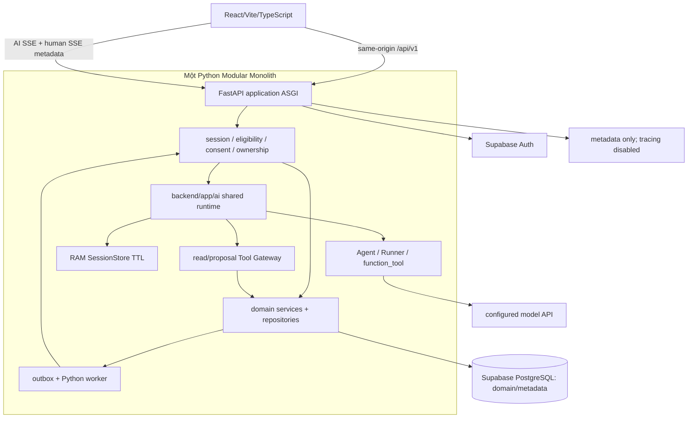
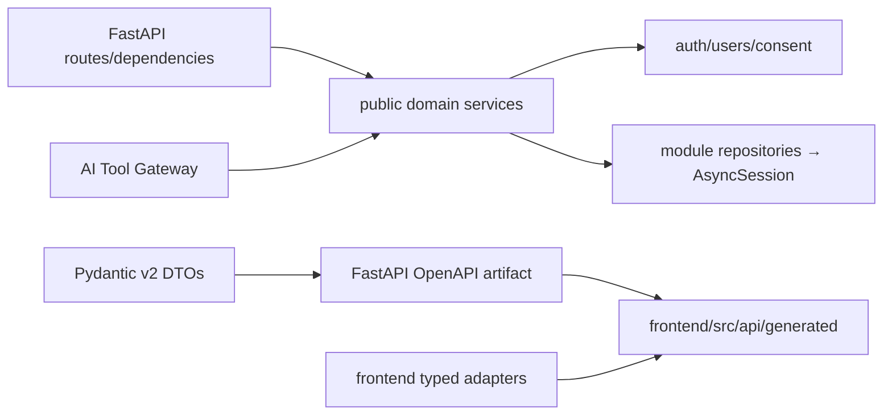

# 03 — Kiến trúc đích và đường tích hợp

> **Kiến trúc đã chốt ngày 23/10/2026:** Python 3.12/FastAPI/Pydantic v2, SQLAlchemy 2 async + psycopg 3, Alembic/uv, Supabase PostgreSQL/Auth và OpenAI Agents SDK Python. Giữ React/Vite/TypeScript; Pydantic → OpenAPI → `frontend/src/api/generated/`. Chỉ scaffold cloud, không deploy. Evidence audit ban đầu là lịch sử, không phải trạng thái implementation mới.

**D02 đã chốt:** một Python 3.12 Modular Monolith FastAPI. Backend không dùng Node/TypeScript hoặc service AI riêng. **D03:** `openai-agents` Python là runtime chung cho Mây/Gương/Nhịp/Rủ Rê/Cầu Nối. Supabase PostgreSQL là database chính thức; Supabase Auth xử lý credentials. Giữ React/Vite/npm/HashRouter, CSS/GSAP/SVG và dependencies frontend hoạt động tốt.

## Topology

**D15/Q04 chốt24/10/2026:** eligibility xuất phát từ onboarding tự khai báo năm sinh + xác nhận16; kết nối người thật cần18. Backend tính age band và ghi owner-private declaration/version/timestamp; năm sinh không là input cho AI hoặc ranking. Không nhận ageBand/actor từ client. Chi tiết API/biên sinh nhật ở [05](05-backend-data-realtime-plan.md).



FastAPI `APIRouter`/`Depends` tách transport/auth policy; Pydantic v2 là nguồn schemas chuẩn. `response_model` là DTO allowlist, không serialize ORM rows trực tiếp. [FastAPI response models](https://fastapi.tiangolo.com/tutorial/response-model/) mô tả filtering và OpenAPI. Async I/O cho DB/model/stream; không blocking network trong event loop. Lifespan tạo/đóng engine, clients, bounded worker/sweeper; request BackgroundTasks không thay durable jobs.

SQLAlchemy 2 `AsyncEngine`/`AsyncSession` dùng **psycopg 3**, URL `postgresql+psycopg://`; một session mỗi unit of work, không share session qua concurrent tasks. Không thêm raw driver repository/PostgREST writes/ORM thứ hai. Alembic là migration engine duy nhất, revision files `backend/alembic/versions/`; app startup không tự upgrade. Các constraints/locks/CAS/idempotency/outbox ở [05](05-backend-data-realtime-plan.md) vẫn bắt buộc.

Long-running FastAPI ưu tiên direct connection nếu network hỗ trợ, hoặc Supabase **session pooler** khi IPv4; pool size/overflow/timeout có budget. `DATABASE_MIGRATION_URL` tách `DATABASE_URL`, migration role có DDL, runtime không DDL/BYPASSRLS. Transaction pooler chỉ sau compatibility tests: psycopg `prepare_threshold=None`, không session state/LISTEN/session advisory locks; RLS context transaction-local. [Supabase connection modes](https://supabase.com/docs/guides/database/connecting-to-postgres). Không đoán host theo region, không hardcode password.

Local PostgreSQL/container chỉ development/integration test, cùng major tương thích Supabase target; không SQLite thay locks/concurrency. Remote Supabase phải xác minh project/privileges/schema/history/diff và có phép DDL/writes riêng trước migration; không drop/truncate tự động hoặc tạo PostgreSQL cloud khác.

## Cấu trúc repository

```text
MoodPrint/
├── frontend/
│   ├── package.json, package-lock.json
│   └── src/
│       ├── api/{client.ts,generated/}
│       ├── features/{auth,companions,mood,profiles,memory,discovery,connections,messaging,privacy,safety}/
│       ├── components/, pages/, companions/, styles/
│       └── app/                         # chỉ extract khi integration cần
├── backend/
│   ├── pyproject.toml, uv.lock, .python-version
│   ├── app/
│   │   ├── main.py
│   │   ├── api/{v1,schemas}/
│   │   ├── core/{config,security,dependencies}.py
│   │   ├── modules/{auth,users,consent,profiles,mood,memory,matching,connections,messaging,moderation}/
│   │   ├── ai/{bots,runtime,context,tools,providers,streaming}/
│   │   ├── infrastructure/{database,realtime,sandbox}/
│   │   └── jobs/
│   ├── alembic/versions/
│   └── tests/{unit,contract,integration,concurrency,evals}/
├── tests/oracles/
├── deploy/{docker,examples}/              # chỉ scaffold/local rehearsal
├── scripts/
├── docs/{plans,architecture}/
├── .env.example
└── agents/                              # audit ban đầu trống; không Python package
```

Uv quản lý backend và exact lockfile; pin Python 3.12 patch tương thích qua `.python-version` sau kiểm thực tế. Npm quản lý frontend, giữ frontend lockfile/versions; không root TypeScript backend workspace. Versions SDK/dependencies phải đọc từ resolved environment, không prose thay compatibility test. Ruff/mypy/pytest/pytest-asyncio/HTTPX là backend gates; frontend giữ Vitest/Playwright.

Root `agents/` đã audit trống; không tạo `agents/__init__.py`, không thêm vào PYTHONPATH. Runtime ở `app.ai`; import smoke `agents.__file__` phải resolve SDK trong environment, không root folder. Không xóa dữ liệu ngoài baseline khi chưa kiểm.

## Contracts và module boundaries



Pydantic models định nghĩa camelCase wire aliases, allowed fields/constraints/errors/discriminated cards/versioned SSE. OpenAPI export deterministic → pinned generator TypeScript/client ở `frontend/src/api/generated/`; CI regenerate và kiểm drift. Frontend không viết schema chuẩn thứ hai; runtime parsing theo generated contract khi cần. SSE payload schema phải có trong OpenAPI/components/contract endpoint để generator thấy. Không prompts/server-only fields/credentials trong generated client; taxonomy public versioned không import mocks.

Transport chỉ gọi services, không SQL; module chỉ dùng repository của chính mình; AI chỉ public read/proposal services qua policy gateway. Matching không phụ thuộc LLM/private/mood/memory/chat. Moderation chỉ expose eligible/restricted, không evidence cho ranking. Consent tăng purpose version nguyên tử, emit ID-only invalidation; reads/writes live gate ngay, cleanup có thể sau.

Composition ở `app/main.py`; transaction nhiều module dùng chung AsyncSession/unit of work và sorted lock order [05](05-backend-data-realtime-plan.md). Không network/model/user approval trong DB transaction. Worker cùng source/domain services, entrypoint riêng nếu cần; fenced/idempotent at-least-once, không tái cấp actor/consent cũ.

| Module               | Public responsibility / boundary                                                                     |
| -------------------- | ---------------------------------------------------------------------------------------------------- |
| auth/users/consent   | Actor, app/provider session lifecycle, eligibility, independent purpose versions; không import UI/AI |
| profiles/mood/memory | Own versioned CRUD, proposals/approvals/source invalidation; không public private text               |
| ai                   | start/cancel/session view, Bot Registry/context/tools/output; không raw SQL/social write             |
| matching             | published projection, hard filters/scorer/candidate refs; cấm private/mood/memory/chat/identity      |
| connections          | canonical pairs/request/room/reveal/block/live access; không LLM                                     |
| messaging            | send/get/seq/ACK/quota, connection live access mỗi lần; human text không tới AI                      |
| moderation           | selected evidence/report receipts/audited assigned review; không AI/ranking evidence                 |
| infrastructure/jobs  | pool/clock/TTL/logging/outbox/expiry/deletion; không tự phục hồi consent                             |

## Auth và frontend migration

Supabase Auth xử lý password/crypto. Backend `POST /auth/login` gọi trusted provider token endpoint bằng credentials rồi **official getUser(access_token)**; chỉ parse session_id từ token vừa được provider xác minh, không public arbitrary token exchange. Không persist password/access/refresh tokens. Opaque app cookie HttpOnly Secure SameSite; DB chỉ session hash/user/provider session_id/expiry; TTL≤JWT expiry, hết hạn login lại. Mỗi request kiểm local session/gates và production live `auth.sessions.session_id` để logout không chờ JWT hết hạn. CSRF+Origin cho writes. User-editable metadata không cấp age/role. [JWT](https://supabase.com/docs/guides/auth/jwts), [sessions](https://supabase.com/docs/guides/auth/sessions). JWKS khi dùng phải kiểm asymmetric signing/issuer/audience/alg/kid/exp; signature hợp lệ không thay session revocation.

Bootstrap `/session`, không auto-adult/consent/profile, không mock fallback khi API lỗi. Chuyển từng feature qua typed adapters, component chỉ giữ draft/dialog/scroll. Giữ HashRouter/cards/layout/motion, không bulk move pages/Next.js/redesign/scoring change. Mây trước rồi registry/tools/memory; matching độc lập sau auth/DB. Screen mapping ở [06](06-frontend-integration-plan.md).

Product UI không nhãn Prototype/Demo/Experimental; thiếu capability hiển thị unavailable/feature gate, không simulated success. Fixtures/stub models chỉ automated tests. ACT01 code/tests được bảo tồn nhưng không simulated peer trong product entry. Domain writes chỉ success sau backend commit receipt.

## Sandbox, cloud và scale

5 bot chưa có code/file execution use case: chỉ interface/config `SANDBOX_ENABLED=false`, không container mọi run. Nếu có use case sau: backend authorize, Docker nonprivileged/non-root/read-only root, bounded temp disk/CPU/RAM/PIDs/time, egress denied; không host mounts tùy ý/secrets/DB credentials/Docker socket cho model; cleanup guaranteed và fixed commands/image allowlist. Model không tự launch Docker.

Chỉ Dockerfile/local Compose/worker/config templates/health/readiness/CI/runbooks và local rehearsal. Không cloud resources/account/provider setup/public deploy/mua dịch vụ/remote migrations. Scale-out/shared ephemeral store/bus/vector chỉ sau measurements, vẫn TTL/revocation/no raw transcripts. RAM store hiện một instance nên restart context lost được nói rõ; không khẳng định database durability cho transcript.
