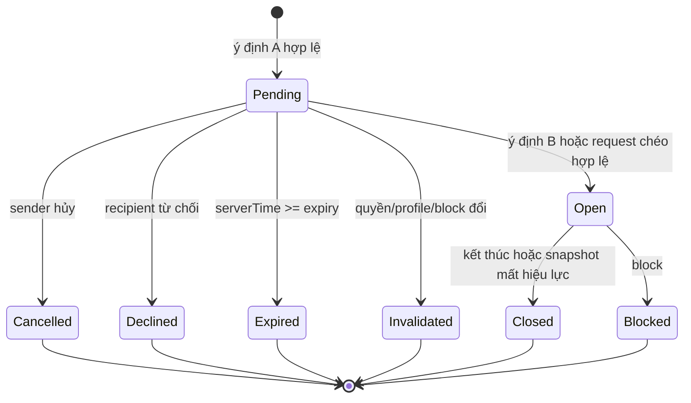

Warning: truncated output (original token count: 12097)
Total output lines: 250

# 05 — Backend, dữ liệu, transactions, realtime và jobs

> **Kiến trúc đã chốt ngày 23/10/2026:** Python 3.12/FastAPI/Pydantic v2, SQLAlchemy 2 async + psycopg 3, Alembic/uv, Supabase PostgreSQL/Auth và OpenAI Agents SDK Python. Giữ React/Vite/TypeScript; Pydantic → OpenAPI → `frontend/src/api/generated/`. Chỉ scaffold cloud, không deploy. Evidence audit ban đầu là lịch sử, không phải trạng thái implementation mới.

**Stack đã chốt:** Supabase PostgreSQL cho domain/metadata, FastAPI/Pydantic v2, SQLAlchemy 2 async+psycopg 3/Alembic, Python worker; AI SSE và human SSE ID-only. Các bảng/API là contract đích, trạng thái implementation/evidence mới ghi riêng. Module boundaries ở [03](03-target-architecture.md), AI/session contract ở [04](04-agents-sdk-architecture.md).

## Identity, quyền và invariants

`AuthenticatedActor = {userId, sessionId, sessionVersion, eligibilityVersion}` do auth middleware dựng từ phiên đã kiểm. HTTP/socket/job không nhận userId của actor từ body. Supabase Auth xử lý password/cryptography. Backend POST /auth/login gọi trusted provider token endpoint, official getUser(access_token) xác minh user rồi chỉ parse session_id từ token vừa được xác minh; không nhận arbitrary access token exchange. Không persist password/access/refresh tokens. Opaque HttpOnly Secure SameSite app cookie, session DB giữ hash/user/provider session_id/expiry; app TTL≤JWT expiry, hết hạn login lại. Mỗi request kiểm local session/gates và production live auth.sessions session_id; signature JWT không tự bảo đảm logout. JWKS nếu dùng phải kiểm asymmetric keys/issuer/audience/exp/alg/kid, không decode-only hoặc user_metadata authorization. Fake identity chỉ FastAPI dependency override trong tests, không runtime env/header bypass. CSRF+Origin cho writes. Q03 cung cấp project/region/config. [JWT](https://supabase.com/docs/guides/auth/jwts), [sessions](https://supabase.com/docs/guides/auth/sessions).

Account có `ageBand:unknown|under16|teen|adult`. Quyết định người dùng 24/10/2026 (D15/Q04): nhập năm sinh và tự xác nhận đã đủ16 tuổi để dùng tính năng riêng; kết nối người thật chỉ từ18. Unknown/under16 fail-closed; teen **không publish/MATCH/invite/chat/reveal**. Năm tròn16 cần xác nhận đã qua sinh nhật16; năm tròn18 cần thêm xác nhận đã đủ18, nếu chưa xác nhận thì vẫn teen. Từ năm sinh+19 đã chắc chắn đủ18. Backend dùng clock Asia/Bangkok, không nhận ageBand/userId hoặc editable provider metadata làm quyền. C-AI/MEM/MATCH/VOICE có independent boolean, version và policyVersion; onboarding không tự bật consent. Bật lại không phục hồi run/room/grant đã terminal.

Các invariants server cần test từ đầu:

1. Dữ liệu riêng luôn thuộc actor; candidate/room DTO không chứa identity/private refs trước grant.
2. Matching chỉ dùng published allowlist; AI/mood/memory/human chat không được đọc làm ranking features.
3. Một canonical pair tối đa một pending interaction hoặc một open connection; đủ hai ý định actor khác nhau mới mở room.
4. Read/send/reveal cần **live** eligibility, membership, consent/profile versions, block/moderation và trạng thái phòng; check tại join socket chưa đủ.
5. Save/reveal/accept/publish thành công chỉ sau commit/idempotent receipt. Worker retry không tạo hành động mới bằng quyền cũ.
6. Revoke/publish/linked-source delete vô hiệu dẫn xuất trước đường sử dụng tiếp theo; cleanup async không là cổng quyền.

## API conventions và DTO

Prefix `/api/v1`. JSON timestamps ISO UTC, ngày mood `YYYY-MM-DD` kèm timezone IANA của user. IDs opaque UUID; `bigint` sequences qua JSON là **string** để tránh mất precision. Query cursors opaque hoặc sequence string, page size 50, tối đa 100; limit/range có schema runtime. Body size limit theo route; AI/human text 1–500 ký tự trim, private/memory/mood note tối đa 120, identity tối đa 40; Pydantic schema chuẩn và OpenAPI-generated client và test Unicode ở T-API-02.

```python
from typing import Literal
from pydantic import BaseModel, ConfigDict, Field

class ApiErrorDetail(BaseModel):
    model_config = ConfigDict(extra="forbid", populate_by_name=True)
    code: str
    message: str
    retryable: bool
    request_id: str = Field(alias="requestId")
    field_errors: dict[str, str] | None = Field(None, alias="fieldErrors")
    retry_after_seconds: int | None = Field(None, alias="retryAfterSeconds")

class ApiError(BaseModel):
    error: ApiErrorDetail

class DomainActionResult(BaseModel):
    model_config = ConfigDict(extra="forbid", populate_by_name=True)
    action_id: str = Field(alias="actionId")
    status: Literal["succeeded"]
    resource_id: str = Field(alias="resourceId")
    resource_version: int = Field(alias="resourceVersion", ge=1)
```

401 phiên hết hạn; 403 purpose/eligibility denied; 404 tài nguyên không tồn tại hoặc không thuộc actor (không tiết lộ người khác); 409 stale version, run active hoặc key khác payload; 410 expired session/proposal; 422 validation; 429 quota với Retry-After; 503 dependency unavailable. Error messages không chứa SQL, provider body hoặc private text. Domain state conflict còn có current safe version để UI tải lại, không tự ghi đè.

Mọi domain write dùng `Idempotency-Key` theo actor+operation+resource, canonical payload digest, expectedVersion. Cùng key/payload trả cùng **receipt** sau kiểm quyền hiện tại; key khác payload trả 409. Replay receipt không trả lại content hết quyền. Idempotency retention ban đầu 24h; message duplicate guard bằng unique clientMessageId lâu bằng message record. AI key/raw digest chỉ kho tạm như [04](04-agents-sdk-architecture.md).

| Endpoint                                                    | Input → output chính                                                                           | Quyền/điều kiện                                                                                                                                                         |
| ----------------------------------------------------------- | ---------------------------------------------------------------------------------------------- | ----------------------------------------------------------------------------------------------------------------------------------------------------------------------- |
| `POST /auth/login`                                          | email/password → verified Supabase Auth identity → app cookie/session                          | Provider-owned crypto; body/password/không persist provider access/refresh tokens, session_id/expiry dùng kiểm lifecycle; tokens không log hoặc lưu; bounded rate limit |
| `POST /auth/logout`                                         | CSRF token → 204                                                                               | Revoke session, close sockets/context, cookie clear                                                                                                                     |
| `GET /session`                                              | Cookie → safe user alias, eligibility flags, consent versions, CSRF token, serverTime/timezone | Không giả lập adult nếu chưa đăng nhập; no-store                                                                                                                        |
| `PATCH /users/me/identity`                                  | `{field,value,expectedVersion}` → own field/version                                            | Owner, field allowlist; đổi giá trị thu hồi grants đúng field/version                                                                                                   |
| `PUT /users/me/eligibility`                                 | `{birthYear,confirmedMinimumAge,confirmedAdultAge,expectedVersion,policyVersion}` → own SessionView | Auth+CSRF+idempotency+owner lock; server-derived band; năm sinh không tự đổi sau ghi nhận; versioned18 upgrade; no auto consent (D15/Q04 resolved24Oct2026) |
| `PUT /consents/:purpose`                                    | `{enabled,expectedVersion,policyVersion}` → effective flags/new version                        | Owner; purpose AI/MEM/MATCH/VOICE; revoke transaction và invalidation                                                                                                   |
| `GET /bots`                                                 | → BotPublicDTO[]                                                                               | Metadata công khai, không prompts/tools credentials                                                                                                                     |
| `POST /ai/conversations`                                    | `{botId}` → conversationId/version/expiresAt                                                   | Auth/sessionAllowed+C-AI, server registry                                                                                                                               |
| `POST /ai/conversations/:id/messages`                       | StartAiRun → 202 RunAccepted                                                                   | Owner/bot immutable, C-AI, limits; IDs và text tạm                                                                                                                      |
| `GET /ai/runs/:id/events?afterSeq=`                         | Cursor → authenticated SSE                                                                     | Owner/live consent; replay còn TTL                                                                                                                                      |
| `GET /ai/conversations/:id`                                 | → SessionView/messages/status/version/expiry                                                   | Owner/live purpose; hết TTL→410; không durable history                                                                                                                  |
| `POST /ai/runs/:id/cancel`                                  | Expected run version → RunView                                                                 | Owner; terminal idempotent, không retry provider                                                                                                                        |
| `POST /ai/conversations/:id/end`                            | → 204                                                                                          | Xóa context/proposals/replay, cancel pending                                                                                                                            |
| `GET/POST /profiles/private-items`                          | Page hoặc `{text}` → owner items/created record                                                | Chức năng tự nhập không cần C-AI/C-MEM                                                                                                                                  |
| `PATCH/DELETE /profiles/private-items/:id`                  | `{text?,expectedVersion}` → version/receipt                                                    | Owner; linked-source invalidation ngay                                                                                                                                  |
| `POST /proposals/:id/confirm`, `/reject`                    | `{version,editedText?}` → DomainActionResult hoặc proposal rejected                            | Owner, TTL/source/current purpose; loại proposal quyết định API service đích                                                                                            |
| `GET /memories`                                             | → approved memory list + bot/status/version                                                    | Owner xem/quản lý kể cả khi AI/MEM tắt; không đưa vào LLM nếu quyền tắt                                                                                                 |
| `PATCH/DELETE /memories/:id`                                | ExpectedVersion + editedText hoặc delete → receipt                                             | Owner; version/invalidation, không đổi scope ngầm                                                                                                                       |
| `GET/PUT /moods/:localDate`                                 | `{value:1..5,note?,expectedVersion,timezone}` → entry/version                                  | Owner; ngày thực, không tương lai; unique owner/date                                                                                                                    |
| `DELETE /moods/:localDate`                                  | ExpectedVersion → receipt                                                                      | Owner; insight/context dẫn xuất invalidated                                                                                                                             |
| `GET /moods/summary?from=&to=`                              | → buckets/count/mean/min/max/source versions                                                   | Owner, mặc định 7 ngày, max 90; day thiếu=null; AI read cần scope yêu cầu                                                                                               |
| `GET/PUT /profiles/matching-draft`                          | Partial allowlist + draftVersion/source selections → draft/new version                         | Owner; không tự publish; teen được nháp theo policy                                                                                                                     |
| `POST /profiles/published`                                  | `{draftVersion,previewDigest,expectedPublishedVersion}` → publishedId/version                  | Adult+C-MATCH, draft hợp lệ và đúng preview; invalidate bản cũ                                                                                                          |
| `DELETE /profiles/published/current`                        | ExpectedVersion → receipt                                                                      | Owner withdraw; đóng access dẫn xuất, không đợi worker                                                                                                                  |
| `GET /matching/candidates`                                  | → ≤5 CandidateCardDTO + scoringVersion/computedAt                                              | Adult/live published+C-MATCH hai bên; empty là kết quả hợp lệ                                                                                                           |
| `POST /matching/skips`                                      | `{candidateRef}` → cooldown receipt                                                            | Cặp hợp lệ; không side effect từ AI                                                                                                                                     |
| `GET/POST /connection-requests`                             | Cursor hoặc `{candidateRef,expectedVersions}` → RequestDTO                                     | Actor thật, quotas, pair tx; hướng in/out tính theo actor                                                                                                               |
| `POST /connection-requests/:id/accept                       | decline                                                           …4097 tokens truncated…serId tăng dần → canonical pair → request/connection → message counter/reveal/domain record theo ID. Các module không khóa theo thứ tự ngược. Tx ngắn, không gọi LLM/Auth provider/network trong transaction. PG row locks giúp tuần tự hóa và partial unique indexes giúp chống duplicate; đây là cơ chế DB, policy kết hợp vẫn cần concurrency tests. [Explicit locking](https://www.postgresql.org/docs/current/explicit-locking.html), [Partial indexes](https://www.postgresql.org/docs/current/indexes-partial.html).

| Thao tác                              | Trong một transaction                                                                                                                                                   | Sau commit                                                                             |
| ------------------------------------- | ----------------------------------------------------------------------------------------------------------------------------------------------------------------------- | -------------------------------------------------------------------------------------- |
| Publish/withdraw/linked-source change | Lock owner gate; validate draft+preview+source; tăng profile/data gate, invalidate bản cũ, append outbox                                                                | Event invalidation, materialize terminal rows/cleanup; mọi access cũ đã fail bằng gate |
| Revoke consent/account status         | Lock owner gate, expectedVersion, increment purpose/gate, mark relevant session/run invalidation metadata, tombstone nếu delete                                         | Hủy in-flight, close sockets/cache; worker dọn refs. Re-enable chỉ tạo version mới     |
| Send request/cross request/accept     | Lock hai account gates sorted; upsert canonical pair; lock pair; revalidate eligibility/quotas/snapshots/expiry; record intent; open room nếu đủ hai actor; unique room | Outbox notify IDs; không auto tạo peer greeting hoặc tin “self” mẫu                    |
| Send human message                    | Lock hai gates rồi pair/room; live policy; idempotency lookup; quota sliding window; increment room seq; insert message+outbox                                          | ACK nghĩa persisted; event metadata cho hai members còn quyền                          |
| Grant/revoke reveal                   | Lock gates/pair/room/identity version; owner actor; TTL/version/preview match; change grant+outbox                                                                      | Notify grant invalidation; value fetch kiểm quyền mới                                  |
| Save memory proposal                  | Claim ephemeral proposal; lock owner gate/source; validate C-AI+MEM, versions; unique proposal receipt + insert memory                                                  | Mark proposal consumed; clear context cache; UI nhận succeeded                         |
| Block                                 | Lock hai gates sorted + pair; insert block, increment pair gate, invalidate access/request/grants, outbox                                                               | Evict room membership/client view; báo cáo vẫn tạo độc lập qua API an toàn             |

Revoke toàn account không khóa hàng loạt pairs trong cùng transaction: account gate là điểm đồng bộ hiệu lực tức thì; workers materialize trạng thái terminal từng pair sau đó theo cùng lock order. Mọi send/accept/read/grant dùng snapshot gate hiện tại nên không có khoảng chờ “worker chưa đóng room”. Khi query expiry, dùng server/database time, không tin client clock; sweeper chậm không kéo dài quyền.

Race outcomes cần xác định: nếu send đã commit trước revoke thì message tồn tại nhưng đọc lại bị live gate chặn; nếu revoke commit trước send thì send denied. Dữ liệu đã gửi qua mạng trước revoke không thể làm chưa được đọc; cuối mỗi response/delivery phải kiểm phiên/quyền lần cuối và không enqueue text trong outbox. Không hứa thu hồi được bytes đã rời server hoặc screenshot.

DB deadlock/serialization failure: retry **toàn transaction** tối đa 2 lần với jitter trong deadline, giữ idempotency key; conflict business không retry. Unique constraint conflict được translate thành receipt/trạng thái hiện hành, không 500. Test bằng nhiều DB connections thực và barriers để ép lịch xen kẽ, không chỉ asyncio.gather trên cùng AsyncSession/connection.

## Matching engine độc lập LLM

Input chỉ published profiles hợp lệ. Candidate retrieval lọc: account active/adult eligibility, C-MATCH hai bên, current published version, goal bằng nhau, ít nhất một language chung, khác user, không block hai chiều, không restriction moderation, không cooldown/pending/open room. Kiểm source invalidation bằng gate/projection, **không đưa private content vào ranking**. Sau query/scoring phải revalidate trước trả card và trước invite/accept.

Phải tách hai predicate để lời mời chéo hoạt động:

- `checkBaseEligibility(tx, actorId, peerId, now)` kiểm tuổi/account/consent/published/goal/language/block/moderation/snapshot hiện tại; không tự loại mọi pending interaction.
- Discovery dùng base eligibility **và** `PairPolicy` để loại cooldown, pending còn hiệu lực, open room; marker đã expired hoặc snapshot đã invalid thì không coi còn active chỉ vì cleanup chưa chạy.
- `sendRequest` khóa gates/pair rồi kiểm base eligibility và state: chưa tương tác hợp lệ thì tạo pending; cùng sender pending là duplicate/idempotent receipt; **pending từ peer còn hạn/đúng snapshots thì ghi ý định actor thứ hai và mở một room**; stale/expired pending không được dùng làm đồng ý. Open room trả conflict/current safe state, không tạo request mới.
- `accept` chỉ dùng request của recipient, kiểm base eligibility và chính request pending/version/expiry; không gọi discovery predicate vốn loại pending. Không yêu cầu “vẫn nằm top 5 lúc accept” để coi ý định cũ hợp lệ.

`validateCandidateRef` resolve actor/pair/snapshots/expiry và base eligibility; rule pending/open/cooldown được operation service quyết định dưới lock, không giấu trong một shared “canMatchPair” loại cả reciprocal intent. Card/ref còn hạn có thể đã stale vì một lời mời chéo vừa đến; transaction mới là nơi phân loại trường hợp này.

Scoring giữ nguyên [source](https://github.com/mhiu05/MoodPrint/blob/dad0cb46bf69417a7b87e60e4e745c0a8c77df71/frontend/src/domain/matching.ts#L8): `round_half_up(45*J(interests)+35*J(values)+20*S(style))`; dedup tags, làm tròn một lần cuối; balanced khác style=0,5; trực tiếp–lắng nghe=0. Chỉ score≥30, tối đa 5. Fixture oracle 90/78/68/44 phải giữ. Production version ban đầu `rules-v1-id` giữ tie-break theo opaque stable candidate ordering trong benchmark; chuyển sang stable daily pair hash cần Q06 và version mới, không gọi đó là `mock-v1` đã đổi hành vi.

Đầu ra `CandidateCardDTO`: opaque `candidateRef` scoped actor/pair/version/expiry, pair alias/avatar seed, allowed tags/style/goal/languages, ≤3 reason strings từ taxonomy template, scoringVersion và safe profile versions. Không userId toàn cục, source refs, raw name/gender, bio hoặc score psychological claim. Backend có thể giữ numeric score để test, UI giữ cách hiện điểm chung hiện tại.

`candidateRef` không cấp quyền: server resolve rồi recheck live. Với cohort nhỏ chấm toàn tập eligible trước top-k; nếu sau này cap retrieval phải đo recall so full oracle. Empty list không tạo nhân vật giả và không nới filters. Index/query plan đo ở 1.000 hồ sơ trước thêm vector/ML/Redis.

## Connections, human messaging và reveal



Phòng mới dùng generation/connectionId mới; không transition terminal→Open. Request 7 ngày; 10 lời mời/24h trượt/account và 10 pending, quota đếm send thực do actor, retry idempotent không tốn lượt mới. Cặp cooldown 30 ngày sau skip/decline/expiry/end/invalidation theo baseline mô tả; hủy lời mời áp dụng cooldown như reducer hiện tại, cần đối chiếu Q01/Q06 nếu spec gốc khác. Scoring không vượt filters/quota.

**Message path đề xuất:** HTTP POST là đường ghi chuẩn; SSE ID-only chỉ thông báo `{eventId,connectionId,highWaterSeq,roomVersion,type}`. Client fetch GET messages theo cursor để lấy text sau auth. Room join và emit target do server xác định, không tin arbitrary room name. SDK/socket không phải persistence.

ACK trả `{clientMessageId,messageId,seq,acceptedAt,status:'persisted'}` sau transaction. Hai tabs retry cùng ID không thêm tin và không tăng quota; cùng ID khác text→409. Client reconcile optimistic bubble với ACK ID; không coi đã gửi là đã đọc. Reconnect đọc snapshot+messages sau seq; event trùng bị dedup, cursor tụt không duplicate view; nếu retention tạo gap trả gap marker rồi fetch khoảng còn tồn tại, không giả tin đã xóa.

SSE app protocol không bảo đảm delivery khi disconnect; outbox IDs/HTTP cursor replay mới khôi phục state. GET `/events?afterSeq=` authenticated, metadata only, bounded heartbeat/backoff; recheck auth trước subscribe và delivery. Không arbitrary room selection hoặc raw message text qua notify. WebSocket chỉ adapter tương lai nếu use case cần hai chiều.

Quota messages 20/phút toàn account, rolling window bằng server time/tx gate; không limiter riêng từng room hoặc browser. Payload length/schema ở cả socket handshake và HTTP route; không gửi raw text trong socket notify baseline. Presence/typing chưa cần, không dùng làm consent hoặc ranking signal.

Reveal tách request/grant theo owner→recipient, field, connection và valueVersion. Xin xem peer field chỉ tạo request. Preview cho owner lấy own identity; requester không được nhận value để preview thay peer như demo. Grant không mở chiều ngược hoặc field khác; identity edit revoke đúng field/version; block/end/revoke MATCH/profile change deny tất cả grants dẫn xuất. Request expiry 7 ngày và decline cooldown 7 ngày; grant lifetime theo room/value, không tự gán request TTL thành TTL grant. UI giải thích thu hồi kiểm soát truy cập tiếp theo, không xóa được bản người khác tự lưu.

## Jobs/outbox và khả năng khôi phục

Python worker cùng source/domain services, entrypoint `python -m app.jobs.worker`; local có thể cùng lifecycle, poll PostgreSQL; không cần broker. Transaction domain ghi outbox cùng commit. Claim job bằng transaction/lease và `FOR UPDATE SKIP LOCKED` trên batch nhỏ, lease fencing; timeout/attempts/backoff có giới hạn. Đặc tính là **at-least-once**, domain handler idempotent, không hứa exactly-once delivery.

| Job                    | Payload cho phép                               | Recovery/quyền                                                                      |
| ---------------------- | ---------------------------------------------- | ----------------------------------------------------------------------------------- |
| Outbox notify          | Resource IDs, gate versions, seq/type          | Recheck recipients/session; duplicate event ID an toàn; text fetch riêng            |
| Expire requests/reveal | IDs/deadline/version                           | Handler conditional pending+expired; live reads đã tự chặn theo time                |
| Invalidation cleanup   | Owner/pair/resource IDs, old/new versions      | Không xóa nhầm version mới; terminal không hồi sinh                                 |
| Physical deletion      | Tombstone/target IDs, processor task IDs       | Immediate deny trước; retry/checkpoint store tối thiểu; escalation nếu quá deadline |
| Export                 | Owner/scope/version/job ID                     | Reauth và permissions tại read/download, TTL ngắn, no peer leakage                  |
| Usage reconciliation   | Run/provider request opaque ID và usage status | Không raw messages; unknown cost vẫn giữ reservation conservative                   |

Job raw-context/LLM transcript background không thuộc baseline. Restart không replay model call đang dang dở; mark interrupted. SDK serialized state không tự đem vào job payload. Chỉ công việc có mục đích/consent rõ được tiếp tục khi tab đóng. Queue backlog, lease-expired count, attempt errors và oldest deletion deadline là metrics cần alert.

## Retention, migrations và hoàn tất slice

Baseline retention được thuật lại trong prompt nội bộ: context/session/proposals tối đa 24h idle hoặc hết phiên, mood/human messages tối đa 90 ngày, explicit delete active/processor trong 7 ngày và backup hết trong 30 ngày; audio có rule riêng. **Các con số cần xác nhận Q01/Q05 và kiểm thực tế từng provider.** Revoke là chặn sử dụng ngay, không đồng nghĩa mọi physical copy đã được xóa.

Alembic migrations versioned trong `backend/alembic/versions/`, chạy bằng migration URL/role riêng, revision/version lock; CI tạo DB sạch rồi apply toàn bộ, kiểm constraints/seeds tổng hợp và upgrade từ revision trước. Dùng expand→migrate→contract cho thay đổi cần rollback app; tránh destructive down migration trên dữ liệu thật. Backup/restore phải áp tombstones/invalidation trước mở traffic; không dựa vào restore DB để khôi phục quyền đã rút. Query/index changes có EXPLAIN trên dữ liệu giả, chọn index theo access pattern, không thêm index mọi cột.

Hoàn tất theo vertical slices ở [07](07-implementation-roadmap.md): phase 1 private/mood bootstrap → phase 4 memory → phase 5 publish/matching → phase 6 mutual/chat/reveal/safety. Mỗi service mới cần unit/SQL/permission test cùng UI demo; không chờ phase 8 mới test quyền.

## Async database và generated API contracts

FastAPI dependency cấp AsyncSession mỗi unit of work, không singleton session; `async with session.begin()` bao domain commit/outbox, rollback/close khi error/cancel. SQLAlchemy parameter binding và `select(...).with_for_update()`, không DB abstraction thứ hai. Lifespan bounded engine pool, `await engine.dispose()` khi shutdown. Direct/session Supabase pooler cho long-running app; transaction mode `prepare_threshold=None`, không session state/LISTEN. Migration URL/role riêng, app không auto-upgrade.

Pydantic request/response tách ORM, extra=forbid, camelCase wire aliases và response_model allowlist. OpenAPI chứa user/session/consent/BotPublicDTO/AI run/events/mood/memory/profile/candidates/connections/messages/reveal/reports/errors. Generated TS/client tại `frontend/src/api/generated/`, CI drift check; serialization không tự xuất server-only/private fields.
