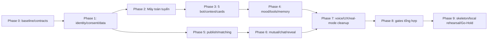

# 07 — Implementation Roadmap cho MoodPrint/Me2We

> **Kiến trúc đã chốt ngày 23/10/2026:** Python 3.12/FastAPI/Pydantic v2, SQLAlchemy 2 async + psycopg 3, Alembic/uv, Supabase PostgreSQL/Auth và OpenAI Agents SDK Python. Giữ React/Vite/TypeScript; Pydantic → OpenAPI → `frontend/src/api/generated/`. Chỉ scaffold cloud, không deploy. Evidence audit ban đầu là lịch sử, không phải trạng thái implementation mới.

**Mục tiêu:** chuyển từng hành trình prototype thành luồng full-stack có thể demo/test, giữ UI và các ranh giới dữ liệu đã nêu. **Kiến trúc đã chốt:** React/Vite + Python/FastAPI Modular Monolith + OpenAI Agents SDK Python + Supabase PostgreSQL/Auth; SSE AI và SSE ID-only notification cho human chat. [Spec/design tham chiếu](../technical-poc-architecture.md), [nguồn yêu cầu và khoảng trống](02-gap-analysis.md), [decisions](10-decisions-and-open-questions.md).

> Dành cho coding agent: thực hiện từng task ID, dùng checkbox để theo dõi và giữ bằng chứng test. Có thể dùng workflow `superpowers:executing-plans` khi skill đó có sẵn. Bộ tài liệu này chỉ giao kế hoạch; **đã được người dùng yêu cầu triển khai trực tiếp; không commit/push/cloud deploy/remote DDL**.

## Ràng buộc toàn cục và cách nghiệm thu

- Không sửa `.gitignore` khi chưa được yêu cầu; không bulk move/rewrite frontend, đổi GSAP/avatar/navigation hoặc scoring.
- Chưa có Charter/spec gốc. Các con số baseline được thuật lại trong docs/prompt cần Q01/Q05; giữ gates bảo thủ và chỉ dùng dữ liệu tổng hợp cho đến khi đủ evidence phê duyệt phạm vi/processor.
- Teen không publish/MATCH/invite/chat/reveal; unknown/under16 fail-closed. C-AI/MEM/MATCH/VOICE độc lập; approved memory cần AI+MEM và duyệt từng mục.
- Context AI/proposals/replay/state có text: kho tạm, ≤24h idle/end/logout; không transcript vào PostgreSQL/WAL/logs/backups. Mood/human messages ≤90 ngày; delete/backup/audio theo [09](09-security-devops-plan.md).
- Giữ công thức 45/35/20, round-half-up cuối, ngưỡng 30, top 5, oracle 90/78/68/44. Shared Activities/specialists/vector/MCP ngoài không thuộc baseline.
- Test/security làm trong từng task. **Không để phase 8 mới thêm ownership hoặc race guards.** Commands/test IDs bên dưới là yêu cầu tương lai; kết quả đã chạy nằm ở [08](08-testing-evals-plan.md).

Review focus xuyên suốt: (1) response đến sau revoke/bot switch không vào thread sai; (2) hai cửa sổ/actors không tạo duplicate room hoặc double save; (3) timeout sau commit không làm UI nói sai; (4) restore/retry không hồi sinh dữ liệu hết quyền; (5) timezone/Unicode/viewport và permission-denied vẫn giữ được draft. Các test tương ứng được gắn từng task.

Task mặc định: viết test lỗi với tên/assertions đã nêu → chạy test để xác nhận lỗi vì feature còn thiếu → triển khai contract tối thiểu → chạy lại test và regression đúng slice → demo/checkpoint → cập nhật bằng chứng. Với tooling/docs task dùng kiểm tra trực tiếp thay vì viết unit test phản chiếu cấu hình. Không bắt commit tự động; agent sau chỉ commit khi được người dùng ủy quyền.

## Dependencies và mốc E2E



**M1 cuối phase 2:** frontend hiện tại → auth/consent backend → Agents SDK → model tổng hợp → stream final đã kiểm → context phiên + run metadata → reload trong phiên. **M2 cuối phase 4:** approved memory tồn tại sau restart nhưng transcript phiên không tồn tại. **M3 cuối phase 6:** hai browser/accounts xuất bản→matching→mutual→chat/replay→block/reveal thu hồi đúng. Hoàn tất text-only M1 chưa hoàn tất nghĩa vụ voice MVP được thuật lại trong tài liệu.

## Phase 0 — Baseline, contracts và tooling có thể kiểm chứng

**Mục tiêu/demo:** một người mới chạy được prototype và kiểm contract mà không đọc lại toàn bộ repo. Tiền đề: checkout hiện tại, dependencies frontend sẵn. Scope: evidence baseline, workspace tối thiểu, contract/taxonomy/oracle. Non-goals: backend feature, DB migration, sửa UI/scoring. Files: backend pyproject/uv lock + frontend npm/lock; Pydantic/OpenAPI; tests/oracles; cập nhật docs chỉ khi task được giao.

- [ ] **P00.01 — Chốt baseline và lệnh verification có kết thúc hữu hạn.** Input: source/test/scripts hiện tại, kết quả audit. Tạo `docs/plans/validation-artifacts/baseline.md` và `scripts/verify-prototype.ps1` khi được giao implementation; lệnh phải thu exit code và timeout tách assertions/teardown. Kiểm `typecheck`, 77 unit tests, build, existing journeys; điều tra và ghi nguyên nhân nếu Windows teardown vẫn treo, chỉ sửa harness trong phạm vi task này. Output: một báo cáo tái lập được, không giấu suite timeout. Acceptance/test T-BASE-01: process kết thúc, artifact ghi đúng PASS/FAIL/TIMED OUT; không thay assertions để xanh. Depends: không.
- [ ] **P00.02 — Python workspace và frontend npm tooling.** Files: `backend/pyproject.toml`, `backend/uv.lock`, `backend/.python-version`, frontend package/lock/scripts, `scripts/verify.*`. Pin Python 3.12 patch tương thích, uv lock; FastAPI/Pydantic2, SQLAlchemy2 async+psycopg3, Alembic, pytest/pytest-asyncio/HTTPX, Ruff/mypy. Frontend giữ npm lock/versions hiện có, không root TypeScript backend workspace hoặc lock migration. Commands thật uv sync --locked/Ruff/mypy/pytest + frontend npm typecheck/unit/build/E2E; không script rỗng PASS. Acceptance: clean install trong checkout tạm có cùng frontend versions và build; .gitignore giữ nguyên. Depends: P00.01.
- [ ] **P00.03 — Pydantic/OpenAPI contracts và taxonomy.** Files: `backend/app/api/schemas/`, OpenAPI export script/artifact, `frontend/src/api/generated/`, `backend/tests/contract/test_contracts.py`. Pydantic v2 source chuẩn cho ApiError/Versioned/CandidateCardDTO/StartAiRun/AiOutputV1/SSE envelope/DomainActionResult/public taxonomy/BotId. FastAPI OpenAPI deterministic→pinned TS generator/client, CI regeneration/drift check; DTO tách ORM/prompts/SDK/server-only fields, không shared TS backend schemas. Acceptance T-CONTRACT-01/T-API-02: payload có gender/privateItems/raw userId trong candidate bị reject; unknown tag, invalid Unicode lengths/version/cursor bị reject; valid old prototype values parse được. Depends: P00.02.
- [ ] **P00.04 — Cố định matching/mood oracle và mapping port.** Files: `tests/oracles/matching-v1.json`, `tests/oracles/mood-v1.json`, `backend/tests/contract/test_oracles.py`; source frontend giữ nguyên nếu chưa có consumer contract mới. Input: score/halfUp/moodSummary và fixtures; output: synthetic vectors độc lập LLM + scoringVersion rationale. Acceptance T-MATCH-01/T-MOOD-01: 90/78/68/44, 77,5→78, null ngày thiếu, day/latest values được xác nhận; không đổi weights/tie-break. Depends: P00.03.

**DoD/checkpoint:** workspace/checks và public schemas review được; baseline bất thường được ghi thật; source prototype còn cùng UI/hành vi. Rủi ro: untracked source, migration lockfile, teardown Windows. Rollback: revert riêng tooling/contracts mới, giữ frontend lockfile và baseline; không xóa .gitignore hoặc dữ liệu untracked. Song song: P00.03 và chuẩn bị oracle có thể tách phần đọc sau P00.02; chỉ chốt oracle khi schemas rõ. Chưa bị chặn bởi provider/Q01.

## Phase 1 — Đăng nhập, quyền và dữ liệu riêng lưu/reload

**Mục tiêu/demo:** một tài khoản synthetic đăng nhập, quyền ban đầu tắt, tự lưu private item và reload đúng chủ. Tiền đề: P00.01–04; DB local/test khả dụng; Supabase Auth đã chọn, Q03 cung cấp project config; test identity chỉ dependency override. Scope: server foundation, ownership, consent/invalidation và manual data slice. Non-goals: model/matching/realtime. Files chủ yếu backend infrastructure/auth/users/consent/profiles, frontend session/bootstrap/API; chưa di chuyển tất cả pages.

- [ ] **P01.01 — Backend/database có schema và transaction foundation.** Files: `backend/app/main.py`, `backend/app/core/config.py`, `backend/app/infrastructure/database/{engine,session}.py`, `backend/alembic/versions/*_identity_consent.py`, integration setup. Produces `AsyncSession unit of work: async with session.begin()`, health endpoints; Alembic local migrations, Supabase direct/session pooler, URLs/roles runtime/migration tách, transaction mode prepare_threshold=None, users/account_gates/auth_sessions/consents/idempotency/outbox/tombstones tối thiểu. Acceptance T-PRIV-01/T-OPS-01: migrate DB sạch, role app không DDL, query parameterized, rollback tx/outbox nguyên tử, pool đóng được; config thiếu secret fail startup không log value. Depends: P00.03/P00.04.
- [ ] **P01.02 — Auth/session và eligibility authoritative.** Files: `backend/app/modules/auth/{routes,service,session,supabase}.py`, users eligibility policy, `frontend/src/features/auth/{api,SessionGate}.tsx`, integration auth tests. Produces `require_actor(request) -> AuthenticatedActor` và `/session/logout` contracts ở 05. Supabase Auth trusted password token endpoint→official getUser→opaque HttpOnly app cookie, no stored password/provider tokens. TTL≤JWT expiry, production live auth.sessions session_id + local revoke + CSRF. Test identity chỉ dependency override; unknown age default; PUT /users/me/eligibility nhận năm sinh/explicit confirmations theo D15/Q04 đã chốt24/10/2026, không nhận ageBand/client actor. Ngưỡng16 dùng ứng dụng,18 kết nối; CSRF/idempotency/CAS; không auto consent. Q03 cung cấp config. Acceptance T-AUTH-01/02: expired/wrong issuer/forged userId denied; adult không auto consent; teen/unknown/under16 không bypass bằng query/body/socket; logout invalidate session. Depends: P01.01; Q04 policy đã chốt, live auth vẫn cần Q03.
- [ ] **P01.03 — Consent ledger, gate/version và immediate deny.** Files: `backend/app/modules/consent/{service,policy,routes}.py`, `backend/app/jobs/invalidation.py`, migration bổ sung consent_events. Produces `set_consent(actor, purpose, enabled, expected_version) -> ConsentSnapshot` và `assert_purpose(tx, actor, purpose) -> ConsentSnapshot`. Tx tăng version + outbox; delete/revoke chặn dùng ngay, cleanup có thể chạy sau. Acceptance T-CONSENT-01/T-PRIV-02: AI/MEM/MATCH/VOICE độc lập, AI+MEM conjunction, stale write 409, enable lại không phục hồi resources, hai connection DB ép revoke/write race có kết quả tuyến tính. Depends: P01.02.
- [ ] **P01.04 — Lát manual private profile → DB → reload.** Files: `backend/app/modules/profiles/private_{service,routes,repository}.py`, migration private_items, `frontend/src/api/*`, query provider và `features/profiles/{api,hooks}.ts`; sửa `Profile.tsx` chỉ phần self-entered list. Produces `create_private_item(actor, request) -> PrivateItemDTO` và list/edit/delete versioned; TanStack Query hoặc lựa chọn D06 đã kiểm. Acceptance T-PRIV-01/T-UI-01: A lưu→reload còn item; B gọi ID đó→404; server lỗi giữ form draft, không success sớm; AI off vẫn dùng. Depends: P01.03.

**DoD:** Mọi route riêng dùng actor/policy; auth+consent audit không chứa text, manual CRUD thật; delete source tăng gate ngay. Test: contracts/auth/SQL/ownership + một fullstack E2E synthetic, frontend regression. Rủi ro: Supabase config còn mở; Q04 đã chốt, stale caches, CSRF, role quá rộng. Rollback: disable real entry/mutations, không khôi phục consent cũ; schema expand-only. Song song: auth UI và DB integration setup sau contract; P01.03 không làm trước identity/locks.

## Phase 2 — Mây thật toàn tuyến, context TTL và streaming

**Mục tiêu/demo M1:** Mây phản hồi model tổng hợp thật, cancel/reload còn đúng phiên, metadata bền vững. Tiền đề: phase 1; credentials test do người dùng cấu hình, Q02 chỉ cho dữ liệu tổng hợp cho tới privacy gate. Scope: một bot, không domain write tool. Non-goals: năm service, memory dài hạn, SDK sandbox/specialist, background model retry. Files: ai runtime/provider/context/stream, run metadata migration và existing BotConversation.

- [ ] **P02.01 — Pin SDK và kiểm adapter bằng fake transport.** Files: `backend/pyproject.toml`/`backend/uv.lock`, `backend/app/ai/provider/{sdk_adapter,config}.py`, `backend/tests/contract/test_sdk_adapter.py`, ghi `docs/plans/validation-artifacts/sdk-compatibility.md`. Produces `run_agent(input: PreparedRun, ctx: ServerRunContext) -> AsyncIterator[AppAiEvent]` qua Agent/Runner.run_streamed/function_tool, async stream_events(), asyncio deadline/result.cancel(); RunConfig tracing disabled/sensitive false trước call; import agents resolve SDK. Test T-AI-05: Agent/Runner/function_tool/context/output_type/events imports và typecheck; tắt exporter trước call, request store mapping/deadline/abort/model-call counter chứng minh bằng fake provider; canary private text không ra logs/traces. Tên option không có phải báo gap, không tự viết loop. Depends: P01.03; pin model explicit sau benchmark.
- [ ] **P02.02 — Mây run service và budgets.** Files: `ai/{runtime,registry,tools}/`, `backend/alembic/versions/*_ai_run_metadata.py`. Produces `startRun/cancelRun` signatures ở 04, active conversation lease/fence, clientMessageId idempotency, usage reservations. Acceptance T-AI-01/03: một user message không duplicate; cùng thread concurrent→409; ≤3 model calls/≤2 tools/30s; cancel/revoke chặn final/tool mới; provider uncertainty không auto retry. Depends: P02.01.
- [ ] **P02.03 — SessionStore TTL, output validation và SSE replay.** Files: `backend/app/ai/context/{store,types}.py`, `backend/app/ai/{context,stream,output_policy}.py`, SSE routes. Produces `getSessionView` và event contract ở 04; app-owned history, buffer output, expiry per read, RAM cap. Acceptance T-AI-06/T-PRIV-02: reconnect/dedup/gap, refresh còn phiên, expiry 410; restart mất raw text nhưng run interrupted; revoke MEM của run đã nạp memory/canary stale source không emit; raw context không xuất PG/outbox. Depends: P02.02.
- [ ] **P02.04 — Nối Mây vào UI giữ interaction.** Files: `frontend/src/features/companions/{api,stream,hooks}.ts`; sửa `companions/Companions.tsx` và Cards adapter tối thiểu. Produces `useBotConversation(botId)` trả thread/run/actions theo server IDs. Acceptance T-UI-01/T-AI-01/06: send→progress→final→reload trong phiên, stop/retry/network failure giữ đúng state; chuyển Gương khi Mây pending không trộn output; backend unavailable hiển thị rõ khi thiếu cấu hình, không fallback scriptedReply. Depends: P02.03.

**DoD:** M1 có model/version/usage/latency evidence tổng hợp, stub tests deterministic, privacy canary, replay/cancel race; không gọi UI thành production approved. Rủi ro: SDK version gap, provider retention, hung runs, budget uncertainty. Rollback: disable AI flag/cancel active runs, giữ manual functions; không chuyển text sang mock. Song song: UI adapter có thể phát triển với fixture API contract sau P02.01, chỉ nghiệm thu sau P02.03.

## Phase 3 — Năm companions, cards và isolation

**Mục tiêu/demo:** roster cũ dùng năm config server, mỗi bot đúng vai và history riêng. Tiền đề: M1. Scope: registry, schema cards, navigate-only transition. Non-goals: autonomous specialists/cross-bot transcript, người dùng tạo prompt/tool. Files: ai registry/prompts/context policies, public bots DTO và frontend cards.

- [ ] **P03.01 — Versioned registry/config cho 5 bot.** Files: `backend/app/ai/bots/{registry,factory,public}.py`, `backend/app/ai/bots/{may,guong,nhip,rure,caunoi}.py`, registry tests. Produces `getBotConfig(botId):BotConfig`, `createAgent(config,services)` theo 04. Acceptance T-AI-02: đúng 5 BotIds/identity, allowlist/context deny từng bot; thêm config test bot không sửa runtime; không lộ prompts qua /bots. Depends: P02.03.
- [ ] **P03.02 — Typed output/cards với action state thật.** Files: Pydantic AI output schema + generated TS, `backend/app/ai/output_policy.py`, frontend `Cards.tsx` adapter và tests. Produces AiOutputV1/ActionView mapping; proposal ref server-only, không model-generated receipt. Acceptance T-CONTRACT-01/T-UI-01: schema invalid/unknown card/action forged rejected; proposed không hiện saved; final JSON không render raw deltas; giữ palette/motion/labels. Depends: P03.01/P02.04.
- [ ] **P03.03 — Bot transition và context isolation.** Files: ai/context policy tests, Companions transition/unread adapter. Produces navigate_bot action không transcript và per-thread cache keys. Acceptance T-AI-04: Mây→Nhịp chỉ route, Nhịp không nhận Mây text; parallel other bot không đổi run destination; invalid BotId fallback route; logout/revoke clear sensitive previews. Depends: P03.02.

**DoD:** 5 bots hoạt động qua SDK hoặc tool pending có trạng thái đúng; không dùng turn parity làm nguồn production; isolation tests và mini rubric role. Rủi ro: cùng giọng/cùng context hoặc DTO chứa quyền. Rollback: flag từng bot về unavailable, không gộp history vào Mây. Song song: prompts/eval examples theo bot sau context contract; runtime factory cùng một implementation.

## Phase 4 — Mood, tools, private proposals và approved memory

**Mục tiêu/demo M2:** Nhịp lấy thống kê thật; Gương proposal→sửa/approve→memory qua restart; explicit delete/revoke làm memory mất quyền ngay. Tiền đề: phase 3 + private foundation phase 1. Scope: manual mood, bounded read/proposal tools và memory lifecycle. Non-goals: diagnosis, semantic search, auto-save hoặc matching từ memory. Files: mood/memory/profiles modules, source links, companions cards/Self/Profile integration.

- [ ] **P04.01 — Mood CRUD/calendar/summary thật.** Files: `backend/app/modules/mood/{service,repository,routes}.py`, migration mood, `features/mood/{api,hooks}.ts`, `pages/Self.tsx`, mini chart data adapter. Produces `save_mood(actor, request) -> MoodDTO`, `get_mood_summary(actor, range) -> MoodSummaryDTO`. Acceptance T-MOOD-01/02: unique owner/localDate, timezone+month/DST boundaries, valid dates/value1..5/note120, null missing/latest rule, 3-day insight gate; AI off manual still works, save error giữ form. Depends: P01.04/P03.02.
- [ ] **P04.02 — Tool Gateway đọc/proposal có quyền.** Files: `backend/app/ai/tools/{gateway,mood,private_item,content}.py`, domain proposal store/service. Produces `execute_tool(ctx, name, args) -> ToolResult`; chưa đăng ký matching-draft tools vì producer ở nhánh phase 5. Acceptance T-AI-02/T-MEM-01: model forged userId/URL/SQL/owner denied, bot allowlist, source range/context policy, tool failures không thành success; profile/memory proposals có TTL và source versions. Depends: P04.01/P03.03.
- [ ] **P04.03 — Approve memory nguyên tử và scoped retrieval.** Files: `backend/app/modules/memory/{service,repository,routes,policy}.py`, migrations memories/sources/receipts, ephemeral proposal claim. Produces `confirm_proposal` ở 04 và `get_approved_memories(actor, bot_id, limits) -> list[MemoryDTO]`. Acceptance T-MEM-02/04: C-AI+MEM+từng mục, đúng edited payload/version/owner, unique proposalId, double confirm một record; bot khác không thấy; restart approved memory còn nhưng raw transcript không. Depends: P04.02.
- [ ] **P04.04 — Edit/delete/invalidation và memory/private UX.** Files: memory source invalidation/context eviction, frontend profiles/memory hooks và Profile/Cards. Produces versioned edit/delete APIs và current action receipts. Acceptance T-MEM-03/T-PRIV-02/T-UI-01: deletion/revoke race dừng in-flight context, old source không ghi lại memory, re-enable không restore, explicit source delete invalidate linked published snapshot, 409 giữ draft; có preview và trạng thái thật. Depends: P04.03.

**DoD:** M2 có data/SQL đối chiếu, no private data vào matching contract, tests source/consent/edit/delete/claim crash và frontend regression. Rủi ro: source TTL tự nhiên bị nhầm explicit delete, memory lẫn bot, DB backup private text. Rollback: tắt memory tools/read, vẫn cho user quản lý dữ liệu đã lưu; không downgrade về auto-memory. Song song: P04.01 manual mood có thể bắt đầu sau P01.04, prompts/library nội dung và UI adapters độc lập sau contracts; confirmation service phụ thuộc proposal contract ổn định.

## Phase 5 — Publish và matching thật, không cần AI

**Mục tiêu/demo:** hai account synthetic tự khai profile, preview/publish và thấy gợi ý có lý do đúng khi AI/MEM tắt. Tiền đề: phase 1 + P00.04; có thể bắt đầu trước phase 2–4. Scope: draft/published source maps, eligibility/ranking, candidate DTO và discovery UI. Non-goals: semantic/ML/stable assignment, bio tự do, thay weights hoặc nới hard filters. Files: profiles/matching modules, migration taxonomy/published profiles, Sharing/Connect hooks.

- [ ] **P05.00 — Nền trạng thái social, block và cooldown cho discovery.** Files: `backend/app/modules/connections/{pair_policy,blocks,cooldowns,peer_ref}.py`, users moderation-status projection, migration pairs/blocks/account restriction fields, Pydantic safe peer refs + generated TS. Produces `get_social_eligibility(tx, actor_id, peer_id, now) -> SocialEligibilitySnapshot`, `get_pair_policy(tx, actor_id, peer_id, now) -> PairPolicySnapshot`, `block_peer(actor, peer_ref, key)` và `set_pair_cooldown(actor, peer_ref, reason, key)` receipts. Codec peerRef ràng buộc actor/cặp/purpose/expiry, có thể kiểm bằng fixtures độc lập với published profiles; ref không tự cấp quyền. Pair marker/snapshots/expiry là dữ liệu DB, không stub always-eligible; request/room APIs chưa mở. Acceptance T-MATCH-02/T-SAFE-01: block hai chiều, cooldown, restriction và markers pending/open/expired đọc đúng; block/cooldown có ownership/idempotency; không cần AI hoặc producer phase sau. Full eligibility ghép published profile ở P05.02; route skip nối ở P05.03. Depends: P01.03/P01.04/P00.04.

- [ ] **P05.01 — Draft→preview→publish/withdraw có version.** Files: `backend/app/modules/profiles/{matching_draft,published,source_links}.py`, migrations taxonomy/profile tables, Pydantic profiles + generated TS, frontend Sharing adapter. Produces `publish_profile(actor, request) -> PublishedProfileDTO` và withdraw. Acceptance T-MATCH-03/T-CONSENT-01: adult+C-MATCH, minima3/2/1, no bio/private fields, preview stale409; cancel preview không đổi published; republish/linked source change tăng gate, room old access denied. Depends: P05.00; không phụ thuộc P04 memory.
- [ ] **P05.02 — Retrieval, scoring và safe candidate refs.** Files: `backend/app/modules/matching/{eligibility,scoring,repository,service,candidate_ref}.py`, test oracles. Produces `get_candidates(actor) -> CandidateListDTO`, `check_base_eligibility(tx, actor_id, peer_id, now) -> EligibilityResult` và `validate_candidate_ref(actor, ref) -> EligiblePairSnapshot`. Ghép social projection/peer-ref codec P05.00 với published projection P05.01; discovery áp thêm PairPolicy, send/accept dùng interaction rules riêng ở 05. Acceptance T-MATCH-01/02/03: oracle và threshold/top5/rounding, both-side age/consent/goal/language/block/restriction/cooldown/pending/open filters; opaque pair ref/version không auth bypass; no identity/source refs/raw text. Depends: P05.01/P01.03.
- [ ] **P05.03 — Discovery/preview UX và empty/error thật.** Files: `features/discovery/{api,hooks}.ts`, `Connect.tsx`, `Profile.tsx` sharing callbacks; API candidate UI schemas và matching skip route. Produces async cards/reasons/publish feedback, skip/block actions đến server; `skip_candidate(actor, candidate_ref, key)` kiểm ref/live matching policy rồi gọi `set_pair_cooldown` của P05.00. Acceptance T-UI-01/T-MATCH-02: AI off hoàn thành publish→discovery, no 400ms fake loading hoặc hardcoded C01 descriptions; empty không fake people; stale ref/quota giữ state và tải lại có chủ ý; mobile/keyboard không regress. Depends: P05.02.

**DoD:** matching chạy được khi provider/AI unavailable, query DB hai user thật trong test, reasons từ allowed tags; no private joins/features. Tests: scoring/property/filter matrix, DB/revalidation/API + E2E AI-off. Rủi ro: Charter/taxonomy/tie-break còn Q01/Q06; cold start. Rollback: disable publish/discovery entry hoặc về no suggestions state, không nới filters; old published versions giữ lịch sử invalidation. Song song: toàn phase 5 có thể song song nhánh AI sau phase 1; tránh cùng chỉnh Profile.tsx một lúc bằng adapters/nhiệm vụ có ownership rõ.

## Phase 6 — Mutual connection, human chat, reveal và safety

**Mục tiêu/demo M3:** hai browser context đăng nhập khác nhau gửi/accept→một phòng→message ACK/replay→reveal/block đúng quyền. Tiền đề: phase 5 + locks/gates phase 1. Scope: canonical pairs, request/room state machine, message SQL/SSE-independent realtime, field grants, reports. Non-goals: Activities production, read receipts/presence analytics, raw text broadcast. Files: connections/messaging/moderation, socket gateway/outbox và Chat/Requests/Messages UI.

- [ ] **P06.01 — Pair/request/mutual transaction và quotas.** Files: `backend/app/modules/connections/{requests,service,policy}.py`, migrations requests/connections/memberships và FK/marker transitions mở rộng nền pairs của P05.00, Pydantic connections + generated TS. Produces `send_request(actor, candidate_ref, key) -> RequestResult`, `decide_request(actor, request_id, decision, version, key) -> RequestResult`. Acceptance T-CONN-01/02: hai intent khác actor; discovery loại pending nhưng locked send/accept cho phép đúng reciprocal pending; cross invites/double accept tạo một open room; 7d expiry/10 per rolling24h/10 pending/cooldown30d, sorted locks; profile/revoke trước accept denied; no fake greetings. Depends: P05.02/P05.00/P01.03.
- [ ] **P06.02 — Messages persistence/ACK và human UI.** Files: `backend/app/modules/messaging/{service,routes,repository,quota}.py`, migration messages/seq, `features/messaging/{api,hooks}.ts`, `Chat.tsx`, `MessagesPage` tách khỏi App nếu task cần. Produces `send_message(actor, connection_id, request) -> MessageAck`, `get_messages(actor, connection_id, cursor) -> MessagePage`. Acceptance T-MSG-01/03/T-UI-01: membership live,500 chars,20/min/account, unique(room,sender,clientId), same ID khác text409; timeout sau commit retry cùng ID một bubble; reload từ DB; AI text không nằm trong human table. Depends: P06.01.
- [ ] **P06.03 — Socket notify/outbox/reconnect và revoke path.** Files: `backend/app/infrastructure/realtime/sse.py`, `backend/app/jobs/{outbox,runner}.py`, messaging notify adapter, frontend socket/cursor handler. Produces ID-only event envelope ở 05 và at-least-once idempotent dispatch. Acceptance T-MSG-02/T-SAFE-01/T-JOB-01: reconnect replay, duplicate/out-of-order events, lost ACK, crash after commit/before emit, session expire/block/revoke while event queued→không fetch text; leak canary absent. Depends: P06.02; SSE subscribe/delivery luôn recheck auth.
- [ ] **P06.04 — Field reveal và identity version.** Files: `backend/app/modules/connections/{reveal,identity}.py`, migrations reveal/identity, frontend reveal panel; mở rộng block service P05.00 để invalidation grants. Produces grant/decline/revoke/value endpoints ở 05 và own identity update. Acceptance T-REVEAL-01/02: owner quyết định, field/direction/room/value version,7d request/decline cooldown, deny stale preview; peer identity không preview trước grant; race edit/revoke/close deny; unblock không restore. Depends: P06.03/P05.00.
- [ ] **P06.05 — Report receipt/evidence và moderation boundary.** Files: `backend/app/modules/moderation/{reports,evidence,access,routes}.py`, migrations reports/evidence, Safety form adapter tối thiểu. Produces `create_report(actor, request, key) -> ReportReceipt`; moderation cập nhật restriction projection đã có từ P05.00, matching không đọc report content. Acceptance T-SAFE-02: max2 selected evidence thuộc quyền chọn hiện tại, no whole chat/AI transcript, block độc lập, reporter idempotency, moderator role riêng/audit; staffing Q07 chưa có thì không mở beta thật. Depends: P06.02/P06.04; nội dung operator policy cần Q07.

**DoD:** M3 + SQL multi-connection races, actor spoof tests, ACK/replay/end/block/reveal sau reload và queued-event revoke; không còn peer simulation trong real connections. Rủi ro: deadlocks, indefinite retries, DTO leak, moderation staffing. Rollback: disable new invites/sends, giữ deny gates/blocked state và dữ liệu đã commit; không resurrect old rooms/grants. Song song: report backend có thể chuẩn bị sau P06.02; reveal UI với DTO stub sau contracts; critical path pair→messages→delivery/revoke không đảo.

## Phase 7 — Voice có consent và hoàn thiện integration frontend

**Mục tiêu/demo:** các hành trình real mode không còn mock production behavior; user ghi ≤30s→STT→sửa chữ→chủ động send, hoặc dùng text khi không có mic. Tiền đề: phase4/6 cho toàn phase; voice spike có thể bắt đầu sau phase2 và Q02. Scope: recorder/STT có cleanup, Settings/delete/export UX, error/accessibility, real/demo separation. Non-goals: always listening, audio emotion inference, Activities production hoặc redesign.

- [ ] **P07.01 — STT backend và audio lifecycle.** Files: `backend/app/ai/voice/{service,routes,processor,temporary_store}.py`, Pydantic voice + generated TS, fake processor tests. Produces `transcribe(actor, recording) -> TranscriptionView`, get/cancel endpoints ở 06. Acceptance T-VOICE-02/T-OPS-01: AI+VOICE live,≤30s server duration + byte/MIME bounds, audio cleanup success/cancel/error≤15min, no audio DB/logs/backups, processor deletion/retention evidence; real data blocked nếu Q02 không đạt. Depends: P02.03/P01.03.
- [ ] **P07.02 — Recorder/preview UI tại bot composer.** Files: `features/companions/voice/{useRecorder,Recorder,TranscriptPreview}.tsx`, Companions composer integration. Produces user-controlled recording/editable text, không auto-send. Acceptance T-VOICE-01/02: user gesture mới getUserMedia,permission denied/unsupported/routeleave/timeout/revoke cleanup tracks,throttle recording max30s, text fallback luôn có; iOS/physical test ghi riêng chưa suy từ Chromium. Depends: P07.01/P03.02.
- [ ] **P07.03 — Nối privacy/safety còn lại và loại mock khỏi real entry.** Files: Settings/StartHome copy (bỏ prototype/demo labels, giữ privacy/safety), features/privacy/safety, App/providers/mode composition, modules/users/data-requests routes, `backend/app/ai/tools/matching_draft.py`, contracts. Produces `requestDeletion/getDeletionStatus/requestExport/getExportStatus` contracts ở 05; nối Cầu Nối own-draft/tag proposal tools sau khi AI gateway và matching draft service đều sẵn; đồng bộ action state trên mọi form. Acceptance T-UI-01/T-PRIV-02/T-SAFE-02/T-AI-02: không sample adult/permissions/profile/PI01/C01 hardcode trong real bootstrap; không peer simulation/scheduler/scriptedReply fallback; success sau commit; export đúng chủ; delete hiện deny/job status; không reset real account về demo. Depends: P04.04/P04.02/P05.01/P05.03/P06.05/P07.02.
- [ ] **P07.04 — Mobile/a11y và visual regression của luồng async.** Files: UI feature components/CSS chỉ khi có finding, Playwright fullstack states/captures. Produces before/after evidence trên viewport matrix/keyboard/zoom và lỗi network. Acceptance T-UI-02: full-height composer/safe area/focus trap/restore/reduced motion,200%zoom/reflow,long VI text, no overflowing data; không xóa animation/component tốt; real status announcements không đọc từng token. Depends: P07.03.

**DoD:** không gọi MVP Must hoàn tất nếu voice/phạm vi Charter chưa xác minh; real bundle/entry không mock effects, tất cả screens có loading/empty/error/success thích hợp. Rủi ro: processor TTL, recorder browser incompatibility, cleanup làm mất UI. Rollback: disable voice giữ text; disable feature bị lỗi có message đúng, feature unavailable có trạng thái rõ; không auto-enable consent. Song song: STT/recorder contract stubs, privacy UI/backend lifecycle; visual check sau mỗi slice và tổng kiểm cuối.

## Phase 8 — Kiểm quyền, concurrency, evals và performance toàn tuyến

**Mục tiêu/demo:** bằng chứng tổng hợp đủ để reviewer quyết định staging Go/Hold. Tiền đề: tests đã tích lũy từ phase1, toàn feature ở phase7. Scope: adversarial/race/fault/recovery/evals/perf; delete physical và restore rehearsal trên dữ liệu tổng hợp. Non-goals: hứa an toàn tuyệt đối, nghiên cứu người chưa được duyệt, chứng minh friendship bằng số message.

- [ ] **P08.01 — Permission/concurrency suite toàn domain.** Files: `backend/tests/concurrency/test_{consent,mutual,messaging,reveal,memory}.py`, integration fixtures/barriers, `tests/e2e/fullstack-journeys.spec.ts`. Consumes public services/HTTP. Produces deterministic race matrix + E2E hai actor. Acceptance T-AUTH/T-CONSENT/T-CONN-02/T-MSG/T-REVEAL/T-PRIV suites: mọi lịch xen kẽ định nghĩa có outcome hợp lệ,0 cross-user leak/unauthorized commit/duplicate open room; stub model cố ý vi phạm không bypass gateway. Depends: P07.03; phát triển dần từ task owning service.
- [ ] **P08.02 — Evals A/B/C cho 5 bot và prompt/model version.** Files: `backend/tests/evals/{dataset.jsonl,rubric.md,runner.py,report.py}`, metadata artifacts. Produces≥60 scenarios chia dev/heldout, scorer + two-human review sample; A instructions/history, B+A tools, C+B approved memory, D specialist chỉ khi experiment được chọn. Acceptance T-EVAL-01/02: same tasks/model/budgets,0 observed privacy/consent/tool authority errors,ngưỡng chất lượng ở08,usage/cost/latency ghi rõ; real-model run opt-in/budgeted và dữ liệu tổng hợp. Depends: P04.04/P03.03; baseline A bắt đầu từ P02.04.
- [ ] **P08.03 — Deletion/TTL/processor và restore không hồi sinh.** Files: `backend/app/jobs/{deletion,expiry,processor_cleanup}.py`, tombstone replay, ops runbooks/tests. Produces `purge_deleted_resources(job) -> DeletionProgress` và restore procedure trước serve. Acceptance T-JOB-02/T-OPS-02/T-PRIV-02: deny ngay,raw context không restore,active/processor7d và backup30d được chứng minh hoặc gate Hold,restore áp tombstones trước read,retry worker không ghi lại memory/grant; audio≤15m. Depends: P07.03/P06.03; provider capability Q02/Q05 là gate riêng.
- [ ] **P08.04 — Load/budgets và failure fallback.** Files: `backend/tests/performance/{ai,matching,messaging}.py`, metrics dashboards/runbook config. Produces report workload/env/p50/p95/usage/errors/budget ceiling. Acceptance T-PERF-01:1/5/20 AI stub then quota-limited real;100/1k/10k profiles;20/100 sockets; thăm dò AIp95≤15s lượt ngắn,match≤1s@1k,chatcommit→visible≤1s@20 nếu Q08 chốt; không nới policy để đạt; manual path vẫn chạy khi LLM breaker mở. Depends: P08.01/P08.02; có thể đo sớm từng slice.

**DoD:** artifact có versions/counts/failed cases, không bỏ test để đạt%; tất cả lỗi quyền severity critical đóng hoặc Hold; ngưỡng được chốt trước chấm. Rủi ro: eval nondeterminism/PII artifacts/budget overflow; cleanup processor không xác minh. Rollback: gate không đạt thì giữ synthetic staging/disable feature, không đổi policy để pass. Song song: deterministic race suite, eval rubric/dataset, load harness và restore rehearsal độc lập sau inputs của từng nhánh.

## Phase 9 — Cloud skeleton, vận hành và local rollback rehearsal

**Mục tiêu/demo:** container local + cloud skeleton có health/metrics/backup/rollback rehearsal và quyết định Go/Hold có người chịu trách nhiệm. Tiền đề: phase8 gates, Q01–Q08 đủ cho phạm vi release cụ thể. Scope: CI checks, secrets templates, local migrations/container/drain, deployment skeleton và operator readiness. Non-goals: tự công khai app, đổi hạ tầng không được duyệt hoặc tuyển nghiên cứu tự phát.

- [ ] **P09.01 — CI/container/staging manifests và health.** Files: `.github/workflows/verify.yml`, backend Dockerfile, deployment manifests/scripts và environment templates khi được giao. Produces deterministic pipeline install/check/unit/contracts/SQL/E2E/build, migrate bằng role riêng, readiness/drain. Acceptance T-OPS-01/02: no secrets/browser bundle,image reproducible,pipeline không dùng production DB,graceful stop lease/socket/SSE hữu hạn,local container/readiness probe có log; manifests chưa deploy. Depends: P08.01/P08.03; CI checks có thể scaffold phase0 nhưng không release/deploy job tự chạy hoặc remote migrations.
- [ ] **P09.02 — Provider/privacy/research và operational readiness gate.** Files: `docs/plans/validation-artifacts/release-readiness.md`, processor inventory/retention evidence, report on-call procedure, cost ceiling config. Produces Go/Hold record theo Q01–08, model/SDK/region/endpoints/retention actuals và các ngoại lệ. Acceptance: không self-approve Charter/teen/provider deletion; unresolved processor/report staffing→Hold liên quan; local secret/config/restore/delete drill có evidence; hosted drill chưa chạy ghi BLOCKED,adult synthetic demo không bị gọi human validation. Depends: P08.02/P08.03/P08.04/Q01–Q08.
- [ ] **P09.03 — Local deploy/rollback rehearsal và cloud skeleton, PoC report.** Files: ops rollback/backup/deletion/on-call runbooks, deployment scripts, final artifact index. Produces demo M1/M2/M3+voice scope, run metrics, backup restore/tombstone/drain/rollback record. Acceptance T-OPS-02: app rollback tương thích schema expand,cancel old AI runs,old consent/grants không hồi sinh,health probe/chức năng manual còn; báo rõ giới hạn synthetic dữ liệu. Chỉ local container rehearsal; remote deploy/DDL tương lai cần user chỉ định target và cho phép sau review. Depends: P09.01/P09.02.

**DoD:** local synthetic rehearsal nghiệm thu; cloud deployment chưa thực hiện, runbooks được tập, decision Go/Hold có owner, rollback không cần phá/xóa dữ liệu. Không tự tuyên bố production-ready khi privacy hoặc staffing chưa đạt. Rủi ro: migration destructive, provider retention/account restrictions, serverless stream limits, mistaken environment. Rollback: disable flags/route traffic về image trước, giữ gates/tombstones, drain jobs; không restore DB mù. Song song: CI/container và readiness paperwork sau đầu vào ổn định; release rehearsal cần tất cả gates.

## Ước lượng, điểm chia nhỏ và quyền thực hiện

Task thường nhắm một change review được trong khoảng **0,5–2 ngày công**, nhưng đây là giả định tổ chức, không estimate đã xác minh. P06.03/P08.03 hoặc auth/provider integration có thể lớn hơn; nếu spike cho thấy không vừa một lượt hợp lý, tách suffix task như P06.03a/P06.03b, cập nhật dependency/test trước làm. Không gộp “build backend/add AI/write tests” thành một task.

Nhóm giả định 3 người: backend/domain owner, frontend/integration owner, QA/AI/ops owner chia sẻ theo năng lực; **không phải chỉ định nhân sự có thật**. Nhánh AI và matching song song sau phase1; integration/SQL policy review là bottleneck có thể làm lịch dài hơn coding thuần. Không tự thay deadline MVP 2 tuần được tài liệu nội bộ thuật lại: Q08 phải chọn scope có gate và lịch sau spike M1/matching, không hứa toàn roadmap vừa 2 tuần.

**Phase có thể triển khai ngay:** 0, bắt đầu P00.01. Chưa cần API key/production access cho baseline/contracts/oracles. Q03 chặn Supabase live auth/DB config và hosting tương lai; Q02 chặn dữ liệu riêng thật/model/voice processor; Q04 đã chốt ngưỡng16/18 và self-declaration; Q07 chặn beta human connection. Không yêu cầu trả lời mọi câu hỏi để bắt đầu việc local độc lập.

Prompt triển khai đang có hiệu lực:

```text
Đọc toàn bộ 12 plans, cập nhật stack nhất quán rồi triển khai trực tiếp P00.01–04, Phase1 và các task có dependencies sẵn. Python/FastAPI + Supabase PostgreSQL/Auth + Agents SDK Python; giữ UI React/Vite và privacy invariants. Ghi evidence thật từng task, không sửa .gitignore/commit/push/cloud deploy/remote DDL. Thiếu credentials báo biến cấu hình cụ thể rồi tiếp tục local tasks độc lập, không mock success.
```

Cloud mọi phase chỉ scaffold/local rehearsal; không public deploy/resources/remote migrations. Docker sandbox chỉ interface/config disabled tới khi có code/file use case; không shell cho bot baseline. Các task/test IDs và dependencies được bảo tồn; checkbox không thay evidence.
