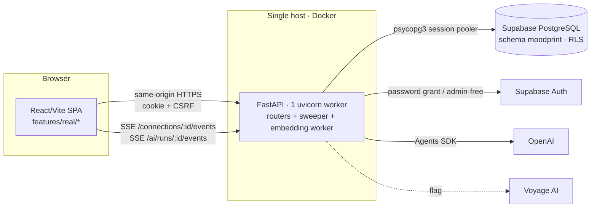

# 04 — Target Architecture

Principle: **evolve the existing modular monolith**. No new services, brokers or realtime vendors for ~50 users. Every addition reuses an existing pattern in the codebase (locking order, idempotency receipts, consent-version snapshots, watermark SSE, expand-only migrations, in-process sweeper).

## 1. System context

## 2. Backend module map (target)

| Module | Status | Responsibility |
|---|---|---|
| `app/core/*` | existing | config, security (actor, CSRF, idempotency), limits, SSE slots, errors |
| `app/modules/auth` | existing (+I-03) | login/session/eligibility; suspension check |
| `app/modules/consent` | existing (+D-05) | consent CAS; abort activities on MATCH withdrawal |
| `app/modules/profiles` | existing (+C-01) | private items; **taxonomy v2 single source of truth** (`taxonomy.py`, `taxonomy_v2.json`) |
| `app/modules/matching` | refactor (C-03/C-04) | `scoring.py` (v1 oracle, rollback), **`scoring_v2.py`**, **`ranking.py`** (fairness/diversity), **`explain.py`** |
| `app/modules/social` | existing (+B-01..B-05, C-04) | drafts/publish, retrieval (**rewritten SQL**), requests, connections, messages, reads, summary, SSE |
| `app/modules/activities` | **new** (D–G) | `models.py`, `definitions.py`, `machine.py` (pure), `content/*.json`, `service.py`, `routes.py`, `jobs.py`, `focus.py`, `schemas.py` |
| `app/modules/moderation` | existing (+I-01..I-04) | reveal, reports; **staff queue/actions**, restrictions |
| `app/modules/users` | existing (+D-05) | export/deletion include activities and reads |
| `app/ai/*` | existing (+I-05) | runtime; **daily quota + spend ceiling** in `admission` |
| `app/jobs/retention.py` | existing (+A-05, D-05) | purge outbox, activity responses, terminal sessions |

Dependency rule: `activities` may import `social.service` (room/live checks, pair locks); `social` must not import `activities` except through a narrow hook module `activities/hooks.py` (`abort_for_pair`, `abort_for_user`) called from block/end/consent/deletion paths.

## 3. Frontend module map (target)

| Path | Responsibility |
|---|---|
| `features/real/RealApp.tsx` | shell, routes, session (unchanged structure; add badge data) |
| `features/real/social/Discovery.tsx` | tabs: suggestions, requests, profile (split from `Social.tsx`) |
| `features/real/social/ProfileEditor.tsx` | v2 stepper + preview/publish |
| `features/real/social/CandidateCard.tsx`, `RequestCard.tsx` | public cards with reasons |
| `features/real/social/HumanMessages.tsx`, `HumanChat.tsx` | list with unread/preview; chat |
| `features/real/social/useConnectionEvents.ts` | single SSE subscription per room, exposes `messages_available` and `activity_changed`, polling fallback |
| `features/real/social/useSocialSummary.ts` | badge polling (15 s, visible tab only) |
| `features/real/activities/*` | `ActivityDock`, `ActivityCatalog`, `InviteBanner`, `IcebreakerPanel`, `QuizPanel`, `FocusPanel`, `ActivitySummary`, `useActivity`, `clock.ts`, `activities.css` |
| `features/real/admin/Moderation.tsx` | staff-only queue (route hidden unless `session.staff`) |

`Social.tsx` becomes a re-export barrel during migration so imports stay stable, then is removed (H-02).

## 4. Synchronization design

**Decision DR-01:** reuse the per-connection SSE stream and its once-per-second watermark read. Add `connections.activity_seq` (bigint), incremented in the **same transaction** as any activity mutation for that connection. The stream compares `(next_seq, version, activity_seq)`:

- change in `next_seq`/`version` → existing `messages_available` event (unchanged payload);
- change in `activity_seq` → new `activity_changed` event: `{version:"social-events-v2", connectionId, activitySeq, eventId}` — IDs only; clients fetch `GET /connections/{id}/activities/current` (authorization re-checked).

Why: zero new infrastructure, one DB row read per stream per second (already paid), authorization stays in HTTP reads, works through any proxy that already carries the chat stream. LISTEN/NOTIFY was rejected (needs a dedicated connection per worker, Supavisor session-mode coupling, little benefit at 50 users). WebSockets were rejected (new protocol surface, proxy config, CSRF model change).

Fallback: when the stream errors, the client polls `GET .../activities/current` every 3 s (same cadence as messages); when healthy, every 15 s as a safety net.

Focus timers: the server stores absolute timestamps; DTOs include `serverTime`; the client derives a clock offset and renders the countdown locally. Phase transitions are materialized by the sweeper (`deadline_at` index) and also lazily on read, both bumping `activity_seq`.

## 5. Concurrency model (unchanged pattern, extended)

Lock order for every pair-scoped write: **users (sorted by id) → pair → connection → activity session**, via `svc.pair_transaction`. Writes require `Idempotency-Key` (receipt table) and `expectedVersion` (CAS). Unique partial indexes enforce invariants (one open room per pair; **one non-terminal activity per connection**). Read-only polling uses `lock=False`.

## 6. Background work

The existing `sweep_context` loop (1 s) gains `activities.jobs.advance_due(app)` (bounded: ≤50 sessions per tick, `FOR UPDATE SKIP LOCKED`) and the retention minute task gains activity purges. No new process.

## 7. Topology and scaling limits (explicit)

- One API process; in-memory limiters/SSE slots/export payloads/AI RAM context remain valid only with one worker. **Do not scale horizontally** without first moving these to PostgreSQL (post-MVP).
- Capacity envelope from existing evidence: ~50 req/s on a dev host; 50 users with 1 s think time p95 ≤ 0.71 s for social writes. Activities add < 1 write/s per active pair.
- DB pool: 8 + 4 overflow (production defaults); SSE streams do not hold a connection between polls.

## 8. Data ownership and privacy boundaries

| Data | Owner | Visible to peer? | Matching input? |
|---|---|---|---|
| Moods, notes, private items, AI conversations, memories | user | never | **never** |
| Published profile (v2) | user | eligible candidates, request counterpart, connection peer | yes |
| Human messages | sender | connection peer (90 days) | no |
| Activity answers | author | peer only per reveal rules | no |
| Activity feedback | author | never (aggregated only) | no |
| Read markers | user | never (no read receipts in MVP) | no |
| Reports | reporter | staff only | no |

## 9. Key decisions (summary; full list in [13](13-risks-and-decisions.md))

DR-01 SSE watermark reuse · DR-02 delete prototype · DR-03 connections survive profile edits · DR-04 deterministic taxonomy scorer v2 (no runtime model calls) · DR-05 no percentages · DR-06 per-pair alias · DR-07 sender card on requests · DR-08 three MVP activities, one active per connection · DR-09 static content banks · DR-10 retire outbox · DR-11 role-gated staff moderation · DR-12 AI quota + spend ceiling · DR-13 read markers · DR-14 four expand-only migrations.
