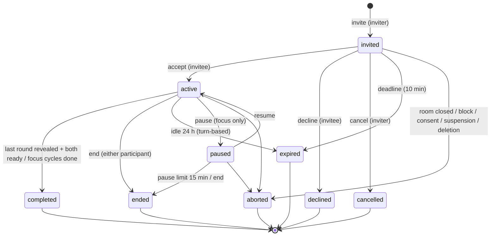

# 06 — Shared Activities Design

Activities run **inside an open human connection**, between two real accounts, with state owned by the server and persisted in PostgreSQL. No peer is ever simulated. Synchronization reuses the connection SSE stream ([04 §4](04-target-architecture.md#4-synchronization-design)).

## 1. Framework concepts

| Concept | Definition |
|---|---|
| Activity definition | Static, versioned description in code: `kind`, `definition_version`, rounds, options, content bank file, handlers (`icebreaker-v1`, `coop_quiz-v1`, `focus-v1`) |
| Activity session | One run of a definition in one connection; row in `activity_sessions` |
| Participant | Exactly two per session (inviter, invitee); row in `activity_participants` |
| Response | One participant's answer for one round; row in `activity_responses` |
| Round / phase | Turn-based kinds: `answering` → `revealed` per round; Focus: `starting` → `focus` → `break` … |
| Watermark | `connections.activity_seq`, bumped in the same transaction as any session change |
| Deadline | `activity_sessions.deadline_at`: the next instant the sweeper must act (invite expiry, phase end, idle expiry, pause limit) |

Invariants:

1. At most one **non-terminal** session (`invited`, `active`, `paused`) per connection (unique partial index).
2. Only the two connection members can read or act, and only while the room is live (`svc.live_room` passes).
3. A participant never receives the peer's hidden data (unrevealed answer, quiz correct answer, private feedback).
4. Every mutation is idempotent (`Idempotency-Key` receipts) and version-checked (`expectedVersion`).

## 2. Common state machine



Terminal states: `completed`, `ended`, `declined`, `cancelled`, `expired`, `aborted`. `end_reason` ∈ {`completed`, `ended_by_self`, `ended_by_peer`, `invite_declined`, `invite_cancelled`, `invite_expired`, `idle_expired`, `pause_expired`, `room_closed`, `blocked`, `consent_withdrawn`, `account_restricted`, `account_deleted`}. The DTO projects `ended_by_*` relative to the viewer.

The transition function is **pure**: `machine.apply(session, participants, responses, command, actor_id, now) -> (changes, events)` in `backend/app/modules/activities/machine.py`; routes only load rows, lock, call it, persist, bump `activity_seq`.

## 3. Invitation lifecycle

| Step | Inviter screen | Invitee screen | Server |
|---|---|---|---|
| Invite | Chooses activity in the catalog sheet → "Mời cùng chơi" → inline card "Đang chờ {alias} đồng ý · Hủy lời mời" | Within ~1–2 s an inline card in chat "{alias} mời bạn chơi Câu hỏi làm quen (khoảng 5 phút)" with **Đồng ý** / **Để sau** | Insert session `invited`, `deadline_at = now + 10 min`, bump `activity_seq` |
| Accept | Card turns into the active panel automatically | Panel opens (bottom sheet on mobile, side panel on desktop) | `active`, `started_at`, round 1 `answering` |
| Decline | Card: "{alias} chưa muốn chơi lúc này" (no reason requested) | Card collapses | `declined`; 10-minute same-kind cooldown for this inviter |
| Cancel | Card: "Bạn đã hủy lời mời" | Card: "Lời mời đã được hủy" | `cancelled` |
| Expire | "Lời mời đã hết hạn" | same | sweeper sets `expired` |
| Concurrent invites | If the peer invited first: 409 `ACTIVITY_IN_PROGRESS` with `currentSessionId`; UI shows the peer's invite with Accept | — | Unique index guarantees one |

## 4. Activity 1 — Icebreaker (`icebreaker-v1`)

Content: `backend/app/modules/activities/content/icebreaker_v1.json`, ≥ 24 questions in three tiers (`light`, `curious`, `reflective`), each `{id, tier, prompt, options[3–4], allowText}`. A session picks one question per tier at accept time (seeded `random.Random(session_id)`), stored in `content.items`.

Rules:

- Each participant answers independently: choose an option and/or type ≤ 140 characters (if `allowText`), or **skip**.
- Peer sees only "Bạn kia đã trả lời" until both have submitted for the round.
- **Reciprocal reveal:** when both have submitted, the round becomes `revealed`. A participant sees the peer's answer **only if they answered themselves**; if they skipped, they see "Bạn đã bỏ qua câu này — câu trả lời của bạn kia được giữ kín". Skips are visible as skips.
- Mutual "Câu tiếp theo": each participant marks `ready_round = n`; the round advances when both are ready. While waiting: "Đang chờ {alias}…".
- After round 3 both ready → `completed`. Summary lists the revealed pairs; CTA "Tiếp tục trò chuyện" focuses the composer; optional feedback chips: "Thích" / "Bình thường" / "Không hợp với mình" (private).
- Answers are user-generated content: they can be reported (up to 2 as evidence, I-04) and are retained 90 days like messages.

Both screens, round 1 (example):

| Moment | A (answered first) | B |
|---|---|---|
| A submits | "Đã gửi. Đang chờ B trả lời…" + own answer visible | Badge "A đã trả lời" above B's options |
| B submits | Reveal: both answers side by side | Reveal: both answers |
| A taps next | "Đang chờ B…" | Button shows "A đã sẵn sàng" |
| B taps next | Round 2 renders | Round 2 renders |

## 5. Activity 2 — Cooperative Quiz (`coop_quiz-v1`)

Content: `backend/app/modules/activities/content/coop_quiz_v1.json`, ≥ 60 light Vietnamese general-knowledge questions (no politics, religion, health, or personal-data topics), each `{id, category, prompt, options[4], correctIndex, explanation}`. Session picks 5 at accept time.

Rules:

- Both answer each round independently (or skip). `correctIndex` is **never sent** before the round is revealed.
- Reveal when both submitted: each answer, the correct option and a one-line explanation.
- Cooperative scoring per round: +1 per correct participant, +1 "đồng đội" bonus if both are correct (max 3/round, 15 total). Score is shown as a **team** score; individual correctness is visible on reveal only.
- Mutual next as in Icebreaker; after round 5 → `completed`. Summary: "Đội của hai bạn: 11/15", per-round dots, and the list of questions with correct answers.
- No timer per question in MVP (avoids pressure and clock sync issues); idle expiry handles abandonment.

## 6. Activity 3 — Shared Focus Session (`focus-v1`)

Options at invite: plan `25/5` (default), `15/3`, `50/10`; cycles 1–4 (default 1). Stored in `content.options`.

Timer model (`timer` JSONB on the session, all times server UTC):

```
{ "plan": [25, 5], "cycles": 1,
  "phase": "starting|focus|break|done", "cycle": 1,
  "phaseStartedAt": ts, "phaseDurationSec": 1500,
  "pausedAt": ts|null, "pausedRemainingSec": int|null, "pausedBy": "user_id"|null,
  "presence": { "<user_id>": [[joinedAt, leftAt|null], ...] } }   -- ≤ 20 intervals per user
```

Semantics:

- **Mutual start**: inviter is joined at invite; invitee joins by accepting. On accept the phase is `starting` for 5 s (`deadline_at = now + 5 s`) so both screens can render "Bắt đầu sau 5…", then `focus`.
- **Countdown**: client computes `remaining = phaseStartedAt + phaseDurationSec − (Date.now() + offset)` where `offset = serverTime − receivedAt`. Re-synced on every fetch/SSE event.
- **Transitions** (focus → break → focus … → done) are applied by the sweeper at `deadline_at` and lazily on read. Final break is skipped; last focus end → `completed`.
- **Pause/resume**: either participant may pause; the other sees "{alias} đã tạm dừng"; either may resume. Pause stores remaining seconds; resume sets `phaseStartedAt = now − (duration − remaining)`. Pause > 15 min → `ended` (`pause_expired`).
- **Leave/rejoin**: leaving closes the user's presence interval; the timer continues; the peer sees "{alias} tạm rời phiên". Rejoin opens a new interval. If both are away for 10 minutes → `ended`.
- **End**: either participant ends the session for both (`ended_by_self/peer`); summary still shows factual minutes.
- **Summary (no fabricated achievements)**: per participant, minutes of focus phases intersected with their presence intervals; "Cùng nhau" = intersection of both. Copy example: "Bạn đã tập trung 25 phút · {alias} 18 phút · Cùng nhau 18 phút". No badges, streaks or points.
- Chat stays usable during Focus; the dock shows a compact timer.

## 7. Database schema (migration `0013_shared_activities`)

```sql
ALTER TABLE moodprint.connections ADD COLUMN activity_seq bigint NOT NULL DEFAULT 0;

CREATE TABLE moodprint.activity_sessions (
  id uuid PRIMARY KEY,
  connection_id uuid NOT NULL REFERENCES moodprint.connections(id),
  pair_id uuid NOT NULL REFERENCES moodprint.pairs(id),
  kind varchar(16) NOT NULL CHECK (kind IN ('icebreaker','coop_quiz','focus')),
  definition_version varchar(24) NOT NULL,
  inviter_id uuid NOT NULL REFERENCES moodprint.users(id),
  invitee_id uuid NOT NULL REFERENCES moodprint.users(id),
  state varchar(12) NOT NULL CHECK (state IN ('invited','active','paused','completed','ended','declined','cancelled','expired','aborted')),
  end_reason varchar(24),
  round smallint NOT NULL DEFAULT 0,
  phase varchar(12) NOT NULL DEFAULT 'invited',
  content jsonb NOT NULL DEFAULT '{}'::jsonb,     -- item ids/options only; never user content
  timer jsonb,                                    -- focus only
  score jsonb,                                    -- quiz only
  version integer NOT NULL DEFAULT 1,
  created_at timestamptz NOT NULL DEFAULT now(),
  started_at timestamptz, ended_at timestamptz,
  deadline_at timestamptz,
  CHECK (inviter_id <> invitee_id)
);
CREATE UNIQUE INDEX uq_activity_open_per_connection ON moodprint.activity_sessions(connection_id)
  WHERE state IN ('invited','active','paused');
CREATE INDEX ix_activity_sessions_deadline ON moodprint.activity_sessions(deadline_at)
  WHERE state IN ('invited','active','paused');
CREATE INDEX ix_activity_sessions_connection_created ON moodprint.activity_sessions(connection_id, created_at DESC);
CREATE INDEX ix_activity_sessions_inviter_created ON moodprint.activity_sessions(inviter_id, created_at);

CREATE TABLE moodprint.activity_participants (
  session_id uuid NOT NULL REFERENCES moodprint.activity_sessions(id) ON DELETE CASCADE,
  user_id uuid NOT NULL REFERENCES moodprint.users(id),
  role varchar(8) NOT NULL CHECK (role IN ('inviter','invitee')),
  accepted_at timestamptz,
  ready_round smallint NOT NULL DEFAULT 0,
  feedback varchar(12) CHECK (feedback IN ('liked','neutral','not_for_me')),
  feedback_at timestamptz,
  PRIMARY KEY (session_id, user_id)
);
CREATE INDEX ix_activity_participants_user ON moodprint.activity_participants(user_id);

CREATE TABLE moodprint.activity_responses (
  session_id uuid NOT NULL REFERENCES moodprint.activity_sessions(id) ON DELETE CASCADE,
  user_id uuid NOT NULL REFERENCES moodprint.users(id),
  round smallint NOT NULL CHECK (round BETWEEN 1 AND 10),
  item_id varchar(32) NOT NULL,
  choice smallint,
  text varchar(140),
  skipped boolean NOT NULL DEFAULT false,
  submitted_at timestamptz NOT NULL DEFAULT now(),
  PRIMARY KEY (session_id, user_id, round),
  CHECK (skipped OR choice IS NOT NULL OR text IS NOT NULL)
);
CREATE INDEX ix_activity_responses_user ON moodprint.activity_responses(user_id);
```

Each new table gets the standard block: `ENABLE ROW LEVEL SECURITY`, `REVOKE ALL … FROM PUBLIC`, revoke `anon/authenticated/service_role`, grant CRUD + `backend_access` policy to `moodprint_runtime` (copy from [0006_ai_usage.py](../../backend/alembic/versions/0006_ai_usage.py)). `downgrade()` raises (expand-only). The SQLAlchemy model must declare identical indexes so `alembic check` reports no drift.

## 8. API endpoints and DTOs

All under `/api/v1`; writes need `X-CSRF-Token` and `Idempotency-Key`. Errors use the existing `ApiError` envelope.

| Method & path | Body | Response | Errors |
|---|---|---|---|
| `GET /activities/catalog` | — | `ActivityDefinitionDTO[]` | — |
| `POST /connections/{cid}/activities` | `{kind, options?}` | 201 `ActivitySessionView` | 403 `CONNECTION_UNAVAILABLE`, 409 `ACTIVITY_IN_PROGRESS {currentSessionId}`, 429 `ACTIVITY_INVITE_QUOTA`/`ACTIVITY_COOLDOWN`, 422 |
| `GET /connections/{cid}/activities/current` | — | `ActivitySessionView \| null` | 403 |
| `GET /connections/{cid}/activities?limit=10` | — | `ActivitySessionView[]` (terminal history, newest first) | 403 |
| `GET /activities/{sid}` | — | `ActivitySessionView` | 403/404 |
| `POST /activities/{sid}/accept` · `/decline` · `/cancel` · `/end` | `{expectedVersion}` | `ActivitySessionView` | 409 `ACTIVITY_CHANGED`, 403 `WRONG_ACTOR` |
| `POST /activities/{sid}/responses` | `{round, expectedVersion, choice?, text?, skipped?}` | `ActivitySessionView` | 409 `ROUND_CHANGED`/`RESPONSE_CONFLICT`, 422 |
| `POST /activities/{sid}/ready` | `{round, expectedVersion}` | `ActivitySessionView` | 409 |
| `POST /activities/{sid}/focus/pause` · `/resume` · `/leave` · `/join` | `{expectedVersion}` | `ActivitySessionView` | 409, 422 `NOT_FOCUS` |
| `POST /activities/{sid}/feedback` | `{rating}` | `ActionReceipt` | 409 `NOT_COMPLETED` |

`ActivitySessionView` (viewer-projected):

```
id, connectionId, kind, definitionVersion, state, endReason?, version,
role: "inviter"|"invitee", createdAt, startedAt?, endedAt?, expiresAt?, serverTime,
self: {accepted, readyRound, joined?, feedbackGiven},
peer: {accepted, readyRound, joined?},            -- never peer feedback
progress: {round, totalRounds, phase},
current?: {item: {id, prompt, options[], allowText}, selfResponse?: {choice?, text?, skipped},
           peerSubmitted: bool,
           reveal?: {self?: Answer, peer?: Answer|"hidden"|"skipped", correctIndex?, explanation?}},
history?: [{round, item, self?, peer?, correctIndex?}],   -- revealed rounds only, same reciprocity
score?: {team, max, rounds: [0..3]},
timer?: {phase, cycle, cycles, phaseEndsAt?, pausedRemainingSec?, pausedBySelf?, selfPresent, peerPresent},
summary?: {focusMinutesSelf, focusMinutesPeer, focusMinutesTogether} | {teamScore, max} | {answeredTogether}
```

`ActivityDefinitionDTO`: `{kind, definitionVersion, title, description, estimatedMinutes, rounds?, focusPlans?: [[25,5],[15,3],[50,10]], maxCycles?: 4}`.

## 9. English practice (post-MVP)

Classified **post-MVP**. Reasons: requires turn-taking with free speech/text evaluation, topic-card content in two languages, and moderation of longer free text; the taxonomy already captures `english`/`language-practice` intent so it can be added later as `english_practice-v1` on the same framework (new `kind`, content bank, a `turn` field in `phase`). No schema change beyond adding the kind to the CHECK constraint.

## 10. PostgreSQL transactions, idempotency and concurrency

For every write:

1. `peer_id = room_peer(cid)` (no lock).
2. `async with svc.pair_transaction(request, actor, peer_id)` → locks both users in id order, verifies session/eligibility.
3. `room = svc.live_room(db, user, peer, cid)` (locks pair + room).
4. `previous_receipt(db, user, f"activity:{op}:{sid}", key, payload)` → replay returns the current projection.
5. `SELECT … FROM activity_sessions WHERE id = :sid FOR UPDATE` → check `version == expectedVersion` and actor role.
6. `machine.apply(...)`; persist rows; `session.version += 1`; `room.activity_seq += 1`.
7. `save_receipt(...)`; commit.

Response submission is additionally idempotent through the `(session_id, user_id, round)` primary key: same payload → returns current view; different payload → 409 `RESPONSE_CONFLICT`.

Sweeper (`activities/jobs.py: advance_due`): (1) read due ids **without locks** — `SELECT id, connection_id FROM activity_sessions WHERE state IN ('invited','active','paused') AND deadline_at <= now() ORDER BY deadline_at LIMIT 50`; (2) for each, in its own short transaction, lock the **room** (`SELECT … FROM connections WHERE id = :cid FOR UPDATE SKIP LOCKED`; skip if busy), then the **session** (`FOR UPDATE`), re-check the state and deadline, apply `machine.tick(now)`, bump `room.activity_seq`, commit. Route writes lock users → pair → room → session; the sweeper takes only the room → session suffix and never locks users, so no lock-order inversion is possible.

## 11. SSE synchronization, polling fallback, reconnection

- Stream: `GET /connections/{cid}/events?afterSeq=` (existing). Watermark becomes `(next_seq, version, activity_seq)`. Emits `activity_changed` with `{version:"social-events-v2", eventId:"{cid}:a{activity_seq}", connectionId, activitySeq}`.
- Client: `useConnectionEvents` dispatches `activity_changed` → `useActivity.refresh()` (`GET …/activities/current`). Dedupe by `activitySeq`.
- Fallback polling: 3 s while the stream is unhealthy, 15 s otherwise (shared timer with messages).
- Reconnect/resume: on mount or `visibilitychange` → fetch current; the server projection is complete, so no client event log is needed. Draft answers are kept in component state keyed by `(sid, round)` and survive re-renders; nothing is stored in browser storage.

## 12. Expiration and cleanup

| What | When | How |
|---|---|---|
| Invitation | 10 min | sweeper → `expired` |
| Turn-based idle | 24 h since last mutation | sweeper → `expired` (`idle_expired`) |
| Focus pause | 15 min | sweeper → `ended` (`pause_expired`) |
| Focus both away | 10 min | sweeper → `ended` |
| Responses | 90 days after `submitted_at` | retention job deletes |
| Terminal sessions | 90 days after `ended_at` | retention job deletes (participants cascade) |

## 13. Authorization, blocking and consent revocation

- All reads and writes require `svc.live_room` → covers adult, active, MATCH consent, no block, open room. A terminal session is readable only while the room is live.
- Hooks (`activities/hooks.py`) called inside the existing transactions:
  - `block_peer` → `abort_for_pair(pair_id, "blocked")`
  - `end` (room) → `abort_for_pair(pair_id, "room_closed")`
  - `interaction()` whenever it closes a room (this is how MATCH withdrawal and deletion close rooms, via `invalidate_user_social`) → `abort_for_pair(pair_id, "consent_withdrawn"|"room_closed")`
  - deletion worker (`matching` scope) → `abort_for_user(uid, "account_deleted")` + delete own responses/feedback
  - moderation restriction/suspension (I-03) → `abort_for_user(uid, "account_restricted")`
- Hooks lock the affected `connections` rows first (`ORDER BY id FOR UPDATE`) and only then the sessions, preserving the room → session order used by routes and the sweeper.
- Each abort bumps `activity_seq`, so open panels close within ~1 s via SSE (and the stream itself revokes access when the room closes).

## 14. Retention, export, deletion

- Export (`social` section): own sessions (kind, state, timestamps), own responses (text/choice), own feedback. Peer answers are excluded.
- Account deletion: delete own `activity_responses` and feedback values; sessions where the user participated are aborted; participant rows remain content-free until the session purge.

## 15. Rate limiting

- Invitations: ≤ 6 per connection per rolling hour, ≤ 20 per user per day (count `activity_sessions` by `inviter_id`), 10-minute cooldown per (inviter, connection, kind) after a decline → 429 with `Retry-After`.
- Responses/ready/focus controls: bounded by state (one response per round) and the existing per-request body limit.

## 16. UI components (summary; full UX in [08](08-frontend-ux-plan.md))

`ActivityEntryButton` (composer row), `ActivityCatalog` (sheet), `InviteCard` (inline in log, both roles), `ActivityDock` (container: bottom sheet < 1100 px, side panel ≥ 1100 px — matching the existing `max-width: 1100px` breakpoint), `IcebreakerPanel`, `QuizPanel`, `FocusPanel` (+ compact `FocusTimerChip` in header), `ActivitySummary`, `FeedbackChips`, `useActivity(cid)`, `clock.ts` (offset + countdown).

Mobile: dock opens at ~60 % height with a drag handle and a collapse button; collapsed state is a 56 px bar above the composer ("Câu 2/3 · Đến lượt bạn"). Focus collapsed bar shows the countdown. Safe-area insets respected; composer stays visible when collapsed.

## 17. Test scenarios (detail in [10](10-testing-evaluation-strategy.md))

Machine unit tests per transition and guard; API two-actor tests for invite races, accept/decline/cancel/expire, response idempotency/conflict, reciprocal reveal, quiz answer secrecy, focus pause/resume/leave math with an injected clock, abort on block/end/consent/deletion, quotas and cooldown, export/deletion; SSE `activity_changed` emission; full-stack two-browser runs for all three activities including a mid-activity reload and a forced stream drop; mobile 390/430 layout checks.
