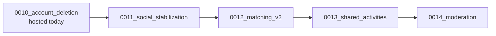

# 11 — Migration and Rollback

## 1. Current state (verified 2026-10-25)

- Hosted Supabase project `roznanxbiyqybjpvtilq` at Alembic `0010_account_deletion`; 32 tables, RLS on all; Supabase's own migration history is intentionally empty.
- Hosted migrations are applied only by `scripts/apply_supabase_review.py --upgrade <key> --apply --approved-sha256 <hash>`, which executes Alembic **offline SQL verbatim** in one transaction after target/fingerprint checks. Never `alembic upgrade` online against hosted, never Supabase `apply_migration`.
- Existing logical backups of the hosted `moodprint` schema exist from before 0006 and 0010 (operator workstation).

## 2. Ordered sequence

| Step | Revision | App release that first needs it | Flag(s) protecting behavior |
|---|---|---|---|
| 1 | 0011 | Release R1 (Phase A+B) | none needed (additive; unread/summary are safe) |
| 2 | 0012 | Release R2 (Phase C) | `MATCHING_SCORER=v1` default |
| 3 | 0013 | Release R3 (Phases D–H) | `ACTIVITIES_ENABLED=false` default, `ACTIVITY_KINDS` |
| 4 | 0014 | Release R4 (Phase I) | `MODERATION_ADMIN_ENABLED=false` default |

Migrations can be applied ahead of the app (expand-only). The readiness probe compares the exact head revision ([main.py:196](../../backend/app/main.py#L196)), so **apply the migration first, then deploy the app whose literal matches it**. The previous app version will report not-ready on a newer schema, so the rollback procedure below includes relaxing that check.

## 3. Readiness check change (task B-04)

Problem: a strict equality check makes app rollback after a migration impossible without editing code. Change in B-04: `READY_REVISIONS` = a tuple of accepted heads in a new constant module `backend/app/core/revisions.py`, imported by the readiness probe and by `scripts/inspect_database.py`, e.g. `("0011_social_stabilization",)`. Each later migration task appends its head and **keeps the previous one** for one release so the previous image stays ready on the newer schema. Note: an image built *before* B-04 still has the exact-match check and would report not-ready on 0011. To keep a clean rollback target for R1, ship a tiny **R0.5** release first containing only `backend/app/core/revisions.py` with `("0010_account_deletion", "0011_social_stabilization")` and the probe change (no schema use), then apply 0011, then deploy R1. If R0.5 is skipped, rolling back R1 means fixing forward. Document in `deploy/README.md`.

## 4. Per-migration procedure (implementation session)

1. Write the migration + model changes; register imports; update `READY_REVISIONS`, `scripts/inspect_database.py`, `UpgradePlan` (`scripts/apply_supabase_review.py`) with review/report paths under `docs/productization/migrations/`.
2. Local: fresh `<name>_migration_test` DB → `alembic upgrade head` → `alembic check` → full pytest.
3. Generate offline SQL (`alembic upgrade 0010_account_deletion:00NN_x --sql`) into `docs/productization/migrations/00NN-review.sql`; compute SHA-256.
4. Rehearse: restore a fresh `pg_dump --schema=moodprint` of hosted into a local `*_test` DB (operator step) and run `apply_supabase_review.py --upgrade 00NN --rehearse-url <local>`; record JSON report.
5. **Stop and request approval** with the SQL hash, scope and rehearsal report.
6. After approval: fresh backup → apply → `inspect_database.py` → Supabase advisors (read-only) → record execution JSON.

## 5. Rollback strategy

| Situation | Action | Data impact |
|---|---|---|
| New feature misbehaves | Flip the flag (`ACTIVITIES_ENABLED=false`, remove a kind from `ACTIVITY_KINDS`, `MATCHING_SCORER=v1`, `MODERATION_ADMIN_ENABLED=false`) and restart | None; rows retained |
| App release broken | Redeploy a verified new-data-compatible image/configuration; see the MVP release procedure | Readiness alone does not establish data-format or privacy-worker compatibility |
| Migration itself fails during apply | Transaction rolls back automatically (single transaction) | None |
| Migration applied but must be undone | **No down-migration.** Write a reviewed forward "contract" migration only if truly required; otherwise leave unused columns/tables | Avoids destructive DDL |
| Data corruption | Restore from the pre-migration logical backup into a new schema/DB, reconcile with operator approval | Point-in-time loss window = backup age |

Behavior-change rollback specifics:

- **DR-03 (rooms survive republish)**: historical images recheck profile versions and goal equality. They can deny rooms created or retained by the new code. Do not use them as functional rollback after new writes.
- **Scorer v2**: `MATCHING_SCORER=v1` on the current compatible image serves `rules-v1.1` over the current taxonomy. Historical image `2c71135` rejects the additional serialized profile fields even with legacy tags.
- **Privacy workers**: historical images cannot erase new activity responses and feedback. Denying HTTP alone does not fence their background deletion workers. After new writes, recovery must retain compatible workers or stop the old backend completely and serve maintenance while fixing forward.
- **MVP rollout**: temporarily block application writes, deploy the integrated image with v1 scoring and activities disabled, verify its core behavior, and preserve its image/runtime configuration as the compatible rollback baseline before enabling v2 and activities. Initial fallback to `2c71135` is allowed only while no new-format records have been written.
- **Activities**: when disabled, write endpoints return 503 and the UI hides the dock; the sweeper keeps running, so open sessions expire through their normal deadlines (no manual cleanup task). Re-enabling resumes normally.
- **Outbox retirement (A-05)**: reverting the app resumes writes; harmless.

## 6. Data migration needs

None of the four revisions requires backfills. Defaults:

- `users.last_seen_at` NULL → treated as active for 30 days after R1 deploy (retrieval: `last_seen_at IS NULL OR last_seen_at > now() - 30 d` until a cutoff constant `LAST_SEEN_ENFORCED_FROM` passes).
- `published_profiles.taxonomy_version` default `v1` correctly labels existing rows.
- `candidate_references.scoring_version` default `rules-v1`.
- `connections.activity_seq` default 0.

## 7. Contract cleanups (post-MVP)

Drop `outbox` (after one release with zero writes), drop legacy CHECK-free status strings if needed, remove `rules-v1` scorer after 2 stable releases on v2.
