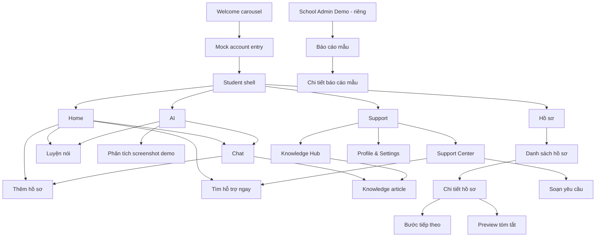
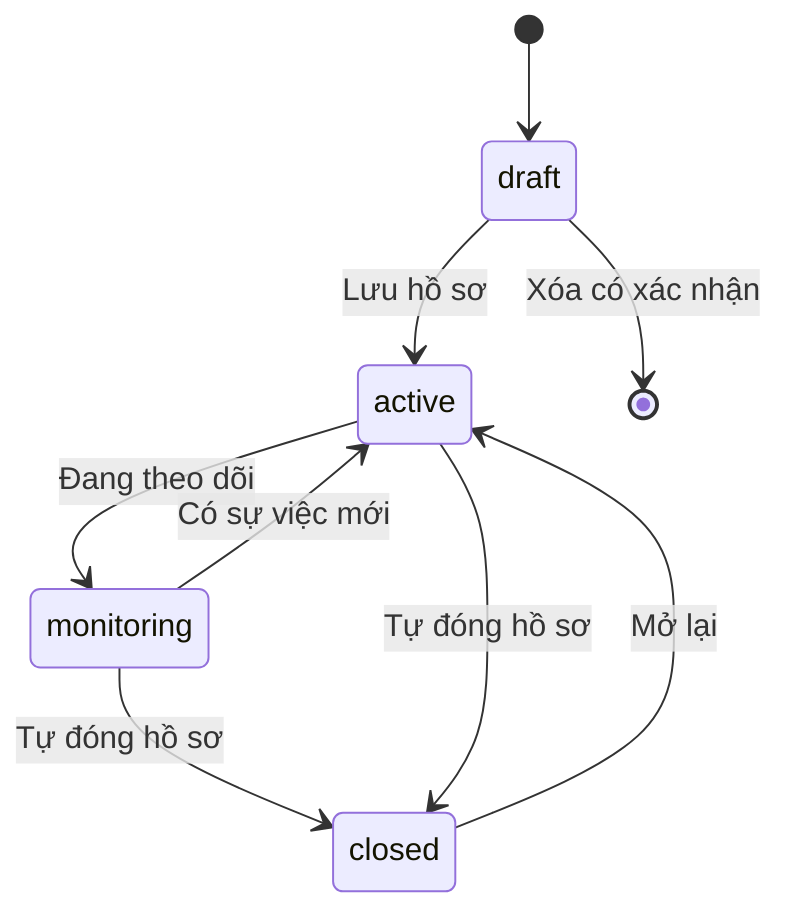
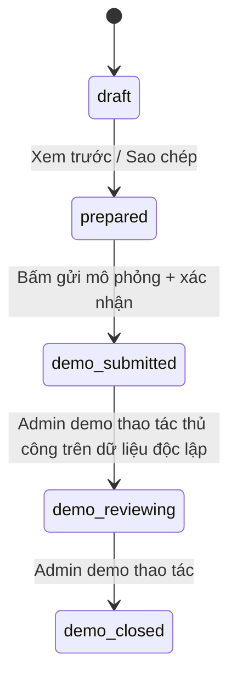

# MoodPrint — Information Architecture, Navigation & Screen Contracts

> 07/11/2026 • Sản phẩm mobile-first web • IA ưu tiên hành động và khả năng trở lại bối cảnh đang làm dở • Route là **đề xuất frontend**, không phải API.

## 1. Nguyên tắc cấu trúc

1. **Mỗi tab một mục tiêu:** Home = định hướng; AI = kể/luyện; Hồ sơ = quản lý diễn biến; Support = kiến thức và kết nối hỗ trợ.
2. **Cross-entry hợp lý:** từ bài Knowledge có thể mở Chat với nguồn; từ Chat tạo Case; từ Case tạo Roleplay; từ Roleplay chuyển Support.
3. **Không ép tuyến tính:** người dùng có thể mở 111 trực tiếp, không cần chat/đăng nhập lại.
4. **Một nguồn dữ liệu chuẩn:** cùng một `Case` xuất hiện tại Home, Case detail, AI attachment picker và Support composer; không sao chép thành các bản riêng.
5. **Student/Admin ngăn cách:** School Admin Demo có layout và store riêng, route riêng, banner demo cố định.
6. **Dễ hiểu theo lứa tuổi:** tên điều hướng Việt hóa, microcopy ngắn, ưu tiên các hành động thường dùng.

## 2. Sơ đồ sitemap



## 3. Route catalog

| ID | Route | Screen | Tab/Container | Mục tiêu | Trạng thái dữ liệu |
|---|---|---|---|---|---|
| SC-01 | `/welcome/:step` | Welcome pager 1–4 | Fullscreen | Giới thiệu / Next / Skip | static |
| SC-02 | `/auth` | Mock Account | Fullscreen | Demo register/login | demo session |
| SC-03 | `/home` | Student Home | Home | Tổng quan cá nhân, 4 quick actions | student store |
| SC-04 | `/ai` | AI hub | AI | Chọn chat / roleplay / recent | AI mock store |
| SC-05 | `/ai/chat` | Chat conversation | AI | Nhiều lượt, quick replies | chats + cases |
| SC-06 | `/ai/chat/:sessionId` | Chat detail | AI | Đọc/tiếp tục transcript giả | chats |
| SC-07 | `/ai/analysis/:analysisId` | Analysis detail | AI | OCR fixture, facts/inferences/unknowns | screenshot analysis |
| SC-08 | `/ai/roleplay` | Roleplay selector | AI | Chọn vai, mục tiêu, mức độ | roleplay scripts |
| SC-09 | `/ai/roleplay/:role` | Roleplay session | AI | Text/voice mô phỏng | roleplay state |
| SC-10 | `/ai/roleplay/:role/feedback` | Feedback | AI | 3 tiêu chí, đề xuất câu nói | roleplay script |
| SC-11 | `/cases` | Case list | Hồ sơ | Tìm/lọc/danh sách | cases |
| SC-12 | `/cases/new` | Case wizard | Hồ sơ | Tạo từ mẫu/thủ công/AI | draft store |
| SC-13 | `/cases/:caseId` | Case overview | Hồ sơ | Summary/nhãn/status | cases |
| SC-14 | `/cases/:caseId/timeline` | Case timeline | Hồ sơ | Lịch sử các mốc sự việc | timeline |
| SC-15 | `/cases/:caseId/evidence` | Evidence gallery | Hồ sơ | Bằng chứng và nguồn | evidence |
| SC-16 | `/cases/:caseId/plan` | Kế hoạch ứng phó | Hồ sơ | Chọn phương án, checklist, theo dõi tiến độ, ghi chú | canonical plan store theo caseId; core #3 đã chốt |

| SC-17 | `/cases/:caseId/summary` | Report preview | Hồ sơ | Preview/copy/export mẫu | generated view |
| SC-18 | `/support` | Support landing | Support | 3 lối vào chính | static + recents |
| SC-19 | `/support/knowledge` | Knowledge Hub | Support | Browse/search/filter | knowledge |
| SC-20 | `/knowledge/:slug` | Knowledge detail | Support | Đọc, tình huống, quiz, nguồn | knowledge |
| SC-21 | `/support/find-help` | Support Center | Support | Nhóm nguồn giúp đỡ | sources |
| SC-22 | `/support/prepare` | Prepare message | Support | Chọn nguồn, alias, compose | requests |
| SC-23 | `/support/requests` | Request demos | Support | Theo dõi bản nháp/demo | requests |
| SC-24 | `/support/urgent` | Help now | Fullscreen/modal | Tìm hỗ trợ gấp | verified links |
| SC-25 | `/settings` | Profile & Settings | Support | Nickname, demo reset, trợ giúp | demo session |
| SC-26 | `/demo/school` | School Overview | Admin shell | Chỉ số tổng hợp hư cấu | separate demo |
| SC-27 | `/demo/school/reports` | School report list | Admin shell | Filter mock reports | separate demo |
| SC-28 | `/demo/school/reports/:id` | School mock detail | Admin shell | Thay status giả | separate demo |
| SC-29 | `*` | Not found | Context | Không mất đường về | — |

**Route guard:** nhánh student yêu cầu mock demo session, ngoại trừ Welcome/Auth và màn hỗ trợ khẩn cấp được phép truy cập trực tiếp. `School Admin Demo` là route công khai có header riêng, không ngụ ý xác thực quản trị thật.

## 4. Điều hướng chi tiết

### 4.1 Bottom nav mobile

```
[ Home ]   [ AI ]   [ Hồ sơ ]   [ Support ]
```

- Hiển thị 4 mục ngay dưới viewport; dùng safe-area inset trên iOS.
- Active state = icon filled/tint + label, không chỉ màu.
- Khi vào màn detail, thanh tab có thể vẫn hiện (case/knowledge) hoặc ẩn cho immersive voice/roleplay; màn có header `Quay lại` với nhãn nơi trở về.
- Deep links giữ `returnTo` được kiểm soát nội bộ; không tự gọi `history.back()` khi người dùng vào thẳng từ link ngoài.
- Khi đang soạn form chưa lưu và đổi tab, hiện confirm `Lưu nháp / Rời đi / Tiếp tục`.

### 4.2 Desktop/tablet

- Tablet ≥768px: bottom nav có thể chuyển rail dọc; content max-width hợp lý; form và hỗ trợ vẫn là 1 cột đọc tốt.
- Desktop ≥1024px: sidebar 4 mục + content; AI chat có cột conversation list tùy viewport; School Admin Demo dùng sidebar khác.
- Không bê nguyên UI dashboard enterprise lên màn 390px.

### 4.3 Breadcrumb / contextual tabs

- Hồ sơ: `Hồ sơ > [Tên hồ sơ] > Dòng thời gian`; chính giao diện mobile có back + title ngắn.
- AI: `AI > Phòng luyện nói > Giáo viên`.
- Knowledge: `Support > Knowledge Hub > [Bài viết]`.

## 5. Content inventory và loại đối tượng

| Object | Cấp | Các field hiển thị quan trọng | Hiển thị ở đâu |
|---|---|---|---|
| `DemoUser` | Account mock | nickname, ageBand, language | Welcome/Home/Profile |
| `Case` | Hồ sơ | title, category, status, lastUpdated, summary | Home/Cases/AI/Support |
| `IncidentEvent` | Mốc | occurredAt/precision, location, description, provenance | Case Timeline/Analysis |
| `Evidence` | Bằng chứng | fileType, thumb, textExcerpt, sourceDate, verification | Case/Analysis/Report |
| `Analysis` | Phân tích | observed, inferred, unknown, references | AI/Case |
| `ActionPlan` | Kế hoạch | goal, items, status, nextReview | Case/Home |
| `ChatSession` | Chat | transcript, linkedCase, sourceRef | AI/Case |
| `RoleplayScript` | Luyện nói | role, scenario, turns, rubric | AI |
| `KnowledgeArticle` | Thư viện | title, tags, content, sources, reviewedAt | Knowledge/AI |
| `SupportSource` | Nguồn giúp | kind, link/tel, eligibility, applicability | Support |
| `SupportDraft` | Tin nhắn | recipient, identityMode, preview, demoStatus | Support/Case |
| `SchoolDemoReport` | Admin mock | fake category, timeframe, status, assignedRole | `/demo/school` only |

## 6. State ownership và liên kết xuyên feature

| Trạng thái | Owner chính | Được đọc bởi | Thao tác cập nhật |
|---|---|---|---|
| `demoSession` | accountStore | Shell/Home/Profile | mock sign-in, sign-out, reset |
| `studentCases` | casesStore | Home/AI/Support | create/edit/status/timeline |
| `evidenceById` | evidenceStore | Case/Analysis/Summary | add/edit/verify/remove |
| `analyses` | aiMockStore | AI/Case | run fixture/confirm observations |
| `chatSessions` | aiMockStore | AI/Home | step-through deterministic messages |
| `roleplaySessions` | aiMockStore | AI/Profile | start/pause/next/feedback |
| `actionPlans` | planStore | Home/Case | add/tick/edit |
| `knowledgeCatalog` | contentStore | Support/AI | read/bookmark/search |
| `supportDrafts` | supportStore | Support/Case | compose/copy/mark demo status |
| `schoolDemoReports` | schoolDemoStore | Admin only | demo filter/status |

**Quan trọng:** Không share `studentCases` vào `schoolDemoStore`. Không lấy tên hay ảnh của học sinh từ mô hình Student Workspace để đổ vào admin reports.

### State transitions: hồ sơ



### State transitions: yêu cầu hỗ trợ mock



> Không đồng bộ `demo_submitted` sang trường học thật. Diagram mô tả kịch bản demo; trong implementation có thể dùng 2 tập dữ liệu tách rời và seeded request giả cho Admin.

## 7. Screen contracts chi tiết

### Home (SC-03)

**Hero:** copy ngắn + CTA `Trò chuyện với AI` • **Quick actions:** `Ghi lại`, `Luyện nói`, `Tìm hỗ trợ`, `Học qua tình huống` • **Your progress:** các case gần đây, steps done • **Learning cards:** 2 topic phù hợp độ tuổi • **Help now:** luôn nhìn thấy ở vùng có thể truy cập dễ. Empty: “Bạn chưa có hồ sơ nào. Bạn vẫn có thể hỏi AI hoặc xem hướng dẫn.”

### AI Hub (SC-04)

Hai card lớn: `Trò chuyện` và `Luyện cách nói`. Danh sách 2–3 cuộc hội thoại gần đây, quick topic `Tin nhắn đe dọa`, `Bị cô lập`, `Không biết nói với ai`. Không hiển thị agent names nội bộ. AI có thanh nhãn `AI mô phỏng`.

### Chat (SC-05,06)

Message bubbles người/AI, quick replies, composer, attachment picker mock, linked-case pill, source indicator, analysis card. Tin nhắn AI có hành động `Xem chi tiết lý do` khi có nguồn/unknown. Chat actions `Tạo hồ sơ`, `Luyện nói`, `Mở nguồn` phải dùng state chung. Trạng thái pending giả lập luôn deterministic; có nút thử lại.

### Analysis detail (SC-07)

Thông tin 8 ảnh giả, bảng ảnh-text-time, filter `Cần kiểm tra`, 4 section `Quan sát / Dấu hiệu / Chưa rõ / Hướng tiếp theo`, mốc timeline preview; summary lưu vào case khi user xác nhận. Có cảnh báo “Đây là mô phỏng phân tích từ dữ liệu mẫu”.

### Case list/detail (SC-11..17)

Danh sách có search/filter chips/CTA thêm mới, status pill; detail có header, tóm tắt, tab/segments Timeline/Evidence/Bước tiếp theo, nút chuẩn bị báo cáo. Detail hỗ trợ sửa từng field và bổ sung dần. Trường “không chắc ngày giờ” được thể hiện rõ.

### Support (SC-18..24)

Support landing có 3 card lớn: `Tìm hiểu` → KB; `Tìm người giúp` → contact composer; `Cần hỗ trợ ngay` → urgent. Phía dưới là `Cài đặt`. Xem trước hỗ trợ dùng biểu mẫu nhất quán, identityMode rõ, CTA copy/preview; UI giải thích demo.

### School Admin (SC-26..28)

Header demo cố định, KPI, chart labels, synthetic segmentation, filters, mock report list, status changes cục bộ, không có dữ liệu individual từ Student Store. Cần có icon/notice “Không kết nối trường học thật”.

## 8. Điều hướng theo ngữ cảnh

| Điểm xuất phát | Hành động | Đích | Dữ liệu mang theo |
|---|---|---|---|
| Home | Trò chuyện | Chat | `promptTopic` tùy chọn |
| Chat | Lưu thành hồ sơ | Case wizard | draft facts + cited evidence ids |
| Chat | Tìm hiểu | Knowledge detail | `articleSlug` |
| Knowledge | Hỏi AI | Chat | `articleId` + nguồn |
| Case | Luyện nói | Roleplay setup | `caseId` + mục tiêu, không auto-reveal |
| Roleplay | Chuẩn bị lời nhắn | Support prepare | transcript fragment do user chọn |
| Case | Nhờ hỗ trợ | Support prepare | brief + caseId |
| Support | Tạo hồ sơ | Case new | template type |
| Any student screen | Hỗ trợ ngay | Urgent | no personal data required |

## 9. Search / filter specification

**Case search:** title, category, shortSummary; filter status/category; sort updatedDesc/default; no-result prompts. **Knowledge search:** title, tags, question variations, body excerpts; filter topic, ageBand, format; search can be deterministic plain-text, no embeddings. **Admin search:** `syntheticReportId`/category, filter month/status; never expose private case search.

## 10. Layout và responsive behavior theo màn

| Range | Nav | Content | Chat | Case wizard | School Admin |
|---|---|---|---|---|---|
| 320–430px | Bottom 4 tabs | 16px margins, 1 col | full-screen bubbles | stepper 1 col | bảng đổi thành cards/scroll cục bộ |
| 431–767px | Bottom tabs | max ~560px | messages max 640px | 1 col | KPI 2 cols |
| 768–1023px | Rail/sidebar tùy thiết kế | 2 col cards | optional history drawer | form max 640px | 2–3 col KPI |
| ≥1024px | Sidebar | max 1120–1200px | history 280px + chat | form + summary | desktop charts + report table |

## 11. Screen-level trạng thái cần thiết

| Screen | Empty | Loading demo | Error | Confirmation |
|---|---|---|---|---|
| Home | chưa có case | skeleton ngắn (tùy) | mock reset | — |
| AI Chat | chưa có chat | typing animation | lỗi fixture/missing source | chuyển sang Case |
| Analysis | chưa chọn ảnh | simulated processing | ảnh không đọc được | xác nhận văn bản trích |
| Case list | chưa có hồ sơ | skeleton | không tìm thấy | delete/close |
| Case wizard | chưa có detail | — | thiếu mô tả cơ bản | rời nháp |
| Roleplay | chưa chọn vai | speaking pulse | không có script | kết thúc buổi |
| Knowledge | search empty | skeleton | link nguồn mất | rời bài khi đã làm quiz |
| Support composer | trống | — | thiếu người nhận | chưa gửi thật |
| School admin | không report giả | synthetic loading | mock failure | đổi status giả |

## 12. Danh sách UI components dùng chung

`AppShell`, `BottomNav`, `DesktopSidebar`, `PageHeader`, `HelpNowEntry`, `SectionCard`, `FeatureCard`, `CaseCard`, `StatusPill`, `EvidenceTile`, `TimelineItem`, `SourceBadge`, `UncertaintyLabel`, `PromptChip`, `ChatBubble`, `Composer`, `RoleplayStage`, `VoiceDemoControls`, `ActionChecklist`, `KnowledgeCard`, `QuizOption`, `SupportContactCard`, `IdentityModeSelector`, `DemoBanner`, `ConfirmDialog`, `EmptyState`, `Skeleton`, `Toast`, `InlineError`, `FormStepper`, `Breadcrumb`, `Tabs`, `SearchBar`.

## 13. Deep link test matrix

- `/cases/C-001` khi đã có mock session → detail hợp lệ.
- `/cases/unknown` → Not found có `Về danh sách hồ sơ`.
- `/knowledge/cyber-threats` có thể mở trực tiếp; nếu chưa mock sign-in, điều hướng auth và giữ return URL (ngoại trừ công khai nếu chủ sản phẩm chọn).
- `/support/urgent` luôn mở được và hiển thị 111.
- `/demo/school` không thể hiển thị student bottom nav hoặc student cases.
- Browser Back không làm mất nháp mà không báo.
