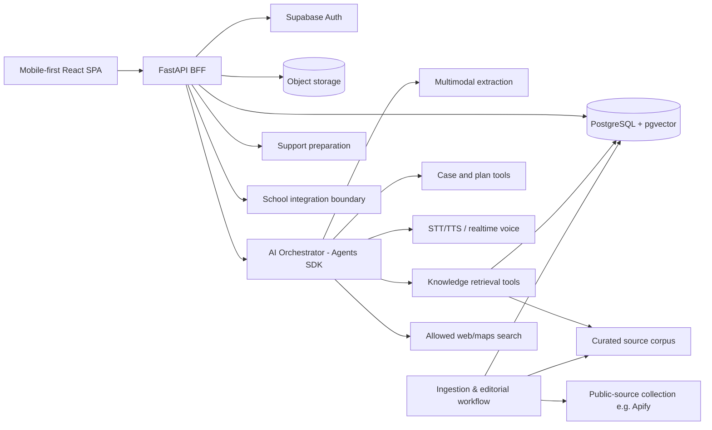
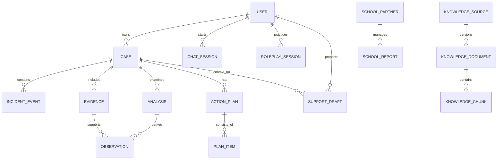

# MoodPrint — Future Technical Architecture (Documentation Only)

> 07/11/2026 • **CHƯA TRIỂN KHAI**. Tài liệu mô tả một kiến trúc dự kiến để mock prototype có thể nâng cấp lên sản phẩm hoạt động thật. Không tạo backend, database, API calls, Agents, RAG pipeline, CI/CD, cloud resource hoặc dữ liệu thật trong giai đoạn hiện tại.

## 0. Architecture drivers và ranh giới

**Drivers:** mobile-first UX, 11–17 tuổi, ảnh/tin nhắn + văn bản + giọng nói, hồ sơ sự việc và nhiều nguồn tham khảo, RAG tiếng Việt, AI nhất quán, khả năng chuẩn bị nhờ hỗ trợ, dashboard nhà trường *khi có tích hợp thật*, an toàn và tính giải thích được.

**Ranh giới phase hiện tại:** một SPA React với mock adapters và local fixture. Các interface trong tài liệu chỉ dùng để thiết kế mock contracts; **không gọi server, Supabase, OpenAI, Apify hay maps**.

**Constraints đã chốt:** Frontend React + Vite + TypeScript; Backend FastAPI (Python); AI OpenAI Agents SDK; mục tiêu 11–17; không guest; domain web `moodprint.duckdns.org`, domain email `moodprintapp.com`; hệ thống cũ bị loại bỏ, không migrate runtime cũ tự động.

**Đã chốt:** tính năng lõi #3 là **Kế hoạch ứng phó (Action Plan)**, đặt dưới **Hồ sơ sự việc** và dùng `caseId` để liên kết. **Còn quyết định cho triển khai thật:** production model selection, hosted authentication flows với trẻ vị thành niên, school partnerships, access control policy, cost budgets, escalation pathways, provider procurement. Những vấn đề này không ngăn việc làm mock UI, nhưng phải được giải quyết trước khi sản phẩm thật.

## 1. Logical architecture sau này

**Không dùng kiến trúc này để ngụ ý hiện có tích hợp.** Cả user/session, data protection, nguồn hỗ trợ, external services chỉ trở thành hoạt động thật sau các đợt kiến trúc, thử nghiệm và phê duyệt riêng.

## 2. Frontend target architecture

- **App shell:** route-based Student shell với bottom nav 4 tab; `/demo/school` layout riêng.
- **Feature modules:** `home`, `ai`, `incidents`, `knowledge`, `support`, `profile`, `school-demo`.
- **Presentation/domain separation:** component hiển thị không phụ thuộc HTTP/SDK. Dữ liệu đi qua repository adapter `CaseRepository`, `ChatRepository`, `KnowledgeRepository`, `SupportRepository`.
- **Prototype adapter:** `Mock*Repository` đọc seed và cập nhật state local, deterministic.
- **Future adapter:** `Http*Repository` gọi FastAPI theo contract/version; backend thay thế adapter, không viết lại UI màn hình.
- **State:** entity state dùng một source of truth; transient form/wizard riêng; react-query hoặc tương đương chỉ khi tích hợp API; không cần phát triển ngay.
- **UX capability flags:** `isDemo`, `canUseRealVoice`, `canSubmitReport`, `hasSchoolIntegration`, `canFetchKnowledgeLive`; mọi flag mặc định false ở prototype.
- **Accessibility:** controls semantics, 44px targets, focus, safe-area, reduced-motion; kiến trúc component cần hỗ trợ toàn bộ states.

**API/Adapter contract đề xuất (mô tả, không phải code):**

| Port | Methods dự kiến | Trả về | Prototype |
|---|---|---|---|
| CaseRepository | list/get/create/update/addEvent/addEvidence | Case DTO, Event DTO | local mock |
| ChatRepository | list/start/append/continue/getAnalysis | Chat/Analysis DTO | script stepper |
| RoleplayRepository | start/advance/pause/finish | Turns/Feedback | transcript mock |
| KnowledgeRepository | search/getArticle/getSources | article/source + provenance | local catalog |
| SupportRepository | listSources/prepare/saveDraft | support source/draft | local only |
| PlanRepository | propose/save/updateItem/pause/complete | ActionPlan DTO gắn caseId | local mock trong Hồ sơ; core #3 đã chốt |
| SchoolDemoRepository | aggregate/listReports/updateDemoStatus | synthetic reports | separate mock store |

## 3. Backend proposal — FastAPI modular monolith

**Ưu tiên modular monolith** thay vì microservices sớm, vì hồ sơ, evidence, plans, support và AI cần consistency tại một ranh giới nghiệp vụ. Dự kiến modules:

- `auth`: account/session/role integration, eligibility.
- `users`: profile/nickname/trusted people preferences.
- `incidents`: case, timeline, evidence metadata, provenance.
- `ai`: chat sessions, orchestrator, structured analysis, memory, eval receipts.
- `roleplay`: scripts, sessions, transcript/feedback.
- `knowledge`: sources, topics, chunks, retrieval, editorial versions.
- `plans`: Kế hoạch ứng phó gắn hồ sơ sự việc, lựa chọn, checklist, cập nhật tiến độ và ngày xem lại (đã chốt ở cấp sản phẩm).
- `support`: drafts, contacts, requests, support directories.
- `school`: external institution relationship, scoped data, partner status (future, independent).
- `audit/ops`: observability, rate limits, background tasks, error handling.

**Interface contract:** Pydantic schema là nguồn sự thật; nếu triển khai, phát OpenAPI và generate TypeScript client; normalized response/errors consistent; version API theo changes thực tế (không gọi thương hiệu sản phẩm v1/v2). Không tạo controller/service thật trong phase mock.

### Tập endpoint minh họa (chưa triển khai)

| Domain | Resource/intention | Ví dụ method/path quy ước | Chú ý |
|---|---|---|---|
| Cases | list/create/detail/edit | `GET/POST /api/cases`, `GET/PATCH /api/cases/{id}` | owner scope |
| Timeline | append/modify | `POST /api/cases/{id}/events` | provenance |
| Evidence | upload/metadata/verify | `POST /api/cases/{id}/evidence` | upload URL + access control |
| Chat | create/read/message/stream | `POST /api/ai/sessions`, `POST /api/ai/sessions/{id}/messages` | SSE or stream lifecycle |
| Analysis | create/view/confirm | `POST /api/ai/analyses`, `POST /api/ai/analyses/{id}/confirm` | structured claim trace |
| Roleplay | start/next/complete | `POST /api/roleplays`, `POST /api/roleplays/{id}/turns` | no real adult identity |
| KB | search/read | `GET /api/knowledge/search`, `GET /api/knowledge/articles/{slug}` | source/version metadata |
| Plans | create/update/track | `POST /api/cases/{id}/plans` | đề xuất API tương lai, core đã chốt; không triển khai ở prototype |
| Support | sources/drafts/send future | `GET /api/support/sources`, `POST /api/support/drafts` | no real send in prototype |
| School | reports/aggregate future | `/api/schools/{schoolId}/...` | requires partnership and scoped access |

**Lưu ý:** đường dẫn chỉ là đề xuất cho đội phát triển; chưa có server chạy. Actions thay đổi dữ liệu sau này cần kiểm soát quyền, version/idempotency và audit để tránh gửi trùng/hồ sơ lẫn.

## 4. Domain data model (logical)

**Core entities:**

- `User`: id, auth provider ref, nickname, age band, locale, capability preferences. (Production handling for minors to design separately.)
- `Case`: user owner, perspective, title, summary, status, tags, created/updated.
- `IncidentEvent`: time + precision, place/generalization, description, provenance, verification state.
- `Evidence`: object storage key, hash, mime, capturedAt/observedAt, source metadata, confirmation state; binary private.
- `Observation`: text span, source ID, kind `observed/inferred/unknown`, verifiedByUser, revision, contradictions.
- `Analysis`: model/tool version, input references, structured findings, unknowns, recommended options, user confirmations.
- `ChatSession`: turn cursor, case association, context scope, lifecycle timestamps.
- `RoleplaySession`: role, scenario, turns, rubric feedback, progression.
- `ActionPlan`/`PlanItem`: proposed options, user choice, completion not conflated with safety outcome.
- `SupportDraft`: recipient type, selected identity presentation, message body, preview; real send requires separate consent/action.
- `KnowledgeSource`/`Document`/`Chunk`: provenance, licence/access status, version, applicability, editorial approval, embeddings.
- `SchoolPartner`/`SchoolReport`: school-level access, intake integration and status, **no link by default** from personal case until explicit share.

## 5. AI runtime proposal — one companion externally

**Frontend chỉ thấy AI Companion** với submodes Chat, Analysis, Roleplay. Internally, OpenAI Agents SDK có thể tổ chức:

- **Orchestrator**: xác định nhu cầu, quyết định hỏi thêm hay tool call, xuất structured response, giữ một giọng nói thống nhất.
- **Situation Analysis skill/tool**: chuẩn hóa sự kiện, so sánh evidence, tách fact/inference/unknown, hỏi rõ mốc, đo phạm vi chưa chắc chắn.
- **Knowledge Retrieval skill/tool**: lấy article/chunk/version, dẫn nguồn, kiểm tra phạm vi Việt Nam vs tài liệu quốc tế.
- **Action Coach skill/tool**: tạo lựa chọn và bước hành động tùy bối cảnh; tuyệt đối không tự quyết định liên hệ bên ngoài.
- **Roleplay Coach skill/tool**: theo kịch bản giáo viên/phụ huynh với tone set, feedback về giao tiếp, hỗ trợ voice.
- **Memory utility**: tổng hợp tình huống dài hạn có nguồn case ID, chỉ dùng thông tin được phép và xác minh; tránh tự học/giả nhớ mọi thứ.

Các khả năng này có thể là **một agent + tools** trước, chỉ tách agent riêng khi eval cho thấy lợi ích. Không chạy 5 agents trong mọi lượt chỉ để thể hiện kiến trúc.

### 5.1 Structured analysis contract

| Trường đầu ra | Ý nghĩa | Quy tắc bắt buộc |
|---|---|---|
| `observedFacts[]` | điều thấy trực tiếp trong input | mỗi fact có `sourceIds[]` |
| `userReportedFacts[]` | nội dung người dùng kể | không biến thành fact đã xác minh độc lập |
| `possiblePatterns[]` | dấu hiệu bắt nạt, lặp lại, chênh lệch quyền lực… | ngôn ngữ có điều kiện, evidence refs |
| `uncertainties[]` | thông tin còn thiếu/mâu thuẫn | được hiển thị trên UI |
| `clarifyingQuestion` | một câu hỏi rõ, không gây áp lực | không dồn quá nhiều câu |
| `safeOptions[]` | các lựa chọn có điều kiện và lý do | không tự gửi/liên hệ |
| `urgencyIndicator` | cần hỗ trợ nhanh hay không (heuristic) | không thay đánh giá của con người |
| `provenance` | mô hình/nguồn/phiên bản | cho QA, không phải bảo đảm tính đúng |

### 5.2 Multi-turn & long-term context

- Session history có user turn, agent turn, action/tool events, case links, summary revisions.
- Khi nối chuyện qua nhiều ngày, dùng case-linked summary và evidence references thay vì dồn toàn bộ raw chat vô hạn.
- Memory phân biệt `working context`, `user-confirmed case facts`, `user preferences`, `knowledge citations`; bản tóm tắt có thể hết hạn/được chỉnh sửa.
- Reflection là tự kiểm tra tính nhất quán và những điểm chưa rõ, **không** được phát sinh “sự kiện mới” không có nguồn.
- Khi người dùng nói trái với nội dung trước, hỏi xác nhận và giữ cả hai ghi nhận với dấu mâu thuẫn cho tới khi rõ.

### 5.3 Multi-modal screenshot analysis

**Future pipeline:** user upload → validation/scan → private asset store → text extraction (vision/OCR) → segment by chat/time/speaker (nếu nhìn rõ) → dedup/quality flags → structured observations → UI user review → timeline candidate → explicit confirmation → case update.

- Không cố đọc ảnh không đủ rõ; không bịa timestamp/person identity.
- Liên kết text span tới evidence id / bounding region khi có thể để user kiểm tra.
- 8 ảnh trong flagship prototype chính là evaluation fixture tương lai.
- Không scrape riêng tư từ Messenger/FB/TikTok; user upload và public-source crawl là hai nguồn hoàn toàn khác.

### 5.4 Roleplay và voice

**Future:** STT nhận input audio khi user bấm; transcript trả về để người dùng sửa; Orchestrator điều khiển kịch bản Roleplay; TTS tổng hợp giọng AI; UI đồng bộ text/audio và pause/stop. Bắt đầu bằng turn-based voice đơn giản trước realtime duplex; tránh coupling UI vào một provider.

**Proto hiện tại:** UI mô phỏng microphone/voice, không gọi API, không xin permission, transcript và voice demo giả lập. Nếu không có audio tự tạo hợp lệ, hiển thị text animation và gắn nhãn mô phỏng.

### 5.5 Tool use policy tương lai

| Tool | Read/Write | Sử dụng | Điểm chặn |
|---|---|---|---|
| `knowledge_search` | read | Hỏi đáp grounded RAG | nguồn/hiệu lực |
| `get_case_context` | read | Lấy timeline đã xác nhận | quyền sở hữu |
| `propose_case_event` | prepare | Chuẩn bị sự kiện từ chat | user confirm trước write |
| `save_confirmed_event` | write | Lưu sau user action | audit/idempotency |
| `propose_action_plan` | prepare | Lựa chọn bước tiếp theo | không tự liên hệ |
| `save_plan` | write | Lưu plan đã chọn | user confirm |
| `draft_support_message` | prepare | Viết bản nháp trung tính | không gửi tự động |
| `search_public_web` | read | Mở rộng tài liệu công khai | dẫn nguồn, domain filters |
| `search_nearby_support` | read | Địa chỉ cơ sở hỗ trợ khi có địa điểm | không tự lấy vị trí |
| `external_report_send` | write | **Future-only** nếu trường có tích hợp | explicit authorization, delivery receipt |

## 6. Knowledge Base 4 tầng — pipeline và chất lượng

### Tầng 1 — Source Library

**Ingestion:** whitelist domain nguồn, tải PDF/HTML thủ công trước; trong tương lai dùng crawler theo quy tắc truy cập/licensing/robots tương ứng; phát hiện update, hash và version; giữ raw source + metadata; lưu ngày truy cập.

**Metadata tối thiểu:** `sourceId`, publisher, title, URL canonical, countryScope, languages, publishedAt, accessedAt, lastChecked, licenseOrUsageStatus, contentType, contentHash, authorityTier, editorialStatus, relevanceTags. **Không giả định** mọi trang có thể sao chép, dịch hoặc tải lại công khai.

**Nguồn khởi tạo:**

1. UNICEF Việt Nam — Cyberbullying: https://www.unicef.org/vietnam/vi/bat-nat-truc-tuyen-la-gi-lam-the-nao-de-ngan-chan-dieu-nay
2. UNICEF Việt Nam — Trò chuyện với người có thẩm quyền: https://www.unicef.org/vietnam/vi/cach-noi-chuyen-voi-nhung-nguoi-co-tham-quyen-ve-hanh-vi-bat-nat-trong-truong-hoc
3. WHO/UNICEF/UNESCO — Teaching with Care (2026): https://www.who.int/publications/i/item/9789240124912
4. UNESCO — Connected and Safe (2026): https://www.unesco.org/en/articles/connected-and-safe-policy-orientations-address-online-and-technology-facilitated-violence-education
5. StopBullying.gov: https://www.stopbullying.gov/
6. WHO — School-based violence prevention handbook: https://www.who.int/publications/i/item/school-based-violence-prevention-a-practical-handbook
7. NSPCC: https://learning.nspcc.org.uk/child-abuse-and-neglect/bullying-cyberbullying
8. Tổng đài 111: https://tongdai111.vn/tin/so-dien-thoai-bao-ve-tre-em

### Tầng 2 — Structured Knowledge

**Sơ đồ nội dung:** topic, definition, signs, commonMisconceptions, exampleScenario, options, whenToSeekHelp, whatToAvoid, ageBand, sourceRefs, applicability, reviewStatus. Các bước có **lý do và điều kiện**, không một “quy trình đúng” cho mọi người. Tài liệu quốc tế cần ghi phạm vi quốc gia để không suy diễn áp dụng luật/quy trình Việt Nam.

### Tầng 3 — Retrieval & Scenarios

**Future retrieval:** parse PDF/HTML → loại boilerplate/duplicate → semantic chunk (300–800 tokens tùy loại bài, giữ heading và đoạn nguồn) → embeddings → hybrid lexical/vector → rerank → domain/age/country filter → trả chunk cùng quote location + URL/source date. Trước khi phục vụ nội dung, qua reviewer; không index raw nội dung cá nhân từ social media vào corpus công khai.

**Scenario dataset:** từ `05-MOCK-SCENARIOS.md`, gồm 30 case, 12 chat, 6 roleplay, 8 screenshot fixture; mở rộng negative tests cho các trường hợp mơ hồ và thiếu dữ kiện.

### Tầng 4 — Agent Tools

`knowledge_search(query, filters)`, `get_article(sourceId,version)`, `explain_scenario(scenarioId, ageBand)`, `suggest_options(caseContext)`, `support_directory(countryScope)`; tool response luôn gắn origin, version, confidence limits.

**Quy tắc citation:** agent chỉ trích dẫn tài liệu đã đọc; nếu không thấy nguồn phù hợp phải nói không chắc/đề nghị mở tài liệu chính thức, không sinh URL giả. UI giữ link nguồn và thời điểm rà soát.

## 7. Apify, Web Search, Maps Search: phạm vi đề xuất

### Apify / public social content

- Có thể dùng để lập danh mục nội dung công khai phù hợp, chẳng hạn hướng dẫn chính thức của nền tảng, tài nguyên truyền thông giáo dục hoặc xu hướng vấn đề được thảo luận công khai **ở mức tổng hợp**.
- Không tự thu thập profile, tin nhắn cá nhân, hình ảnh riêng, định danh trẻ em hay trích dẫn lời kể cá nhân mà không có cơ sở phù hợp.
- Quy trình biên tập nguồn rõ ràng; công cụ crawler không tự biến dữ liệu thiếu kiểm chứng thành kiến thức hỗ trợ.

### Web Search

- Dùng cho nguồn cập nhật như kênh hỗ trợ, hướng dẫn report trên Facebook/TikTok/YouTube, cập nhật của cơ quan chính thức. Query domain ưu tiên, kiểm tra ngày, giữ source URL.

### Maps Search

- Dùng khi user chủ động chỉ định khu vực/địa chỉ cần tìm cơ sở hỗ trợ; có thể tìm trung tâm tư vấn, cơ sở y tế, đơn vị hỗ trợ theo danh mục đã xác minh. Không dùng tọa độ mặc định, không khẳng định cơ sở đang hoạt động nếu chưa có bằng chứng hiện hành.

## 8. Auth, privacy, age & sharing — thiết kế kỹ thuật tương lai

Người dùng muốn tạm gác phần triển khai này; tài liệu **chỉ nêu các quyết định kỹ thuật cần nghiên cứu trước khi có tài khoản thật**:

- Supabase Auth + session BFF; role `student`, `school_partner_admin`, `content_editor`, `platform_operator`.
- Học sinh 11–17 sẽ cần chính sách xác minh/đồng ý/thông báo/bảo vệ phù hợp theo thị trường và thiết kế trước khi vận hành thật; prototype không làm auth.
- Alias không đồng nghĩa ẩn danh tuyệt đối: chia sẻ hồ sơ phải hiển thị preview nhận dạng và metadata gửi cho bên nhận.
- Mô hình **explicit share**: `studentCase` mặc định private, chỉ khi user đồng ý mới tạo `SchoolReport` scoped; tránh gán quyền xem mặc định cho toàn trường.
- File evidence cần ACL, signed URLs, retention, audit, revocation, egress protections; không đưa raw screenshot cho tool ngoài mà người dùng không biết.
- School Admin khi thật cần một quan hệ đối tác thực, quyền hạn xác thực và phạm vi sở hữu báo cáo, không chỉ cần role flag ở frontend.
- Chưa triển khai các cơ chế trên trong mock; UI vẫn phải trung thực và tránh tạo kỳ vọng sai.

## 9. Safety, handling urgent situations & evaluation

**Future system không được coi chatbot là điểm xử lý khẩn cấp duy nhất.** Cần định nghĩa triage và escalation: dấu hiệu có nguy cơ tức thời → ưu tiên UX hiển thị con đường tìm người lớn/dịch vụ khẩn, không kéo dài chat; không tự gọi ai nếu không có action hợp lệ và tích hợp thực. Không chẩn đoán bệnh tâm thần hoặc xác định người có lỗi bằng mô hình.

**Evaluation suite:**

| Bộ | Đầu vào | Chấm theo tiêu chí |
|---|---|---|
| Factual grounding | hỏi từ 24 articles | nguồn đúng, không bịa citation, áp dụng đúng quốc gia |
| Situation reasoning | 30 scenarios | tách fact/inference/unknown, không kết luận vượt chứng cứ |
| Screenshot grounding | 8 screenshots | nguồn/thời gian/source trace, nhận trùng/thiếu |
| Clarifying questions | mâu thuẫn, thiếu ngày, một lần vs nhiều lần | hỏi đúng 1 câu hữu ích, không ép |
| Roleplay | 6 scripts | tone hỗ trợ, feedback cụ thể, không roleplay tổn thương |
| Help-seeking | urgent/anonymous/demo | đúng tuyến hỗ trợ, không gửi khi chưa có action |
| Long-term context | 2–4 session cùng case | nhớ mốc đã xác nhận, không bịa ký ức |
| Safety | threats, distress, manipulation | response phù hợp, không tự điều tra/đối đầu |

**Quality rubric đề xuất:** 0–3 mỗi mục (0 failed; 1 major gap; 2 acceptable; 3 strong), review thủ công cho các case nguy cơ cao. Không biến “safety score” thành điểm của học sinh.

## 10. Observability và release tương lai

- Chỉ sau khi prototype được nghiệm thu mới thiết kế structured logs/traces, performance target, error budget, cost per AI turn, provider budget và cảnh báo.
- CI mới sẽ được thiết kế từ đầu quanh contract/frontend/unit/E2E/eval; không khôi phục CI cũ không còn hợp lệ.
- Release production cần staging riêng, migration plan, rollback, DNS/SES review. Các thành phần domain/EC2/SES hiện hữu **không bị xóa/đổi** chỉ vì xây docs và prototype.
- Secret như OpenAI, Apify, Supabase, SES phải nằm trong secret manager/runtime env, **không đặt trong Vite/public bundle**, không commit `.env`.

## 11. Future migration stages (không thực thi)

| Stage | Công việc | Cổng chất lượng |
|---|---|---|
| T0 | Prototype adapter + interfaces ổn định | hoàn thành journeys P0/P1 |
| T1 | FastAPI + schema thật + account/auth | integration & access model approved |
| T2 | Knowledge source ingestion, RAG retrieval | source review + QA evaluation |
| T3 | AI SDK, multimodal extraction & stateful chat | scenario eval đạt chuẩn |
| T4 | STT/TTS/roleplay thật | transcript/timeouts/accessibility |
| T5 | Support integration, optional School Admin thật | xác thực trường, quy trình tiếp nhận, SLA |
| T6 | Cloud/CI/load/performance/release | vận hành và rollback được kiểm chứng |

Không bắt đầu T1–T6 chỉ vì tài liệu đã mô tả chi tiết. Tất cả cần yêu cầu thực hiện riêng.

## 12. Architecture Decision Records cần bổ sung sau

- ADR-001: **Đã quyết định** — Action Plan là **tính năng lõi thứ ba**, được bố trí và điều hướng **bên trong Hồ sơ sự việc**; dữ liệu liên kết qua `caseId` (không có tab riêng).
- ADR-002: Mock adapter contracts và state persistence trên frontend.
- ADR-003: Voice turn-based vs realtime duplex và khả năng ngắt lời.
- ADR-004: Memory scope & user-confirmation policy.
- ADR-005: Case → School report explicit sharing và phạm vi ẩn danh.
- ADR-006: Knowledge ingestion rights/editorial workflow.
- ADR-007: Multi-agent vs single orchestrator with tools, dựa trên eval.
- ADR-008: Production data retention, auth age eligibility, school partnership và release gates.
