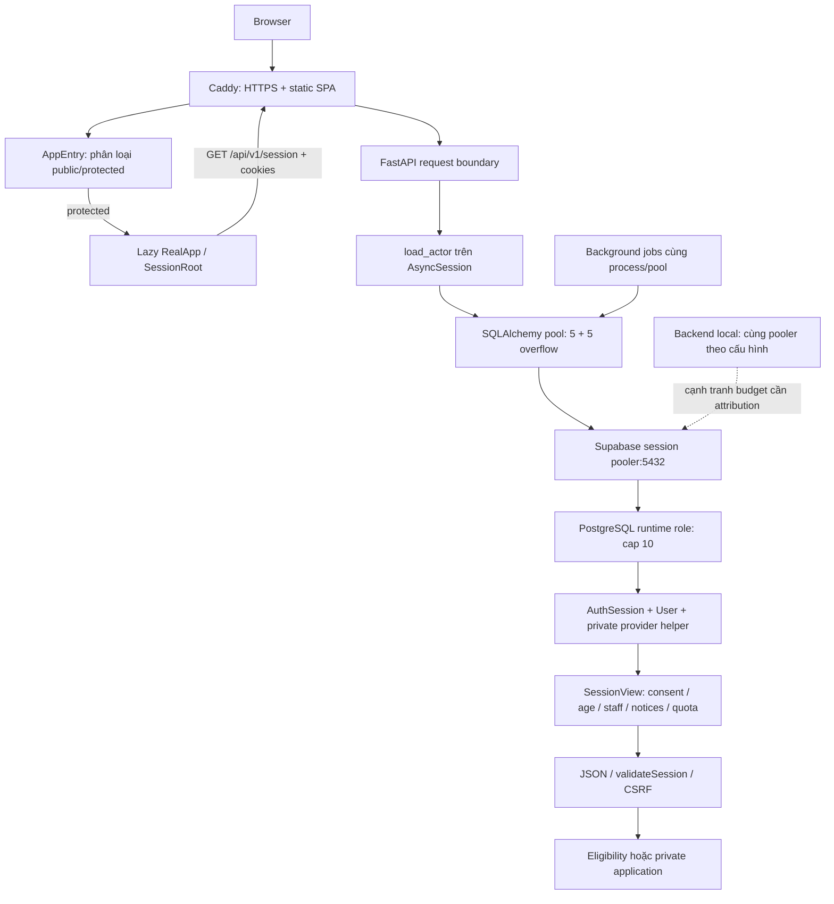

# Kiến trúc và audit reliability của session startup

Ngày 30/10/2026, UTC+7. Primary source/runtime: `57b3f7fbf91967f329a80fd344421f24ff6c5e52`. Bằng chứng, phạm vi và giới hạn suy luận nằm trong [01-root-cause-analysis.md](01-root-cause-analysis.md).

## 1. Kiến trúc hiện tại

MoodPrint là modular monolith: React/Vite/TypeScript, FastAPI async, SQLAlchemy + psycopg, Supabase PostgreSQL/Auth, hai container API/Caddy trên một EC2 `t3.small`. GitHub Actions build/publish image theo digest; systemd poller trên EC2 xác minh release rồi gọi Docker Compose. Chưa cần microservices, Redis hoặc nhiều Uvicorn workers để xử lý mục tiêu khoảng 50 người dùng đồng thời.

### Điều kiện để protected application dùng được

- DNS/TLS tới Caddy, static index và lazy JS/CSS assets phải tải được.
- FastAPI đã hoàn tất lifespan; Uvicorn nhận request.
- Cookie phiên tồn tại và hợp lệ; nếu không có cookie, `/session` trả 401 trước khi checkout DB.
- Pool cung cấp được connection; Supavisor và PostgreSQL chấp nhận connection/query.
- Identity tồn tại, user active, phiên chưa expired/revoked, auth_version khớp, account không suspended, provider session còn tồn tại.
- Mọi query tạo SessionView và response validation thành công.
- Client nhận JSON đúng contract, đủ bốn consent và CSRF token không rỗng; session đủ eligibility để mở các tính năng tương ứng.

Public landing không phụ thuộc toàn bộ các bước protected startup. Ở deployed AppEntry, public/protected boundary và lazy import tại `frontend/src/AppEntry.tsx:28–50`; workspace đang có thay đổi `/login` riêng nên không dùng nó để suy ra hành vi deployed.

## 2. Authentication lifecycle

### Đăng nhập và cookies

`backend/app/modules/auth/routes.py:189–253`: Supabase HTTP password session xác thực credentials; app tạo opaque token và CSRF ngẫu nhiên, chỉ lưu SHA-256 trong `moodprint.auth_sessions`, tham chiếu `provider_session_id`. Cookie session HttpOnly, Secure trong production, SameSite strict, path `/`; CSRF cookie đọc được bởi browser. Max-age mặc định 7 ngày, server enforced idle window mặc định 12 giờ (`core/config.py:41–42`). Không lưu provider access/refresh tokens trong browser storage.

**GET `/session` không gọi Supabase Auth HTTP API.** Nó dùng DB helper để kiểm tra live provider-session row. Vì vậy sự cố riêng Auth HTTP không mặc nhiên là nguyên nhân startup session failure; PostgreSQL/Auth tables là dependency trực tiếp. Provider HTTP cần cho login/signup/recovery, không phải mọi revalidation.

### Xác thực trên mỗi request

`core/security.py:59–111`:

1. Hash cookie, join `AuthSession` + `User` bằng unique token index.
2. `verify_session:34–56`: guest deadline, expiry/revocation/auth_version/user status/suspension; gọi private helper `moodprint.is_provider_session_active(session.id, user.id)`.
3. Registered session gần hết idle allowance thì update session expiry và user.last_seen, tối đa theo cadence 15 phút, commit (`82–95`). Guest không được gia hạn.
4. Writes yêu cầu CSRF hash và origin hợp lệ (`96–102`). GET `/session` không cần header CSRF để xác thực.
5. Các domain transactions có thể revalidate actor sau khi lấy user lock (`129–183`), giữ server làm authority.

Provider helper bản guest-aware ở `backend/alembic/versions/0017_guest_security.py:22–51` kiểm tra app session, provider session và provider user kind, dùng DB clock; SECURITY DEFINER có search_path rỗng và grants hạn chế. Không thay helper này bằng JWT signature-only hoặc cache auth result để cải thiện latency.

### Session renewal và concurrency

`GET /session` dùng **cùng AsyncSession** cho `load_actor` và `_session_view` (`auth/routes.py:138–146`), không đi wrapper `session_view()` có user `FOR UPDATE`. Đây là tối ưu đã có từ commit `c2391a6`, không phải đề xuất mới.

Ở nhánh sliding renewal, `db.commit()` trả connection về pool; các query tạo view phía sau có thể checkout lại tuần tự. Vì vậy “một AsyncSession” không bảo đảm đúng một physical checkout trong mọi nhánh. Không có nested checkout đồng thời trong đường GET đang xét.

Concurrent session requests có thể cùng thấy expiry cũ và cùng update; điều kiện UPDATE chặn session revoked, nhưng không có compare-and-swap expiry để ép tuyệt đối một renewal cho mọi request đồng thời. Đây là chi phí cần benchmark, chưa phải leak được chứng minh. Request cancellation ở browser cũng không bảo đảm server đã hủy DB query ngay.

## 3. Database dependency graph và chi phí SessionView

Số dưới đây là **đếm tĩnh top-level SQL executions** theo source, chưa phải query trace/latency đo từ production. Không tính implicit BEGIN/COMMIT/ROLLBACK, pre-ping, protocol traffic hay các internal SELECT của SQL helper.

| Bước | Registered | Guest | Source |
|---|---:|---:|---|
| AuthSession + User join | 1 | 1 | `core/security.py:68–74` |
| Guest active clock | 0 | 1 | `guests/policy.py:45–48` |
| Clock cho verify_session | 0 | 1 | `core/security.py:38` |
| Provider helper | 1 | 1 | `core/security.py:51–54` |
| Guest output deadline clock | 0 | 1 | `core/security.py:79–81`, `guests/deadlines.py:29–40` |
| Consents | 1 | 1 | `auth/routes.py:45` |
| AgeDeclaration | 1 | 1 | `auth/routes.py:46` |
| StaffRole | 1 | 0 | `auth/routes.py:54` |
| Moderation warning trong 30 ngày | 1 | 0 | `auth/routes.py:57–65` |
| Daily AiRun count nếu AI available | 0–1 | 0 | `auth/routes.py:97–101`, `ai/persistence.py:190–198` |
| Server clock + GuestUsage | 0 | 2 | `auth/routes.py:81–82` |
| **Tổng khi không renewal** | **6–7** | **9** | Không có network call tới model để tạo view |
| Renewal registered | **+2 UPDATE + COMMIT** | 0 | `core/security.py:88–95` |

Nhiều round trips làm giữ connection lâu hơn trên tuyến EC2 Sydney → Supabase endpoint được cấu hình. Chưa đo network RTT/DB execution từ một connection runtime thành công trong audit; không gán số millisecond suy đoán cho chi phí này.

AI availability/status là tính toán trong process, nhưng quota registered cần count `ai_runs` theo user và ngày UTC. Daily count nằm trong critical path dù người dùng chỉ muốn mở app. Staff/moderation và quota là các dependencies bổ sung; có thể tối ưu projection hoặc tách enrichment, nhưng không được làm stale quyền/suspension/consent.

### Indexes và plans

Catalog snapshot xác nhận token hash unique index, user/expiry indexes cho auth_sessions, consent composite PK, age PK, moderation `(subject_id, created_at)`, AiRun user index và conversation index. Không thấy composite `(user_id, created_at)` của AiRun trong tập index đã kiểm tra. Điều này **chỉ là ứng viên benchmark**, không chứng minh count chậm hoặc cần migration.

Chưa chạy EXPLAIN ANALYZE trên production; chưa đo slow queries/lock wait. Không có căn cứ thêm index hoặc tăng connection limits ngay. `pg_stat_activity` đã chạm **role limit**, không chạm global max. Hai transaction ở trạng thái idle-in-transaction trong một snapshot có state age khoảng 0 giây; snapshot sau max transaction age làm tròn 0, không phải bằng chứng connection leak.

## 4. Pooling, deadlines và resource lifecycle

`backend/app/infrastructure/database/connection.py:21–30` cấu hình async engine, pre-ping, hide_parameters, psycopg `prepare_threshold=None`, `connect_timeout=5`; context managers đóng session, lifespan dispose engine. Không tìm thấy leak hiển nhiên ở GET session.

Runtime là `5+5`, timeout 10 s; defaults trong code lại là `8+4=12`, lớn hơn role cap 10 nếu bỏ runtime overrides. `DATABASE_POOL_MODE` là nhãn topology; nó không tự chuyển endpoint hay engine sang NullPool/transaction mode.

[SQLAlchemy](https://docs.sqlalchemy.org/en/20/core/pooling.html#disconnect-handling-pessimistic) mô tả pre-ping tại checkout; nó không bảo đảm transaction đang chạy sống qua disconnect. Vì vậy không thể coi `pool_pre_ping=True` là đã có retry cho mọi DB lỗi.

[Supabase](https://supabase.com/docs/guides/database/connecting-to-postgres#connection-pooler) phân biệt session và transaction pooling. Việc đổi mode cần kiểm tra semantics và connection budget; nó không tự sửa cap theo role hay giúp an toàn khi tùy tiện mở thêm connections.

Timeout hiện tại không tạo một deadline xuyên suốt: browser abort 20 s (`client.ts:95`), pool wait 10 s, connect 5 s, query timeout runtime chưa biết; Caddy response header timeout 120 s (`Caddyfile:22–25`). Các timeout này áp dụng ở những giai đoạn khác nhau, không phải luôn cộng tuyến tính. Cần deadline riêng cho session read; không đổi timeout SSE/AI/upload một cách đồng loạt.

## 5. Frontend: classification và trạng thái lỗi

| Kết quả request | Hành vi hiện tại |
|---|---|
| 401 `/session` | SessionRoot reset/clear session; `GUEST_EXPIRED` còn gọi onUnauthorized ngay trong client |
| 401 resource private | onUnauthorized reset mọi in-flight reads và epoch; các auth endpoints/REAUTH_REQUIRED được loại trừ có chủ đích |
| 403 `/session` | Generic `setError`; full-screen, không phân biệt account suspension với outage |
| 429 | ApiError giữ `Retry-After`, không scheduling retry tự động; `/session` hiện không có limiter riêng tạo 429 |
| 500/502/503/504 hoặc non-JSON non-2xx | ApiError → full-screen; thiếu message dùng fallback chung |
| Network failure | TypeError → thông báo không kết nối, cũng full-screen |
| Timeout 20 s | Internal AbortController abort → không có timeout code riêng; bị gộp như lỗi kết nối |
| Caller abort / effect cleanup | SessionRoot check external signal + api epoch để bỏ kết quả cũ; không chủ ý hiển thị lỗi |
| JSON session sai | `validateSession` ném local ApiError 502 `INVALID_SESSION`; không phải server HTTP 502 |

Client bỏ `retryable` và `requestId` của error payload, chỉ giữ status/code/message/retryAfter (`client.ts:1–10,106–120`). Backend có request ID header, nhưng UI không thể cung cấp correlation ID qua ApiError hiện tại. HTML 502 của proxy vẫn thành ApiError an toàn, song không có category cho proxy/network/contract.

### Bootstrap khác revalidation nhưng code chưa tách

- Bootstrap chưa có session đáng tin: không được render dữ liệu private cho đến khi server xác thực thành công.
- Revalidation có session đã xác thực: lỗi tạm thời hiện unmount `AIDataProvider/Shell/GuestHost`, có thể mất draft/state đang ở memory, tạo thêm fetch khi remount.
- `session` vẫn giữ trong SessionRoot khi error xảy ra. Do đó focus listener vẫn tồn tại và có thể phục hồi ở lần focus kế tiếp; không phải trạng thái kẹt vĩnh viễn.
- Không có timer retry hoặc registered-session `online` listener. Server phục hồi trong lúc người dùng ở nguyên tab không tự làm mất lỗi.
- Nút retry clear error trước khi có kết quả. Khi còn session cũ, cây private có thể remount ngay; đây không phải một trạng thái “chờ reverify” rõ ràng.
- Root và guest hook đều debounce focus riêng 100 ms, nên guest có thể tạo hai session checks (`useGuestLifecycle.ts:79–112`). Guest hook bỏ qua lỗi không phải 401 và không dùng response thành công để cập nhật parent session.
- GuestHost bị unmount khi full-screen error: monotonic timer ref trong hook cũng mất. Nếu remount bằng snapshot session cũ trước response mới, deadline hiển thị có thể bị neo lại. Backend vẫn enforce T, nhưng cần test không kéo dài client deadline hoặc giữ private guest view khi retry thất bại.

StrictMode extra effect chỉ chạy trong development theo [React docs](https://react.dev/reference/react/StrictMode). Bootstrap local quan sát hai calls; effect abort/epoch guards đã tồn tại. Không có căn cứ nói StrictMode tự nhân đôi production request. Một local error boundary có ở AIActivityStatus; không tìm thấy boundary bao AppEntry/lazy RealApp. Lazy chunk lỗi là rủi ro deploy khác, không phải cơ chế đã tạo hai dòng thông báo đang điều tra.

## 6. Background jobs và deployment

`main.py:43–215`: startup recovery chạy trước nhận traffic; opening pass của sweep/embedding/guest/journal cũng chạy trước yield. Sau đó sweep, embedding, guest chạy theo chu kỳ khoảng 1 giây sau delay ban đầu; retention khoảng 60 giây, journal cleanup 60 giây. Chúng cùng event loop và database pool với requests.

Concurrency này có thể kích hoạt connection checkout burst dù có ít người dùng. Chưa đo task-specific occupancy. Ví dụ journal storage cleanup đã tách provider I/O ra ngoài owner-lock transaction (`journal/storage.py:181–222`); không được kết luận toàn bộ workers giữ DB connection trong suốt network I/O.

Uvicorn một worker là intentional vì rate limit, stream slots và temporary state ở memory (`backend/app/__main__.py:9–18`). Tăng workers nhân pool theo process và có thể phá semantics admission; không phải chữa cháy phù hợp cho cap 10.

Compose healthcheck gọi readiness; Caddy web healthcheck chỉ đọc admin `/config/`. `depends_on: [api]` không chờ API healthy. Proxy route duy nhất `api:8001`; không cấu hình retry hay upstream health selection. `deploy.sh:83–102` kiểm tra health **sau** `up -d`, có rollback image pair nhưng không phải zero-downtime switch. Hai 502 startup quan sát được phù hợp cấu hình này.

Graceful shutdown: Compose cho 150 s nhưng Uvicorn default graceful timeout là 45 s; lifespan cancel workers rồi close AI runtime/dispose engine. Cần test shutdown/draining và stream recovery, không suy ra mất dữ liệu từ sự khác nhau này.

## 7. Observability và security

Backend content-free logs bảo vệ PII nhưng đang bỏ quá nhiều thông tin chẩn đoán: request failure thiếu route template, duration, SQLSTATE/category và SHA; generic 5xx metric không có endpoint. Không log raw SQL/params/exception text là đúng, cần bổ sung fields allowlist thay vì bật `logger.exception` tùy tiện.

Readiness chỉ `select 1`, revision và helper existence (`main.py:314–334`), không kiểm tra provider helper thực thi cho identity, view queries, new-connection headroom hay authorization của người dùng. Không thêm full session query vào healthcheck 20 giây: vừa không đại diện tất cả user, vừa tạo load và đòi credentials.

Docker json-file rotation là local retention hữu hạn; CloudWatch config/alarm JSON trong repo chưa có bằng chứng active tại region đã kiểm tra. Chưa có authenticated synthetic canary, session p95/5xx series hay DB pool metrics.

Các invariant bắt buộc khi cải thiện availability:

- Confirmed 401/session revoked/logout/guest T: abort + epoch invalidate + clear private tree/caches ngay.
- ACCOUNT_SUSPENDED hoặc session authorization 403: clear private view, hiển thị blocked state; không retry như network outage.
- Lỗi tạm thời không được chuyển thành “đã logout”, cũng không được cho phép write nếu chưa xác minh lại quyền.
- Nếu giữ snapshot cũ, chỉ giữ data đã được phép hiển thị trong memory, có giới hạn thời gian, không fetch thêm private data/stream khi auth uncertain. Không persist snapshot/CSRF vào localStorage.
- Consent, eligibility và provider revocation vẫn được enforce trên server; không cache authorization để giảm query count.
- Dev và production cần tách credentials/targets và budget; không log role password, provider tokens hay cookie để xác định consumer.

Thiết kế đề xuất và acceptance criteria cụ thể ở [04](04-optimization-proposal.md) và [05](05-implementation-plan.md).
