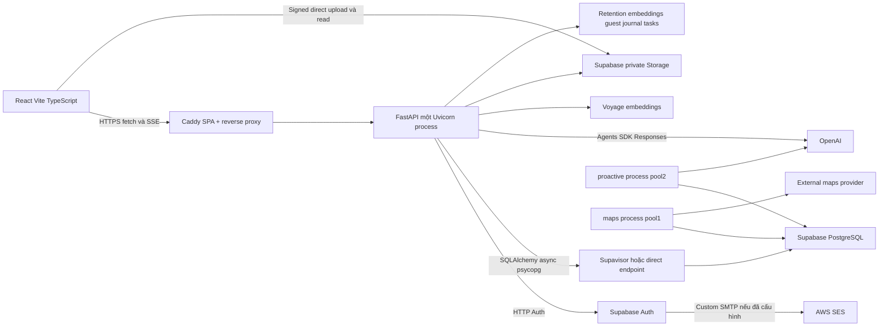

# Audit codebase hiện tại

Snapshot 05-11-2026, branch `feat/upgrade-user`, HEAD `0573af5b50c0584c523e5119755479fcf47fae74`. Báo cáo dựa code đọc trực tiếp, không chỉ README. [Executive](00-executive-summary.md), [capacity](02-capacity-and-bottleneck-analysis.md), [roadmap](08-implementation-roadmap.md).

## Phạm vi bằng chứng

**VERIFIED repository** khác **VERIFIED runtime**. Trong audit chỉ có loại thứ nhất và output local checks; không có snapshot deployment/cloud. Người dùng nói Supabase Pro đã mua và branch đồng bộ main; không biến thành xác nhận compute SKU hay prod SHA. Không đọc/xuất toàn bộ.env. Numeric/model allowlist local được kiểm chứng riêng; local settings không áp dụng ngầm cho production.

Git status trước audit:

```text
 M .gitignore
 M docs/implementation-plans/journal-intelligence-and-matching-removal/09-codex-prompt.md
 M frontend/evidence/test-results/.last-run.json
?? backend/runtime.txt
?? docs/implementation-plans/journal-intelligence-and-matching-removal/12-codex-release-prompt.md
?? docs/mvp-validation/
?? docs/plans/
?? docs/productization/
?? evidence/
```

Đã lưu hash của 52 tệp có thay đổi/chưa track trước audit trong bộ nhớ phiên để so sánh cuối; không lưu nội dung secret vào docs. Không tạo commit/fetch/push/merge. Các thao tác của audit chỉ ghi vào `docs/scale-readiness/`.

**Workspace thay đổi đồng thời:** tại kiểm tra cuối, 23/52 tệp baseline không còn tồn tại, gồm hai release prompts và 21 ảnh trong `docs/productization/screens/`; 29 tệp còn tồn tại có hash khớp baseline, trong đó có `.gitignore` và `backend/runtime.txt`. Nhiều tài liệu tracked khác cũng bị xóa ngoài phạm vi thao tác của audit. Audit không khôi phục, xóa tiếp hoặc sửa các thay đổi này. HEAD và branch vẫn giữ nguyên.

## Kiến trúc thực tế trong mã



Auth→SES là topology **đề xuất nếu custom SMTP bật**, cloud UNKNOWN. PostgreSQL qua pooler/direct phụ thuộc URL thực; `DATABASE_POOL_MODE` là metadata chứ không tạo topology. Runtime mặc định frontend riêng Caddy; FastAPI cũng có lựa chọn serve shell khác, không nhầm với Compose target.

## Inventory và audit matrix

| Khu vực đã đọc | VERIFIED AS-IS và bằng chứng | TO-BE / kết luận |
|---|---|---|
| Dependencies/build | `backend/pyproject.toml:6` Python≥3.12<3.13, FastAPI/SQLAlchemy/psycopg/Agents SDK pin; `backend/Dockerfile:1` Python 3.12.13; `frontend/package.json:29` React 19/Vite 7/TS | Giữ stack; dùng lockfile, không đề xuất thay framework |
| Process | `backend/app/__main__.py:9`, `:15`: một worker, trusted proxy qua FORWARDED_ALLOW_IPS; `:18` server grace 45 s | Không tăng workers để đạt benchmark; state RAM/auth limits phải được thiết kế lại trước |
| Auth flows | `backend/app/modules/auth/routes.py:232`, `:251`, `:307`, `:317`, `:327`, `:337`; `provider.py:164` | Provider Auth trước app provision; preserve upsert/locks/CSRF/enumeration; [03](03-supabase-auth-and-ses-plan.md) |
| Rate/CAPTCHA | `backend/app/modules/auth/routes.py:227`, `:228`; `backend/app/core/limits.py:8`; `provider.py:131`; frontend`useAuthCaptcha.ts:13` | IP 40/900 chung action, email 3/h/action, login 10/900; local RAM; antiabuse giữ nguyên cho tới policy review |
| HTTP/Auth | `backend/app/modules/auth/provider.py:139` tạo AsyncClient mỗi exchange | Client reuse SHOULD; 429/5xx/timeout mapping và cooldown MUST; benchmark impact chưa đo |
| Session/security | `backend/app/core/security.py:36`, `:84`, `:131`; `frontend/src/api/session.ts:21`; `routes.py:176` sessionview | App session hash/CSRF/revocation/provider active; tránh bỏ checks để giảm query |
| DB engine | `backend/app/infrastructure/database/connection.py:23`; `backend/app/core/config.py:104` | Async psycopg, prepare_threshold=None, pool default 5+2/timeout 10; Compose API 4+1; không phải asyncpg hiện tại |
| DB budget | `backend/app/infrastructure/database/budget.py:14`, `:43`; Compose`:10`,`:43`,`:75` | Calculator assumptions cũ thiếu Maps/all workers overlap; actual role limit UNKNOWN, reviewed SQL10 |
| Lifespan/jobs | `backend/app/main.py:72`, `:243`; `backend/app/jobs/retention.py:21` | Startup recovery, no migration startup; background dùng API pool; retention transaction nhiều bảng, cần batch theo đo |
| AI persistence | `backend/app/ai/persistence.py:419`, `:443` | Advisory lock và DB count global; không thuần semaphore RAM |
| AI runtime/provider | `backend/app/ai/runtime.py:138`, `:142`, `:763`; `backend/app/ai/provider.py:160`, `:290` | Local state/slot; client reuse, explicit retry bounds; provider request limit chưa có semantics thống nhất mọi origin |
| Financial ledger | `backend/app/ai/accounting.py:24`, `:94`, `:108`, `:129`, `:162` | Atomic reserve $2/row, cap min(config, 20), unknown liability giữ reserve; guard cần giữ khi tối ưu |
| Workflow fanout | `backend/app/ai/orchestration/workflow.py:72`, `:756`; `backend/app/ai/collaboration/coordinator.py:367`; `backend/app/ai/groups/turn.py:372` | Tổng model calls/turn có thể 7 V3/10 group; không đồng nghĩa tất cả song song. Children thêm rows/reserves |
| Proactive/search | `backend/app/jobs/proactive.py:331`; `backend/app/ai/proactive/policy.py:183`; `deploy/compose.staging.yml:37`, `:70` | Worker riêng, DB leases; vẫn chia sẻ provider/budget/DB; flags/dependency actual phải kiểm |
| Journal/embeddings | `backend/app/ai/journal_memory.py:298`; `backend/app/modules/journal/quota.py:47`; `backend/app/modules/journal/media_routes.py:29` | Journal model ngoài chat semaphore; embedding/voice/provider phụ có cost scope riêng; signed media tránh đẩy file lớn qua API |
| Hot data queries | `backend/app/modules/journal/routes.py:89`, `:99`; `backend/app/modules/social/retrieval.py:27`, `:137` | Journal COUNT+offset, discovery bounded 1000, shortlist 10; cần EXPLAIN dataset 1000/90 ngày, không kết luận thiếu index nếu chưa đo |
| SSE/protocol | `backend/app/ai/chat_routes.py:777`, `:806`, `:812`; `backend/app/core/streams.py:13`; `frontend/src/api/stream.ts:282` | Saved replay DB, peruser 6 slots/process, polling 0.25 s và policy 0.5 s; frontend fetch reader; cleanup/cancel khác nhau |
| Client-visible output | `backend/app/ai/provider.py:309`; `frontend/src/api/stream.ts:282` | Có progress/final validated, không raw token stream. Provider TTFT khác client first content, cần metric đúng |
| Deploy/proxy | `deploy/Caddyfile:20`; `deploy/aws/deploy.sh:180`; `.github/workflows/deploy-staging.yml:14` | flush-1, dial 5 s/header 120 s; Compose up recreate +rollback; không HA/zero-downtime |
| Release controls | `deploy/aws/README.md:32`; `.github/workflows/deploy-staging.yml:42`; `deploy/aws/release_gate.py:5` | Hold/provenance/CI exact main; audit không gỡ hold; maintenance HTTP không fence worker |
| Observability | `backend/app/main.py:96`, `:316`; `deploy/aws/cloudwatch-agent.json:6`; `deploy/aws/cloudwatch-alarms.json:3` | Base HTTP/DB/social SSE metrics và template alarms; thiếu measured TTFT/provider active/pool wait/credit/RSS proof |
| Tests/evals | `.github/workflows/verify.yml:43`, `:50`; `backend/evals/concurrency_live.py:110`; `scripts/provision_auth_test_accounts.py:30` | CI 10 synthetic users, live≤12, provision 2 admin confirmed; không chứng minh 1000/100 signup/50×15 phút |

Tên path rút gọn trong cùng row kế thừa prefix đầy đủ ở đầu row. Chi tiết SQL/index/RLS đọc trong [04](04-database-and-connection-pooling-plan.md); toàn bộ folder đã inventory nhưng audit không có khả năng chứng minh mọi endpoint production chỉ bằng static review. Không kiểm tra row PII/production data.

## Sáu giả thuyết được yêu cầu xác minh

| Giả thuyết | Kết quả |
|---|---|
| AUTH IP 40/900 | VERIFIED, dùng chung nhiều action; giới hạn NAT là hành vi policy thực |
| AI global default 50, semaphore local | VERIFIED cả hai, **bổ sung DB global admission đã có**; local.env cuối 10 |
| Compose API pool 4+1 | VERIFIED; core default 5+2, fixture 5+5, không được trộn |
| Role 20 | VERIFIED constant assumption, không VERIFIED cloud. SQL bootstrap 10, cần SELECT actual |
| API mem 768 m | VERIFIED hard limit Compose; chưa OOM/RSS 50 benchmark |
| Docs cũ 8+4 | VERIFIED `docs/backend/operations.md:26`; không khớp core 5+2/Compose 4+1. Ghi obsolete tại đây, audit không sửa tài liệu cũ ngoài scope |

## Kiểm chứng đã chạy trong audit

| Command/môi trường | Output thực | Ý nghĩa |
|---|---|---|
| `git branch --show-current`, `git rev-parse HEAD`, `git status --short` | Branch/SHA/status như trên | Baseline local; không fetch/deployed proof |
| `python -X utf8 scripts/check_docs.py` trước tạo bộ mới | PASS:183 Markdown, 1164 links, 144 API operations, 130 settings, 64 tables; exit 0 | Docs baseline không gãy link/inventory; không test performance |
| `python -X utf8 -m unittest discover -s deploy/aws/tests -v` trên native Windows Python 3.11 | Ran 19 tests, failures 10 sub cases, errors 1, exit 1 | Captcha helper Bash gọi`python3` gặp Microsoft Store alias; poller import`fcntl` Linux-only (`deploy/aws/poll_release.py:6`). Không suy ra runtime Linux bị bug; phải chạy CI/Linux toolchain |
| Scoped checks của bộ 12 docs | 89 local links và 252 dẫn chứng source `path:line` tồn tại, số dòng hợp lệ; không phát hiện credential pattern hoặc code fence mất cân bằng | PASS phạm vi bộ mới; kiểm tra line tồn tại không thay thế review ý nghĩa dẫn chứng |
| `python -X utf8 scripts/check_docs.py` cuối phiên | 107 Markdown, 581 local links; FAIL với 22 liên kết đến tài liệu cũ bị xóa đồng thời ngoài bộ mới | Không sửa link/tài liệu ngoài scope; full-repo docs check hiện không xanh |
| `git diff --check` | Exit0; Git cảnh báo LF/CRLF của browser evidence đã dirty trước phiên | Không chứng minh benchmark hoặc toàn bộ tests xanh |
| Hash compare cuối | 29 tệp còn tồn tại khớp baseline; 23 tệp baseline bị xóa đồng thời; không có tệp baseline còn tồn tại bị thay đổi byte | Không tuyên bố toàn bộ workspace giữ nguyên khi có thao tác đồng thời |

Không chạy backend pytests/benchmarks cần DB, không install package, không migration/reset DB, không live provider/cloud benchmark. Test source được đọc là evidence về assertion/guard, không phải test PASS. Các command future trong 03–07 là bàn giao, không được dùng làm run result.

## Ranh giới trách nhiệm

- CODEX: code/config/template chỉ sau nhiệm vụ implementation riêng, tests local disposable, không mở guard để vượt số.
- HUMAN: cloud facts/settings/quota/DNS/SMTP/backup/paid approval/deploy decision theo [09](09-human-action-checklist.md).
- UNKNOWN giữ NO-GO tương ứng; không được đóng gate bằng README, số user đăng ký hoặc 50 tab mở.
