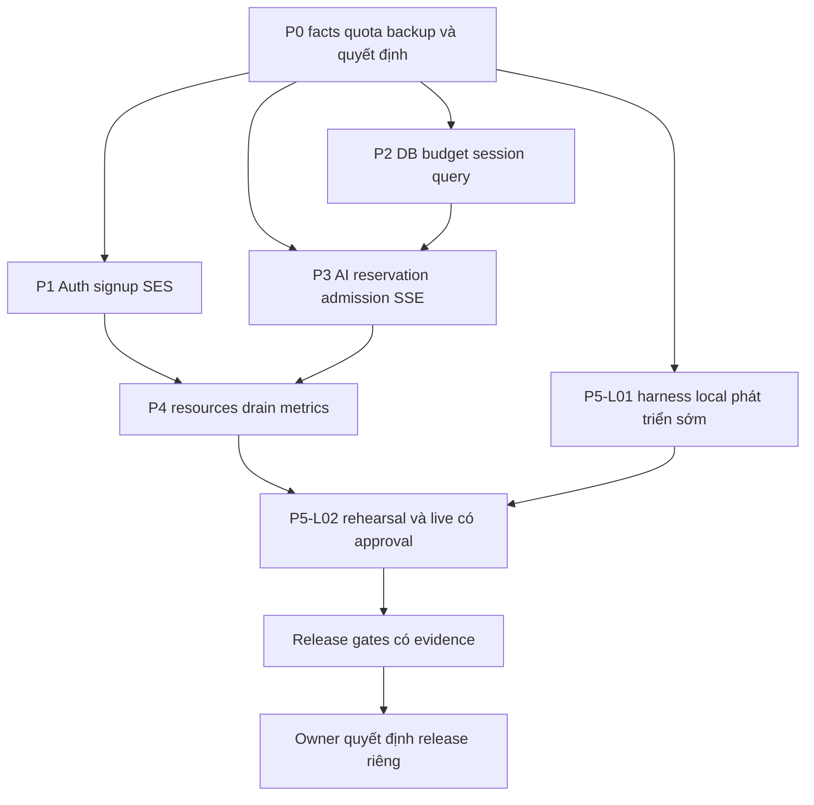

# Roadmap triển khai theo phase

> **Implementation, 2026-11-05:** Yêu cầu hiện hành cho phép local engineering và read-only cloud. Target AI toàn ứng dụng **$50/ngày**, chưa kích hoạt production; campaign staging tối đa **$3 tổng cộng**, chỉ `gpt-6-luna` generation, không judge API. D03/D05/D10/D12 đã được chấp thuận. Mỗi production mutation cần approval riêng. Các đoạn audit-only/$20/$5 bên dưới là baseline lịch sử. [Tiến độ](12-implementation-progress.md), [cloud](13-cloud-inventory-redacted.md), [approval proposals](14-owner-decisions-required.md), [kết quả](15-test-results.md) là nguồn cập nhật; release vẫn **NO-GO**.

> Dành cho người thực hiện: đọc [baseline](01-current-codebase-audit.md), [capacity](02-capacity-and-bottleneck-analysis.md) và task cards của từng chuyên mục trước khi sửa. Dùng `executing-plans` hoặc phương thức đã được owner chọn. Audit này chỉ tạo kế hoạch; mọi checkbox bên dưới chưa được thực hiện.

**Goal:** xác minh 1000 tài khoản đã xác nhận, 100 signup/60 giây ở cả hai mô hình IP, và 50 registered AI turns cùng 50 SSE trong 15 phút.

**Architecture:** tối ưu modular monolith trên một EC2, một API process; giữ Supabase Auth/PostgreSQL, SES qua custom SMTP, OpenAI Agents SDK và Docker Compose. Duy trì atomic DB admission, ledger, privacy và anti-abuse. Chỉ nâng hạ tầng sau khi metric chỉ đúng bottleneck.

**Tech stack:** React/Vite/TypeScript, FastAPI/asyncio, SQLAlchemy async/psycopg, Agents SDK, PostgreSQL/Supavisor, Caddy, Docker Compose.

**Spec:** [00](00-executive-summary.md) và workload/SLO trong [02](02-capacity-and-bottleneck-analysis.md); yêu cầu gốc là audit + planning của người dùng, chưa cho phép implementation/deploy.

## Ràng buộc chung

- Không tự sửa `.gitignore`; không đụng thay đổi chưa commit của người dùng.
- Giữ stack; không thêm Redis/Kubernetes/ECS/SQS/instance thứ hai khi chưa có metric chứng minh.
- Không đạt throughput bằng tắt CAPTCHA, email confirmation, RLS, session revocation, accounting hoặc đặt budget 0.
- Giữ policy trần 20 khi đang bật; thay reservation chỉ dựa bound được cưỡng chế trước dispatch, không theo average cost.
- UNKNOWN cloud settings giữ gate mở; không đưa secret, credentials, PII hoặc raw prompts vào docs/evidence.
- Test hosted/paid/email và deployment phải có authorization riêng đúng target/cost/scope trước thực hiện; không push/merge/deploy trong audit.

## Review focus

1. Cùng NAT có cả signup/login/resend: policy mới phải giữ brute-force/email-bomb protection, test thuộc P1-A02/A10.
2. Timeout sau khi provider đã nhận request: trạng thái unknown không tự retry/tạo email trùng, test thuộc P1-A06 và P3-I08.
3. Parent 50 cộng children/guest/background: giữ đúng provider slots và hard budget trong mọi interleaving, test P3-I02/I03/I06.
4. Reconnect hoặc mất consent/session trong stream: không replay dữ liệu không còn quyền, không bill lại, test P3-I05/P2-D08.
5. Crash giữa dispatch và usage hoặc overlap deployment: không hoàn tiền unknown hay vượt role budget, test P3-I08/P2-D02/P4-E02.

## Trình tự và phụ thuộc

P1/P2 và phần harness có thể phát triển độc lập sau khi contract đã chốt. P3 financial bound là rủi ro cao nhất, cần review riêng trước tăng admission 50. Đừng chờ hoàn tất mọi phase mới viết harness; một số dependency là feedback từ measurement, không phải vòng phụ thuộc không có điểm bắt đầu: P5-L01 skeleton/mock có thể làm ngay sau P0, rồi từng phase thêm case của mình.

## P0 — Production infrastructure prerequisites

### P0-H01 — MUST FIX / P0: xác minh nguồn sự thật của môi trường đích

**Owner:** HUMAN. **Problem/evidence:** target t3.large/Pro/SES không chứng minh compute, region, SMTP hay quotas; code budget assumption 20 khác SQL10 (`backend/app/infrastructure/database/budget.py:14`, `deploy/supabase/reviewed-sql/supabase-runtime-login-review.sql:8`). **Root:** thiếu snapshot deployment/cloud. **Target files:** ghi evidence đã scrub trong `docs/scale-readiness/09-human-action-checklist.md` và run manifest tương lai; không sửa runtime để lấy evidence. **Solution:** facts allowlist từ Console/read-only SQL.

- [ ] Thu H-S01/S 02/S 06, H-M01/M 03, H-E01/E 03, H-O01 trong [09](09-human-action-checklist.md).
- [ ] Ghi timestamp, project/instance fingerprint đã che dữ liệu nhạy cảm, exact deployed SHA/digest và resolved numeric settings.
- [ ] Tính lại connection budget, RPM/TPM, recipient rate và pending liability từ facts.
- [ ] Owner chốt NAT policy, context bound, RPO/RTO và workload mix; unresolved decision ghi [11](11-risks-and-open-decisions.md).

**Dependencies:** không có. **Tests/acceptance:** mọi field P0 có giá trị có nguồn hoặc ghi UNKNOWN và giữ gate; không dùng ảnh chụp secrets. Đối chiếu SELECT catalog read-only ở DB plan. **Complexity:** S/M, 0.5–1 ngày; quota request có thể nhiều ngày. **Risk:** chọn nhầm project/region. **Rollback:** không mutation; hủy snapshot sai và lấy lại. **Cost:** read-only không đổi resource; quota/resize chưa được thực hiện.

### P0-H02 — MUST FIX / P0: backup, restore và credential hygiene

**Owner:** HUMAN. **Problem/evidence:** backup/PITR/Storage recovery chưa chứng minh; scratch `backend/runtime.txt` chứa credential đã xuất hiện trong output đọc tệp. **Root:** thiếu recovery evidence và credential cần rotation. **Files:** `docs/scale-readiness/09-human-action-checklist.md`; runtime secrets trong vault/SSM, không commit vào repo.

- [ ] Thực hiện H-S08/S 09 và H-E02/E 06/E 08: xoay credential có phối hợp, kiểm credential cũ hết hiệu lực, không gửi giá trị vào chat.
- [ ] Xác minh backup mới nhất và snapshot EBS; test restore DB trên môi trường riêng, Storage có backup riêng.
- [ ] Ghi RPO/RTO đo được, owner và recovery steps; RPO 24 h nếu chỉ daily backup, RPO 15 phút cần giải pháp phù hợp có phí và rehearsal.
- [ ] Phân quyền runtime/migration riêng, không dùng owner connection cho API.

**Dependencies:** H01 xác định đúng target. **Acceptance:** recovery rehearsal có timestamp và check sum/count synthetic; không mất đường quản trị khi xoay secret. **Complexity:** M, 1 ngày + restore window. **Risk:** rotation làm gián đoạn DB/email; backup DB không chứa Storage bytes. **Rollback:** credential transition theo vault với thời gian overlap được kiểm soát; giữ backup cũ theo retention, không restore production tùy tiện. **Cost:** snapshot/PITR/storage/restore project.

### P0-H03 — MUST FIX / P0: bật các prerequisite đã review

**Owner:** HUMAN. **Problem/evidence:** custom SMTP, CAPTCHA, SES production access, alarms và OpenAI quota actual UNKNOWN; source templates chưa applied (`deploy/aws/cloudwatch-alarms.json:3`). **Root:** account configuration nằm ngoài code. **Files:** Console settings; redacted checklist 09; templates runtime hiện có chỉ sửa ở phase tương ứng sau review.

- [ ] Review plan 03/06, cấu hình SES identity/DNS/SMTP, CAPTCHA/redirects và rates theo H-M/H-S, giữ anti-abuse.
- [ ] Xác nhận provider model/RPM/TPM và spending alerts; không tự nâng budget.
- [ ] Chốt và apply CloudWatch sau khi P4-E03 tạo metric contract, kiểm alarm delivery.
- [ ] Chỉ cho hosted/paid test sau run manifest, cap, cleanup và approval cụ thể; không coi task này là blanket approval.

**Dependencies:** H01/H02; phần metric apply phụ thuộc P4-E03. **Acceptance:** checklist có evidence và smoke có approval; SES accepted/delivery và provider quota tách rõ. **Complexity:** M, 1–2 ngày cộng quota review. **Risk:** DNS/SMTP/permissions sai. **Rollback:** reviewed previous config, không xóa identity/suppression/backups hàng loạt. **Cost:** SES usage, CloudWatch, quota/compute nếu owner chọn.

## P1 — Auth/signup burst readiness

Task card đầy đủ, từng bước/test/rollback/cost tại [03](03-supabase-auth-and-ses-plan.md). Mức MUST/SHOULD/OPTIONAL được dùng thống nhất với MUST FIX/SHOULD FIX/OPTIONAL, không phải nhãn đã sửa.

| Checklist/task | Priority / owner | Deliverable và dependency chính |
|---|---|---|
| [ ] P1-A01 baseline Auth | P0 MUST / HUMAN+CODEX | Facts auth/SMTP và contract; P0-H01 |
| [ ] P1-A02 NAT admission | P1 MUST / CODEX, HUMAN policy | 100 legitimate NAT có thể đi tiếp; negative abuse vẫn chặn; A01 |
| [ ] P1-A03 trusted IP chain | P1 MUST / CODEX+HUMAN | Chứng minh proxy IP/upstream egress, không tin header client; A01 |
| [ ] P1-A04 provider client reuse | P2 SHOULD / CODEX | Bounded lifespan client, không chia sẻ mutable auth headers; A01 |
| [ ] P1-A05 errors/Retry-After | P1 MUST / CODEX | 429/5xx/timeout không enumeration; A01 |
| [ ] P1-A06 ambiguous retry | P1 MUST / CODEX | Unknown side effect không tự resend; A05 |
| [ ] P1-A07 provisioning | P1 MUST / CODEX | Upsert/row lock/partial failure không duplicate; DB plan |
| [ ] P1-A08 SES/custom SMTP | P0 MUST / HUMAN | Production access/quota/DNS/SMTP; H03 |
| [ ] P1-A09 email events | P1 MUST / HUMAN+CODEX | Accepted/delivery/bounce/complaint timeline; A08 |
| [ ] P1-A10 burst regression | P1 MUST / CODEX | T2/T3/Auth+AI mixed; A02…A09 |
| [ ] P1-A11 wait list/hook alter native | P2 OPTIONAL / HUMAN+CODEX | Chỉ xét nếu quota/policy không thể nhận burst; không thêm queue service mặc định |

**Exit:** T2 distributed và T3 NAT đạt business outcome 100 valid confirmed ở môi trường được phê duyệt; synthetic negative cases giữ anti-abuse. Nếu owner giữ 40/900, chỉ đóng security gate, không đóng NAT business gate.

## P2 — Database/session performance

Task card tại [04](04-database-and-connection-pooling-plan.md).

| Checklist/task | Priority / owner | Deliverable / dependency |
|---|---|---|
| [ ] P2-D01 cloud/role facts | P0 MUST / HUMAN | role/compute/pooler/region actual; H01 |
| [ ] P2-D02 budget all processes | P1 MUST / CODEX | API+proactive+maps+overlap+reserve calculator và tests; D01 |
| [ ] P2-D03 AI/SSE polling | P1 MUST / CODEX | Đo/giảm query load giữ revocation; D02 + telemetry |
| [ ] P2-D04 timeouts/locks | P1 MUST / CODEX | Bounded pool/statement/lock waits và error mapping |
| [ ] P2-D05 signup/first-login | P1 MUST / CODEX | Concurrent provisioning và session endpoint benchmark; P1-A07 |
| [ ] P2-D06 query/index | P2 SHOULD / CODEX | EXPLAIN theo profile 1000 users/90 ngày trước thêm index |
| [ ] P2-D07 retention batches | P2 SHOULD / CODEX | Session purge, batch jobs không giữ transaction dài |
| [ ] P2-D08 RLS/grants | P1 MUST / CODEX+HUMAN | Cross-user/privacy unchanged khi tối ưu |
| [ ] P2-D09 transaction pool canary | P2 SHOULD / CODEX+HUMAN | Chỉ đổi topology nếu đo tốt hơn; psycopg prepared-off |
| [ ] P2-D10 recovery/region | P0 MUST / HUMAN | DB +Storage restore, compute/RTT decision; H02 |

**Exit:** budget đúng actual role/server/pooler, no pool timeout dưới T4/T6/T7, p95 wait<100 ms, query/privacy tests và recovery evidence đủ. Không bắt buộc đổi session→transaction nếu session mode đã đạt.

## P3 — AI concurrency & streaming

Task card tại [05](05-ai-50-concurrent-chat-plan.md). Task P3-I07 và P5-L01 chia trách nhiệm: P5 sở hữu CLI/manifest/safety/metrics output; P3 cung cấp fake provider barrier, workflow fixtures và assertions. Chỉ có một CLI chuẩn `scripts/scale_readiness.py`; không viết hai harness cạnh tranh.

| Checklist/task | Priority / owner | Deliverable / dependency |
|---|---|---|
| [ ] P3-I01 resolved settings | P1 MUST / CODEX | Detect duplicate keys và config snapshot không secret |
| [ ] P3-I02 bounded reservation | P0 MUST / CODEX, HUMAN context policy | 50 chỉ admit khi upper bound thật đủ trong cap 20, child costs không double count |
| [ ] P3-I03 parent/provider admission | P1 MUST / CODEX | Global DB guard + bounded dispatch/fanout/fairness; I02 |
| [ ] P3-I04 metrics | P1 MUST / CODEX | Parent rows/calls/SSE/TTFT tách biệt; P4-E03 contract |
| [ ] P3-I05 SSE lifecycle | P1 MUST / CODEX | Replay/cancel/disconnect cleanup, không bill lại |
| [ ] P3-I06 background fairness | P1 MUST / CODEX+HUMAN | Guest/proactive/journal/embedding có scope quota/budget |
| [ ] P3-I07 fake 50×15 m fixtures | P1 MUST / CODEX | T4/T7 chuẩn, all real guards; P5-L01 shared harness |
| [ ] P3-I08 fault/accounting matrix | P1 MUST / CODEX | Crash/unknown/reconcile không over spend/refund bừa |
| [ ] P3-I09 quota/paid approval | P0 MUST / HUMAN | Model limits/pricing/test cap trước T5 |
| [ ] P3-I10 transport | P2 SHOULD / CODEX | Tối ưu transport sau khi đo, giữ bounded retries và cancellation |
| [ ] P3-I11 polling/lock pressure | P2 SHOULD / CODEX | Giảm polling có kiểm chứng, phối hợp P2-D03 và giữ authorization |
| [ ] P3-I12 multi-process | P2 OPTIONAL / CODEX + HUMAN | Chỉ xét sau single-process gate và thiết kế shared state/fencing |

**Exit:** fake 50 và real 50 đều đo đúng cohort, cap 20 invariant, provider RPM/TPM có headroom, loops/DB/SSE ổn định 15 phút; single/multi reported riêng. Không thay daily policy để đóng gate.

## P4 — EC2 deployment & observability

Task card tại [06](06-ec2-t3-large-deployment-plan.md).

- [ ] **P4-E01, P1 MUST, CODEX:** đo/chốt resource envelope; baseline 768 MiB không kết luận OOM khi chưa đo. Dependencies P2/P3 instrumentation và P5 harness.
- [ ] **P4-E02, P1 MUST, CODEX:** drain, deadline/grace, worker fencing, controlled recreate/rollback; không hứa HA/zero downtime.
- [ ] **P4-E03, P1 MUST, CODEX +HUMAN apply:** metrics/alarms CPU credits/RSS/TTFT/pool/provider/cost; verify actual delivery.

**Exit:** resource gates và alarm canary đạt; native Linux deployment unit suite xanh; rollback rehearsal có RTO/RPO thực. Một EC2 vẫn SPOF đã được owner chấp nhận.

## P5 — Load testing & release readiness

Task card/commands/scenarios ở [07](07-load-testing-and-benchmark-plan.md).

- [ ] **P5-L01, P1 MUST, CODEX:** CLI manifest +target/cost/cleanup guards, datasets T1–T8, future commands được implement trước khi dùng.
- [ ] **P5-L02, P1 MUST, HUMAN+CODEX:** local→target-size staging→approved real tests, reconcile actual spend, verification cleanup và final gate.

**Exit:** tất cả [release gates](10-release-readiness-gates.md) có evidence đúng SHA/dataset/config/environment, không còn P0/P1 MUST chưa xử lý; business exceptions phải được owner ghi rõ và không được gọi là đạt requirement gốc.

## Ước lượng và bàn giao

Ước lượng theo task là planning range, không cam kết lịch: P0 khoảng 1–2 ngày kỹ thuật cộng quota/DNS wait; P1 3–5 ngày; P2 3–6 ngày; P3 8–15 ngày do financial invariants; P4 3–5 ngày; P5 4–7 ngày có phần chạy sớm/song song. Không cộng cơ học thành deadline vì có overlap, dependency và external wait. Mỗi task đóng bằng test/evidence, code review và rollback cụ thể, không bằng đã sửa file.

Khi bắt đầu implementation: xác minh lại HEAD/status, đọc task card gốc, tạo regression test meaningful, chạy fail→minimal change→pass trên môi trường local disposable; review security/cost boundaries, rồi bàn giao thay đổi reviewable. Commit/push/deploy chỉ theo authorization riêng của phiên implementation, không tự suy từ roadmap này.
