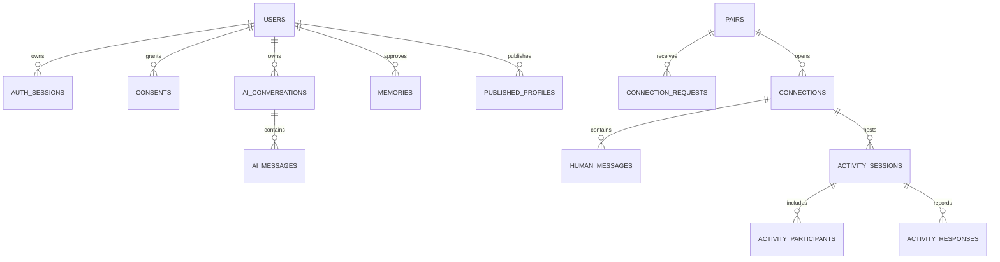

# Schema và quan hệ dữ liệu

ORM kế thừa `Base` trong [database/models.py](../../backend/app/infrastructure/database/models.py); application tables nằm trong schema `moodprint`. Migration tạo version table trong schema này. PostgreSQL là dependency thực: JSONB, locks, constraints và pgvector không được xác minh bằng SQLite.

## Nhóm bảng

| Nhóm | Bảng | Vai trò |
| --- | --- | --- |
| Account | `users`, `auth_sessions`, `age_declarations` | Auth subject, age/status, session hash, version |
| Consent | `consents`, `consent_events` | Purpose state/version và lịch sử thay đổi |
| Personal | `private_items`, `moods`, `memories` | Private profile, mood theo ngày, memory được duyệt |
| Write coordination | `idempotency_keys`, `outbox` | Receipts; outbox giữ compatibility, không delivery active |
| AI metadata | `ai_runs`, `ai_usage`, `ai_turns` | Run status/accounting, content-free coordination/policy stamps |
| AI history | `ai_preferences`, `ai_conversations`, `ai_messages` | Preference và transcript opted-in |
| Memory proposal/index | `memory_proposals`, `memory_embedding_jobs`, `memory_embeddings` | Pending approval và semantic retrieval có quyền |
| Publication | `matching_drafts`, `published_profiles`, `candidate_references` | Draft/preview/snapshot và opaque temporary refs |
| Social | `pairs`, `connection_requests`, `connections`, `human_messages`, `blocks`, `connection_reads` | Pair lifecycle, room, sequence, private read watermark |
| Aggregate | `matching_stats_daily` | Counters matching tổng hợp theo ngày/scorer |
| Shared activity | `activity_sessions`, `activity_participants`, `activity_responses` | State/version, membership và answers |
| Identity/safety | `identity_fields`, `reveal_access`, `reports`, `staff_roles`, `moderation_actions` | Private identity grants, evidence và decisions |
| Data lifecycle | `data_jobs` | Export/deletion job status |
| Guest trial | `guest_provisioning_attempts`, `guest_cleanup_jobs`, `guest_usage`, `guest_abuse_buckets`, `guest_operation_links` | Intent và correlation ngẫu nhiên khi tạo trial, lease dọn dẹp, bộ đếm trọn đời trial, security counter HMAC và ánh xạ thao tác trả phí tạm; owner-scoped ngoại trừ bucket mạng |
| Guest cost | `guest_budget_days`, `guest_cost_reservations` | Liability theo ngày không gắn user/run/provider/IP; không bị cascade khi purge guest |

Nguồn mở rộng: [guest models](../../backend/app/modules/guests/models.py), [AI models](../../backend/app/ai/models.py), [proposal](../../backend/app/ai/memory_models.py), [embedding](../../backend/app/ai/embedding_models.py), [social models](../../backend/app/modules/social/models.py), [activity models](../../backend/app/modules/activities/models.py), [moderation models](../../backend/app/modules/moderation/models.py), [data jobs](../../backend/app/modules/users/models.py).

## Quan hệ chính

Đây là logical view; kiểm tra FK/constraints trong ORM và migration khi thay schema. Một pair có hai user theo canonical low/high order, alias theo pair; không dùng alias để xác thực owner. `ConnectionRead` là state riêng của viewer, không lộ read marker sang peer.

## Invariants quan trọng

- App `users.id` và Supabase `auth_subject` có vai trò khác nhau; không giả định luôn bằng nhau. Synthetic fixture có thể dùng cùng UUID nhưng production login không bắt buộc như vậy.
- `ai_turns` chứa policy/version/digest/lease metadata, không raw temporary transcript. Persistent text nằm trong `ai_messages` theo opt-in.
- `published_profiles.payload` là snapshot public được validation; không join private items/moods/memory vào retrieval.
- Profile/consent versions được snapshot trong candidate refs, recheck trước thao tác. Ref 15 phút không miễn recheck trong thời gian còn hạn.
- Message `client_message_id`, room sequence và unique constraints bảo vệ dedup/order. Seq trả ra JSON dạng string.
- Vector model/dimensions và version của memory phải khớp authorization/index state; index tồn tại không đồng nghĩa được phép dùng.
- `users.account_kind` là `registered` (mặc định cho mọi dòng cũ) hoặc `guest`. Guest có `guest_started_at` và `guest_expires_at = guest_started_at + 7200 giây`; check constraint và trigger `users_lifecycle_immutable` chặn đổi/gỡ/nâng cấp kind hoặc deadline, trigger `auth_sessions_lifetime_cap` chặn session guest vượt deadline. Không có refresh, retry hay restart nào gia hạn được.
- `guest_budget_days`/`guest_cost_reservations` không có FK tới `users`: xóa mọi guest không mở lại ngân sách đã dùng.
- `auth.sessions`/`auth.users` thuộc provider. Test harness tạo synthetic tables chỉ trong DB local disposable.

## Runtime role

Role ứng dụng chỉ cần DML/sequence/function permissions theo reviewed SQL, không DDL hoặc quyền owner. Migration mới phải cấp quyền bảng mới theo review trước mở traffic. Không sửa SQL đã pin trong [reviewed-sql](../../deploy/supabase/reviewed-sql/README.md) để làm check hash đạt; thay đổi cần review/hash mới.

Xem [migration runbook](migrations.md) và [data lifecycle](../backend/data-lifecycle.md) cho retention/deletion.
