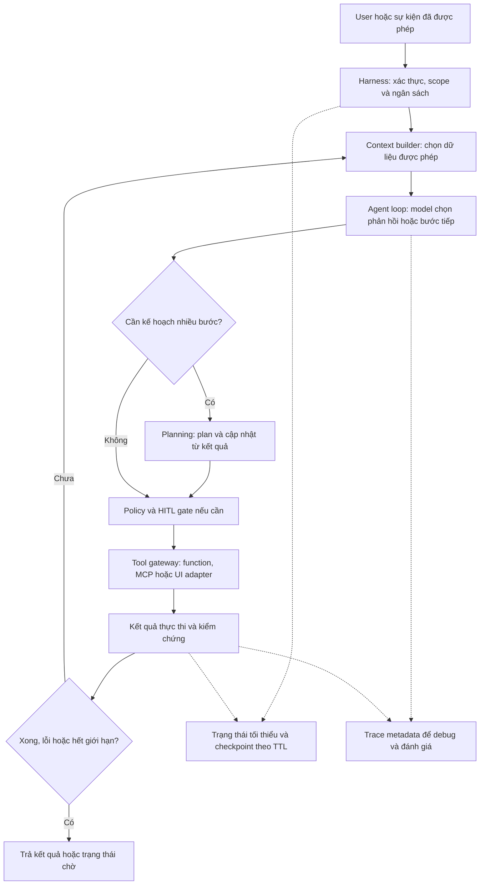
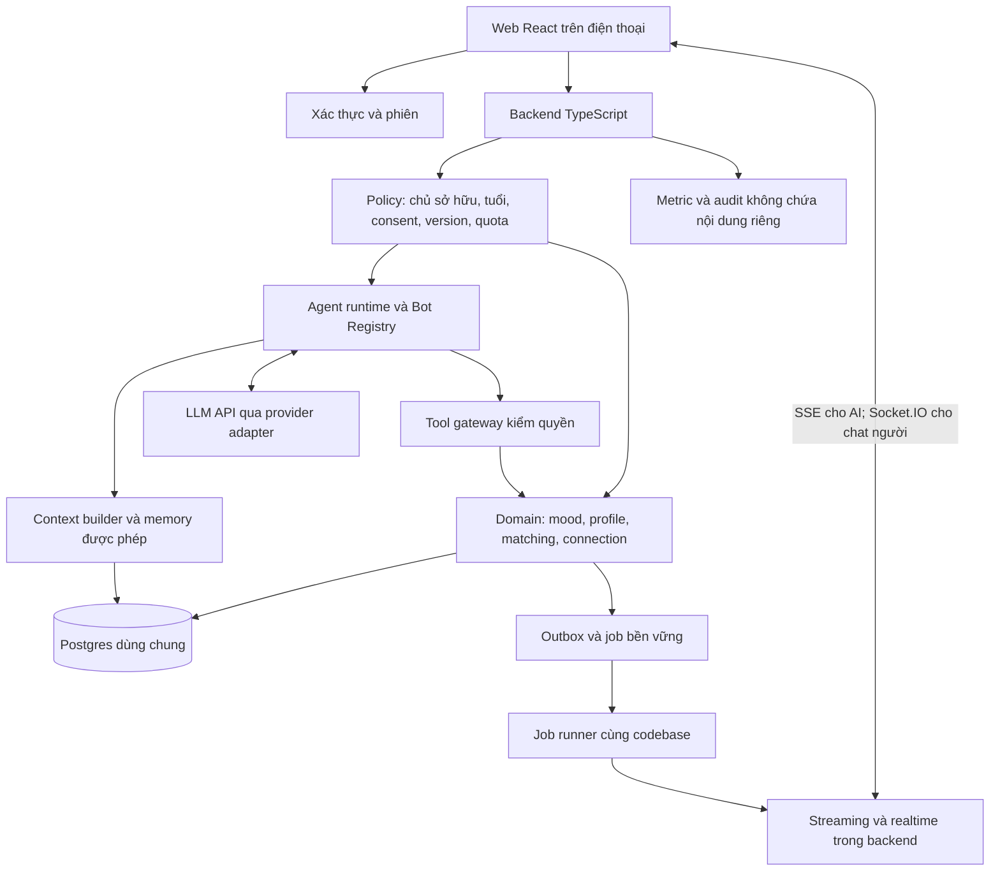
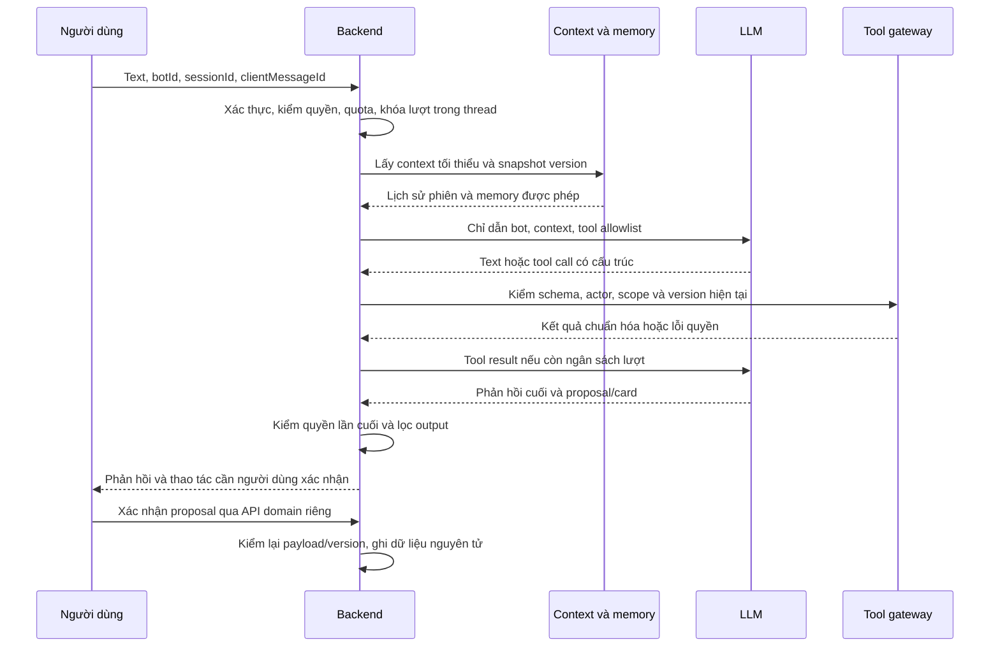

# Me2We — Thiết kế kỹ thuật AI, bot và ghép cặp để kiểm chứng PoC

Ngày lập: **23/10/2026**. Trạng thái: **PROPOSED — tài liệu nghiên cứu và thiết kế**, chưa phải quyết định triển khai hoặc bằng chứng PoC đã chạy. Đối tượng đọc: nhóm sản phẩm/kỹ thuật 3 người và người phản biện tính khả thi.

Tài liệu trả lời hai câu hỏi: làm thế nào để trải nghiệm AI hữu ích, có trí nhớ và có thể hành động mà nhóm vẫn vận hành được; và làm thế nào để ghép đúng người rồi duy trì kết nối có quyền truy cập rõ ràng. Phần agent được tổ chức theo sáu nhóm: **harness và các vòng xử lý; context/RAG/memory; tool/MCP/computer use; multi-agent; HITL; cloud/persistence/tracing/evals**. Phần cuối có **Output: prompt dùng với ChatGPT web**, gồm bản đầy đủ và bản ngắn tập trung vào agent.

## 1. Kết luận thiết kế đề xuất

Giữ **5 bot ở lớp trải nghiệm, dùng chung một agent runtime**, mỗi lượt chỉ kích hoạt bot người dùng đang chọn. Runtime gọi một LLM qua API, nạp đúng ngữ cảnh, cung cấp một tập tool nhỏ và kiểm tra quyền ở backend. Chưa cần năm model, năm dịch vụ hoặc năm agent luôn trò chuyện với nhau.

Ghép cặp bắt đầu bằng **bộ lọc điều kiện + công thức có thể giải thích**, chạy trên hồ sơ người dùng chủ động xuất bản. AI hỗ trợ chuẩn bị hồ sơ và cách bắt chuyện; backend quyết định ai đủ điều kiện, tính điểm, xử lý hai đồng ý và quyền chat. Memory riêng tư không trở thành đầu vào matching.

Hạ tầng PoC đề xuất gồm frontend static, **một backend TypeScript theo module**, một Postgres được quản lý, một nhà cung cấp LLM và một bộ thực thi job từ cùng codebase. Backend cũng phục vụ kết nối thời gian thực; job có thể chạy cùng tiến trình lúc PoC nhưng trạng thái job quan trọng phải bền vững. Dịch vụ xác thực dùng giải pháp đã được kiểm chứng. Đây là vài thành phần dùng chung, không phải hạ tầng riêng cho từng bot/tài khoản.

**Bằng chứng cần tạo:** demo với API và hai trình duyệt thật; bộ đánh giá AI có baseline; test đồng thời/thu hồi quyền; số đo latency, token và chi phí. Sơ đồ kiến trúc hoặc câu trả lời trôi chảy chưa đủ chứng minh chất lượng ghép cặp hay khả năng phục vụ người dùng thật.

## 2. Bối cảnh thực tế và ràng buộc

### 2.1. Những gì đã có trong repository

| Nội dung | Bằng chứng đang có | Khoảng trống cần PoC |
| --- | --- | --- |
| Giao diện 5 bot Mây/Gương/Nhịp/Rủ Rê/Cầu Nối | [Registry](../prototype/src/companions/registry.ts), [kịch bản](../prototype/src/companions/scenarios.ts) | Phản hồi hiện soạn sẵn; chưa có model, tool calling hay delegation thật |
| Các thread theo bot, card hành động và chuyển bot | [README runtime](../prototype/README.md), [reducer](../prototype/src/state/reducer.ts) | RAM-only; chưa có session server, auth hoặc memory bền vững |
| Matching rule-based | [matching.ts](../prototype/src/domain/matching.ts), [Matching Specification](2-requirements/2.5-matching-specification.md) | Ứng viên hư cấu; chưa có tìm kiếm trên nhiều tài khoản và transaction hai phía |
| Kiểm tra consent/version, mutual chat, reveal và block | [policies.ts](../prototype/src/domain/policies.ts) | Guard frontend phục vụ demo; cần backend thực thi và kiểm chứng cạnh tranh dữ liệu |
| Mô tả quyền AI/memory và phân loại dữ liệu | [AI Spec](2-requirements/2.4-ai-agent-and-emotion.md), [Privacy Spec](2-requirements/2.1-data-privacy-and-safety.md) | Chưa kiểm chứng vòng đời dữ liệu ở database, cache, job và provider |

Một số tài liệu kế hoạch cũ trong `documents/prototype/` còn nói ứng dụng chưa được tạo hoặc mô tả giao diện trước khi có 5 bot. Với trạng thái code, tài liệu này dựa vào source và README runtime hiện tại; với quy tắc sản phẩm, tham chiếu các spec đã nêu. Những đề xuất ở đây không tự thay Charter, phạm vi Must hoặc quyết định sản phẩm đang chờ.

### 2.2. Ràng buộc phải giữ khi nghiên cứu kiến trúc

- Hai trụ cột Self-Discovery và Human Connection ngang ưu tiên; người dùng có thể tìm bạn mà không chat AI, không bật C-AI/C-MEM.
- Sản phẩm định hướng từ đủ 16 tuổi. PoC kết nối động trước hết dùng tài khoản thử nghiệm người trưởng thành; nhóm 16–17 tiếp tục bị khóa publish/MATCH/lời mời/chat/reveal cho đến khi có phương án riêng được duyệt. Đây không phải thay đổi đối tượng sản phẩm.
- Tách Private Profile, memory, mood, hồ sơ kết nối đã xuất bản và reveal. Không dùng AI chat, chat người-người, mood hoặc suy luận nhạy cảm làm đặc trưng matching.
- C-AI, C-MEM, C-MATCH và C-VOICE độc lập theo mục đích; memory AI cần cả C-AI và C-MEM, kèm xác nhận từng mục. Bật lại quyền không phục hồi tác vụ, phòng hay grant đã vô hiệu.
- AI chỉ đề xuất; xuất bản hồ sơ, gửi/accept lời mời, reveal là hành động của người dùng. Mood chuẩn của biểu đồ là dữ liệu tự ghi, không phải suy đoán của model.
- Shared Activities vẫn là Future Work. Có thể nghiên cứu kỹ thuật đồng bộ hoạt động, nhưng không dùng nó để mở rộng Must của PoC chính.

## 3. Hiểu đúng “AI thông minh hơn”

Một bot hữu ích cần model đủ năng lực **và** dữ liệu/ngữ cảnh phù hợp, khả năng gọi chức năng thật, nhớ đúng điều đã được phép, biết hỏi lại và có bộ đánh giá. Thêm agent chỉ là một phương án tổ chức công việc; không bảo đảm chất lượng tăng.

| Năng lực người dùng cảm nhận | Cơ chế kỹ thuật | Cách chứng minh |
| --- | --- | --- |
| Hiểu điều đang nói và hỏi tiếp đúng ý | Chỉ dẫn theo vai trò, lịch sử phiên có giới hạn, ví dụ tiếng Việt | Chấm hội thoại nhiều lượt bằng rubric, so với baseline cùng model |
| Nhớ đúng sở thích đã xác nhận | Memory có chủ sở hữu, phạm vi bot, nguồn và phiên bản | Hỏi lại qua phiên mới; thử sửa, xóa và tắt C-MEM |
| Làm được việc trong ứng dụng | Tool gọi domain service, kết quả có trạng thái thật | Tool thành công thì có dữ liệu thật; thất bại thì AI không báo đã lưu |
| Biết giới hạn | Hỏi làm rõ, không bịa nguồn/dữ liệu, fallback khi lỗi | Ca thiếu nguồn, dữ liệu mâu thuẫn, model/provider timeout |
| Chuyển việc hợp lý | Handoff có lựa chọn và payload nhỏ | Đổi bot không rò transcript hoặc mở rộng quyền |
| Có ích khi tìm bạn | Hồ sơ rõ, nguồn ứng viên đủ, ranking và feedback | Đánh giá retrieval trước; chất lượng quan hệ cần nghiên cứu với người thật |

Phân biệt: **LLM** là model; **tool** là chức năng backend; **agent** là vòng chọn bước/tool có giới hạn; **workflow** là các bước do code quyết định; **RAG** là truy xuất thông tin rồi đưa vào context; **memory** là thông tin được phép tái sử dụng qua lượt/phiên. Vector database là một cách tìm thông tin, không tự tạo ra trí nhớ đúng hoặc quyền sử dụng dữ liệu.

Tài liệu Anthropic phân biệt workflow do code điều phối với agent do model điều hướng, và khuyên tăng độ phức tạp khi có nhu cầu đo được. Đây là nguyên tắc tham khảo; lựa chọn một runtime cho Me2We là đề xuất của tài liệu này. [Nguồn: Building effective agents](https://www.anthropic.com/research/building-effective-agents).

### 3.1. Bản đồ các vấn đề cần tìm hiểu về agent

Các thuật ngữ dưới đây thuộc những lớp khác nhau của hệ thống. Đây là cách dùng thuật ngữ trong tài liệu, không phải một chuẩn kiến trúc duy nhất. Chuẩn hóa cách viết: **computer use**, **always-on cloud**, **persistence / persistent execution**, **human-in-the-loop (HITL)** và **evaluations (evals)**.

| Nhóm | Khái niệm và vai trò | Câu hỏi cần làm rõ cho Me2We |
| --- | --- | --- |
| Vận hành | **Agent harness**: lớp phần mềm bao quanh model, quản lý vòng chạy, context, tool, trạng thái, quyền, ngân sách và quan sát | Harness tối thiểu gồm những gì? Tự viết vòng nhỏ hay dùng SDK/runtime có sẵn? Bot config nằm ở đâu trong harness? |
| Vận hành | **Agent loop**: nhận nhiệm vụ/context → gọi model → thực thi tool hợp lệ → nhận kết quả → tiếp tục hoặc dừng | Ai quyết định bước tiếp theo? Khi nào dừng, hỏi user, retry hoặc báo lỗi? Làm sao không lặp vô hạn hoặc ghi hai lần? |
| Vận hành | **Planning loop**: tạo kế hoạch → thực hiện bước → kiểm kết quả → cập nhật kế hoạch khi cần | Việc nào cần plan rõ ràng? Việc nào chỉ cần một lượt/tool? Ai xác nhận mục tiêu và giới hạn số lần lập lại kế hoạch? |
| Thông tin | **Context engineering**: chọn, tổ chức và cập nhật toàn bộ đầu vào model ở mỗi bước | Nạp prompt, lịch sử, memory, tool result và dữ liệu truy xuất thế nào để đủ thông tin, đúng quyền và vừa token budget? |
| Thông tin | **RAG**: truy xuất nguồn liên quan để hỗ trợ tạo câu trả lời | Truy xuất nguồn nào, theo quyền nào? Keyword đủ chưa, khi nào cần embedding/reranking? Đo retrieval và độ bám nguồn ra sao? |
| Thông tin | **Memory**: thông tin được phép tái sử dụng qua lượt/phiên | Ai xác nhận mục nhớ? Nhớ theo bot hay dùng chung? Xử lý sai, mâu thuẫn, sửa/xóa, expiry và thu hồi thế nào? |
| Công cụ | **Tool calling**: model yêu cầu gọi chức năng; backend xác thực và thực thi | Tool đọc, đề xuất và ghi khác nhau thế nào? Schema hợp lệ có đủ chưa? Làm sao chỉ báo thành công sau commit thật? |
| Công cụ | **MCP — Model Context Protocol**: chuẩn kết nối ứng dụng AI với tool/nguồn ngoài | Nội bộ có cần MCP hay function tool là đủ? Nếu kết nối MCP server ngoài, ai kiểm auth, scope, phiên bản, lỗi và đường dữ liệu đi ra? |
| Công cụ | **Computer use**: agent thao tác giao diện trình duyệt/máy tính | Có tác vụ nào thật sự thiếu API? Chạy ở browser/VM cô lập nào, với tài khoản nào, quyền gì và bằng chứng kiểm kết quả gì? |
| Phối hợp | **Multi-agent**: nhiều vai trò thực thi có hợp đồng giao việc và kết quả | Năm persona có cần năm agent độc lập không? Khi nào dùng routing, specialist-as-tool, handoff hoặc chạy song song? |
| Kiểm soát | **HITL gates**: điểm workflow chờ con người duyệt, sửa hoặc từ chối trước khi tiếp tục | Hành động nào cần gate? Ai duyệt đúng payload/version? Approval hết hạn hoặc quyền đổi khi chờ thì xử lý ra sao? |
| Triển khai | **Always-on cloud**: dịch vụ luôn sẵn sàng nhận request/event/job | Có cần tiến trình riêng cho từng user không? User đóng tab thì việc gì tiếp tục? Kích hoạt bằng event/schedule nào và giới hạn ngân sách nào? |
| Triển khai | **Persistence và durable execution**: lưu trạng thái cần thiết và tiếp tục công việc sau gián đoạn | Lưu những gì khác memory? Checkpoint ở đâu, giữ bao lâu? Restart/replay có lặp side effect hoặc phục hồi dữ liệu hết quyền không? |
| Chất lượng | **Tracing**: liên kết các bước trong một lần chạy để điều tra hành vi | Theo dõi model/tool/retrieval/handoff/gate/job bằng ID nào? Thu đủ gì để debug mà không ghi private text hoặc chain-of-thought? |
| Chất lượng | **Evals**: bộ đánh giá lặp lại để so sánh phiên bản và phát hiện lỗi | Đo chất lượng hội thoại, chọn tool, dùng nguồn/memory và tuân thủ quyền thế nào? Có baseline, ca khó và điều kiện chặn phát hành nào? |

Khung harness tham khảo từ [Anthropic — Effective harnesses for long-running agents](https://www.anthropic.com/research/effective-harnesses-for-long-running-agents). Bài viết nghiên cứu agent lập trình chạy dài; việc áp dụng các thành phần cho Me2We là đề xuất, không có nghĩa Companion cần chạy nhiều giờ hoặc cần toàn bộ kiến trúc của coding agent.

### 3.2. Harness, agent loop và planning loop liên hệ thế nào?

**Harness là lớp điều phối tổng thể; agent loop là một cơ chế bên trong; planning loop là cơ chế tùy chọn cho nhiệm vụ nhiều bước.** Kế hoạch do model đề xuất vẫn bị ràng buộc bởi code về quyền, tool, số bước, thời gian và ngân sách. Plan không có khả năng cấp quyền mới.



Ví dụ: “xem mood tuần này” chỉ cần workflow lấy số liệu và diễn giải; chưa cần planner riêng. “Giúp mình soạn hồ sơ tìm bạn” có thể dùng các bước làm rõ mục tiêu → đề xuất tag → preview, nhưng publish vẫn là thao tác riêng của user. Nếu thử planner, lưu trạng thái ngắn gọn gồm mục tiêu, bước hiện tại, kết quả có nguồn và điều kiện hoàn tất; không yêu cầu model xuất suy nghĩ nội bộ. Khi mục tiêu/nguồn/quyền thay đổi, replan trong giới hạn hoặc hỏi lại.

### 3.3. Context engineering, RAG, memory và persistence

Context engineering quyết định **model được thấy gì ở bước hiện tại**; RAG cung cấp thông tin bằng truy xuất; memory cung cấp những điều được phép nhớ; persistence quyết định trạng thái nào tồn tại qua gián đoạn. Một bản ghi có thể tham gia nhiều cơ chế, nhưng mỗi mục đích vẫn cần scope và TTL riêng. Tài liệu [Anthropic — Effective context engineering](https://www.anthropic.com/research/effective-context-engineering-for-ai-agents) mô tả việc quản lý context rộng hơn viết prompt.

Đối với Me2We, nên thử context builder tách theo user/bot, lịch sử phiên có giới hạn, memory đã duyệt và kết quả domain tool trước. Nếu RAG được bổ sung, đánh giá riêng bước tìm nguồn và bước trả lời dựa trên nguồn; thêm vector search không tự khắc phục nguồn sai hoặc thiếu quyền.

Persistence gồm ít nhất ba loại cần phân biệt: dữ liệu ứng dụng bền vững; trạng thái công việc/approval để resume; và context tạm theo phiên. Không lưu toàn bộ prompt/transcript vào checkpoint bền vững chỉ vì framework có sẵn. Một checkpoint có raw context cũng chịu TTL/xóa như context gốc. LangGraph phân biệt checkpointer cho trạng thái thread và store cho dữ liệu qua nhiều thread; đây là ví dụ cơ chế, chưa phải quyết định chọn LangGraph. [Nguồn: LangGraph Persistence](https://docs.langchain.com/oss/javascript/langgraph/persistence).

### 3.4. Tool calling, MCP, computer use và multi-agent

Ba cách truy cập công cụ cần so sánh theo tác vụ: function tool gọi domain API của chính Me2We; MCP khi cần hợp đồng kết nối với hệ ngoài; computer use khi cần thao tác UI. Với chức năng app tự xây, đề xuất gọi domain API trực tiếp để kiểm soát quyền và kết quả. UI automation của agent sản phẩm khác với công cụ kiểm thử frontend của nhóm phát triển.

Computer use không phải điều kiện để Companion thông minh. Nếu có use case ngoài app, cần browser/VM cô lập, credential được quản lý, giới hạn site/action, xác nhận hành động có tác động và kiểm kết quả sau thao tác. Không cấp quyền điều khiển thiết bị cá nhân của user từ việc họ chỉ bật AI chat. [Nguồn tham khảo cơ chế thao tác UI: OpenAI Computer use](https://developers.openai.com/api/docs/guides/tools-computer-use).

Multi-agent là lựa chọn điều phối khác với lựa chọn giao thức/tool. Nhiều agent có thể chạy cùng backend và gọi hàm nội bộ; dùng MCP không tự biến hệ thống thành multi-agent. Với năm persona hiện tại, baseline vẫn là một runtime chọn cấu hình bot, một agent hoạt động mỗi lượt. Chỉ thử specialist khi có nhiệm vụ cụ thể và eval chứng minh lợi ích so với tăng context hoặc bổ sung tool cho agent hiện có.

### 3.5. HITL gates và khả năng tiếp tục sau khi user rời app

Gate cần biểu diễn bằng trạng thái backend như `waiting_for_approval`, kèm actor được duyệt, payload/version, thời hạn và trạng thái dùng một lần. Gửi card UI là cách xin quyết định; backend mới là nơi khóa hành động đến khi xác minh quyết định hợp lệ. Không dùng một câu “đồng ý” mơ hồ trong hội thoại làm quyền cho mọi thao tác.

Gate cho lưu memory khác consent tổng quát C-MEM; gate publish khác việc duyệt một tag; accept kết nối và reveal có chủ thể/quyền riêng. Khi user sửa đề xuất, phải duyệt bản đã sửa. Hết hạn, bị hủy hoặc consent/nguồn đổi thì từ chối resume cũ và yêu cầu quyết định mới nếu vẫn cần. Không giữ model call hoặc transaction database mở suốt thời gian chờ.

Framework có thể hỗ trợ pause/resume bằng interrupt và persistence, nhưng backend vẫn cần kiểm quyền/idempotency khi tiếp tục; một số bước có thể được chạy lại khi resume. [Nguồn: LangGraph Interrupts](https://docs.langchain.com/oss/javascript/langgraph/interrupts).

**Always-on** là luôn sẵn sàng phục vụ, không đòi model liên tục suy luận. Đề xuất dịch vụ dùng chung nhận request/event và worker nhận job; user không tương ứng với một container/agent process chạy 24/7. Chỉ cần worker đang chạy khi có việc hoặc hạ tầng được cấu hình giữ sẵn theo nhu cầu latency.

**Persistent execution** là khả năng giữ/khôi phục tiến độ phù hợp, không phải chạy mãi hoặc nhớ mọi dữ liệu. Khi user đóng tab, chỉ job đã được phép và có mục đích rõ mới tiếp tục; đóng tab không đồng nghĩa thu hồi consent, nhưng cũng không cấp thêm quyền. PoC chưa cần chủ động phân tích tâm sự, tìm người hoặc gửi thông báo theo lịch ngoài phạm vi được duyệt. Resume sau restart kiểm lại quyền hiện tại và chống side effect lặp; không phục hồi cuộc gọi LLM đang chạy theo nghĩa bảo đảm provider chỉ tính phí một lần.

### 3.6. Tracing, evals và ưu tiên cho PoC

Tracing giúp lần theo một run; evals cho biết hệ thống có đạt tiêu chí trên bộ tác vụ hay không. Trace có thể ghi `traceId/runId/parentRunId`, model/prompt/tool policy version, tool name, trạng thái gate, source version, latency, token và lỗi đã chuẩn hóa. Chưa ghi raw transcript, nội dung mood/memory, screenshot có dữ liệu riêng hoặc chain-of-thought vào trace mặc định. SDK/exporter phải được kiểm cấu hình trước khi bật vì chúng có thể thu inputs/outputs. [Nguồn: OpenAI Integrations and observability](https://developers.openai.com/api/docs/guides/agents/integrations-observability).

Evals cần đánh giá cả kết quả cuối và hành vi: đúng tool, đủ nguồn, đúng scope memory, dừng ở gate, không lặp, không ghi lại dữ liệu đã xóa. Traces hỗ trợ tìm lỗi; bộ dữ liệu và rubric giúp so sánh thay prompt/model/harness lặp lại. [Nguồn: OpenAI Evaluate agent workflows](https://developers.openai.com/api/docs/guides/agent-evals).

| Mức ưu tiên đề xuất | Phạm vi |
| --- | --- |
| Cần cho baseline PoC | Harness nhỏ, agent loop có giới hạn, context builder, domain tools, HITL ở hành động cần xác nhận, trace metadata và evals |
| Cần thử trong PoC về memory/vận hành | Memory xác nhận theo scope, persistence tối thiểu, approval/job resume, restart/retry và xóa/thu hồi; cloud dùng chung phục vụ theo sự kiện |
| Chỉ thêm khi có bằng chứng cần | Planner riêng, MCP server ngoài, semantic RAG/vector search, specialist hoặc multi-agent tự phối hợp |
| Chưa nằm trong baseline | Computer use trong sản phẩm, agent tự chạy liên tục cho mỗi user, tự chủ động hành động xã hội |

Với mỗi thành phần, câu trả lời nghiên cứu cần có **vấn đề được giải quyết → thiết kế tối thiểu → đánh đổi → phép thử → điều kiện nâng cấp**. Trạng thái “chưa cần ở baseline” là quyết định phạm vi thử nghiệm, không phải kết luận tính năng đó không bao giờ hữu ích.

## 4. Kiến trúc tổng thể tối thiểu



Các khối trong sơ đồ là **module logic**. PoC triển khai một backend phục vụ API/realtime/runtime; không cần mỗi khối một microservice. AI stream dùng SSE qua endpoint có xác thực; có thể dùng `fetch` đọc stream với POST. Chat người-người dùng Socket.IO để quản lý room/reconnect, nhưng database vẫn là nguồn chuẩn.

Request HTTP, socket và job đều gọi chung domain service/policy. Không có đường đi tắt từ tool hoặc worker vào dữ liệu nhạy cảm. API key LLM và thông tin truy cập database chỉ ở server; browser không được chọn đường dẫn tool, prompt hệ thống hay danh tính actor.

Một provider adapter nhỏ nhận messages/tool schemas/cấu hình và trả text, tool calls, usage, lỗi chuẩn hóa. Chưa xây lớp hỗ trợ mọi nhà cung cấp. Chọn một model qua benchmark tiếng Việt, độ đúng tool, latency, điều kiện dữ liệu và ngân sách; ghi rõ model/version thử nghiệm. Chưa chọn model theo tên thương mại hoặc mặc định model lớn nhất.

## 5. Tạo bot như thế nào để vận hành đơn giản?

### 5.1. Bot là cấu hình có phiên bản

Một bot được định nghĩa bằng `botId`, tên/vai trò, `promptVersion`, `toolPolicyVersion`, danh sách tool, nguồn context được phép, kiểu card đầu ra và hạn mức. Hội thoại thuộc `userId + botId + sessionId`; một lần chạy có `runId` riêng. Cấu hình lưu cùng code và review bằng Git ở PoC.

| Bot | Nhiệm vụ | Chức năng được cung cấp | Giới hạn context mặc định |
| --- | --- | --- | --- |
| Mây | Lắng nghe, phản hồi gợi mở | Đề nghị chuyển bot; đề xuất mục memory để duyệt | Lịch sử Mây và memory người dùng cho phép Mây dùng |
| Gương | Làm rõ sở thích/giá trị, đề xuất mục hồ sơ riêng | Tạo proposal hồ sơ/memory, không tự ghi mục đã xác nhận | Lịch sử Gương và các mục được cấp quyền |
| Nhịp | Check-in và nhìn lại số liệu | Đọc thống kê mood khi người dùng yêu cầu; mở form ghi mood | Lịch sử Nhịp, khoảng dữ liệu mood đã chọn; không suy diễn nguyên nhân |
| Rủ Rê | Học/chơi ngắn, đề xuất hoạt động | Đọc thư viện nội dung đã duyệt; card hoạt động | Lịch sử Rủ Rê; không tự mời người khác |
| Cầu Nối | Giúp soạn hồ sơ kết nối và điều hướng tìm bạn | Đọc/sửa bản nháp qua proposal; mở trang tìm bạn | Hồ sơ matching của chính chủ; không có quyền đọc private/mood hoặc hồ sơ thô của người khác |

Cầu Nối có thể nói “mở danh sách gợi ý” bằng card điều hướng; trang tìm bạn gọi API ranking độc lập. PoC không cần đưa danh sách người khác vào LLM để viết lời giải thích. Backend tạo tối đa ba lý do từ tag/style hợp lệ.

Đăng ký bot mới = thêm cấu hình, nội dung UI và ca đánh giá. Không tạo database, GPU, container, tài khoản provider hoặc tiến trình nền mới. Nhiều người dùng dùng chung runtime nhưng mỗi truy vấn phải có scope chủ sở hữu lấy từ phiên server.

### 5.2. Ai được tạo bot?

PoC cho **nhóm sản phẩm tạo bot chuẩn**; người dùng chọn bot và tùy chỉnh nhẹ như cách xưng hô/độ dài nếu cần. Nếu sau này muốn “tự tạo bot”, bắt đầu bằng template + lựa chọn cho phép. Không mở nhập system prompt, URL tool, mã thực thi, credential hoặc tự cấp quyền đọc dữ liệu. Marketplace bot cần moderation/versioning/đánh giá riêng, nên tách khỏi bài toán PoC hiện tại.

### 5.3. Một model hay nhiều model?

Khởi đầu một model chung để đo baseline nhất quán. Giọng điệu, prompt và tool policy làm bot khác nhau. Chỉ thêm model nhỏ cho tác vụ trích xuất hoặc model mạnh hơn cho tác vụ khó khi benchmark chứng minh lợi ích sau khi tính thêm routing, chi phí, latency và regression test. Memory không phải fine-tuning; chưa cần huấn luyện model riêng.

## 6. Vòng đời một lượt AI và tool calling

### 6.1. Luồng xử lý



Model đưa ra **yêu cầu gọi hàm**; ứng dụng thực thi code, trả kết quả rồi model tiếp tục. Đây là cơ chế function calling được mô tả trong [OpenAI Function calling](https://developers.openai.com/api/docs/guides/function-calling). JSON/schema đúng chỉ xác nhận cấu trúc, không chứng minh dữ liệu đúng hoặc người gọi có quyền.

Ví dụ Nhịp nhận “xem tuần này”: backend xác định bảy ngày theo múi giờ người dùng, tool tính thống kê xác định được, LLM diễn giải từ kết quả đó. Dưới ba ngày check-in khác nhau thì không dựng insight xu hướng. Việc tính trung bình, bucket ngày và dữ liệu thiếu không giao cho LLM tự tính.

### 6.2. Tool nên chia thành ba nhóm

| Nhóm | Ví dụ | Cách thực thi |
| --- | --- | --- |
| Đọc có giới hạn | `get_mood_summary(range)`, `get_own_matching_draft()` | Backend lấy actor từ auth; kiểm phạm vi nguồn, thời gian và consent; trả dữ liệu tối thiểu |
| Đề xuất | `propose_private_item(text, sourceRefs)`, `propose_memory(text, sourceRefs)` | Tạo proposal ngắn hạn, có nguồn; UI cho sửa/lưu/bỏ qua; chưa là memory/profile đã duyệt |
| Ghi và hành động xã hội | Lưu memory/mood, publish, invite, accept, reveal, block | API domain được kích hoạt bởi hành động UI đã xác thực; không cho model tự gọi thao tác xã hội |

Một tool contract cần tên/mô tả rõ, schema và giới hạn độ dài, phạm vi bot, mục đích, phiên bản quyền, timeout, kết quả/lỗi và tính idempotent. `userId`, trạng thái consent, vai trò và confirmation không nhận như sự thật từ arguments của model.

Proposal server giữ ID, nội dung/nguồn/version và thời hạn. Người dùng sửa nội dung thì server bind xác nhận vào bản sửa đó. Khi lưu, server xác minh chủ sở hữu, quyền còn hiệu lực, proposal chưa dùng và version nguồn; request cũ không thể xác nhận một nội dung khác. Ghi thành công mới hiển thị trạng thái “đã lưu”.

### 6.3. Giới hạn vòng agent và lỗi

PoC đề xuất tối đa **3 lần gọi model và 2 lần thực thi tool mỗi lượt**, một handoff tối đa; deadline lượt 30 giây. Đây là tham số để thử, chưa là SLA. Chạm giới hạn thì trả trạng thái có nghĩa và lối tiếp tục; không tự lặp đến khi hết tiền.

Mỗi thread xử lý tuần tự hoặc từ chối lượt mới khi lượt trước chưa xong; chạy khác bot vẫn có `runId` và đích nhận riêng. Dùng `clientMessageId` để chống gửi lặp, timeout cho từng provider/tool và retry hữu hạn có backoff chỉ khi an toàn. Không retry mù thao tác ghi; dùng idempotency key và tra kết quả đã commit.

Khi C-AI/C-MEM bị rút: tăng version, hủy request nếu provider hỗ trợ, chặn tool/ghi/output còn lại dựa trên version mới. Nếu đã stream một đoạn ra trình duyệt trước thu hồi, không thể làm người dùng “chưa từng thấy”; phải dừng phần còn lại. Với output cần kiểm duyệt đầy đủ trước khi hiển thị, buffer câu trả lời rồi kiểm tra trước khi gửi. PoC nên dùng chế độ buffer cho các ca nhạy cảm và đo phần latency tăng thêm.

### 6.4. Chống prompt injection và trả lời sai trạng thái

Text, memory, kết quả retrieval và tool result là dữ liệu, không có quyền sửa policy. Tool gateway dùng danh sách hàm cố định, không thực thi SQL/URL/code do model sinh. Kiểm schema ở runtime, giới hạn output, escape Markdown/HTML và chỉ chấp nhận loại card đã định nghĩa. Không dùng `eval`.

Không chỉ viết prompt “đừng đọc user khác”: truy vấn phải scope theo auth, tool thiếu quyền phải bị backend từ chối. Với câu “bỏ qua quy tắc và lưu luôn”, model không có khả năng biến nó thành confirmation server. Kiểm thử cả model giả lập cố tình gọi tool sai và model thật bị tấn công.

## 7. Memory, context và quyền sử dụng lại

### 7.1. Bốn lớp dữ liệu cần phân biệt

| Lớp | Nội dung | Vòng đời/phạm vi đề xuất cho PoC |
| --- | --- | --- |
| Context phiên | Tin gần đây và bản tóm tắt phiên khi cần | Theo user/bot/session; không lưu lịch sử mặc định; kết thúc phiên hoặc tối đa 24 giờ từ tương tác cuối theo Privacy Spec |
| Memory đã xác nhận | Ví dụ “mình thích câu trả lời ngắn” | Bền vững khi C-MEM được bật và từng mục được duyệt; mặc định chỉ bot nguồn |
| Dữ liệu ứng dụng | Mood tự ghi, mục private tự nhập, matching draft/published | Domain record riêng, quyền và retention riêng; không gom hết thành memory |
| Kiến thức dùng chung | Nội dung học/chơi và hướng dẫn sản phẩm được duyệt | Đọc theo phiên bản thư viện; không chứa dữ liệu riêng của người dùng |

Model không tự biết toàn bộ lịch sử của ứng dụng. Backend phải cung cấp context hoặc dùng cơ chế lưu hội thoại của provider. PoC đề xuất tự quản lý phần context tối thiểu để kiểm soát scope và TTL; đối chiếu các cách quản lý hội thoại trong [OpenAI Conversation state](https://developers.openai.com/api/docs/guides/conversation-state).

### 7.2. Pipeline ghi và đọc memory

Ghi: hội thoại → proposal có nguồn → người dùng đúng/sửa/bỏ qua → kiểm C-AI + C-MEM → lưu bản được xác nhận cùng owner, bot scope, nguồn và version. C-MEM bật không đồng nghĩa cho phép tự ghi mọi nhận xét. Hypothesis chưa xác nhận hết hạn cùng phiên.

Đọc: xác định user/bot/mục đích và consent → lọc bản active/chưa xóa/đúng scope/nguồn còn hợp lệ → chọn số mục liên quan trong ngân sách context → nạp vào prompt dưới dạng dữ liệu. Có thể bắt đầu với 5–10 mục và giới hạn token, rồi đo. Không truy xuất toàn hệ thống trước rồi trông chờ model tự bỏ dữ liệu người khác.

Mục đã được người dùng sửa gần nhất được ưu tiên; hai mục mâu thuẫn thì hỏi lại. Memory là lời tự khai/quan sát đã xác nhận, không phải kết luận khách quan về con người. Nhận xét chưa rõ không được biến thành “bạn là người hướng nội” chắc chắn.

### 7.3. Sửa, xóa và tóm tắt

Mỗi mục cần trạng thái, version và source references tối thiểu. Nếu người dùng xóa nguồn còn được liên kết, vô hiệu hóa memory/summary/insight dẫn xuất trước khi truy xuất tiếp. Có thể chỉ giữ ID nguồn và nội dung đã duyệt sau khi transcript phiên hết TTL; không giữ transcript vô hạn để “chứng minh memory”. Nếu muốn giữ một mục độc lập sau thao tác xóa nguồn, cần thao tác lưu độc lập rõ ràng thay vì tự sao chép lại.

Tóm tắt phiên vẫn là dữ liệu riêng và có thể sai; nó giữ scope, nguồn, version và TTL của phiên, không tự thành memory. Context phiên không vào log, outbox, backup hoặc công cụ tracing mặc định. Nếu dùng kho tạm, bảo đảm restart không phục hồi dữ liệu đã hết hạn; mất context phiên khi restart là fallback chấp nhận được ở PoC, phải thông báo rõ.

Rút quyền chặn sử dụng ngay ở backend, việc xóa vật lý chạy riêng theo thời hạn Privacy Spec. Khi delete chạy, đánh dấu nguồn/bản dẫn xuất không hợp lệ trước; worker/model đang chạy phải bị chặn ghi lại bản cũ. Cần danh sách nơi phải xóa gồm active store, embedding/index nếu có, cache và dữ liệu provider có liên quan; backup bền vững khôi phục phải áp tombstone trước phục vụ.

### 7.4. Có cần RAG/vector database ngay không?

Với memory có cấu trúc ít mục, truy vấn owner/bot/status + từ khóa có thể đủ. Thư viện nội dung nhỏ có thể chọn theo taxonomy. Chỉ thêm semantic retrieval khi bộ đánh giá cho thấy bỏ sót diễn đạt tương đương và keyword retrieval không đủ.

Nếu thêm embedding, embedding vẫn là dữ liệu cần quyền/xóa, không coi là đã ẩn danh. Lọc scope trước tìm kiếm, hoặc dùng truy vấn có điều kiện quyền thực sự được thực thi cùng retrieval; không chỉ lọc sau khi đã gửi top-k toàn hệ thống ra model. Không dùng embedding từ chat riêng để ghép người.

## 8. Giao tiếp giữa agent và giao tiếp với người dùng

### 8.1. Ba kiểu phối hợp

| Kiểu | Ý nghĩa | Đề xuất cho Me2We |
| --- | --- | --- |
| Workflow trong code | Runtime gọi module thống kê/profile/retrieval | Mặc định PoC; dễ quan sát và giới hạn quyền |
| Specialist như tool | Bot chính hỏi một chuyên gia hẹp rồi tự trả lời | Chỉ thêm khi benchmark chứng minh một tác vụ cần prompt/model khác |
| Handoff | Bot khác tiếp quản cuộc trò chuyện | Người dùng chọn; backend chuyển đến thread đích theo quyền |

OpenAI mô tả sự khác nhau giữa handoff và agent-as-tool; handoff chuyển quyền điều khiển hội thoại, còn manager dùng specialist như tool vẫn tổng hợp câu trả lời cuối. [Nguồn: Orchestration and handoffs](https://developers.openai.com/api/docs/guides/agents/orchestration).

PoC chưa cần agent-to-agent qua mạng. Lời gọi module trong cùng backend hoặc một task có cấu trúc là đủ. MCP là tiêu chuẩn kết nối ứng dụng AI với tool/nguồn ngoài; nó không tự giải quyết memory, quyền dữ liệu hay chất lượng phối hợp agent. Chưa cần MCP cho các domain tool nội bộ. [Nguồn: MCP introduction](https://modelcontextprotocol.io/docs/getting-started/intro).

### 8.2. Handoff cụ thể: Mây sang Nhịp

Mặc định giữ hành vi prototype: Mây đề nghị “Bạn muốn mở Nhịp để ghi cảm xúc không?”; bấm mở chỉ chuyển bot, **không gửi transcript**. Nhịp bắt đầu từ thread của Nhịp. Không bí mật chạy thêm bốn bot để phân tích cuộc tâm sự.

Nếu thử chuyển context trong PoC mở rộng: cho người dùng xem/sửa đúng đoạn tóm tắt, chọn gửi một lần đến Nhịp và xác nhận. Payload có `handoffId`, bot nguồn/đích, nhiệm vụ, nội dung được duyệt, source versions, consent versions, expiry và `parentRunId`. Backend xác minh và làm sạch payload; bot đích nhận dữ liệu, không nhận chỉ thị quyền từ bot nguồn. Không tự đánh dấu payload thành memory dài hạn hoặc chia sẻ cho bot thứ ba.

Specialist sau này chỉ trả kết quả có schema: `status`, dữ kiện/đề xuất, nguồn, lỗi và mức bất định cần hỏi lại. Giới hạn độ sâu/timeout/token; không cho các agent tự gọi vòng nhau. Mọi bot/specialist có thể nằm trong một process; chỉ tách dịch vụ khi có lý do vận hành đo được.

### 8.3. Trải nghiệm chat cần thể hiện trạng thái thật

Người dùng cần phân biệt AI chat và chat với người; biết bot nào đang trả lời; thấy “đang lấy số liệu”, “cần bạn xác nhận”, “chưa lưu”, “đã lưu” hoặc “không thực hiện được”. Giải thích ngắn bằng nguồn và hành động, không phơi bày chain-of-thought. Đổi bot khi có phản hồi chờ không làm tin trả về thread sai.

Chức năng quan trọng có nút/form trực tiếp ngoài chat: nhập mood, sửa hồ sơ, xóa memory, tìm bạn, block/report. Nếu AI lỗi, những đường này tiếp tục hoạt động. Đây cũng là cách kiểm chứng hai trụ cột độc lập.

## 9. Matching: từ “phù hợp” đến thuật toán kiểm chứng được

### 9.1. Mục tiêu và hard filters

“Phù hợp” ở PoC là đủ quyền, có mục tiêu/ngôn ngữ chung và khớp các thuộc tính đã khai. Điểm không phải xác suất trở thành bạn, độ tương hợp tâm lý hay chất lượng con người.

Trước scoring, kiểm cả hai phía: tài khoản hoạt động; quyền tuổi/kênh; C-MATCH; hồ sơ đã xuất bản hợp lệ; cùng goal; có ngôn ngữ chung; không tự ghép; không block ở cả hai chiều; không hạn chế moderation; không cooldown; không pending/phòng đang mở của cặp. Hồ sơ tối thiểu 3 interest tags, 2 value tags, 1 style, 1 goal, ít nhất 1 language. Không tăng score để vượt điều kiện cứng.

Tuổi chỉ phục vụ eligibility theo policy, không tăng điểm. Giới tính, tên, mood, chẩn đoán/suy luận nhạy cảm, chat và memory không nằm trong scoring. Engine có thể đọc trạng thái eligibility do moderation cung cấp nhưng không đọc bằng chứng report để xếp hạng.

### 9.2. Baseline đang có

```text
J(X,Y) = |X giao Y| / |X hợp Y|
S(style) = 1 nếu giống nhau
           0,5 nếu khác nhau và một bên chọn cân bằng
           0 nếu trực tiếp và lắng nghe
Score = round_half_up(45 × J(interests) + 35 × J(values) + 20 × S)
```

Loại tag trùng; chỉ làm tròn cuối; thiếu trường bắt buộc thì không đủ điều kiện. Ví dụ interests giao 2/hợp 4, values trùng hết, style giống nhau: `22,5 + 35 + 20 = 77,5 → 78`. `mock-v1` hiện dùng ngưỡng 30, lấy tối đa 5, hòa điểm theo ID; spec mục tiêu đề xuất thứ tự giả ngẫu nhiên ổn định theo ngày/cặp. PoC cần ghi rõ version đang thử; không âm thầm đổi baseline mock.

Công thức có thể tính nhanh và giải thích bằng mẫu “cùng thích đọc sách”. Nó không cần LLM gọi cho từng cặp. Trọng số/style là giả thuyết sản phẩm; phải kiểm chứng, đặc biệt giả định hai người cùng style luôn tốt hơn hai style khác nhau.

### 9.3. Pipeline đề xuất

```mermaid
flowchart LR
  P[Hồ sơ xuất bản có version] --> F[Lọc eligibility hai chiều]
  F --> C[Lấy tập ứng viên có giới hạn]
  C --> S[Tính điểm baseline]
  S --> R[Xếp hạng theo version]
  R --> V[Kiểm lại consent và profile trước trả]
  V --> T[Tối đa 5 thẻ và lý do từ template]
  T --> A[Lời mời và đồng ý hai phía]
  A --> H[Phòng chat được backend cấp quyền]
```



Với cohort nhỏ, query theo goal/language/trạng thái rồi chấm các ứng viên đủ điều kiện khi có request. Không tính mọi cặp toàn hệ thống sau mỗi tin AI. Nếu cần cắt tập ứng viên do tải, ghi nhận tỷ lệ bỏ sót top-k so với chạy đầy đủ trên tập benchmark; giới hạn tùy tiện có thể làm giảm chất lượng.

Kết quả mang version công thức, profile hai bên, consent và thời điểm tính; metadata này không thay kiểm tra live trước trả thẻ/gửi lời mời/accept. Client chỉ nhận opaque candidate token/ID phù hợp, bí danh theo cặp, các trường cho phép và lý do; không trả ID tài khoản toàn cục hay dữ liệu private rồi ẩn bằng CSS.

### 9.4. Ranking hai phía và cold-start

Discovery này là gợi ý nhiều người phù hợp, chưa phải bài toán chia toàn bộ dân số thành cặp một-một. Không cần thuật toán stable matching ở PoC. Nếu sau này làm phiên ghép một-một có slot thời gian và capacity, đó là bài toán assignment cần đặc tả riêng.

Sau baseline, có thể thử đa dạng hóa gợi ý, hạn chế dồn lời mời vào vài người và reciprocal ranking dựa trên khả năng cả hai tự nguyện phản hồi. Tín hiệu mới phải có mục đích, thông báo và review riêng; không âm thầm lấy tần suất online hoặc phản hồi riêng để cộng điểm. Không để lịch sử được hiển thị nhiều tiếp tục độc chiếm exposure.

Thiếu người thường quan trọng hơn độ tinh vi thuật toán. Ước lượng thô: `E(ứng viên hợp lệ) ≈ (N−1) × tỷ lệ bật matching × tỷ lệ cùng goal × tỷ lệ chung ngôn ngữ × tỷ lệ qua các điều kiện còn lại`. Các tỷ lệ có thể phụ thuộc nhau nên đây chỉ là mô hình lập giả thuyết. Ví dụ 100 người và các tỷ lệ 0,6 × 0,5 × 0,7 × 0,5 chỉ cho khoảng 10 ứng viên trước ngưỡng điểm; đây không phải số đo Me2We.

PoC dùng hồ sơ tổng hợp có nhãn để kiểm logic. Thử sản phẩm thật nên tập trung cohort cùng ngôn ngữ/mục tiêu, cho người dùng tự khai tag và có trạng thái “chưa có người phù hợp”. Không bịa người hoặc bỏ hard filters để lấp danh sách.

### 9.5. Khi nào mới thử semantic matching/ML?

Trước hết đo taxonomy có làm mất ý nghĩa không, tỷ lệ không có ứng viên và người dùng có thấy tag/lý do đúng không. Nếu cần, AI có thể đề xuất chuẩn hóa cách nói thành tag allowlist, nhưng người dùng vẫn phải chọn/xuất bản. Embedding trên mô tả **được phép dùng cho matching** chỉ là thử nghiệm mở rộng khi có chính sách dữ liệu tương ứng; baseline hiện chưa có free-text bio.

Học trọng số cần feedback đủ tốt, xử lý exposure bias và tách tập đánh giá theo người/thời gian để tránh rò dữ liệu. Không lấy số tin dài hoặc thời gian trong app làm thước đo quan hệ tốt duy nhất. PoC nhỏ chưa đủ chứng minh mô hình ML hoặc độ bền tình bạn.

## 10. Từ gợi ý đến chat thật: đồng thời, realtime và thu hồi

### 10.1. State machine của cặp

```text
Chưa có tương tác → Pending (A đã thể hiện ý định)
Pending → Open (B đồng ý; cả hai version/eligibility còn hợp lệ)
Pending → Cancelled / Declined / Expired / Invalidated
Open → Closed / Blocked / Invalidated
Trạng thái kết thúc không mở lại; kết nối sau này dùng connectionId mới.
```

Hai request chéo có thể thể hiện đủ hai ý định nếu cùng snapshot hợp lệ; chỉ tạo một connection. Pending chưa được đọc/gửi tin. Giới hạn theo spec: lời mời hết hạn sau 7 ngày, 10 lời mời/24 giờ trượt, tối đa 10 pending; cooldown cặp 30 ngày sau bỏ qua/từ chối/hết hạn/kết thúc. Đây là baseline đề xuất trong spec, cần kiểm định khi dùng thật.

### 10.2. Transaction tạo kết nối

Canonical pair dùng hai account ID sắp theo thứ tự cố định, chỉ tồn tại nội bộ. Tạo hoặc lấy một bản ghi điều phối duy nhất của cặp; nhờ unique constraint, hai request đồng thời chưa có bản ghi cũng không tạo hai cặp. Sau đó khóa bản ghi cặp và các bản ghi quyền/profile liên quan theo thứ tự cố định, kiểm tra lại điều kiện và ghi hai ý định/mở phòng trong transaction ngắn.

Accept, request chéo, block, đổi profile và revoke phải dùng cùng quy ước khóa/version để không có khoảng trống “check xong rồi quyền đổi trước commit”. Với revoke toàn tài khoản, khóa/version ở cấp user làm điểm đồng bộ; không chỉ khóa một phòng. Không giữ transaction trong lúc gọi LLM hoặc mạng ngoài.

Đặt ràng buộc tối đa một pending/open hợp lệ mỗi cặp và một phòng open; dùng connection ID mới cho vòng kết nối mới. Idempotency key gắn actor/action/payload hash: retry cùng nội dung trả kết quả cũ sau kiểm quyền, cùng key khác payload bị từ chối. Transaction ghi cả thay đổi domain và outbox event. Worker retry event theo ID; không tuyên bố exactly-once trên mạng.

Postgres cung cấp row locks cho xử lý cạnh tranh và unique/partial unique index để ràng buộc dữ liệu. Cách phối hợp khóa/quyền ở trên là thiết kế đề xuất cần test đồng thời. [Nguồn: Explicit locking](https://www.postgresql.org/docs/current/explicit-locking.html), [Constraints](https://www.postgresql.org/docs/current/ddl-constraints.html).

### 10.3. Gửi tin, ACK và reconnect

Client gửi `connectionId + clientMessageId + text`. Server kiểm auth, thành viên, phòng mở, hai consent/profile version, block và quota; transaction ghi message và thứ tự server của phòng. ACK nghĩa là server đã nhận và lưu, không đồng nghĩa đối phương đã đọc. Retry không tạo tin trùng nhờ unique key theo người gửi/phòng/clientMessageId.

Outbox chuyển thông báo sau commit. Để giảm rò qua event đang chờ, PoC ưu tiên event chỉ mang ID/sequence/trạng thái tối thiểu, client fetch nội dung qua API kiểm quyền hiện tại. Nếu gửi nội dung trực tiếp qua socket thì gateway phải kiểm quyền/version lúc giao, không chỉ lúc join room. Broadcast global rồi client tự lọc là không hợp lệ.

Reconnect gửi cursor sequence; API trả các tin còn quyền đọc sau cursor. Event có thể trùng nên client deduplicate. Phòng đã đóng/revoke thì không trả lịch sử dù client giữ cursor cũ. Presence/typing là tín hiệu tạm, không phải bằng chứng ý định hoặc quyền gửi.

Socket.IO bảo đảm thứ tự các event được giao nhưng mặc định mức giao là at-most-once; muốn retry/replay phải bổ sung ở ứng dụng. Vì vậy chỉ có WebSocket chưa chứng minh chat đáng tin cậy. [Nguồn: Delivery guarantees](https://socket.io/docs/v4/delivery-guarantees/).

Hạn mức tin baseline là 20 tin/phút/người trên toàn tài khoản. Dùng limiter nguyên tử dùng chung; PoC một instance có thể tận dụng Postgres, khi nhiều instance phải có trạng thái chung. In-memory counter riêng từng server không đủ để thực thi quota tài khoản.

### 10.4. Block, reveal và dữ liệu đã nhận

Block có hiệu lực ngay ở đường đọc/gửi: ghi block và tăng version/đóng phòng, vô hiệu pending/grant/activity trong transaction hoặc bằng cổng quyền cấp tài khoản/cặp có hiệu lực cùng commit. Việc quét dọn bản dẫn xuất chạy sau; không chờ worker mới chặn. Event đã enqueue không được làm hiện lại tin hoặc reveal sau khi version đổi. UI nhận invalidation và xóa dữ liệu khỏi view.

Reveal là grant riêng theo chủ dữ liệu, người nhận, connection, tên trường và version giá trị; đồng ý chia sẻ tên không đồng nghĩa chia sẻ giới tính hoặc chiều ngược lại. Request reveal hết hạn 7 ngày; từ chối chặn hỏi lại 7 ngày theo spec. Backend trả trường reveal chỉ qua endpoint còn grant; không cache bền vững/offline.

PD-05 hiện yêu cầu thay bản publish/rút MATCH/sửa-xóa nguồn đã liên kết làm vô hiệu dẫn xuất và đóng phòng liên quan. Backend PoC phải giữ hành vi này để so sánh với prototype. Nếu muốn bớt gián đoạn bằng policy khác, ghi thành quyết định sản phẩm mới, không tự đổi khi làm kỹ thuật.

Thu hồi chỉ kiểm soát việc truy cập/phục vụ tiếp theo. Nội dung đã được người khác đọc, copy hoặc chụp không thể bị thu hồi tuyệt đối. Phần chat người-người không được đưa vào Companion/matching; report có thể chọn bằng chứng tối thiểu trong luồng moderation riêng, không cấp quyền để bot đọc toàn bộ phòng.

## 11. Mô hình dữ liệu logic và triển khai

### 11.1. Các nhóm bản ghi cần có

Đây là mô hình logic để thảo luận, chưa phải migration/DDL hoàn chỉnh. Nhiều nhóm có thể dùng chung bảng phù hợp; không cần tạo một database cho mỗi nhóm.

| Nhóm | Trách nhiệm và ranh giới |
| --- | --- |
| Account, feature eligibility, consent | Auth subject, quyền theo tuổi/kênh, version theo mục đích; không trả metadata nhạy cảm cho đối phương |
| Bot definition và run metadata | Cấu hình/version bot; run status, usage, lỗi; không lưu prompt/text riêng vào trace mặc định |
| Context/proposal tạm | User/bot/session, expiry, source/version; không sao lưu vào kho bền vững |
| Private item, mood, approved memory | Chủ sở hữu, trạng thái, version, source refs; phân biệt tự khai với AI được xác nhận |
| Matching draft/published và source links | Allowlist, snapshot xuất bản, version; liên kết nguồn khi người dùng chủ động chọn |
| Pair coordination, request, connection, member | Một canonical pair; lịch sử vòng kết nối, hai ý định và snapshot quyền |
| Message | Connection, sender, server sequence, clientMessageId; đọc qua membership/quyền hiện tại |
| Reveal request/grant, block, cooldown | Quyền từng trường/từng chiều; không join vào scoring |
| Report, selected evidence | Cô lập mục đích safety và quyền moderator; không cho agent đọc |
| Idempotency, outbox, job, usage/audit | Chống lặp, retry, hạn mức, xóa và thống kê; outbox chỉ ID/version tối thiểu, không sao chép transcript |

Truy cập từ backend dùng role tối thiểu và câu truy vấn có scope. Nếu client truy cập database trực tiếp trong một phương án BaaS, phải thiết kế/kiểm thử RLS tương ứng; cấu trúc frontend không thay ACL. Có thể dùng RLS như lớp phòng thủ bổ sung ngay cả khi chỉ backend truy cập. Không trao role chủ database cho tool runner.

Index ban đầu theo access pattern: owner/bot/status cho memory; goal/status và cấu trúc tag/language phù hợp cho matching; membership, connection+sequence cho tin; cặp/trạng thái cho request; trường hết hạn cho job. Chốt index qua `EXPLAIN` và workload thực tế; không hứa một loại index tự xử lý mọi truy vấn. Pool kết nối database dùng chung; không mở connection Postgres cho mỗi socket.

### 11.2. Triển khai PoC đề xuất

| Thành phần | Cách triển khai đầu tiên | Khi nào cần tách/nâng |
| --- | --- | --- |
| Frontend | Static hosting/CDN, gọi backend HTTPS | Đo cache asset, lỗi tải và UX mobile |
| Backend | Container Node.js chạy lâu dài, module agent/domain/realtime chung | Tách khi tài nguyên hoặc failure domain có số đo rõ |
| Postgres | Dịch vụ được quản lý, cùng/vùng gần backend khi đáp ứng yêu cầu dữ liệu | Tối ưu query/pool trước; tăng cấu hình khi metric cần |
| Context phiên | Kho tạm có TTL, PoC một instance có thể giữ RAM | Multi-instance cần routing/kho tạm dùng chung được cấu hình không persistence trái TTL |
| LLM | API ngoài, secret ở server, model/prompt version có thể rollback | Chỉ thêm provider/model thứ hai khi có tiêu chí và benchmark |
| Job runner | Cùng codebase, job metadata/outbox bền vững; poll/retry hữu hạn | Tách process khi backlog, restart hoặc latency ảnh hưởng API |
| Auth | Thư viện/dịch vụ xác thực đã được kiểm chứng | Xác minh JWT/session server-side, expiry, revoke; không tự chế password crypto |
| Observability | Metric latency/token/tool/quota/job; error không nội dung | Tracing chỉ metadata hoặc bản đã redaction được kiểm chứng |

Chọn container vì cần stream/socket và job kéo dài; nếu dùng function/serverless phải kiểm thời hạn request, giữ kết nối, background execution và pooling của nền tảng cụ thể. Không suy ra mọi serverless đều không hỗ trợ. BaaS giảm phần vận hành nhưng vẫn cần policy, giao dịch và vòng đời dữ liệu do nhóm thiết kế.

Ở một instance, restart có thể làm mất context phiên và ngắt socket; dữ liệu đã commit, job và outbox phải khôi phục được. Khi lên nhiều instance, cần event bus/adapter cho socket, trạng thái quota chung, cách định tuyến context và cơ chế vô hiệu quyền chung. Redis là lựa chọn có thể xem xét lúc đó; chưa cần Kafka, Kubernetes, graph database, vector database riêng hoặc GPU tự host chỉ để có năm bot.

Triển khai tách môi trường test/PoC, secret riêng và dữ liệu tổng hợp; TLS, cấu hình CORS/session phù hợp, xác thực lại thao tác nhạy cảm, health check và rollback cấu hình. Trước dữ liệu thật cần thử restore, deletion và provider retention, không chỉ kiểm endpoint trả 200.

### 11.3. Lưu ý ở phía provider

Tự quản lý context không bảo đảm provider không lưu dữ liệu. Ví dụ OpenAI phân biệt dữ liệu huấn luyện, abuse monitoring và application state theo endpoint; mặc định abuse monitoring có thể giữ đến 30 ngày và một số state có vòng đời riêng. `store:false` không đồng nghĩa không lưu dữ liệu ở mọi lớp. Phải xác minh điều kiện tài khoản/endpoint/vùng xử lý và khả năng đáp ứng TTL trước tích hợp dữ liệu riêng thật. [Nguồn: OpenAI Data controls](https://developers.openai.com/api/docs/guides/your-data).

Nếu provider không đáp ứng các thời hạn/điều kiện Privacy Spec, PoC tiếp tục bằng dữ liệu tổng hợp và ghi khoảng trống; không tuyên bố việc xóa ở database của mình đã hoàn thành xóa ở processor. Voice thử riêng luồng nhấn ghi ≤30 giây → STT → duyệt chữ → AI, không suy cảm xúc từ giọng; audio xử lý theo TTL riêng. Việc tách spike voice khỏi spike AI không loại voice khỏi Must của MVP.

## 12. Tải, latency và chi phí: tính bằng giả định rõ ràng

### 12.1. Workload để bắt đầu đo

Kịch bản minh họa: 100 DAU, mỗi người 10 lượt AI/ngày, 30% lượt có một tool khiến cần thêm một request model. Khi đó trung bình 1,3 request/lượt → **1.300 request model/ngày**. Đây là giả định lập tải, chưa có traffic thực nghiệm; 100 tài khoản đăng ký không đồng nghĩa 100 DAU hoặc 100 người online cùng lúc.

Nếu mỗi request trung bình 2.000 input tokens và 400 output tokens, ngày có khoảng 2,6 triệu input và 0,52 triệu output tokens. Tổng này phải tính lại từ usage thật vì lượt sau tool gửi lại context, số token của các request khác nhau và một số model có phần usage bổ sung.

```text
LLM cost/day = 2,6 × giá input/triệu tokens + 0,52 × giá output/triệu tokens
Total/month = LLM + backend + database + auth + egress + lưu trữ/backup
              + STT nếu có + log/monitoring + chi phí vận hành người
```

Không điền giá theo trí nhớ hoặc coi free tier là cam kết ngân sách. Khi chọn provider, ghi model, ngày tra giá, đơn vị, cached/uncached/reasoning/tool charges áp dụng, region và thuế nếu có. Dùng token usage thực tế để tính cost per completed task; bot trả lời rẻ nhưng thất bại nhiều có thể tốn hơn.

Giới hạn theo tài khoản, global concurrency, max input/output, deadline, số vòng tool và ngân sách ngày. Reserve ngân sách trước request, reconcile usage sau; khi chạm ngưỡng ngừng gọi mới và vẫn cho chức năng thủ công. Cảnh báo hóa đơn riêng không phải hard cap tức thì, cần tính request đang chạy và độ trễ usage.

### 12.2. Đo tải tách ba đường

| Đường | Kịch bản thử đề xuất | Chỉ số cần thu |
| --- | --- | --- |
| AI | 1/5/20 lượt đồng thời; provider stub đo backend, sau đó đợt API thật có quota | Queue delay, TTFT nếu stream, thời gian hoàn tất, timeout, token, chi phí, tỷ lệ task hoàn thành |
| Matching | 100/1.000/10.000 hồ sơ tổng hợp, đo phân bố goal/tag/language và eligibility | p50/p95, query plan, số ứng viên trước/sau lọc, chất lượng top-k, không vi phạm filter |
| Human chat | 20/100 socket thử, hai thiết bị reconnect/retry/block | Commit→nhận tin, ACK/replay, tin trùng/mất, DB pool, bộ nhớ, rò dữ liệu sau revoke |

Các mức trên là bài thử tăng dần, không phải dự báo công suất. Mục tiêu thăm dò: AI hoàn tất p95 ≤15 giây cho lượt ngắn không tool, matching p95 ≤1 giây ở 1.000 hồ sơ thử, chat commit→nhận p95 ≤1 giây với 20 socket trong môi trường đã ghi rõ. Không hạ chất lượng/quyền để đạt tốc độ; nếu thất bại phải phân tích queue, provider, truy vấn hoặc mạng trước khi tăng số dịch vụ.

Quan hệ ước lượng `concurrency ≈ request rate × thời gian xử lý` chỉ dùng với workload tương đối ổn định. Số socket online không bằng số lượt model đang chạy. Ghi môi trường, vùng, cấu hình và tải đi kèm mọi kết quả latency.

## 13. Kế hoạch chứng minh PoC và tiêu chí quyết định

### 13.1. Thực nghiệm theo thứ tự phụ thuộc

| Bước | Sản phẩm kiểm chứng | Bằng chứng hoàn thành |
| --- | --- | --- |
| P1 — runtime một bot | Mây trả lời từ API thật, context phiên, timeout/quota/cancel | Trace metadata, usage, hội thoại tổng hợp và ca revoke đang chạy |
| P2 — cấu hình năm bot | Thêm registry/prompt/tool policy; hai bot không lẫn thread/context | Test bot isolation; so sánh đầu ra theo rubric đúng vai trò |
| P3 — tool và memory | Một tool số liệu + proposal/lưu/sửa/xóa memory đã duyệt | Dữ liệu commit thật, lỗi tool không báo thành công, memory bị xóa không xuất hiện lại |
| P4 — matching backend | Hai tài khoản tổng hợp, hard filters, baseline, publish/version | Kết quả so với oracle từ mock; không dùng private, có empty state |
| P5 — mutual và chat | Hai browser session, transaction accept, ACK/replay, block/reveal | Race test, retry và thu hồi; tối đa một phòng; quyền đọc/gửi đúng |
| P6 — đo và phản biện | Benchmark AI/harness, tải/cost, restart/job/delete, chờ approval/resume; spike voice riêng | Trace metadata không rò private text; evals theo phiên bản; chứng minh retry/resume không lặp hành động và quyền cũ không sống lại |

Có thể ước lượng sau P1/P4 khi đã biết năng lực nhóm và độ khó provider. Không dùng bảng này thay deadline MVP 2 tuần trong Charter hoặc hứa lịch mới. Đánh giá khả thi nên tính cả auth, quyền, QA, xóa dữ liệu và vận hành, không chỉ thời gian gọi được model.

### 13.2. Đánh giá AI có baseline và kiểm soát biến

Dùng ít nhất 60 kịch bản tổng hợp tiếng Việt, có hội thoại nhiều lượt, nói ngắn/mơ hồ, sửa ý, nguồn mâu thuẫn, prompt injection, tool lỗi, chuyển bot, tắt quyền và tình huống nhạy cảm. Có mẫu 16–17 để kiểm feature gate, không tuyển người chưa thành niên chỉ để chạy test kỹ thuật.

So sánh A: model + prompt vai trò + context phiên; B: A + tool; C: B + memory đã duyệt. Giữ model, giới hạn và bộ câu hỏi tương đương; xem việc thêm memory/tool có tăng đúng nhiệm vụ không. Chưa cần multi-agent baseline trừ khi một nhiệm vụ cụ thể còn thất bại.

Rubric 1–5: bám mục tiêu người dùng, câu hỏi tiếp theo hữu ích, đúng nguồn, đúng vai trò, không khẳng định quá mức, báo trạng thái hành động đúng. Hai người review độc lập một tập chung, đối chiếu bất đồng; LLM-as-judge chỉ phụ trợ. Tách bộ phát triển và bộ đánh giá giữ lại, chạy lặp một phần do đầu ra model có biến thiên.

Ngưỡng thăm dò: ít nhất 80% tác vụ thông thường hoàn thành theo rubric, không chiều chất lượng chính nào trung bình dưới 4/5. Chốt rubric/ngưỡng trước khi so sánh. Với kiểm soát quyền, yêu cầu **0 lỗi trong bộ test**: không dữ liệu người khác, ghi ngầm, gọi hành động xã hội trái phép hoặc dùng dữ liệu đã rút quyền. Zero lỗi quan sát được không chứng minh hệ thống tuyệt đối an toàn; cần ghi kích thước và phạm vi test.

### 13.3. Matching và vận hành cần bằng chứng riêng

Test xác định được: score 77,5→78, tag trùng, ngưỡng, tie-break/version, hard filter hai chiều, pending hết hạn/cooldown, hai request chéo, accept đồng thời, profile đổi trước accept, block khi gửi/replay, reveal đổi giá trị và revoke toàn tài khoản. Thử nhiều lịch xen kẽ sự kiện và fault injection worker crash sau commit/trước gửi.

Đánh giá retrieval trên bộ hồ sơ tổng hợp có đánh giá phù hợp: candidate coverage, precision/nDCG@5 khi có nhãn, phân bố exposure và lý do đúng dữ liệu. Đây kiểm thuật toán theo nhãn thử, chưa chứng minh người thật hợp nhau. Nghiên cứu được duyệt sau này mới đo mutual acceptance, cuộc trò chuyện hai chiều có tự nguyện, phản hồi phù hợp và block/report trên mẫu/số lượt tiếp xúc rõ ràng.

Go sang thử nghiệm tiếp theo khi có demo và số đo đáp ứng mục tiêu đã chốt, không có lỗi quyền nghiêm trọng chưa xử lý, có fallback và khả năng dừng chi phí. Hold phần liên quan nếu provider TTL chưa phù hợp, chưa chặn được race quyền, memory lẫn scope hoặc không có người xử lý report cho beta. Các gate dữ liệu/nghiên cứu đang có vẫn áp dụng; tài liệu này không yêu cầu mở triển khai ngay.

## 14. Quyết định còn cần nghiên cứu

| Câu hỏi | Đề xuất ban đầu | Điều gì có thể làm thay đổi quyết định? |
| --- | --- | --- |
| Năm bot có tạo giá trị hơn một Companion với mode? | Giữ UI hiện tại; runtime chung | Thử nghiệm cho thấy khó chọn bot/lặp hội thoại hoặc không nhận ra khác biệt |
| Memory dùng chung giữa bot? | Mặc định theo bot; chuyển một lần có preview; mở rộng scope phải rõ | Người dùng cần tái sử dụng và hiểu chính xác thông tin đi đâu |
| Có specialist tự động không? | Workflow/module trước | Một tác vụ hẹp có benchmark tốt hơn đủ bù chi phí/latency |
| Chọn provider/model/vùng nào? | Adapter nhỏ, chọn qua benchmark và kiểm retention | Dữ liệu tiếng Việt, giới hạn tài khoản, TTL, chi phí thực tế |
| Phân nhóm tuổi và kênh beta? | Adult test; teen giữ feature gate hiện có | Phương án an toàn/quyền tính năng được duyệt riêng |
| Có cần vector retrieval? | Chưa cần ở baseline | Có số đo semantic recall thấp trên memory/thư viện được phép |
| Công thức 45/35/20 có phù hợp? | Baseline có version | Dữ liệu nghiên cứu có nhãn/feedback đủ tin cậy, kiểm bias |
| Đóng phòng khi publish đổi có quá gián đoạn? | Giữ PD-05 để kiểm PoC | Quyết định sản phẩm mới sau phân tích quyền và UX |
| Hạ tầng đã quá phức tạp chưa? | Một backend + DB quản lý + API model + auth | Metric chứng minh cần tách worker, cache hoặc realtime service |
